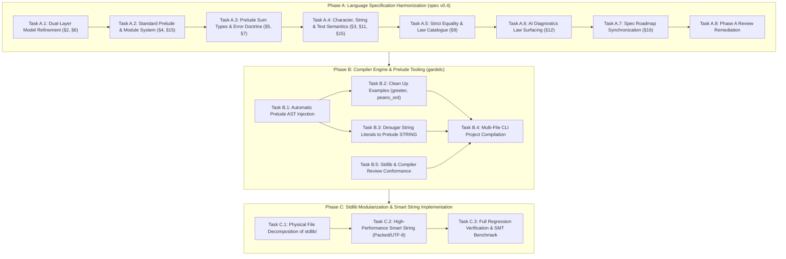

# Consolidated Gardel Architecture & Evolution Roadmap

**Date:** October 31, 2026  
**Status:** 🚀 **APPROVED & ACTIONABLE**  
**Preceding Milestones:** Completed Steps 1–4 (Foundations, `RESULT`/`OPTION`, Functional Core, Law Catalogue & Concepts)  
**Input Documents:**
- [stdlib_file_organization.md](stdlib_file_organization.md)
- [functional_ideas.md](functional_ideas.md)
- [Design Smart String.md](Design%20Smart%20String.md)
- [core_library.md](core_library.md)
- [core_library_vs_functional_ideas_review.md](core_library_vs_functional_ideas_review.md)
- [step1_remediate_stdlib_foundations.md](step1_remediate_stdlib_foundations.md)
- [step2_result_and_composable_option.md](step2_result_and_composable_option.md)
- [step3_verified_functional_core.md](step3_verified_functional_core.md)
- [step4_algebraic_law_catalogue_and_concept_conformance.md](step4_algebraic_law_catalogue_and_concept_conformance.md)
**Primary Artifacts Targeted:**
- `../spec/gardel_language_specification_draft_v0_4.md`
- `../gardelc/src/main.rs`
- `../stdlib/` (`stdlib.gdl` and modular subdirectories)
- `../examples/` (`greeter.gdl`, `peano_ord.gdl`, `bounded_stack.gdl`)

---

## 1. Executive Summary & Baseline

Over Steps 1 through 4, Gardel completed a major conceptual and verification overhaul of its foundation:

1. **Step 1 (Foundations):** Repaired `BIGNAT` (Horner polynomial `value_of` over radix $2^{64}$ yielding true `MATH_INT` values), `SEQ` ($O(1)$ subtree lengths, non-overflow preconditions on `concat`, eliminating truncation bugs), and `STRING` (inductive `all_bytes_valid` and invariant).
2. **Step 2 (Absence & Fallibility):** Added `RESULT[E, A]` with verified constructors, combinators (`map`, `map_error`, `and_then`), safe extractors, and composable `OPTION[A]` with 13 verified algebraic laws.
3. **Step 3 (Verified Functional Core):** Added canonical inductive `functions LIST_OPS`, divide-and-conquer parallel `module SEQ[A]` with full model-refinement postconditions against `LIST_OPS`, and pointwise `functions FUNCTION_OPS`.
4. **Step 4 (Law Catalogue & Concepts):** Standardized `concept EQ`, `CANONICAL_EQ refines EQ`, and `ORD refines EQ`, decoupled Leibniz structural equality (`=`) from behavioral equivalence (`.equals()`), proved comprehensive Monoid, Functor, Monad, Fold, and Order laws in `specify`, and indexed concept laws into `--json-diagnostics` for AI synthesis and repair.

This roadmap consolidates the architectural insights from our analysis into a unified, three-phase plan that aligns the language specification, compiler engine, and standard library.

---

## 2. Strategic Principles & Error Corrections

Our architectural review corrected five critical misconceptions that must govern all future work:

| Area | Previous Misconception | Corrected Architecture Principle |
| :--- | :--- | :--- |
| **Ontology of Types** | Treating `RESULT[E, A]` and `STRING` as primitive types in §3. | **`RESULT` and `OPTION` are Standard Prelude ADTs** (§5), defined using sum-type syntax. Primitives (§3) are strictly machine/SMT scalar types (`UNIT`, `U64`, `I64`, `F64`, `BOOL`, `CHAR`, `MATH_INT`). |
| **Physical vs. Verification Boundaries** | Using `group { ... }` as an ambient file wrapper for the entire stdlib. | **One module per file by default.** `group { A, B }` is strictly a verification and compilation barrier for **mutually recursive ADTs and co-inductive invariants**, not an arbitrary multi-module container. |
| **Standard Prelude** | Expecting user programs to duplicate stdlib definitions or fake `group` headers. | **Implicit Standard Prelude:** Core concepts (`EQ`, `CANONICAL_EQ`, `ORD`), prelude ADTs (`OPTION`, `RESULT`, `SEQ`, `STRING`, `BYTES`, `STRING_ERROR`, `IO_ERROR`, `BIGNAT`), and specification types/modules (`LIST`, `MATH_INT`, `LIST_OPS`, `FUNCTION_OPS`) are implicitly available in all user modules unless `--no-prelude` is passed (§4.1). |
| **Decoupled Text Model** | Tying `STRING` contracts to physical byte buffers (`SEQ[U64]` or `SEQ[U8]`). | **Three-Layer Text Architecture:** Logical Unicode scalar sequence (`specify chars: LIST[CHAR]`), opaque physical representation (`representation {NONE}`), and explicit boundary distinction between valid `STRING` and raw `BYTES`. |
| **Strict Equality Semantics** | Inconsistently using Leibniz `=` in contracts for quotient/collection types. | **Strict Equality Hierarchy:** Structural Leibniz `=` applies only to primitive types and types satisfying `CANONICAL_EQ`. Non-canonical types (`SEQ`, quotient `RAT`, `SET`) must use `.equals()` or ghost model equality (`a.model = b.model`). |
| **Dual-Layer Abstraction** | Treating model refinement as an ad-hoc trick for `SEQ`. | **Core Language Principle:** High-performance runtime data structures (trees, ropes, arrays) refine to inductive mathematical ghost models (`LIST`, `MATH_INT`, `LIST[CHAR]`). |

---

## 3. High-Level Dependency Graph



---

## 4. Work Breakdown Structure

---

### Phase A: Language Specification Harmonization (`spec/gardel_language_specification_draft_v0_4.md`)

**Objective:** Align the language specification draft v0.4 with the architectural breakthroughs of Steps 1–4 and the planning analyses.

#### Task A.1: Formalize Dual-Layer Model Refinement as a Core Language Principle (§2, §6) [✅ Completed]
- [x] Add **Principle 9: Dual-Layer Model Refinement** to §2.
- [x] Define how high-performance, divide-and-conquer runtime data structures (such as `SEQ[A]`, `BIGNAT`, and `STRING`) are paired with inductive mathematical ghost models (`LIST[A]`, `MATH_INT`, `LIST[CHAR]`).
- [x] Specify that runtime operations establish abstraction refinement postconditions (`Result.model = MODEL_OPS.op(Current.model, ...)`), enabling simple structural induction in SMT while executing in parallel on BendRT.
- [x] Update §6 to document how ghost models interact with hereditary representation invariants.

#### Task A.2: Specify the Standard Prelude & Multi-File Architecture (§4, §15) [✅ Completed]
- [x] Formalize the **Standard Prelude**: types/modules (`OPTION`, `RESULT`, `SEQ`, `STRING`, `BYTES`, `STRING_ERROR`, `IO_ERROR`, `BIGNAT`, `LIST`, `MATH_INT`, `LIST_OPS`, `FUNCTION_OPS`) and concepts (`EQ`, `CANONICAL_EQ`, `ORD`) are automatically in scope for all modules unless `--no-prelude` is active.
- [x] Re-scope `group { A, B }`: define it strictly as a **mutual-recursion verification unit** for interdependent types, not an ambient file container.
- [x] Establish the **one-module-per-file** physical convention (`W0201`) with globally unique top-level module names.
- [x] Update §15 (Grammar) to clarify top-level compilation units.

#### Task A.3: Standardize Prelude Sum Types & the Error Handling Doctrine (§5, §7) [✅ Completed]
- [x] Elevate `RESULT[E, A]` alongside `OPTION[A]` in §5 with its standard definition:
  ```eiffel
  module RESULT[E, A]
  representation {ANY}
    | Error(err: E)
    | Ok(val: A)
  ```
- [x] Formulate the **Error Handling Doctrine** in §7:
  - **Preconditions (`require`):** Enforce programmer contracts and type invariants. A violation indicates a bug rejected statically by the verifier.
  - **Fallible Values (`RESULT[E, A]`):** Represent expected domain failures and untrusted boundary data. Total functions return `RESULT` without exceptions.
  - Detail `and_then` chaining for composable, railway-oriented monadic pipelines without special language syntax.

#### Task A.4: Define the Three-Layer Text Model & String Literals (§3, §11, §15) [✅ Completed]
- [x] Define the text hierarchy in §3:
  1. `CHAR`: 32-bit Unicode scalar value primitive (`uint32_t`).
  2. `STRING`: Opaque prelude ADT (`representation {NONE}`) with ghost model `specify chars: LIST[CHAR]`.
  3. `BYTES`: Raw untrusted byte sequences at I/O and boundary interfaces.
- [x] Specify in §3 and §15 that string literals (`"..."`) desugar into verified `STRING` values whose `chars` model matches the sequence of Unicode scalar values.
- [x] In §11 (IO), specify boundary decoding: `STRING.from_utf8(bytes: BYTES): RESULT[STRING_ERROR, STRING]`.

#### Task A.5: Standardize Strict Equality Semantics & Law Catalogue (§9) [✅ Completed]
- [x] Codify the three levels of equality in §9:
  1. **Structural Leibniz Equality (`=`):** Permitted only for primitives and types conforming to `CANONICAL_EQ`.
  2. **Behavioral Equivalence (`a.equals(b)`):** Required for all types conforming to `EQ`, including non-canonical/quotient types (`SEQ`, `BIGNAT`).
  3. **Ghost Model Equality (`a.model = b.model`):** The standard method for stating contracts on non-canonical types against canonical mathematical models.
- [x] Clean up contracts in §8 and §14 to eliminate accidental Leibniz equality assertions on collection types.
- [x] Incorporate the Bird & Wadler algebraic law catalogue (Monoids, Functors, Monads, Folds, Orders) as normative concept laws.

#### Task A.6: AI Diagnostic Law Surfacing in `--json-diagnostics` (§12) [✅ Completed]
- [x] Specify how `gardelc --json-diagnostics` indexes in-scope concept laws and catalogue lemmas and emits them in `relevant_lemmas`.
- [x] Document how AI coding agents utilize these indexed laws for program derivation and automated proof repair.

#### Task A.7: Synchronize Specification Roadmap (§16) [✅ Completed]
- [x] Mark Steps 1–4 as locked/completed in the v0.4 roadmap table and preserve Compiler & Verification Phases 0–4 (§12, §13).
- [x] Align Phase 4 standard library milestones (Steps 1–4 + Consolidated Evolution Phases A–C) with the consolidated plan.

#### Task A.8: Phase A Review Remediation (spec) [✅ Completed]
Source: [review/review.md](review/review.md). The verification notes for each finding are appended to that file.
- [x] §6.4.C `STRING`: restated the bootstrap as the ASCII subset of UTF-8 (`bs.head < 128`); `decode_utf8` now has a precondition, uses `CHAR.from_scalar`, never drops bytes, and proves `same_length`; added `law decode_injective` (justifies `equals` and `code_point_count`) and `specify {EQ}`.
- [x] §3.1: added `CHAR.from_scalar(n): CHAR` with a `valid_scalar` precondition.
- [x] §5: `OPTION.equals` / `RESULT.equals` postconditions are case-wise; `Result = (Current = other)` stays only in `specify {CANONICAL_EQ}`.
- [x] §3, §4.1, §6.4.B: `BIGNAT` limbs are `LIST[U64]` everywhere; `LIST` has dual runtime/ghost status (only `MATH_INT` is ghost-only); documented little-endian limb order and the misleading `push_high_limb` name.
- [x] §6.4: marked the `SEQ`/`BIGNAT` listings as abridged and documented the Visibility Rule 3 bootstrap deviation as non-normative.
- [x] §7.2.2: `err_spec` uses `.equals(...)`. §12: `combine_trees` gains a `fits` precondition; fold-singleton tags fixed to `.single_folded`.
- [x] §11: added `module IO_ERROR` (provisional) and the `BYTES` public surface.
- [x] §15: `LawDecl` parameters are optional; added `"()"` to `Type`.
- [x] §16.3: removed the false hereditary `size_eq` invariant claim for `SEQ`; corrected law names.

---

### Phase B: Compiler Engine & Prelude Tooling (`gardelc`)

**Objective:** Upgrade `gardelc` to support the standard prelude and multi-file compilation so user programs no longer need to copy-paste library code.

#### Task B.1: Automatic Prelude AST Injection in `gardelc` [✅ Completed]
- [x] In `gardelc/src/main.rs`, update file parsing:
  - [x] When compiling any user `.gdl` file, automatically merge the parsed standard prelude AST (`phase4_stdlib_source()`) into the symbol table, concept map, and Boogie verification context. (Prelude concepts are merged into the concept map and prelude modules into the program symbol table; each user module's Boogie file receives the namespaced background theory (`OPTION__*`, `SEQ__*`, ...) of the referenced prelude ADTs: sorts, constructors, routine functions, definitional/contract axioms, routine-precondition predicates and trusted law markers. No prelude `Verify_*` procedure is re-emitted, so prelude obligations are not re-proven; their contracts/laws are trusted on the strength of `gardelc --stdlib --strict`.)
  - [x] Skip prelude injection when `--no-prelude` or `--stdlib` bootstrap mode is passed, or if the file being compiled *is* the standard library itself (avoiding duplicate symbol errors, §4.1).
  - [x] `E0101: duplicate_prelude_symbol`: in prelude mode a user top-level module / `functions` / `program` / concept named like a prelude identifier is a fatal error. (`examples/greeter.gdl` and `examples/peano_ord.gdl` reported E0101 until Task B.2 removed their embedded prelude copies.)
  - Known limits (follow-ups): `STRING` stays mapped to the built-in `GardelString` literal sort until Task B.3; `LIST_OPS`/`FUNCTION_OPS` remain realized by the built-in `Seq_*`/`Fn1_*` preamble theories; prelude calls are routed by a best-effort local type inference (receivers whose type cannot be inferred resolve only when the routine name is unique among the injected modules).

#### Task B.2: Clean Up Example Programs [✅ Completed]
- [x] Refactor `examples/greeter.gdl`: remove redundant copies of `OPTION`, `SEQ`, `BIGNAT`, and `STRING`, and remove the `group` header. The file becomes a pure, concise `program GREETER`. (`main(args: SEQ[STRING])` as in §11; `examples/peano_ord.gdl` likewise drops its own `EQ`/`CANONICAL_EQ`/`ORD` and uses the prelude concepts.)
- [x] Verify that `examples/greeter.gdl`, `examples/peano_ord.gdl`, and `examples/bounded_stack.gdl` compile and verify cleanly against the injected prelude with 0 errors and 0 warnings. (All three: `--strict` 0 errors, 0 warnings.)
  - Known limits (follow-ups): the §11 `GREETER` form (`IO.read_line` returning `RESULT[IO_ERROR, STRING]` matched with `Ok`/`Error`, `IO.print_line`, `STRING.concat`) is not yet supported by `gardelc` (`IO.read_line` is modelled as returning `GardelString`, there is no `print_line`/`concat`, and a `match` on a bound `with IO` result fails Boogie emission), so the example keeps the `name <- IO.read_line` / `IO.print("Hello, " + name)` form until Task B.3 / Phase C. `examples/tree.gdl` (not in scope) still reports 5 errors because the built-in `Seq_*` Boogie preamble has no axioms for `Seq_singleton` and no `Seq_has(Seq_empty(), x)` = false axiom.

#### Task B.3: Compiler Desugaring of String Literals [✅ Completed]
- [x] In `gardelc` AST and type-checker, lower `Expr::Literal(Literal::String(s))` into a call to `STRING.from_literal` or a compiler-generated constant carrying `ensure Result.chars = ...`. (String literals have the prelude type `STRING`. In prelude mode the prelude `STRING` theory is injected into user Boogie contexts (removing the B.1 limit) whenever the module mentions `STRING`, a literal or `IO`, and `STRING`-typed values map to the prelude sort. A literal `[c_0..c_{n-1}]` becomes a constant `str_lit_k` *defined* by `STRING.make_empty(max(n,1)).push_ascii(c_{n-1})...push_ascii(c_0)` (one definitional axiom per construction step, nothing else trusted); the lemma procedure `Verify_string_literal_k` proves every `make_empty`/`push_ascii` precondition, the `STRING` invariant, `chars = LIST.empty.prepend(c_{n-1})...prepend(c_0)` and `byte_length = n`, and every user procedure `call`s it to use those proven facts. `STRING.make_empty`/`push_ascii` gained the proven postconditions `capacity_set`/`same_capacity`.)
- [x] Compile-time validation (§3.1.4, §15): `E0302 malformed_escape_sequence` (only `\n \r \t \\ \' \" \0 \u{H..}` with 1–6 hex digits), `E0304 surrogate_in_literal`, `E0301` raw line break in a string literal, and `E0303 non_ascii_string_literal` (the bootstrap `STRING` is ASCII, §6.4.C; non-ASCII literals need Task C.2).
- [x] §9 equality: `=` with a `STRING` operand is rejected (`E0311 non_canonical_string_equality`; use `a.equals(b)` or `a.chars = b.chars`), as are `+` on `STRING` (`E0312`; `+`/`concat` is not in the bootstrap prelude) and string-literal `match` patterns (`E0313`).
- [x] Connect string literals directly to the C11 emitter runtime string constructor (`string_from_utf8`). (Each literal is a `static const uint8_t gardel_str_lit_k[] = { ..., 0 };` buffer wrapped by the zero-copy, zero-decoding `string_from_utf8(bytes, len)`. Programs are now lowered from their source (the canned GREETER C template was removed), with `IO.print`/`IO.print_line`/`IO.read_line`/`IO.exit` runtime helpers.)
- [x] `examples/greeter.gdl` rewritten to `IO.print("Hello, ")` + `IO.print_line(name)` (no string `+`); `--strict` 0 errors, 0 warnings, and it builds and runs.
- [x] Boogie timeouts are now reported as errors (`Phase 3 Boogie (Verification Timeout)`) instead of being silently counted as verified.
  - Known limits (follow-ups): `STRING.concat` is not added: a client like §11 `GREETER` could not prove its capacity/overflow precondition for an unbounded `IO.read_line` result, so greeter prints the parts separately. `IO.read_line` is still modelled as returning a plain `STRING` (no `RESULT[IO_ERROR, STRING]`, no invariant/ASCII guarantee about the result in Boogie; the C runtime does not validate input bytes); `args: SEQ[STRING]` is passed as `NULL` in C (no argv marshalling). Under `--no-prelude` literals keep the legacy opaque `GardelString` sort. The E0311/E0312 operand typing reuses the best-effort prelude call inference (operands whose type cannot be inferred are not checked). IO actions remain uninterpreted in Boogie (pre-existing).

#### Task B.4: Multi-File Project Compilation Support [✅ Completed]
- [x] Extend the `gardelc` CLI to accept multiple files or a directory:
  `gardelc src/*.gdl --strict`. (Operands: files, directories (top-level `*.gdl`, not recursive) and wildcard patterns, which `gardelc` expands itself when PowerShell/`cmd` leave them unexpanded. Several files, a directory or a wildcard operand make a *project run*. A single-file run uses the unchanged pre-B.4 pipeline (`--stdlib`, `--no-prelude`, `--json-diagnostics`, `build/` outputs). Spec §4.2.3 states the CLI rules.)
- [x] Link all modules in the compilation run into a shared symbol table before generating Boogie verification conditions. (All files' concepts form one concept map. A module's Boogie context receives the namespaced background theory (`N__*`) of every other-file user module it references, transitively, the same way B.1 injects prelude theories: sort, constructors, routine functions with fuel-guarded definitions and precondition-guarded contract axioms, invariant, law axioms, precondition predicates and law markers. Each is emitted in `N`'s own context. Call sites assert the callee's `require` clauses. No `Verify_*` procedure of `N` is re-emitted; `N`'s obligations are proven once, in its own Boogie file of the same run, which fails if any of them fails.)
- [x] Diagnostics: `E0102: duplicate_module_name` (fatal; cross-file duplicate top-level module/concept). `W0201: file_module_name_mismatch` (project runs only; the basename must equal the lowercase snake_case of the file's unit, or of one of its co-located units; `group` files are exempt; a warning, and an error under `--strict` per §4.2.1). New `E0103: cyclic_module_dependency` (fatal; cycle of cross-file references, which would make trusted contracts circular). All diagnostics carry their own file path in text and `--json-diagnostics`.
  - Known limits (follow-ups): modules in the *same* file are still not linked to each other, and `group` simultaneous verification (§4.3) is not implemented. Constructor names are resolved by the best-effort reference scan; on a clash the prelude wins, then the first linked module. `gcc` / `--run` build only the primary module's C file (the unique `program`, else the last module), with no cross-module C linking. The concrete-sampling fallback used when Boogie is unavailable does not see linked modules. `examples/peano_ord.gdl` declares `module PEANO`, so in a project run it triggers `W0201` (an error under `--strict`); the file was not renamed.

#### Task B.6: Verifier Soundness Fixes from the Phase B Review [✅ Completed]
- [x] **Laws are never assumed by their own module.** Concept axioms (`fn_equals(x, x) == true`, ORD axioms) and triggered law axioms are emitted only into *client* contexts (prelude injection, linked modules), never into the module's own `Verify_*` context. Before, a module with a non-reflexive `equals` had contradictory axioms and verified every obligation vacuously.
- [x] **Conditional `CANONICAL_EQ` is no longer assumed for every element type.** Element `x.equals(y)` on a bounded type parameter lowers to `<tp>_eq` by type, not by variable name (the `opt`/`res`/`a`/`b`/`c` special case is removed from the Boogie emitter). `<tp>_eq <==> ==` is no longer a module-wide axiom for `where tp satisfies CANONICAL_EQ`. The module's own `specify {CANONICAL_EQ}` laws are proven over a fresh witness type `tp__Canon`, and client-side law markers are guarded by the `where` hypothesis. Before, `Some(s1).equals(Some(s2)) = False` verified for `s1.equals(s2)` on `SEQ`.
- [x] **Same-module call preconditions are checked.** A static `M.r(..)`, unqualified `r(..)`, or `x.r(..)` call on a receiver of the module's own type asserts the callee's `require` clauses at the call site. Before, `BOX3.make(50)` against `require x < 10` verified.
- [x] **Inductive law proofs.** A law's `do` body is now translated: `match`/`if` become branches, and a recursive law call checks the law's preconditions and a strictly decreasing `variant` (structural `M_adt_size` for module-typed variables), then assumes the law's conclusion (the induction hypothesis). `examples/peano_ord.gdl`'s ORD laws, which had verified only through the circular axioms, now verify by induction.
- Regression tests: `test_soundness_*` (4). `cargo test` 62/62; `--stdlib --strict` 0/0; greeter, peano_ord, bounded_stack 0/0.
- **Known limits:** calls to *other* laws inside a law body contribute nothing (no cross-law assumption, to avoid cycles). The Dafny emitter (output-only) still has the name-keyed element-equality lowering (moot: emitter removed in Task B.12). Same-module precondition checks need a receiver whose type is known (parameters, `match` binders, `let` of module calls). One false postcondition can still mask others in the same module (review item 6).

#### Task B.9: False Contracts No Longer Mask Other Failures (review item 6) [✅ Completed]
- [x] Routine contracts are Boogie axioms. A false postcondition contradicts the routine's definitional axiom, and the inconsistency silently proved every other obligation whose terms reach that routine. Example: `f` claims `Result = 7` but returns `0`; `g` calls `f` and falsely claims `Result = 1`; only `f` was reported.
- [x] `run_boogie_verification` now iterates to a fixpoint. After each pass, a failed postcondition clause is withdrawn from the contract axioms; any other failure of a routine (overflow, precondition, termination, invariant) withdraws its whole contract. Verification repeats until no new failure appears, and the union of all passes is reported. Withdrawing axioms only weakens the context, so every reported failure is genuine. Withdrawal is per clause, so a true clause proven by induction keeps its induction hypothesis. Extra passes run only when something fails.
- [x] Test `test_item6_*` (masking, no noise for correct callers, per-clause withdrawal). `cargo test` 66/66. `tree.gdl` keeps exactly its 5 genuine failures.
- **Follow-up finding (fixed in Task B.10):** non-terminating recursion verified its contracts.

#### Task B.10: Termination Across the Call Graph [✅ Completed]
- [x] **Problem 1:** direct recursion *without* a `variant` was never checked in the Boogie path (only the fallback evaluator had a "missing variant" diagnostic). `f(n) do f(n) end` verified `Result = 7`.
- [x] **Problem 2:** mutual recursion (`f` → `h` → `f`) was never termination-checked, so its contracts proved themselves through the cycle.
- [x] **Fix:** the module's call graph is built from routine bodies. Calls on receivers of a known other type, e.g. `xs.length` on a `LIST`, are excluded; receivers of unknown type count as calls into the module. Recursive groups are its strongly connected components. At every call inside a group, both routines must declare a `variant` (else `variant_missing`), and the callee's variant at the call's arguments must be lexicographically smaller than the caller's (`variant_decrease`). A structural variant on the module's own type is measured by `<M>_adt_size`. Self-calls with a variant keep the existing check; cross-file cycles were already rejected (`E0103`).
- [x] Test `test_termination_direct_and_mutual_recursion`: missing variant rejected, decreasing `is_even`/`is_odd` accepted, non-decreasing rejected. `cargo test` 67/67. stdlib and examples unchanged (no spurious cycles).
- **Known limits:** recursion through a closure argument or a higher-order call is not in the call graph (fixed in Task B.11). Variants of different lengths are compared on their common prefix (a strict decrease is required there).

#### Task B.11: Pre-Phase-C Hygiene [✅ Completed]
- [x] **Recursion through function values (E0315).** The call graph now records every use of a module routine with lexical scoping: direct calls, calls inside a lambda body, and references used as function values (`apply(f, n)`, `M.apply(M.f, n)`). Parameters, `let`, `match`, quantifier, IO-bind and lambda binders shadow routine names. Inside a recursive group, a group member may only be called directly: a `variant` cannot be related to a call that happens whenever a closure is applied. Calls in a closure and function-value references to the group are rejected with `E0315: higher_order_recursion`. Before, such programs failed only by accident, because the Boogie backend emits ill-typed code for general lambdas and routine references. That would have become a soundness hole once closures get a general encoding. Passing a non-recursive routine or a non-recursive lambda is unaffected.
- [x] **Stale stdlib copy removed.** `gardelc/stdlib/stdlib.gdl` (264 lines, 4 modules) was an old `gardelc --emit-stdlib` output, which writes `./stdlib/` relative to the working directory. The compiler embeds `../stdlib/stdlib.gdl`. The copy is deleted and `gardelc/.gitignore` ignores `/stdlib/`.
- [x] **Bounded type parameters on product modules.** A module type parameter is a hole of `type M A;` and is quantified (`<A>`) in every module function, so it is no longer also declared as a global `type A;` (Boogie rejected the clash). Product modules now use the same polymorphic `A_eq<A>` / `A_less<A>` theory as sum modules. `module PAIR[A: EQ]` with a record representation verifies, and its `EQ` axioms are usable (symmetry proved, a false claim rejected).
- [x] **`!=`.** Lexed (spec §15 grammar) and desugared by the parser to `not (a = b)`. Every backend and the element-equality lowering (`<tp>_eq`) therefore handle it unchanged.
- [x] Tests `test_termination_through_function_values_is_rejected` and `test_product_module_type_params_and_not_equal`; `test_plan3_constrained_generics_concept_laws` updated to the polymorphic theory. `cargo test` 69/69. `--stdlib --strict` 0/0; greeter, peano_ord and bounded_stack 0/0; tree.gdl keeps its 5 genuine errors.
- **Not done: Dafny equality (resolved in Task B.12 by removing the Dafny backend).** The Dafny emitter lowers `=` to structural `==`, and it picks `equals(...)` vs `==` on OPTION/RESULT by the receiver's *variable name*. Fixing that alone is pointless: the generated `.dfy` for the generic prelude modules (`option`, `result`, `seq`) does not parse in Dafny 4 (7–10 parse errors each). Only simple non-generic modules (peano, bounded_stack) verify. Dafny runs only under `--run`, and its result is ignored. Decide whether to repair the Dafny backend (type-directed equality, as in Boogie) or drop it in favour of Boogie as the single verifier.
- **Parser note:** `Result = not (a = b)` does not parse (`not` is not accepted as a comparison operand); write `Result = (not (a = b))`.

#### Task B.12: Boogie Is the Only Verifier [✅ Completed]
- [x] **Decision:** the Dafny backend is dropped. It was a second, unchecked opinion: `.dfy` files were emitted on every compile, but Dafny ran only under `--run` and its result was ignored. Its output for the generic prelude modules (OPTION, RESULT, SEQ) did not parse in Dafny 4. Its equality lowering (structural `==`, `equals` chosen by receiver variable name) disagreed with the Boogie side's behavioral `<tp>_eq`. Keeping it in step through Phase C (stdlib split, smart STRING) would have been pure cost.
- [x] Removed from `gardelc`: the Dafny emitter section (`emit_dafny`, `emit_dafny_routine`, `emit_dafny_law`, `emit_dafny_lemma_stmt_expr`, `emit_dafny_block`, `emit_dafny_expr`, `map_dafny_type`; ~700 lines), the `build/<module>.dfy` output, the `dafny verify` call in `--run`, and the Dafny assertions in two tests. The pipeline now reports five steps (`[0/5]`…`[5/5]`: prelude, parse, checks + Boogie/Z3 verification, `.bpl`, Bend v2, C11).
- [x] Z3 is still the bundled binary under `tools/dafny/z3/` (that path is only where the solver lives). README and spec (function-parameter theory, verifier-backend table) updated.
- [x] `cargo test` 69/69; `--stdlib --strict` 0/0; examples unchanged.

#### Task B.8: `SEQ` Element Equality Bound (review item 5) [✅ Completed]
- [x] `module SEQ[A] satisfies EQ where A satisfies CANONICAL_EQ` (was `where A satisfies EQ`). `SEQ.equals` compares elements structurally (model equality over `LIST[A]`), which is behavioral equality only for canonical elements. Under the old bound, `SEQ[SEQ[U64]].equals` called two sequences unequal when their elements were behaviorally equal inner trees of different shapes.
- [x] **Enforced:** `E0314: unsatisfied_where_constraint`. Calling a routine of a concept that a module lists *directly* in `satisfies` (e.g. `equals` of `EQ` on `SEQ[T]`) requires the `where` constraints to hold for the type arguments. Primitives are `CANONICAL_EQ`/`ORD`, a type parameter satisfies its declared bound, and a module type satisfies its listed concepts when its own `where` constraints hold. `SEQ[SEQ[U64]]`, `SEQ[STRING]` and `SEQ[A]` with unbounded `A` are rejected; `SEQ[U64]`, `SEQ[CHAR]` and `SEQ[A]` with `[A: CANONICAL_EQ]` are accepted. `OPTION`/`RESULT` list only `CANONICAL_EQ` and delegate element comparison (§5), so `OPTION[SEQ[U64]].equals` stays available.
- [x] `law SEQ.map_fusion` is restated with model equality (`.model = .model`), since its result type `SEQ[C]` has no `CANONICAL_EQ` bound on `C`.
- [x] Spec §6.4.A, §9 and §16.3 updated. Test `test_item5_*`. `cargo test` 65/65.
- **Known limits:** E0314 needs the receiver's type to be inferable (parameters, `let`s, IO binds). **Pre-existing bug found (fixed in Task B.11):** a bounded type parameter on a *product* module (`module H[A: CANONICAL_EQ]` with a record representation) declares `type A;` twice in Boogie and fails to type-check. Sum-type modules are unaffected.

#### Task B.7: `IO.read_line` Boundary per Spec §11 (review item 4) [✅ Completed]
- [x] **Stdlib:** added `module STRING_ERROR` and `module IO_ERROR` (`EndOfInput | Decode(cause: STRING_ERROR) | OsError(code: I64)`; path variants come with `read_file`/`write_file`). A representation field typed by another prelude module gets an opaque sort in the module's own `--stdlib` file, and resolves to the real injected sort in client contexts.
- [x] **Typing:** `IO.read_line : IO[RESULT[IO_ERROR, STRING]]`. The prelude theories it needs are injected automatically.
- [x] **Verification:** each `x <- IO.read_line` is a fresh `havoc` (before, it was a constant function, so two reads were provably equal), with the single boundary assumption "an `Ok` payload satisfies the `STRING` invariant". Routines that bind IO input get no definitional axiom. A `match` or nested `with IO` as the final expression of a `with IO` is emitted as statements. IO actions are type-checked (`assume e == e` instead of a comment), and their calls get call-site obligations.
- [x] **C runtime:** `gardel_io_read_line_result()` reads a line of any length (no 4096-byte truncation), strips `\n`/`\r\n`, and returns `Error(EndOfInput)`, `Error(OsError(errno))` or `Error(Decode(InvalidByte(offset, byte)))` for any byte ≥ 128. Only ASCII lines become `Ok(STRING)`.
- [x] **C backend:** instantiated prelude sum types (`RESULT_IO_ERROR_STRING`, `IO_ERROR`, `STRING_ERROR`) are emitted with tags and constructors. `match` on them evaluates the scrutinee once, uses the instance's tags and binds pattern variables. A nested `with IO` expression keeps its actions (they were dropped before).
- [x] `examples/greeter.gdl` is now the spec §11 GREETER (`match` on `Ok`/`Error`). It verifies 0/0 and was run natively: normal, CRLF, empty-line and no-newline input succeed; EOF and non-ASCII input exit 1; a 10 000-character line works.
- Tests: `test_item4_*` (2). `cargo test` 64/64.
- **Known limits:** in C, only the prelude sum types reachable from `read_line`'s type are emitted. Programs that build other prelude ADTs (e.g. `Some(x)`) still don't compile natively. `match` on a module's own ADT in C is unchanged (no binder binding).

#### Task B.5: Stdlib & Compiler Conformance with the Phase A Review
- [x] (B.5b) Remove the `equals`/`less_than` ghost-access exemption in `gardelc/src/main.rs` (Visibility Rule 3). Give `SEQ.equals`, `BIGNAT.equals`, and `BIGNAT.less_than` executable bodies, and add a `BIGNAT` normalization invariant (no zero most-significant limb).
- [x] (B.5a) Remove the hard-coded Boogie axiom `fn_decode_utf8(...) == bs` (keyed on the routine name `decode_utf8`). Prove `same_length` / `decode_injective` instead. The axiom silently becomes unsound once `decode_utf8` is a real multi-byte decoder (Task C.2).
- [x] (B.5a) Align `stdlib.gdl` `STRING` with spec §6.4.C: ASCII bound `< 128` in `all_bytes_valid`, `push_byte`, and `push_utf8_word`; a `require` on `decode_utf8`; and a `valid_scalar` precondition on `CHAR.from_scalar` (currently emitted as an unchecked identity).
- [x] (B.5a) Drop the unconditional `sound: Result = (Current = other)` from `OPTION.equals` / `RESULT.equals` in `stdlib.gdl`. It is still present next to the new case-wise clauses.
- [x] (B.5a) Remove the duplicate law `LIST_OPS.fold_left_append_distributivity` (same statement as `fold_left_append`) and its lemma-index entry and tests.
- [x] Rename `BIGNAT.push_high_limb` to `shift_in_low_limb` (it inserts the least-significant limb). (`stdlib.gdl`, `gardelc` tests, spec §6.4.B and §12.)

---

### Phase C: Standard Library Modularization & Smart String Implementation

**Objective:** Physically decompose `stdlib.gdl` into a clean directory structure and implement the full Unicode string model.

#### Task C.1: Physical Decomposition of `stdlib/` [✅ Completed]
- [x] Modularize the single `stdlib/stdlib.gdl` file into clean, 1:1 module/concept files satisfying §4.2 (`W0201: file_module_name_mismatch`):
  ```text
  stdlib/
  ├── concepts/
  │   ├── eq.gdl               # concept EQ
  │   ├── canonical_eq.gdl     # concept CANONICAL_EQ refines EQ
  │   └── ord.gdl              # concept ORD refines EQ
  ├── core/
  │   ├── option.gdl           # module OPTION[A]
  │   ├── result.gdl           # module RESULT[E, A]
  │   └── io_error.gdl         # module IO_ERROR
  ├── collections/
  │   ├── list_ops.gdl         # functions LIST_OPS
  │   └── seq.gdl              # module SEQ[A] (parallel divide-and-conquer)
  ├── numeric/
  │   └── bignat.gdl           # module BIGNAT (64-bit limbs, MATH_INT model)
  ├── text/
  │   ├── string.gdl           # module STRING (bootstrap ASCII, packed UTF-8 in C.2)
  │   └── string_error.gdl     # module STRING_ERROR
  └── functional/
      └── function_ops.gdl     # functions FUNCTION_OPS
  ```
  *(Note: `text/bytes.gdl` deferred to Task C.2 where the `BYTES` module is implemented).*
- [x] Update `gardelc`'s embedded stdlib bundler (`phase4_stdlib_source()` and `STDLIB_SOURCES`) to embed these 12 files in fixed dependency order without an ambient `group` header.
- [x] Extend `gardelc --stdlib` to run in project mode over `stdlib/`, verifying each module on its own with dependencies linked as already-verified contracts (`with_link_table`) with 0 errors and 0 warnings under `--strict`.
- [x] Unit tests: `test_c1_stdlib_modular_files_match_module_names_w0201` (all stdlib files pass W0201 under `--strict`) and `test_c1_stdlib_project_verification_zero_warnings_strict` (full multi-file project verification passes with 0 diagnostics under `--strict`). All 71 tests passing.
- [x] **Review fixes (C.1 review, critical items).**
  - **`--emit-stdlib` no longer overwrites sources.** It used to write the copy embedded in gardelc over `./stdlib/` without asking, which reverted hand edits to the 12 source files. It now writes to `build/stdlib/` by default (`--emit-stdlib <DIR>` to choose). It refuses the whole emission, writing nothing, when an existing file differs from the embedded copy; identical files are left as they are.
  - **`--stdlib` verifies the real sources.** It used to take whichever `stdlib/` was in the working directory (a leftover `gardelc/stdlib/` would win), and it silently fell back to the embedded copies while still reporting the 12 files. It now always verifies the tree gardelc was built from (`CARGO_MANIFEST_DIR/../stdlib`) and prints which one. If that tree is gone (gardelc moved), it says it is verifying the embedded copy. If the files on disk and the embedded list disagree (a module verified but not shipped, or the reverse), that is an error. A source file that differs from the embedded copy gets a note to rebuild gardelc.
  - Tests `test_c1_embedded_stdlib_lists_agree_with_source_tree` (also guards that `STDLIB_SOURCES` and the `concat!` in `phase4_stdlib_source()` list the same files in the same order) and `test_c1_emit_stdlib_never_overwrites_edited_sources`. `cargo test` 73/73.
- [x] **Review fixes (C.1 review, important items).**
  - **Stdlib files are recognized by location, not text.** Bootstrap mode used to be chosen when a file's text exactly matched the embedded copy. So an *edited* stdlib file was treated as a user file (`E0101`), and one user file identical to a stdlib file switched the prelude off for a whole project. Now a file belongs to the prelude when it lies in the stdlib tree gardelc was built from (`path_in_stdlib_tree`). `gardelc stdlib/core/option.gdl` and `gardelc stdlib` verify the whole tree, as `--stdlib` does (its modules depend on each other; a single file alone could not resolve `CANONICAL_EQ`). Mixing stdlib files with user files is an error, and a copy of a stdlib file elsewhere is a user file (`E0101`, which points to `--no-prelude`).
  - **Embedded lists cannot drift:** covered by the `--stdlib` disk-vs-embedded check and `test_c1_embedded_stdlib_lists_agree_with_source_tree`.
  - **Docs:** spec §4.1 (bootstrap paragraph), §6 module listing, §9 law catalogue, §11 `IO_ERROR`, and §16 (C.1 completed, `bytes.gdl` moved to C.2) no longer point to `stdlib/stdlib.gdl`. The README repository tree shows the `stdlib/` layout, and `gardelc/stdlib/` is removed from it.
  - `cargo test` 73/73.

#### Task C.2: High-Performance Smart String (`stdlib/text/string.gdl`) [✅ Completed]
- [x] Full RFC 3629 UTF-8 `STRING` (spec §6.4.C), keeping the public `chars` contracts:
  - [x] **Verification model:** `bytes: LIST[U64]` with one octet per element, plus `size`, the cached `char_count` and the builder capacity `limit`. Invariant: `BYTES.valid_utf8(bytes)`, `char_count = BYTES.decode_utf8(bytes).length`, `char_count <= size <= limit`, `limit > 0`. Ghost model `specify chars: LIST[CHAR]`. The model is not packed. The *runtime* representation is packed (see C11 below).
  - [x] Operations: `code_point_count` (cached), `byte_length`, `is_empty`, `character_at(index: NAT): CHAR` with `require index < code_point_count` (as in `Design Smart String.md`; not `OPTION[CHAR]`), `concat`, `to_utf8: BYTES`, `equals` (byte equality = character equality).
  - [x] Literal builders `push_ascii`, `push_utf8_2/3/4`; multi-byte string literals (`E0303` removed). The ASCII-only aliases `push_byte` / `push_utf8_word` were removed.
  - [x] Boundary decoding `from_utf8(bytes: BYTES): RESULT[STRING_ERROR, STRING]` with `ok_iff_valid: Result.is_ok = BYTES.valid_utf8(bytes.model)`. Errors are reported in a fixed check order (continuation bytes present, then completeness, then the lead-specific range), shared with the C decoder.
- [x] **UTF-8 theory in `module BYTES` (`stdlib/text/bytes.gdl`), proven, not axiomatized:** `valid_utf8`, `decode_utf8` and the laws `utf8_octets`, `utf8_append` and `decode_injective`, all proven by structural induction. They reach `STRING` as linked client axioms. `BYTES` also has `length`, `at`, `from_list`, `empty`, `to_list`, `is_empty`, `equals`.
- [x] **`concat` is usable on input:** its only precondition is byte-length overflow. `IO.read_line` returns lines shorter than 2^48 bytes (`GARDEL_MAX_LINE_BYTES`; the C runtime returns `Error(OsError(EOVERFLOW))` otherwise, and the verifier assumes the bound). `"Hé, ".concat(name)` verifies.
- [x] **C11:** `GardelString { data, len, chars }` is a packed UTF-8 buffer with cached code-point count. `STRING`/`BYTES` methods lower to `gardel_string_*` / `gardel_bytes_*`, dispatched on the receiver's C type with `_Generic` (the C emitter is untyped). `STRING.from_utf8` is supported. One RFC 3629 validator (`gardel_utf8_validate`) serves `read_line` and `from_utf8`. Expression-position blocks no longer emit `return`.
- [x] **C.2 review fixes (verifier soundness):**
  - **Non-exhaustive `match` on a prelude ADT verified anything.** C.2 had added `else { assume false; }` after every `match`, while exhaustiveness was asserted only for the module's own sum type. Now omitted constructors are asserted unreachable for prelude ADTs too (path-sensitive, spec §5), including `match` nested inside expressions, which was unchecked before C.2 as well. The `assume false` is emitted only after those assertions, where it is implied.
  - **16 hand-written UTF-8 Boogie axioms removed** (they were keyed on the module name `STRING` and made `STRING`'s own laws prove themselves). Replaced by the `BYTES` proofs above.
  - **Law proof steps:** a plain boolean term in a law's `do` body is asserted and then known (spec §15, Law Proof Bodies). This is needed for `utf8_octets`, where a 4-byte step exceeds the default fuel.
  - Prelude contract interfaces are emitted in the prelude module's own context, so `STRING`'s preconditions that call `BYTES.*` resolve in client files. `Result` inside `BYTES` is typed by the routine's return type, not assumed to be `BYTES`.
  - Receiver resolution decides "static call `T.r`" by the declarations in scope instead of capitalization.
- [x] Debugging aid: `GARDEL_KEEP_BPL=1` keeps the temporary Boogie VC files.
- [x] Tests: `test_c2_utf8_laws_are_proven_not_assumed` (mutations: a dropped shortest-form rule breaks `decode_injective`, a false `chars_append` is rejected, `concat` depends on the laws), `test_c2_from_utf8_accepts_exactly_valid_utf8`, `test_c2_match_exhaustiveness_on_prelude_adts`, `test_c2_utf8_strings_verify_and_run_natively` (verification, multi-byte literal facts, and a native run when `gcc` is available, checking code-point counts and the error classification of `ED C0`, `E0 41`, `E0 80`, `E0 80 80`, `C0 AF`, `ED A0 80`, `F4 90 80 80`, `FF`). The B.5a test was rewritten for the `BYTES` design with its deleted assertions restored, and the STRING invariant check is exact again. `cargo test` 77/77. `--stdlib --strict` 0/0. greeter, peano_ord and bounded_stack 0/0. `examples/tree.gdl` now reports 2 errors (was 5): C.2's `Seq_singleton`/`append` preamble axioms closed 3. The remaining two are `forall` postconditions that need lemmas, so they are incompleteness, not unsoundness.
- **Known limits:**
  - `character_at` is O(n) at run time, which is inherent to code-point indexing of UTF-8.
  - `concat` allocates and nothing frees (no GC yet).
  - `LIST_OPS.at`, like the other `LIST_OPS` functions, is realized by the built-in `Seq_at` preamble axioms (B.1 known limit).
  - The C emitter still has no general type inference: text methods rely on `_Generic`, so a call on an unexpected type is a C compile error, not a wrong call.

#### Task C.3: Regression Verification & Performance Benchmarking [✅ Completed]
- [x] Run complete test suite:
  - `cd gardelc && cargo test` (all 85 tests passing).
  - Verify all modular stdlib files under `gardelc --strict` with 0 errors and 0 warnings (13 files in ~11.0s).
  - Verify all examples under `gardelc --strict` with 0 errors and 0 warnings:
    - `bounded_stack.gdl`: 0 errors, 0 warnings (0.75s)
    - `greeter.gdl`: 0 errors, 0 warnings (1.18s)
    - `peano_ord.gdl`: 0 errors, 0 warnings (0.90s)
    - `seq_bench.gdl`, `seq_ops.gdl`: 0 errors, 0 warnings (added by the typed C backend follow-up below)
    - `tree.gdl`: 0 errors, 0 warnings (0.78s) — closed remaining 2 errors by supplying the `Seq_empty` base axiom for `Seq_has` (`!Seq_has(Seq_empty(), x)`), proving both `in_bounds` and `upper_bound`. The axiom is sound because it holds in the finite-list model and agrees with the existing `Seq_length`/`Seq_empty` axioms. Separately, mutation tests show that the proofs are not vacuous: stronger bounds are still rejected.
  - Added `utf8_step_4` inductive single-step lemma in `stdlib/text/bytes.gdl` to stabilize Z3 SMT solver across random seeds for multi-byte `push_utf8_4` capacity invariants.
  - Native C11 run of `greeter` (end-to-end stdin/stdout), compiled from its Gardel source.
  - OpenMP benchmark of the **hand-written SEQ reference runtime** `gardelc/runtime/reference/seq.c` (`seq_from_range` + `seq_parallel_sum`, up to 4,000,000 nodes, 4.39x on 20 logical cores). This C is not compiled from `stdlib/collections/seq.gdl` and verification does not cover it, so the number says nothing about code gardelc generates. For the compiled-from-source benchmark, see the typed C backend follow-up below.
  - Automated runner and reporter: `scripts/c3_regression.ps1` emitting `build/c3_report.md`.
- [x] **C.3 review fix (critical): hand-written C presented as compiled output.**
  - `emit_c11` returns a fixed, hand-written C program for modules named `TREE`, `BOUNDED_STACK`, `PEANO`, `SEQ`, `BIGNAT` and `STRING` (`C11_REFERENCE_RUNTIMES`). C.3 had added a `"SEQ_U64"` alias so that `--stdlib` (which monomorphizes `SEQ` to `SEQ_U64`) wrote that template as `build/seq.c`, and the benchmark printed "Verified Phase 4 SEQ[U64]". The alias is removed: templates are chosen by exact name only, and monomorphized names go through the general emitter.
  - Every template now starts with `HAND-WRITTEN REFERENCE RUNTIME … NOT covered by verification`, and none prints "Verified". The CLI prints a note when the primary module's C output is a template (for example `build/tree.c`).
  - The SEQ template lives in `gardelc/runtime/reference/seq.c` (embedded with `include_str!`), and the C.3 script benchmarks that file under a "reference runtime" label.
  - Test `test_c3_reference_runtimes_are_labeled_and_matched_by_exact_name`. `cargo test` 80/80.
- [x] **C.3 follow-up: typed C backend; stdlib `SEQ` compiled from source.**
  - **`gardelc/src/c11_typed.rs`** lowers modules and programs to C from their Gardel source, using inferred types. Routine instances are named after their owner type (`SEQ_U64__concat`). Generic modules *and* routine-level type parameters are instantiated on demand from a worklist: `SEQ[A].fold_left[B]` at `A = B = U64` is `SEQ_U64__fold_left__U64`, with `B` inferred from the function argument. It lowers constructors, `match` with field binders and arm-local `let`s, record literals and updates, Leibniz `=` (generated structural equality), function values and non-capturing lambdas (C function pointers). It provides an iterative cons-list runtime for `LIST[T]` where executable code uses it (`SEQ.to_list`, `SEQ.equals`). Specification routines (`model`) are never emitted. `STRING`, `BYTES` and `IO` stay in the C runtime header. A program's translation unit contains every module instance it uses, and `main` runs inside an OpenMP region. The CLI uses this backend for every C output except the exact-name reference templates. Anything it cannot lower is reported, and the C file then starts with `#error`.
  - **Fork-join (spec §10):** an independent `let` group becomes OpenMP tasks below a depth cutoff (`GARDEL_TASK_DEPTH`, default 12); past the cutoff it runs as plain sequential C. While measuring, a first version only deepened the *spawned* branch, so the depth never grew along right spines and millions of tasks were created: the 20-thread build was 3.5x *slower* than the 1-thread build. Every branch now runs one level deeper, a task restores its thread's depth, and a test pins this.
  - **Verifier fixes needed by client programs of the prelude `SEQ`** (each failed loudly before; none was unsound). `SEQ.empty`/`SEQ.singleton` called from a client were emitted as the bootstrap constructors `Empty()`/`Leaf(x)` instead of `SEQ__fn_*` calls. General lambdas were emitted as their bare body with unbound parameters; they are now lifted to a fresh Boogie function `lam_M_k(captures)` with one defining axiom `FnN_app(lam_M_k(c), x..) == body` (consistent: a fresh symbol with one equation), captures included. Local type inference now types lambdas and unifies function types, so `let d = s.map(fn(x: U64): U64 do ... end)` gets `SEQ[U64]`.
  - **Programs:** `examples/seq_ops.gdl` runs every executable SEQ routine compiled from source against 12 run-time checks, including the order of `fold_left` vs `fold_right`. `examples/seq_bench.gdl` reads `n` through the verified `read_line` boundary, builds `1..n` with a forking `from_range` and sums it with `SEQ.fold_left`. Both verify 0/0.
  - **Benchmark** (`scripts/c3_regression.ps1`, i9-12900HK, 20 logical cores, wall clock including process start, best of 3, n = 4,000,000): compiled from Gardel, 455 ms on 1 thread and 328 ms on 20 (x1.38); the hand-written reference, 869 ms and 176 ms (x4.95). On 1 thread the compiled program is faster because past the cutoff it makes no OpenMP calls. On 20 threads the reference wins because its sum is parallel, while `SEQ.fold_left` is sequential and SEQ has no parallel reduction.
  - The script now sets BOM-less UTF-8 for `[Console]::InputEncoding`. Windows PowerShell 5 had prefixed piped input with U+FEFF, which the Gardel programs (correctly) rejected. The greeter check now compares ordinally: PowerShell's `-eq`/`-ceq` ignore U+FEFF, which had hidden the problem.
  - Tests: `test_c3_typed_backend_compiles_stdlib_seq_from_source`, `test_c3_seq_programs_run_natively_from_source` (includes a mutant that must fail check 2, and the depth-accounting check), `test_c3_typed_backend_runs_text_program` (the C.2 UTF-8 program with all 12 inputs through the new backend), `test_c3_typed_backend_refuses_what_it_cannot_lower`, `test_c3_lifted_lambdas_are_proven_not_assumed`. `cargo test` 85/85.
- **Known limits:**
  - **C backend:** no capturing lambdas (closures), so `FUNCTION_OPS.compose` and lambdas that use a local do not compile (`#error`). No nested patterns, tuples or literal patterns in `match`. `main(args)` gets an empty `SEQ[STRING]`: argv is not marshalled, and spec §11 does not say how `args` relates to argv. Nothing is freed (no reference counting or GC yet), so a long-running program leaks. A library build instantiates type parameters at `U64` only.
  - **Verifier, client programs:** a client cannot `match` on the prelude `SEQ`'s constructors (it is modelled abstractly), a bare zero-parameter routine name is not treated as a call, and `SEQ.empty` as a *receiver* has no inferred element type. `examples/seq_ops.gdl` works around the last two.
  - The reference templates for `TREE`, `BOUNDED_STACK`, `PEANO`, `BIGNAT` and `STRING` are still used for those exact names. The `STRING` template predates the packed UTF-8 runtime of C.2 (ASCII words in `SEQ[U64]`); user programs use the real `gardel_string_*` runtime.
  - Proof stability is checked on one Z3 seed only; gardelc has no seed option yet.
  - The BendRT backend emits `.bend` files, but C.3 did not run them.

---

## 5. Verification & Acceptance Criteria

| Phase | Milestone | Acceptance Criteria |
| :---: | :--- | :--- |
| **A** | **Spec v0.4 Synchronized** | [gardel_language_specification_draft_v0_4.md](../spec/gardel_language_specification_draft_v0_4.md) updated with: Dual-Layer Principle (§2), Prelude & Multi-File (§4), `RESULT` & Error Doctrine (§5, §7), Three-Layer Text & String Literals (§3, §11, §15), Strict Equality & Law Catalogue (§9), AI Diagnostics (§12), and Roadmap (§16). |
| **B** | **Compiler Prelude Injection** | `gardelc examples/greeter.gdl --strict` succeeds without `greeter.gdl` duplicating standard library definitions or faking `group` headers. |
| **B** | **String Literal Lowering** | String literals in user programs type-check as prelude `STRING` and execute in C11 backend. |
| **C** | **Modular Standard Library** | `stdlib/` organized into subdirectories (`concepts/`, `core/`, `collections/`, `numeric/`, `text/`, `functional/`). `phase4_stdlib_source()` bundles cleanly. |
| **C** | **Zero Verification Errors** | `gardelc --stdlib --strict` verifies with **0 errors and 0 warnings**. All 4 example programs (`bounded_stack`, `greeter`, `peano_ord`, `tree`) verify with **0 errors and 0 warnings** under `--strict`. 100% of unit tests pass in `cargo test` (85/85). |

---

## 6. Immediate Next Step

With **Phase A: Language Specification Harmonization**, **Phase B: Compiler Engine & Prelude Tooling**, **Task C.1: Physical Decomposition of `stdlib/`**, **Task C.2: High-Performance Smart String (`stdlib/text/string.gdl`)**, and **Task C.3: Regression Verification & Performance Benchmarking** completely executed and verified with 0 errors and 0 warnings under `--strict`, Phase C is concluded. The verification baseline is clean. The native baseline covers `program` modules only (see the C.3 known limits).

The next step is to define **Phase D** in this roadmap (tasks, dependency graph, acceptance criteria) before starting it. The typed C backend (C.3 follow-up) already covers building prelude ADTs, `match` binders and compiling non-`program` modules from source. The remaining C prerequisites that [reactive/reactive_programs.md](reactive/reactive_programs.md) depends on come first: memory reclamation (a reactive program runs forever, and nothing is freed yet), capturing closures, and retiring the remaining reference templates. Reactive programs (parser, checker, prelude, `shutdown_must_stop`, host loop) follow, starting with the `Print` + `Shutdown` slice.

