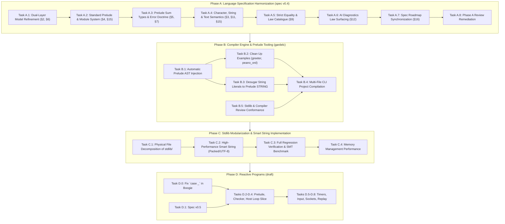
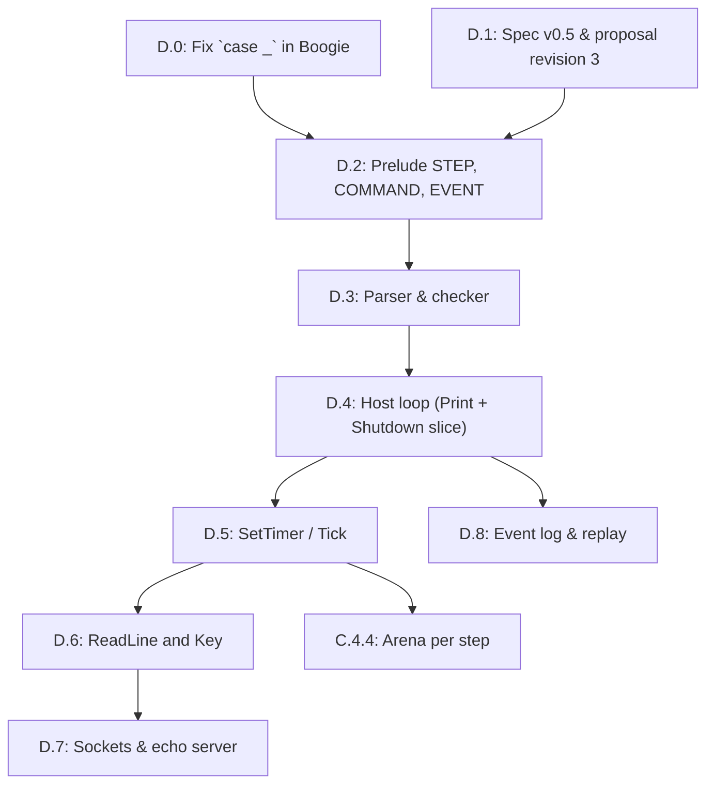

# Consolidated Gardel Architecture & Evolution Roadmap

**Date:** October 31, 2026  
**Status:** 🚀 **APPROVED & ACTIONABLE**  
**Preceding Milestones:** Completed Steps 1–4 (Foundations, `RESULT`/`OPTION`, Functional Core, Law Catalogue & Concepts)  
**Input Documents:**
- [stdlib_file_organization.md](stdlib_file_organization.md)
- [functional_ideas.md](functional_ideas.md)
- [Design Smart String.md](Design%20Smart%20String.md)
- [core_library.md](core_library.md)
- [core_library_vs_functional_ideas_review.md](core_library_vs_functional_ideas_review.md)
- [step1_remediate_stdlib_foundations.md](step1_remediate_stdlib_foundations.md)
- [step2_result_and_composable_option.md](step2_result_and_composable_option.md)
- [step3_verified_functional_core.md](step3_verified_functional_core.md)
- [step4_algebraic_law_catalogue_and_concept_conformance.md](step4_algebraic_law_catalogue_and_concept_conformance.md)
**Primary Artifacts Targeted:**
- `../spec/gardel_language_specification_draft_v0_5.md`
- `../gardelc/src/main.rs`
- `../stdlib/` (`stdlib.gdl` and modular subdirectories)
- `../examples/` (`greeter.gdl`, `peano_ord.gdl`, `bounded_stack.gdl`)

---

## 1. Executive Summary & Baseline

Over Steps 1 through 4, Gardel completed a major conceptual and verification overhaul of its foundation:

1. **Step 1 (Foundations):** Repaired `BIGNAT` (Horner polynomial `value_of` over radix $2^{64}$ yielding true `MATH_INT` values), `SEQ` ($O(1)$ subtree lengths, non-overflow preconditions on `concat`, eliminating truncation bugs), and `STRING` (inductive `all_bytes_valid` and invariant).
2. **Step 2 (Absence & Fallibility):** Added `RESULT[E, A]` with verified constructors, combinators (`map`, `map_error`, `and_then`), safe extractors, and composable `OPTION[A]` with 13 verified algebraic laws.
3. **Step 3 (Verified Functional Core):** Added canonical inductive `functions LIST_OPS`, divide-and-conquer parallel `module SEQ[A]` with full model-refinement postconditions against `LIST_OPS`, and pointwise `functions FUNCTION_OPS`.
4. **Step 4 (Law Catalogue & Concepts):** Standardized `concept EQ`, `CANONICAL_EQ refines EQ`, and `ORD refines EQ`, decoupled Leibniz structural equality (`=`) from behavioral equivalence (`.equals()`), proved comprehensive Monoid, Functor, Monad, Fold, and Order laws in `specify`, and indexed concept laws into `--json-diagnostics` for AI synthesis and repair.

This roadmap consolidates the architectural insights from our analysis into a unified, three-phase plan that aligns the language specification, compiler engine, and standard library.

---

## 2. Strategic Principles & Error Corrections

Our architectural review corrected five critical misconceptions that must govern all future work:

| Area | Previous Misconception | Corrected Architecture Principle |
| :--- | :--- | :--- |
| **Ontology of Types** | Treating `RESULT[E, A]` and `STRING` as primitive types in §3. | **`RESULT` and `OPTION` are Standard Prelude ADTs** (§5), defined using sum-type syntax. Primitives (§3) are strictly machine/SMT scalar types (`UNIT`, `U64`, `I64`, `F64`, `BOOL`, `CHAR`, `MATH_INT`). |
| **Physical vs. Verification Boundaries** | Using `group { ... }` as an ambient file wrapper for the entire stdlib. | **One module per file by default.** `group { A, B }` is strictly a verification and compilation barrier for **mutually recursive ADTs and co-inductive invariants**, not an arbitrary multi-module container. |
| **Standard Prelude** | Expecting user programs to duplicate stdlib definitions or fake `group` headers. | **Implicit Standard Prelude:** Core concepts (`EQ`, `CANONICAL_EQ`, `ORD`), prelude ADTs (`OPTION`, `RESULT`, `SEQ`, `STRING`, `BYTES`, `STRING_ERROR`, `IO_ERROR`, `BIGNAT`), and specification types/modules (`LIST`, `MATH_INT`, `LIST_OPS`, `FUNCTION_OPS`) are implicitly available in all user modules unless `--no-prelude` is passed (§4.1). |
| **Decoupled Text Model** | Tying `STRING` contracts to physical byte buffers (`SEQ[U64]` or `SEQ[U8]`). | **Three-Layer Text Architecture:** Logical Unicode scalar sequence (`specify chars: LIST[CHAR]`), opaque physical representation (`representation {NONE}`), and explicit boundary distinction between valid `STRING` and raw `BYTES`. |
| **Strict Equality Semantics** | Inconsistently using Leibniz `=` in contracts for quotient/collection types. | **Strict Equality Hierarchy:** Structural Leibniz `=` applies only to primitive types and types satisfying `CANONICAL_EQ`. Non-canonical types (`SEQ`, quotient `RAT`, `SET`) must use `.equals()` or ghost model equality (`a.model = b.model`). |
| **Dual-Layer Abstraction** | Treating model refinement as an ad-hoc trick for `SEQ`. | **Core Language Principle:** High-performance runtime data structures (trees, ropes, arrays) refine to inductive mathematical ghost models (`LIST`, `MATH_INT`, `LIST[CHAR]`). |

---

## 3. High-Level Dependency Graph



---

## 4. Work Breakdown Structure

---

### Phase A: Language Specification Harmonization (`spec/gardel_language_specification_draft_v0_5.md`)

**Objective:** Align the language specification draft v0.4 with the architectural breakthroughs of Steps 1–4 and the planning analyses.

#### Task A.1: Formalize Dual-Layer Model Refinement as a Core Language Principle (§2, §6) [✅ Completed]
- [x] Add **Principle 9: Dual-Layer Model Refinement** to §2.
- [x] Define how high-performance, divide-and-conquer runtime data structures (such as `SEQ[A]`, `BIGNAT`, and `STRING`) are paired with inductive mathematical ghost models (`LIST[A]`, `MATH_INT`, `LIST[CHAR]`).
- [x] Specify that runtime operations establish abstraction refinement postconditions (`Result.model = MODEL_OPS.op(Current.model, ...)`), enabling simple structural induction in SMT while executing in parallel on BendRT.
- [x] Update §6 to document how ghost models interact with hereditary representation invariants.

#### Task A.2: Specify the Standard Prelude & Multi-File Architecture (§4, §15) [✅ Completed]
- [x] Formalize the **Standard Prelude**: types/modules (`OPTION`, `RESULT`, `SEQ`, `STRING`, `BYTES`, `STRING_ERROR`, `IO_ERROR`, `BIGNAT`, `LIST`, `MATH_INT`, `LIST_OPS`, `FUNCTION_OPS`) and concepts (`EQ`, `CANONICAL_EQ`, `ORD`) are automatically in scope for all modules unless `--no-prelude` is active.
- [x] Re-scope `group { A, B }`: define it strictly as a **mutual-recursion verification unit** for interdependent types, not an ambient file container.
- [x] Establish the **one-module-per-file** physical convention (`W0201`) with globally unique top-level module names.
- [x] Update §15 (Grammar) to clarify top-level compilation units.

#### Task A.3: Standardize Prelude Sum Types & the Error Handling Doctrine (§5, §7) [✅ Completed]
- [x] Elevate `RESULT[E, A]` alongside `OPTION[A]` in §5 with its standard definition:
  ```eiffel
  module RESULT[E, A]
  representation {ANY}
    | Error(err: E)
    | Ok(val: A)
  ```
- [x] Formulate the **Error Handling Doctrine** in §7:
  - **Preconditions (`require`):** Enforce programmer contracts and type invariants. A violation indicates a bug rejected statically by the verifier.
  - **Fallible Values (`RESULT[E, A]`):** Represent expected domain failures and untrusted boundary data. Total functions return `RESULT` without exceptions.
  - Detail `and_then` chaining for composable, railway-oriented monadic pipelines without special language syntax.

#### Task A.4: Define the Three-Layer Text Model & String Literals (§3, §11, §15) [✅ Completed]
- [x] Define the text hierarchy in §3:
  1. `CHAR`: 32-bit Unicode scalar value primitive (`uint32_t`).
  2. `STRING`: Opaque prelude ADT (`representation {NONE}`) with ghost model `specify chars: LIST[CHAR]`.
  3. `BYTES`: Raw untrusted byte sequences at I/O and boundary interfaces.
- [x] Specify in §3 and §15 that string literals (`"..."`) desugar into verified `STRING` values whose `chars` model matches the sequence of Unicode scalar values.
- [x] In §11 (IO), specify boundary decoding: `STRING.from_utf8(bytes: BYTES): RESULT[STRING_ERROR, STRING]`.

#### Task A.5: Standardize Strict Equality Semantics & Law Catalogue (§9) [✅ Completed]
- [x] Codify the three levels of equality in §9:
  1. **Structural Leibniz Equality (`=`):** Permitted only for primitives and types conforming to `CANONICAL_EQ`.
  2. **Behavioral Equivalence (`a.equals(b)`):** Required for all types conforming to `EQ`, including non-canonical/quotient types (`SEQ`, `BIGNAT`).
  3. **Ghost Model Equality (`a.model = b.model`):** The standard method for stating contracts on non-canonical types against canonical mathematical models.
- [x] Clean up contracts in §8 and §14 to eliminate accidental Leibniz equality assertions on collection types.
- [x] Incorporate the Bird & Wadler algebraic law catalogue (Monoids, Functors, Monads, Folds, Orders) as normative concept laws.

#### Task A.6: AI Diagnostic Law Surfacing in `--json-diagnostics` (§12) [✅ Completed]
- [x] Specify how `gardelc --json-diagnostics` indexes in-scope concept laws and catalogue lemmas and emits them in `relevant_lemmas`.
- [x] Document how AI coding agents utilize these indexed laws for program derivation and automated proof repair.

#### Task A.7: Synchronize Specification Roadmap (§16) [✅ Completed]
- [x] Mark Steps 1–4 as locked/completed in the v0.4 roadmap table and preserve Compiler & Verification Phases 0–4 (§12, §13).
- [x] Align Phase 4 standard library milestones (Steps 1–4 + Consolidated Evolution Phases A–C) with the consolidated plan.

#### Task A.8: Phase A Review Remediation (spec) [✅ Completed]
Source: [review/review.md](review/review.md). The verification notes for each finding are appended to that file.
- [x] §6.4.C `STRING`: restated the bootstrap as the ASCII subset of UTF-8 (`bs.head < 128`); `decode_utf8` now has a precondition, uses `CHAR.from_scalar`, never drops bytes, and proves `same_length`; added `law decode_injective` (justifies `equals` and `code_point_count`) and `specify {EQ}`.
- [x] §3.1: added `CHAR.from_scalar(n): CHAR` with a `valid_scalar` precondition.
- [x] §5: `OPTION.equals` / `RESULT.equals` postconditions are case-wise; `Result = (Current = other)` stays only in `specify {CANONICAL_EQ}`.
- [x] §3, §4.1, §6.4.B: `BIGNAT` limbs are `LIST[U64]` everywhere; `LIST` has dual runtime/ghost status (only `MATH_INT` is ghost-only); documented little-endian limb order and the misleading `push_high_limb` name.
- [x] §6.4: marked the `SEQ`/`BIGNAT` listings as abridged and documented the Visibility Rule 3 bootstrap deviation as non-normative.
- [x] §7.2.2: `err_spec` uses `.equals(...)`. §12: `combine_trees` gains a `fits` precondition; fold-singleton tags fixed to `.single_folded`.
- [x] §11: added `module IO_ERROR` (provisional) and the `BYTES` public surface.
- [x] §15: `LawDecl` parameters are optional; added `"()"` to `Type`.
- [x] §16.3: removed the false hereditary `size_eq` invariant claim for `SEQ`; corrected law names.

---

### Phase B: Compiler Engine & Prelude Tooling (`gardelc`)

**Objective:** Upgrade `gardelc` to support the standard prelude and multi-file compilation so user programs no longer need to copy-paste library code.

#### Task B.1: Automatic Prelude AST Injection in `gardelc` [✅ Completed]
- [x] In `gardelc/src/main.rs`, update file parsing:
  - [x] When compiling any user `.gdl` file, automatically merge the parsed standard prelude AST (`phase4_stdlib_source()`) into the symbol table, concept map, and Boogie verification context. (Prelude concepts are merged into the concept map and prelude modules into the program symbol table; each user module's Boogie file receives the namespaced background theory (`OPTION__*`, `SEQ__*`, ...) of the referenced prelude ADTs: sorts, constructors, routine functions, definitional/contract axioms, routine-precondition predicates and trusted law markers. No prelude `Verify_*` procedure is re-emitted, so prelude obligations are not re-proven; their contracts/laws are trusted on the strength of `gardelc --stdlib --strict`.)
  - [x] Skip prelude injection when `--no-prelude` or `--stdlib` bootstrap mode is passed, or if the file being compiled *is* the standard library itself (avoiding duplicate symbol errors, §4.1).
  - [x] `E0101: duplicate_prelude_symbol`: in prelude mode a user top-level module / `functions` / `program` / concept named like a prelude identifier is a fatal error. (`examples/greeter.gdl` and `examples/peano_ord.gdl` reported E0101 until Task B.2 removed their embedded prelude copies.)
  - Known limits (follow-ups): `STRING` stays mapped to the built-in `GardelString` literal sort until Task B.3; `LIST_OPS`/`FUNCTION_OPS` remain realized by the built-in `Seq_*`/`Fn1_*` preamble theories; prelude calls are routed by a best-effort local type inference (receivers whose type cannot be inferred resolve only when the routine name is unique among the injected modules).

#### Task B.2: Clean Up Example Programs [✅ Completed]
- [x] Refactor `examples/greeter.gdl`: remove redundant copies of `OPTION`, `SEQ`, `BIGNAT`, and `STRING`, and remove the `group` header. The file becomes a pure, concise `program GREETER`. (`main(args: SEQ[STRING])` as in §11; `examples/peano_ord.gdl` likewise drops its own `EQ`/`CANONICAL_EQ`/`ORD` and uses the prelude concepts.)
- [x] Verify that `examples/greeter.gdl`, `examples/peano_ord.gdl`, and `examples/bounded_stack.gdl` compile and verify cleanly against the injected prelude with 0 errors and 0 warnings. (All three: `--strict` 0 errors, 0 warnings.)
  - Known limits (follow-ups): the §11 `GREETER` form (`IO.read_line` returning `RESULT[IO_ERROR, STRING]` matched with `Ok`/`Error`, `IO.print_line`, `STRING.concat`) is not yet supported by `gardelc` (`IO.read_line` is modelled as returning `GardelString`, there is no `print_line`/`concat`, and a `match` on a bound `with IO` result fails Boogie emission), so the example keeps the `name <- IO.read_line` / `IO.print("Hello, " + name)` form until Task B.3 / Phase C. `examples/tree.gdl` (not in scope) still reports 5 errors because the built-in `Seq_*` Boogie preamble has no axioms for `Seq_singleton` and no `Seq_has(Seq_empty(), x)` = false axiom.

#### Task B.3: Compiler Desugaring of String Literals [✅ Completed]
- [x] In `gardelc` AST and type-checker, lower `Expr::Literal(Literal::String(s))` into a call to `STRING.from_literal` or a compiler-generated constant carrying `ensure Result.chars = ...`. (String literals have the prelude type `STRING`. In prelude mode the prelude `STRING` theory is injected into user Boogie contexts (removing the B.1 limit) whenever the module mentions `STRING`, a literal or `IO`, and `STRING`-typed values map to the prelude sort. A literal `[c_0..c_{n-1}]` becomes a constant `str_lit_k` *defined* by `STRING.make_empty(max(n,1)).push_ascii(c_{n-1})...push_ascii(c_0)` (one definitional axiom per construction step, nothing else trusted); the lemma procedure `Verify_string_literal_k` proves every `make_empty`/`push_ascii` precondition, the `STRING` invariant, `chars = LIST.empty.prepend(c_{n-1})...prepend(c_0)` and `byte_length = n`, and every user procedure `call`s it to use those proven facts. `STRING.make_empty`/`push_ascii` gained the proven postconditions `capacity_set`/`same_capacity`.)
- [x] Compile-time validation (§3.1.4, §15): `E0302 malformed_escape_sequence` (only `\n \r \t \\ \' \" \0 \u{H..}` with 1–6 hex digits), `E0304 surrogate_in_literal`, `E0301` raw line break in a string literal, and `E0303 non_ascii_string_literal` (the bootstrap `STRING` is ASCII, §6.4.C; non-ASCII literals need Task C.2).
- [x] §9 equality: `=` with a `STRING` operand is rejected (`E0311 non_canonical_string_equality`; use `a.equals(b)` or `a.chars = b.chars`), as are `+` on `STRING` (`E0312`; `+`/`concat` is not in the bootstrap prelude) and string-literal `match` patterns (`E0313`).
- [x] Connect string literals directly to the C11 emitter runtime string constructor (`string_from_utf8`). (Each literal is a `static const uint8_t gardel_str_lit_k[] = { ..., 0 };` buffer wrapped by the zero-copy, zero-decoding `string_from_utf8(bytes, len)`. Programs are now lowered from their source (the canned GREETER C template was removed), with `IO.print`/`IO.print_line`/`IO.read_line`/`IO.exit` runtime helpers.)
- [x] `examples/greeter.gdl` rewritten to `IO.print("Hello, ")` + `IO.print_line(name)` (no string `+`); `--strict` 0 errors, 0 warnings, and it builds and runs.
- [x] Boogie timeouts are now reported as errors (`Phase 3 Boogie (Verification Timeout)`) instead of being silently counted as verified.
  - Known limits (follow-ups): `STRING.concat` is not added: a client like §11 `GREETER` could not prove its capacity/overflow precondition for an unbounded `IO.read_line` result, so greeter prints the parts separately. `IO.read_line` is still modelled as returning a plain `STRING` (no `RESULT[IO_ERROR, STRING]`, no invariant/ASCII guarantee about the result in Boogie; the C runtime does not validate input bytes); `args: SEQ[STRING]` is passed as `NULL` in C (no argv marshalling). Under `--no-prelude` literals keep the legacy opaque `GardelString` sort. The E0311/E0312 operand typing reuses the best-effort prelude call inference (operands whose type cannot be inferred are not checked). IO actions remain uninterpreted in Boogie (pre-existing).

#### Task B.4: Multi-File Project Compilation Support [✅ Completed]
- [x] Extend the `gardelc` CLI to accept multiple files or a directory:
  `gardelc src/*.gdl --strict`. (Operands: files, directories (top-level `*.gdl`, not recursive) and wildcard patterns, which `gardelc` expands itself when PowerShell/`cmd` leave them unexpanded. Several files, a directory or a wildcard operand make a *project run*. A single-file run uses the unchanged pre-B.4 pipeline (`--stdlib`, `--no-prelude`, `--json-diagnostics`, `build/` outputs). Spec §4.2.3 states the CLI rules.)
- [x] Link all modules in the compilation run into a shared symbol table before generating Boogie verification conditions. (All files' concepts form one concept map. A module's Boogie context receives the namespaced background theory (`N__*`) of every other-file user module it references, transitively, the same way B.1 injects prelude theories: sort, constructors, routine functions with fuel-guarded definitions and precondition-guarded contract axioms, invariant, law axioms, precondition predicates and law markers. Each is emitted in `N`'s own context. Call sites assert the callee's `require` clauses. No `Verify_*` procedure of `N` is re-emitted; `N`'s obligations are proven once, in its own Boogie file of the same run, which fails if any of them fails.)
- [x] Diagnostics: `E0102: duplicate_module_name` (fatal; cross-file duplicate top-level module/concept). `W0201: file_module_name_mismatch` (project runs only; the basename must equal the lowercase snake_case of the file's unit, or of one of its co-located units; `group` files are exempt; a warning, and an error under `--strict` per §4.2.1). New `E0103: cyclic_module_dependency` (fatal; cycle of cross-file references, which would make trusted contracts circular). All diagnostics carry their own file path in text and `--json-diagnostics`.
  - Known limits (follow-ups): modules in the *same* file are still not linked to each other, and `group` simultaneous verification (§4.3) is not implemented. Constructor names are resolved by the best-effort reference scan; on a clash the prelude wins, then the first linked module. `gcc` / `--run` build only the primary module's C file (the unique `program`, else the last module), with no cross-module C linking. The concrete-sampling fallback used when Boogie is unavailable does not see linked modules. `examples/peano_ord.gdl` declares `module PEANO`, so in a project run it triggers `W0201` (an error under `--strict`); the file was not renamed.

#### Task B.6: Verifier Soundness Fixes from the Phase B Review [✅ Completed]
- [x] **Laws are never assumed by their own module.** Concept axioms (`fn_equals(x, x) == true`, ORD axioms) and triggered law axioms are emitted only into *client* contexts (prelude injection, linked modules), never into the module's own `Verify_*` context. Before, a module with a non-reflexive `equals` had contradictory axioms and verified every obligation vacuously.
- [x] **Conditional `CANONICAL_EQ` is no longer assumed for every element type.** Element `x.equals(y)` on a bounded type parameter lowers to `<tp>_eq` by type, not by variable name (the `opt`/`res`/`a`/`b`/`c` special case is removed from the Boogie emitter). `<tp>_eq <==> ==` is no longer a module-wide axiom for `where tp satisfies CANONICAL_EQ`. The module's own `specify {CANONICAL_EQ}` laws are proven over a fresh witness type `tp__Canon`, and client-side law markers are guarded by the `where` hypothesis. Before, `Some(s1).equals(Some(s2)) = False` verified for `s1.equals(s2)` on `SEQ`.
- [x] **Same-module call preconditions are checked.** A static `M.r(..)`, unqualified `r(..)`, or `x.r(..)` call on a receiver of the module's own type asserts the callee's `require` clauses at the call site. Before, `BOX3.make(50)` against `require x < 10` verified.
- [x] **Inductive law proofs.** A law's `do` body is now translated: `match`/`if` become branches, and a recursive law call checks the law's preconditions and a strictly decreasing `variant` (structural `M_adt_size` for module-typed variables), then assumes the law's conclusion (the induction hypothesis). `examples/peano_ord.gdl`'s ORD laws, which had verified only through the circular axioms, now verify by induction.
- Regression tests: `test_soundness_*` (4). `cargo test` 62/62; `--stdlib --strict` 0/0; greeter, peano_ord, bounded_stack 0/0.
- **Known limits:** calls to *other* laws inside a law body contribute nothing (no cross-law assumption, to avoid cycles). The Dafny emitter (output-only) still has the name-keyed element-equality lowering (moot: emitter removed in Task B.12). Same-module precondition checks need a receiver whose type is known (parameters, `match` binders, `let` of module calls). One false postcondition can still mask others in the same module (review item 6).

#### Task B.9: False Contracts No Longer Mask Other Failures (review item 6) [✅ Completed]
- [x] Routine contracts are Boogie axioms. A false postcondition contradicts the routine's definitional axiom, and the inconsistency silently proved every other obligation whose terms reach that routine. Example: `f` claims `Result = 7` but returns `0`; `g` calls `f` and falsely claims `Result = 1`; only `f` was reported.
- [x] `run_boogie_verification` now iterates to a fixpoint. After each pass, a failed postcondition clause is withdrawn from the contract axioms; any other failure of a routine (overflow, precondition, termination, invariant) withdraws its whole contract. Verification repeats until no new failure appears, and the union of all passes is reported. Withdrawing axioms only weakens the context, so every reported failure is genuine. Withdrawal is per clause, so a true clause proven by induction keeps its induction hypothesis. Extra passes run only when something fails.
- [x] Test `test_item6_*` (masking, no noise for correct callers, per-clause withdrawal). `cargo test` 66/66. `tree.gdl` keeps exactly its 5 genuine failures.
- **Follow-up finding (fixed in Task B.10):** non-terminating recursion verified its contracts.

#### Task B.10: Termination Across the Call Graph [✅ Completed]
- [x] **Problem 1:** direct recursion *without* a `variant` was never checked in the Boogie path (only the fallback evaluator had a "missing variant" diagnostic). `f(n) do f(n) end` verified `Result = 7`.
- [x] **Problem 2:** mutual recursion (`f` → `h` → `f`) was never termination-checked, so its contracts proved themselves through the cycle.
- [x] **Fix:** the module's call graph is built from routine bodies. Calls on receivers of a known other type, e.g. `xs.length` on a `LIST`, are excluded; receivers of unknown type count as calls into the module. Recursive groups are its strongly connected components. At every call inside a group, both routines must declare a `variant` (else `variant_missing`), and the callee's variant at the call's arguments must be lexicographically smaller than the caller's (`variant_decrease`). A structural variant on the module's own type is measured by `<M>_adt_size`. Self-calls with a variant keep the existing check; cross-file cycles were already rejected (`E0103`).
- [x] Test `test_termination_direct_and_mutual_recursion`: missing variant rejected, decreasing `is_even`/`is_odd` accepted, non-decreasing rejected. `cargo test` 67/67. stdlib and examples unchanged (no spurious cycles).
- **Known limits:** recursion through a closure argument or a higher-order call is not in the call graph (fixed in Task B.11). Variants of different lengths are compared on their common prefix (a strict decrease is required there).

#### Task B.11: Pre-Phase-C Hygiene [✅ Completed]
- [x] **Recursion through function values (E0315).** The call graph now records every use of a module routine with lexical scoping: direct calls, calls inside a lambda body, and references used as function values (`apply(f, n)`, `M.apply(M.f, n)`). Parameters, `let`, `match`, quantifier, IO-bind and lambda binders shadow routine names. Inside a recursive group, a group member may only be called directly: a `variant` cannot be related to a call that happens whenever a closure is applied. Calls in a closure and function-value references to the group are rejected with `E0315: higher_order_recursion`. Before, such programs failed only by accident, because the Boogie backend emits ill-typed code for general lambdas and routine references. That would have become a soundness hole once closures get a general encoding. Passing a non-recursive routine or a non-recursive lambda is unaffected.
- [x] **Stale stdlib copy removed.** `gardelc/stdlib/stdlib.gdl` (264 lines, 4 modules) was an old `gardelc --emit-stdlib` output, which writes `./stdlib/` relative to the working directory. The compiler embeds `../stdlib/stdlib.gdl`. The copy is deleted and `gardelc/.gitignore` ignores `/stdlib/`.
- [x] **Bounded type parameters on product modules.** A module type parameter is a hole of `type M A;` and is quantified (`<A>`) in every module function, so it is no longer also declared as a global `type A;` (Boogie rejected the clash). Product modules now use the same polymorphic `A_eq<A>` / `A_less<A>` theory as sum modules. `module PAIR[A: EQ]` with a record representation verifies, and its `EQ` axioms are usable (symmetry proved, a false claim rejected).
- [x] **`!=`.** Lexed (spec §15 grammar) and desugared by the parser to `not (a = b)`. Every backend and the element-equality lowering (`<tp>_eq`) therefore handle it unchanged.
- [x] Tests `test_termination_through_function_values_is_rejected` and `test_product_module_type_params_and_not_equal`; `test_plan3_constrained_generics_concept_laws` updated to the polymorphic theory. `cargo test` 69/69. `--stdlib --strict` 0/0; greeter, peano_ord and bounded_stack 0/0; tree.gdl keeps its 5 genuine errors.
- **Not done: Dafny equality (resolved in Task B.12 by removing the Dafny backend).** The Dafny emitter lowers `=` to structural `==`, and it picks `equals(...)` vs `==` on OPTION/RESULT by the receiver's *variable name*. Fixing that alone is pointless: the generated `.dfy` for the generic prelude modules (`option`, `result`, `seq`) does not parse in Dafny 4 (7–10 parse errors each). Only simple non-generic modules (peano, bounded_stack) verify. Dafny runs only under `--run`, and its result is ignored. Decide whether to repair the Dafny backend (type-directed equality, as in Boogie) or drop it in favour of Boogie as the single verifier.
- **Parser note:** `Result = not (a = b)` does not parse (`not` is not accepted as a comparison operand); write `Result = (not (a = b))`.

#### Task B.12: Boogie Is the Only Verifier [✅ Completed]
- [x] **Decision:** the Dafny backend is dropped. It was a second, unchecked opinion: `.dfy` files were emitted on every compile, but Dafny ran only under `--run` and its result was ignored. Its output for the generic prelude modules (OPTION, RESULT, SEQ) did not parse in Dafny 4. Its equality lowering (structural `==`, `equals` chosen by receiver variable name) disagreed with the Boogie side's behavioral `<tp>_eq`. Keeping it in step through Phase C (stdlib split, smart STRING) would have been pure cost.
- [x] Removed from `gardelc`: the Dafny emitter section (`emit_dafny`, `emit_dafny_routine`, `emit_dafny_law`, `emit_dafny_lemma_stmt_expr`, `emit_dafny_block`, `emit_dafny_expr`, `map_dafny_type`; ~700 lines), the `build/<module>.dfy` output, the `dafny verify` call in `--run`, and the Dafny assertions in two tests. The pipeline now reports five steps (`[0/5]`…`[5/5]`: prelude, parse, checks + Boogie/Z3 verification, `.bpl`, Bend v2, C11).
- [x] Z3 is still the bundled binary under `tools/dafny/z3/` (that path is only where the solver lives). README and spec (function-parameter theory, verifier-backend table) updated.
- [x] `cargo test` 69/69; `--stdlib --strict` 0/0; examples unchanged.

#### Task B.8: `SEQ` Element Equality Bound (review item 5) [✅ Completed]
- [x] `module SEQ[A] satisfies EQ where A satisfies CANONICAL_EQ` (was `where A satisfies EQ`). `SEQ.equals` compares elements structurally (model equality over `LIST[A]`), which is behavioral equality only for canonical elements. Under the old bound, `SEQ[SEQ[U64]].equals` called two sequences unequal when their elements were behaviorally equal inner trees of different shapes.
- [x] **Enforced:** `E0314: unsatisfied_where_constraint`. Calling a routine of a concept that a module lists *directly* in `satisfies` (e.g. `equals` of `EQ` on `SEQ[T]`) requires the `where` constraints to hold for the type arguments. Primitives are `CANONICAL_EQ`/`ORD`, a type parameter satisfies its declared bound, and a module type satisfies its listed concepts when its own `where` constraints hold. `SEQ[SEQ[U64]]`, `SEQ[STRING]` and `SEQ[A]` with unbounded `A` are rejected; `SEQ[U64]`, `SEQ[CHAR]` and `SEQ[A]` with `[A: CANONICAL_EQ]` are accepted. `OPTION`/`RESULT` list only `CANONICAL_EQ` and delegate element comparison (§5), so `OPTION[SEQ[U64]].equals` stays available.
- [x] `law SEQ.map_fusion` is restated with model equality (`.model = .model`), since its result type `SEQ[C]` has no `CANONICAL_EQ` bound on `C`.
- [x] Spec §6.4.A, §9 and §16.3 updated. Test `test_item5_*`. `cargo test` 65/65.
- **Known limits:** E0314 needs the receiver's type to be inferable (parameters, `let`s, IO binds). **Pre-existing bug found (fixed in Task B.11):** a bounded type parameter on a *product* module (`module H[A: CANONICAL_EQ]` with a record representation) declares `type A;` twice in Boogie and fails to type-check. Sum-type modules are unaffected.

#### Task B.7: `IO.read_line` Boundary per Spec §11 (review item 4) [✅ Completed]
- [x] **Stdlib:** added `module STRING_ERROR` and `module IO_ERROR` (`EndOfInput | Decode(cause: STRING_ERROR) | OsError(code: I64)`; path variants come with `read_file`/`write_file`). A representation field typed by another prelude module gets an opaque sort in the module's own `--stdlib` file, and resolves to the real injected sort in client contexts.
- [x] **Typing:** `IO.read_line : IO[RESULT[IO_ERROR, STRING]]`. The prelude theories it needs are injected automatically.
- [x] **Verification:** each `x <- IO.read_line` is a fresh `havoc` (before, it was a constant function, so two reads were provably equal), with the single boundary assumption "an `Ok` payload satisfies the `STRING` invariant". Routines that bind IO input get no definitional axiom. A `match` or nested `with IO` as the final expression of a `with IO` is emitted as statements. IO actions are type-checked (`assume e == e` instead of a comment), and their calls get call-site obligations.
- [x] **C runtime:** `gardel_io_read_line_result()` reads a line of any length (no 4096-byte truncation), strips `\n`/`\r\n`, and returns `Error(EndOfInput)`, `Error(OsError(errno))` or `Error(Decode(InvalidByte(offset, byte)))` for any byte ≥ 128. Only ASCII lines become `Ok(STRING)`.
- [x] **C backend:** instantiated prelude sum types (`RESULT_IO_ERROR_STRING`, `IO_ERROR`, `STRING_ERROR`) are emitted with tags and constructors. `match` on them evaluates the scrutinee once, uses the instance's tags and binds pattern variables. A nested `with IO` expression keeps its actions (they were dropped before).
- [x] `examples/greeter.gdl` is now the spec §11 GREETER (`match` on `Ok`/`Error`). It verifies 0/0 and was run natively: normal, CRLF, empty-line and no-newline input succeed; EOF and non-ASCII input exit 1; a 10 000-character line works.
- Tests: `test_item4_*` (2). `cargo test` 64/64.
- **Known limits:** in C, only the prelude sum types reachable from `read_line`'s type are emitted. Programs that build other prelude ADTs (e.g. `Some(x)`) still don't compile natively. `match` on a module's own ADT in C is unchanged (no binder binding).

#### Task B.5: Stdlib & Compiler Conformance with the Phase A Review
- [x] (B.5b) Remove the `equals`/`less_than` ghost-access exemption in `gardelc/src/main.rs` (Visibility Rule 3). Give `SEQ.equals`, `BIGNAT.equals`, and `BIGNAT.less_than` executable bodies, and add a `BIGNAT` normalization invariant (no zero most-significant limb).
- [x] (B.5a) Remove the hard-coded Boogie axiom `fn_decode_utf8(...) == bs` (keyed on the routine name `decode_utf8`). Prove `same_length` / `decode_injective` instead. The axiom silently becomes unsound once `decode_utf8` is a real multi-byte decoder (Task C.2).
- [x] (B.5a) Align `stdlib.gdl` `STRING` with spec §6.4.C: ASCII bound `< 128` in `all_bytes_valid`, `push_byte`, and `push_utf8_word`; a `require` on `decode_utf8`; and a `valid_scalar` precondition on `CHAR.from_scalar` (currently emitted as an unchecked identity).
- [x] (B.5a) Drop the unconditional `sound: Result = (Current = other)` from `OPTION.equals` / `RESULT.equals` in `stdlib.gdl`. It is still present next to the new case-wise clauses.
- [x] (B.5a) Remove the duplicate law `LIST_OPS.fold_left_append_distributivity` (same statement as `fold_left_append`) and its lemma-index entry and tests.
- [x] Rename `BIGNAT.push_high_limb` to `shift_in_low_limb` (it inserts the least-significant limb). (`stdlib.gdl`, `gardelc` tests, spec §6.4.B and §12.)

---

### Phase C: Standard Library Modularization & Smart String Implementation

**Objective:** Physically decompose `stdlib.gdl` into a clean directory structure and implement the full Unicode string model.

#### Task C.1: Physical Decomposition of `stdlib/` [✅ Completed]
- [x] Modularize the single `stdlib/stdlib.gdl` file into clean, 1:1 module/concept files satisfying §4.2 (`W0201: file_module_name_mismatch`):
  ```text
  stdlib/
  ├── concepts/
  │   ├── eq.gdl               # concept EQ
  │   ├── canonical_eq.gdl     # concept CANONICAL_EQ refines EQ
  │   └── ord.gdl              # concept ORD refines EQ
  ├── core/
  │   ├── option.gdl           # module OPTION[A]
  │   ├── result.gdl           # module RESULT[E, A]
  │   └── io_error.gdl         # module IO_ERROR
  ├── collections/
  │   ├── list_ops.gdl         # functions LIST_OPS
  │   └── seq.gdl              # module SEQ[A] (parallel divide-and-conquer)
  ├── numeric/
  │   └── bignat.gdl           # module BIGNAT (64-bit limbs, MATH_INT model)
  ├── text/
  │   ├── string.gdl           # module STRING (bootstrap ASCII, packed UTF-8 in C.2)
  │   └── string_error.gdl     # module STRING_ERROR
  └── functional/
      └── function_ops.gdl     # functions FUNCTION_OPS
  ```
  *(Note: `text/bytes.gdl` deferred to Task C.2 where the `BYTES` module is implemented).*
- [x] Update `gardelc`'s embedded stdlib bundler (`phase4_stdlib_source()` and `STDLIB_SOURCES`) to embed these 12 files in fixed dependency order without an ambient `group` header.
- [x] Extend `gardelc --stdlib` to run in project mode over `stdlib/`, verifying each module on its own with dependencies linked as already-verified contracts (`with_link_table`) with 0 errors and 0 warnings under `--strict`.
- [x] Unit tests: `test_c1_stdlib_modular_files_match_module_names_w0201` (all stdlib files pass W0201 under `--strict`) and `test_c1_stdlib_project_verification_zero_warnings_strict` (full multi-file project verification passes with 0 diagnostics under `--strict`). All 71 tests passing.
- [x] **Review fixes (C.1 review, critical items).**
  - **`--emit-stdlib` no longer overwrites sources.** It used to write the copy embedded in gardelc over `./stdlib/` without asking, which reverted hand edits to the 12 source files. It now writes to `build/stdlib/` by default (`--emit-stdlib <DIR>` to choose). It refuses the whole emission, writing nothing, when an existing file differs from the embedded copy; identical files are left as they are.
  - **`--stdlib` verifies the real sources.** It used to take whichever `stdlib/` was in the working directory (a leftover `gardelc/stdlib/` would win), and it silently fell back to the embedded copies while still reporting the 12 files. It now always verifies the tree gardelc was built from (`CARGO_MANIFEST_DIR/../stdlib`) and prints which one. If that tree is gone (gardelc moved), it says it is verifying the embedded copy. If the files on disk and the embedded list disagree (a module verified but not shipped, or the reverse), that is an error. A source file that differs from the embedded copy gets a note to rebuild gardelc.
  - Tests `test_c1_embedded_stdlib_lists_agree_with_source_tree` (also guards that `STDLIB_SOURCES` and the `concat!` in `phase4_stdlib_source()` list the same files in the same order) and `test_c1_emit_stdlib_never_overwrites_edited_sources`. `cargo test` 73/73.
- [x] **Review fixes (C.1 review, important items).**
  - **Stdlib files are recognized by location, not text.** Bootstrap mode used to be chosen when a file's text exactly matched the embedded copy. So an *edited* stdlib file was treated as a user file (`E0101`), and one user file identical to a stdlib file switched the prelude off for a whole project. Now a file belongs to the prelude when it lies in the stdlib tree gardelc was built from (`path_in_stdlib_tree`). `gardelc stdlib/core/option.gdl` and `gardelc stdlib` verify the whole tree, as `--stdlib` does (its modules depend on each other; a single file alone could not resolve `CANONICAL_EQ`). Mixing stdlib files with user files is an error, and a copy of a stdlib file elsewhere is a user file (`E0101`, which points to `--no-prelude`).
  - **Embedded lists cannot drift:** covered by the `--stdlib` disk-vs-embedded check and `test_c1_embedded_stdlib_lists_agree_with_source_tree`.
  - **Docs:** spec §4.1 (bootstrap paragraph), §6 module listing, §9 law catalogue, §11 `IO_ERROR`, and §16 (C.1 completed, `bytes.gdl` moved to C.2) no longer point to `stdlib/stdlib.gdl`. The README repository tree shows the `stdlib/` layout, and `gardelc/stdlib/` is removed from it.
  - `cargo test` 73/73.

#### Task C.2: High-Performance Smart String (`stdlib/text/string.gdl`) [✅ Completed]
- [x] Full RFC 3629 UTF-8 `STRING` (spec §6.4.C), keeping the public `chars` contracts:
  - [x] **Verification model:** `bytes: LIST[U64]` with one octet per element, plus `size`, the cached `char_count` and the builder capacity `limit`. Invariant: `BYTES.valid_utf8(bytes)`, `char_count = BYTES.decode_utf8(bytes).length`, `char_count <= size <= limit`, `limit > 0`. Ghost model `specify chars: LIST[CHAR]`. The model is not packed. The *runtime* representation is packed (see C11 below).
  - [x] Operations: `code_point_count` (cached), `byte_length`, `is_empty`, `character_at(index: NAT): CHAR` with `require index < code_point_count` (as in `Design Smart String.md`; not `OPTION[CHAR]`), `concat`, `to_utf8: BYTES`, `equals` (byte equality = character equality).
  - [x] Literal builders `push_ascii`, `push_utf8_2/3/4`; multi-byte string literals (`E0303` removed). The ASCII-only aliases `push_byte` / `push_utf8_word` were removed.
  - [x] Boundary decoding `from_utf8(bytes: BYTES): RESULT[STRING_ERROR, STRING]` with `ok_iff_valid: Result.is_ok = BYTES.valid_utf8(bytes.model)`. Errors are reported in a fixed check order (continuation bytes present, then completeness, then the lead-specific range), shared with the C decoder.
- [x] **UTF-8 theory in `module BYTES` (`stdlib/text/bytes.gdl`), proven, not axiomatized:** `valid_utf8`, `decode_utf8` and the laws `utf8_octets`, `utf8_append` and `decode_injective`, all proven by structural induction. They reach `STRING` as linked client axioms. `BYTES` also has `length`, `at`, `from_list`, `empty`, `to_list`, `is_empty`, `equals`.
- [x] **`concat` is usable on input:** its only precondition is byte-length overflow. `IO.read_line` returns lines shorter than 2^48 bytes (`GARDEL_MAX_LINE_BYTES`; the C runtime returns `Error(OsError(EOVERFLOW))` otherwise, and the verifier assumes the bound). `"Hé, ".concat(name)` verifies.
- [x] **C11:** `GardelString { data, len, chars }` is a packed UTF-8 buffer with cached code-point count. `STRING`/`BYTES` methods lower to `gardel_string_*` / `gardel_bytes_*`, dispatched on the receiver's C type with `_Generic` (the C emitter is untyped). `STRING.from_utf8` is supported. One RFC 3629 validator (`gardel_utf8_validate`) serves `read_line` and `from_utf8`. Expression-position blocks no longer emit `return`.
- [x] **C.2 review fixes (verifier soundness):**
  - **Non-exhaustive `match` on a prelude ADT verified anything.** C.2 had added `else { assume false; }` after every `match`, while exhaustiveness was asserted only for the module's own sum type. Now omitted constructors are asserted unreachable for prelude ADTs too (path-sensitive, spec §5), including `match` nested inside expressions, which was unchecked before C.2 as well. The `assume false` is emitted only after those assertions, where it is implied.
  - **16 hand-written UTF-8 Boogie axioms removed** (they were keyed on the module name `STRING` and made `STRING`'s own laws prove themselves). Replaced by the `BYTES` proofs above.
  - **Law proof steps:** a plain boolean term in a law's `do` body is asserted and then known (spec §15, Law Proof Bodies). This is needed for `utf8_octets`, where a 4-byte step exceeds the default fuel.
  - Prelude contract interfaces are emitted in the prelude module's own context, so `STRING`'s preconditions that call `BYTES.*` resolve in client files. `Result` inside `BYTES` is typed by the routine's return type, not assumed to be `BYTES`.
  - Receiver resolution decides "static call `T.r`" by the declarations in scope instead of capitalization.
- [x] Debugging aid: `GARDEL_KEEP_BPL=1` keeps the temporary Boogie VC files.
- [x] Tests: `test_c2_utf8_laws_are_proven_not_assumed` (mutations: a dropped shortest-form rule breaks `decode_injective`, a false `chars_append` is rejected, `concat` depends on the laws), `test_c2_from_utf8_accepts_exactly_valid_utf8`, `test_c2_match_exhaustiveness_on_prelude_adts`, `test_c2_utf8_strings_verify_and_run_natively` (verification, multi-byte literal facts, and a native run when `gcc` is available, checking code-point counts and the error classification of `ED C0`, `E0 41`, `E0 80`, `E0 80 80`, `C0 AF`, `ED A0 80`, `F4 90 80 80`, `FF`). The B.5a test was rewritten for the `BYTES` design with its deleted assertions restored, and the STRING invariant check is exact again. `cargo test` 77/77. `--stdlib --strict` 0/0. greeter, peano_ord and bounded_stack 0/0. `examples/tree.gdl` now reports 2 errors (was 5): C.2's `Seq_singleton`/`append` preamble axioms closed 3. The remaining two are `forall` postconditions that need lemmas, so they are incompleteness, not unsoundness.
- **Known limits:**
  - `character_at` is O(n) at run time, which is inherent to code-point indexing of UTF-8.
  - `concat` allocates and nothing frees (no GC yet).
  - `LIST_OPS.at`, like the other `LIST_OPS` functions, is realized by the built-in `Seq_at` preamble axioms (B.1 known limit).
  - The C emitter still has no general type inference: text methods rely on `_Generic`, so a call on an unexpected type is a C compile error, not a wrong call.

#### Task C.3: Regression Verification & Performance Benchmarking [✅ Completed]
- [x] Run complete test suite:
  - `cd gardelc && cargo test` (all 85 tests passing).
  - Verify all modular stdlib files under `gardelc --strict` with 0 errors and 0 warnings (13 files in ~11.0s).
  - Verify all examples under `gardelc --strict` with 0 errors and 0 warnings:
    - `bounded_stack.gdl`: 0 errors, 0 warnings (0.75s)
    - `greeter.gdl`: 0 errors, 0 warnings (1.18s)
    - `peano_ord.gdl`: 0 errors, 0 warnings (0.90s)
    - `seq_bench.gdl`, `seq_ops.gdl`: 0 errors, 0 warnings (added by the typed C backend follow-up below)
    - `tree.gdl`: 0 errors, 0 warnings (0.78s) — closed remaining 2 errors by supplying the `Seq_empty` base axiom for `Seq_has` (`!Seq_has(Seq_empty(), x)`), proving both `in_bounds` and `upper_bound`. The axiom is sound because it holds in the finite-list model and agrees with the existing `Seq_length`/`Seq_empty` axioms. Separately, mutation tests show that the proofs are not vacuous: stronger bounds are still rejected.
  - Added `utf8_step_4` inductive single-step lemma in `stdlib/text/bytes.gdl` to stabilize Z3 SMT solver across random seeds for multi-byte `push_utf8_4` capacity invariants.
  - Native C11 run of `greeter` (end-to-end stdin/stdout), compiled from its Gardel source.
  - OpenMP benchmark of the **hand-written SEQ reference runtime** `gardelc/runtime/reference/seq.c` (`seq_from_range` + `seq_parallel_sum`, up to 4,000,000 nodes, 4.39x on 20 logical cores). This C is not compiled from `stdlib/collections/seq.gdl` and verification does not cover it, so the number says nothing about code gardelc generates. For the compiled-from-source benchmark, see the typed C backend follow-up below.
  - Automated runner and reporter: `scripts/c3_regression.ps1` emitting `build/c3_report.md`.
- [x] **C.3 review fix (critical): hand-written C presented as compiled output.**
  - `emit_c11` returns a fixed, hand-written C program for modules named `TREE`, `BOUNDED_STACK`, `PEANO`, `SEQ`, `BIGNAT` and `STRING` (`C11_REFERENCE_RUNTIMES`). C.3 had added a `"SEQ_U64"` alias so that `--stdlib` (which monomorphizes `SEQ` to `SEQ_U64`) wrote that template as `build/seq.c`, and the benchmark printed "Verified Phase 4 SEQ[U64]". The alias is removed: templates are chosen by exact name only, and monomorphized names go through the general emitter.
  - Every template now starts with `HAND-WRITTEN REFERENCE RUNTIME … NOT covered by verification`, and none prints "Verified". The CLI prints a note when the primary module's C output is a template (for example `build/tree.c`).
  - The SEQ template lives in `gardelc/runtime/reference/seq.c` (embedded with `include_str!`), and the C.3 script benchmarks that file under a "reference runtime" label.
  - Test `test_c3_reference_runtimes_are_labeled_and_matched_by_exact_name`. `cargo test` 80/80.
- [x] **C.3 follow-up: typed C backend; stdlib `SEQ` compiled from source.**
  - **`gardelc/src/c11_typed.rs`** lowers modules and programs to C from their Gardel source, using inferred types. Routine instances are named after their owner type (`SEQ_U64__concat`). Generic modules *and* routine-level type parameters are instantiated on demand from a worklist: `SEQ[A].fold_left[B]` at `A = B = U64` is `SEQ_U64__fold_left__U64`, with `B` inferred from the function argument. It lowers constructors, `match` with field binders and arm-local `let`s, record literals and updates, Leibniz `=` (generated structural equality), function values and non-capturing lambdas (C function pointers). It provides an iterative cons-list runtime for `LIST[T]` where executable code uses it (`SEQ.to_list`, `SEQ.equals`). Specification routines (`model`) are never emitted. `STRING`, `BYTES` and `IO` stay in the C runtime header. A program's translation unit contains every module instance it uses, and `main` runs inside an OpenMP region. The CLI uses this backend for every C output except the exact-name reference templates. Anything it cannot lower is reported, and the C file then starts with `#error`.
  - **Fork-join (spec §10):** an independent `let` group becomes OpenMP tasks below a depth cutoff (`GARDEL_TASK_DEPTH`, default 12); past the cutoff it runs as plain sequential C. While measuring, a first version only deepened the *spawned* branch, so the depth never grew along right spines and millions of tasks were created: the 20-thread build was 3.5x *slower* than the 1-thread build. Every branch now runs one level deeper, a task restores its thread's depth, and a test pins this.
  - **Verifier fixes needed by client programs of the prelude `SEQ`** (each failed loudly before; none was unsound). `SEQ.empty`/`SEQ.singleton` called from a client were emitted as the bootstrap constructors `Empty()`/`Leaf(x)` instead of `SEQ__fn_*` calls. General lambdas were emitted as their bare body with unbound parameters; they are now lifted to a fresh Boogie function `lam_M_k(captures)` with one defining axiom `FnN_app(lam_M_k(c), x..) == body` (consistent: a fresh symbol with one equation), captures included. Local type inference now types lambdas and unifies function types, so `let d = s.map(fn(x: U64): U64 do ... end)` gets `SEQ[U64]`.
  - **Programs:** `examples/seq_ops.gdl` runs every executable SEQ routine compiled from source against 12 run-time checks, including the order of `fold_left` vs `fold_right`. `examples/seq_bench.gdl` reads `n` through the verified `read_line` boundary, builds `1..n` with a forking `from_range` and sums it with `SEQ.fold_left`. Both verify 0/0.
  - **Benchmark** (`scripts/c3_regression.ps1`, i9-12900HK, 20 logical cores, wall clock including process start, best of 3, n = 4,000,000): compiled from Gardel, 455 ms on 1 thread and 328 ms on 20 (x1.38); the hand-written reference, 869 ms and 176 ms (x4.95). On 1 thread the compiled program is faster because past the cutoff it makes no OpenMP calls. On 20 threads the reference wins because its sum is parallel, while `SEQ.fold_left` is sequential and SEQ has no parallel reduction.
  - The script now sets BOM-less UTF-8 for `[Console]::InputEncoding`. Windows PowerShell 5 had prefixed piped input with U+FEFF, which the Gardel programs (correctly) rejected. The greeter check now compares ordinally: PowerShell's `-eq`/`-ceq` ignore U+FEFF, which had hidden the problem.
  - Tests: `test_c3_typed_backend_compiles_stdlib_seq_from_source`, `test_c3_seq_programs_run_natively_from_source` (includes a mutant that must fail check 2, and the depth-accounting check), `test_c3_typed_backend_runs_text_program` (the C.2 UTF-8 program with all 12 inputs through the new backend), `test_c3_typed_backend_refuses_what_it_cannot_lower`, `test_c3_lifted_lambdas_are_proven_not_assumed`. `cargo test` 85/85.
- **Known limits:**
  - *(The C backend and verifier limits listed here at first were fixed by the second follow-up below.)*
  - Proof stability is now checked on multiple Z3 seeds (added `--z3-seed <N>` and multi-seed run in `scripts/c3_regression.ps1`). `--z3-seed` overrides `GARDEL_Z3_SEED`, and a missing or invalid value in either is an error, so a sweep cannot silently run on the default seed.
  - The BendRT backend emits `.bend` files, but C.3 did not run them.
- [x] **C.3 follow-up 2: memory, closures, patterns, argv; no hand-written C left.**
  - **Reference counting** (`c11_typed.rs`). Every heap value (module values, `LIST` cells, closure environments, string and byte buffers) has an atomic count. Gardel values are immutable and acyclic, so counting frees everything, deterministically. Calls borrow their arguments and return an owned result; constructors consume what they store; parameters, `match` binders and captures are borrowed; `let` and IO-bound locals are released at the end of their block; an owned temporary used as a borrow is bound and released after the use. Every lowered expression records whether it is owned, and `dup_*`/`drop_*` are inserted from that. Drops loop on the last same-type field, so long lists are freed in constant C stack. `STRING`/`BYTES` carry an `owner` (counted buffer, `NULL` for literals and argv). A test harness counts live allocations: 0 after 50 calls of every checked routine (SEQ ops, the parallel build and sum, closures, BIGNAT), and it does see a deliberately unreleased tree.
  - **Closures:** a function value is `{fn, env}` with a counted environment of captured values (dup'd at creation, released with the environment). Lambdas capturing locals or `Current`, nested lambdas, routine names as values and `FUNCTION_OPS.compose` (a stdlib closure) compile and run.
  - **Patterns** (`patterns.rs`, a pass after parsing): literal, tuple and nested patterns and top-level binders are compiled (clause matrix, first row wins) into flat matches, `if` chains and arm-local `let`s, for the verifier and the C backend alike. Exhaustiveness is still checked on the flat matches produced (a test removes `case None` from a nested match and expects a diagnostic). Tuples are C value structs.
  - **argv** (spec §11): `main(args: SEQ[STRING])` gets argv[1..] as a balanced `SEQ[STRING]`; each argument is checked with the RFC 3629 validator of `read_line`, and an invalid one stops the program with exit code 2 and a message before `main` runs. On Windows the arguments come from the UTF-16 command line (the C `argv` is in the ANSI code page); unpaired surrogates are invalid.
  - **No hand-written C:** `emit_c11`'s templates for `TREE`, `BOUNDED_STACK`, `PEANO`, `SEQ`, `BIGNAT`, `STRING` are deleted and the CLI lowers every module from source. `STRING`/`BYTES` library builds say that the runtime header provides them. Programs using `TREE`, `BOUNDED_STACK` and `PEANO` (verified as multi-file projects) and `BIGNAT` run from source. `gardelc/runtime/reference/seq.c` stays only as the benchmark baseline.
  - **Verifier fixes for client programs:** a bare zero-parameter routine name in a `program`/`functions` module is a call (a scope-aware rewrite after parsing). Receiver types of static call chains are inferred from the method's arguments (`SEQ.empty.concat(s)`, `BOUNDED_STACK.make(4).push(10)`). A call of a `let`-bound function value (`let h = FUNCTION_OPS.compose(..)`, then `h(x)`) is substituted as `.apply`. A structural `variant` on a parameter of a prelude or linked ADT is measured by that module's size function, so a client can recurse on `SEQ`'s constructors (`examples/seq_bench.gdl` now sums in parallel this way).
  - **C type aliases:** `NAT`/`EXIT_CODE` (`U64`) and `INT` (`I64`) are one spelling inside the C backend; otherwise `(U64) -> U64` and `(NAT) -> NAT` were different C function types.
  - **Benchmark** (n = 4,000,000, best of 3, wall clock): compiled from Gardel 832 ms on 1 thread and 591 ms on 20; the reference 881 ms and 177 ms. The compiled program now frees its 8M-node tree before exiting (about 300 ms, sequential); the reference frees nothing. Reference counting itself added about 70 ms to the 1-thread build.
  - Tests (`gardelc/tests/c_backend/*.gdl` fixtures): `test_d_no_hand_written_templates_remain`, `test_d_former_template_modules_run_from_source`, `test_d_closures_capture_and_are_freed`, `test_d_reference_counting_frees_everything`, `test_d_pattern_compilation`, `test_d_nullary_calls_and_receiver_inference`, `test_d_client_match_on_prelude_seq`, `test_d_main_args_are_validated_utf8`, `test_d_typed_backend_refuses_specification_code`. `cargo test` 92/92.
- **Known limits (after follow-up 2):**
  - Freeing is sequential and each value costs atomic count updates; a large structure released just before exit is freed anyway. No ownership transfer ("last use moves") yet.
  - A non-decreasing recursion on a client ADT parameter is rejected by a solver timeout, not a clean `variant_decrease` failure.
  - The unused untyped emitter (`emit_c11` / `emit_c11_general_module`) was removed; all code generation and tests now use the typed backend (`c11_typed`).
  - A library build instantiates type parameters at `U64` only. Tuples are pairs only.
  - Proof stability is now verified across multiple Z3 seeds (`0`, `1`, `42`); the BendRT output is not run.

- [x] **C.3 follow-up 3: code review fixes (critical items).** Each fix was checked against the previous compiler build, which failed the same fixture.
  - **Signed values compiled as unsigned.** A number with no annotation defaulted to `U64`, so `let zero = 0; x < zero` on an `I64` compared as unsigned in C, and the binary disagreed with its verified contract. Unannotated `let`s now take their type from their uses (the block is lowered again at that type), `if` and `match` take it from a typed branch, and a negated literal defaults to `I64`. Any remaining mix of signed, unsigned and `F64` is an error, never a C conversion. Negating an unsigned value and a literal that does not fit are errors too.
  - **Wrong generic instance.** `BOX.make(..)` inside `BOX[A].map[B]` was pinned to the caller's `BOX[A]`. Only a call using the caller's `Current` is pinned now. Otherwise the expected type and the arguments decide, and the caller's instance fills what they leave open. A value of another instance of the expected module is an error (C only warned, and the layouts differ).
  - **`match` scrutinee** (`patterns.rs`). It was copied into every column, which turned O(n) into O(2^n) for a recursive scrutinee (`fib_pair(90)` did not finish), and a binder such as `case (p, q)` on `p` captured the later columns. The scrutinee is now bound once to a fresh `_pmN`. A plain variable stays as it is unless a binder shadows it, so existing proofs keep their shape. The C backend lowers only the live branch of a pattern block, so nesting no longer doubles the C.
  - **Self tail calls are loops (spec §10).** The typed backend had none: a verified `loop(3000000, ..)` overflowed the stack (`0xC00000FD`). A tail call in a block, `if` or `match` now takes owned arguments, releases the scopes it leaves and the previous parameters, and jumps. This also covers calls that are not C tail calls because a local must be released after them. The unused `is_tail_recursive_routine` and its test are removed.
  - **Z3 seeds.** An invalid `--z3-seed` or `GARDEL_Z3_SEED` was ignored, and the run still reported 0/0 on the default seed. Both are errors now. The seed is resolved once at startup, so the `--run` Boogie call honours the variable too. The prover log shows both Z3 seed options set.
  - Tests `test_d_untyped_numbers_take_their_type_from_use`, `test_d_mixed_signedness_is_refused_not_converted`, `test_d_generic_call_inside_its_module_uses_the_right_instance`, `test_d_match_evaluates_its_scrutinee_once`, `test_d_match_binder_does_not_capture_its_scrutinee`, `test_d_self_tail_calls_are_loops`, `test_z3_seed_invalid_values_are_errors`, `test_z3_seed_args_set_both_solver_seeds`. `cargo test` 99/99.
- **Known limits (after follow-up 3):**
  - A `let` or pattern binder cannot reuse a parameter's name in Boogie (`more than one declaration of variable name`). It fails loudly. The C backend handles such shadowing correctly.
  - Only self tail calls are loops. Mutual recursion still uses the stack.
  - From the same review, not yet fixed (all fail loudly): `map_boogie_type` splits nested type arguments on every comma (`BOX[TUPLE[A, B]]`), `desugar_patterns` skips laws, a by-value tuple parameter in a function type fails in gcc, and field names are not escaped in C (`r`, C keywords).
  - `--run`'s second Boogie call finds Z3 through a relative path, which Boogie cannot start. The result of that call is not used.
- [x] **C.3 follow-up 4: verdicts no longer depend on machine load or solver failure.**
  - **Soundness: a solver that gave up could read as verified.** `Verification inconclusive (P)` did not match the parser, and Boogie's summary (`2 verified, 0 errors, 1 inconclusive`) was not read, so the module reported 0 errors. A crash with no summary passed the same way. Every "gave up" wording is now an error, and passing requires Boogie's clean summary line (`N verified, 0 errors` and nothing after it). Anything else fails closed with `Phase 3 Boogie (Verification Incomplete)`.
  - **Load no longer changes a verdict.** `/timeLimit:10` was wall-clock time, and Boogie reports hitting it as an ordinary error. Under 60 parallel runs, the valid proof in `test_c3_lifted_lambdas_are_proven_not_assumed` failed 53 times, and that test failed in about 1 of 4 full `cargo test` runs. Verification now uses Z3's resource limit `/rlimit` (`DEFAULT_Z3_RLIMIT`, override with `--z3-rlimit <N>`), which counts solver work. A 600-second time limit stays only as a backstop for a hung solver. The same 60-run load test now passes 60 of 60.
  - **Unproven is not refuted.** Boogie prints a refutation with a `*** MODEL`. A failed obligation with no model is one the solver gave up on, and it is now reported as `Phase 3 Boogie (Verification Resource Limit)`, with its tag kept for contract withdrawal (Task B.9), and not as a postcondition violation.
  - **Calibration (2026-11-04).** All VCs of `--stdlib`, the six examples and `cargo test` were captured: 136 unique files, 65 of them clean. Each clean file was run on seeds 0–3 at rising limits. Every proof passed on every seed. Resources needed: 245 of 260 file/seed pairs at most 500K, heaviest 3M (`BYTES`, seed 1). One proof varies by up to 6x across seeds. The limit is 30M, 10x the heaviest proof. No clean file changes verdict between 3M and 100M. If a proof passes 10M, recalibrate rather than raising the limit in passing.
  - Tests `test_boogie_inconclusive_is_never_a_pass`, `test_solver_giving_up_is_unproven_not_refuted`, `test_z3_rlimit_verdict_is_decided_by_the_limit`. `cargo test` 102/102.

#### Task C.4: Memory Management Performance [📋 Planned]

**Objective:** make memory management cheaper while keeping reference counting, which suits Gardel's immutable, acyclic values and frees deterministically (tracing GC was considered and rejected: pauses and non-deterministic timing conflict with the bounded-work-per-event goal of reactive programs, and it complicates the OpenMP tasks).

**Baseline** (`examples/seq_bench.gdl`, n = 4,000,000, i9-12900HK, after C.3 follow-up 2): 832 ms on 1 thread, 591 ms on 20. Of this, counting costs about 70 ms on the 1-thread build (atomic updates, mostly the copy/release pair around each `concat`), and freeing the 8M-node tree costs 260–325 ms, one `free()` per node on one thread. Most of the cost is the allocator, not the counting. Subtasks are ordered by payoff for effort; each is measured with `scripts/c3_regression.ps1` and must keep the leak tests (`test_d_reference_counting_frees_everything`) at 0.

- [ ] **C.4.1 Skip freeing at program exit.** When `main` returns, or `IO.exit` ends the process, the operating system reclaims all memory, so the final drops are wasted work. Leave values alive at those points (e.g. `IO.exit` does not unwind, and `main`'s result path skips its pending drops).
  - Acceptance: `seq_bench` no longer frees its tree before exiting (about 300 ms less at n = 4M); the leak tests still report 0 for routines that return normally (they measure inside the program, not at exit).
- [ ] **C.4.2 Faster allocator.** Replace `malloc`/`free` in `gardel_alloc`/`gardel_free` with per-thread free lists by size class (most Gardel nodes are a few fixed sizes), or link an existing allocator such as mimalloc. Keep the live-allocation counter for tests, but make it per thread or debug-only so it is not a contended atomic.
  - Acceptance: lower allocation and free time on 1 thread, and the 20-thread build no longer limited by heap contention; measured against the baseline above.
- [ ] **C.4.3 Optimized reference counting (Perceus / Lean 4 style).**
  - **Ownership transfer on last use:** pass a variable's reference instead of copying it when this is its last use, so `left.concat(right)` does not pay a copy then a release. Needs an owned-parameter calling convention where profitable, or borrow inference.
  - **Reuse:** when a value's count is 1, a `match` arm that builds a value of the same shape updates it in place instead of freeing and allocating ("functional but in place").
  - **Non-atomic counts for unshared values:** use atomics only for values another task can see; mark values as shared when they are passed into a task (as Lean does).
  - Acceptance: most of the ~70 ms counting overhead removed; leak tests at 0; the native runs and the C.2 text program unchanged.
- [ ] **C.4.4 Arena per step for reactive programs (evaluate with Phase D).** A reactive `step` is pure and returns the next state, so after each event everything not reachable from the new state (and the commands) is garbage. Allocate during a step in a bump arena, copy out only the surviving state, then release the whole arena at once. Cost scales with the live state rather than with allocation volume. Risk: a large state copied on every step; mitigate with an older generation (reference counted) for long-lived state.
  - Acceptance: a prototype on a reactive example compared with plain reference counting (time per event and peak memory), and a decision recorded here. Baseline: 0.29 us per event (Task D.5).

---

### Phase D: Reactive Programs

**Status:** 🔄 In progress: D.0 to D.5 completed, D.6 next (2026-11-04).

**Objective:** let Gardel express programs that run until told to stop (servers, TUIs, games) without weakening totality. Every routine stays total. Non-termination lives in one place, the runtime's host loop, and a `reactive program` declares it. The design is [reactive/reactive_programs.md](reactive/reactive_programs.md) (revision 2), corrected by the findings below.

**Not in this phase:** partial functions (proposal §10), liveness and fairness, parallel event handling, and bounds on total state size.

#### Findings from probing the design against `gardelc` (2026-11-04)

Small multi-file programs shaped like the proposal were run through the compiler at commit `70dfef5`.

| # | Finding | Effect on the plan |
| :--- | :--- | :--- |
| 1 | `representation {ECHO_SERVER}` in the state's own file (proposal §7.1) is rejected with `E0103`: the export list counts as a dependency, so state and program form a cycle. | The proposal's example does not compile as written. Fixed by decision 1. |
| 2 | A client cannot use another file's record representation in Boogie, even with `representation {ANY}`. A literal or update gets the enclosing module's type, and a field read emits an undeclared `fn_<field>`. This fails loudly and is not a soundness hole. | "Invariant preservation comes for free" (proposal §4.2) is false for client-built records. Fixed by decision 1. |
| 3 | The same design verifies when the state is opaque and changed through its own routines. A `step` over `CONN_STATE.add/remove`, with `add` guarded by `require room`, verified 0/0 under `--strict`, and it ran natively with the right result. Removing the guard was rejected (`room`). Returning `Go` on the shutdown event was rejected by a postcondition. The state's `filter` with a capturing lambda proved the invariant. | The verifier needs no new machinery for invariants, as the proposal hoped. |
| 4 | `case _` on a sum type fails in Boogie with `use of undeclared function: is_`, both on a module's own ADT and on a linked one inside a `program`. | Blocks proposal §6, which tells programs to end `match` with `case _`. Task D.0 fixes it. |
| 5 | `e = Shutdown` breaks the §9 equality rules, because `EVENT` holds `STRING`/`BYTES` and is not `CANONICAL_EQ`. `Result is Stop` has no syntax. | Fixed by decision 2. The postcondition form was tested in finding 3. |
| 6 | `specify` is not permitted in `program` (`main.rs`, §4), but proposal §3 allows `specify` lemmas in a reactive program. | Lemmas go in the state module or a `functions` module (proposal §7.3). |
| 7 | Proposal §9 assumes `poll`/`epoll`, and development is on Windows. `IO.read_line` blocks, while a command must never block the loop. | Decisions 4 and 5. |
| 8 | `let t = LIST.empty.prepend(..)` inside a `program` fails in Boogie (`cannot assign Seq EVENT to int`): local type inference does not follow that chain. It fails loudly. A routine with a declared return type avoids it. | Known limit. Fix it if D.5's test programs need it. |
| 9 | `satisfies CANONICAL_EQ` on `CONN_ID` needs proofs of four concept laws (`reflexive`, `symmetric`, `transitive`, `agrees_with_structural`), and `ORD` needs more. The proposal treated it as a simple handle. | Task D.7 budgets for these proofs. |
| 10 | `x != c` on a module that is not `CANONICAL_EQ` verifies 0/0. The §9 rule that `=` needs `CANONICAL_EQ` is enforced only for `STRING` (`E0311`). | An existing gap, not specific to Phase D. **Decision (2026-11-04): enforce the rule**, in Task D.6b, before D.7 relies on it. |

#### Decisions

1. **State is an opaque module.** `S` is normally a `module` with `representation {NONE}` in its own file. It has an `invariant` and routines whose `require` clauses carry the guards. `step` builds no records. The invariant is proven once, in the state module. Client-built records, and export lists that do not create dependency edges, are a possible later extension, not a prerequisite.
2. **`shutdown_must_stop` uses constructor tests.** The prelude provides `EVENT.is_shutdown` and `STEP.is_stop`. The compiler adds the implicit postcondition `e.is_shutdown implies Result.is_stop` to `step`. No new syntax and no `=` on `EVENT`.
3. **Closed types grow with the runtime.** A variant of `COMMAND` or `EVENT` is added only in the task whose runtime can deliver it, so the type never promises something the host cannot do. The slice starts with `Print` and `Shutdown`.
4. **Shared `poll`-style event loop first.** POSIX `poll` and Windows `WSAPoll` (sockets), with `SetConsoleCtrlHandler` / `sigaction` for shutdown. Move to IOCP or `epoll` only if a measurement requires it.
5. **Blocking sources run on helper threads.** Console input runs on a reader thread that queues events. The Gardel step loop stays single-threaded and handles one event at a time.
6. **Event sources are an internal interface from the start.** The first host loop reads from a scripted source as well as from the OS. Tests then stay deterministic and need no real signals. D.8 builds logging and replay on the same interface.
7. **Open questions closed for the first version** (proposal §11): `Shutdown` stays mandatory (no never-stopping programs), `cmds` stays `LIST[COMMAND]`, and correlation ids are deferred until a program needs several `ReadLine`s in flight.

#### Dependency graph



#### Task D.0: Fix `case _` on Sum Types in Boogie, Nested Type Arguments, and Patterns in Laws [✅ Completed]
- [x] Lower a wildcard arm to the final `else` (or to the whole match when it comes first), instead of emitting `is_`. An arm after a catch-all is rejected (`E0316`, below). A bare binder `case x` is replaced by the scrutinee.
- [x] Check a wildcard on a module's own ADT, on a linked ADT, and on a prelude ADT, and a bind-all arm in each position (`gardelc/tests/boogie/wild_own.gdl`, `wild_prelude.gdl`, `wild_linked/`).
- [x] Widened from review findings, since reactive programs hit them directly: `map_boogie_type` splits type arguments at top-level commas only, so `BOX[TUPLE[A, B]]` and `OPTION[RESULT[TUPLE[..], ..]]` map correctly. A reactive state or `STEP[...]` holding a `TUPLE` or `RESULT` hits the same path.
- [x] Widened: `desugar_patterns` also compiles law bodies and law `require`/`ensure` clauses, so literal and tuple patterns in laws verify in Boogie (`tests/boogie/law_patterns.gdl`). Multi-step lemmas about `step` need this.
- [x] **D.0 review fixes.**
  - **Verifier and binary disagreed after a catch-all.** Boogie stopped at the first `case _`, while a C `switch` still honoured a later `case`, so a verified routine could return another value at run time. An arm after a catch-all is now `E0316: unreachable_match_arm`, reported during pattern compilation, so it covers routines, contracts, invariants and laws, and no backend has to decide what such an arm means. Spec v0.5 §5.1 documents `E0316`.
  - **Law proof steps were silently dropped.** Blocks with `let`s (which compiled patterns produce) and `case _` arms lost their steps and induction hypotheses. The law's own `ensure` was still proven, so no false law passed, but a false step went unreported and a valid induction could not be proven. `LawProofCtx::block` now substitutes `let`s and keeps `check`/`assume`, a catch-all arm is the final `else`, and an unknown constructor is an error instead of a skipped arm. The stdlib laws verify with their steps enforced.
  - **Binder of a foreign generic field in a law** (`Some(x)` on `OPTION` in a client): the Boogie local had the undeclared type `A`. The binder now stands for the projection. This was hidden while those arms were dropped.
  - **Bounded evaluator:** arms are taken in order and catch-alls match, so `case _` gets the same verdict with and without the solvers.
  - **Nested type arguments:** `collect_monomorphized_instances` splits at top-level commas too. The D.0 test no longer depends on the checkout's line endings.
  - Tests `test_d0_arm_after_a_catch_all_is_rejected`, `test_d0_no_law_proof_step_is_dropped` (a false step in 9 positions is reported, a true one verifies), `test_d0_induction_hypothesis_survives_a_catch_all_arm`, `test_d0_bounded_evaluator_takes_catch_all_arms`. `cargo test` 109/109. `--stdlib --strict` 0/0 on seeds 0–3.
- Acceptance: a test where `case _` verifies in all three cases, and a mutant where a wrong wildcard arm is rejected. Exhaustiveness checks on non-wildcard matches are unchanged. `cargo test` and `--stdlib --strict` stay clean. Tests: `test_d0_wildcard_arms_verify_on_own_prelude_and_linked_adts`, `test_d0_nested_type_arguments_map_to_boogie`, `test_d0_patterns_in_laws_are_compiled`.

#### Task D.1: Spec v0.5 and Proposal Revision 3 [✅ Completed]
- [x] Applied the table in proposal §12 to the spec, leaving out the `partial` rows: §2 principle 2, §3 `EXIT_CODE`, §4 and §4.1, §11 item 1, §12 obligations, §13 and §15. New §11.6 holds the normative reactive rules.
- [x] Spec file renamed to `spec/gardel_language_specification_draft_v0_5.md`, with its links. "Changes in v0.5" in §1 lists the changes and states what is implemented. Also documented: `E0316` (§5.1), the solver limit and fail-closed results (§7.3, §12), and the seed and limit options. §16.1 and §16.2 are brought up to date.
- [x] `reactive_programs.md` revision 3: opaque `SERVER_STATE`, no `specify` in a reactive program, rule 4 with `is_shutdown` / `is_stop`, open questions closed as decided above, and the plan moved here.
- [x] Added spec §16.5 for Phase D.
- [x] **Checked against the compiler.** `SERVER_STATE`, the full `STEP`, `COMMAND` and `EVENT` shapes as user modules, and the echo logic as `functions ECHO_LOGIC` verify 0/0 under `--strict`. A test program fed it four events, and the native run gave the expected result. Mutants are rejected: no capacity guard (`room`), no `require` on `admit` (`within_limit`), `Continue` on `Shutdown` (`shutdown_must_stop`). This gave findings 8 to 10.
- Acceptance: every example in the proposal has been compiled by `gardelc` or is marked as depending on a named later task (proposal §13).

#### Task D.2: Prelude Modules [✅ Completed]
- [x] Added `stdlib/core/step.gdl`, `command.gdl` and `event.gdl`: `STEP[S]` with `is_stop`, `COMMAND` with `Print`, and `EVENT` with `Shutdown` and `is_shutdown`. `is_shutdown` keeps a `case _` arm, so it stays total when later tasks add variants.
- [x] Registered them in `STDLIB_SOURCES`, `phase4_stdlib_source()` and `BOOGIE_INJECTED_PRELUDE` (without the last, user code could not reach them, while `--stdlib` still passed). The §4.1 inventory is in spec v0.5.
- [x] User-visible change: `STEP`, `COMMAND` and `EVENT` are reserved through `E0101`.
- [x] **User constructors win over prelude constructors** (spec §4.1). The Boogie context let the prelude win, so a linked user `Stop` or `Print` resolved to the prelude's once these modules arrived, and every later variant (`Tick`, `Key`, `Line`, `Closed`) would have taken more names. This also covers `Some`, `Ok` and `Error`.
- [x] C backend: a nullary constructor as a receiver (`Shutdown.is_shutdown`) was taken for a module name.
- [x] Tests `test_d2_prelude_step_types_work_from_user_code` (`tests/reactive/`: a step function over an opaque state verifies and runs, frees everything, and rejects the mutants `room` and `shutdown_must_stop`), `test_d2_user_constructors_win_over_prelude_constructors`, `test_d2_prelude_step_names_are_reserved`.
- `cargo test` 112/112. `--stdlib --strict` 0/0 on seeds 0–3 with 16 files, and the six examples 0/0.
- **Known limit:** a module that sees a user `Stop` cannot build the prelude `Stop`, since there is no qualified constructor syntax. It fails loudly.
- Acceptance: `--stdlib --strict` 0/0, and existing examples unchanged.

#### Task D.3: Parser and Checker [✅ Completed]
- [x] Added `ModuleKind::ReactiveProgram` and `reactive program`. `reactive` is a keyword only directly before `program`. As for `program`, there is no `specify`, `representation`, `create` or `invariant` section. Type parameters are rejected.
- [x] Required `init(args: SEQ[STRING]): STEP[S]` and `step(s: S, e: EVENT): STEP[S]`, and rejected `main`. Type aliases are the same type (`STEP[NAT]` with `s: U64`).
- [x] Diagnostics in family `"Phase 4 (Reactive Violation)"`: `missing_init`, `missing_step`, `main_in_reactive`, `state_type_mismatch`, `io_in_reactive`, `shutdown_must_stop`, plus `bad_init_signature` and `bad_step_signature`.
- [x] Added the implicit `shutdown_must_stop` postcondition (decision 2). It stays an ordinary postcondition, so the fixpoint in Task B.9 handles it, and only the report names the reactive rule. It is always added, so a weak clause under the same tag cannot replace it.
- [x] Labelled the unit in `--inspect`.
- [x] **Not in the original task: `entry_point_require`.** The proposal allowed `require` on `init` and `step`, but the runtime calls them with every input and proves nothing. `require False` on `step` would have made its contract vacuous, `shutdown_must_stop` included.
- [x] **Not in the original task: `E0104: entry_point_reference`.** The proposal said an entry point cannot be referenced, but nothing enforced it, for `program` either: a `functions` module could call into a `program`. It now applies to both, using the cross-file reference scan of `E0103`.
- [x] Until D.4 adds the host loop, a reactive program builds as a library: `init` and `step` compile to C and no executable is linked.
- Tests `test_d3_reactive_program_verifies`, `test_d3_form_of_a_reactive_program`, `test_d3_entry_points_cannot_assume_anything`, `test_d3_step_obligations`, `test_d3_nothing_may_refer_to_an_entry_point`, `test_d3_logic_compiles_to_c_without_a_host_loop_yet`. `cargo test` 118/118. `--stdlib --strict` 0/0 on seeds 0–3, and the six examples 0/0.
- **Known limit:** `E0104` uses the cross-file reference scan, so a reference inside one file is not caught. Same-file modules are not linked to each other anyway (Task B.4), so such a reference does not verify.
- Acceptance: one test per diagnostic, including a `step` that continues on `Shutdown` and a `step` that breaks the state's `require`. The diagnostic for an invariant failure names the state's clause.

#### Task D.4: Host Loop, `Print` + `Shutdown` Slice [✅ Completed]
- [x] `reactive_host` in `c11_typed.rs` emits the entry point: call `init`, run its commands in order, wait for an event, call `step`, and repeat. It runs `Stop`'s commands, then exits with its code. The CLI builds an executable for a reactive root.
- [x] Reference counting: the loop holds its own reference to the state, and releases the `STEP` (with its commands), the old state and the event. An OpenMP region opens per call, not around the loop, so no thread team is held during a wait.
- [x] OS and scripted event sources behind `gardel_next_event` (decision 6). Shutdown uses `SetConsoleCtrlHandler`, or `sigaction` with a self-pipe and `poll`, which D.7's socket loop can share. On a closing console, a logoff or a system shutdown, the Windows handler waits for the loop, because the process ends when it returns. `GARDEL_EVENTS` holds a script, and its end is a `Shutdown`, so a scripted run always ends.
- [x] The host switches on every `COMMAND` and `EVENT` variant. A variant with no host code is a compile error, so a later task cannot add one that the runtime ignores.
- [x] `Print` writes the text and a newline (the spec had not said). Output is flushed after each command list: without this, a greeting through a pipe stayed in the buffer for the whole wait (0 bytes on stdout while waiting, in a control run). A test cannot see this through a script, because the process exits and flushes.
- [x] Added `examples/reactive_hello.gdl`: print a greeting, wait, print a goodbye on Ctrl-C, exit 0.
- [x] **Real signals.** Windows, sent by a driver to a process in its own console, stdout on a file: Ctrl-C stops it in 15 ms with exit code 0 and the goodbye; Ctrl-Break prints the goodbye too; 0.000 s of CPU over 1.5 s of waiting. Linux, the same generated C in a container: no compiler warnings, and `SIGINT` and `SIGTERM` each exit 0 with the goodbye. A console close, logoff or system shutdown was not exercised.
- Tests `test_d4_hello_runs_and_stops_on_shutdown`, `test_d4_exit_codes_and_command_order_come_from_the_program`, `test_d4_init_can_refuse_to_start`, `test_d4_host_frees_state_commands_and_events` (0 live allocations after 50 runs of the loop), `test_d4_output_is_flushed_before_waiting` (no script, through a pipe), `test_d4_host_is_exhaustive_over_commands_and_events`, and `test_d4_sigint_and_sigterm_stop_the_program` (Unix only). `cargo test` 123/123. `--stdlib --strict` 0/0 on seeds 0–3, and the seven examples 0/0.
- Acceptance: verifies 0/0, and runs natively on Windows with a real Ctrl-C and in tests with a scripted `Shutdown`. Exit codes come from `Stop`. `init` returning `Stop` exits without calling `step`.

#### Task D.5: `SetTimer` / `Tick` [✅ Completed]
- [x] Added `COMMAND.SetTimer(id, millis)` and `EVENT.Tick(id)`, with the wait bounded by the next timer (`gardel_next_event`). Timers are one-shot, on a monotonic clock. Setting a pending id replaces it. Order is deadline, then setting order. A pending `Shutdown` comes before a due timer, so a zero-timer loop cannot starve it. Spec §11.6 states all of this. The host finds the next timer by a linear scan, which suits a few timers, not thousands.
- [x] Scripts: `Tick:<id>` delivers a tick, and timers do not run, so a scripted run does not depend on the clock (needed by D.8).
- [x] Added `examples/reactive_clock/` (`gardelc examples/reactive_clock --strict`): a countdown whose opaque state proves `within_total`, and `advance` needs its `left` guard.
- [x] Adding the variants before the host code gave `COMMAND.SetTimer has no host implementation` and no binary, so the D.4 guard works. `host_command_code` and `host_event_code` make it testable.
- [x] **Host corrected: one OpenMP region around the loop.** D.4 opened a region per call, to avoid holding a team during a wait. That was wrong: parked threads sleep anyway, as under `main`, and the region woke 20 threads per event.
- [x] **Baseline for C.4.4** (`tests/reactive/beat.gdl`: one state, list cell, command and event per step; `-O3`, i9-12900HK, 100,000 scripted events, best of 5): **0.29 us per event on 20 threads, 0.28 us on 1 thread.** With a region per call it was 95 us and 2.8 us. Idle waiting: 0.000 s of CPU over 1.2 s. Fork-join inside `step` still scales: `work(38)` takes 935 ms on 1 thread and 130 ms on 20.
- [x] **Real signals.** Windows: Ctrl-C during a timer wait exits 1 with `Interrupted.`, and Ctrl-C stops a zero-timer flood at once. Linux, in a container: the clock runs to the end, `SIGTERM` during a timer wait exits 1 with `Interrupted.`, and `SIGINT` stops the flood.
- Tests `test_d5_timers_fire_in_deadline_order_and_can_be_replaced` (real timers), `test_d5_scripts_do_not_depend_on_the_clock`, `test_d5_live_allocations_do_not_grow_over_a_long_run` (sampled during the run: 5 live at event 1,000, at most 12 after, 0 at exit), `test_d5_clock_example_verifies_and_counts_down`. `cargo test` 127/127. `--stdlib --strict` 0/0 on seeds 0–3, and the eight examples 0/0.
- Acceptance: live allocations do not grow over 100,000 scripted ticks (the first long-run leak test), and time per event is recorded as the baseline for C.4.4.

#### Task D.6: `ReadLine` and `Key` [📋 Planned]
- [ ] Add `ReadLine` / `Line(RESULT[IO_ERROR, STRING])`, reusing the RFC 3629 validation of `gardel_io_read_line_result`, on a reader thread (decision 5).
- [ ] Add raw-mode `Key(code)` on the Windows console and POSIX terminals. Restore the terminal on every exit path.
- [ ] Add an example: a small turn-based TUI game whose board invariant is proven.
- Acceptance: malformed input arrives as an `Error` event and never crashes. The terminal is restored after `Stop` and after Ctrl-C. Scripted runs give identical output.

#### Task D.6b: Enforce the `=` Rule for Modules [📋 Planned]
- [ ] Extend `E0311` from `STRING` to every type that is not primitive or `CANONICAL_EQ` (spec §9, finding 10), with `a.equals(b)` or `a.model = b.model` as the fix the message suggests.
- [ ] Measure what it rejects in `stdlib/`, `examples/` and the fixtures, and fix those uses.
- Acceptance: `=` on a non-canonical module is rejected, canonical and primitive uses are unchanged, and `--stdlib --strict` and the examples stay 0/0.

#### Task D.7: Sockets and the Echo Server [📋 Planned]
- [ ] Add opaque `CONN_ID` (`representation {NONE}`, `CANONICAL_EQ`, `ORD`, with their law proofs, finding 9), `Listen`, `Send`, `Close`, and `Accepted`, `ListenFailed`, `Received`, `SendFailed`, `Closed`.
- [ ] Enforce the runtime's handle guarantees (proposal §6): one `Accepted` per id, and at most one `Closed` after `Close`.
- [ ] Add `examples/echo_server.gdl` with a verified connection limit.
- Acceptance: the limit holds under a client test that opens more connections than allowed. Removing the limit guard is rejected by the verifier. Live allocations do not grow across many connect/close cycles.

#### Task D.8: Event Log and Replay [📋 Planned]
- [ ] Add a runtime flag that records events, and one that replays a log through the scripted source.
- Acceptance: replaying a recorded run of the D.6 example reproduces its commands exactly, which tests the determinism claim in proposal §5.

---

## 5. Verification & Acceptance Criteria

| Phase | Milestone | Acceptance Criteria |
| :---: | :--- | :--- |
| **A** | **Spec v0.4 Synchronized** | [gardel_language_specification_draft_v0_5.md](../spec/gardel_language_specification_draft_v0_5.md) updated with: Dual-Layer Principle (§2), Prelude & Multi-File (§4), `RESULT` & Error Doctrine (§5, §7), Three-Layer Text & String Literals (§3, §11, §15), Strict Equality & Law Catalogue (§9), AI Diagnostics (§12), and Roadmap (§16). |
| **B** | **Compiler Prelude Injection** | `gardelc examples/greeter.gdl --strict` succeeds without `greeter.gdl` duplicating standard library definitions or faking `group` headers. |
| **B** | **String Literal Lowering** | String literals in user programs type-check as prelude `STRING` and execute in C11 backend. |
| **C** | **Modular Standard Library** | `stdlib/` organized into subdirectories (`concepts/`, `core/`, `collections/`, `numeric/`, `text/`, `functional/`). `phase4_stdlib_source()` bundles cleanly. |
| **C** | **Zero Verification Errors** | `gardelc --stdlib --strict` verifies with **0 errors and 0 warnings**. All 4 example programs (`bounded_stack`, `greeter`, `peano_ord`, `tree`) verify with **0 errors and 0 warnings** under `--strict`. 100% of unit tests pass in `cargo test` (92/92). |
| **D** | **Reactive Slice** | `examples/reactive_hello.gdl` verifies with **0 errors and 0 warnings**, runs natively, and exits through `Stop` on a real Ctrl-C and on a scripted `Shutdown`. Each reactive diagnostic has a test. |
| **D** | **Unbounded Runs** | A timer program shows no growth in live allocations over 100,000 events. `examples/echo_server.gdl` holds its verified connection limit under test, and removing the guard is rejected by the verifier. |
| **D** | **Determinism** | Replaying a recorded event log reproduces the run's commands exactly. |

---

## 6. Immediate Next Step

With **Phase A: Language Specification Harmonization**, **Phase B: Compiler Engine & Prelude Tooling**, **Task C.1: Physical Decomposition of `stdlib/`**, **Task C.2: High-Performance Smart String (`stdlib/text/string.gdl`)**, and **Task C.3: Regression Verification & Performance Benchmarking** completely executed and verified with 0 errors and 0 warnings under `--strict`, Phase C's planned work is done. The verification baseline is clean, and every module compiles from source to C with reference-counted memory (C.3 follow-ups).

The next step is **Phase D: Reactive Programs**, defined above with its tasks, dependency graph and acceptance criteria. The C prerequisites of [reactive/reactive_programs.md](reactive/reactive_programs.md) are in place (C.3 follow-ups): every module compiles from source, closures work, and memory is reference counted, so a program that runs forever does not leak. Tasks D.0 to D.5 are completed, so `examples/reactive_hello.gdl` and `examples/reactive_clock/` run. Next, console input (D.6). C.4.4 now has its baseline (Task D.5).

**Task C.4 (memory management performance)** is planned. C.4.1–C.4.3 do not depend on Phase D and can be done before or alongside it. C.4.1 and C.4.2 are small and have the largest payoff measured on `seq_bench`, but a reactive program rarely exits, so C.4.1 does little for Phase D and C.4.2 matters more. C.4.4 needs a reactive program to measure against, and D.5 provides its baseline.

