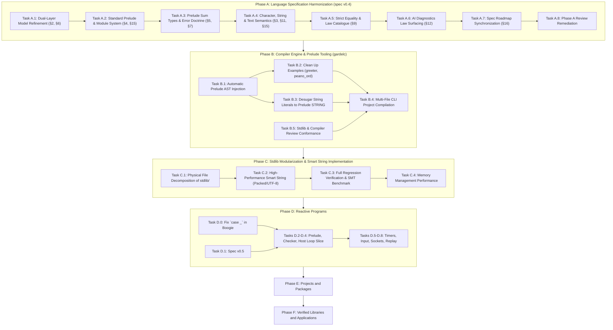
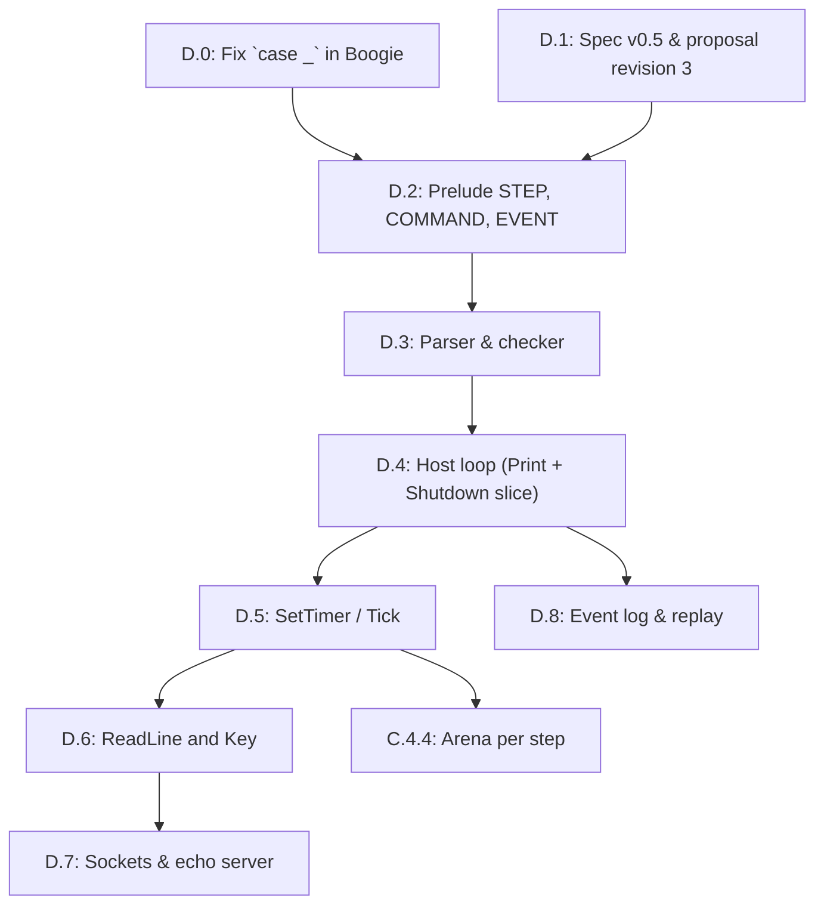
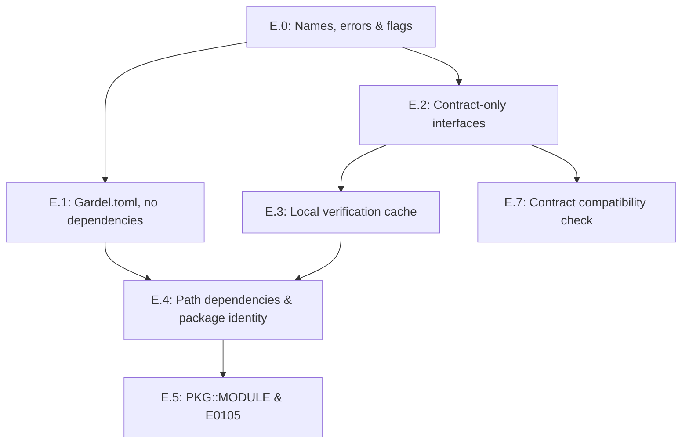

# Consolidated Gardel Architecture & Evolution Roadmap

**Date:** October 31, 2026  
**Status:** 🚀 **APPROVED & ACTIONABLE**  
**Preceding Milestones:** Completed Steps 1–4 (Foundations, `RESULT`/`OPTION`, Functional Core, Law Catalogue & Concepts)  
**Input Documents:**
- [stdlib_file_organization.md](stdlib_file_organization.md)
- [functional_ideas.md](functional_ideas.md)
- [Design Smart String.md](Design%20Smart%20String.md)
- [core_library.md](core_library.md)
- [core_library_vs_functional_ideas_review.md](core_library_vs_functional_ideas_review.md)
- [step1_remediate_stdlib_foundations.md](step1_remediate_stdlib_foundations.md)
- [step2_result_and_composable_option.md](step2_result_and_composable_option.md)
- [step3_verified_functional_core.md](step3_verified_functional_core.md)
- [step4_algebraic_law_catalogue_and_concept_conformance.md](step4_algebraic_law_catalogue_and_concept_conformance.md)
- [libraries/verified_libraries.md](libraries/verified_libraries.md)
**Primary Artifacts Targeted:**
- `../spec/gardel_language_specification_draft_v0_5.md`
- `../gardelc/src/main.rs`
- `../stdlib/` (`stdlib.gdl` and modular subdirectories)
- `../examples/` (`greeter.gdl`, `peano_ord.gdl`, `bounded_stack.gdl`)

---

## 1. Executive Summary & Baseline

Over Steps 1 through 4, Gardel completed a major conceptual and verification overhaul of its foundation:

1. **Step 1 (Foundations):** Repaired `BIGNAT` (Horner polynomial `value_of` over radix $2^{64}$ yielding true `MATH_INT` values), `SEQ` ($O(1)$ subtree lengths, non-overflow preconditions on `concat`, eliminating truncation bugs), and `STRING` (inductive `all_bytes_valid` and invariant).
2. **Step 2 (Absence & Fallibility):** Added `RESULT[E, A]` with verified constructors, combinators (`map`, `map_error`, `and_then`), safe extractors, and composable `OPTION[A]` with 13 verified algebraic laws.
3. **Step 3 (Verified Functional Core):** Added canonical inductive `functions LIST_OPS`, divide-and-conquer parallel `module SEQ[A]` with full model-refinement postconditions against `LIST_OPS`, and pointwise `functions FUNCTION_OPS`.
4. **Step 4 (Law Catalogue & Concepts):** Standardized `concept EQ`, `CANONICAL_EQ refines EQ`, and `ORD refines EQ`, decoupled Leibniz structural equality (`=`) from behavioral equivalence (`.equals()`), proved comprehensive Monoid, Functor, Monad, Fold, and Order laws in `specify`, and indexed concept laws into `--json-diagnostics` for AI synthesis and repair.

This roadmap consolidates the architectural insights from our analysis into a unified, three-phase plan that aligns the language specification, compiler engine, and standard library.

---

## 2. Strategic Principles & Error Corrections

Our architectural review corrected five critical misconceptions that must govern all future work:

| Area | Previous Misconception | Corrected Architecture Principle |
| :--- | :--- | :--- |
| **Ontology of Types** | Treating `RESULT[E, A]` and `STRING` as primitive types in §3. | **`RESULT` and `OPTION` are Standard Prelude ADTs** (§5), defined using sum-type syntax. Primitives (§3) are strictly machine/SMT scalar types (`UNIT`, `U64`, `I64`, `F64`, `BOOL`, `CHAR`, `MATH_INT`). |
| **Physical vs. Verification Boundaries** | Using `group { ... }` as an ambient file wrapper for the entire stdlib. | **One module per file by default.** `group { A, B }` is strictly a verification and compilation barrier for **mutually recursive ADTs and co-inductive invariants**, not an arbitrary multi-module container. |
| **Standard Prelude** | Expecting user programs to duplicate stdlib definitions or fake `group` headers. | **Implicit Standard Prelude:** Core concepts (`EQ`, `CANONICAL_EQ`, `ORD`), prelude ADTs (`OPTION`, `RESULT`, `SEQ`, `STRING`, `BYTES`, `STRING_ERROR`, `IO_ERROR`, `BIGNAT`), and specification types/modules (`LIST`, `MATH_INT`, `LIST_OPS`, `FUNCTION_OPS`) are implicitly available in all user modules unless `--no-prelude` is passed (§4.1). |
| **Decoupled Text Model** | Tying `STRING` contracts to physical byte buffers (`SEQ[U64]` or `SEQ[U8]`). | **Three-Layer Text Architecture:** Logical Unicode scalar sequence (`specify chars: LIST[CHAR]`), opaque physical representation (`representation {NONE}`), and explicit boundary distinction between valid `STRING` and raw `BYTES`. |
| **Strict Equality Semantics** | Inconsistently using Leibniz `=` in contracts for quotient/collection types. | **Strict Equality Hierarchy:** Structural Leibniz `=` applies only to primitive types and types satisfying `CANONICAL_EQ`. Non-canonical types (`SEQ`, quotient `RAT`, `SET`) must use `.equals()` or ghost model equality (`a.model = b.model`). |
| **Dual-Layer Abstraction** | Treating model refinement as an ad-hoc trick for `SEQ`. | **Core Language Principle:** High-performance runtime data structures (trees, ropes, arrays) refine to inductive mathematical ghost models (`LIST`, `MATH_INT`, `LIST[CHAR]`). |

---

## 3. High-Level Dependency Graph



---

## 4. Work Breakdown Structure

---

### Phase A: Language Specification Harmonization (`spec/gardel_language_specification_draft_v0_5.md`)

**Objective:** Align the language specification draft v0.4 with the architectural breakthroughs of Steps 1–4 and the planning analyses.

#### Task A.1: Formalize Dual-Layer Model Refinement as a Core Language Principle (§2, §6) [✅ Completed]
- [x] Add **Principle 9: Dual-Layer Model Refinement** to §2.
- [x] Define how high-performance, divide-and-conquer runtime data structures (such as `SEQ[A]`, `BIGNAT`, and `STRING`) are paired with inductive mathematical ghost models (`LIST[A]`, `MATH_INT`, `LIST[CHAR]`).
- [x] Specify that runtime operations establish abstraction refinement postconditions (`Result.model = MODEL_OPS.op(Current.model, ...)`), enabling simple structural induction in SMT while executing in parallel on BendRT.
- [x] Update §6 to document how ghost models interact with hereditary representation invariants.

#### Task A.2: Specify the Standard Prelude & Multi-File Architecture (§4, §15) [✅ Completed]
- [x] Formalize the **Standard Prelude**: types/modules (`OPTION`, `RESULT`, `SEQ`, `STRING`, `BYTES`, `STRING_ERROR`, `IO_ERROR`, `BIGNAT`, `LIST`, `MATH_INT`, `LIST_OPS`, `FUNCTION_OPS`) and concepts (`EQ`, `CANONICAL_EQ`, `ORD`) are automatically in scope for all modules unless `--no-prelude` is active.
- [x] Re-scope `group { A, B }`: define it strictly as a **mutual-recursion verification unit** for interdependent types, not an ambient file container.
- [x] Establish the **one-module-per-file** physical convention (`W0201`) with globally unique top-level module names.
- [x] Update §15 (Grammar) to clarify top-level compilation units.

#### Task A.3: Standardize Prelude Sum Types & the Error Handling Doctrine (§5, §7) [✅ Completed]
- [x] Elevate `RESULT[E, A]` alongside `OPTION[A]` in §5 with its standard definition:
  ```text
  module RESULT[E, A]
  representation {ANY}
    | Error(err: E)
    | Ok(val: A)
  ```
- [x] Formulate the **Error Handling Doctrine** in §7:
  - **Preconditions (`require`):** Enforce programmer contracts and type invariants. A violation indicates a bug rejected statically by the verifier.
  - **Fallible Values (`RESULT[E, A]`):** Represent expected domain failures and untrusted boundary data. Total functions return `RESULT` without exceptions.
  - Detail `and_then` chaining for composable, railway-oriented monadic pipelines without special language syntax.

#### Task A.4: Define the Three-Layer Text Model & String Literals (§3, §11, §15) [✅ Completed]
- [x] Define the text hierarchy in §3:
  1. `CHAR`: 32-bit Unicode scalar value primitive (`uint32_t`).
  2. `STRING`: Opaque prelude ADT (`representation {NONE}`) with ghost model `specify chars: LIST[CHAR]`.
  3. `BYTES`: Raw untrusted byte sequences at I/O and boundary interfaces.
- [x] Specify in §3 and §15 that string literals (`"..."`) desugar into verified `STRING` values whose `chars` model matches the sequence of Unicode scalar values.
- [x] In §11 (IO), specify boundary decoding: `STRING.from_utf8(bytes: BYTES): RESULT[STRING_ERROR, STRING]`.

#### Task A.5: Standardize Strict Equality Semantics & Law Catalogue (§9) [✅ Completed]
- [x] Codify the three levels of equality in §9:
  1. **Structural Leibniz Equality (`=`):** Permitted only for primitives and types conforming to `CANONICAL_EQ`.
  2. **Behavioral Equivalence (`a.equals(b)`):** Required for all types conforming to `EQ`, including non-canonical/quotient types (`SEQ`, `BIGNAT`).
  3. **Ghost Model Equality (`a.model = b.model`):** The standard method for stating contracts on non-canonical types against canonical mathematical models.
- [x] Clean up contracts in §8 and §14 to eliminate accidental Leibniz equality assertions on collection types.
- [x] Incorporate the Bird & Wadler algebraic law catalogue (Monoids, Functors, Monads, Folds, Orders) as normative concept laws.

#### Task A.6: AI Diagnostic Law Surfacing in `--json-diagnostics` (§12) [✅ Completed]
- [x] Specify how `gardelc --json-diagnostics` indexes in-scope concept laws and catalogue lemmas and emits them in `relevant_lemmas`.
- [x] Document how AI coding agents utilize these indexed laws for program derivation and automated proof repair.

#### Task A.7: Synchronize Specification Roadmap (§16) [✅ Completed]
- [x] Mark Steps 1–4 as locked/completed in the v0.4 roadmap table and preserve Compiler & Verification Phases 0–4 (§12, §13).
- [x] Align Phase 4 standard library milestones (Steps 1–4 + Consolidated Evolution Phases A–C) with the consolidated plan.

#### Task A.8: Phase A Review Remediation (spec) [✅ Completed]
Source: [review/review.md](review/review.md). The verification notes for each finding are appended to that file.
- [x] §6.4.C `STRING`: restated the bootstrap as the ASCII subset of UTF-8 (`bs.head < 128`); `decode_utf8` now has a precondition, uses `CHAR.from_scalar`, never drops bytes, and proves `same_length`; added `law decode_injective` (justifies `equals` and `code_point_count`) and `specify {EQ}`.
- [x] §3.1: added `CHAR.from_scalar(n): CHAR` with a `valid_scalar` precondition.
- [x] §5: `OPTION.equals` / `RESULT.equals` postconditions are case-wise; `Result = (Current = other)` stays only in `specify {CANONICAL_EQ}`.
- [x] §3, §4.1, §6.4.B: `BIGNAT` limbs are `LIST[U64]` everywhere; `LIST` has dual runtime/ghost status (only `MATH_INT` is ghost-only); documented little-endian limb order and the misleading `push_high_limb` name.
- [x] §6.4: marked the `SEQ`/`BIGNAT` listings as abridged and documented the Visibility Rule 3 bootstrap deviation as non-normative.
- [x] §7.2.2: `err_spec` uses `.equals(...)`. §12: `combine_trees` gains a `fits` precondition; fold-singleton tags fixed to `.single_folded`.
- [x] §11: added `module IO_ERROR` (provisional) and the `BYTES` public surface.
- [x] §15: `LawDecl` parameters are optional; added `"()"` to `Type`.
- [x] §16.3: removed the false hereditary `size_eq` invariant claim for `SEQ`; corrected law names.

---

### Phase B: Compiler Engine & Prelude Tooling (`gardelc`)

**Objective:** Upgrade `gardelc` to support the standard prelude and multi-file compilation so user programs no longer need to copy-paste library code.

#### Task B.1: Automatic Prelude AST Injection in `gardelc` [✅ Completed]
- [x] In `gardelc/src/main.rs`, update file parsing:
  - [x] When compiling any user `.gdl` file, automatically merge the parsed standard prelude AST (`phase4_stdlib_source()`) into the symbol table, concept map, and Boogie verification context. (Prelude concepts are merged into the concept map and prelude modules into the program symbol table; each user module's Boogie file receives the namespaced background theory (`OPTION__*`, `SEQ__*`, ...) of the referenced prelude ADTs: sorts, constructors, routine functions, definitional/contract axioms, routine-precondition predicates and trusted law markers. No prelude `Verify_*` procedure is re-emitted, so prelude obligations are not re-proven; their contracts/laws are trusted on the strength of `gardelc --stdlib --strict`.)
  - [x] Skip prelude injection when `--no-prelude` or `--stdlib` bootstrap mode is passed, or if the file being compiled *is* the standard library itself (avoiding duplicate symbol errors, §4.1).
  - [x] `E0101: duplicate_prelude_symbol`: in prelude mode a user top-level module / `functions` / `program` / concept named like a prelude identifier is a fatal error. (`examples/greeter.gdl` and `examples/peano_ord.gdl` reported E0101 until Task B.2 removed their embedded prelude copies.)
  - Known limits (follow-ups): `STRING` stays mapped to the built-in `GardelString` literal sort until Task B.3; `LIST_OPS`/`FUNCTION_OPS` remain realized by the built-in `Seq_*`/`Fn1_*` preamble theories; prelude calls are routed by a best-effort local type inference (receivers whose type cannot be inferred resolve only when the routine name is unique among the injected modules).

#### Task B.2: Clean Up Example Programs [✅ Completed]
- [x] Refactor `examples/greeter.gdl`: remove redundant copies of `OPTION`, `SEQ`, `BIGNAT`, and `STRING`, and remove the `group` header. The file becomes a pure, concise `program GREETER`. (`main(args: SEQ[STRING])` as in §11; `examples/peano_ord.gdl` likewise drops its own `EQ`/`CANONICAL_EQ`/`ORD` and uses the prelude concepts.)
- [x] Verify that `examples/greeter.gdl`, `examples/peano_ord.gdl`, and `examples/bounded_stack.gdl` compile and verify cleanly against the injected prelude with 0 errors and 0 warnings. (All three: `--strict` 0 errors, 0 warnings.)
  - Known limits (follow-ups): the §11 `GREETER` form (`IO.read_line` returning `RESULT[IO_ERROR, STRING]` matched with `Ok`/`Error`, `IO.print_line`, `STRING.concat`) is not yet supported by `gardelc` (`IO.read_line` is modelled as returning `GardelString`, there is no `print_line`/`concat`, and a `match` on a bound `with IO` result fails Boogie emission), so the example keeps the `name <- IO.read_line` / `IO.print("Hello, " + name)` form until Task B.3 / Phase C. `examples/tree.gdl` (not in scope) still reports 5 errors because the built-in `Seq_*` Boogie preamble has no axioms for `Seq_singleton` and no `Seq_has(Seq_empty(), x)` = false axiom.

#### Task B.3: Compiler Desugaring of String Literals [✅ Completed]
- [x] In `gardelc` AST and type-checker, lower `Expr::Literal(Literal::String(s))` into a call to `STRING.from_literal` or a compiler-generated constant carrying `ensure Result.chars = ...`. (String literals have the prelude type `STRING`. In prelude mode the prelude `STRING` theory is injected into user Boogie contexts (removing the B.1 limit) whenever the module mentions `STRING`, a literal or `IO`, and `STRING`-typed values map to the prelude sort. A literal `[c_0..c_{n-1}]` becomes a constant `str_lit_k` *defined* by `STRING.make_empty(max(n,1)).push_ascii(c_{n-1})...push_ascii(c_0)` (one definitional axiom per construction step, nothing else trusted); the lemma procedure `Verify_string_literal_k` proves every `make_empty`/`push_ascii` precondition, the `STRING` invariant, `chars = LIST.empty.prepend(c_{n-1})...prepend(c_0)` and `byte_length = n`, and every user procedure `call`s it to use those proven facts. `STRING.make_empty`/`push_ascii` gained the proven postconditions `capacity_set`/`same_capacity`.)
- [x] Compile-time validation (§3.1.4, §15): `E0302 malformed_escape_sequence` (only `\n \r \t \\ \' \" \0 \u{H..}` with 1–6 hex digits), `E0304 surrogate_in_literal`, `E0301` raw line break in a string literal, and `E0303 non_ascii_string_literal` (the bootstrap `STRING` is ASCII, §6.4.C; non-ASCII literals need Task C.2).
- [x] §9 equality: `=` with a `STRING` operand is rejected (`E0311 non_canonical_string_equality`; use `a.equals(b)` or `a.chars = b.chars`), as are `+` on `STRING` (`E0312`; `+`/`concat` is not in the bootstrap prelude) and string-literal `match` patterns (`E0313`).
- [x] Connect string literals directly to the C11 emitter runtime string constructor (`string_from_utf8`). (Each literal is a `static const uint8_t gardel_str_lit_k[] = { ..., 0 };` buffer wrapped by the zero-copy, zero-decoding `string_from_utf8(bytes, len)`. Programs are now lowered from their source (the canned GREETER C template was removed), with `IO.print`/`IO.print_line`/`IO.read_line`/`IO.exit` runtime helpers.)
- [x] `examples/greeter.gdl` rewritten to `IO.print("Hello, ")` + `IO.print_line(name)` (no string `+`); `--strict` 0 errors, 0 warnings, and it builds and runs.
- [x] Boogie timeouts are now reported as errors (`Phase 3 Boogie (Verification Timeout)`) instead of being silently counted as verified.
  - Known limits (follow-ups): `STRING.concat` is not added: a client like §11 `GREETER` could not prove its capacity/overflow precondition for an unbounded `IO.read_line` result, so greeter prints the parts separately. `IO.read_line` is still modelled as returning a plain `STRING` (no `RESULT[IO_ERROR, STRING]`, no invariant/ASCII guarantee about the result in Boogie; the C runtime does not validate input bytes); `args: SEQ[STRING]` is passed as `NULL` in C (no argv marshalling). Under `--no-prelude` literals keep the legacy opaque `GardelString` sort. The E0311/E0312 operand typing reuses the best-effort prelude call inference (operands whose type cannot be inferred are not checked). IO actions remain uninterpreted in Boogie (pre-existing).

#### Task B.4: Multi-File Project Compilation Support [✅ Completed]
- [x] Extend the `gardelc` CLI to accept multiple files or a directory:
  `gardelc src/*.gdl --strict`. (Operands: files, directories (top-level `*.gdl`, not recursive) and wildcard patterns, which `gardelc` expands itself when PowerShell/`cmd` leave them unexpanded. Several files, a directory or a wildcard operand make a *project run*. A single-file run uses the unchanged pre-B.4 pipeline (`--stdlib`, `--no-prelude`, `--json-diagnostics`, `build/` outputs). Spec §4.2.3 states the CLI rules.)
- [x] Link all modules in the compilation run into a shared symbol table before generating Boogie verification conditions. (All files' concepts form one concept map. A module's Boogie context receives the namespaced background theory (`N__*`) of every other-file user module it references, transitively, the same way B.1 injects prelude theories: sort, constructors, routine functions with fuel-guarded definitions and precondition-guarded contract axioms, invariant, law axioms, precondition predicates and law markers. Each is emitted in `N`'s own context. Call sites assert the callee's `require` clauses. No `Verify_*` procedure of `N` is re-emitted; `N`'s obligations are proven once, in its own Boogie file of the same run, which fails if any of them fails.)
- [x] Diagnostics: `E0102: duplicate_module_name` (fatal; cross-file duplicate top-level module/concept). `W0201: file_module_name_mismatch` (project runs only; the basename must equal the lowercase snake_case of the file's unit, or of one of its co-located units; `group` files are exempt; a warning, and an error under `--strict` per §4.2.1). New `E0103: cyclic_module_dependency` (fatal; cycle of cross-file references, which would make trusted contracts circular). All diagnostics carry their own file path in text and `--json-diagnostics`.
  - Known limits (follow-ups): modules in the *same* file are still not linked to each other, and `group` simultaneous verification (§4.3) is not implemented. Constructor names are resolved by the best-effort reference scan; on a clash the prelude wins, then the first linked module. `gcc` / `--run` build only the primary module's C file (the unique `program`, else the last module), with no cross-module C linking. The concrete-sampling fallback used when Boogie is unavailable does not see linked modules. `examples/peano_ord.gdl` declares `module PEANO`, so in a project run it triggers `W0201` (an error under `--strict`); the file was not renamed.

#### Task B.6: Verifier Soundness Fixes from the Phase B Review [✅ Completed]
- [x] **Laws are never assumed by their own module.** Concept axioms (`fn_equals(x, x) == true`, ORD axioms) and triggered law axioms are emitted only into *client* contexts (prelude injection, linked modules), never into the module's own `Verify_*` context. Before, a module with a non-reflexive `equals` had contradictory axioms and verified every obligation vacuously.
- [x] **Conditional `CANONICAL_EQ` is no longer assumed for every element type.** Element `x.equals(y)` on a bounded type parameter lowers to `<tp>_eq` by type, not by variable name (the `opt`/`res`/`a`/`b`/`c` special case is removed from the Boogie emitter). `<tp>_eq <==> ==` is no longer a module-wide axiom for `where tp satisfies CANONICAL_EQ`. The module's own `specify {CANONICAL_EQ}` laws are proven over a fresh witness type `tp__Canon`, and client-side law markers are guarded by the `where` hypothesis. Before, `Some(s1).equals(Some(s2)) = False` verified for `s1.equals(s2)` on `SEQ`.
- [x] **Same-module call preconditions are checked.** A static `M.r(..)`, unqualified `r(..)`, or `x.r(..)` call on a receiver of the module's own type asserts the callee's `require` clauses at the call site. Before, `BOX3.make(50)` against `require x < 10` verified.
- [x] **Inductive law proofs.** A law's `do` body is now translated: `match`/`if` become branches, and a recursive law call checks the law's preconditions and a strictly decreasing `variant` (structural `M_adt_size` for module-typed variables), then assumes the law's conclusion (the induction hypothesis). `examples/peano_ord.gdl`'s ORD laws, which had verified only through the circular axioms, now verify by induction.
- Regression tests: `test_soundness_*` (4). `cargo test` 62/62; `--stdlib --strict` 0/0; greeter, peano_ord, bounded_stack 0/0.
- **Known limits:** calls to *other* laws inside a law body contribute nothing (no cross-law assumption, to avoid cycles). The Dafny emitter (output-only) still has the name-keyed element-equality lowering (moot: emitter removed in Task B.12). Same-module precondition checks need a receiver whose type is known (parameters, `match` binders, `let` of module calls). One false postcondition can still mask others in the same module (review item 6).

#### Task B.9: False Contracts No Longer Mask Other Failures (review item 6) [✅ Completed]
- [x] Routine contracts are Boogie axioms. A false postcondition contradicts the routine's definitional axiom, and the inconsistency silently proved every other obligation whose terms reach that routine. Example: `f` claims `Result = 7` but returns `0`; `g` calls `f` and falsely claims `Result = 1`; only `f` was reported.
- [x] `run_boogie_verification` now iterates to a fixpoint. After each pass, a failed postcondition clause is withdrawn from the contract axioms; any other failure of a routine (overflow, precondition, termination, invariant) withdraws its whole contract. Verification repeats until no new failure appears, and the union of all passes is reported. Withdrawing axioms only weakens the context, so every reported failure is genuine. Withdrawal is per clause, so a true clause proven by induction keeps its induction hypothesis. Extra passes run only when something fails.
- [x] Test `test_item6_*` (masking, no noise for correct callers, per-clause withdrawal). `cargo test` 66/66. `tree.gdl` keeps exactly its 5 genuine failures.
- **Follow-up finding (fixed in Task B.10):** non-terminating recursion verified its contracts.

#### Task B.10: Termination Across the Call Graph [✅ Completed]
- [x] **Problem 1:** direct recursion *without* a `variant` was never checked in the Boogie path (only the fallback evaluator had a "missing variant" diagnostic). `f(n) do f(n) end` verified `Result = 7`.
- [x] **Problem 2:** mutual recursion (`f` → `h` → `f`) was never termination-checked, so its contracts proved themselves through the cycle.
- [x] **Fix:** the module's call graph is built from routine bodies. Calls on receivers of a known other type, e.g. `xs.length` on a `LIST`, are excluded; receivers of unknown type count as calls into the module. Recursive groups are its strongly connected components. At every call inside a group, both routines must declare a `variant` (else `variant_missing`), and the callee's variant at the call's arguments must be lexicographically smaller than the caller's (`variant_decrease`). A structural variant on the module's own type is measured by `<M>_adt_size`. Self-calls with a variant keep the existing check; cross-file cycles were already rejected (`E0103`).
- [x] Test `test_termination_direct_and_mutual_recursion`: missing variant rejected, decreasing `is_even`/`is_odd` accepted, non-decreasing rejected. `cargo test` 67/67. stdlib and examples unchanged (no spurious cycles).
- **Known limits:** recursion through a closure argument or a higher-order call is not in the call graph (fixed in Task B.11). Variants of different lengths are compared on their common prefix (a strict decrease is required there).

#### Task B.11: Pre-Phase-C Hygiene [✅ Completed]
- [x] **Recursion through function values (E0315).** The call graph now records every use of a module routine with lexical scoping: direct calls, calls inside a lambda body, and references used as function values (`apply(f, n)`, `M.apply(M.f, n)`). Parameters, `let`, `match`, quantifier, IO-bind and lambda binders shadow routine names. Inside a recursive group, a group member may only be called directly: a `variant` cannot be related to a call that happens whenever a closure is applied. Calls in a closure and function-value references to the group are rejected with `E0315: higher_order_recursion`. Before, such programs failed only by accident, because the Boogie backend emits ill-typed code for general lambdas and routine references. That would have become a soundness hole once closures get a general encoding. Passing a non-recursive routine or a non-recursive lambda is unaffected.
- [x] **Stale stdlib copy removed.** `gardelc/stdlib/stdlib.gdl` (264 lines, 4 modules) was an old `gardelc --emit-stdlib` output, which writes `./stdlib/` relative to the working directory. The compiler embeds `../stdlib/stdlib.gdl`. The copy is deleted and `gardelc/.gitignore` ignores `/stdlib/`.
- [x] **Bounded type parameters on product modules.** A module type parameter is a hole of `type M A;` and is quantified (`<A>`) in every module function, so it is no longer also declared as a global `type A;` (Boogie rejected the clash). Product modules now use the same polymorphic `A_eq<A>` / `A_less<A>` theory as sum modules. `module PAIR[A: EQ]` with a record representation verifies, and its `EQ` axioms are usable (symmetry proved, a false claim rejected).
- [x] **`!=`.** Lexed (spec §15 grammar) and desugared by the parser to `not (a = b)`. Every backend and the element-equality lowering (`<tp>_eq`) therefore handle it unchanged.
- [x] Tests `test_termination_through_function_values_is_rejected` and `test_product_module_type_params_and_not_equal`; `test_plan3_constrained_generics_concept_laws` updated to the polymorphic theory. `cargo test` 69/69. `--stdlib --strict` 0/0; greeter, peano_ord and bounded_stack 0/0; tree.gdl keeps its 5 genuine errors.
- **Not done: Dafny equality (resolved in Task B.12 by removing the Dafny backend).** The Dafny emitter lowers `=` to structural `==`, and it picks `equals(...)` vs `==` on OPTION/RESULT by the receiver's *variable name*. Fixing that alone is pointless: the generated `.dfy` for the generic prelude modules (`option`, `result`, `seq`) does not parse in Dafny 4 (7–10 parse errors each). Only simple non-generic modules (peano, bounded_stack) verify. Dafny runs only under `--run`, and its result is ignored. Decide whether to repair the Dafny backend (type-directed equality, as in Boogie) or drop it in favour of Boogie as the single verifier.
- **Parser note:** `Result = not (a = b)` does not parse (`not` is not accepted as a comparison operand); write `Result = (not (a = b))`.

#### Task B.12: Boogie Is the Only Verifier [✅ Completed]
- [x] **Decision:** the Dafny backend is dropped. It was a second, unchecked opinion: `.dfy` files were emitted on every compile, but Dafny ran only under `--run` and its result was ignored. Its output for the generic prelude modules (OPTION, RESULT, SEQ) did not parse in Dafny 4. Its equality lowering (structural `==`, `equals` chosen by receiver variable name) disagreed with the Boogie side's behavioral `<tp>_eq`. Keeping it in step through Phase C (stdlib split, smart STRING) would have been pure cost.
- [x] Removed from `gardelc`: the Dafny emitter section (`emit_dafny`, `emit_dafny_routine`, `emit_dafny_law`, `emit_dafny_lemma_stmt_expr`, `emit_dafny_block`, `emit_dafny_expr`, `map_dafny_type`; ~700 lines), the `build/<module>.dfy` output, the `dafny verify` call in `--run`, and the Dafny assertions in two tests. The pipeline now reports five steps (`[0/5]`…`[5/5]`: prelude, parse, checks + Boogie/Z3 verification, `.bpl`, Bend v2, C11).
- [x] Z3 is still the bundled binary under `tools/dafny/z3/` (that path is only where the solver lives). README and spec (function-parameter theory, verifier-backend table) updated.
- [x] `cargo test` 69/69; `--stdlib --strict` 0/0; examples unchanged.

#### Task B.8: `SEQ` Element Equality Bound (review item 5) [✅ Completed]
- [x] `module SEQ[A] satisfies EQ where A satisfies CANONICAL_EQ` (was `where A satisfies EQ`). `SEQ.equals` compares elements structurally (model equality over `LIST[A]`), which is behavioral equality only for canonical elements. Under the old bound, `SEQ[SEQ[U64]].equals` called two sequences unequal when their elements were behaviorally equal inner trees of different shapes.
- [x] **Enforced:** `E0314: unsatisfied_where_constraint`. Calling a routine of a concept that a module lists *directly* in `satisfies` (e.g. `equals` of `EQ` on `SEQ[T]`) requires the `where` constraints to hold for the type arguments. Primitives are `CANONICAL_EQ`/`ORD`, a type parameter satisfies its declared bound, and a module type satisfies its listed concepts when its own `where` constraints hold. `SEQ[SEQ[U64]]`, `SEQ[STRING]` and `SEQ[A]` with unbounded `A` are rejected; `SEQ[U64]`, `SEQ[CHAR]` and `SEQ[A]` with `[A: CANONICAL_EQ]` are accepted. `OPTION`/`RESULT` list only `CANONICAL_EQ` and delegate element comparison (§5), so `OPTION[SEQ[U64]].equals` stays available.
- [x] `law SEQ.map_fusion` is restated with model equality (`.model = .model`), since its result type `SEQ[C]` has no `CANONICAL_EQ` bound on `C`.
- [x] Spec §6.4.A, §9 and §16.3 updated. Test `test_item5_*`. `cargo test` 65/65.
- **Known limits:** E0314 needs the receiver's type to be inferable (parameters, `let`s, IO binds). **Pre-existing bug found (fixed in Task B.11):** a bounded type parameter on a *product* module (`module H[A: CANONICAL_EQ]` with a record representation) declares `type A;` twice in Boogie and fails to type-check. Sum-type modules are unaffected.

#### Task B.7: `IO.read_line` Boundary per Spec §11 (review item 4) [✅ Completed]
- [x] **Stdlib:** added `module STRING_ERROR` and `module IO_ERROR` (`EndOfInput | Decode(cause: STRING_ERROR) | OsError(code: I64)`; path variants come with `read_file`/`write_file`). A representation field typed by another prelude module gets an opaque sort in the module's own `--stdlib` file, and resolves to the real injected sort in client contexts.
- [x] **Typing:** `IO.read_line : IO[RESULT[IO_ERROR, STRING]]`. The prelude theories it needs are injected automatically.
- [x] **Verification:** each `x <- IO.read_line` is a fresh `havoc` (before, it was a constant function, so two reads were provably equal), with the single boundary assumption "an `Ok` payload satisfies the `STRING` invariant". Routines that bind IO input get no definitional axiom. A `match` or nested `with IO` as the final expression of a `with IO` is emitted as statements. IO actions are type-checked (`assume e == e` instead of a comment), and their calls get call-site obligations.
- [x] **C runtime:** `gardel_io_read_line_result()` reads a line of any length (no 4096-byte truncation), strips `\n`/`\r\n`, and returns `Error(EndOfInput)`, `Error(OsError(errno))` or `Error(Decode(InvalidByte(offset, byte)))` for any byte ≥ 128. Only ASCII lines become `Ok(STRING)`.
- [x] **C backend:** instantiated prelude sum types (`RESULT_IO_ERROR_STRING`, `IO_ERROR`, `STRING_ERROR`) are emitted with tags and constructors. `match` on them evaluates the scrutinee once, uses the instance's tags and binds pattern variables. A nested `with IO` expression keeps its actions (they were dropped before).
- [x] `examples/greeter.gdl` is now the spec §11 GREETER (`match` on `Ok`/`Error`). It verifies 0/0 and was run natively: normal, CRLF, empty-line and no-newline input succeed; EOF and non-ASCII input exit 1; a 10 000-character line works.
- Tests: `test_item4_*` (2). `cargo test` 64/64.
- **Known limits:** in C, only the prelude sum types reachable from `read_line`'s type are emitted. Programs that build other prelude ADTs (e.g. `Some(x)`) still don't compile natively. `match` on a module's own ADT in C is unchanged (no binder binding).

#### Task B.5: Stdlib & Compiler Conformance with the Phase A Review
- [x] (B.5b) Remove the `equals`/`less_than` ghost-access exemption in `gardelc/src/main.rs` (Visibility Rule 3). Give `SEQ.equals`, `BIGNAT.equals`, and `BIGNAT.less_than` executable bodies, and add a `BIGNAT` normalization invariant (no zero most-significant limb).
- [x] (B.5a) Remove the hard-coded Boogie axiom `fn_decode_utf8(...) == bs` (keyed on the routine name `decode_utf8`). Prove `same_length` / `decode_injective` instead. The axiom silently becomes unsound once `decode_utf8` is a real multi-byte decoder (Task C.2).
- [x] (B.5a) Align `stdlib.gdl` `STRING` with spec §6.4.C: ASCII bound `< 128` in `all_bytes_valid`, `push_byte`, and `push_utf8_word`; a `require` on `decode_utf8`; and a `valid_scalar` precondition on `CHAR.from_scalar` (currently emitted as an unchecked identity).
- [x] (B.5a) Drop the unconditional `sound: Result = (Current = other)` from `OPTION.equals` / `RESULT.equals` in `stdlib.gdl`. It is still present next to the new case-wise clauses.
- [x] (B.5a) Remove the duplicate law `LIST_OPS.fold_left_append_distributivity` (same statement as `fold_left_append`) and its lemma-index entry and tests.
- [x] Rename `BIGNAT.push_high_limb` to `shift_in_low_limb` (it inserts the least-significant limb). (`stdlib.gdl`, `gardelc` tests, spec §6.4.B and §12.)

---

### Phase C: Standard Library Modularization & Smart String Implementation

**Objective:** Physically decompose `stdlib.gdl` into a clean directory structure and implement the full Unicode string model.

#### Task C.1: Physical Decomposition of `stdlib/` [✅ Completed]
- [x] Modularize the single `stdlib/stdlib.gdl` file into clean, 1:1 module/concept files satisfying §4.2 (`W0201: file_module_name_mismatch`):
  ```text
  stdlib/
  ├── concepts/
  │   ├── eq.gdl               # concept EQ
  │   ├── canonical_eq.gdl     # concept CANONICAL_EQ refines EQ
  │   └── ord.gdl              # concept ORD refines EQ
  ├── core/
  │   ├── option.gdl           # module OPTION[A]
  │   ├── result.gdl           # module RESULT[E, A]
  │   └── io_error.gdl         # module IO_ERROR
  ├── collections/
  │   ├── list_ops.gdl         # functions LIST_OPS
  │   └── seq.gdl              # module SEQ[A] (parallel divide-and-conquer)
  ├── numeric/
  │   └── bignat.gdl           # module BIGNAT (64-bit limbs, MATH_INT model)
  ├── text/
  │   ├── string.gdl           # module STRING (bootstrap ASCII, packed UTF-8 in C.2)
  │   └── string_error.gdl     # module STRING_ERROR
  └── functional/
      └── function_ops.gdl     # functions FUNCTION_OPS
  ```
  *(Note: `text/bytes.gdl` deferred to Task C.2 where the `BYTES` module is implemented).*
- [x] Update `gardelc`'s embedded stdlib bundler (`phase4_stdlib_source()` and `STDLIB_SOURCES`) to embed these 12 files in fixed dependency order without an ambient `group` header.
- [x] Extend `gardelc --stdlib` to run in project mode over `stdlib/`, verifying each module on its own with dependencies linked as already-verified contracts (`with_link_table`) with 0 errors and 0 warnings under `--strict`.
- [x] Unit tests: `test_c1_stdlib_modular_files_match_module_names_w0201` (all stdlib files pass W0201 under `--strict`) and `test_c1_stdlib_project_verification_zero_warnings_strict` (full multi-file project verification passes with 0 diagnostics under `--strict`). All 71 tests passing.
- [x] **Review fixes (C.1 review, critical items).**
  - **`--emit-stdlib` no longer overwrites sources.** It used to write the copy embedded in gardelc over `./stdlib/` without asking, which reverted hand edits to the 12 source files. It now writes to `build/stdlib/` by default (`--emit-stdlib <DIR>` to choose). It refuses the whole emission, writing nothing, when an existing file differs from the embedded copy; identical files are left as they are.
  - **`--stdlib` verifies the real sources.** It used to take whichever `stdlib/` was in the working directory (a leftover `gardelc/stdlib/` would win), and it silently fell back to the embedded copies while still reporting the 12 files. It now always verifies the tree gardelc was built from (`CARGO_MANIFEST_DIR/../stdlib`) and prints which one. If that tree is gone (gardelc moved), it says it is verifying the embedded copy. If the files on disk and the embedded list disagree (a module verified but not shipped, or the reverse), that is an error. A source file that differs from the embedded copy gets a note to rebuild gardelc.
  - Tests `test_c1_embedded_stdlib_lists_agree_with_source_tree` (also guards that `STDLIB_SOURCES` and the `concat!` in `phase4_stdlib_source()` list the same files in the same order) and `test_c1_emit_stdlib_never_overwrites_edited_sources`. `cargo test` 73/73.
- [x] **Review fixes (C.1 review, important items).**
  - **Stdlib files are recognized by location, not text.** Bootstrap mode used to be chosen when a file's text exactly matched the embedded copy. So an *edited* stdlib file was treated as a user file (`E0101`), and one user file identical to a stdlib file switched the prelude off for a whole project. Now a file belongs to the prelude when it lies in the stdlib tree gardelc was built from (`path_in_stdlib_tree`). `gardelc stdlib/core/option.gdl` and `gardelc stdlib` verify the whole tree, as `--stdlib` does (its modules depend on each other; a single file alone could not resolve `CANONICAL_EQ`). Mixing stdlib files with user files is an error, and a copy of a stdlib file elsewhere is a user file (`E0101`, which points to `--no-prelude`).
  - **Embedded lists cannot drift:** covered by the `--stdlib` disk-vs-embedded check and `test_c1_embedded_stdlib_lists_agree_with_source_tree`.
  - **Docs:** spec §4.1 (bootstrap paragraph), §6 module listing, §9 law catalogue, §11 `IO_ERROR`, and §16 (C.1 completed, `bytes.gdl` moved to C.2) no longer point to `stdlib/stdlib.gdl`. The README repository tree shows the `stdlib/` layout, and `gardelc/stdlib/` is removed from it.
  - `cargo test` 73/73.

#### Task C.2: High-Performance Smart String (`stdlib/text/string.gdl`) [✅ Completed]
- [x] Full RFC 3629 UTF-8 `STRING` (spec §6.4.C), keeping the public `chars` contracts:
  - [x] **Verification model:** `bytes: LIST[U64]` with one octet per element, plus `size`, the cached `char_count` and the builder capacity `limit`. Invariant: `BYTES.valid_utf8(bytes)`, `char_count = BYTES.decode_utf8(bytes).length`, `char_count <= size <= limit`, `limit > 0`. Ghost model `specify chars: LIST[CHAR]`. The model is not packed. The *runtime* representation is packed (see C11 below).
  - [x] Operations: `code_point_count` (cached), `byte_length`, `is_empty`, `character_at(index: NAT): CHAR` with `require index < code_point_count` (as in `Design Smart String.md`; not `OPTION[CHAR]`), `concat`, `to_utf8: BYTES`, `equals` (byte equality = character equality).
  - [x] Literal builders `push_ascii`, `push_utf8_2/3/4`; multi-byte string literals (`E0303` removed). The ASCII-only aliases `push_byte` / `push_utf8_word` were removed.
  - [x] Boundary decoding `from_utf8(bytes: BYTES): RESULT[STRING_ERROR, STRING]` with `ok_iff_valid: Result.is_ok = BYTES.valid_utf8(bytes.model)`. Errors are reported in a fixed check order (continuation bytes present, then completeness, then the lead-specific range), shared with the C decoder.
- [x] **UTF-8 theory in `module BYTES` (`stdlib/text/bytes.gdl`), proven, not axiomatized:** `valid_utf8`, `decode_utf8` and the laws `utf8_octets`, `utf8_append` and `decode_injective`, all proven by structural induction. They reach `STRING` as linked client axioms. `BYTES` also has `length`, `at`, `from_list`, `empty`, `to_list`, `is_empty`, `equals`.
- [x] **`concat` is usable on input:** its only precondition is byte-length overflow. `IO.read_line` returns lines shorter than 2^48 bytes (`GARDEL_MAX_LINE_BYTES`; the C runtime returns `Error(OsError(EOVERFLOW))` otherwise, and the verifier assumes the bound). `"Hé, ".concat(name)` verifies.
- [x] **C11:** `GardelString { data, len, chars }` is a packed UTF-8 buffer with cached code-point count. `STRING`/`BYTES` methods lower to `gardel_string_*` / `gardel_bytes_*`, dispatched on the receiver's C type with `_Generic` (the C emitter is untyped). `STRING.from_utf8` is supported. One RFC 3629 validator (`gardel_utf8_validate`) serves `read_line` and `from_utf8`. Expression-position blocks no longer emit `return`.
- [x] **C.2 review fixes (verifier soundness):**
  - **Non-exhaustive `match` on a prelude ADT verified anything.** C.2 had added `else { assume false; }` after every `match`, while exhaustiveness was asserted only for the module's own sum type. Now omitted constructors are asserted unreachable for prelude ADTs too (path-sensitive, spec §5), including `match` nested inside expressions, which was unchecked before C.2 as well. The `assume false` is emitted only after those assertions, where it is implied.
  - **16 hand-written UTF-8 Boogie axioms removed** (they were keyed on the module name `STRING` and made `STRING`'s own laws prove themselves). Replaced by the `BYTES` proofs above.
  - **Law proof steps:** a plain boolean term in a law's `do` body is asserted and then known (spec §15, Law Proof Bodies). This is needed for `utf8_octets`, where a 4-byte step exceeds the default fuel.
  - Prelude contract interfaces are emitted in the prelude module's own context, so `STRING`'s preconditions that call `BYTES.*` resolve in client files. `Result` inside `BYTES` is typed by the routine's return type, not assumed to be `BYTES`.
  - Receiver resolution decides "static call `T.r`" by the declarations in scope instead of capitalization.
- [x] Debugging aid: `GARDEL_KEEP_BPL=1` keeps the temporary Boogie VC files.
- [x] Tests: `test_c2_utf8_laws_are_proven_not_assumed` (mutations: a dropped shortest-form rule breaks `decode_injective`, a false `chars_append` is rejected, `concat` depends on the laws), `test_c2_from_utf8_accepts_exactly_valid_utf8`, `test_c2_match_exhaustiveness_on_prelude_adts`, `test_c2_utf8_strings_verify_and_run_natively` (verification, multi-byte literal facts, and a native run when `gcc` is available, checking code-point counts and the error classification of `ED C0`, `E0 41`, `E0 80`, `E0 80 80`, `C0 AF`, `ED A0 80`, `F4 90 80 80`, `FF`). The B.5a test was rewritten for the `BYTES` design with its deleted assertions restored, and the STRING invariant check is exact again. `cargo test` 77/77. `--stdlib --strict` 0/0. greeter, peano_ord and bounded_stack 0/0. `examples/tree.gdl` now reports 2 errors (was 5): C.2's `Seq_singleton`/`append` preamble axioms closed 3. The remaining two are `forall` postconditions that need lemmas, so they are incompleteness, not unsoundness.
- **Known limits:**
  - `character_at` is O(n) at run time, which is inherent to code-point indexing of UTF-8.
  - `concat` allocates and nothing frees (no GC yet).
  - `LIST_OPS.at`, like the other `LIST_OPS` functions, is realized by the built-in `Seq_at` preamble axioms (B.1 known limit).
  - The C emitter still has no general type inference: text methods rely on `_Generic`, so a call on an unexpected type is a C compile error, not a wrong call.

#### Task C.3: Regression Verification & Performance Benchmarking [✅ Completed]
- [x] Run complete test suite:
  - `cd gardelc && cargo test` (all 85 tests passing).
  - Verify all modular stdlib files under `gardelc --strict` with 0 errors and 0 warnings (13 files in ~11.0s).
  - Verify all examples under `gardelc --strict` with 0 errors and 0 warnings:
    - `bounded_stack.gdl`: 0 errors, 0 warnings (0.75s)
    - `greeter.gdl`: 0 errors, 0 warnings (1.18s)
    - `peano_ord.gdl`: 0 errors, 0 warnings (0.90s)
    - `seq_bench.gdl`, `seq_ops.gdl`: 0 errors, 0 warnings (added by the typed C backend follow-up below)
    - `tree.gdl`: 0 errors, 0 warnings (0.78s) — closed remaining 2 errors by supplying the `Seq_empty` base axiom for `Seq_has` (`!Seq_has(Seq_empty(), x)`), proving both `in_bounds` and `upper_bound`. The axiom is sound because it holds in the finite-list model and agrees with the existing `Seq_length`/`Seq_empty` axioms. Separately, mutation tests show that the proofs are not vacuous: stronger bounds are still rejected.
  - Added `utf8_step_4` inductive single-step lemma in `stdlib/text/bytes.gdl` to stabilize Z3 SMT solver across random seeds for multi-byte `push_utf8_4` capacity invariants.
  - Native C11 run of `greeter` (end-to-end stdin/stdout), compiled from its Gardel source.
  - OpenMP benchmark of the **hand-written SEQ reference runtime** `gardelc/runtime/reference/seq.c` (`seq_from_range` + `seq_parallel_sum`, up to 4,000,000 nodes, 4.39x on 20 logical cores). This C is not compiled from `stdlib/collections/seq.gdl` and verification does not cover it, so the number says nothing about code gardelc generates. For the compiled-from-source benchmark, see the typed C backend follow-up below.
  - Automated runner and reporter: `scripts/c3_regression.ps1` emitting `build/c3_report.md`.
- [x] **C.3 review fix (critical): hand-written C presented as compiled output.**
  - `emit_c11` returns a fixed, hand-written C program for modules named `TREE`, `BOUNDED_STACK`, `PEANO`, `SEQ`, `BIGNAT` and `STRING` (`C11_REFERENCE_RUNTIMES`). C.3 had added a `"SEQ_U64"` alias so that `--stdlib` (which monomorphizes `SEQ` to `SEQ_U64`) wrote that template as `build/seq.c`, and the benchmark printed "Verified Phase 4 SEQ[U64]". The alias is removed: templates are chosen by exact name only, and monomorphized names go through the general emitter.
  - Every template now starts with `HAND-WRITTEN REFERENCE RUNTIME … NOT covered by verification`, and none prints "Verified". The CLI prints a note when the primary module's C output is a template (for example `build/tree.c`).
  - The SEQ template lives in `gardelc/runtime/reference/seq.c` (embedded with `include_str!`), and the C.3 script benchmarks that file under a "reference runtime" label.
  - Test `test_c3_reference_runtimes_are_labeled_and_matched_by_exact_name`. `cargo test` 80/80.
- [x] **C.3 follow-up: typed C backend; stdlib `SEQ` compiled from source.**
  - **`gardelc/src/c11_typed.rs`** lowers modules and programs to C from their Gardel source, using inferred types. Routine instances are named after their owner type (`SEQ_U64__concat`). Generic modules *and* routine-level type parameters are instantiated on demand from a worklist: `SEQ[A].fold_left[B]` at `A = B = U64` is `SEQ_U64__fold_left__U64`, with `B` inferred from the function argument. It lowers constructors, `match` with field binders and arm-local `let`s, record literals and updates, Leibniz `=` (generated structural equality), function values and non-capturing lambdas (C function pointers). It provides an iterative cons-list runtime for `LIST[T]` where executable code uses it (`SEQ.to_list`, `SEQ.equals`). Specification routines (`model`) are never emitted. `STRING`, `BYTES` and `IO` stay in the C runtime header. A program's translation unit contains every module instance it uses, and `main` runs inside an OpenMP region. The CLI uses this backend for every C output except the exact-name reference templates. Anything it cannot lower is reported, and the C file then starts with `#error`.
  - **Fork-join (spec §10):** an independent `let` group becomes OpenMP tasks below a depth cutoff (`GARDEL_TASK_DEPTH`, default 12); past the cutoff it runs as plain sequential C. While measuring, a first version only deepened the *spawned* branch, so the depth never grew along right spines and millions of tasks were created: the 20-thread build was 3.5x *slower* than the 1-thread build. Every branch now runs one level deeper, a task restores its thread's depth, and a test pins this.
  - **Verifier fixes needed by client programs of the prelude `SEQ`** (each failed loudly before; none was unsound). `SEQ.empty`/`SEQ.singleton` called from a client were emitted as the bootstrap constructors `Empty()`/`Leaf(x)` instead of `SEQ__fn_*` calls. General lambdas were emitted as their bare body with unbound parameters; they are now lifted to a fresh Boogie function `lam_M_k(captures)` with one defining axiom `FnN_app(lam_M_k(c), x..) == body` (consistent: a fresh symbol with one equation), captures included. Local type inference now types lambdas and unifies function types, so `let d = s.map(fn(x: U64): U64 do ... end)` gets `SEQ[U64]`.
  - **Programs:** `examples/seq_ops.gdl` runs every executable SEQ routine compiled from source against 12 run-time checks, including the order of `fold_left` vs `fold_right`. `examples/seq_bench.gdl` reads `n` through the verified `read_line` boundary, builds `1..n` with a forking `from_range` and sums it with `SEQ.fold_left`. Both verify 0/0.
  - **Benchmark** (`scripts/c3_regression.ps1`, i9-12900HK, 20 logical cores, wall clock including process start, best of 3, n = 4,000,000): compiled from Gardel, 455 ms on 1 thread and 328 ms on 20 (x1.38); the hand-written reference, 869 ms and 176 ms (x4.95). On 1 thread the compiled program is faster because past the cutoff it makes no OpenMP calls. On 20 threads the reference wins because its sum is parallel, while `SEQ.fold_left` is sequential and SEQ has no parallel reduction.
  - The script now sets BOM-less UTF-8 for `[Console]::InputEncoding`. Windows PowerShell 5 had prefixed piped input with U+FEFF, which the Gardel programs (correctly) rejected. The greeter check now compares ordinally: PowerShell's `-eq`/`-ceq` ignore U+FEFF, which had hidden the problem.
  - Tests: `test_c3_typed_backend_compiles_stdlib_seq_from_source`, `test_c3_seq_programs_run_natively_from_source` (includes a mutant that must fail check 2, and the depth-accounting check), `test_c3_typed_backend_runs_text_program` (the C.2 UTF-8 program with all 12 inputs through the new backend), `test_c3_typed_backend_refuses_what_it_cannot_lower`, `test_c3_lifted_lambdas_are_proven_not_assumed`. `cargo test` 85/85.
- **Known limits:**
  - *(The C backend and verifier limits listed here at first were fixed by the second follow-up below.)*
  - Proof stability is now checked on multiple Z3 seeds (added `--z3-seed <N>` and multi-seed run in `scripts/c3_regression.ps1`). `--z3-seed` overrides `GARDEL_Z3_SEED`, and a missing or invalid value in either is an error, so a sweep cannot silently run on the default seed.
  - The BendRT backend emits `.bend` files, but C.3 did not run them.
- [x] **C.3 follow-up 2: memory, closures, patterns, argv; no hand-written C left.**
  - **Reference counting** (`c11_typed.rs`). Every heap value (module values, `LIST` cells, closure environments, string and byte buffers) has an atomic count. Gardel values are immutable and acyclic, so counting frees everything, deterministically. Calls borrow their arguments and return an owned result; constructors consume what they store; parameters, `match` binders and captures are borrowed; `let` and IO-bound locals are released at the end of their block; an owned temporary used as a borrow is bound and released after the use. Every lowered expression records whether it is owned, and `dup_*`/`drop_*` are inserted from that. Drops loop on the last same-type field, so long lists are freed in constant C stack. `STRING`/`BYTES` carry an `owner` (counted buffer, `NULL` for literals and argv). A test harness counts live allocations: 0 after 50 calls of every checked routine (SEQ ops, the parallel build and sum, closures, BIGNAT), and it does see a deliberately unreleased tree.
  - **Closures:** a function value is `{fn, env}` with a counted environment of captured values (dup'd at creation, released with the environment). Lambdas capturing locals or `Current`, nested lambdas, routine names as values and `FUNCTION_OPS.compose` (a stdlib closure) compile and run.
  - **Patterns** (`patterns.rs`, a pass after parsing): literal, tuple and nested patterns and top-level binders are compiled (clause matrix, first row wins) into flat matches, `if` chains and arm-local `let`s, for the verifier and the C backend alike. Exhaustiveness is still checked on the flat matches produced (a test removes `case None` from a nested match and expects a diagnostic). Tuples are C value structs.
  - **argv** (spec §11): `main(args: SEQ[STRING])` gets argv[1..] as a balanced `SEQ[STRING]`; each argument is checked with the RFC 3629 validator of `read_line`, and an invalid one stops the program with exit code 2 and a message before `main` runs. On Windows the arguments come from the UTF-16 command line (the C `argv` is in the ANSI code page); unpaired surrogates are invalid.
  - **No hand-written C:** `emit_c11`'s templates for `TREE`, `BOUNDED_STACK`, `PEANO`, `SEQ`, `BIGNAT`, `STRING` are deleted and the CLI lowers every module from source. `STRING`/`BYTES` library builds say that the runtime header provides them. Programs using `TREE`, `BOUNDED_STACK` and `PEANO` (verified as multi-file projects) and `BIGNAT` run from source. `gardelc/runtime/reference/seq.c` stays only as the benchmark baseline.
  - **Verifier fixes for client programs:** a bare zero-parameter routine name in a `program`/`functions` module is a call (a scope-aware rewrite after parsing). Receiver types of static call chains are inferred from the method's arguments (`SEQ.empty.concat(s)`, `BOUNDED_STACK.make(4).push(10)`). A call of a `let`-bound function value (`let h = FUNCTION_OPS.compose(..)`, then `h(x)`) is substituted as `.apply`. A structural `variant` on a parameter of a prelude or linked ADT is measured by that module's size function, so a client can recurse on `SEQ`'s constructors (`examples/seq_bench.gdl` now sums in parallel this way).
  - **C type aliases:** `NAT`/`EXIT_CODE` (`U64`) and `INT` (`I64`) are one spelling inside the C backend; otherwise `(U64) -> U64` and `(NAT) -> NAT` were different C function types.
  - **Benchmark** (n = 4,000,000, best of 3, wall clock): compiled from Gardel 832 ms on 1 thread and 591 ms on 20; the reference 881 ms and 177 ms. The compiled program now frees its 8M-node tree before exiting (about 300 ms, sequential); the reference frees nothing. Reference counting itself added about 70 ms to the 1-thread build.
  - Tests (`gardelc/tests/c_backend/*.gdl` fixtures): `test_d_no_hand_written_templates_remain`, `test_d_former_template_modules_run_from_source`, `test_d_closures_capture_and_are_freed`, `test_d_reference_counting_frees_everything`, `test_d_pattern_compilation`, `test_d_nullary_calls_and_receiver_inference`, `test_d_client_match_on_prelude_seq`, `test_d_main_args_are_validated_utf8`, `test_d_typed_backend_refuses_specification_code`. `cargo test` 92/92.
- **Known limits (after follow-up 2):**
  - Freeing is sequential and each value costs atomic count updates; a large structure released just before exit is freed anyway. No ownership transfer ("last use moves") yet.
  - A non-decreasing recursion on a client ADT parameter is rejected by a solver timeout, not a clean `variant_decrease` failure.
  - The unused untyped emitter (`emit_c11` / `emit_c11_general_module`) was removed; all code generation and tests now use the typed backend (`c11_typed`).
  - A library build instantiates type parameters at `U64` only. Tuples are pairs only.
  - Proof stability is now verified across multiple Z3 seeds (`0`, `1`, `42`); the BendRT output is not run.

- [x] **C.3 follow-up 3: code review fixes (critical items).** Each fix was checked against the previous compiler build, which failed the same fixture.
  - **Signed values compiled as unsigned.** A number with no annotation defaulted to `U64`, so `let zero = 0; x < zero` on an `I64` compared as unsigned in C, and the binary disagreed with its verified contract. Unannotated `let`s now take their type from their uses (the block is lowered again at that type), `if` and `match` take it from a typed branch, and a negated literal defaults to `I64`. Any remaining mix of signed, unsigned and `F64` is an error, never a C conversion. Negating an unsigned value and a literal that does not fit are errors too.
  - **Wrong generic instance.** `BOX.make(..)` inside `BOX[A].map[B]` was pinned to the caller's `BOX[A]`. Only a call using the caller's `Current` is pinned now. Otherwise the expected type and the arguments decide, and the caller's instance fills what they leave open. A value of another instance of the expected module is an error (C only warned, and the layouts differ).
  - **`match` scrutinee** (`patterns.rs`). It was copied into every column, which turned O(n) into O(2^n) for a recursive scrutinee (`fib_pair(90)` did not finish), and a binder such as `case (p, q)` on `p` captured the later columns. The scrutinee is now bound once to a fresh `_pmN`. A plain variable stays as it is unless a binder shadows it, so existing proofs keep their shape. The C backend lowers only the live branch of a pattern block, so nesting no longer doubles the C.
  - **Self tail calls are loops (spec §10).** The typed backend had none: a verified `loop(3000000, ..)` overflowed the stack (`0xC00000FD`). A tail call in a block, `if` or `match` now takes owned arguments, releases the scopes it leaves and the previous parameters, and jumps. This also covers calls that are not C tail calls because a local must be released after them. The unused `is_tail_recursive_routine` and its test are removed.
  - **Z3 seeds.** An invalid `--z3-seed` or `GARDEL_Z3_SEED` was ignored, and the run still reported 0/0 on the default seed. Both are errors now. The seed is resolved once at startup, so the `--run` Boogie call honours the variable too. The prover log shows both Z3 seed options set.
  - Tests `test_d_untyped_numbers_take_their_type_from_use`, `test_d_mixed_signedness_is_refused_not_converted`, `test_d_generic_call_inside_its_module_uses_the_right_instance`, `test_d_match_evaluates_its_scrutinee_once`, `test_d_match_binder_does_not_capture_its_scrutinee`, `test_d_self_tail_calls_are_loops`, `test_z3_seed_invalid_values_are_errors`, `test_z3_seed_args_set_both_solver_seeds`. `cargo test` 99/99.
- **Known limits (after follow-up 3):**
  - A `let` or pattern binder cannot reuse a parameter's name in Boogie (`more than one declaration of variable name`). It fails loudly. The C backend handles such shadowing correctly.
  - Only self tail calls are loops. Mutual recursion still uses the stack.
  - From the same review, not yet fixed (all fail loudly): `map_boogie_type` splits nested type arguments on every comma (`BOX[TUPLE[A, B]]`), `desugar_patterns` skips laws, a by-value tuple parameter in a function type fails in gcc, and field names are not escaped in C (`r`, C keywords).
  - `--run`'s second Boogie call finds Z3 through a relative path, which Boogie cannot start. The result of that call is not used.
- [x] **C.3 follow-up 4: verdicts no longer depend on machine load or solver failure.**
  - **Soundness: a solver that gave up could read as verified.** `Verification inconclusive (P)` did not match the parser, and Boogie's summary (`2 verified, 0 errors, 1 inconclusive`) was not read, so the module reported 0 errors. A crash with no summary passed the same way. Every "gave up" wording is now an error, and passing requires Boogie's clean summary line (`N verified, 0 errors` and nothing after it). Anything else fails closed with `Phase 3 Boogie (Verification Incomplete)`.
  - **Load no longer changes a verdict.** `/timeLimit:10` was wall-clock time, and Boogie reports hitting it as an ordinary error. Under 60 parallel runs, the valid proof in `test_c3_lifted_lambdas_are_proven_not_assumed` failed 53 times, and that test failed in about 1 of 4 full `cargo test` runs. Verification now uses Z3's resource limit `/rlimit` (`DEFAULT_Z3_RLIMIT`, override with `--z3-rlimit <N>`), which counts solver work. A 600-second time limit stays only as a backstop for a hung solver. The same 60-run load test now passes 60 of 60.
  - **Unproven is not refuted.** Boogie prints a refutation with a `*** MODEL`. A failed obligation with no model is one the solver gave up on, and it is now reported as `Phase 3 Boogie (Verification Resource Limit)`, with its tag kept for contract withdrawal (Task B.9), and not as a postcondition violation.
  - **Calibration (2026-11-04).** All VCs of `--stdlib`, the six examples and `cargo test` were captured: 136 unique files, 65 of them clean. Each clean file was run on seeds 0–3 at rising limits. Every proof passed on every seed. Resources needed: 245 of 260 file/seed pairs at most 500K, heaviest 3M (`BYTES`, seed 1). One proof varies by up to 6x across seeds. The limit is 30M, 10x the heaviest proof. No clean file changes verdict between 3M and 100M. If a proof passes 10M, recalibrate rather than raising the limit in passing.
  - Tests `test_boogie_inconclusive_is_never_a_pass`, `test_solver_giving_up_is_unproven_not_refuted`, `test_z3_rlimit_verdict_is_decided_by_the_limit`. `cargo test` 102/102.

#### Task C.4: Memory Management Performance [✅ Completed, reuse deferred]

**Objective:** make memory management cheaper while keeping reference counting, which suits Gardel's immutable, acyclic values and frees deterministically (tracing GC was considered and rejected: pauses and non-deterministic timing conflict with the bounded-work-per-event goal of reactive programs, and it complicates the OpenMP tasks).

**Baseline** (`examples/seq_bench.gdl`, n = 4,000,000, i9-12900HK, after C.3 follow-up 2): 832 ms on 1 thread, 591 ms on 20. Of this, counting costs about 70 ms on the 1-thread build (atomic updates, mostly the copy/release pair around each `concat`), and freeing the 8M-node tree costs 260–325 ms, one `free()` per node on one thread.

**Result** (best of 5, wall clock with process start, one session, the D.8 compiler rebuilt for the left column; `seq_churn` best of 3 at n = 1,000,000):

| | D.8, 1 thread | C.4, 1 thread | D.8, 20 threads | C.4, 20 threads |
| :--- | ---: | ---: | ---: | ---: |
| `seq_bench` (builds one tree, exits) | 812 ms | 196 ms | 602 ms | 66 ms |
| `seq_churn` (builds and frees four trees) | 829 ms | 214 ms | 567 ms | 127 ms |
| `tests/reactive/beat.gdl`, per event | 0.29 us | 0.08 us | 0.29 us | 0.08 us |

Peak memory is unchanged: `seq_bench` 375 MB and `seq_churn` 99 MB on 1 thread, before and after. The steps on `seq_bench`, 1 and 20 threads: skipping the frees 540 / 143 ms, the allocator 394 / 71 ms, direct thread-local access 245 / 64 ms, ownership transfer 171 / 59 ms. A run's noise here is about 10%.

- [x] **C.4.1 Skip freeing at program exit.** A `main` can end only through `IO.exit`, which never returns, so what `main` holds in scope was never released. The task's "`main`'s result path" does not exist, and code written for it was removed as dead. What remained was the argument of `IO.exit`, where `sum(from_range(1, n))` freed its tree before exiting: its scopes no longer release. A lambda inside the argument still does, because it runs once per element and is not the end of the program.
  - The cost of this is that temporaries in that one expression live until it ends. Only `drop` is skipped, which has no visible effect in a pure language.
- [x] **C.4.2 Faster allocator.** Thread-local free lists for 16 size classes up to 256 bytes, with no block header, because every release now knows the size (`gardel_free(p, size)`; text buffers store theirs). Larger blocks use `malloc`. mimalloc was not used: this is about 100 lines in the emitted C, and it keeps gcc as the only dependency.
  - **One-way traffic.** A thread that only frees would hoard what another only allocates, and that other would grow without limit. A list reaching 64 KB becomes the thread's spare, and a previous spare goes to a shared depot under a spinlock. With the depot, 3M blocks passed one way take at most 16 chunks. Without it, 311.
  - **The first version made 20 threads 6 times slower** (4,248 ms): a refill took the depot's lock even when the depot was empty, which is always, in a program that is only growing. A refill now reads the depot without the lock first, and each entry has its own cache line.
  - **The live-allocation counter** is under `-DGARDEL_COUNT_ALLOCS`, and `gardel_live_allocations` does not exist without it, so a test cannot read a silent zero. The tests build with it, and the allocator is otherwise the production one.
  - **`-DGARDEL_SYSTEM_ALLOC`** uses `malloc` for everything. A sanitizer cannot see a block reused inside a pool, so sanitizer builds need this.
- [x] **Not in the task: thread-local access was the largest remaining cost.** gcc on Windows makes every `_Thread_local` access a function call, measured as 118 of 395 ms, more than all the counting. On x86-64 Windows `gardel_thread_get` now reads a TLS slot from the TEB directly, as `TlsGetValue` does and as mimalloc does. Only the first 64 slots live there, so a program started with none free stops with an error. `gardel_task_depth`, read on every call past the task cutoff, moved there too. Elsewhere it stays `_Thread_local`, which is cheap on Linux.
- [x] **C.4.3 Optimized reference counting: ownership transfer done, non-atomic counts rejected, reuse deferred.**
  - **Ownership transfer on last use.** A constructor or call takes over an owned local when nothing evaluated after it uses that local: at the result of a block, and in a `let` whose later `let`s and result do not name it. A routine whose body ends by storing a parameter in a new value, as `concat` does, also gets a variant that owns its parameters (`sink_...`). So `left.concat(right)` costs no copy and no release. `seq_bench`'s build has no counting left, and that step was worth 74 ms on 1 thread.
  - **Limits of it.** There is no general owned-parameter convention. A local inside one arm of an `if` or `match`, in a parallel `let` group, or in a call that is not itself the `let`'s value is still copied. `Current` is never taken by a `let`, since a bare name can use it unseen.
  - **A release of the only reference needs no atomic update** (`gardel_rc_release`): no other thread holds a reference, and a borrower has finished before its owner releases.
  - **Non-atomic counts: rejected.** With every count on `seq_churn` made plain, as an upper bound valid on one thread only, it took 211–213 ms against 188–202 ms, so there is nothing left to gain there. The Lean scheme needs a pass over every value passed to a task, and a pass that misses one is a data race in a verified program. `seq_bench`'s sum would pay it for 8M nodes and has no counting to save.
  - **Reuse: not done.** It needs a value known to be unique, and parameters are borrowed, so it needs the general owned convention above. No benchmark here shows the need.
- [x] **C.4.4 Arena per step: prototyped and rejected.** A hand patch of the generated `beat`, in its best case: bump allocation, every drop a no-op, the state copied out after each step. One million events, 1 thread:

  | State | D.8 | C.4 | Arena |
  | :--- | ---: | ---: | ---: |
  | up to 8 entries | 0.29 us | 0.075 us | 0.051 us |
  | up to 1000 entries | 0.95 us | 0.71 us | 1.76 us |

  Memory growth during the run was between 0.4 and 1.0 MB for all of them, with no pattern. The arena saves 24 ns per event on the smallest state and costs 2.4 times as much on a moderate one, because it copies the live state on every step, and it would need generated copy code for every type. Free lists gave most of the gain with none of that. **Decision: keep reference counting.** The 1000-entry row is mostly `recent.length`, a list walk, in all three columns.
- Tests `test_c4_a_dying_program_does_not_release`, `test_c4_the_allocator_keeps_blocks_apart_and_does_not_hoard`, `test_c4_ownership_moves_are_correct_and_leak_nothing`. `tests/c_backend/ownership.gdl` gives values away in 19 ways. Seven mutants were rejected: a moved value still released, a local taken though used later, one local given twice, sink parameters never released, `IO.exit`'s flag leaking into a lambda, no depot, and blocks 8 bytes short. The second survived at first, because a freed block keeps its contents and because two `let`s it relied on formed a parallel group: `stored_twice_current_unused` now reuses the block before reading it.
- Checked by hand, not in `cargo test`. Ubuntu 24.04: AddressSanitizer and UBSan with `-DGARDEL_SYSTEM_ALLOC` on `ownership`, `seq_ops`, `seq_churn`, the game with malformed input and its replay, and echo over TCP stopped by `SIGTERM`, leak checking off. The real allocator on native TLS: `seq_churn` 198 ms on 1 thread, 112 ms on 8. ThreadSanitizer on the allocator, with 8 threads passing blocks in pairs: clean, and it reports the race in `gardel_alloc_refill` when the depot's lock is removed. OpenMP was not under ThreadSanitizer, because libgomp is not instrumented.
- `cargo test` 153/153. `--stdlib --strict` 0/0 on seeds 0–3, and the eleven examples 0/0. `examples/seq_churn.gdl` is new, since `seq_bench` no longer frees.
- **Known limits.** Blocks return to their size class and never to the system, so a program's footprint is the peak of each class. A thread that ends leaves its lists and chunk behind. This is not reached today: OpenMP keeps its threads, and the host's reader thread, which allocates each line for the main thread to free, lives until the process ends. The depot's spinlock waits without yielding, for a section of a few instructions. On Windows on ARM, thread-local access is still a function call. All timings but the two Ubuntu ones are from one machine, on Windows, with gcc 13.
- Acceptance: C.4.1, the tree is not freed, and leak tests report 0 for routines that return. C.4.2, lower time on 1 thread, and 20 threads no longer limited by the heap. C.4.3, the counting overhead is gone from `seq_bench`. C.4.4, prototype compared and decision recorded.

---

### Phase D: Reactive Programs

**Status:** ✅ Completed: D.0 to D.8 (2026-11-05).

**Objective:** let Gardel express programs that run until told to stop (servers, TUIs, games) without weakening totality. Every routine stays total. Non-termination lives in one place, the runtime's host loop, and a `reactive program` declares it. The design is [reactive/reactive_programs.md](reactive/reactive_programs.md) (revision 2), corrected by the findings below.

**Not in this phase:** partial functions (proposal §10), liveness and fairness, parallel event handling, and bounds on total state size.

#### Findings from probing the design against `gardelc` (2026-11-04)

Small multi-file programs shaped like the proposal were run through the compiler at commit `70dfef5`.

| # | Finding | Effect on the plan |
| :--- | :--- | :--- |
| 1 | `representation {ECHO_SERVER}` in the state's own file (proposal §7.1) is rejected with `E0103`: the export list counts as a dependency, so state and program form a cycle. | The proposal's example does not compile as written. Fixed by decision 1. |
| 2 | A client cannot use another file's record representation in Boogie, even with `representation {ANY}`. A literal or update gets the enclosing module's type, and a field read emits an undeclared `fn_<field>`. This fails loudly and is not a soundness hole. | "Invariant preservation comes for free" (proposal §4.2) is false for client-built records. Fixed by decision 1. |
| 3 | The same design verifies when the state is opaque and changed through its own routines. A `step` over `CONN_STATE.add/remove`, with `add` guarded by `require room`, verified 0/0 under `--strict`, and it ran natively with the right result. Removing the guard was rejected (`room`). Returning `Go` on the shutdown event was rejected by a postcondition. The state's `filter` with a capturing lambda proved the invariant. | The verifier needs no new machinery for invariants, as the proposal hoped. |
| 4 | `case _` on a sum type fails in Boogie with `use of undeclared function: is_`, both on a module's own ADT and on a linked one inside a `program`. | Blocks proposal §6, which tells programs to end `match` with `case _`. Task D.0 fixes it. |
| 5 | `e = Shutdown` breaks the §9 equality rules, because `EVENT` holds `STRING`/`BYTES` and is not `CANONICAL_EQ`. `Result is Stop` has no syntax. | Fixed by decision 2. The postcondition form was tested in finding 3. |
| 6 | `specify` is not permitted in `program` (`main.rs`, §4), but proposal §3 allows `specify` lemmas in a reactive program. | Lemmas go in the state module or a `functions` module (proposal §7.3). |
| 7 | Proposal §9 assumes `poll`/`epoll`, and development is on Windows. `IO.read_line` blocks, while a command must never block the loop. | Decisions 4 and 5. |
| 8 | `let t = LIST.empty.prepend(..)` inside a `program` fails in Boogie (`cannot assign Seq EVENT to int`): local type inference does not follow that chain. It fails loudly. A routine with a declared return type avoids it. | Known limit. Fix it if D.5's test programs need it. |
| 9 | `satisfies CANONICAL_EQ` on `CONN_ID` needs proofs of four concept laws (`reflexive`, `symmetric`, `transitive`, `agrees_with_structural`), and `ORD` needs more. The proposal treated it as a simple handle. | Task D.7 proved them, in `stdlib/core/conn_id.gdl`. |
| 10 | `x != c` on a module that is not `CANONICAL_EQ` verifies 0/0. The §9 rule that `=` needs `CANONICAL_EQ` is enforced only for `STRING` (`E0311`). | An existing gap, not specific to Phase D. **Decision (2026-11-04): enforce the rule**, done in Task D.6b. |

#### Decisions

1. **State is an opaque module.** `S` is normally a `module` with `representation {NONE}` in its own file. It has an `invariant` and routines whose `require` clauses carry the guards. `step` builds no records. The invariant is proven once, in the state module. Client-built records, and export lists that do not create dependency edges, are a possible later extension, not a prerequisite.
2. **`shutdown_must_stop` uses constructor tests.** The prelude provides `EVENT.is_shutdown` and `STEP.is_stop`. The compiler adds the implicit postcondition `e.is_shutdown implies Result.is_stop` to `step`. No new syntax and no `=` on `EVENT`.
3. **Closed types grow with the runtime.** A variant of `COMMAND` or `EVENT` is added only in the task whose runtime can deliver it, so the type never promises something the host cannot do. The slice starts with `Print` and `Shutdown`.
4. **Shared `poll`-style event loop first.** POSIX `poll` and Windows `WSAPoll` (sockets), with `SetConsoleCtrlHandler` / `sigaction` for shutdown. Move to IOCP or `epoll` only if a measurement requires it.
5. **Blocking sources run on helper threads.** Console input runs on a reader thread that queues events. The Gardel step loop stays single-threaded and handles one event at a time.
6. **Event sources are an internal interface from the start.** The first host loop reads from a scripted source as well as from the OS. Tests then stay deterministic and need no real signals. D.8 builds logging and replay on the same interface.
7. **Open questions closed for the first version** (proposal §11): `Shutdown` stays mandatory (no never-stopping programs), `cmds` stays `LIST[COMMAND]`, and correlation ids are deferred until a program needs several `ReadLine`s in flight.

#### Dependency graph



#### Task D.0: Fix `case _` on Sum Types in Boogie, Nested Type Arguments, and Patterns in Laws [✅ Completed]
- [x] Lower a wildcard arm to the final `else` (or to the whole match when it comes first), instead of emitting `is_`. An arm after a catch-all is rejected (`E0316`, below). A bare binder `case x` is replaced by the scrutinee.
- [x] Check a wildcard on a module's own ADT, on a linked ADT, and on a prelude ADT, and a bind-all arm in each position (`gardelc/tests/boogie/wild_own.gdl`, `wild_prelude.gdl`, `wild_linked/`).
- [x] Widened from review findings, since reactive programs hit them directly: `map_boogie_type` splits type arguments at top-level commas only, so `BOX[TUPLE[A, B]]` and `OPTION[RESULT[TUPLE[..], ..]]` map correctly. A reactive state or `STEP[...]` holding a `TUPLE` or `RESULT` hits the same path.
- [x] Widened: `desugar_patterns` also compiles law bodies and law `require`/`ensure` clauses, so literal and tuple patterns in laws verify in Boogie (`tests/boogie/law_patterns.gdl`). Multi-step lemmas about `step` need this.
- [x] **D.0 review fixes.**
  - **Verifier and binary disagreed after a catch-all.** Boogie stopped at the first `case _`, while a C `switch` still honoured a later `case`, so a verified routine could return another value at run time. An arm after a catch-all is now `E0316: unreachable_match_arm`, reported during pattern compilation, so it covers routines, contracts, invariants and laws, and no backend has to decide what such an arm means. Spec v0.5 §5.1 documents `E0316`.
  - **Law proof steps were silently dropped.** Blocks with `let`s (which compiled patterns produce) and `case _` arms lost their steps and induction hypotheses. The law's own `ensure` was still proven, so no false law passed, but a false step went unreported and a valid induction could not be proven. `LawProofCtx::block` now substitutes `let`s and keeps `check`/`assume`, a catch-all arm is the final `else`, and an unknown constructor is an error instead of a skipped arm. The stdlib laws verify with their steps enforced.
  - **Binder of a foreign generic field in a law** (`Some(x)` on `OPTION` in a client): the Boogie local had the undeclared type `A`. The binder now stands for the projection. This was hidden while those arms were dropped.
  - **Bounded evaluator:** arms are taken in order and catch-alls match, so `case _` gets the same verdict with and without the solvers.
  - **Nested type arguments:** `collect_monomorphized_instances` splits at top-level commas too. The D.0 test no longer depends on the checkout's line endings.
  - Tests `test_d0_arm_after_a_catch_all_is_rejected`, `test_d0_no_law_proof_step_is_dropped` (a false step in 9 positions is reported, a true one verifies), `test_d0_induction_hypothesis_survives_a_catch_all_arm`, `test_d0_bounded_evaluator_takes_catch_all_arms`. `cargo test` 109/109. `--stdlib --strict` 0/0 on seeds 0–3.
- Acceptance: a test where `case _` verifies in all three cases, and a mutant where a wrong wildcard arm is rejected. Exhaustiveness checks on non-wildcard matches are unchanged. `cargo test` and `--stdlib --strict` stay clean. Tests: `test_d0_wildcard_arms_verify_on_own_prelude_and_linked_adts`, `test_d0_nested_type_arguments_map_to_boogie`, `test_d0_patterns_in_laws_are_compiled`.

#### Task D.1: Spec v0.5 and Proposal Revision 3 [✅ Completed]
- [x] Applied the table in proposal §12 to the spec, leaving out the `partial` rows: §2 principle 2, §3 `EXIT_CODE`, §4 and §4.1, §11 item 1, §12 obligations, §13 and §15. New §11.6 holds the normative reactive rules.
- [x] Spec file renamed to `spec/gardel_language_specification_draft_v0_5.md`, with its links. "Changes in v0.5" in §1 lists the changes and states what is implemented. Also documented: `E0316` (§5.1), the solver limit and fail-closed results (§7.3, §12), and the seed and limit options. §16.1 and §16.2 are brought up to date.
- [x] `reactive_programs.md` revision 3: opaque `SERVER_STATE`, no `specify` in a reactive program, rule 4 with `is_shutdown` / `is_stop`, open questions closed as decided above, and the plan moved here.
- [x] Added spec §16.5 for Phase D.
- [x] **Checked against the compiler.** `SERVER_STATE`, the full `STEP`, `COMMAND` and `EVENT` shapes as user modules, and the echo logic as `functions ECHO_LOGIC` verify 0/0 under `--strict`. A test program fed it four events, and the native run gave the expected result. Mutants are rejected: no capacity guard (`room`), no `require` on `admit` (`within_limit`), `Continue` on `Shutdown` (`shutdown_must_stop`). This gave findings 8 to 10.
- Acceptance: every example in the proposal has been compiled by `gardelc` or is marked as depending on a named later task (proposal §13).

#### Task D.2: Prelude Modules [✅ Completed]
- [x] Added `stdlib/core/step.gdl`, `command.gdl` and `event.gdl`: `STEP[S]` with `is_stop`, `COMMAND` with `Print`, and `EVENT` with `Shutdown` and `is_shutdown`. `is_shutdown` keeps a `case _` arm, so it stays total when later tasks add variants.
- [x] Registered them in `STDLIB_SOURCES`, `phase4_stdlib_source()` and `BOOGIE_INJECTED_PRELUDE` (without the last, user code could not reach them, while `--stdlib` still passed). The §4.1 inventory is in spec v0.5.
- [x] User-visible change: `STEP`, `COMMAND` and `EVENT` are reserved through `E0101`.
- [x] **User constructors win over prelude constructors** (spec §4.1). The Boogie context let the prelude win, so a linked user `Stop` or `Print` resolved to the prelude's once these modules arrived, and every later variant (`Tick`, `Key`, `Line`, `Closed`) would have taken more names. This also covers `Some`, `Ok` and `Error`.
- [x] C backend: a nullary constructor as a receiver (`Shutdown.is_shutdown`) was taken for a module name.
- [x] Tests `test_d2_prelude_step_types_work_from_user_code` (`tests/reactive/`: a step function over an opaque state verifies and runs, frees everything, and rejects the mutants `room` and `shutdown_must_stop`), `test_d2_user_constructors_win_over_prelude_constructors`, `test_d2_prelude_step_names_are_reserved`.
- `cargo test` 112/112. `--stdlib --strict` 0/0 on seeds 0–3 with 16 files, and the six examples 0/0.
- **Known limit:** a module that sees a user `Stop` cannot build the prelude `Stop`, since there is no qualified constructor syntax. It fails loudly.
- Acceptance: `--stdlib --strict` 0/0, and existing examples unchanged.

#### Task D.3: Parser and Checker [✅ Completed]
- [x] Added `ModuleKind::ReactiveProgram` and `reactive program`. `reactive` is a keyword only directly before `program`. As for `program`, there is no `specify`, `representation`, `create` or `invariant` section. Type parameters are rejected.
- [x] Required `init(args: SEQ[STRING]): STEP[S]` and `step(s: S, e: EVENT): STEP[S]`, and rejected `main`. Type aliases are the same type (`STEP[NAT]` with `s: U64`).
- [x] Diagnostics in family `"Phase 4 (Reactive Violation)"`: `missing_init`, `missing_step`, `main_in_reactive`, `state_type_mismatch`, `io_in_reactive`, `shutdown_must_stop`, plus `bad_init_signature` and `bad_step_signature`.
- [x] Added the implicit `shutdown_must_stop` postcondition (decision 2). It stays an ordinary postcondition, so the fixpoint in Task B.9 handles it, and only the report names the reactive rule. It is always added, so a weak clause under the same tag cannot replace it.
- [x] Labelled the unit in `--inspect`.
- [x] **Not in the original task: `entry_point_require`.** The proposal allowed `require` on `init` and `step`, but the runtime calls them with every input and proves nothing. `require False` on `step` would have made its contract vacuous, `shutdown_must_stop` included.
- [x] **Not in the original task: `E0104: entry_point_reference`.** The proposal said an entry point cannot be referenced, but nothing enforced it, for `program` either: a `functions` module could call into a `program`. It now applies to both, using the cross-file reference scan of `E0103`.
- [x] Until D.4 adds the host loop, a reactive program builds as a library: `init` and `step` compile to C and no executable is linked.
- Tests `test_d3_reactive_program_verifies`, `test_d3_form_of_a_reactive_program`, `test_d3_entry_points_cannot_assume_anything`, `test_d3_step_obligations`, `test_d3_nothing_may_refer_to_an_entry_point`, `test_d3_logic_compiles_to_c_without_a_host_loop_yet`. `cargo test` 118/118. `--stdlib --strict` 0/0 on seeds 0–3, and the six examples 0/0.
- **Known limit:** `E0104` uses the cross-file reference scan, so a reference inside one file is not caught. Same-file modules are not linked to each other anyway (Task B.4), so such a reference does not verify.
- Acceptance: one test per diagnostic, including a `step` that continues on `Shutdown` and a `step` that breaks the state's `require`. The diagnostic for an invariant failure names the state's clause.

#### Task D.4: Host Loop, `Print` + `Shutdown` Slice [✅ Completed]
- [x] `reactive_host` in `c11_typed.rs` emits the entry point: call `init`, run its commands in order, wait for an event, call `step`, and repeat. It runs `Stop`'s commands, then exits with its code. The CLI builds an executable for a reactive root.
- [x] Reference counting: the loop holds its own reference to the state, and releases the `STEP` (with its commands), the old state and the event. An OpenMP region opens per call, not around the loop, so no thread team is held during a wait.
- [x] OS and scripted event sources behind `gardel_next_event` (decision 6). Shutdown uses `SetConsoleCtrlHandler`, or `sigaction` with a self-pipe and `poll`, which D.7's socket loop can share. On a closing console, a logoff or a system shutdown, the Windows handler waits for the loop, because the process ends when it returns. `GARDEL_EVENTS` holds a script, and its end is a `Shutdown`, so a scripted run always ends.
- [x] The host switches on every `COMMAND` and `EVENT` variant. A variant with no host code is a compile error, so a later task cannot add one that the runtime ignores.
- [x] `Print` writes the text and a newline (the spec had not said). Output is flushed after each command list: without this, a greeting through a pipe stayed in the buffer for the whole wait (0 bytes on stdout while waiting, in a control run). A test cannot see this through a script, because the process exits and flushes.
- [x] Added `examples/reactive_hello.gdl`: print a greeting, wait, print a goodbye on Ctrl-C, exit 0.
- [x] **Real signals.** Windows, sent by a driver to a process in its own console, stdout on a file: Ctrl-C stops it in 15 ms with exit code 0 and the goodbye; Ctrl-Break prints the goodbye too; 0.000 s of CPU over 1.5 s of waiting. Linux, the same generated C in a container: no compiler warnings, and `SIGINT` and `SIGTERM` each exit 0 with the goodbye. A console close, logoff or system shutdown was not exercised.
- Tests `test_d4_hello_runs_and_stops_on_shutdown`, `test_d4_exit_codes_and_command_order_come_from_the_program`, `test_d4_init_can_refuse_to_start`, `test_d4_host_frees_state_commands_and_events` (0 live allocations after 50 runs of the loop), `test_d4_output_is_flushed_before_waiting` (no script, through a pipe), `test_d4_host_is_exhaustive_over_commands_and_events`, and `test_d4_sigint_and_sigterm_stop_the_program` (Unix only). `cargo test` 123/123. `--stdlib --strict` 0/0 on seeds 0–3, and the seven examples 0/0.
- Acceptance: verifies 0/0, and runs natively on Windows with a real Ctrl-C and in tests with a scripted `Shutdown`. Exit codes come from `Stop`. `init` returning `Stop` exits without calling `step`.

#### Task D.5: `SetTimer` / `Tick` [✅ Completed]
- [x] Added `COMMAND.SetTimer(id, millis)` and `EVENT.Tick(id)`, with the wait bounded by the next timer (`gardel_next_event`). Timers are one-shot, on a monotonic clock. Setting a pending id replaces it. Order is deadline, then setting order. A pending `Shutdown` comes before a due timer, so a zero-timer loop cannot starve it. Spec §11.6 states all of this. The host finds the next timer by a linear scan, which suits a few timers, not thousands.
- [x] Scripts: `Tick:<id>` delivers a tick, and timers do not run, so a scripted run does not depend on the clock (needed by D.8).
- [x] Added `examples/reactive_clock/` (`gardelc examples/reactive_clock --strict`): a countdown whose opaque state proves `within_total`, and `advance` needs its `left` guard.
- [x] Adding the variants before the host code gave `COMMAND.SetTimer has no host implementation` and no binary, so the D.4 guard works. `host_command_code` and `host_event_code` make it testable.
- [x] **Host corrected: one OpenMP region around the loop.** D.4 opened a region per call, to avoid holding a team during a wait. That was wrong: parked threads sleep anyway, as under `main`, and the region woke 20 threads per event.
- [x] **Baseline for C.4.4** (`tests/reactive/beat.gdl`: one state, list cell, command and event per step; `-O3`, i9-12900HK, 100,000 scripted events, best of 5): **0.29 us per event on 20 threads, 0.28 us on 1 thread.** With a region per call it was 95 us and 2.8 us. Idle waiting: 0.000 s of CPU over 1.2 s. Fork-join inside `step` still scales: `work(38)` takes 935 ms on 1 thread and 130 ms on 20.
- [x] **Real signals.** Windows: Ctrl-C during a timer wait exits 1 with `Interrupted.`, and Ctrl-C stops a zero-timer flood at once. Linux, in a container: the clock runs to the end, `SIGTERM` during a timer wait exits 1 with `Interrupted.`, and `SIGINT` stops the flood.
- Tests `test_d5_timers_fire_in_deadline_order_and_can_be_replaced` (real timers), `test_d5_scripts_do_not_depend_on_the_clock`, `test_d5_live_allocations_do_not_grow_over_a_long_run` (sampled during the run: 5 live at event 1,000, at most 12 after, 0 at exit), `test_d5_clock_example_verifies_and_counts_down`. `cargo test` 127/127. `--stdlib --strict` 0/0 on seeds 0–3, and the eight examples 0/0.
- Acceptance: live allocations do not grow over 100,000 scripted ticks (the first long-run leak test), and time per event is recorded as the baseline for C.4.4.

#### Task D.6: `ReadLine` and `Key` [✅ Completed]
- [x] Added `ReadLine` / `Line(RESULT[IO_ERROR, STRING])`, reusing the RFC 3629 validation of `gardel_io_read_line_result`, on a reader thread (decision 5). The wait now also wakes on an answer, so a blocked read holds up neither timers nor a `Shutdown`.
- [x] Added raw-mode key input on the Windows console and POSIX terminals, restored on `Stop`, a `Shutdown` and `exit()`. Ctrl-C stays a signal in raw mode.
- [x] **Changes to the design.** The proposal had a `Key` event but no way to ask for one, so `ReadKey` was added, one request and one answer like `ReadLine`. `Key(code: NAT)` needed numbers outside Unicode for arrows and had no way to report the end of input, so it is now `Key(key: KEY)`, a prelude sum type: `match` checks it, malformed bytes are `Other` and can never make an invalid `CHAR`, and `KeysEnded` means a program cannot hang on a closed input.
- [x] **Exit with a blocked reader.** `exit()` waits for the `stdin` stream that a blocked reader holds, so a program that has started a reader ends with `_Exit`, after restoring the terminal and flushing.
- [x] **Prelude constructor names are unique.** `KEY.EndOfInput` captured `IO_ERROR.EndOfInput`, since constructors resolve by name alone, so it is `KeysEnded`, and `test_prelude_constructor_names_are_unique` guards D.7's names.
- [x] Programs that match on `EVENT` need `case _` (spec §11.6, rule 8): `reactive_clock` and `tests/reactive/beat.gdl` did not have it and stopped compiling when `Line` and `Key` arrived, as that rule predicts.
- [x] Scripts: `Line:<text>` with `%XX` bytes, `LineEnd`, `Key:<name>`, `Key:<scalar>`.
- [x] Added `examples/reactive_game/` (`gardelc examples/reactive_game --strict`): walk the `@` to the `G`, with `on_board` proven for every reachable board.
- [x] **Real terminals.** Windows, keys injected into the console input buffer of a separate console: the expected board after each key, including a wall, a bare Shift (no event) and F5 (`Other`). Line and echo bits are off during play and back after a win and after Ctrl-C (`0x1f1`, then `0x1e7`). Linux, in a container, on a real pty: arrow escape sequences, Delete (`ESC [ 3 ~`), a lone Escape, a multi-byte character and a bad byte. `ICANON` and `ECHO` are off during play, and `termios` is restored after a win, `q`, Ctrl-C from the terminal and `SIGTERM`.
- Tests `test_d6_lines_arrive_as_events_and_bad_input_never_crashes` (real stdin and a script give identical output), `test_d6_a_blocked_reader_does_not_stop_the_program_or_its_exit`, `test_d6_game_verifies_and_plays`, `test_d6_scripted_input_is_checked`, `test_prelude_constructor_names_are_unique`. The real-terminal checks above are not in `cargo test`, which has no terminal. `cargo test` 132/132. `--stdlib --strict` 0/0 on seeds 0–3, and the nine examples 0/0. The Task D.5 baseline holds, at 0.30 us per event.
- **Known limits:** a read cannot be cancelled, so a `ReadLine` waits until a line arrives. Mixing `ReadLine` and `ReadKey` on piped input is not defined, because `ReadLine` reads through a stdio buffer and `ReadKey` does not. On Windows, piped input (not a console) has no arrow keys, and a byte 27 is always `Escape`. A crash, `SIGKILL` or Ctrl-Z leaves a POSIX terminal raw.
- Acceptance: malformed input arrives as an `Error` event and never crashes. The terminal is restored after `Stop` and after Ctrl-C. Scripted runs give identical output.

#### Task D.6b: Enforce the `=` Rule for Modules [✅ Completed]
- [x] **Measured first**, with a temporary build logging every `=`: 355 in `stdlib/`, `examples/` and the fixtures. 299 were fine, 8 had an unknown type, and 48 broke the rule as §9 stated it. All 48 were in contracts and laws, none in running code. 5 were `MATH_INT`, which `type_satisfies` had omitted. Most of the rest were §9's own catalogue laws on unbounded type parameters (`Some(v).map(f) = Some(f(v))`), which cannot be stated any other way, so the rule as written could not be enforced.
- [x] **Spec §9 changed** to separate what runs from what is proven. In running code `=` is a real structural comparison: the type must be canonical and known, and a type parameter needs a bound. A comparison with a field-less constructor is allowed (`l = Red`, what `match` does). In a contract, `=` is refused only where the type says it is not its equality: it declares `EQ` without `CANONICAL_EQ`, holds such a type, is `F64`, or is opaque to the module.
- [x] `E0311` is now `non_canonical_equality`, with `a.equals(b)` or `a.model = b.model` as the fix its message suggests. It rejects nothing in `stdlib/`, `examples/` or the `.gdl` fixtures. It did reject two inline test sources, rightly, and both were rewritten keeping what they prove: `PAIR[A: EQ]` used `=` where `A` only promises `EQ`, and a soundness test said "differently shaped" as `not (s1 = s2)` on `SEQ`, now `is_leaf(s1) and not is_leaf(s2)`. It closes finding 10: `x != c` on an opaque handle is refused, so D.7's `CONN_ID` needs its `CANONICAL_EQ` proofs.
- [x] The fix `E0311` suggests did not compile in one case: `x.f.equals(y)` on a record field typed by a bounded parameter emitted an undeclared `fn_equals`. `elem_receiver_type` now resolves fields.
- Tests `test_d6b_runtime_equality_needs_a_canonical_type`, `test_d6b_contracts_may_compare_unless_the_type_says_not`, `test_d6b_an_opaque_type_cannot_be_compared_by_a_client`.
- `cargo test` 135/135. `--stdlib --strict` 0/0 on seeds 0–3, and the nine examples 0/0.
- **Known limit:** as before, the check runs on user modules, not on `stdlib/`, and a contract operand whose type cannot be inferred is not checked (8 cases in the stdlib, all function applications or `None.map(f)`).
- Acceptance: `=` on a non-canonical module is rejected, canonical and primitive uses are unchanged, and `--stdlib --strict` and the examples stay 0/0.

#### Task D.7: Sockets and the Echo Server [✅ Completed]
- [x] Added opaque `CONN_ID` (`representation {NONE}`, `ORD`, `CANONICAL_EQ`, no creator, so only the host makes one), `Listen`, `Send`, `Close`, and `Accepted`, `ListenFailed`, `Received`, `SendFailed`, `Closed`. All seven law proofs pass (finding 9). `agrees_with_structural` needed two proof steps, `{ id = a.id } = a` and the same for `b`, because the extensionality axiom triggers only on a rebuilt record; the steps are proven, so nothing was added to the trusted theory.
- [x] Host: one non-blocking loop with no socket thread, on `poll`, sharing the D.4 self-pipes, or on `WSAPoll` with one `WSAEventSelect` event beside the D.4 events. On Windows a reactive program links `ws2_32`: `gardelc` passes `-lws2_32`, and a hand-written `gcc` line must too. A first version avoided the flag by resolving Winsock at run time with `LoadLibraryA` and `GetProcAddress`. Defender flagged one such build as `Trojan:Win32/Bearfoos.A!ml`, a machine-learning verdict on code we wrote, so a false positive, but a small binary that hides its socket imports and then listens is a fair thing to flag. Normal imports are less code and show what the program does. They are no promise about a scanner's verdict.
- [x] Handle guarantees (proposal §6). Ids only grow. A read happens when its event is delivered, so there is no buffered `Received` to outlive a `Close`. A command naming a closed id does nothing, and `Close` drops a `SendFailed` not yet delivered.
- [x] **Decisions the proposal left open**, now in spec §11.6. `Close` sends what is queued first. A peer's half close still gets its queue. A failed `Send` ends the connection, so `SendFailed` is always followed by `Closed`. A connection with 64 KiB queued is not read, and a `Send` fails at 1 MiB, so a client that never reads cannot grow the process. An ending connection is dropped after 5 seconds with no progress. A listener out of files rests 100 ms, or it would spin. `Listen` is on loopback unless `GARDEL_LISTEN_ADDR` says otherwise, and port 0 is refused.
- [x] Scripts: `Accepted:`, `Received:`, `SendFailed:`, `ListenFailed:` and `Closed:` tokens, and `Listen`, `Send` and `Close` written to stderr, so D.8 can replay a network run with no sockets.
- [x] Added `examples/echo_server/`, a directory like `reactive_clock/`, because the opaque state needs its own file. It has a fixed port, 8888, since Docker Desktop publishes 8080 on the development machine (see the known limits). Tests replace the port in the source.
- Tests `test_d7_conn_id_laws_are_proven_and_a_handle_cannot_be_forged`, `test_d7_the_limit_is_proven`, `test_d7_scripted_sockets`, `test_d7_echo_server_over_real_sockets`, `test_d7_listen_failures_are_events`, `test_d7_a_closed_handle_stays_quiet`, `test_d7_a_failed_send_ends_the_connection`, `test_d7_live_allocations_do_not_grow_across_connections`, with `tests/reactive/net_rules.gdl` and `net_flood.gdl`. The socket tests have a client over real TCP and fail, not hang, on a stuck server.
- Checked by hand, not in `cargo test`. POSIX: the emitted C in Ubuntu 24.04 with a Python client, plain and under AddressSanitizer and UBSan, passed the same scenarios, a peer reset mid-send (no `SIGPIPE`), 500 cycles, and `SIGTERM` ending with code 0. Windows: a real Ctrl-Break with a client connected ended with code 0 in 7 ms and the client saw the end of the stream, and 160 fresh servers, 80 of them with all 20 cores busy, answered their first client within 1 ms, so no wake-up is lost between `WSAEventSelect` and `WSAPoll`.
- `cargo test` 143/143, twice. `--stdlib --strict` 0/0 on seeds 0–3, and the ten examples 0/0.
- **Known limits.** `SendFailed` is tested only for a full queue, not for an OS error from `send`. IPv4 only, with one address for all `Listen`s, and no outgoing connections. Hiding a representation across modules is enforced, but only as a Boogie type error, so a client reading `c.id` gets an internal message and not a `gardelc` rule. A connection that stalls while open stays open: a program that wants a timeout sets a timer and `Close`s. A module named `C` fails in Boogie ("reserved for type constructor"). On Windows a bind to `127.0.0.1:8080` succeeds beside a wildcard listener on the same port, and such a listener can take the connections: Docker Desktop publishing `8080` did this during testing, so the example then seems to hang. The tests use free ports.
- Acceptance: the limit holds under a client test that opens more connections than allowed (70 against 64, and exactly in a script). Removing the limit guard is rejected by the verifier (`room`, and `within_limit` without the `require`). Live allocations do not grow across 2,000 connect/close cycles.

#### Task D.8: Event Log and Replay [✅ Completed]
- [x] `GARDEL_RECORD=<file>` writes a log and `GARDEL_REPLAY=<file>` replays one through the scripted source, as spec §11.6 defines. The "flags" of the original task are environment variables, because the command line is the program's own: taking a flag from it would change `args`, which is an input to the run.
- [x] **The log holds the commands and the exit code as well as the events, which the task did not ask for.** The events alone would make a replay that nothing could fail. With the commands in the log, the replay compares each one before it takes effect and stops with exit status 3 and the line that differs, so a log from a working build finds a regression in a changed program.
- [x] **Arguments are logged too**, since determinism is stated over `args` and the events. A replay uses the logged ones, and refuses any given on its command line. `gardel_main_args` was split in two for this.
- [x] **A line's raw bytes are kept for the log**, since a `RESULT` has lost them and a malformed line has no text. `gardel_io_read_line_result` was split into reading and interpreting, and `LineFailed:<code>` was added to scripts, because a failed read had no token.
- [x] **Every command needs a log form.** `host_command_log` has one case per variant, and a variant with none stops the build, as `host_command_code` does.
- [x] A log may end anywhere: a kill leaves no `exit` line and perhaps half a line. That half is dropped, the rest replays, a note says the remainder was not checked, and the exit code is the program's. A log that cannot be written ends the recording with one warning, not the run.
- Tests `test_d8_replay_of_the_game_reproduces_its_commands`, `test_d8_replay_does_not_wait_for_timers`, `test_d8_every_event_survives_the_log`, `test_d8_a_replay_gets_the_arguments_of_its_run`, `test_d8_a_network_run_replays_with_no_network`, `test_d8_a_replay_that_differs_is_an_error`, `test_d8_any_log_replays_or_is_refused_without_a_crash`. The acceptance check does not rest on the runtime's own comparison: the events of a log, given to a fresh run as a plain `GARDEL_EVENTS` script, write a byte-identical log. The network replay runs while another listener holds the port. The last test cuts a game log at every byte, and replaces every byte with each of three values. Two mutants were rejected: a replay that never compares, and a raw line break in logged text.
- Checked by hand, not in `cargo test`. Windows: a real Ctrl-Break during a recorded echo session ended with code 0, the log held `event Shutdown` and `exit 0`, and it replayed with code 0. Ubuntu 24.04 under AddressSanitizer and UBSan: the game with malformed input, a 51 KB echo over real TCP stopped by `SIGTERM`, both replayed, and a log created as `-rw-------`. Recording to `/dev/full` warned once and the game played to the end with its own exit code. Leak checking was off.
- `cargo test` 150/150. `--stdlib --strict` 0/0 on seeds 0–3, and the ten examples 0/0.
- **Known limits.** A log has no size limit, holds what clients sent in the clear, and is protected by file mode only on POSIX. The header names the program, not its build, so a changed program is noticed only when a command differs, not when only its state does. A cut log checks nothing past its end. Replay shows that commands repeat, and nothing about the real effects of those commands, such as bytes reaching a client. The cost of recording, two flushes per event, was not measured. `GARDEL_RECORD` and `GARDEL_REPLAY` go through `getenv` and `fopen`, so on Windows a path outside the ANSI code page may fail, and it does so with exit status 2.
- Acceptance: replaying a recorded run of the D.6 example reproduces its commands exactly, which tests the determinism claim in proposal §5. The run came from real stdin, with malformed bytes in it, and it also holds for the D.5 clock on real timers and for a network run.

#### Task D.9: Obligations Reach Every Expression [✅ Completed]
- [x] **Soundness: most nested expressions had no proof obligations.** `emit_boogie_expr_obligations` listed some `Expr` kinds and ended with `_ => {}`. A program with `y * 10` in a lambda body verified 0/0 and wrapped at run time, and one with `10 / z` in a lambda verified 0/0 and died with `0xC0000094`. The same gap covered `if` and `match` nested in an expression, `not`, tuples, record fields (`{ size = Current.size + 1 }` was never checked), a call's `require` inside a lambda, a `check` in a nested block or a lambda (dropped, so a false `check` passed), and the scrutinee of a `match` that is a routine's body. A probe of 29 cases found 15 unchecked.
- [x] The match is now exhaustive, with no wildcard, so a new `Expr` variant must say what it obliges. Nested `if`, `match`, `and`, `or` and `implies` become Boogie branches, so a guard protects what it guards. This also removes a false rejection: `x != 0 and 10 / x > 1` was refused, although the C backend short-circuits. Nested `let`s are substituted, as `emit_boogie_block_expr` does. Nested binders get fresh locals, declared only if used.
- [x] A lambda body runs in `if (*) { havoc params; assume they are values of their types; ...; assume false; }`. It is proven for every argument, and it sees what holds where it is created, which is sound because captures are immutable.
- [x] **Fragile proofs found by the change.** The new `in_u64` asserts tipped `STRING.push_utf8_2` and `push_utf8_3` over, as `utf8_step_4` was in Task C.3: the proof of `valid_bytes` needed the solver to unfold `valid_utf8` itself. `push_utf8_3` failed on every seed in the unit-test harness, whose theory has six more equality axioms, and more solver budget did not help. `push_utf8_2` failed on seed 3 of `--stdlib --strict`. Added the proven laws `BYTES.utf8_step_2` and `utf8_step_3`.
- Tests `test_obligations_reach_every_expression_position`, `test_obligations_in_record_fields`, `test_obligations_respect_guards_and_nothing_leaks` (includes the wrong guards, which must still fail). `cargo test` 156/156. `--stdlib --strict` 0/0 on seeds 0-9 and 42, the unit-test harness on seeds 0-3, and the eleven examples 0/0 on seeds 0-3.
- **Known limits.** A lambda passed to a refined function type is proven for every value of the parameter type, so it cannot use that type's `require`, and a correct lambda can be rejected. That needs `f(x)` to prove the `require` as well. Arithmetic in law bodies is ghost and has no obligations.

#### Task D.10: `I64` in the Verifier [✅ Completed]
- [x] **Soundness: `/` and `%` proved values the binary does not compute.** They were Boogie's Euclidean `div` and `mod`, and C truncates. The two agree only for a non-negative dividend, so `(-7) / 2 = -4` verified while the program computed `-3`. Added `gdl_div` and `gdl_mod`, which truncate. They are used unless the dividend is known to be unsigned, so a type that is not known is still right. They are not used for every type because the case split they add took `examples/seq_ops.gdl` from seconds to minutes on seed 2.
- [x] **Soundness: three traps had no check.** `-x` at `I64.min`, `I64.min / -1` and `I64.min % -1` verified. Added `overflow_neg` and `overflow_div`. `-x` on `U64` needs `x = 0`, since the verifier's value is negative and C's wraps.
- [x] **The other direction.** `+`, `-` and `*` used the `U64` range for every type, so `x - 200` on a small `I64` was refused, and `I64` parameters, results and fields had no range at all, so `x <= I64.max` could not be proven. They now have `in_i64`, at the five places `U64` has `in_u64`.
- [x] `numeric_kind` picks the range. An untyped number adopts the type it meets, and `let`s take their signedness from their value. When a type is not determined, the check requires both ranges, so a wrong guess cannot let a value through. In `stdlib/` and the examples only `.code` reaches that path, and it proves.
- [x] Wrapping on `I64` was read as unsigned: `x +% 0` at `-1` was `2^64 - 1` in a contract. It is now two's complement, matching the C cast. Bitwise operators on `I64` are refused (`bitwise_on_signed`), as §3 defines them on `U64` only and the verifier's model reads the bits as unsigned.
- [x] `tests/c_backend/signed_ops.gdl` proves 16 exact results and checks the same values at run time, so a verifier and a binary that disagree fail. Two mutants were rejected: Euclidean division fails `div_np` and `div_nn`, and unsigned wrapping fails three routines.
- Tests `test_i64_arithmetic_is_checked_against_its_own_range`, `test_i64_results_proven_by_the_verifier_are_what_the_binary_computes`. A probe of 61 cases had 17 of the first 35 wrong, and all are right now.
- **Known limit.** Z3 gives up on a wrapping operator applied to a routine's result (`v(1) +% 1`) in an exact postcondition. It reports unproven, not verified, and a parameter pinned by `require` proves. `F64` operators are unchanged.

### Phase E: Projects and Packages (the "Verified Universe")

**Status:** Tasks E.0 to E.5 and E.7 ✅ Completed (2026-11-06). All design questions are decided (decisions 1 to 11). `ghttp` is the real second package, used by `examples/hello_api`. Phase E is complete.

**Objective:** let a Gardel project depend on other Gardel packages without import statements, and without trusting anything that was not proven on this machine. Source stays declaration-only. A manifest, `Gardel.toml`, states what is in the universe. Modular reasoning stays Hoare's rule for a call: prove the callee's precondition, then use its postcondition.

**Review verdict:** the direction is right and fits what exists. No imports is already the language (§4.2): a project run links every file into one flat namespace with the prelude in scope. A manifest was anticipated in [stdlib_file_organization.md](stdlib_file_organization.md). Accepted with four corrections: a certificate cannot be the trust root, an interface file cannot replace source, collisions go beyond module names, and "bare by default" needs a rule for names that appear later.

**Not in this phase:** a public registry, fetching dependencies or a lockfile (a path dependency on a git submodule already pins a commit), binary-only packages, signed certificates, two versions of one package in a build, and any change to `group`.

#### Findings from probing the proposal against `gardelc` (2026-11-05)

Small projects shaped like the proposal were run through the compiler at `58fcc88` plus Task D.10.

| # | Finding | Effect on the plan |
| :--- | :--- | :--- |
| 1 | **A false dependency contract proves anything in the client.** A `LIB.f` with `assume c: False` and `ensure lie: Result = 2`, whose body returns 1: a client verified `absurd: Result = 3`, and `x * 1000` in the client reported no overflow, at exit 0. `--strict` catches it only because the source is in the run. | "Assume the library's postconditions as axioms" is safe only for what this machine proved. A downloaded `.gds` must never be trusted: it could state `False`. Decision 1. |
| 2 | **Clients see public bodies today.** A client proved `Result = 5` for `DEP.five`, a routine with no `ensure`. | "Opaque bodies" is a semantic change: such proofs stop verifying, and today a dependency's body change can break or fix a client's proof silently. Decision 2. |
| 3 | **Bodies are needed for code.** The C backend monomorphizes from source (Task C.3), so a generic module cannot be built from contracts. | A `.gds` cannot be the distributed form. A package ships source, and the interface is a derived cache for the verifier. Decision 3. |
| 4 | **Constructors collide too.** `Leaf` in two modules of one project fails with a raw Boogie type error. Constructors resolve by name alone and have no qualified syntax (§4.1). | `JSON::PARSER` alone does not solve collisions: two libraries both defining `Leaf` or `Error` is more likely than two defining `PARSER`. Task E.0. |
| 5 | **A unique name is assumed throughout.** Modules are found by bare name (`ctx.module` at 35 sites, 231 uses of `m.name` in `main.rs`, 15 in `c11_typed.rs`), and bare names form Boogie and C symbols (`PARSER__fn_x`, `struct PARSER`). | Most of the work. Two packages with one module name need identity by (package, name) and mangled symbols in Boogie and C. The `::` token is the small part. Task E.4. |
| 6 | **"Bare by default" is fragile.** Under the proposal, a dependency adding a module `PARSER` in a minor release breaks every client using another `PARSER` bare. The prelude already has this shape: Phase D added `EVENT`, `KEY` and `COMMAND`, so a user module with one of those names now fails with `E0101`. | Decision 4 for local names, and a dependency pinned by the project's repository, so nothing changes without an action. Decision 8 covers the prelude. |
| 7 | **Undefined and unknown things are reported badly.** An undefined module gives raw Boogie errors with a temp-file path (`Unknown`, `invalid type`). An unknown flag is ignored: `--project` and `--no-such-flag` both exit 0. | Must be real errors before a manifest adds paths and flags that can be mistyped. Task E.0. |
| 8 | Directories are already recursive: `gardelc nested` linked `nested/sub/b_mod.gdl`. Spec §4.2 says they are not. | `src/**/*.gdl` already works. Fix the spec in Task E.0. |
| 9 | The prelude is the proposal's interface model in a special case: its contracts are injected as trusted theory, proven by `--stdlib`. Cost today: 0.8 s for `bounded_stack.gdl`, 14.6 s for all 18 stdlib files under `--strict`. | The mechanism exists, so E.2 generalizes it. No claim about "hours" or "instant" can be made yet, and the "80% of trivial build errors" figure has no source. Measure in E.3. |
| 10 | `[dependencies]` in `gardelc/Cargo.toml` is empty. `E0105` is unused. | Parsing `Gardel.toml` needs a dependency or a small TOML subset. Decision 10. |

#### Decisions

1. **Proofs are checked locally. A certificate is a cache, not evidence.** A dependency is verified from source on first use, and the result is cached under a hash of its source, the interfaces it depends on, the verifier version, the Boogie and Z3 versions, the solver limit and the flags. Nothing downloaded can mark a package as proven. The hash includes the verifier because soundness fixes change what is proven: Tasks D.9 and D.10 invalidated proofs from earlier compilers.
2. **Contracts only across a package boundary.** A client of another package sees signatures, contracts, public ghost models and laws, never a `do` body. Within a project, linking stays as it is. Changing a body inside its contract then cannot change a client's proof.
3. **Packages ship source.** The interface file is derived, for the verifier, and code generation reads source. Private routines stay hidden from clients by visibility.
4. **Names resolve nearest first.** A project's own module wins, so a new module in a dependency or the prelude never changes what local code means, the rule §4.1 already uses for constructors. Everything else is on one level, the prelude included (decision 8). Two of them providing one name, used bare, are `E0105: ambiguous_module_reference`, fixed by qualifying. There is no order between a dependency and the prelude, because either order lets one silently replace the other: a dependency adding `OPTION` would take over the bare `OPTION`, and a new prelude name would replace a dependency's module.
5. **Only direct dependencies are in the universe.** A package resolves its own names against its own manifest, so a transitive dependency adds no names. One version of a package per build, and a conflict is an error.
6. **`--strict` is transitive.** A package's `assume`s are recorded in its cached result and reported to clients. `--strict` refuses them in any dependency, and `--bounded-check` results never count as proven.
7. **Export lists stop at the package.** `{FRIENDS}` and `{M}` name modules of the same package. A `group` cannot cross packages, and an entry point is never exported (`E0104`).
8. **Every module has a full name, and the prelude is a package.** Identity is (package, module), as in `acme.json::PARSER` and `gardel.core::COMMAND`. The package name comes from the manifest, so a source file has no `package` line, and a file with no manifest is an unnamed local project. Bare names stay the normal spelling, resolved by decision 4. A user module may then reuse any prelude name, so `E0101` goes away once E.4 and E.5 are in. `gardelc` refers to the names it builds in (`EVENT`, `COMMAND`, `RESULT`) by identity, so a user's module of that name cannot interfere. This fixes finding 6 for the project's own names. A new prelude name can still clash with a dependency's name used bare, which is `E0105`: loud, and fixed by one qualifier, not a rename. With no registry a name has no owner, so two different packages with one name in a build are refused.
9. **Qualified constructors, with a known type as a tie-break.** `TOK_A.Leaf(1)`, `JSON::TOK.Leaf(1)` and `case RESULT.Error(e)` always work. A bare constructor resolves as module names do: the module's own, then the project's, then everything else on one level. If that leaves several candidates, a type known for certain chooses: the scrutinee of a `match`, or the declared result of a routine that returns the constructor directly. Otherwise it is `E0112`, showing the qualified spelling. A type only breaks a tie, so it can turn an error into a success and can never change what code means. A module with its own `Stop` therefore still writes `COMMAND.Stop` to match a `COMMAND`.
10. **The manifest parser is a strict TOML subset in `gardelc`, which stays dependency-free.** Tables, quoted and bare keys, strings, inline tables of strings, and comments. Every manifest is real TOML, and anything outside the subset is an error with its line number. Moving to the `toml` crate later would break no manifest, and the other direction could.
11. **Aliases are a spelling, defaulting to the last segment of the package name.** `acme.json` is `JSON`, `acme.http-client` is `HTTP_CLIENT`, and `as` overrides it. Source uses the alias (`JSON::PARSER`), and the prelude is `GARDEL`. The dotted name appears in manifests and diagnostics, and `::` is used because `.` is already member access. Rules:
    - Package names use lowercase letters, digits, `-` and `.`.
    - Two dependencies with one alias are an error in the manifest, never first-wins.
    - `GARDEL` is reserved.
    - An alias belongs to one manifest, so it says nothing about a dependency's own aliases.
    - Identity stays the full name, so renaming an alias changes no proof or symbol.
    - `::` takes only an alias, so a local module `JSON` can coexist with an alias `JSON`.
    - A project has no alias for itself, as its own names always win bare.

#### Dependency graph



#### Task E.0: Names, Errors and Flags [✅ Completed]
- [x] **Name resolution before Boogie** (`gardelc/src/names.rs`). Undefined names reached Boogie and came back as `Phase 3 Boogie (Verification Condition Failed) in Unknown` with a temp-file path. Sixteen kinds were probed and all did this. Now `E0106` module, `E0107` type, `E0108` routine, `E0109` constructor, `E0110` variable and `E0111` argument count, each at its source location. They are fatal, and are reported together with what the static checks found, not in place of it.
- [x] **Soundness: private members were not private across modules.** `SECRET.make.hidden`, a `feature {NONE}` routine, was callable from another module. A client could also match or build a constructor of a `representation {NONE}` sum type, so `Light(1)` forged a value the invariant never saw, which breaks the guarantee reactive state rests on. Reading a hidden field failed only by accident, as a Boogie error (the known limit of Task D.7). All three are `E0113: hidden_member`.
- [x] Constructors of one name: a module's own wins. Declared by two other modules, a use is `E0112: ambiguous_constructor`, at each use. Qualified constructors stay an open question.
- [x] **Backstop.** What Boogie refuses is `E0199: verifier_translation_failed`, once per module, with no Boogie file path: the module is not verified, and this is reported as a limit of `gardelc`. `x.nothing` on a `U64` lands here, because a receiver's type is followed only through parameters, `let`s and routine results.
- [x] An unknown flag is an error. A mistyped `--stric` used to run the weaker check and report success. `--boogie`, used by the old tutorial, was one such flag. A bad or missing `--fuel` value is also an error: it used to verify at the default fuel, and a repeated `--fuel` now takes the last value, as `--z3-seed` does.
- [x] Spec §4.2 corrected: directories are recursive. The guide's table of contents linked to a section that did not exist.
- Tests `test_e0_every_undefined_name_has_a_rule_and_a_location` (rule and line), `test_e0_all_repository_sources_resolve` (every example and the stdlib, so a false rejection fails here), `test_e0_private_members_stay_private`, `test_e0_constructors_of_one_name`, `test_e0_what_boogie_refuses_is_not_shown_as_boogie_text`, `test_e0_flags_are_known_or_refused`. `cargo test` 164/164. `--stdlib --strict` 0/0 and the eleven examples 0/0.
- **Found in review.** `E0113` missed a receiver whose type comes from a generic, `if`, `match` or a pattern, so `o.get.secret` passed. These are followed now, and a name hidden by every module declaring it is refused on any receiver. The verifier refuses a `{NONE}` target itself (`routine_is_private`), since it knows the target when the name does not. Test `test_e0_hidden_members_behind_inferred_receivers`, `test_e0_inferred_receivers_refuse_nothing_that_is_visible`, `test_e0_a_call_of_a_private_routine_never_skips_its_require`.
- **Known limits.** A member on a receiver of unknown type whose name another module exports reaches the verifier, which refuses a `{NONE}` target but not one outside a `{FRIEND}` list. `feature {OTHER}` across files is not usable, as the export list forms a cycle (`E0103`), so `E0113` is tested only for `{NONE}` and for a module outside the list.

#### Task E.1: `Gardel.toml` Without Dependencies [✅ Completed]
- [x] `[project]` with `name` and `version`, read by the strict TOML 1.0 subset parser of decision 10 (`gardelc/src/manifest.rs`). `gardelc` with no input, or `--project DIR`, reads it and uses `src/`.
- [x] Check package names against decision 11 (lowercase, digits, `-`, `.`, segments starting with a lowercase letter and not ending with `-`, no reserved `gardel` prefix or `GARDEL` alias). TOML outside the subset, unknown table/keys, a duplicate key/table, or a bad escape is an error with its 1-based line number.
- [x] Spec §4.2 and §13: documented the manifest model, naming rules, and CLI resolution. A manifest without dependencies changes nothing about what a source file means, and dependencies change it only through the names and aliases they add.
- [x] Acceptance: `examples/echo_server/Gardel.toml` added and sources placed in `examples/echo_server/src/`; `gardelc --project examples/echo_server` and `gardelc examples/echo_server` give the exact same `.bpl` and `.c` files. Unit tests: `test_e1_manifest_parser_and_package_name_validation`, `test_e1_echo_server_with_manifest_gives_same_bpl_and_c`, `test_e1_cli_project_argument_handling`, plus strictness unit tests in `manifest.rs`.
- **Found in review.** A manifest with a no-break space after a value or a form feed in a key was accepted, as `str::trim` strips more than TOML's space and tab (`toml_trim`, test `test_only_space_and_tab_are_toml_whitespace`). The acceptance above held only because the example has no `.gdl` file outside `src/`. `gardelc DIR` ignored the manifest, so it accepted an invalid one and linked every file below `DIR`, and a false contract in an unrelated directory failed the project. A directory with a `Gardel.toml` is now that project, and mixing it with other inputs is an error. Tests in `gardelc/tests/project_operand.rs`.
- **Known limit.** `gardelc DIR` on a directory with no manifest still walks into a subdirectory that has one.

#### Task E.2: Contract-Only Interfaces [✅ Completed]
- [x] Define the `.gds` content from `--inspect`: signatures, `require`, `ensure`, public ghost signatures and laws (`contract_only_module`, `format_module_interface`). A ghost query over a hidden representation stays uninterpreted for a client. Private `{NONE}` routines/laws, invariants or contract clauses referencing hidden representation or private routines, and all routine `do` bodies are withheld; type parameter bounds, `satisfies ... where ...` clauses, and law `trigger` clauses are preserved.
- [x] Add a boundary to linking that withholds bodies, generalizing `prelude_contract_interface` across package boundaries (`BoogieEmitScope`, `LinkTable::with_packages`, `LinkTable::is_external_for`, `linked_contract_interface`). Intra-project linking retains definitional axioms; cross-package/prelude linking withholds `do` bodies, hidden representations (`representation {NONE}`), body-derived receiver-independence axioms, body-lifted lambdas, and body string literals while keeping fuel-stabilization axioms (`SuccFuel(SuccFuel(_fuel)) == SuccFuel(_fuel)`) and precondition/trust-guarded return-type frame axioms.
- [x] **Measure first:** run `examples/` with bodies withheld, and record which proofs need new `ensure` clauses:
  - Measured all 11 repository examples (`bounded_stack.gdl`, `greeter.gdl`, `peano_ord.gdl`, `seq_bench.gdl`, `seq_churn.gdl`, `seq_ops.gdl`, `tree.gdl`, `reactive_hello.gdl`, `reactive_clock`, `reactive_game`, `echo_server`), including multi-file projects with their support modules (`CLOCK_STATE`, `TRACK_BOARD`, `SERVER_STATE`) linked across the contract-only boundary.
  - Added necessary contract postconditions / laws:
    - `stdlib/core/step.gdl`: `is_stop` postcondition `ensure def: Result = (match Current case Stop(_, _) then True case _ then False end)`.
    - `stdlib/core/event.gdl`: `is_shutdown` postcondition `ensure def: Result = (match Current case Shutdown then True case _ then False end)`.
    - `stdlib/text/bytes.gdl`: `valid_utf8` postcondition `ensure empty_valid: (bs.length = 0) implies Result`, `to_list` postcondition `ensure len: Result.length = Current.length`, and `law utf8_step_1`.
    - `stdlib/text/string.gdl`: `capacity` postcondition `ensure at_least_byte_length: Result >= Current.byte_length`.
  - Multi-file support modules (`CLOCK_STATE`, `TRACK_BOARD`, `SERVER_STATE`) needed no additional `ensure` clauses when linked as external contract-only dependencies.
  - With these contract postconditions, all 11 examples verify with 0 errors and 0 warnings under `--strict`.
- [x] Acceptance: verified by unit test `test_e2_contract_only_interfaces_body_change_and_missing_fact`:
  - A client relying on an external dependency's body fails with the missing fact named (`exact`).
  - Adding the contract postcondition to the dependency allows the client's proof to succeed.
  - A body change inside the contract (including adding `Current` references, lambdas, or string literals) leaves the client's proof and result unchanged and emits byte-identical Boogie background theories for the client.
  - Ghost queries, triggers, and hidden representation in `.gds` / `--inspect` are canonically formatted and withhold private invariants, `{NONE}` members, and `do` bodies.
- **Found in review** (all reproduced first, each with a test):
  - **`False` was provable.** `e6c402e` removed a hidden `require` from a law but kept its conclusion, so a client got the law with no hypothesis. A `require` of an exported law is now under Rule 1, and the emitter drops a law whose hypothesis it would withhold. Withholding an `ensure` stays allowed, as that only weakens a law. Test `test_e2_a_law_cannot_hide_its_require`.
  - **A `require` with no predicate was skipped.** E.2 stopped declaring `pre_*` for private routines, and the call site skipped what was not declared, so a private `safe_div(0)` verified and the binary crashed. It now fails.
  - **The acceptance test had never passed.** Its `COUNTER_DEP` fixture sent Z3 into a matching loop (below), and past that its check for `str_lit_` matched the preamble's `str_lit_empty`.
  - **Matching loops in the preamble.** `Seq_filter(empty, k) == empty` and `Seq_map(xs, id) == xs` make a list look like a filtered or mapped one, so fusion matched its own result forever. This predates E.2 and reached plain code such as `LIST_OPS.map(l, identity)`. Fusion now needs `Seq_length(xs) > 0`, and `Fn1_compose` has identity laws, so fusion's result is a term that already exists. Test `test_fusion_axioms_end_on_their_fixed_points`.
  - **`/timeLimit` did not stop Z3.** A matching loop never reaches Z3's checks of its limits. `gardelc` now kills the Boogie run and its children at `BOOGIE_TIME_BACKSTOP` (`output_within`) and reports the module as unproven. Test `test_output_within_stops_a_process_tree_at_its_limit`, Windows only so far.
  - **No proof, no success.** With no working Boogie, a run sampled instead and exited 0 under `--strict`, on a contract false at one input in 2^64. It is now `Verification Incomplete`, and sampling needs `--bounded-check` (decision 6). `--inspect` returned before reporting, so it printed a false contract as the interface with exit 0. It now shows no interface for a run with errors. Tests in `gardelc/tests/proof_refusal.rs`.
  - **Sampling reported success.** `--bounded-check --strict` exited 0 with "obligations satisfied", against decision 6, and `--bounded-check --inspect` printed an interface. Each sampled module now gets a `not_proven` warning, an error under `--strict`, and shows no interface. E.3 must not cache such a run.
  - **A law's proof crossed the boundary.** `contract_only_module` kept law bodies, so a proof naming a module linked that module into every client, against decision 2, and E.3's interface hash would have depended on it. Law bodies are now withheld. Test `test_e2_a_law_proof_stays_out_of_the_interface`.
  - **The boundary could not name two packages.** `external_modules` was one set, so two dependencies saw each other's bodies, and a dependency saw the bodies of a project module: package B proved `Result = 5` from a routine of package A with no `ensure`, against decision 2. `VerifyOptions.packages` now maps each module to its package, and a module sees only the contracts of any other package. Tests `test_e2_only_contracts_cross_between_packages` and `test_e2_a_package_mate_of_a_dependency_stays_behind_the_boundary`.
  - `cargo test` 186/186, 9/9 and 4/4. `--stdlib --strict` 0/0 and the eleven examples 0/0.
- **Known limits.** A `let` in a law's proof is not bound, and gives `E0199`. A program that states its own fixed point, such as `require LIST_OPS.filter(l, k) = l`, can still loop, and ends at the backstop as unproven. The boundary was reachable only from tests until E.4 set `packages`.

#### Task E.3: Local Verification Cache [✅ Completed]
- [x] Cache key and contents as in decision 1 (`gardelc/src/proof_cache.rs`, `verify_unless_cached`). Any change to a key input re-verifies.
  - The key is a SHA-256 of the exact VC text, the verifier id, the Boogie and Z3 versions, `--z3-rlimit`, the seed and `--fuel`. Decision 1 says "source and interfaces". The VC is the same input made exact: the solver's whole input is in the key, so a hit is the answer a run would give. It also gives decision 2 by construction: a dependency's body change inside its contract leaves a client's VC unchanged, so the client's entry stands. Within a project a client sees bodies, and is verified again.
  - The verifier id hashes `gardelc`'s own sources, embedded with `include_str!`. `CARGO_PKG_VERSION` stayed `0.1.0` through the soundness fixes of D.9 and D.10. A test fails if a new source file is left out.
  - The cache replaces the solver and nothing else. Every other check runs in every run, so `--strict` is not in the key and a proof from a weaker run cannot answer it. Only a clean result is stored, and `--bounded-check` neither reads nor writes.
  - An entry counts only if it is byte for byte what this machine would write, including an HMAC-SHA-256 under a random secret kept with the cache. The cache lives in `GARDEL_CACHE_DIR`, or the user's cache directory, never in a project, so nothing that arrives with a package is read. If the tool versions cannot be found out, the cache is not used, so a warm cache does not excuse a broken solver. A cache that cannot be opened or written only costs time.
- [x] Record `assume`s, and make `--strict` transitive (decision 6). An entry lists the `assume`s it rests on and must match the source. A dependency's `assume`s are reported in every run and named by package, and `--strict` refuses them, from the cache too. Tests `test_e3_strict_covers_a_dependency_and_its_assumes_are_reported`, `strict_is_not_answered_by_a_proof_from_a_weaker_run`.
- [x] Add `--verify-deps`, which ignores the cache, for CI. It still stores its results.
- [x] Measure the time saved on the stdlib before and after. Release build, median of three, cold then warm:

  | Target | Modules | Cold | Warm |
  | :--- | :---: | ---: | ---: |
  | `--stdlib --strict` | 15 | 15.16 s | 0.42 s |
  | All eleven examples, `--strict` | 14 | 24.78 s | 8.40 s |

  Every module hits on a warm run. What is left in the examples is emission and, for a program, `gcc`. One case of each kind on `reactive_game`: a comment re-verifies nothing (1.35 s), and a routine added to the program re-verifies that module only (5.25 s of 6.43 s, as it is the slow one).
- [x] Acceptance: `test_e3_a_forged_entry_cannot_prove_a_false_contract` is finding 1. A false `LIB` with a forged entry, correct but for the secret, still fails, and the same entry under the real secret does make the client verify, so the secret is what holds. `a_false_interface_file_is_never_read`: nothing reads a `.gds`. `test_e3_a_changed_verifier_verifies_everything_again`. Each byte of an entry is flipped in turn in `only_the_entry_this_machine_wrote_counts`.
- **Found while building it** (each reproduced first, with a test):
  - **A nested `assume` passed `--strict`.** The walk went only through `if` and `match` at the top of a body, so `let y = if x > 0 then assume hole: False end 1 else 7 end` verified a false contract at exit 0, under `--strict`, and `--audit` did not list it. The walk now reaches every expression and contract clause (`assume_diagnostics`). Test `test_e3_every_assume_is_found`.
  - **A VC differed between runs of one source.** `type_bounds` was emitted in a map's order, which differs per process and reaches the solver as axiom order, so a verdict could change with it. It is sorted now. Test `test_e3_type_bounds_are_emitted_in_one_order`.
  - **A VC depended on what was emitted before it.** Lambda numbers ran on across emissions, so a run that hit the cache gave the next module other names, and it missed. Each emission and interface now numbers from zero (`with_fresh_boogie_numbering`), and four test workarounds are gone. Test `test_e3_a_vc_does_not_depend_on_earlier_emissions`.
- `cargo test` 202/202, 9/9, 4/4 and 16/16. `--stdlib --strict` 0/0 and the eleven examples 0/0. Ten mutations of the defences above, each made on a private copy, all turn a test red.
- **Known limits.** E.4 changed the first two limits this task recorded: see its section on the prelude. A tool is identified by its version string. Entries are never removed. Whoever can read this user's secret can forge an entry, but could equally replace `gardelc`. `--run` still starts its own Boogie, and `GARDEL_KEEP_BPL` bypasses the cache, as a hit writes no VC.

#### Task E.4: Path Dependencies and Package Identity [✅ Completed]
- [x] `[dependencies]` with `path`, setting `VerifyOptions.packages`. The universe is the prelude, the project and its direct dependencies (decision 5). `manifest::load_packages` reads every package, dependencies first, and a package reached twice is one package.
- [x] Identify modules by (package, name). Mangle Boogie and C symbols by the full package name, never the alias (`gardelc/src/resolve.rs`).
  - Finding 5 counted 231 uses of `m.name`. Passing a pair through all of them is not needed, as the compiler only requires one string per identity. A resolver runs straight after parsing and gives each module, concept and constructor of a dependency the internal name `PK<n>_<PACKAGE>_<NAME>`, as in `PK9_ACME_JSON_PARSER`. It keeps the shape every later pass relies on (`all_caps`, an upper first letter), and `::` in E.5 is one more input to the same pass.
  - The length makes the name injective, as `a` + `B__C` and `a-b` + `C` otherwise give one string, and `.` and `-` map differently. A name can be read back, so diagnostics show `acme.json::PARSER` and a source lookup finds `PARSER`, with no table. `E0115: reserved_name` refuses a declaration of that form.
  - The root project and the prelude keep bare names, so a project with no dependencies compiles to the same text. Checked: all eleven examples and `ghttp` give byte-identical `.bpl`, `.c` and `.bend` from the compilers before and after this task. A package verified as a root and as a dependency therefore has two VCs, and is proven once for each.
- [x] Make the prelude a package (decision 8). It is `gardel.core` to the resolver. Moving the built-in names to identities needed no change to their strings: an internal `COMMAND` can only be the prelude's, because a dependency's own is `PK..._COMMAND`, and the root is refused by `E0101`. Test `a_dependency_cannot_interfere_with_the_built_in_names`, with a dependency declaring `Shutdown`, `Print` and `Stop`.
  - **The prelude is not verified on first use**, which E.3 listed as a limit for this task. It ships inside `gardelc`, so a normal run takes it on the same trust as the verifier. Verifying it there would cost 15 s on every new cache. `--verify-deps` now proves the embedded source, under `--strict` settings, so CI trusts nothing.
- [x] Default aliases, `as`, and the manifest errors of decision 11, each with its line. Refuse two packages of one name in a build, the root included, and a dependency cycle. A dependency must be the package it was declared as.
- [x] Apply decisions 4, 7 and 8. `E0101` stayed until E.5 could qualify a prelude name.
  - Decision 4: a package's own names win, and a new dependency leaves a client's `.bpl` byte-identical. `E0105: ambiguous_module_reference` and `E0112` land here for a bare name with several providers, as a resolver must choose or refuse. E.5 adds the spelling that fixes them.
  - Decision 7: `E0114: export_outside_package`. `{M}` is resolved in the package, so a `FRIEND` in another package is not the `FRIEND` of the list. A concept stays allowed, as in `{EQ}`. An entry point of a dependency is verified but is not a root and builds no binary, is `E0104` if used, and cannot make a name ambiguous. This applies to a project with a manifest.
- [x] Acceptance: `two_packages_with_one_name_verify_link_and_run` runs the binary and checks each package's output. `each_package_keeps_its_own_proofs` makes a contract true of one `PARSER` only. `an_alias_reaches_no_symbol_and_no_proof`: a new alias leaves all ten `.bpl` and `.c` files byte-identical and proves nothing again.
- **The real second package.** `examples/hello_api` is an HTTP service in its own project. It has its own route and handler on `ghttp`'s parser, router and server state, and sees them only as contracts. `a_service_on_ghttp_verifies_and_answers` verifies it under `--strict` and sends it a real request. Release build: 68 s cold, for 21 modules, and 5.6 s after changing the client, which re-proves that one module. The first run caught a bug in the example: an unbounded `cap` against `HTTP_ROUTER.empty`'s `require`, known only from the contract.
- `cargo test` 205/205, 28/28, 4/4, 16/16 and 9/9. `--stdlib --strict` 0/0, and the eleven examples and `ghttp` 0/0. Twenty-eight mutations of the defences above, each made on a private copy, all turn a test red. Three first survived, and each showed a missing test: a root with no entry point, a span of a resolved name, and a test skipped to save time.
- **Known limits.**
  - `--inspect` shows only the root's modules.
  - A dependency's `.c`, `.bend` and `.bpl` are still written to `build/`, though only the root's binary is built.
- **Limits met on the way, not from packages**, both closed before E.5.
  - `let x: T = e` dropped `T`. It is now `Stmt::LetType`, an inert statement beside the `Let`, so that a pass with a `_` arm over expressions cannot skip a wrapped value. It is resolved like any type, gives the Boogie local its type, and is the type C builds at. `E0116: let_type_mismatch` refuses a value known to have another type, and an integer literal that does not fit.
  - **The other was a soundness bug, not a limit.** `Result.code` gave `E0199` because `x.code` was emitted as `x` on every receiver. With a routine `code: COLOR`, the types agree and the false claim `x.code = x` verified. `code` is now the identity only on a receiver known to be `CHAR`, and a module's own routine wins over the eleven preamble names (`a_routine_named_like_a_built_in_means_that_routine`). A receiver of unknown type no longer reaches the identity: it fails closed, as an undeclared function. Bend has no types to decide with, so a run that declares `code` calls it on every receiver.

#### Task E.5: `PKG::MODULE` and `E0105` [✅ Completed]
- [x] Add the `::` token, and qualified names in expressions and types, including nested type arguments. The resolver is the only pass that sees them, and it now runs on every build, a run with no manifest being one package called `local`.
- [x] `E0105: ambiguous_module_reference` gives the qualified spellings. Qualification is allowed when it is not needed, and gives the same `.bpl` (`a_qualifier_that_is_not_needed_changes_nothing`). Renaming a used alias changes no symbol.
- [x] Qualified constructors in expressions and patterns (decision 9). Each becomes a plain internal name, which is the resolved owner.
  - Two modules of one package with one constructor could not be told apart by (package, name), so such a constructor is `<MODULE>__<Ctor>` within its package's internal form. `TOK_A.Leaf` and `TOK_B.Leaf` are then different symbols, and `E0112` moved from `names.rs` to the resolver, which knows the spellings.
- [x] Remove `E0101`, so a user module may reuse a prelude name (decision 8). The root keeps bare names except for one the prelude also has, which becomes `PK<n>_<PROJECT>_<NAME>`. That is what makes `gardelc`'s built-in names identities: with a user `EVENT`, `STEP` and `STRING`, a reactive program still runs on the prelude's (`a_user_module_does_not_disturb_what_gardelc_builds_in`).
  - Twelve of the thirteen projects give byte-identical output. `examples/tree.gdl` differs, because its `Leaf` is also a constructor of `SEQ`. Its three files are identical after removing the `PK5_LOCAL_` prefix.
- [x] The type tie-break of decision 9, for `match` scrutinees and directly returned results, through `if` and `match`. The resolver knows the head of a type for parameters, `let`s, routine and field results, `Current` and `IO.read_line`. It needs only the head, and anything else stays `E0112`, which is the safe side.
- Acceptance: `a_qualifier_chooses_between_two_dependencies` runs both. `a_user_command_and_the_preludes_work_in_one_module`. `a_known_type_breaks_a_constructor_tie`, with `Error` on a parameter, a routine result, a typed `let` and `IO.read_line`, and an untyped `Error` as `E0112`.
- `cargo test` 203/203, 48/48, 4/4, 16/16 and 9/9, with `--stdlib --strict` 0/0. Thirty-one mutations of these defences, each made on a private copy: thirty turn a test red, six of them only after their tests were added or sharpened. One is equivalent, as `choose` takes the hint and a stale hint can only name the scrutinee's own type. Among the six, `M2.Foo` silently meaning `M1.Foo` had no test.
- A qualifier opens nothing: `a_qualifier_opens_no_boundary` builds and matches a hidden representation and calls a private routine through `::`, and each is `E0113`. An entry point stays `E0104`.
- **Known limits.**
  - A constructor of the wrong type for its scrutinee, as `case Some(v)` on a `GARDEL::OPTION` in a project with its own `Some`, is `E0199`, not a type error. It fails closed, and the qualified spelling fixes it.
  - A root module that shares a prelude name has generated files under its internal name, in `build/`.

#### Task E.7: Contract Compatibility Check [✅ Completed]
- [x] Compare the interfaces of two versions: a stronger `require`, a weaker `ensure` or a removed routine is a breaking change. `gardelc --compare-with <dir>` verifies the package as usual, then reports each change as the error `breaking_change` (`gardelc/src/compat.rs`). The old version is read but not verified, as what matters is what its clients were told. Git supplies the old version, for example with `git worktree add`.
- Acceptance: a stronger `require` is reported as breaking and a body-only change is not. Implication between contracts is checked with the solver, and an unproven comparison counts as breaking. Tests `a_stronger_require_is_breaking`, `a_body_change_is_not_breaking`, and the unit test `an_unproven_comparison_is_breaking`, which runs with no solver and with one that cannot start.
- **What is compared.** `{ANY}` items of modules that are not entry points, which is where decision 7 stops an export.
  - For a routine or law, `old require` must imply each new `require`, and `old require` with the new `ensure`s must imply each old `ensure`. Each old public `invariant` must follow from the new ones.
  - Also breaking: a removed or less visible item, a changed signature, type parameter, bound or `where` clause, a dropped concept, a renamed package, and any change to an exported representation, as a new constructor breaks a complete `match`.
  - A public concept is compared exactly and with no solver, as a client both supplies it and relies on it. A default body is not compared.
  - A new `assume` anywhere in the build is breaking, dependencies and private routines included, as `--strict` refuses it in every client (decision 6). So is a package new to the build, or one at another `version`, as a build holds one package of a name (decision 5).
  - A new module, concept or public representation is the warning `new_public_name`, even under `--strict`. A client using that name bare from another package gets `E0105` or `E0112` (finding 6), which one qualifier fixes.
  - Parameters correspond by position, because a caller passes them that way. Both sides are restated over fresh names, so a new name cannot be captured by a binder of an old clause.
- **The solver sees no contract or law of a user module.** Every routine in a clause is an unknown function, so what is proved holds whatever those routines mean, and a change in their meaning is reported at the routine itself. A false contract therefore cannot make everything compatible (`a_false_contract_makes_nothing_compatible`). A true implication that needs a law of the package is reported as breaking (`an_implication_that_needs_a_law_is_reported`).
- **Only a positive answer counts.** A clause found word for word on the other side needs no solver. Otherwise a claim is proved only if Boogie names its procedure as verified, so a timeout or a file Boogie refuses leaves the change breaking. If Boogie refuses a module's file, each claim is asked alone, so one clause on a removed constructor does not answer for the others. The query uses the run's `--z3-seed` and `--z3-rlimit`.
- **Found in review** (each reproduced with a real client package):
  - **"0 breaking", and the client no longer built.** Four changes passed: a removed `concept`, a body gaining an `assume`, a new module whose name a client used bare, and a new entry in `[dependencies]`. The first version compared contracts of modules only, and the acceptance line "a body-only change is not breaking" did not allow for decision 6.
  - **A harmless change was reported as breaking** when another clause of the module made Boogie refuse the file, and `--z3-seed` and `--z3-rlimit` did not reach the query.
  - **Two tests shared a temporary directory**, so they failed at random, and the second attempt at the fix moved the clash. In a mutation run, that failure made unrelated mutations look caught. `World::new` now gives each test its own directory whatever its name, and all 23 mutations of the review's rules were run again after it.
- `cargo test` 206/206, 47/47, 48/48, 4/4, 16/16 and 9/9, with `--stdlib --strict` 0/0, and `ghttp`, `hello_api` and `echo_server` 0/0 under `--strict`. Sixty-six mutations of these rules, each made on a private copy, all turn a test red, seven of them only after their tests were added or sharpened. A sixty-seventh changes nothing, as a project's units are its packages alone. The first false-contract test never reached the false contract, as Z3 needs a term to apply it to, and a law with no `trigger` gives the solver nothing.
- **Known limits.**
  - An `assume` the old version already had cannot be checked, only named. The warning `rests_on_assume` lists each one, as a body can start to lean on one with no change to any contract, and `--strict` refuses them.
  - A dependency is compared by name, `version` and text, not by contract: each package checks its own releases. New text at one `version` is the warning `dependency_moved`, even for a change to a comment.
  - A concept is compared as written, apart from the names of parameters, so a renamed quantified variable is reported as a change.
  - `new_public_name` is given for every new name, as a package cannot see its clients. Only a client's own build can say whether a name clashes.
  - A renamed type parameter, a weaker bound and a changed `trigger` are not analysed. The first two count as breaking, and a changed `trigger` counts as nothing, although it can stop a client's proof from going through.
  - A proof can also depend on how a contract is written, so a compatible change can still need a client's proof to be adjusted.

---

### Phase F: Verified Libraries and Applications

**Status:** In progress. Tasks F.0, F.1, F.2, F.3 and F.5 are completed, and decisions 1 to 12 of the plan are taken.

**Objective:** build real software on Phases A to E, and let it decide what the core libraries need: text, number and map libraries, a verified JSON package, a REST library with sync and then async handlers, and a terminal library with a tool built on it. Nothing goes into a library without a client in this plan that needs it.

**The detailed plan is [libraries/verified_libraries.md](libraries/verified_libraries.md):** findings, task graph, decisions, and each task's steps and acceptance criteria.

**Not in this phase:** TLS, HTTP/2, WebSockets, chunked transfer encoding, printing `F64` as text, databases, handling events in parallel, and full liveness proofs.

**Boogie is pinned to 3.4.3 (2026-11-07),** which has the fix below. See [the plan](libraries/verified_libraries.md#task-f0-resolve-the-failing-e3-test) for why 3.5.x was rejected.

**Cause of the failing E.3 test (Task F.0):** a deadlock in Boogie 3.1.6, not load and not the 30 second limit. `boogie /version` hangs for good in about 1 of 275 calls: a worker thread between its loop check and `queue.Dequeue()` misses the cancellation in `CustomStackSizePoolTaskScheduler.Dispose`, which then joins that thread forever. `tool_versions` now names the tool and the reason, and gives each call 10 s and up to three tries, with only a hang tried again. The steps and measurements are in [the plan](libraries/verified_libraries.md#task-f0-resolve-the-failing-e3-test).

**What probing found (commit `1349cb6`):**

- **`ghttp` is wrong on a split request.** Its parser keeps a count and no bytes, so a request split across TCP reads is answered as `GET /`, and a split `GET /nope` gets `200 OK`. Headers and bodies are not parsed, so a `POST` with a body hangs. Task F.5 fixed this (`ghttp` 0.2.0): every request is now parsed from all the bytes received, and the tests cut each one at every byte.
- **The compiler needed work first (Task F.1, done).** A method from a concept bound now translates and means the instance chosen at each use, a bound is checked at each use, and a record can hold and call a function. Nested recursion through `LIST[SELF]` still cannot be proven, though a flat cell form can, and `variant` on a list is now `E0319` rather than `E0199`.
- **The core proofs look feasible.** A string `find` with an exact postcondition and a digit round trip both verify today.

| Step | Task | Delivers |
| :--- | :--- | :--- |
| 1. Foundations | [F.0](libraries/verified_libraries.md#task-f0-resolve-the-failing-e3-test) | The failing E.3 test resolved ✅ |
| | [F.1](libraries/verified_libraries.md#task-f1-compiler-gaps) | Generic bounds, match binders, function fields in C ✅ |
| 2. Core libraries | [F.2](libraries/verified_libraries.md#task-f2-bytes-string-and-number-text) | `BYTES`, `STRING` and number text ✅ |
| | [F.3](libraries/verified_libraries.md#task-f3-mapk-v) | `MAP[K, V]` ✅ |
| | [F.13](libraries/verified_libraries.md#task-f13-fuel-guards-on-recursive-functions) | Fuel guards on recursive functions, found in F.5 ✅ |
| | [F.15](libraries/verified_libraries.md#task-f15-facts-over-a-user-type-at-the-values-of-calls) | Facts over a user type at the values of calls, found in F.8: fixed in the verifier ✅, stage D of the round trip still open |
| | [F.14](libraries/verified_libraries.md#task-f14-a-cost-model-for-parallel-lets) | A cost model for parallel `let`s, found in F.4 ✅; explicit parallelism in the language to evaluate (pros and cons in the task) |
| 3. JSON | [F.4](libraries/verified_libraries.md#task-f4-the-gjson-package) | The `gjson` package, with the round trip proven for scalars and strings ✅ |
| 4. REST | [F.5](libraries/verified_libraries.md#task-f5-a-parser-that-means-what-the-bytes-say) | A correct `ghttp` parser ✅ |
| | [F.12](libraries/verified_libraries.md#task-f12-refined-function-types) | `require` and `ensure` on function types enforced ✅ |
| | [F.6](libraries/verified_libraries.md#task-f6-grest-sync-rest) | `grest`, sync handlers, `todo_api` ✅ |
| 5. Async | [F.7](libraries/verified_libraries.md#task-f7-connect-and-correlation-ids) | `Connect`, correlation ids, `CancelTimer` ✅ (Windows) |
| | [F.8](libraries/verified_libraries.md#task-f8-http-client-and-async-handlers) | HTTP client, async handlers, `api_gateway` ✅ |
| 6. TUI | [F.9](libraries/verified_libraries.md#task-f9-terminal-host) | Terminal host commands: `Write`, `TerminalSize`/`Resized`, VT mode, the new keys ✅ (same bytes on Windows and Linux); constructors of dependencies now resolve before the prelude's |
| | [F.10](libraries/verified_libraries.md#task-f10-the-gtui-package) | The `gtui` package ✅: screen, diff, layout, widgets and an Elm-style loop; every write proven inside the screen, children inside their parent and apart; `examples/todo_tui`; a 200 by 60 redraw in about 7 ms |
| | [F.11](libraries/verified_libraries.md#task-f11-files-processes-and-tablon) | Files, processes, and Tablon, a tool written in Gardel: check, short forms, build and run. F.11a, the host's file and process commands, ✅. F.11b, short forms as JSON, `--no-verify` and `gcc`'s failures as diagnostics, ✅. F.11c, `gtui` 0.2.0: colours, frames, focus, tabs, trees, source views and a command palette, and `examples/gtui_tour`, ✅. F.11d, Tablon: errors placed in their routine and under their own invariant clause ✅; the layout and browsing ✅; check, build, run and edit ✅. F.11 ✅ |
| | [F.16](libraries/verified_libraries.md#task-f16-editing-in-gtui) | A text editor in `gtui`, then editing in Tablon. F.16a, the host: `WriteFile`, keys with modifiers, F-keys, bracketed paste, the cursor and OSC 52 copy, and Tablon's `/new` ✅; `gtui` 0.3.0's `TEXT_AREA` next |

---

## 5. Verification & Acceptance Criteria

| Phase | Milestone | Acceptance Criteria |
| :---: | :--- | :--- |
| **A** | **Spec v0.4 Synchronized** | [gardel_language_specification_draft_v0_5.md](../spec/gardel_language_specification_draft_v0_5.md) updated with: Dual-Layer Principle (§2), Prelude & Multi-File (§4), `RESULT` & Error Doctrine (§5, §7), Three-Layer Text & String Literals (§3, §11, §15), Strict Equality & Law Catalogue (§9), AI Diagnostics (§12), and Roadmap (§16). |
| **B** | **Compiler Prelude Injection** | `gardelc examples/greeter.gdl --strict` succeeds without `greeter.gdl` duplicating standard library definitions or faking `group` headers. |
| **B** | **String Literal Lowering** | String literals in user programs type-check as prelude `STRING` and execute in C11 backend. |
| **C** | **Modular Standard Library** | `stdlib/` organized into subdirectories (`concepts/`, `core/`, `collections/`, `numeric/`, `text/`, `functional/`). `phase4_stdlib_source()` bundles cleanly. |
| **C** | **Zero Verification Errors** | `gardelc --stdlib --strict` verifies with **0 errors and 0 warnings**. All 4 example programs (`bounded_stack`, `greeter`, `peano_ord`, `tree`) verify with **0 errors and 0 warnings** under `--strict`. 100% of unit tests pass in `cargo test` (92/92). |
| **D** | **Reactive Slice** | `examples/reactive_hello.gdl` verifies with **0 errors and 0 warnings**, runs natively, and exits through `Stop` on a real Ctrl-C and on a scripted `Shutdown`. Each reactive diagnostic has a test. |
| **D** | **Unbounded Runs** | A timer program shows no growth in live allocations over 100,000 events. `examples/echo_server.gdl` holds its verified connection limit under test, and removing the guard is rejected by the verifier. |
| **D** | **Determinism** | Replaying a recorded event log reproduces the run's commands exactly. |
| **E** | **Nothing Unproven Is Trusted** | A false `.gds` or cache entry cannot make a client verify, `--strict` covers dependencies, and a changed verifier re-verifies them. |
| **E** | **Two Libraries, One Name** | Two packages defining the same module and constructor names build and run together, with `E0105` on bare use across them. |
| **F** | **Libraries a Client Can Prove With** | `STRING`, number text and `MAP` are used by a client through their contracts alone, with `--stdlib --strict` at 0/0. |
| **F** | **A Real REST Service** | `examples/todo_api` verifies under `--strict`. Over real sockets it gives the same answer for a request split at every byte offset, and accepts JSON bodies. `gjson` has no `assume`. |
| **F** | **Services That Call Services** | `examples/api_gateway` serves other requests while one waits. Removing a waiting entry's timeout is rejected by the verifier. |
| **F** | **A Tool Written in Gardel** | A tool built on `gtui` verifies under `--strict`, browses a project's failed proofs, and replays a session with no process run. |

---

## 6. Immediate Next Step

**Phase F: Verified Libraries and Applications** is in progress, and Tasks F.0 to F.14 are completed (F.7 on Windows only). `grest` serves `todo_api` over real sockets, and its async handlers let `api_gateway` wait for another service with proven limits. The round trip of a request through `ghttp` is proven up to its field lines, which tests cover; what is left there is proof work on `HTTP_READ_FIELDS` and `HTTP_READ_STEPS`, the rest of F.15. The terminal host (F.9) writes the same bytes on Windows and Linux, and `gtui` (F.10) draws full-screen programs on it, such as `examples/todo_tui`. F.11 is completed: the host reads files, lists directories and runs processes, captured or with the terminal (F.11a), on Windows and Linux. The compiler gives short forms as JSON, with or without proofs, and reports a failed `gcc` (F.11b). `gtui` 0.2.0 has the widgets Tablon needs, in colour, and gives the terminal to a child run attached (F.11c); `examples/gtui_tour` lays them out as Tablon will. In F.11d the compiler places a failure in its routine and under its own invariant clause, and Tablon (`tools/tablon`) browses a project's modules and files, with every view of a module; it checks the project and goes from a failure to its line, builds, runs a program with its output streamed and its input typed (a reactive one attached), and opens a file in the user's editor, never blocking the keys. Editing in Tablon itself is F.16, whose host part is done (F.16a): files are written whole, keys come with their modifiers, a paste is one event, a frame can show the cursor, and text can be copied to the terminal's clipboard; Tablon's `/new` makes a module. Next is `gtui`'s text area (F.16b).

**Phase E: Projects and Packages:** Tasks E.0 to E.5 and E.7 are completed, so Phase E is complete. Fetching dependencies and a lockfile were dropped, as a path dependency on a git submodule already pins a commit.

With **Phase A: Language Specification Harmonization**, **Phase B: Compiler Engine & Prelude Tooling**, **Task C.1: Physical Decomposition of `stdlib/`**, **Task C.2: High-Performance Smart String (`stdlib/text/string.gdl`)**, and **Task C.3: Regression Verification & Performance Benchmarking** completely executed and verified with 0 errors and 0 warnings under `--strict`, Phase C's planned work is done. The verification baseline is clean, and every module compiles from source to C with reference-counted memory (C.3 follow-ups).

**Phase D: Reactive Programs** is defined above with its tasks, dependency graph and acceptance criteria. The C prerequisites of [reactive/reactive_programs.md](reactive/reactive_programs.md) are in place (C.3 follow-ups): every module compiles from source, closures work, and memory is reference counted, so a program that runs forever does not leak. Tasks D.0 to D.6 are completed, so `examples/reactive_hello.gdl`, `examples/reactive_clock/` and `examples/reactive_game/` run. Tasks D.6b and D.7 are completed too, so `examples/echo_server/` runs over real sockets with a proven connection limit, and D.8 records and replays any of them, so Phase D is complete. C.4.4 has its baseline (Task D.5).

**Task C.4 (memory management performance)** is completed, with reuse deferred: `seq_bench` takes 196 ms on 1 thread and 66 ms on 20, down from 812 and 602, and the arena per step was prototyped and rejected.

