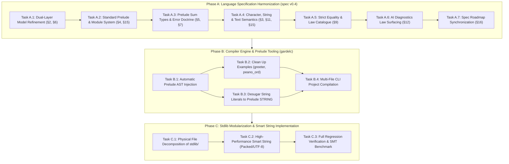

# Consolidated Gardel Architecture & Evolution Roadmap

**Date:** October 31, 2026  
**Status:** 🚀 **APPROVED & ACTIONABLE**  
**Preceding Milestones:** Completed Steps 1–4 (Foundations, `RESULT`/`OPTION`, Functional Core, Law Catalogue & Concepts)  
**Input Documents:**
- [stdlib_file_organization.md](stdlib_file_organization.md)
- [functional_ideas.md](functional_ideas.md)
- [Design Smart String.md](Design%20Smart%20String.md)
- [core_library.md](core_library.md)
- [core_library_vs_functional_ideas_review.md](core_library_vs_functional_ideas_review.md)
- [step1_remediate_stdlib_foundations.md](step1_remediate_stdlib_foundations.md)
- [step2_result_and_composable_option.md](step2_result_and_composable_option.md)
- [step3_verified_functional_core.md](step3_verified_functional_core.md)
- [step4_algebraic_law_catalogue_and_concept_conformance.md](step4_algebraic_law_catalogue_and_concept_conformance.md)
**Primary Artifacts Targeted:**
- `../spec/gardel_language_specification_draft_v0_4.md`
- `../gardelc/src/main.rs`
- `../stdlib/` (`stdlib.gdl` and modular subdirectories)
- `../examples/` (`greeter.gdl`, `peano_ord.gdl`, `bounded_stack.gdl`)

---

## 1. Executive Summary & Baseline

Over Steps 1 through 4, Gardel completed a major conceptual and verification overhaul of its foundation:

1. **Step 1 (Foundations):** Repaired `BIGNAT` (Horner polynomial `value_of` over radix $2^{64}$ yielding true `MATH_INT` values), `SEQ` ($O(1)$ subtree lengths, non-overflow preconditions on `concat`, eliminating truncation bugs), and `STRING` (inductive `all_bytes_valid` and invariant).
2. **Step 2 (Absence & Fallibility):** Added `RESULT[E, A]` with verified constructors, combinators (`map`, `map_error`, `and_then`), safe extractors, and composable `OPTION[A]` with 13 verified algebraic laws.
3. **Step 3 (Verified Functional Core):** Added canonical inductive `functions LIST_OPS`, divide-and-conquer parallel `module SEQ[A]` with full model-refinement postconditions against `LIST_OPS`, and pointwise `functions FUNCTION_OPS`.
4. **Step 4 (Law Catalogue & Concepts):** Standardized `concept EQ`, `CANONICAL_EQ refines EQ`, and `ORD refines EQ`, decoupled Leibniz structural equality (`=`) from behavioral equivalence (`.equals()`), proved comprehensive Monoid, Functor, Monad, Fold, and Order laws in `specify`, and indexed concept laws into `--json-diagnostics` for AI synthesis and repair.

This roadmap consolidates the architectural insights from our analysis into a unified, three-phase plan that aligns the language specification, compiler engine, and standard library.

---

## 2. Strategic Principles & Error Corrections

Our architectural review corrected five critical misconceptions that must govern all future work:

| Area | Previous Misconception | Corrected Architecture Principle |
| :--- | :--- | :--- |
| **Ontology of Types** | Treating `RESULT[E, A]` and `STRING` as primitive types in §3. | **`RESULT` and `OPTION` are Standard Prelude ADTs** (§5), defined using sum-type syntax. Primitives (§3) are strictly machine/SMT scalar types (`UNIT`, `U64`, `I64`, `F64`, `BOOL`, `CHAR`, `MATH_INT`). |
| **Physical vs. Verification Boundaries** | Using `group { ... }` as an ambient file wrapper for the entire stdlib. | **One module per file by default.** `group { A, B }` is strictly a verification and compilation barrier for **mutually recursive ADTs and co-inductive invariants**, not an arbitrary multi-module container. |
| **Standard Prelude** | Expecting user programs to duplicate stdlib definitions or fake `group` headers. | **Implicit Standard Prelude:** Core concepts (`EQ`, `CANONICAL_EQ`, `ORD`) and prelude ADTs (`OPTION`, `RESULT`, `SEQ`, `STRING`, `BIGNAT`) are implicitly available in all user modules without copy-pasting. |
| **Decoupled Text Model** | Tying `STRING` contracts to physical byte buffers (`SEQ[U64]` or `SEQ[U8]`). | **Three-Layer Text Architecture:** Logical Unicode scalar sequence (`specify chars: LIST[CHAR]`), opaque physical representation (`representation {NONE}`), and explicit boundary distinction between valid `STRING` and raw `BYTES`. |
| **Strict Equality Semantics** | Inconsistently using Leibniz `=` in contracts for quotient/collection types. | **Strict Equality Hierarchy:** Structural Leibniz `=` applies only to primitive types and types satisfying `CANONICAL_EQ`. Non-canonical types (`SEQ`, quotient `RAT`, `SET`) must use `.equals()` or ghost model equality (`a.model = b.model`). |
| **Dual-Layer Abstraction** | Treating model refinement as an ad-hoc trick for `SEQ`. | **Core Language Principle:** High-performance runtime data structures (trees, ropes, arrays) refine to inductive mathematical ghost models (`LIST`, `MATH_INT`, `LIST[CHAR]`). |

---

## 3. High-Level Dependency Graph



---

## 4. Work Breakdown Structure

---

### Phase A: Language Specification Harmonization (`spec/gardel_language_specification_draft_v0_4.md`)

**Objective:** Align the language specification draft v0.4 with the architectural breakthroughs of Steps 1–4 and the planning analyses.

#### Task A.1: Formalize Dual-Layer Model Refinement as a Core Language Principle (§2, §6) [✅ Completed]
- [x] Add **Principle 9: Dual-Layer Model Refinement** to §2.
- [x] Define how high-performance, divide-and-conquer runtime data structures (such as `SEQ[A]`, `BIGNAT`, and `STRING`) are paired with inductive mathematical ghost models (`LIST[A]`, `MATH_INT`, `LIST[CHAR]`).
- [x] Specify that runtime operations establish abstraction refinement postconditions (`Result.model = MODEL_OPS.op(Current.model, ...)`), enabling simple structural induction in SMT while executing in parallel on BendRT.
- [x] Update §6 to document how ghost models interact with hereditary representation invariants.

#### Task A.2: Specify the Standard Prelude & Multi-File Architecture (§4, §15) [✅ Completed]
- [x] Formalize the **Standard Prelude**: types (`OPTION`, `RESULT`, `SEQ`, `STRING`, `BIGNAT`) and concepts (`EQ`, `CANONICAL_EQ`, `ORD`) are automatically in scope for all modules.
- [x] Re-scope `group { A, B }`: define it strictly as a **mutual-recursion verification unit** for interdependent types, not an ambient file container.
- [x] Establish the **one-module-per-file** physical convention with globally unique top-level module names.
- [x] Update §15 (Grammar) to clarify top-level compilation units.

#### Task A.3: Standardize Prelude Sum Types & the Error Handling Doctrine (§5, §7) [✅ Completed]
- [x] Elevate `RESULT[E, A]` alongside `OPTION[A]` in §5 with its standard definition:
  ```eiffel
  module RESULT[E, A]
  representation {ANY}
    | Error(err: E)
    | Ok(val: A)
  ```
- [x] Formulate the **Error Handling Doctrine** in §7:
  - **Preconditions (`require`):** Enforce programmer contracts and type invariants. A violation indicates a bug rejected statically by the verifier.
  - **Fallible Values (`RESULT[E, A]`):** Represent expected domain failures and untrusted boundary data. Total functions return `RESULT` without exceptions.
  - Detail `and_then` chaining for composable, railway-oriented monadic pipelines without special language syntax.

#### Task A.4: Define the Three-Layer Text Model & String Literals (§3, §11, §15)
- Define the text hierarchy in §3:
  1. `CHAR`: 32-bit Unicode scalar value primitive (`uint32_t`).
  2. `STRING`: Opaque prelude ADT (`representation {NONE}`) with ghost model `specify chars: LIST[CHAR]`.
  3. `BYTES`: Raw untrusted byte sequences at I/O and boundary interfaces.
- Specify in §3 and §15 that string literals (`"..."`) desugar into verified `STRING` values whose `chars` model matches the sequence of Unicode scalar values.
- In §11 (IO), specify boundary decoding: `STRING.from_utf8(bytes: BYTES): RESULT[STRING_ERROR, STRING]`.

#### Task A.5: Standardize Strict Equality Semantics & Law Catalogue (§9)
- Codify the three levels of equality in §9:
  1. **Structural Leibniz Equality (`=`):** Permitted only for primitives and types conforming to `CANONICAL_EQ`.
  2. **Behavioral Equivalence (`a.equals(b)`):** Required for all types conforming to `EQ`, including non-canonical/quotient types (`SEQ`, `BIGNAT`).
  3. **Ghost Model Equality (`a.model = b.model`):** The standard method for stating contracts on non-canonical types against canonical mathematical models.
- Clean up contracts in §8 and §14 to eliminate accidental Leibniz equality assertions on collection types.
- Incorporate the Bird & Wadler algebraic law catalogue (Monoids, Functors, Monads, Folds, Orders) as normative concept laws.

#### Task A.6: AI Diagnostic Law Surfacing in `--json-diagnostics` (§12)
- Specify how `gardelc --json-diagnostics` indexes in-scope concept laws and catalogue lemmas and emits them in `relevant_lemmas`.
- Document how AI coding agents utilize these indexed laws for program derivation and automated proof repair.

#### Task A.7: Synchronize Specification Roadmap (§16)
- Mark Steps 1–4 as locked/completed in the v0.4 roadmap table.
- Align Phase 4 standard library milestones with the consolidated plan.

---

### Phase B: Compiler Engine & Prelude Tooling (`gardelc`)

**Objective:** Upgrade `gardelc` to support the standard prelude and multi-file compilation so user programs no longer need to copy-paste library code.

#### Task B.1: Automatic Prelude AST Injection in `gardelc`
- In `gardelc/src/main.rs`, update file parsing:
  - When compiling any user `.gdl` file, automatically merge the parsed standard prelude AST (`phase4_stdlib_source()`) into the symbol table, concept map, and Boogie verification context.
  - Skip prelude injection if the file being compiled *is* the standard library itself (avoiding duplicate symbol errors).

#### Task B.2: Clean Up Example Programs
- Refactor `examples/greeter.gdl`: remove redundant copies of `OPTION`, `SEQ`, `BIGNAT`, and `STRING`, and remove the `group` header. The file becomes a pure, concise `program GREETER`.
- Verify that `examples/greeter.gdl`, `examples/peano_ord.gdl`, and `examples/bounded_stack.gdl` compile and verify cleanly against the injected prelude with 0 errors and 0 warnings.

#### Task B.3: Compiler Desugaring of String Literals
- In `gardelc` AST and type-checker, lower `Expr::Literal(Literal::String(s))` into a call to `STRING.from_literal` or a compiler-generated constant carrying `ensure Result.chars = ...`.
- Connect string literals directly to the C11 emitter runtime string constructor (`string_from_utf8`).

#### Task B.4: Multi-File Project Compilation Support
- Extend the `gardelc` CLI to accept multiple files or a directory:
  `gardelc src/*.gdl --strict`
- Link all modules in the compilation run into a shared symbol table before generating Boogie verification conditions.

---

### Phase C: Standard Library Modularization & Smart String Implementation

**Objective:** Physically decompose `stdlib.gdl` into a clean directory structure and implement the full Unicode string model.

#### Task C.1: Physical Decomposition of `stdlib/`
- Modularize the single `stdlib/stdlib.gdl` file into clean, focused files:
  ```text
  stdlib/
  ├── concepts/
  │   ├── eq.gdl               # EQ, CANONICAL_EQ
  │   └── ord.gdl              # ORD
  ├── core/
  │   ├── option.gdl           # OPTION[A]
  │   └── result.gdl           # RESULT[E, A]
  ├── collections/
  │   ├── list_ops.gdl         # functions LIST_OPS
  │   └── seq.gdl              # SEQ[A] (parallel divide-and-conquer)
  ├── numeric/
  │   └── bignat.gdl           # BIGNAT (64-bit limbs, MATH_INT model)
  ├── text/
  │   └── string.gdl           # STRING (packed UTF-8, LIST[CHAR] model)
  └── functional/
      └── function_ops.gdl     # functions FUNCTION_OPS
  ```
- Update `gardelc`'s embedded stdlib bundler (`phase4_stdlib_source()`) to bundle these files cleanly during compiler build.

#### Task C.2: High-Performance Smart String (`stdlib/text/string.gdl`)
- Align `module STRING` with `Design Smart String.md` and the C runtime emitter:
  - Representation: packed 64-bit words or UTF-8 byte buffer.
  - Invariant: `valid_utf8` / `all_bytes_valid`.
  - Ghost model: `specify chars: LIST[CHAR]`.
  - Operations: `code_point_count: NAT`, `byte_count: NAT`, `is_empty: BOOL`, `concat(other: STRING): STRING`.
  - Safe boundary conversion: `from_utf8(bytes: BYTES): RESULT[STRING_ERROR, STRING]`.

#### Task C.3: Regression Verification & Performance Benchmarking
- Run complete test suite:
  - `cd gardelc && cargo test` (all 36+ tests passing).
  - Verify all modular stdlib files under `gardelc --strict` with 0 errors and 0 warnings.
  - Verify all examples under `gardelc --strict` with 0 errors and 0 warnings.
  - Execute native C11 builds of `greeter` and `SEQ` parallel tree benchmarks.

---

## 5. Verification & Acceptance Criteria

| Phase | Milestone | Acceptance Criteria |
| :---: | :--- | :--- |
| **A** | **Spec v0.4 Synchronized** | [gardel_language_specification_draft_v0_4.md](../spec/gardel_language_specification_draft_v0_4.md) updated with: Dual-Layer Principle (§2), Prelude & Multi-File (§4), `RESULT` & Error Doctrine (§5, §7), Three-Layer Text & String Literals (§3, §11, §15), Strict Equality & Law Catalogue (§9), AI Diagnostics (§12), and Roadmap (§16). |
| **B** | **Compiler Prelude Injection** | `gardelc examples/greeter.gdl --strict` succeeds without `greeter.gdl` duplicating standard library definitions or faking `group` headers. |
| **B** | **String Literal Lowering** | String literals in user programs type-check as prelude `STRING` and execute in C11 backend. |
| **C** | **Modular Standard Library** | `stdlib/` organized into subdirectories (`concepts/`, `core/`, `collections/`, `numeric/`, `text/`, `functional/`). `phase4_stdlib_source()` bundles cleanly. |
| **C** | **Zero Verification Errors** | `gardelc --stdlib --strict` verifies with **0 errors and 0 warnings**. 100% of unit tests pass in `cargo test`. |

---

## 6. Immediate Next Step

With this roadmap consolidated and agreed upon, the immediate execution task is **Phase A: Language Specification Harmonization**.

We will update [gardel_language_specification_draft_v0_4.md](../spec/gardel_language_specification_draft_v0_4.md) to integrate Tasks A.1 through A.7.

