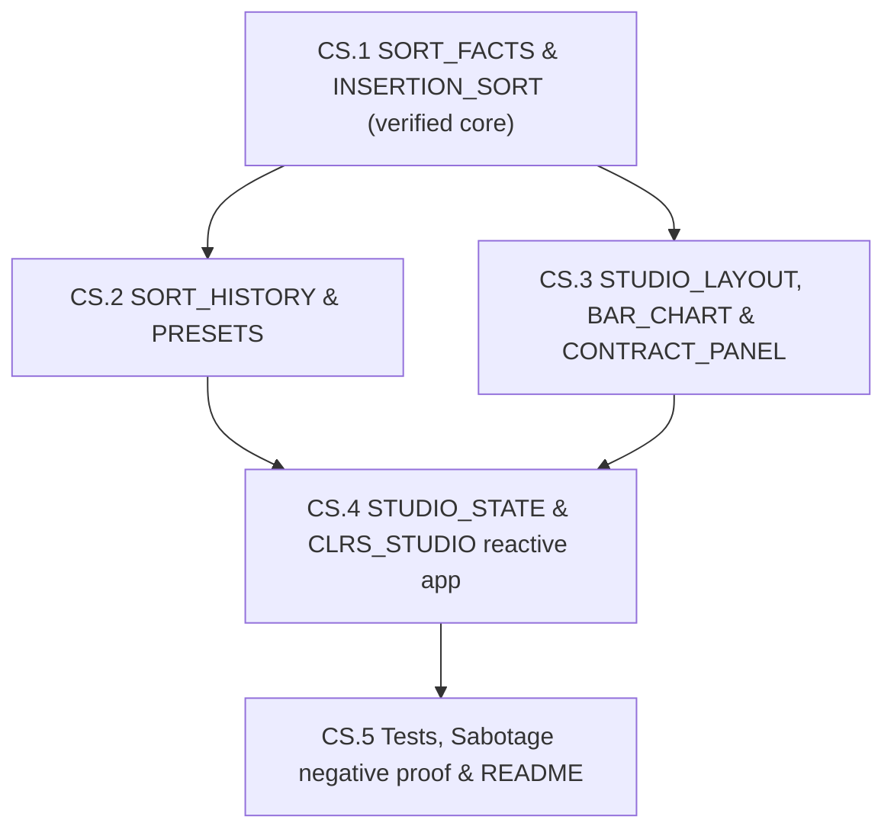

# `clrs_studio` — Verified CLRS Algorithm Visualizer Plan

**Date:** November 22, 2026  
**Status:** Completed (v1: CLRS Ch. 2.1 Insertion Sort, `gtui` 0.6.0 TUI, scripted VT session tests, and automated sabotage negative proof)  
**Location:** `examples/clrs_studio/` (depends on `gtui` `0.6.0`)  
**Inspiration:** [ideas/brainstorming.md](../ideas/brainstorming.md)

---

## 1. Objective

Build **`clrs_studio`**, a flagship Gardel demonstration application that executes algorithms from *Introduction to Algorithms* (CLRS) step-by-step in a modern `gtui` `0.6.0` terminal interface while **spotlighting Gardel's compile-time formal verification**.

Rather than a generic animation, `clrs_studio` makes Gardel's pillars visible on screen:

1. **CLRS Textbook Proofs as Machine-Checked Contracts:** Loop invariants (*Initialization → Maintenance → Termination*), preconditions (`require`), postconditions (`ensure`), and termination metrics (`variant`) are proved statically by Boogie/Z3 under `gardelc --strict` and erased at runtime.
2. **Visual-to-Contract Coupling:** The proven invariant region in the visualization (e.g., the sorted prefix `A[0..j-1]`) is highlighted in the same accent color as its `✓ [PROVEN]` badge in the contract panel, and the termination `variant` renders as a live `GAUGE` draining to `0`.
3. **Pure Time-Travel Stepping:** Because every algorithm step is a pure function `step(s): STATE`, the app records a pure state history enabling **Step Forward**, **Step Back**, **Auto-Play** (deterministic `Tick` timers), and **Timeline Scrubbing (`SLIDER`)**.
4. **Real Code & Eiffel-Style Short Form:** The right pane shows the actual verified Gardel source (with the active phase line marked via `TEXT_VIEW.draw_code`) alongside its real `gardelc --inspect` short form.
5. **Expandable Multi-Algorithm Architecture:** v1 ships with **Insertion Sort (CLRS Ch. 2.1)** as a polished, airtight flagship, structured so additional algorithms (Dijkstra Ch. 24, LCS Ch. 15, Merge Sort + OpenMP Ch. 2, Red-Black Trees Ch. 13) plug cleanly into the `Algorithm` menu later.

---

## 2. Screen Layout & UX

```text
 File(Alt+F)  Algorithm(Alt+A)  Input(Alt+I)  Theme(Alt+T)  Help
┌ Insertion Sort — CLRS Ch. 2.1 (60%) ────┐┌ Verified Spec & State (40%) ─────────┐
│                                         ││ Invariants(i) │ Code(c) │ Short(s)   │
│         ██                              ││ ───────────────────────────────────  │
│   ██    ██          ██                  ││  ✓ sorted_prefix(0..j)   [PROVEN]    │
│   ██    ██    ██    ██                  ││  ✓ length_preserved      [PROVEN]    │
│   ██    ██    ██    ██    ██            ││  ✓ sum_conserved         [PROVEN]    │
│   ██    ██    ██    ██    ██    ██      ││  ✓ 0 <= i <= j <= n      [PROVEN]    │
│   [2]   [4]   [5]   [6]  (1)   [3]      ││                                      │
│    0     1     2     3    ^j    5       ││  Variant (work left):                │
│   ╰─── proven sorted ───╯ key           ││  [██████████░░░░░░░░░░] 14 → 0       │
│                                         ││ ───────────────────────────────────  │
│  [x] Highlight proven region            ││  j = 4   i = 3   key = 1             │
│  [x] Show bar values                    ││  Phase: CompareShift  Cmp: 5  Sh: 3  │
└─────────────────────────────────────────┘└──────────────────────────────────────┘
 [ ◀ Back ] [ ▶ Play ] [ Step ▶ ] [ Reset ]  Step: ━━━●────── 6/18  Speed: ━━●──
 Insertion Sort · Preset: CLRS [5,2,4,6,1,3]           Space:play ←/→:step q:quit
```

### `gtui` 0.6.0 Widget Mapping

| Region / Feature | `gtui` Widget(s) | Behavior |
| :--- | :--- | :--- |
| Top menu bar | `MENU`, `MENU_ITEM` | `File` (Reset, Quit), `Algorithm` (Insertion Sort; future slots disabled/coming soon), `Input` (CLRS Textbook, Reversed, Nearly Sorted, Duplicates, Custom…), `Theme` (Dark, Light, Nord, Dracula), `Help` (Controls, About) |
| Split panes | `LAYOUT`, `FRAME`, `FRAME.merge_borders`, `PADDING`, `FOCUS` | 60/40 split with merged vertical border; `Tab` switches pane focus |
| Left: Bar chart | Custom `BAR_CHART` on `SCREEN` + `GLYPHS` | Multi-row Unicode block bars (`▁▂▃▄▅▆▇█`) with TrueColor semantic roles (Green = proven sorted prefix, Yellow = active `key`, Cyan = compared/shifted `A[i]`, Dim = unsorted suffix) |
| Left: Display options | `CHECKBOX` | Toggle `"Highlight proven region"` and `"Show bar values"` |
| Right: Spec tabs | `TABS` | `Invariants (i)`, `Code (c)`, `Short Form (s)` |
| Right: Invariants view | `DIVIDER`, `GAUGE`, `TABLE` | Color-coded proven invariant badges, `GAUGE` for termination `variant` countdown, live variable/counter `TABLE` |
| Right: Code & Short view | `TEXT_VIEW.draw_code`, `SCROLLBAR` | Gardel syntax highlighting (reusing the `tour_lexer` pattern), active phase line marked in `Code`, real `gardelc --inspect` output in `Short Form` |
| Transport bar | `BUTTON`, `SLIDER` | Mouse-clickable `[◀ Back]`, `[▶ Play]`/`[❚❚ Pause]`, `[Step ▶]`, `[Reset]`, Timeline `SLIDER` (`0..trace_len`), Speed `SLIDER` (`1..10`) |
| Overlays | `DIALOG`, `POPUP`, `TOAST` | `DIALOG` for Quit/Reset confirmation or custom input, `POPUP` for Help/About, `TOAST` when `Done` is reached (`"Postcondition ensure: is_sorted(A) reached!"`) |
| Bottom bar | `STATUS_BAR` | Active algorithm, preset name, and key hints |

---

## 3. Package & Module Architecture

```text
examples/clrs_studio/
├── Gardel.toml
├── README.md                    # Includes the 30-second "Sabotage Demo"
└── src/
    ├── clrs_studio.gdl          # reactive program CLRS_STUDIO (TUI entry point)
    ├── algo/
    │   ├── sort_facts.gdl       # functions: is_sorted, sorted_range, all_greater, sum_list, inductive lemmas
    │   ├── insertion_sort.gdl   # module INSERTION_SORT: verified fine-grained CLRS Ch. 2.1 stepper
    │   ├── sort_history.gdl     # module SORT_HISTORY: pure trace + cursor for Back / Scrub / Reset
    │   └── presets.gdl          # functions: CLRS datasets & custom integer-list parser
    └── ui/
        ├── studio_layout.gdl    # functions: shared RECT geometry for view & mouse hit-testing
        ├── bar_chart.gdl        # functions: multi-row Unicode block bar renderer
        ├── gdl_lexer.gdl        # functions: Gardel syntax highlighter for Code & Short Form tabs
        ├── contract_panel.gdl   # functions: Invariants + Variant GAUGE + Code + Short Form panes
        └── studio_state.gdl     # module STUDIO_STATE: widgets, timers, input routing, toasts
```

### Extensibility Path (v2+)

Keep `algo/` completely decoupled from `ui/`'s transport and layout:
* When adding Algorithm #2 (e.g., **Dijkstra Ch. 24** or **LCS Ch. 15**), introduce a sum-type `ALGO_KIND` / `ALGO_RUNNER` in `src/algo/` that dispatches `step`, `is_done`, `variant_value`, `phase_line`, and `invariant_rows` to the active algorithm module, while `studio_state.gdl`, `studio_layout.gdl`, transport controls, menus, themes, and toasts remain shared.

---

## 4. Verified Algorithm Design (`INSERTION_SORT`)

### 4.1 Fine-Grained CLRS Phases

To animate every comparison, shift, and insertion (matching CLRS Ch. 2.1 line-by-line), `INSERTION_SORT` models an explicit `SORT_PHASE`:

```text
PickKey       -- outer loop: j < n; pick key = A[j], set hole = j, move to CompareShift (or Done if j = n)
CompareShift  -- inner loop: if hole > 0 and A[hole - 1] > key, shift A[hole - 1] right & hole := hole - 1;
              --             else move to InsertKey
InsertKey     -- place key at A[hole], increment j := j + 1, move to PickKey (or Done if j + 1 = n)
Done          -- terminal state: j = n, whole array is proven sorted
```

Using `hole` (`0 <= hole <= j`) keeps the representation simple and avoids signed underflow (`i = -1`) in `NAT` arithmetic.

### 4.2 Representation & Static Invariants

```eiffel
-- Conceptual contract sketch for INSERTION_SORT
representation {NONE}
  items: LIST[NAT]       -- current array values (bounded length 1..32 for clean TUI display)
  n: NAT                 -- items.length
  j: NAT                 -- outer-loop index (sorted prefix boundary: 0..j is sorted at PickKey)
  hole: NAT              -- inner-loop insertion slot (0 <= hole <= j)
  key: NAT               -- value being inserted during CompareShift / InsertKey
  phase: NAT             -- 0 = PickKey, 1 = CompareShift, 2 = InsertKey, 3 = Done
  comparisons: NAT       -- telemetry counter
  shifts: NAT            -- telemetry counter
  initial_sum: NAT       -- sum of initial elements (for sum conservation)
```

**Proven `invariant` clauses (discharged by Boogie/Z3 under `--strict`, zero `assume`):**

1. `length_matches`: `items.length = n`
2. `j_in_bounds`: `j <= n`
3. `hole_in_bounds`: `hole <= j` and `(phase = 1 or phase = 2) implies j < n`
4. `done_at_end`: `phase = 3 implies j = n`
5. `sorted_outer`: `(phase = 0 or phase = 3) implies SORT_FACTS.sorted_prefix(items, j)`
6. `sorted_inner`: `(phase = 1 or phase = 2) implies SORT_FACTS.sorted_with_hole(items, j, hole, key)`
   *(i.e., `items[0..hole-1]` is sorted, `items[hole+1..j]` is sorted, every element in `items[hole+1..j]` is `> key`, and if `hole > 0` and `hole < j` then `items[hole - 1] <= items[hole + 1]`)*
7. `sum_conserved`:
   * At `PickKey` / `Done`: `SORT_FACTS.sum(items) = initial_sum`
   * During `CompareShift` / `InsertKey` (while `key` is lifted out of `hole`): `SORT_FACTS.sum_without(items, hole) + key = initial_sum`

**Proven `step` postconditions:**

* **Strict termination (`work_left`):**
  Define `work_left: NAT` as a lexicographic measure packed into a `NAT`:
  `(n - j) * (n + 3) + (if phase = 0 then n + 2 else if phase = 1 then hole + 1 else if phase = 2 then 0 else 0)`
  *(or exact formula verified in `CS.1`)* so `step` proves:
  `not Current.is_done implies Result.work_left < Current.work_left`
* **Final correctness (`ensure`):**
  `Result.is_done implies SORT_FACTS.is_sorted(Result.items)`
* **Stability when finished:**
  `Current.is_done implies Result = Current`

### 4.3 Live Code & Short Form Synchronization

Each phase (`PickKey`, `CompareShift`, `InsertKey`, `Done`) maps to a line number in the embedded Gardel source text displayed in the `Code` tab, so `TEXT_VIEW.draw_code` highlights the exact line executing on every step. The `Short Form` tab displays the verified `gardelc --inspect INSERTION_SORT` interface.

---

## 5. The "Sabotage Demo" (Negative Verification Proof)

A centerpiece of `examples/clrs_studio/README.md` (and verified automatically in `gardelc/tests/clrs_studio.rs`):

1. Open `src/algo/insertion_sort.gdl`.
2. Introduce a classic sorting bug (e.g., change `>` to `<` in the shift comparison, or increment `j` without placing `key` at `hole`).
3. Run `gardelc --project examples/clrs_studio --strict`.
4. **Result:** Boogie/Z3 rejects the build and pinpoints the exact violated invariant (`sorted_outer`, `sorted_inner`, or `sum_conserved`)—proving that the TUI *cannot even be compiled* with a broken algorithm.

---

## 6. Execution Phases & Verification Gates



| Task | Delivers | Primary Files | Gate |
| :--- | :--- | :--- | :--- |
| `CS.1` | Verified `SORT_FACTS` lemmas and `INSERTION_SORT` stepper with all CLRS invariants, sum conservation, and `work_left` termination proof | `src/algo/sort_facts.gdl`, `src/algo/insertion_sort.gdl` | `gardelc --project examples/clrs_studio --strict` passes with 0 errors, 0 warnings, 0 `assume` |
| `CS.2` | Pure `SORT_HISTORY` (Back / Step / Scrub / Reset) with `cursor < steps.length` invariant, and `PRESETS` + input parser | `src/algo/sort_history.gdl`, `src/algo/presets.gdl` | Verifies under `--strict`; history bounds & preset invariants proved |
| `CS.3` | `STUDIO_LAYOUT`, `BAR_CHART` (Unicode block bars + proven-region coloring), `GDL_LEXER`, and `CONTRACT_PANEL` (Invariants + Variant `GAUGE` + Code + Short Form) | `src/ui/studio_layout.gdl`, `src/ui/bar_chart.gdl`, `src/ui/gdl_lexer.gdl`, `src/ui/contract_panel.gdl` | Verifies under `--strict`; all `SCREEN` dimensions & `RECT.inside` contracts proved |
| `CS.4` | `STUDIO_STATE` & `CLRS_STUDIO` reactive program wiring `MENU`, `TABS`, `BUTTON`, `SLIDER`, `CHECKBOX`, `DIALOG`, `POPUP`, `TOAST`, `STATUS_BAR`, mouse hit-testing, and deterministic `Tick` auto-play | `src/ui/studio_state.gdl`, `src/clrs_studio.gdl`, `Gardel.toml` | `gardelc --project examples/clrs_studio --strict` builds `build/clrs_studio_bin` cleanly |
| `CS.5` | Scripted VT session tests (step, back, scrub, play/pause, preset switch, theme switch, mouse clicks), automated negative-proof sabotage test, and `README.md` | `gardelc/tests/clrs_studio.rs`, `examples/clrs_studio/README.md` | `cargo test --manifest-path gardelc/Cargo.toml --test clrs_studio` passes |

---

## 7. Gardel / Boogie Engineering Notes

* Set `$env:Z3_EXE = "C:\home\Learn\Gardel\gardelc\tools\dafny\z3\bin\z3-4.12.1.exe"` before running `gardelc` or `cargo test`.
* Avoid Boogie reserved words (such as `pop`) as local variable names.
* Avoid giving a client state routine the same name as a method called on an unresolved receiver (`E0315`); use distinct handler names (e.g., `handle_mouse`, `handle_key`) in `STUDIO_STATE`.
* Keep `BAR_CHART` and `CONTRACT_PANEL` pure (`(SCREEN, RECT, ...) -> SCREEN`) with `Result.width = s.width` and `Result.height = s.height` postconditions, matching `gtui` conventions.
* Render `MENU` and `TOAST`/`DIALOG`/`POPUP` overlays last so drop-downs and modals always appear cleanly above the panes.
