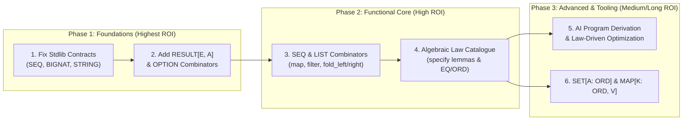

# Strategic Review: Core Library vs. Functional Ideas & v0.4 Specification Alignment

**Date:** October 28, 2026  
**Target Documents:**
- [core_library.md](core_library.md)
- [functional_ideas.md](functional_ideas.md)
- [gardel_language_specification_draft_v0_5.md](../spec/gardel_language_specification_draft_v0_5.md)
- [stdlib.gdl](../stdlib/stdlib.gdl)

---

## 1. Executive Decision: What Should We Do First?

> [!IMPORTANT]
> **Verdict: Interleaved Foundation-First Approach — Fix & Extend the Core Library (`stdlib.gdl`) FIRST, using it as the proving ground to solidify the Core Functional Ideas.**
>
> Attempting to formalize abstract functional programming methodologies (equational reasoning, program synthesis, fold laws) on top of broken or underspecified foundation models (`BIGNAT.model` returning limb counts instead of values, `SEQ.length` silently returning `ll` on overflow, and `STRING` mixing `U64` words with `CHAR` models) will cause verification noise and invalid proofs. Conversely, expanding the core library blindly without establishing the functional combinator patterns (`map`, `filter`, `fold`, model refinement laws) risks creating ad-hoc, uncomposable APIs.

### Why this sequencing wins:
1. **The Compiler (`gardelc` v0.4.0) is Ready:** As recorded in [CHANGELOG.md](../CHANGELOG.md), `gardelc` now has genuine Boogie/Z3 verification, closure conversion, AST monomorphization, hereditary invariant checks, and decoupled `EQ` / `CANONICAL_EQ` concepts. We do **not** need new compiler or syntax features to execute the core ideas in either document.
2. **Foundational Bugs Block Meaningful Proofs:** In [stdlib.gdl](../stdlib/stdlib.gdl#L30-L201), `SEQ`, `BIGNAT`, and `STRING` currently diverge from the v0.4 specification (§3, §10, §16) and contain semantic placeholders that prevent proving real algebraic laws.
3. **Functional Ideas = Core Library Phase 2:** The highest-value recommendations in [functional_ideas.md](functional_ideas.md) (algebraic laws in `specify`, library-level `fold_left`/`fold_right`/`compose`, and ghost model refinement) are *identical* to Phase 1 and Phase 2 of [core_library.md](core_library.md).

---

## 2. Alignment Audit with Specification v0.4

Both planning documents align philosophically with [gardel_language_specification_draft_v0_5.md](../spec/gardel_language_specification_draft_v0_5.md), particularly in rejecting `fold`/`unfold` syntax in favor of standard library combinators and pure structural recursion. However, our audit uncovered **seven specific misalignments** across [stdlib.gdl](../stdlib/stdlib.gdl), the two plan documents, and the v0.4 specification.

### 2.1 Critical Misalignments Between `stdlib.gdl` and Spec v0.4 (Remediated in Step 1)

| Component | Spec v0.4 Requirement | Historical Status | Status & Resolution (Step 1 Completed) |
| :--- | :--- | :--- | :--- |
| **`BIGNAT`** | **§3 (L57):** *"stores limbs in a `SEQ[U64]` and has `MATH_INT` as its ghost model."* | Defined `model: NAT` returning `Current.size` (limb count!). `from_u64` required `x > 0`. | ✅ **Resolved in Step 1:** Horner polynomial evaluation `value_of(ls: LIST[U64]): MATH_INT` with radix $2^{64}$; `model: MATH_INT` evaluates true natural number; `zero` ensures `Result.model = 0`; `from_u64` accepts $x \ge 0$ ensuring `Result.model = x`; `push_high_limb` ensures `Result.model = limb + 2^{64} * Current.model`. |
| **`STRING`** | **§16 (L673):** *"UTF-8 byte-buffer backed by `SEQ[U64]` with ghost `LIST[CHAR]`."* | Used `items: LIST[U64]` and `specify {ANY} chars: LIST[U64]`. | ✅ **Resolved in Step 1:** Standardized to `bytes: LIST[U64]`; added recursive ghost validator `all_bytes_valid` and invariant `valid_bytes`; separated `byte_model: LIST[U64]` from `chars: LIST[CHAR]`; added `push_byte` and `is_empty`. |
| **`SEQ[A]`** | **§10.5 (L397):** *"a balanced binary tree with stored `U64` length and a ghost `model: LIST[A]`."* | Defined `Concat(left, right)` without length; recursive $O(N)$ traversal with silent fallback `else ll`. | ✅ **Resolved in Step 1 & Step 3:** Implemented `Concat(left, right, len)`; length is $O(1)$; eliminated fallback; verified `model_concat: Result.model = Current.model.append(other.model)` and `is_empty`. In Step 3: extended with verified parallel combinators (`map`, `filter`, `fold_left`, `fold_right`) with explicit abstraction refinement postconditions against `LIST_OPS` and algebraic laws. |
| **`RESULT[E, A]`** | **§7.4 (L241), §11.4 (L411), §16 (L672):** Explicitly referenced as a boundary validation return type alongside `OPTION`. | **Missing** from [stdlib.gdl](../stdlib/stdlib.gdl). | ✅ **Resolved in Step 2:** Full module added to stdlib with `Ok`/`Error` variants, checked constructors `ok`/`error`, queries `is_ok`/`is_error`, safe extractors `get`/`get_error`, total fallbacks `unwrap_or`/`to_option`, combinators `map`/`map_error`/`and_then`, and 7 verified algebraic laws. |
| **`peano_ord.gdl`** | **§9 (L312-L376):** `EQ` uses `reflexive`, `symmetric`, `transitive`; `ORD` uses `a.equals(b)`. | [peano_ord.gdl](../examples/peano_ord.gdl#L1-L41) still defines the old v0.3 `law agrees_with_structural` directly inside `EQ` and uses `a = b` in `ORD`. | ⏳ **Pending Step 4:** Concept law catalogue & example update. |

### 2.2 Technical Friction Points Between the Plans and Spec v0.4 Mechanics

1. **Higher-Order Equality in Postconditions ([functional_ideas.md](functional_ideas.md#L80-L95)):**
   - *The Issue:* `functional_ideas.md` proposes writing `ensure definition: Result = (fn(x: A): C do f(g(x)) end)` on `compose`.
   - *Spec v0.4 Reality:* In §8 and §13, closures are lambda-lifted to first-order environment structs (`ClosureEnv_<id>`), and `=` in contracts is structural SMT Leibniz equality (§9). Proving equality of two function values directly via `=` is notoriously brittle in First-Order SMT (Boogie/Z3).
   - *Resolution:* Specify higher-order combinators like `compose` **pointwise** using universal quantification in `specify` lemmas or postconditions:
     ```eiffel
     law compose_associative[A, B, C, D](f: C -> D, g: B -> C, h: A -> B, x: A)
       ensure
         pointwise: compose(compose(f, g), h)(x) = compose(f, compose(g, h))(x)
       end
     ```
2. **Non-Canonical Quotient Equality on `SEQ[A]` ([core_library.md](core_library.md#L238-L249)):**
   - *The Issue:* `core_library.md` rightly emphasizes that `(a.concat(b)).concat(c)` and `a.concat(b.concat(c))` have different tree structures (`Concat` nesting) but the same abstract model.
   - *Spec v0.4 Reality:* Because Spec v0.4 (§9) decoupled `EQ` (`a.equals(b)`) from structural identity (`a = b`), `SEQ[A]` can now lawfully satisfy `EQ` (where `a.equals(b)` is defined as `a.model.equals(b.model)`) while `LIST[A]` and `OPTION[A]` satisfy `CANONICAL_EQ`! Laws on `SEQ` must therefore be stated either via `a.model = b.model` or `a.equals(b)`, never `a = b`.
3. **Generic Constraints for `SET[A]` and `MAP[K, V]` ([core_library.md](core_library.md#L498-L505)):**
   - *The Issue:* `core_library.md` states *"The supplied specification does not establish all these capabilities [equality on arbitrary generic types, ordering, generic constraints]"*.
   - *Spec v0.4 Reality:* Spec v0.4 **does** establish these in §9 (`concept EQ`, `concept ORD refines EQ`, conditional conformance `where A satisfies EQ`, and constrained generics `module SET[A: ORD]`). While we agree `SET` and `MAP` are P2 priorities, the language specification and compiler already support their type constraints.

---

## 3. Cost-Benefit Analysis (CBA)

We break down the initiatives from both documents into five concrete workstreams and evaluate their **Engineering Cost** (compiler/library effort, SMT proof complexity), **Strategic Benefit** (usability, verification soundness, AI synthesis leverage), and **ROI**.



### Detailed Matrix

| Workstream | Source Doc | Cost | Benefit | Risk if Delayed | Verdict / Priority |
| :--- | :--- | :---: | :---: | :--- | :--- |
| **1. Fix Existing Stdlib Models & Contracts** (`BIGNAT.model: MATH_INT`, `SEQ.length` invariant, `STRING` clarity) | `core_library.md` §5 | **Low–Med** (Library & verifier fuel tuning) | **Critical** (Aligns `stdlib.gdl` with Spec v0.4; restores mathematical soundness) | **Severe:** Every new operation or proof built on `BIGNAT` or `SEQ.length` inherits broken semantics. | **✅ Done (Step 1 Completed)** |
| **2. Core Error & Absence Types** (`RESULT[E, A]`, `OPTION` combinators `map`, `and_then`, `unwrap_or`) | `core_library.md` §2, §3 | **Low** (Pure ADT & HOF routines; easy Z3 proofs) | **Very High** (Unlocks total error handling & boundary validation required by §7.4 & §11.4) | **High:** Users and AI agents cannot write total fallible pipelines without `RESULT`. | **✅ Done (Step 2 Completed)** |
| **3. Verified Collection Combinators** (`SEQ` & `LIST` `map`, `filter`, `fold_left`, `fold_right`, `compose`) | Both (`core_library.md` §4, §6; `functional_ideas.md` §2–§4) | **Medium** (Requires inductive `variant` proofs connecting `SEQ` to `LIST` model) | **Very High** (Makes Gardel practically usable as a functional language without adding syntax) | **High:** Forces boilerplate structural recursion for every collection query. | **✅ Done (Step 3 Completed)** |
| **4. Algebraic Law Catalogue & Concept Conformance** (`EQ`/`ORD` in stdlib, `map`/`append`/`fold` laws in `specify`) | Both (`core_library.md` §8; `functional_ideas.md` §2, §5, §7) | **Medium** (Inductive lemma proofs in Boogie/Z3) | **High** (Provides reusable lemmas for Z3 `relevant_lemmas` diagnostics and proves abstraction refinement) | **Medium:** Verification works, but complex client proofs require manual unfolding (`reveal`). | **P1 — Do Fourth** |
| **5. AI Specification-to-Implementation Derivation Workflow** (Bird–Wadler synthesis prompts/tooling) | `functional_ideas.md` §2 (Priority 2), §11 | **High** (Requires external agent harness / prompt engineering + rich lemma library) | **High (Long-term)** (Reduces generate-and-repair loops) | **Low in short term:** Cannot succeed *until* the Core Library and Law Catalogue (Items 1–4) exist for the AI to target! | **P2 — After Core Library** |
| **6. Associative Collections & Syntactic Sugar** (`SET[A: ORD]`, `MAP[K: ORD, V]`, currying, list comprehensions) | `core_library.md` §7; `functional_ideas.md` §4, §6 | **High** (Tree balance invariants or parser/AST changes) | **Low–Med** (Convenience features, not foundational) | **Low:** Can be emulated with `SEQ` and `map`/`filter` initially. | **P3 — Defer** |

---

## 4. Recommended Next Steps (Actionable Execution Plan)

To maximize velocity and keep every commit 100% verified by `gardelc` (Boogie + Z3), we recommend executing the following four-stage plan:

### Step 1: Remediate `stdlib/stdlib.gdl` Foundations (Align with Spec v0.4) — ✅ COMPLETED (October 29, 2026)
1. **Fix [`BIGNAT`](../stdlib/stdlib.gdl#L94-L146):**
   - Implemented Horner polynomial evaluation `value_of(ls: LIST[U64]): MATH_INT` with radix $2^{64}$.
   - Upgraded `model: MATH_INT` to return true mathematical natural number value instead of limb count.
   - Verified `zero` (`ensure is_zero: Result.model = 0`), `from_u64` for all $x \ge 0$ (`ensure matches: Result.model = x`), and `push_high_limb` (`ensure high_limb_added: Result.model = limb + 18446744073709551616 * Current.model`).
   - Extended `gardelc` AST literals to `u128` to parse $2^{64}$ and exempted `MATH_INT` arithmetic from machine 64-bit overflow assertions.
2. **Fix [`SEQ[A]`](../stdlib/stdlib.gdl#L30-L92):**
   - Implemented `Concat(left: SEQ[A], right: SEQ[A], len: U64)` storing subtree length $O(1)$ per Spec v0.4 §10.5.
   - Enforced non-overflowing precondition `require no_overflow: left.length <= 18446744073709551615 - right.length` on `concat`, eliminating the historical silent truncation fallback `else ll`.
   - Verified ghost model concatenation `ensure model_concat: Result.model = Current.model.append(other.model)` with Boogie fuel stabilization axioms.
   - Added `is_empty` routine with postcondition `ensure Result = (Current.length = 0)`.
3. **Clarify [`STRING`](../stdlib/stdlib.gdl#L148-L201):**
   - Replaced ambiguous `items` with `bytes: LIST[U64]` and added recursive validator `all_bytes_valid(bs: LIST[U64]): BOOL` with class invariant `invariant valid_bytes: all_bytes_valid(Current.bytes)`.
   - Separated byte model `byte_model: LIST[U64]` from character scalar model `chars: LIST[CHAR]` per Spec v0.4 §16.
   - Added and verified `is_empty` and `push_byte` with strict precondition `require byte_valid: b < 256` and contract `ensure byte_appended: Result.bytes = Current.bytes.append(LIST[U64].Cons(b, LIST[U64].Nil))`.
4. **All checks passing:** `cargo test` (27/27 passed), `stdlib.gdl` strict verification (0 errors, 0 warnings), and `examples/greeter.gdl` compilation clean. Ready to proceed directly to Step 2.

### Step 2: Introduce `RESULT[E, A]` and Composable `OPTION[A]` — ✅ COMPLETED (October 29, 2026)
1. **Added `module RESULT[E, A]` to [stdlib.gdl](../stdlib/stdlib.gdl):**
   - Declared representation `| Error(err: E) | Ok(val: A)` with checked constructors `ok(v)` and `error(e)`.
   - Queries `is_ok`, `is_error`, total fallbacks `unwrap_or`, `to_option: OPTION[A]`.
   - Contracted safe extractors `get: A` (`require ok_present: Current.is_ok`) and `get_error: E` (`require err_present: Current.is_error`).
   - Functor/monad combinators `map[B]`, `map_error[F]`, and `and_then[B]`.
   - 7 algebraic laws verified in `specify`: `ok_not_error`, `map_ok`, `map_preserves_error`, `map_error_err`, `map_error_preserves_ok`, `and_then_ok`, `and_then_error`.
2. **Extended [`OPTION[A]`](../stdlib/stdlib.gdl#L3-L50):**
   - Added `is_none: BOOL`, `unwrap_or(default: A): A`, `map[B](f: A -> B): OPTION[B]`, and `and_then[B](f: A -> OPTION[B]): OPTION[B]`.
   - 6 algebraic laws verified in `specify`: `none_is_not_some`, `unwrap_or_some`, `unwrap_or_none`, `map_preserves_none`, `map_some`, `and_then_left_unit`, `and_then_none`.
3. **Compiler (`gardelc`) Architectural Enhancements:**
   - Switched Boogie invocation to `/typeEncoding:p` to eliminate monomorphization recursion on higher-order polymorphic combinators.
   - Added type-ascriptions in sum constructor projection/injection axioms and symmetric bidirectional variant disjointness axioms.
   - Inlined variant invariant functions (`function {:inline} ..._Invariant`).
   - Restricted C native binary compilation to `ModuleKind::Program`.
4. **Verification & Testing:**
   - `gardelc stdlib/stdlib.gdl --strict`: **0 errors, 0 warnings** across all 5 modules (`SEQ`, `BIGNAT`, `STRING`, `OPTION`, `RESULT`).
   - `cargo test`: **28 passed; 0 failed**, including unit tests proving precondition violations on invalid `get`/`get_error` calls.
   - Updated `spec/gardel_language_specification_draft_v0_5.md` §7.4 (`try_make_result`) and §16 roadmap table. Ready to proceed to Step 3.

### Step 3: Build the Verified Functional Core on `LIST` and `SEQ` — ✅ COMPLETED (October 30, 2026) — [Dedicated Plan: step3_verified_functional_core.md](step3_verified_functional_core.md)
1. **Added `functions LIST_OPS` to standard library ([`stdlib.gdl`](../stdlib/stdlib.gdl#L476-L633)):**
   - Canonical recursive definitions for `map`, `filter`, `fold_left`, and `fold_right`.
   - Structural homomorphism laws distributing over `append` (`map_append_homomorphism`, `filter_append_homomorphism`, `fold_left_append_homomorphism`, `fold_right_append_homomorphism`), plus base case and empty list laws.
2. **Extended `module SEQ[A]` with Verified Parallel Combinators ([`stdlib.gdl`](../stdlib/stdlib.gdl#L98-L260)):**
   - Implemented divide-and-conquer `map[B]`, `filter`, `fold_left[B]`, and `fold_right[B]`.
   - Connected every operation to `LIST_OPS` via explicit model-refinement postconditions (`Result.model = LIST_OPS.map(Current.model, f)`, `Result.model = LIST_OPS.filter(Current.model, keep)`, `Result = LIST_OPS.fold_left(Current.model, f, init)`, `Result = LIST_OPS.fold_right(Current.model, f, init)`), realizing Bird & Wadler Chapter 8 abstraction refinement proofs.
   - Used independent `let` bindings (`let l_res = l.map(f)` and `let r_res = r.map(f)`) on recursive subtrees, enabling automatic lowering to parallel fork-join tasks in Bend v2 and OpenMP/C11.
   - Proved 6 algebraic laws in `specify`: `map_identity_law`, `map_composition_law`, `fold_empty`, `fold_right_empty`, `empty_is_empty`, `singleton_length`.
3. **Added `functions FUNCTION_OPS` ([`stdlib.gdl`](../stdlib/stdlib.gdl#L635-L689)):**
   - Implemented `identity`, `id_fn`, and higher-order `compose`.
   - Formulated contracts and category laws pointwise (`forall x: A. Result(x) = f(g(x))`), avoiding first-order SMT quantifier instabilities while verifying left/right identity and associativity laws.
4. **Compiler (`gardelc`) Verification & Codegen Enhancements:**
   - Multi-parameter function types (e.g. `(acc: B, x: A) -> B`) mapped to Boogie `Fn2 A B C` and `Fn2_app`.
   - Extended Boogie prelude with `Seq` theory list decomposition axioms, `Fn1_id`, `Fn1_compose`, and `Seq_map`/`Seq_filter`/`Seq_fold_left`/`Seq_fold_right`.
   - Injected length-model coherence frame axiom for `SEQ.length` (`fn_length == Seq_length(fn_model(_fuel, Current))`).
   - Injected dummy value parameters in Boogie law verification procedures for polymorphic type parameters unreferenced in value arguments.
   - Added unit test suites verifying positive refinement, soundness mutation rejection, and parallel fork-join lowering.
5. **Verification & Testing:**
   - `gardelc stdlib/stdlib.gdl --strict`: **0 errors, 0 warnings** across all 7 stdlib modules (`SEQ`, `BIGNAT`, `STRING`, `OPTION`, `RESULT`, `LIST_OPS`, `FUNCTION_OPS`).
   - `cargo test`: **31 passed; 0 failed** (100% pass rate).
   - Updated `spec/gardel_language_specification_draft_v0_5.md` §8, §10.5, and §16 roadmap table. Ready to proceed to Step 4.

### Step 4: Codify the Algebraic Law Catalogue & Concept Conformance — [Dedicated Plan: step4_algebraic_law_catalogue_and_concept_conformance.md](step4_algebraic_law_catalogue_and_concept_conformance.md)
1. Move `concept EQ`, `concept CANONICAL_EQ`, and `concept ORD` into [stdlib.gdl](../stdlib/stdlib.gdl) (and update [peano_ord.gdl](../examples/peano_ord.gdl) to match v0.4 §9).
2. Implement `SEQ[A] satisfies EQ where A satisfies EQ` using behavioral model equality (`Current.model.equals(other.model)`).
3. Add inductive `law` routines in `specify` blocks for concatenation associativity (`(a ++ b) ++ c` vs `a ++ (b ++ c)` at the model level) and `map` fusion/composition, verifying that `gardelc --json-diagnostics` surfaces these laws in `relevant_lemmas`.
