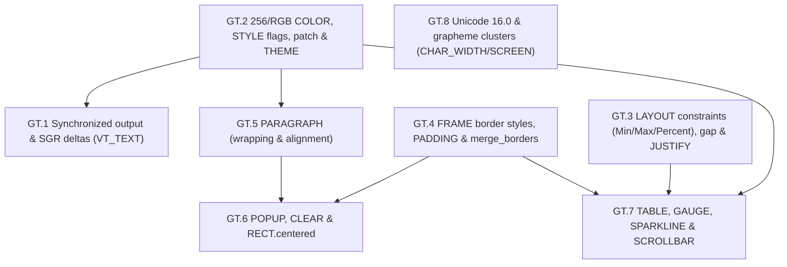

# `gtui` 0.4.0 Improvements Plan

**Date:** November 15, 2026
**Status:** Phase 1 Complete (Functional implementation, baseline `--strict` contracts, `examples/gtui_tour`, `examples/gtui_dashboard`, and 21 integration tests in `gardelc/tests/gtui.rs`). Phase 2 Pending (Closing deferred `-- TODO(proof-GT.*)` relational proofs).
**Context:** Extending [gtui](../../gtui) from `0.3.0` (36 `.gdl` files) to `0.4.0` (48 `.gdl` files).
**Follows:** [Phase F](verified_libraries.md) (where `gtui` was introduced) and [Phase H](library_essentials.md).

---

## 1. Objective

`gtui` is a lean, statically verified Elm-style TUI library with a strong editing core (`TEXT_AREA` zipper, incremental lexing, proven undo). This plan expands `gtui`'s terminal rendering, layout constraints, widget set, and Unicode support while strictly preserving its pure functional value semantics and static verification guarantees:

1. **Terminal & Style Polish (`GT.1`–`GT.2`):** Synchronized output mode 2026 (`?2026h`/`?2026l`), SGR deltas, 256-color and TrueColor RGB, `italic`/`strikethrough`, `STYLE.patch`, and `THEME` presets.
2. **Layout Expressiveness (`GT.3`):** `SIZE.min`, `SIZE.max`, `SIZE.percent`, `gap` spacing, and `JUSTIFY` in `LAYOUT` while preserving `LAYOUT_APART` disjointness proofs.
3. **Frame & Border Ergonomics (`GT.4`):** Border styles (`BORDER_KIND`: `Rounded`, `Plain`, `Double`, `Thick`), `PADDING`, multi-title support, and pure border-junction merging (`FRAME.merge_borders`).
4. **Core Widgets (`GT.5`–`GT.7`):** `PARAGRAPH` (word/character wrapping and `ALIGN`), `POPUP` + `CLEAR` + `RECT.centered`, `TABLE`, `GAUGE`, `SPARKLINE`, and `SCROLLBAR`.
5. **Modern Unicode Grapheme Clusters (`GT.8`):** Unicode 16.0.0 character widths and UAX #29 cell segmentation (ZWJ emoji sequences, skin-tone modifiers, regional-indicator flags, `VS15`/`VS16`).

**Out of scope:**
* Inline or fixed viewports, terminal mouse capture, or Kitty keyboard protocol (these require host-level changes in `gardelc` and `stdlib` beyond `gtui` itself).
* Braille/HalfBlock vector canvas and chart widgets (deferred until an application requires vector plotting).
* Mutable screen buffers or thread-local layout caches.

---

## 2. Task Graph

---

## 3. Tasks

### GT.1 — Synchronized Output & SGR Deltas (`VT_TEXT`)
* **What it adds to `gtui`:**
  * Update `VT_TEXT.frame` and `VT_TEXT.drawn` in [vt_text.gdl](../../gtui/src/screen/vt_text.gdl) to wrap non-empty frame writes in `\u{1b}[?2026h` ... `\u{1b}[?2026l`.
  * Emit minimal SGR transitions between consecutive cells (reset `\u{1b}[0m` only when an active flag/color is cleared; otherwise emit only newly enabled attributes/colors).
* **Proof obligations:** Frame output remains pure `STRING`; `VT_TEXT` introduces no control characters outside CSI SGR/cursor/mode-2026 sequences (`-- TODO(proof-GT.1)`).
* **Client / tests:** `gardelc/tests/gtui.rs` (`gt1_synchronized_output_and_sgr_deltas_work`): VT equivalence and SGR byte reduction on `gtui_tour` and styled `TEXT_AREA` frames.

### GT.2 — Extended `COLOR`, `STYLE`, `patch`, and `THEME`
* **What it adds to `gtui`:**
  * Extend [color.gdl](../../gtui/src/screen/color.gdl) to a sum type covering `default`, `reset`, `standard(n)` (`0..15`), `indexed(n)` (`0..255`), and `rgb(r, g, b)` (each `0..255`).
  * Extend [style.gdl](../../gtui/src/screen/style.gdl) with `italic`, `strikethrough`, and `patch(other: STYLE): STYLE` (merging non-default attributes and handling `COLOR.reset`).
  * Add [theme.gdl](../../gtui/src/screen/theme.gdl) (`THEME`) with `dark`, `light`, `nord`, and `dracula` semantic presets.
* **Proof obligations:** `COLOR` invariants (`standard` ≤ 15, `indexed` ≤ 255, RGB channels ≤ 255); `STYLE.same` reflexivity/symmetry and `patch` algebraic laws (`-- TODO(proof-GT.2)`).
* **Client / tests:** `examples/gtui_tour`, `examples/gtui_dashboard`, and `gt2_extended_colors_styles_patch_and_themes_work` in `gardelc/tests/gtui.rs`.

### GT.3 — Richer `LAYOUT` Constraints, `gap`, & `JUSTIFY`
* **What it adds to `gtui`:**
  * Extend `SIZE` ([size.gdl](../../gtui/src/layout/size.gdl)) with `min(n)`, `max(n)`, and `percent(p)` (`0..100`).
  * Add [justify.gdl](../../gtui/src/layout/justify.gdl) (`JUSTIFY`: `start`, `center`, `finish`/`end_align`, `space_between`) and `LAYOUT.columns_with_gap`, `LAYOUT.rows_with_gap`, `LAYOUT.columns_justified`, and `LAYOUT.rows_justified` in [layout.gdl](../../gtui/src/layout/layout.gdl).
* **Proof obligations:** Preserve `LAYOUT.across` / `LAYOUT.down` and `LAYOUT_APART` (`columns_apart` / `rows_apart`) postconditions: every child lies inside `r`, never exceeds `r`, and adjacent children are non-overlapping (`-- TODO(proof-GT.3)` for stronger `gap`-separation bounds).
* **Client / tests:** `examples/gtui_dashboard`, `TABLE` column sizing (`GT.7`), and `gt3_layout_constraints_gaps_and_justify_work` in `gardelc/tests/gtui.rs`.

### GT.4 — `FRAME` Border Styles, `PADDING`, & Junction Merging
* **What it adds to `gtui`:**
  * Add [border_kind.gdl](../../gtui/src/widget/border_kind.gdl) (`BORDER_KIND`: `rounded`, `plain`, `double`, `thick`) and [padding.gdl](../../gtui/src/widget/padding.gdl) (`PADDING`: `top`, `right`, `bottom`, `left`).
  * Add `FRAME.pad_rect`, `FRAME.inner_padded`, `FRAME.draw_styled`, `FRAME.draw_titled`, `FRAME.draw_titles`, and pure `FRAME.merge_borders(s: SCREEN, r: RECT)` in [frame.gdl](../../gtui/src/widget/frame.gdl) while keeping `FRAME.draw` intact.
* **Proof obligations:** `FRAME.inner_padded(r, pad).inside(r)`; all border writes preserve `SCREEN` dimensions (`-- TODO(proof-GT.4)` for interior cell frame conditions).
* **Client / tests:** `examples/gtui_dashboard` and `gt4_frame_borders_padding_titles_and_junction_merge_work` in `gardelc/tests/gtui.rs`.

### GT.5 — `PARAGRAPH` (Word/Character Wrapping & Alignment)
* **What it adds to `gtui`:**
  * Add [align.gdl](../../gtui/src/widget/align.gdl) (`ALIGN`: `left`, `center`, `right`), [wrap_mode.gdl](../../gtui/src/widget/wrap_mode.gdl) (`WRAP_MODE`: `wrap_word`, `wrap_char`, `no_wrap`), and [paragraph.gdl](../../gtui/src/widget/paragraph.gdl) (`PARAGRAPH`), measuring line widths with `GLYPHS.width`.
* **Proof obligations:** Rendered output preserves `SCREEN` dimensions and scroll offset stays bounded by `last_top` (`-- TODO(proof-GT.5)` for wrapped line width bounds).
* **Client / tests:** `POPUP` bodies (`GT.6`), `examples/gtui_dashboard`, and `gt5_paragraph_wrapping_alignment_and_scroll_work` in `gardelc/tests/gtui.rs`.

### GT.6 — `POPUP`, `CLEAR`, and `RECT.centered`
* **What it adds to `gtui`:**
  * Add `RECT.centered(w, h)` and `RECT.centered_percent(pw, ph)` in [rect.gdl](../../gtui/src/layout/rect.gdl).
  * Add [clear.gdl](../../gtui/src/widget/clear.gdl) (`CLEAR`) and [popup.gdl](../../gtui/src/widget/popup.gdl) (`POPUP`) for centered modal overlays that clear underlying screen cells and render a framed `PARAGRAPH`.
* **Proof obligations:** `r.centered(w, h).inside(r)` and `popup.bounds(area).inside(area)` hold unconditionally (`-- TODO(proof-GT.6)` for margin symmetry and frame locality).
* **Client / tests:** Help overlays in `examples/gtui_tour`, `examples/gtui_dashboard`, and `gt6_popup_clear_and_centered_rect_work` in `gardelc/tests/gtui.rs`.

### GT.7 — `TABLE`, `GAUGE`, `SPARKLINE`, and `SCROLLBAR`
* **What it adds to `gtui`:**
  * [table.gdl](../../gtui/src/widget/table.gdl) (`TABLE`): Multi-column selectable grid using `LAYOUT.columns_with_gap`, optional header row, and row scrolling.
  * [gauge.gdl](../../gtui/src/widget/gauge.gdl) (`GAUGE`): Progress bar (`0..100` or ratio `num/den`) using 1/8-block glyphs (`▏▎▍▌▋▊▉█`) with centered label and color inversion across the filled boundary.
  * [sparkline.gdl](../../gtui/src/widget/sparkline.gdl) (`SPARKLINE`): 1-row or multi-row trend chart using 8-level vertical block glyphs (`▁▂▃▄▅▆▇█`).
  * [scrollbar.gdl](../../gtui/src/widget/scrollbar.gdl) (`SCROLLBAR`): 1-column vertical / 1-row horizontal track + proportional thumb drawn along a `RECT` edge.
* **Proof obligations:** All widgets preserve `SCREEN` dimensions and maintain selection/thumb bounds (`-- TODO(proof-GT.7)` for monotonicity and locality).
* **Client / tests:** `examples/gtui_dashboard` and `gt7_table_gauge_sparkline_and_scrollbar_work` in `gardelc/tests/gtui.rs`.

### GT.8 — Unicode 16.0 & Grapheme-Cluster Cell Segmentation
* **What it adds to `gtui`:**
  * Update [gen_char_width.py](../../scripts/gen_char_width.py) and [char_width.gdl](../../gtui/src/screen/char_width.gdl) to Unicode 16.0.0 (`485` runs) with UAX #29 character predicates (`is_zwj`, `is_vs15`, `is_vs16`, `is_skin_tone`, `is_regional_indicator`).
  * Update `CELL` ([cell.gdl](../../gtui/src/screen/cell.gdl)), `GLYPHS.width_into` ([glyphs.gdl](../../gtui/src/screen/glyphs.gdl)), and `SCREEN.styled_into` ([screen.gdl](../../gtui/src/screen/screen.gdl)) to group ZWJ sequences, emoji modifiers, regional-indicator flag pairs, and variation selectors into their base cell with the cluster's terminal display width.
* **Proof obligations:** `CHAR_WIDTH.of <= 2`, `GLYPHS.width <= 65535`, and termination variants on `chars.length` (`-- TODO(proof-GT.8)` for wide-character pairing and width/cell-count equivalence).
* **Client / tests:** `examples/gtui_dashboard` and `gt8_unicode16_and_grapheme_clusters_work` in `gardelc/tests/gtui.rs`.

---

## 4. Architectural Exclusions

| Excluded Pattern | Reason to Exclude from `gtui` |
| :--- | :--- |
| Mutable screen buffers | Breaks `gtui`'s pure value semantics and complicates static verification; `gtui` already meets 16 ms frame budgets (~7 ms full 200×60 redraw, ~0.2 ms `TEXT_AREA` keystroke). |
| Background event threads & queues | I/O and event multiplexing belong to the `gardelc` runtime host, not `gtui`. |
| Platform console drivers (Win32 / POSIX) | Platform console handling is owned by the Gardel runtime host. |
| Thread-local layout caches | `gtui` layouts are small pure list splits; caching adds mutable state without a demonstrated bottleneck. |
| Object-oriented widget inheritance hierarchies | Gardel modules are value-based; passing `(screen, rect, ...)` and returning updated values is simpler and uniform across `gtui`. |
