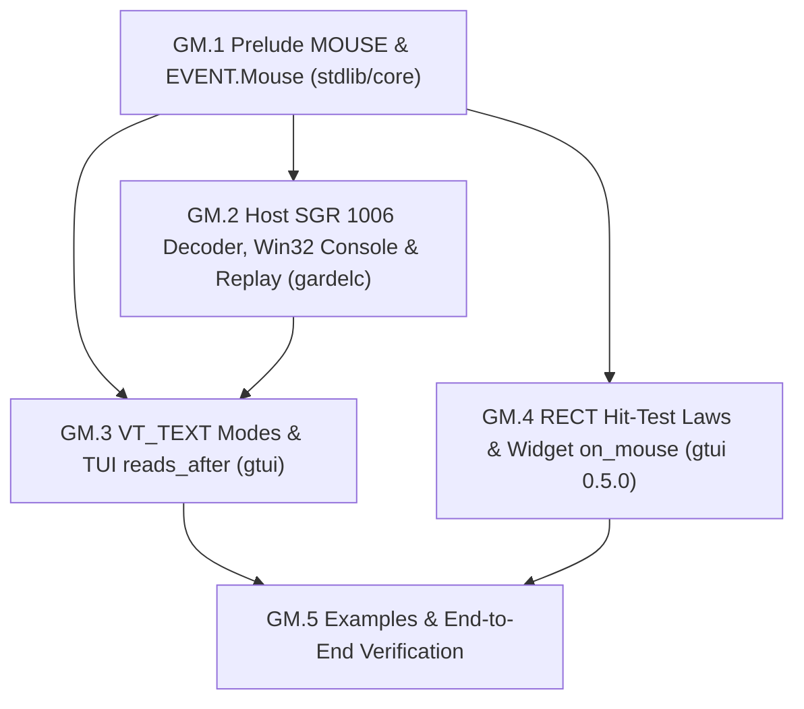

# Full Terminal Mouse Support Plan (SGR 1006)

**Date:** November 16, 2026
**Status:** Completed (all tasks `GM.1`–`GM.5` implemented and verified in `gtui` `0.5.0`, `stdlib/core`, `gardelc`, `examples/gtui_dashboard`, `examples/gtui_tour`, and 22 integration tests in `gardelc/tests/gtui.rs`; follow-up to [`gtui` 0.4.0](gtui_improvements.md))
**Context:** End-to-end terminal mouse capture and pure functional hit-testing across [stdlib/core](../../stdlib/core), the [gardelc](../../gardelc) C11 reactive host, and [gtui](../../gtui) (`0.5.0`).
**Follows:** [`gtui` 0.4.0 Improvements](gtui_improvements.md) and [Phase F](verified_libraries.md).

---

## 1. Objective & Scope

[`gtui` 0.4.0](gtui_improvements.md) intentionally kept terminal mouse capture out of scope because keyboard and terminal input decoding live in [stdlib/core](../../stdlib/core) and the [gardelc](../../gardelc) runtime host. This follow-up plan adds full SGR 1006 (`ESC [ < Cb ; Cx ; Cy M/m`) mouse capture across the entire stack while strictly preserving deterministic logging/replay (`GARDEL_RECORD` / `GARDEL_REPLAY`), scripted testing (`GARDEL_EVENTS`), cross-platform POSIX/Windows parity, and `gtui`'s pure value semantics and static verification guarantees:

1. **Prelude Mouse Event Model (`GM.1`):** Add `MOUSE` in [mouse.gdl](../../stdlib/core/mouse.gdl) and `EVENT.Mouse(mouse: MOUSE)` in [event.gdl](../../stdlib/core/event.gdl) with 0-based cell coordinates (`x: NAT, y: NAT`) and modifier wrapping (`MouseMod`).
2. **Host SGR 1006 Decoder, Console Mode, & Deterministic Replay (`GM.2`):** Decode `CSI < Cb ; Cx ; Cy M/m` in [c11_typed.rs](../../gardelc/src/c11_typed.rs) as an event answering `ReadKey` (like `Pasted`), support Windows console mouse input, and add `Mouse:...` tokens to `GARDEL_RECORD`, `GARDEL_REPLAY`, and `GARDEL_EVENTS`.
3. **`VT_TEXT` Mode Control & `TUI` Event Loop (`GM.3`):** Enable/disable `?1000h?1002h?1006h` in `VT_TEXT.enter` / `VT_TEXT.leave` ([vt_text.gdl](../../gtui/src/screen/vt_text.gdl)) and queue `ReadKey` after `EVENT.Mouse(_)` in `TUI_COMMANDS.reads_after` ([tui_commands.gdl](../../gtui/src/app/tui_commands.gdl)).
4. **Verified Hit-Testing & Widget Mouse Handlers (`GM.4`):** Add `RECT.has_inside` and `RECT.has_disjoint` laws in [rect.gdl](../../gtui/src/layout/rect.gdl) (proving clicks in disjoint `LAYOUT` panes are mutually exclusive) and pure `on_mouse` / hit-test routines on `TABS`, `LIST_VIEW`, `TABLE`, `TREE_VIEW`, `SCROLLBAR`, `TEXT_VIEW`, `PARAGRAPH`, `POPUP`, and `TEXT_AREA`.
5. **Client Integration & Verification (`GM.5`):** Wire mouse interactions into [examples/gtui_dashboard](../../examples/gtui_dashboard) and [examples/gtui_tour](../../examples/gtui_tour), and add host + widget + client-proof tests in [gardelc/src/main.rs](../../gardelc/src/main.rs) and [gardelc/tests/gtui.rs](../../gardelc/tests/gtui.rs).

**Out of scope:**
* **Any-motion hover tracking (`?1003h`):** Reporting every pointer move without a pressed button would flood the single-threaded reactive loop and force unnecessary redraw diffs. Button-event (`?1000h`) and button-drag (`?1002h`) with SGR coordinates (`?1006h`) cover clicks, drags, and scroll wheels cleanly.
* **Pixel-coordinate mouse reporting (`?1016h`):** All `gtui` geometry (`RECT`, `SCREEN`, widget layouts) operates exclusively in character cells.
* **Custom cursor-pointer shapes or host-level event debouncing:** Mouse events arrive in order through `ReadKey` and reuse `TUI`'s existing diff gating.

---

## 2. Task Graph



| Task | Status | Layer | Delivers | Primary Files |
| :--- | :--- | :--- | :--- | :--- |
| `GM.1` | Completed | Standard Library | `MOUSE` sum type + `EVENT.Mouse` + prelude registration | [mouse.gdl](../../stdlib/core/mouse.gdl), [event.gdl](../../stdlib/core/event.gdl), [main.rs](../../gardelc/src/main.rs) |
| `GM.2` | Completed | Runtime Host (`gardelc`) | SGR 1006 decoder, Windows console mouse mode & fallback, log/replay/script syntax | [c11_typed.rs](../../gardelc/src/c11_typed.rs) |
| `GM.3` | Completed | Terminal & App Loop (`gtui`) | `?1000h`/`?1002h`/`?1006h` in `VT_TEXT`, `ReadKey` continuation in `TUI_COMMANDS`, mock VT mode tracking | [vt_text.gdl](../../gtui/src/screen/vt_text.gdl), [tui_commands.gdl](../../gtui/src/app/tui_commands.gdl), [gtui.rs](../../gardelc/tests/gtui.rs) |
| `GM.4` | Completed | Geometry & Widgets (`gtui`) | `RECT` hit-test laws and pure `on_mouse` / hit-test handlers across interactive widgets | [rect.gdl](../../gtui/src/layout/rect.gdl), [widget/](../../gtui/src/widget), [text_area.gdl](../../gtui/src/edit/text_area.gdl) |
| `GM.5` | Completed | Examples & Tests | Interactive mouse support in `gtui_dashboard` and `gtui_tour`, host decoder tests, and `gtui.rs` proofs/sessions | [examples/gtui_dashboard](../../examples/gtui_dashboard), [examples/gtui_tour](../../examples/gtui_tour), [main.rs](../../gardelc/src/main.rs), [gtui.rs](../../gardelc/tests/gtui.rs) |

---

## 3. Tasks

### `GM.1` — Prelude `MOUSE` & `EVENT.Mouse` (`stdlib/core`) [Completed]

* **Design:**
  * Follow the same modifier-wrapper pattern established by [key.gdl](../../stdlib/core/key.gdl) (`KEY.Mod`) so existing clients that match without modifiers continue to compose cleanly.
  * Add [mouse.gdl](../../stdlib/core/mouse.gdl) defining `module MOUSE`:
    ```text
    representation {ANY}
      | MouseDown(button: NAT, x: NAT, y: NAT)
      | MouseUp(button: NAT, x: NAT, y: NAT)
      | MouseDrag(button: NAT, x: NAT, y: NAT)
      | WheelUp(x: NAT, y: NAT)
      | WheelDown(x: NAT, y: NAT)
      | MouseMod(mouse: MOUSE, shift: BOOL, alt: BOOL, ctrl: BOOL)
    ```
  * Choose globally unique constructor names (`MouseDown`, `MouseUp`, `MouseDrag`, `WheelUp`, `WheelDown`, `MouseMod`) so none collide with `KEY` (`Up`, `Down`, `Left`, `Right`, `Mod`) in the flat constructor namespace.
  * Button numbering matches SGR / XTerm conventions (`0` = left, `1` = middle, `2` = right); coordinates `(x, y)` are **0-based cell indices** matching [RECT](../../gtui/src/layout/rect.gdl) and [SCREEN](../../gtui/src/screen/screen.gdl).
  * Expose non-recursive helper queries in `feature {ANY}` (handling one-level unwrapping of `MouseMod` without recursion issues in Boogie, as the host guarantees `MouseMod` never wraps another `MouseMod`):
    * `x: NAT` and `y: NAT` returning the cell column and row (bounded by `x <= 65534`, `y <= 65534` when produced by the host).
    * `is_left_down: BOOL`, `is_wheel_up: BOOL`, `is_wheel_down: BOOL` (checking both unmodded and `MouseMod`-wrapped events) with exact `ensure` postconditions.
  * Update [event.gdl](../../stdlib/core/event.gdl) with `| Mouse(mouse: MOUSE)`. Existing reactive programs (which are unaffected unless they exhaustively omit `case _`) should keep compiling cleanly.
  * Register `stdlib/core/mouse.gdl` in [gardelc/src/main.rs](../../gardelc/src/main.rs):
    * `EMBEDDED_STDLIB`
    * `phase4_stdlib_source`
    * `BOOGIE_INJECTED_PRELUDE` (incrementing the array size and keeping `repr_prelude_deps` transitive injection intact, since `EVENT`'s representation now references `MOUSE`).
* **Proof obligations & checks:**
  * `gardelc --stdlib --strict` passes with 0 errors and 0 warnings.
  * All `EVENT` and `KEY` resolution tests in [gardelc/src/main.rs](../../gardelc/src/main.rs) pass with no constructor collisions.

---

### `GM.2` — `gardelc` Host SGR 1006 Decoder, Console Mode, & Deterministic Replay ([c11_typed.rs](../../gardelc/src/c11_typed.rs)) [Completed]

* **Host event & command representation:**
  * Mouse events are asynchronous terminal input sequences that answer `ReadKey` (in the same reader stream as `Key` and `Pasted`, avoiding stdin races and preserving strict `GARDEL_RECORD`/`GARDEL_REPLAY` ordering).
  * Extend `REACTIVE_RUNTIME` in [c11_typed.rs](../../gardelc/src/c11_typed.rs):
    * Add `GARDEL_HOST_MOUSE` to `enum gardel_host_kind`.
    * Add `enum gardel_host_mouse`:
      `GARDEL_MOUSE_DOWN`, `GARDEL_MOUSE_UP`, `GARDEL_MOUSE_DRAG`, `GARDEL_MOUSE_WHEEL_UP`, `GARDEL_MOUSE_WHEEL_DOWN`.
    * Add mouse fields to `struct gardel_host_event`: `enum gardel_host_mouse mouse; uint64_t mouse_btn, mouse_x, mouse_y;` (reusing `ev->mods` with `GARDEL_MOD_SHIFT`, `GARDEL_MOD_ALT`, `GARDEL_MOD_CTRL`).
  * Update `reactive_host` in [c11_typed.rs](../../gardelc/src/c11_typed.rs):
    * Emit `gardel_mouse_plain` and `gardel_mouse_value` (mirroring `gardel_key_plain` / `gardel_key_value`, wrapping in `make_MOUSE_MouseMod(...)` whenever `ev.mods != 0`).
    * Implement `host_mouse_code(variant)` covering all `MOUSE` variants so no `MOUSE` variant can be omitted silently.
    * Add `"Mouse"` to `host_event_code`: `case GARDEL_HOST_MOUSE: return make_EVENT_Mouse(gardel_mouse_value(ev));`.
* **SGR 1006 VT byte decoder (`gardel_decode_sequence`):**
  * Trigger when `ESC [` is followed by `'<'`.
  * Parse up to 3 semicolon-separated unsigned integer parameters (`Cb ; Cx ; Cy`) up to a final byte `'M'` (press / drag / wheel) or `'m'` (release), reading bytes directly from `gardel_read_byte()` (respecting malformed bounds and preventing partial-sequence hangs).
  * Validate 1-based terminal coordinates: require `Cx >= 1`, `Cx <= 65535`, `Cy >= 1`, `Cy <= 65535`; convert to 0-based `mouse_x = Cx - 1`, `mouse_y = Cy - 1` (`0..65534`). If malformed or out of range, fall back safely (`GARDEL_HOST_KEY` with `GARDEL_KEY_OTHER`).
  * Decode `Cb` bits per XTerm SGR 1006 specification:
    * Modifiers: `(Cb & 4) -> GARDEL_MOD_SHIFT`, `(Cb & 8) -> GARDEL_MOD_ALT`, `(Cb & 16) -> GARDEL_MOD_CTRL`.
    * Wheel (`(Cb & 64) != 0`): on final `'M'`, `btn = (Cb & 3)` gives `0 -> GARDEL_MOUSE_WHEEL_UP`, `1 -> GARDEL_MOUSE_WHEEL_DOWN`; ignore horizontal wheel codes (`2`, `3`) or `'m'` wheel releases as `GARDEL_KEY_OTHER`.
    * Buttons (`(Cb & 64) == 0`): `btn = (Cb & 3)` valid for `0..2` (`3` = SGR no-button release/hover, mapped to `GARDEL_KEY_OTHER` since `?1003h` is excluded).
      * Final `'m'`: `GARDEL_MOUSE_UP` with `mouse_btn = btn`.
      * Final `'M'` with `(Cb & 32) != 0`: `GARDEL_MOUSE_DRAG` with `mouse_btn = btn`.
      * Final `'M'` with `(Cb & 32) == 0`: `GARDEL_MOUSE_DOWN` with `mouse_btn = btn`.
* **Windows console support (`_WIN32` in [c11_typed.rs](../../gardelc/src/c11_typed.rs)):**
  * In `gardel_term_set_raw(bool raw)`: when enabling raw mode on a Windows console handle (`gardel_term_in`), clear `ENABLE_QUICK_EDIT_MODE` (`0x0040UL`), set `ENABLE_EXTENDED_FLAGS` (`0x0080UL`) and `ENABLE_MOUSE_INPUT` (`0x0010UL`) alongside `ENABLE_VIRTUAL_TERMINAL_INPUT` (`0x0200UL`), so mouse clicks reach the application instead of triggering Windows console text selection. Restore `gardel_term_saved` cleanly when `raw == false` (covering `Stop`, `Shutdown`, `atexit`, and `RunAttached`).
  * Extend `struct gardel_console_key` / `INPUT_RECORD` union in `gardel_con_take`: when VT input (`gardel_term_vt_in`) is active, modern Windows Terminal / ConPTY delivers SGR 1006 sequences via `KEY_EVENT` bytes straight into `gardel_decode_sequence`; when `gardel_term_vt_in` is false (legacy console / winpty fallback), decode `MOUSE_EVENT` (`type == 2`) records (`dwMousePosition`, `dwButtonState`, `dwControlKeyState`, `dwEventFlags`) into `GARDEL_HOST_MOUSE`.
* **Event logging, replay, and scripted syntax:**
  * Keep exact bijection between `gardel_log_event` (`GARDEL_RECORD`), `GARDEL_REPLAY`, and `GARDEL_EVENTS`:
    * `Mouse:[Shift+][Alt+][Ctrl+]Down:<button>:<x>:<y>` (`button` in `0..2`)
    * `Mouse:[Shift+][Alt+][Ctrl+]Up:<button>:<x>:<y>` (`button` in `0..2`)
    * `Mouse:[Shift+][Alt+][Ctrl+]Drag:<button>:<x>:<y>` (`button` in `0..2`)
    * `Mouse:[Shift+][Alt+][Ctrl+]WheelUp:<x>:<y>`
    * `Mouse:[Shift+][Alt+][Ctrl+]WheelDown:<x>:<y>`
  * Validate modifier prefix order (`Shift+`, `Alt+`, `Ctrl+` — matching `Key:`), button bounds (`<= 2`), and coordinate bounds (`<= 65534`); abort with exit code 2 (`unknown event`) on malformed script tokens.

---

### `GM.3` — `VT_TEXT` Mode Sequences & `TUI` Event Loop (`gtui/src/screen`, `gtui/src/app`) [Completed]

* **`VT_TEXT.enter` and `VT_TEXT.leave` ([vt_text.gdl](../../gtui/src/screen/vt_text.gdl)):**
  * Update `VT_TEXT.enter`:
    * Append `\u{1b}[?1000h\u{1b}[?1002h\u{1b}[?1006h` after `\u{1b}[?2004h`.
  * Update `VT_TEXT.leave`:
    * Prepend `\u{1b}[?1006l\u{1b}[?1002l\u{1b}[?1000l` before `\u{1b}[?2004l` so mouse reporting is turned off in reverse order before exiting the alternate screen (and automatically suspended while a `RunAttached` child owns the terminal, because [tui.gdl](../../gtui/src/app/tui.gdl) already emits `VT_TEXT.leave` on `RunAttached` and `VT_TEXT.enter` on `AttachedEnded`).
  * Update existing frame/session assertions in [gardelc/tests/gtui.rs](../../gardelc/tests/gtui.rs) that compare exact `enter`/`leave` sequence bytes (and update `Terminal` in `gtui.rs` to record `mouse_1000`, `mouse_1002`, and `mouse_1006` flags from CSI private `?h`/`?l` sequences and verify balanced enter/leave cleanup).
* **`TUI_COMMANDS.reads_after` ([tui_commands.gdl](../../gtui/src/app/tui_commands.gdl)):**
  * Queue the next `ReadKey` after `Mouse(_)`, identical to `Pasted(_)` and non-ending `Key(_)`:
    ```text
    case Mouse(_) then LIST.empty.prepend(ReadKey)
    ```
  * Verify `TUI` ([tui.gdl](../../gtui/src/app/tui.gdl)) requires no structural loop changes: `TUI.step` already routes all non-`Shutdown`/non-`Resized` events to `Current.on_event`, computes `TUI_COMMANDS.reads_after(e)`, and skips writing frame bytes when neither `SCREEN_DIFF.changes` nor cursor state changed.

---

### `GM.4` — Verified Hit-Testing & Widget `on_mouse` Routines (`gtui/src/layout`, `gtui/src/widget`, `gtui/src/edit`) [Completed]

* **Verified geometry hit-test laws ([rect.gdl](../../gtui/src/layout/rect.gdl)):**
  * Add `specify {ANY}` laws building on existing `RECT.has`, `RECT.inside`, and `RECT.disjoint`:
    * `has_inside(r: RECT, outer: RECT, cx: NAT, cy: NAT)`: `r.inside(outer) and r.has(cx, cy) implies outer.has(cx, cy)`
    * `has_disjoint(a: RECT, b: RECT, cx: NAT, cy: NAT)`: `a.disjoint(b) implies not (a.has(cx, cy) and b.has(cx, cy))`
  * Together with `LAYOUT.across_inside` / `LAYOUT_APART.columns_apart` / `rows_apart`, clients can statically prove that any mouse coordinate `(m.x, m.y)` clicks inside at most one pane of a layout.
* **Widget mouse handlers (`0.5.0`):**
  * Every widget routine remains pure, preserves representation invariants and `SCREEN` dimension postconditions, and unwraps `MouseMod` only where needed (e.g., Shift-click selection in `TEXT_AREA`):
  1. **`TABS` ([tabs.gdl](../../gtui/src/widget/tabs.gdl)):**
     * Add `tab_at(r: RECT, cx: NAT, cy: NAT): OPTION[NAT]` computing which rendered tab label `( + key )` span on `r.take_top(1)` covers `(cx, cy)`.
     * Add `on_mouse(m: MOUSE, r: RECT): TABS` selecting the clicked tab on left `MouseDown(0, x, y)` (`ensure same_count: Result.count = Current.count`).
  2. **`LIST_VIEW` ([list_view.gdl](../../gtui/src/widget/list_view.gdl)):**
     * Add `on_mouse(m: MOUSE, r: RECT): LIST_VIEW`:
       * Left `MouseDown(0, x, y)` inside `r`: select `Current.top + (y - r.y)` (keeping `chosen < entries.length` via `select`).
       * `WheelUp(x, y)` / `WheelDown(x, y)` inside `r`: scroll/step selection up or down by 3 items via `up(3, r.height)` / `down(3, r.height)` (`ensure same_count: Result.count = Current.count`).
  3. **`TABLE` ([table.gdl](../../gtui/src/widget/table.gdl)):**
     * Add `on_mouse(m: MOUSE, r: RECT): TABLE`:
       * Left `MouseDown(0, x, y)` inside the body rect (`r.drop_top(1)` when `Current.has_header`, else `r`): select row `Current.top + (y - body.y)`.
       * `WheelUp` / `WheelDown` inside `r`: step selection (`ensure same_count: Result.row_count = Current.row_count`).
  4. **`TREE_VIEW` ([tree_view.gdl](../../gtui/src/widget/tree_view.gdl)):**
     * Add `on_mouse(m: MOUSE, r: RECT): TREE_VIEW`:
       * Left `MouseDown(0, x, y)` inside `r`: select the clicked visible row (`Current.top + (y - r.y)`), and toggle open/close if the row is already selected or the click hits the disclosure indicator column (`2 * depth`).
       * `WheelUp` / `WheelDown` inside `r`: scroll/step the underlying `view`.
  5. **`SCROLLBAR` ([scrollbar.gdl](../../gtui/src/widget/scrollbar.gdl)):**
     * Add `scroll_for_mouse(m: MOUSE, r: RECT, total: NAT, viewport: NAT): OPTION[NAT]`:
       * For `MouseDown(0, x, y)` or `MouseDrag(0, x, y)` inside the track `r`, map the vertical (`r.height`) or horizontal (`r.width`) offset proportionally to `0..max_offset` (or `0..total`), preserving the contract:
         `ensure bounded: match Result case Some(pos) then pos <= total case None then True end`.
  6. **`TEXT_VIEW` ([text_view.gdl](../../gtui/src/widget/text_view.gdl)) & `PARAGRAPH` ([paragraph.gdl](../../gtui/src/widget/paragraph.gdl)):**
     * Add `on_mouse(m: MOUSE, r: RECT)` (with `rows` or `r: RECT`) handling `WheelUp` / `WheelDown` inside `r` by scrolling 3 lines within `last_top`.
  7. **`POPUP` ([popup.gdl](../../gtui/src/widget/popup.gdl)):**
     * Add `contains(area: RECT, cx: NAT, cy: NAT): BOOL` (`Current.bounds(area).has(cx, cy)`).
     * Add `on_mouse(m: MOUSE, area: RECT): POPUP` routing `WheelUp`/`WheelDown` inside `Current.bounds(area)` to `Current.content.on_mouse(m, Current.content_area(area))` (enabling click-outside dismissal by clients when `not popup.contains(area, m.x, m.y)`).
  8. **`TEXT_AREA` ([text_area.gdl](../../gtui/src/edit/text_area.gdl)):**
     * Add `on_mouse(m: MOUSE, r: RECT): TEXT_AREA`:
       * `MouseDown(0, x, y)` inside `r`: map row `(y - r.y)` and column `(x - text_rect.x)` (accounting for the line-number gutter width, horizontal scroll `left_col`, and UTF-8 cluster widths on that line) to move the cursor cleanly within bounds (keeping `MouseMod(_, True, _, _)` Shift-click extending the selection anchor).
       * `MouseDrag(0, x, y)`: extend selection anchor from press point to current cell.
       * `WheelUp` / `WheelDown` inside `r`: scroll viewport vertically by 3 lines while preserving all `TEXT_AREA` cursor and anchor invariants.

---

### `GM.5` — Examples & End-to-End Verification (`examples/`, `gardelc/src/main.rs`, `gardelc/tests/gtui.rs`) [Completed]

* **Update examples:**
  * [examples/gtui_dashboard](../../examples/gtui_dashboard): Refactor layout splitting into a shared pure helper (so both `update`—which needs `last_size: RECT` or stores `size: RECT` updated on `Resized(w, h)`—and `view` derive identical geometry):
    * Clicking top `TABS` switches active view (`Overview` / `Tasks` / `Events` / `Unicode`).
    * Clicking rows or wheel-scrolling in the `TABLE` selects/scrolls tasks; clicking/dragging on the `SCROLLBAR` jumps table scroll position.
    * Wheel-scrolling inside the detail `PARAGRAPH` scrolls detail notes.
    * Clicking outside an open `?` `POPUP` dismisses the modal; scrolling inside scrolls its text.
  * [examples/gtui_tour](../../examples/gtui_tour):
    * Clicking a pane updates `FOCUS`; clicking `TABS` or `TREE_VIEW` rows selects tabs/nodes; clicking/dragging/scrolling inside the `TEXT_AREA` pane moves the cursor/selection and scrolls.
* **Host tests in [gardelc/src/main.rs](../../gardelc/src/main.rs):**
  * Extend `test_f9_a_scripted_terminal_run_writes_exact_bytes` (or add a dedicated sibling test `test_mouse_sgr_script_log_and_replay`):
    * Verify scripted tokens `Mouse:Down:0:12:3`, `Mouse:Shift+Drag:0:15:4`, `Mouse:Ctrl+Up:2:15:4`, `Mouse:Alt+WheelUp:8:2`, `Mouse:WheelDown:8:2`.
    * Verify malformed tokens (`Mouse:Down:3:0:0`, `Mouse:Down:0:65535:0`, `Mouse:WheelUp:1:2:3`, `Mouse:Ctrl+Alt+Down:0:1:1`, `Mouse:Bogus`) exit with status 2 and `"unknown event"`.
    * Verify `GARDEL_RECORD` + `GARDEL_REPLAY` round-trip equivalence.
  * Extend `test_f9_keys_are_decoded_from_terminal_bytes` (or add `test_mouse_sgr_bytes_decoded`):
    * Feed raw bytes `\x1b[<0;13;4M`, `\x1b[<36;16;5M` (Shift + left drag: `32 + 4 = 36`), `\x1b[<2;16;5m`, `\x1b[<64;9;3M`, `\x1b[<65;9;3M`, plus malformed `\x1b[<999;1;1M` -> `Other`, and confirm byte-for-byte identical output on Windows pipes and POSIX.
* **`gtui` verification & integration tests in [gardelc/tests/gtui.rs](../../gardelc/tests/gtui.rs):**
  * Update `Terminal` in `gtui.rs` to assert `?1000h`, `?1002h`, `?1006h` are set on enter (and re-set after `AttachedEnded`), and `?1006l`, `?1002l`, `?1000l` are cleared before `RunAttached` and on shutdown/quit.
  * Add `mouse_hit_test_and_widgets_verify_and_handle_events`:
    * Contract test verifying `RECT.has_inside` and `RECT.has_disjoint` across `LAYOUT` splits in a client module (and confirming a false claim of overlapping clicks fails verification).
    * Unit checks for `TABS`, `LIST_VIEW`, `TABLE`, `TREE_VIEW`, `SCROLLBAR`, `PARAGRAPH`, `POPUP`, and `TEXT_AREA` under `on_mouse`.
    * Scripted VT session driving `examples/gtui_dashboard` and `examples/gtui_tour` with `Mouse:...` events and verifying expected state transitions and differential terminal renders.

---

## 4. Execution Order & Verification Gates

1. **Step 1 (`GM.1` + `GM.2`):** [Completed] Implement [mouse.gdl](../../stdlib/core/mouse.gdl), update [event.gdl](../../stdlib/core/event.gdl) and [main.rs](../../gardelc/src/main.rs), and implement SGR 1006 decoding, Windows console mouse mode/fallback, and log/replay/script support in [c11_typed.rs](../../gardelc/src/c11_typed.rs).
   * *Gate:* `gardelc --stdlib --strict` passes; host F.9 & new SGR mouse tests pass (`cargo test --manifest-path gardelc/Cargo.toml test_f9` and mouse host tests).
2. **Step 2 (`GM.3`):** [Completed] Update `VT_TEXT.enter`/`leave`, `TUI_COMMANDS.reads_after`, and the test `Terminal` in [gardelc/tests/gtui.rs](../../gardelc/tests/gtui.rs).
   * *Gate:* Existing `gtui` suite passes under `--strict` with updated enter/leave sequence checks.
3. **Step 3 (`GM.4`):** [Completed] Add `RECT` hit-test laws and `on_mouse` / hit-test handlers across `gtui` widgets and `TEXT_AREA`, maintaining zero `--strict` errors/warnings (and documenting any non-local relational lemmas clearly rather than introducing unsound assumes).
   * *Gate:* All `gtui` modules verify under `gardelc --strict`.
4. **Step 4 (`GM.5`):** [Completed] Wire mouse interactions into [examples/gtui_dashboard](../../examples/gtui_dashboard) and [examples/gtui_tour](../../examples/gtui_tour), add contract & scripted-session mouse tests in [gardelc/tests/gtui.rs](../../gardelc/tests/gtui.rs), and run the complete test suite (`cargo test --manifest-path gardelc/Cargo.toml --test gtui -- --test-threads=4`).
