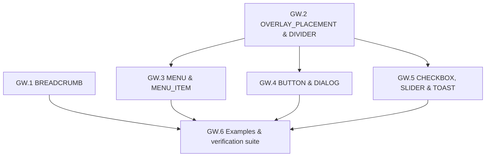

# `gtui` 0.6.0 Widgets & Navigation Plan

**Date:** November 21, 2026
**Status:** Planned (follow-up to [`gtui` 0.4.0](gtui_improvements.md) and [`gtui` 0.5.0 mouse support](gtui_mouse_support.md))
**Context:** Extending [gtui](../../gtui) from `0.5.0` to `0.6.0` with navigation, overlay, and form widgets.

---

## 1. Objective

`gtui` has tabs, lists, tables, trees, popups, and a verified text editor, but no menu bar, breadcrumb, divider, button/dialog, or form controls. This plan adds the missing widgets using `gtui`'s pure functional value semantics.

**Design rules:**

* No mutable hit containers, focus-scope side effects, or stateful widget wrappers: Each widget is a value module with pure `draw(s, r, ...)`, `on_key(k)`, `on_mouse(m, r)`, and geometry queries (`*_area`, `*_at`).
* Hit-testing is done by geometry queries on the same `RECT`s that `draw` uses, so click and render always agree (as in `TABS.tab_at` / `TABS.draw` from 0.5.0).
* Mouse input uses the `MOUSE` event from [gtui_mouse_support.md](gtui_mouse_support.md) (`m.x`, `m.y`, `m.is_left_down`, `m.is_wheel_up`, ...). `?1003h` hover tracking stays out of scope, so tooltips and hover states are not ported.
* Modal behavior (menu open, dialog open) lives in the client's `update`: while a menu or dialog is open, the client sends all events to it first.

**Two-phase verification (as in `GT.*`):**

1. **Phase 1 (this plan, `GW.1`–`GW.6`):** functional implementation, representation invariants, baseline `--strict` contracts (`SCREEN` dimension preservation, `RECT.inside` bounds, selection/range invariants, `OVERLAY_PLACEMENT` disjointness), example wiring, and tests in [gardelc/tests/gtui.rs](../../gardelc/tests/gtui.rs). Relational proofs that need non-local lemmas are left as `-- TODO(proof-GW.n)` (no unsound `assume`).
2. **Phase 2 (delegated proof pass):** the `-- TODO(proof-GW.1)`..`-- TODO(proof-GW.5)` obligations are closed together with the open `-- TODO(proof-GT.1)`..`-- TODO(proof-GT.8)` ones, then everything is proved under `gardelc --strict`.

**Out of scope:**

* `canvas/*` (Braille canvas, shapes, charts, world map): deferred until an application needs vector plotting (see [gtui_improvements.md](gtui_improvements.md)).
* `tooltip/*` and `HOVER_STATE`: need `?1003h` any-motion reporting, excluded in the mouse plan. A focus- or key-triggered tooltip can reuse `OVERLAY_PLACEMENT` later.
* `calendar/*`, `barchart`, `line_gauge`: candidates for a later `0.7.0`; not needed by the current examples.
* `shadow` / `dimmed_effect`: candidate for `0.7.0` (needs a per-cell effect over `SCREEN`); menus and dialogs use plain borders in 0.6.0.

---

## 2. Task Graph

| Task | Status | Delivers | Primary files |
| :--- | :--- | :--- | :--- |
| `GW.1` | Completed | `BREADCRUMB` with collapse, keys, mouse | `widget/breadcrumb.gdl` |
| `GW.2` | Completed | `OVERLAY_SIDE`, `OVERLAY_PLACEMENT`, `DIVIDER` | `layout/overlay_side.gdl`, `layout/overlay_placement.gdl`, `widget/divider.gdl` |
| `GW.3` | Completed | `MENU_ITEM`, `MENU` (bar, drop-downs, sub-menus) | `widget/menu_item.gdl`, `widget/menu.gdl` |
| `GW.4` | Completed | `BUTTON`, `DIALOG` | `widget/button.gdl`, `widget/dialog.gdl` |
| `GW.5` | Completed | `CHECKBOX`, `SLIDER`, `TOAST` | `widget/checkbox.gdl`, `widget/slider.gdl`, `widget/toast_item.gdl`, `widget/toast.gdl` |
| `GW.6` | Completed | Example wiring and tests | `examples/gtui_tour`, `examples/gtui_dashboard`, `gardelc/tests/gtui.rs` |

All paths under `gtui/src/`. `gtui/Gardel.toml` is bumped to `version = "0.6.0"`.

---

## 3. Tasks

### `GW.1` — `BREADCRUMB` [Completed]

* **Representation:** `crumbs: LIST[STRING]`, `sep: STRING` (default `" › "`; presets `" > "`, `" / "`), `picked: NAT` (index+1 of the selected crumb, 0 for none).
  * Invariant: `picked <= crumbs.length`.
* **API:**
  * `make(crumbs)`, `with_separator(sep)`, `with_selected(i)`, `crumb_count`, `crumb(i)`.
  * `width: NAT`: columns of the whole path, `Σ GLYPHS.width(crumb) + (n-1)·GLYPHS.width(sep)`.
  * `layout(w: NAT): LIST[PIECE]` where a piece is `(index, offset, width)` (index `0` = ellipsis `…`), implementing the three collapse steps:
    1. whole path when `width <= w`;
    2. `first sep … sep` plus the longest run of last crumbs that fits;
    3. `first sep … sep` plus the last crumb cut per grapheme cluster; with even less room only the last crumb, cut.
  * `crumb_at(r: RECT, cx: NAT, cy: NAT): OPTION[NAT]` (separators, ellipsis and blanks give `None`).
  * `on_key(k)`: `Left`/`Right` move the selection (clamped to `1..n`), no other key changes anything. `chosen(): OPTION[NAT]` is the selection, so the client decides what Enter does.
  * `on_mouse(m, r)`: left click on a crumb selects it.
  * `draw(s, r, st, current, selected, sep_style)`: top row of `r`; last crumb in `current` (bold), selected crumb in `selected` (reversed), separators and `…` in `sep_style`.
* **Baseline contracts:** `draw` keeps `SCREEN` width/height; every piece of `layout(w)` lies in `0..w`; `crumb_at` result `< crumb_count`; `with_selected` keeps `crumb_count`; `on_key` keeps `crumb_count`.
* **Phase 2 (`-- TODO(proof-GW.1)`):** `layout(w)` pieces are ordered and non-overlapping; `width <= w` implies no collapse; the selection is shown whenever step 1 or 2 applies; `draw` only writes cells of the top row of `r`.
* **Tests (`gw1_breadcrumb_collapse_keys_and_mouse_work`):** width table (fit, step 1, step 2, step 3, 1-column area, wide characters), keys, mouse hit/miss on separators, render golden rows.

### `GW.2` — `OVERLAY_PLACEMENT` & `DIVIDER` [Completed]

* **`OVERLAY_SIDE`** (`layout/overlay_side.gdl`): `Below | Above | RightOf | LeftOf`, with `opposite` (involution, proved) and `is_vertical`.
* **`OVERLAY_PLACEMENT`** (`layout/overlay_placement.gdl`, `functions`):
  * `room(anchor, side, bounds): NAT`: rows (below/above) or columns (right/left) between anchor and bounds edge.
  * `fits(anchor, w, h, side, bounds): BOOL`, `placed_side(anchor, w, h, preferred, bounds): OVERLAY_SIDE` (preferred if it fits, else opposite if it fits, else the side with more room, preferred on a tie).
  * `place(anchor, w, h, preferred, bounds): RECT`: flip, then shift back along the edge, then cut.
  * **Baseline contracts (the flagship ones, written so Phase 1 already proves what is local):** `Result.inside(bounds)`, `Result.width <= w`, `Result.height <= h`, `Result.disjoint(anchor)` whenever the anchor lies inside `bounds`, and `placed_side` returns the preferred side or its opposite.
  * **Phase 2 (`-- TODO(proof-GW.2)`):** `fits(preferred)` implies `place` has size exactly `w x h`; a flipped placement is whole when the opposite side fits; a cut box keeps its start edge.
* **`DIVIDER`** (`widget/divider.gdl`): `direction` (horizontal / vertical), `kind: BORDER_KIND` (glyphs `kind.horizontal` / `kind.vertical`), optional `label: STRING`, `align: ALIGN`, `padding`.
  * `draw(s, r, st)`: top row (horizontal) or left column (vertical) of `r`. The label keeps one line cell at each end, is padded, and is cut per grapheme cluster; dropped when it does not fit.
  * Baseline contract: `SCREEN` dimensions preserved.
  * Phase 2: only cells of the row/column of `r` change; the label never overwrites the end cells.
* **Tests (`gw2_overlay_placement_and_divider_work`):** placement table (below, flip above, shift left, cut, empty bounds, anchor at every corner) plus negative contract proof (a false claim of overlap fails verification); divider glyph sets, label alignment, clipped label.

### `GW.3` — `MENU` & `MENU_ITEM` [Completed]

* **`MENU_ITEM`** (`widget/menu_item.gdl`, immutable value):
  * `label: STRING`, `shortcut: STRING` (text only, the client binds the key), `id: NAT` (what the client receives when chosen), `enabled: BOOL`, `separator: BOOL`, `children: LIST[MENU_ITEM]`.
  * Constructors: `item(label, id)`, `separator`, `submenu(label, children)`; builders `with_shortcut`, `with_enabled`.
  * Queries: `is_selectable` (enabled and not separator), `has_submenu`, `label_width`, `shortcut_width`.
  * Navigation helpers over `LIST[MENU_ITEM]`: `first_selectable`, `last_selectable`, `next_selectable(i)`, `previous_selectable(i)` (wrapping, skipping separators and disabled items; `None` when nothing is selectable). Contract: result, when present, is `< length` and selectable; proved by structural induction.
  * Recursion is on the child list, not on the item, so no higher-order recursion (`E0315`) as long as the helper routines are named differently from the instance methods (lesson from `TOUR_STATE.handle_mouse`).
* **`MENU`** (`widget/menu.gdl`): `entries: LIST[MENU_ITEM]`, `path: LIST[NAT]` (open path: `[]` closed, `[2]` bar active on entry 2, `[2, 0]` drop-down open with nothing highlighted, `[2, 3, 1]` sub-menu open), `chosen: OPTION[NAT]`.
  * Invariant `valid_path`: every index except the last points to a selectable item with a sub-menu; the last is `0` or a valid index.
  * Geometry (all pure, all on the same rects `draw` uses; `screen` is the area drop-downs may cover): `bar_area(r)`, `entry_area(r, i)`, `drop_down_width`, `drop_down_height`, `drop_down_area(r, screen, level)` (via `OVERLAY_PLACEMENT.place`, `Below` for level 2, `RightOf` for deeper levels), `item_area(r, screen, level, j)`.
  * Keys `on_key(k)` (the client opens it with `open()` on `F10` or Alt+letter via `entry_with_initial`): `Down`/`Up` (open drop-down on the bar, else move, skipping separators and disabled), `Right`/`Left` (open/leave sub-menu, else next/previous entry), `Enter` (open sub-menu or choose leaf, which closes the menu and sets `chosen`), `Esc` (`close_level`). `take_chosen(): (MENU, OPTION[NAT])` clears it.
  * Mouse `on_mouse(m, r, screen)`: click on an entry toggles its drop-down; click on an item opens its sub-menu or chooses a leaf; click on a disabled item or separator does nothing; click anywhere else while open closes the menu. `contains(r, screen, cx, cy)` tells the client whether the cell belongs to the menu (bar or any open box), so the client can route first.
  * `draw(s, r, ...)`: bar row, then each open drop-down as an overlay (`CLEAR`, `FRAME` border, items, right-aligned shortcut column, `▸` for sub-menus, `DIVIDER` rows for separators), highlighted item in the highlight style, disabled in the dim style. Render the menu last.
  * Scrolling of a cut drop-down (`Scroll_up/down_symbol`) is **Phase 1 optional**: if the box is cut, items past the box are neither drawn nor clickable and the keys keep reaching them; `keep_highlight_visible` is done in `draw`, with `▲`/`▼` marks.
* **Baseline contracts:** `on_key`/`on_mouse` preserve `entries` and the `valid_path` invariant; `draw` keeps `SCREEN` dimensions; `drop_down_area(...).inside(screen)`; `on_key(Esc)` never increases `path.length`; a chosen id always belongs to an enabled, non-separator leaf.
* **Phase 2 (`-- TODO(proof-GW.3)`):** drop-down boxes of different levels never cover the bar entry or the item row they belong to (from `OVERLAY_PLACEMENT.disjoint(anchor)`); `item_area` lies inside its box; `chosen` implies the menu is closed; click routing is deterministic (a cell belongs to at most one of bar entry, item, box, outside).
* **Tests (`gw3_menu_navigation_overlay_and_mouse_work`):** model tests over a `File`/`Edit`/`View`/`Help` menu with sub-menu, separators, and a disabled item; key sequences; mouse clicks (open, switch entry, leaf, disabled, outside); drop-down flip at the screen bottom and shift at the right edge; golden render.

### `GW.4` — `BUTTON` & `DIALOG` [Completed]

* **`BUTTON`** (`widget/button.gdl`): `label`, `left`/`right` brackets (default `"[ "` / `" ]"`), `align: ALIGN`, `width` (brackets + label), `content_row(r)` (middle row, upper of two for even height), `hit(r, cx, cy): BOOL` (whole area), `draw(s, r, st, focused, pressed)` (area filled with the style, content clipped per cluster at the right edge).
  * Baseline contracts: `SCREEN` dimensions preserved; `content_row(r)` lies in `r`.
  * Phase 2: only cells of `r` change.
* **`DIALOG_KIND`:** `Info | Warning | Error | Question`, each with an edge style.
* **`DIALOG`** (`widget/dialog.gdl`): `heading`, `message: PARAGRAPH`, `buttons: LIST[STRING]` (1 to 4, invariant), `default`, `cancel` (0 = Esc does nothing), `focused: NAT`, `kind`, `answer: OPTION[NAT]`, `open: BOOL`.
  * Factories: `alert` (OK), `confirm` (Yes/No, default and cancel = No), `ok_cancel`.
  * Geometry: `box(area): RECT` (centered via `RECT.centered`, wrapped message rows, widest of message / button row / title, plus chrome; cut to the area when it is too small, message rows first), `body_area`, `button_areas(area): LIST[RECT]` (`LAYOUT.columns_justified` centered, `button_spacing` apart; labels cut to a common width with at least one cluster when too wide).
  * Keys `on_key(k)`: `Tab`/`Right` next, `Shift+Tab`/`Left` previous (wrapping), `Enter`/`Space` answer with the focused button, `Esc` cancel, a letter that starts exactly one label answers with it. Mouse `on_mouse(m, area)`: left click on a button answers with it; any other click while open is swallowed (modal).
  * Answering sets `answer = Some(i)` and `open = False`; the client reads `take_answer()`.
  * `draw(s, area, ...)`: `POPUP`-style clear + border in the kind's style + message + button row (focused button reversed).
* **Baseline contracts:** `box(area).inside(area)`; every button area lies inside `box(area)`; `on_key`/`on_mouse` keep `buttons.length` and `focused < buttons.length`; the answer is `< buttons.length`; `draw` keeps `SCREEN` dimensions.
* **Phase 2 (`-- TODO(proof-GW.4)`):** button areas pairwise disjoint (`LAYOUT_APART`); message rows and button row do not overlap; a modal dialog swallows every click outside its buttons.
* **Tests (`gw4_button_and_dialog_work`):** alert/confirm/ok_cancel key and mouse flows, initial-letter shortcut with and without ambiguity, tiny-area clipping, golden render.

### `GW.5` — `CHECKBOX`, `SLIDER` & `TOAST` [Completed]

* **`CHECKBOX`** (`widget/checkbox.gdl`): `label`, `checked`, `on_symbol`/`off_symbol` (presets `[x]`/`[ ]`, `☑`/`☐`, radio `(•)`/`( )`), `symbol_width` (the wider symbol, so the label never moves), `width`, `content_area(r)` (top row, `width` columns, cut to `r`), `toggle`, `on_key` (Space toggles), `on_mouse(m, r)` (left click inside `content_area` toggles), `draw(s, r, st, focused)`.
  * Radio-group recipe: documented in the module header (several checkboxes sharing one selected index owned by the client).
  * Baseline contracts: `content_area(r).inside(r)`; `toggle` is an involution on `checked` (proved); `SCREEN` dimensions preserved.
* **`SLIDER`** (`widget/slider.gdl`): `lo`, `hi`, `step`, `value` with invariant `lo <= value <= hi` and `lo <= hi`; `horizontal: BOOL`; optional value label.
  * `thumb_cell(len): NAT` (rounded position in `0..len-1`; `lo = hi` gives 0), `track_area(r)`, `set_from_position(cell, len)` (clamped), `increase`/`decrease`/`page`/`home`/`end` (clamped), `on_key`, `on_mouse(m, r)` (click and drag map to `set_from_position`, also past the ends), `draw` (filled `━`, thumb `●`, rest `─`; vertical uses `┃`/`│`).
  * Baseline contracts: every mutator keeps `lo <= value <= hi` (invariant, proved); `thumb_cell(len) < len` when `len > 0` (proved); `track_area(r).inside(r)`; `SCREEN` dimensions preserved.
  * Phase 2: `thumb_cell` is monotone in `value`; `set_from_position(thumb_cell(len), len)` returns a value whose thumb cell is the same.
* **`TOAST_ITEM` / `TOAST`** (`widget/toast_item.gdl`, `widget/toast.gdl`): `TOAST_ITEM` is `(id, text, level, duration, started)`; `TOAST` is a queue of items with `max_visible` (default 3), `last_id`, `now`.
  * Deterministic time: no clock inside the library. The client calls `tick(now)` (the `Tick`/timer event it already gets); an item's clock starts at the first `tick` at which it is visible, and it expires when shown for its whole duration. `push(text, level, duration)` takes no time; waiting items keep their order and none is dropped.
  * Geometry: `boxes(area): LIST[RECT]` (stacked from the corner edge, wrapped text, at most `max_width`, cut when out of room, nothing when narrower than 3 columns); `on_mouse(m, area)` dismisses the clicked toast by id; `draw` (cleared box, border in the level style, text).
  * Baseline contracts: `visible_count = min(count, max_visible)`; ids strictly increase; `tick` never grows the queue; every box lies inside `area`; `SCREEN` dimensions preserved.
  * Phase 2: boxes pairwise disjoint; an expired item is never visible after `tick`.
* **Tests (`gw5_checkbox_slider_and_toast_work`):** toggle/radio flows, slider key and mouse (including drag past the ends and `lo = hi`), toast queue timing table (start at first tick, expiry boundary `t + d - 1` vs `t + d`, waiting promotion, dismiss by id), golden render.

### `GW.6` — Examples & Verification Suite

* **`examples/gtui_tour`:** top `MENU` bar (`F10`, Alt+letter, mouse) with `File` (New, Open…, Quit) / `View` (Theme ▸ Dark | Light | Nord | Dracula, Help) / `Help`; `BREADCRUMB` row above the editor showing the selected tree path (click a crumb to select the ancestor node); `DIALOG` confirm on Quit when the editor is modified.
* **`examples/gtui_dashboard`:** `DIVIDER` between inspector sections; `CHECKBOX` ("Auto-refresh", "Show finished") and `SLIDER` (refresh rate) in the Overview inspector; `TOAST` on task status changes (info/success/warning) with click-to-dismiss.
* **`gardelc/tests/gtui.rs`:** add `gw1`..`gw5` (above) and `gw6_examples_menu_breadcrumb_dialog_dashboard_work` driving both examples with `Key:` and `Mouse:` events (scripted VT sessions, as `mouse_hit_test_and_widgets_verify_and_handle_events`), plus a negative contract proof for `OVERLAY_PLACEMENT` and `MENU` click routing.
* **READMEs:** update [examples/gtui_tour/README.md](../../examples/gtui_tour/README.md) and [examples/gtui_dashboard/README.md](../../examples/gtui_dashboard/README.md) with the new keys and mouse actions.

---

## 4. Execution Order & Verification Gates

1. **Step 1 (`GW.2` then `GW.1`):** [Completed] `OVERLAY_SIDE`, `OVERLAY_PLACEMENT`, `DIVIDER`, `BREADCRUMB`.
   * *Gate:* `gardelc --project gtui --strict` has 0 errors and 0 warnings; `gw1` and `gw2` pass.
2. **Step 2 (`GW.3`):** [Completed] `MENU_ITEM`, `MENU`.
   * *Gate:* `gtui` verifies under `--strict`; `gw3` passes.
3. **Step 3 (`GW.4` + `GW.5`):** [Completed] `BUTTON`, `DIALOG`, `CHECKBOX`, `SLIDER`, `TOAST`.
   * *Gate:* `gtui` verifies under `--strict`; `gw4` and `gw5` pass.
4. **Step 4 (`GW.6`):** bump `gtui` to `0.6.0`, wire both examples, update READMEs, add `gw6`.
   * *Gate:* both examples verify under `--strict`; the full suite passes (`cargo test --manifest-path gardelc/Cargo.toml --test gtui -- --test-threads=4`).
5. **Phase 2 (delegated proof pass):** close `-- TODO(proof-GW.1)`..`-- TODO(proof-GW.5)` together with `-- TODO(proof-GT.1)`..`-- TODO(proof-GT.8)`, then prove everything under `--strict` with no `TODO(proof-*)` left in `gtui/src`.
   * *Gate:* `Select-String -Path gtui\src\**\*.gdl -Pattern "TODO\(proof"` finds nothing; `gardelc --project gtui --strict` and the full `gtui` suite pass.

**Gardel / Boogie lessons to apply (from the 0.5.0 work):**

* Do not name a Gardel local `pop` (Boogie statement keyword); avoid other Boogie keywords in locals too.
* Do not give a state routine the same name as a method called on an unresolved receiver (`E0315`); use names like `handle_mouse` for client routines.
* Set `$env:Z3_EXE = "C:\home\Learn\Gardel\gardelc\tools\dafny\z3\bin\z3-4.12.1.exe"` before running `gardelc` or `cargo test`.
