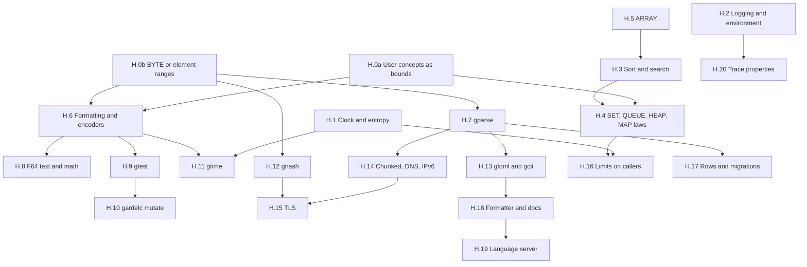

# Phase H: Library Essentials

**Date:** November 12, 2026
**Status:** Proposal. Nothing here is started, and no decision below is taken.
**Follows:** [Phase F](verified_libraries.md) (verified libraries) and [Phase G](../ffi/ffi_plan.md) (foreign interfaces).

---

## 1. Objective

After Phases F and G, Gardel can serve JSON over HTTP, call another service, draw a terminal and use a database. It still lacks what most programs need on their first day: the time, a random number, a sort, a set, a way to format text, a test runner. This phase adds them.

The phase delivers, in this order:

1. Host essentials: a clock, entropy, logging and the environment.
2. Core data: sorting, searching, sets, queues, heaps and a flat array.
3. Text and numbers: formatting, encoders, a shared parsing cursor and `F64` text.
4. Testing: a test runner and a mutation tool.
5. Time, hashes and configuration.
6. What a server needs to face the internet: chunked encoding, name lookup, IPv6, TLS, and limits on callers.
7. Typed rows and migrations over the databases of Phase G.
8. Tooling: a formatter, generated documentation, a language server and trace properties.

**The rule of Phase F stays:** nothing goes into a library without a client in this plan that needs it. Each task names its client.

**Not in this phase:** HTTP/2, WebSockets, locale collation, time zones other than UTC, Unicode normalization and display width, a package registry, GPU backends.

---

## 2. Prerequisites

Some tasks cannot start until the compiler or an earlier phase provides something. Each is listed once here and named by its task.

| # | Prerequisite | Where it comes from | Needed by |
| :--- | :--- | :--- | :--- |
| P1 | **F.13 and F.15 closed.** Recursive helpers with a `require`, and facts at the value of a call | Phase F | Every proof-heavy task: H.3, H.4, H.7, H.11 |
| P2 | **User concepts as bounds.** Today only `EQ`, `CANONICAL_EQ` and `ORD` have a theory (`E0320`) | New compiler task, H.0a | `HASH` in H.4 and H.12, `SHOW` in H.6 |
| P3 | **A `BYTE` type, or element ranges for `LIST` and `SEQ` of a machine type.** Today an element of `LIST[U64]` has no range in the proof, so `gjson` checks each byte it reads | New compiler task, H.0b | H.6, H.7, H.12 |
| P4 | **A contiguous buffer in the C backend** with a `LIST` model | New compiler task, inside H.5 | H.5, and through it H.3 and H.4 |
| P5 | **Pure foreign routines** (G.0 to G.3) | Phase G | SHA-2 and HMAC in H.12, math in H.8 |
| P6 | **Native commands** (G.6b) | Phase G | H.15 (TLS), H.17 (rows) |
| P7 | **Files and processes** (F.11) | Phase F | H.9, H.10, H.13, H.18 |
| P8 | **Linux CI** | Not planned anywhere yet | Every task with host code: H.1, H.2, H.14, H.15 |

P8 is the one with no owner. F.7's POSIX code has never run, and every host task below adds more. Set up a Linux runner before H.1.

---

## 3. Task graph

| Task | Size | Delivers | Main risk |
| :--- | :--- | :--- | :--- |
| H.0a | L | A user's own concept as a bound | Touches the verifier core, as F.1 did |
| H.0b | M | Bytes that carry their range | Changing how every list of numbers is typed |
| H.1 | S | `ReadClock`, `Random` | Secrets in the event log |
| H.2 | S | `Log`, environment variables | Prelude name clashes |
| H.3 | M | Sort and binary search, proven | The permutation proof |
| H.4 | M | `SET`, `QUEUE`, `HEAP`, more `MAP` laws | Heap-order proofs |
| H.5 | L | `ARRAY[A]` with constant-time index | Update in place needs ownership (C.4, deferred) |
| H.6 | M | `STRING_BUILDER`, `TEXT_FORMAT`, hex, base64, percent-encoding | Round-trip proofs for base64 |
| H.7 | L | `gparse`, a cursor with proven progress | Moving three parsers onto it without losing proofs |
| H.8 | L | `F64` to and from text, a math module | `F64` has only bound axioms in the verifier |
| H.9 | M | `gtest`, `gardelc test` | Keeping test time down |
| H.10 | M | `gardelc mutate` | Mutants that are equivalent to the original |
| H.11 | M | `gtime`: dates, RFC 3339 | The civil-date round trip |
| H.12 | M | `ghash`: CRC32, FNV, SipHash, SHA-2, HMAC | Bitvector proofs are slow |
| H.13 | M | `gtoml`, `gcli` | TOML's size |
| H.14 | M | Chunked encoding, name lookup, IPv6 | Two platforms |
| H.15 | L | TLS in the host | A native dependency in the runtime |
| H.16 | S | Rate limiter, retry, circuit breaker | None large |
| H.17 | M | Typed rows, migrations | Depends on G.6b's final shape |
| H.18 | M | `gardelc fmt`, `gardelc doc` | Comments in the parser |
| H.19 | L | A language server | Verification latency |
| H.20 | M | Properties checked over event logs | Choosing a property language |

---

## 4. Decisions to take

1. **Clock: a command, or a field on every event?** Proposed: a command, `ReadClock(tag)`. A time on every event would change `EVENT`, and most steps do not need it.
2. **Wall clock unit.** Proposed: milliseconds since the Unix epoch as `I64`, UTC, with no leap seconds, as POSIX counts them.
3. **Random bytes in the log.** A replay needs them, so they must be logged, and the log is in the clear (spec §11.6). Proposed: log them, and say in the guide that a log of a program that makes secrets is itself a secret. The alternative, a seed, would make every token predictable from the log too.
4. **`BYTE` type or element ranges (H.0b).** Proposed: element ranges, as F.4 did for fields. It changes no source. A `BYTE` type is cleaner but changes `BYTES`' model from `LIST[U64]` and every proof on it.
5. **Sorting when `equals` and `less_than` disagree.** `ORD` does not promise that they agree (F.3). Proposed: state `sorted` through `less_or_equal` alone, and `permutation` through `=` on a `CANONICAL_EQ` element, with a weaker contract otherwise.
6. **`ARRAY` updates.** Proposed: `set` copies unless the array has one reference, checked at run time by the reference count. This needs no ownership rule in the language. A static rule is C.4's deferred work.
7. **`F64` printing: proven or tested.** Proposed: tested first, against a public corpus, with the algorithm in Gardel over `BIGNAT`. A proof needs an `F64` model the verifier does not have.
8. **Math functions: per platform or bundled.** Proposed: one bundled implementation, linked as a pure foreign routine, so `sin(x)` is the same bits everywhere, as §3 of the spec requires of `F64`.
9. **Where TLS lives.** Proposed: in the host, as `ListenTls` and `ConnectTls`, so a program sees plain bytes and the same `Received` and `Send`. In Gardel code it would need a native command per record, and the keys would pass through the event log.
10. **Test discovery.** Proposed: a package's `tests/` directory is a client package, as `ghttp/tests` and `gjson/tests` already are, and `gardelc test` runs each `program` in it.
11. **Formatter style.** Proposed: one style, no options.
12. **Trace property language.** Proposed: a pure Gardel routine over a list of log entries, so no new language is needed.

---

## 5. Work breakdown

Every task follows the rules of Phases E and F:

- `--stdlib --strict` stays 0/0, and every example and package stays 0/0 under `--strict`.
- New rules get tests, and mutations on a private copy must each turn a test red. From H.10 on, the tool does this.
- `--compare-with` runs on every package and prelude change.
- A new `COMMAND` or `EVENT` comes with its host code on both platforms, its scripted form and its log form.
- What is not proven is listed as such, with the test that covers it.

### Step 0: Compiler prerequisites

#### Task H.0a: User Concepts as Bounds

Client: `HASH` (H.4, H.12) and `SHOW` (H.6). Closes F.1's first known limit.

- [ ] A `concept` declared by a user gets a theory in a generic module that names it as a bound: one relation or function per method, and its laws as axioms, as `EQ` and `ORD` have today.
- [ ] Methods that are not relations: `hash: U64`, `show: STRING`. Today's theory covers only `equals`, `less_than` and `less_or_equal`.
- [ ] Instance links (F.1) for a user concept, with the same rule: no link inside a module that the instance's own proofs could rest on.
- [ ] `[A: ORD]` together with `where A satisfies C` checks both (F.1's fourth limit).
- [ ] A false-law test, as F.1 had: a type whose `hash` breaks `equals implies same hash` must not verify through a bound.
- Acceptance: `module BAG[K: HASH]` verifies, uses `k.hash`, and runs in C. `E0320` is gone for user concepts. All existing `.bpl` output is byte-identical, as no existing code has such a bound.

#### Task H.0b: Bytes That Carry Their Range

Client: every parser. Needs decision 4. Closes F.2's first known limit.

- [ ] An element of a `LIST` or `SEQ` of a machine type is in the type's range: at `head`, `LIST_OPS.at`, a `match` binder and a `fold` argument.
- [ ] `BYTES.model` elements are below 256 wherever a client reads one, from `BYTES`' invariant, without a call to `at`.
- [ ] Remove the per-byte range checks from `gjson`'s reader, and measure.
- [ ] Soundness test: a list built from a value out of range must be refused where it is built.
- Acceptance: a client proves `bs.model.head < 256` for a non-empty `BYTES` with no check in its body. `gjson` is 0/0 with the checks removed.

### Step 1: Host essentials

#### Task H.1: Clock and Entropy

Client: `gtime` (H.11), the rate limiter (H.16), request ids in `grest`. Needs decisions 1 to 3 and P8.

- [ ] `ReadClock(tag)` answered by `Clock(tag, wall_millis: I64, monotonic_millis: U64)`. The monotonic value is the clock that timers already use.
- [ ] `Random(tag, count: NAT)` answered by `RandomBytes(tag, res: RESULT[IO_ERROR, BYTES])`, from the system's generator (`BCryptGenRandom`, `getrandom`). A `count` above 1024 is an `Error`.
- [ ] For a `program`: `IO.now: IO[I64]` and `IO.random(count: NAT): IO[RESULT[IO_ERROR, BYTES]]`. Each is a fresh value in the proof, as `IO.read_line` is.
- [ ] Scripted forms `Clock:<tag>:<wall>:<mono>` and `RandomBytes:<tag>:<text>`, log forms, and replay.
- [ ] Guide: a log holds the random bytes (decision 3).
- [ ] `RandomBytes` has the postcondition a client needs stated on a gateway: an `Ok` payload has length `count`. The host checks it, so the assumption is justified, as with `read_line`'s length bound.
- Acceptance: a reactive program prints the time and eight random bytes; its recording replays to the same output on another day. Two `Random` results are not provably equal.

#### Task H.2: Logging and the Environment

Client: every server example. `Print` writes to standard output with a newline, so a server has nowhere to write a diagnostic today.

- [ ] `Log(level: LOG_LEVEL, text: STRING)`: one line on standard error. `LOG_LEVEL` is `Debug | Info | Warn | Error`. `GARDEL_LOG_LEVEL` sets the lowest level written.
- [ ] `init` receives the environment: decide between a second parameter and a command `ReadEnv(tag, name)`. A command keeps `init`'s signature and is logged like any input, so it is proposed.
- [ ] `IO.log` and `IO.env(name): IO[OPTION[STRING]]` for a `program`. A value that is not UTF-8 is `None`.
- [ ] Scripted and log forms. A replay compares `Log` commands as it compares `Print`.
- [ ] `grest` logs one line per request at `Info`, as its first client.
- Acceptance: `todo_api` reads its port from the environment and logs each request, and a replay reproduces the log lines.

### Step 2: Core data

#### Task H.5: `ARRAY[A]`

Client: sorting (H.3), the heap (H.4), `gtui`'s screen grid (F.10). Needs decision 6. Listed first in this step because H.3 and H.4 build on it.

- [ ] `module ARRAY[A]`, `representation {NONE}`, ghost model `model: LIST[A]`. `make(n, x)`, `from_list`, `to_list`, `length`, `at(i)`, `set(i, x)`, `swap(i, j)`, `slice`, `fold`.
- [ ] Contracts on the model: `set` gives `LIST_OPS.update(model, i, x)`, with laws `at_set_same` and `at_set_other`, each with a trigger, as `MAP` has.
- [ ] C backend (P4): one contiguous block. `at` is constant time. `set` writes in place when the reference count is 1, and copies otherwise.
- [ ] The verification model stays a list, as `STRING`'s does, so no proof sees the buffer.
- [ ] Benchmark: a loop of 1,000,000 `set` calls on an array held once makes no allocation. The same loop on an array held twice copies once.
- [ ] Leak test in the C.3 style.
- Acceptance: the laws are proven, the benchmark is recorded, and a client proves `a.set(i, x).at(i) = x` through the contract alone.
- Risk: a `let` that keeps the old array alive turns each `set` into a copy, silently. The benchmark must show how to write the loop, and the guide must say it.

#### Task H.3: Sort and Search

Client: `MAP.keys` consumers, `gtui` list views, `gtime` tables. Needs decision 5, H.5 and P1.

- [ ] `module SORTING[K: ORD]`, a module of routines as `KEY_ORDER` is: `sorted(xs)`, `sort(xs: LIST[K])`, `sort_array`, `merge`.
- [ ] Merge sort on `LIST`, and on `SEQ` with the two halves as independent `let`s, so it runs in parallel. F.14's cost model decides the cutoff.
- [ ] Proven: `sorted(Result)`, `Result.length = xs.length`, and `permutation(xs, Result)`, stated by decision 5.
- [ ] Stability, as a separate law, if the permutation proof leaves room. Otherwise tested.
- [ ] `binary_search(a: ARRAY[K], k): OPTION[NAT]` with `require sorted`, and `found`, `absent` postconditions as `STRING.find` has. The midpoint is the spec's own §3 example.
- [ ] Benchmark against C `qsort` on 1,000,000 `U64`, on 1 and on all threads.
- Acceptance: all three properties of `sort` proven. A client proves that the first item of a sorted non-empty list is at most every other.

#### Task H.4: `SET`, `QUEUE`, `HEAP` and `MAP` Laws

Client: `grest`'s waiting table, which F.8 built as a list because `MAP` had no size law; the rate limiter (H.16); timers in `gtui`.

- [ ] `MAP`: laws for `size` after `put` and `remove`, and a law relating `fold` to `put`. Then move F.8's waiting table to `MAP` if the proofs allow, and record whether they do.
- [ ] `MAP` as a balanced tree, only if a benchmark of `todo_api` with 10,000 todos calls for it (F decision 4). The laws are on the abstract model, so no contract changes.
- [ ] `module SET[K: ORD]` over `MAP[K, UNIT]` or `KEY_ORDER` directly: `has`, `add`, `remove`, `union`, `intersection`, `size`, with laws on `has`.
- [ ] `module QUEUE[A]`: two lists, amortized constant time, model `LIST[A]`.
- [ ] `module HEAP[K: ORD]` on `ARRAY`: `push`, `pop_min`, `peek`. Proven: `peek` is at most every item, and `pop_min` removes one item.
- [ ] With H.0a: `concept HASH refines EQ` (`equals` implies equal `hash`), and `HASH_MAP[K: HASH, V]` on `ARRAY`, with `MAP`'s laws.
- Acceptance: each structure's laws are proven and used by a client that sees no body, with lies refused, as `tests/map.rs` does.

### Step 3: Text and numbers

#### Task H.6: Formatting and Encoders

Client: every program that prints. Today text is built with `concat`, and there is no interpolation. Needs H.0b.

- [ ] `STRING_BUILDER`, as `BYTES_BUILDER`: `add`, `add_char`, `add_nat`, `add_i64`, `to_string`, with model `LIST[CHAR]`.
- [ ] `TEXT_FORMAT`: `pad_left`, `pad_right`, `join(parts, sep)`, `repeat`, ASCII `to_lower` and `to_upper`, each stated on `chars`.
- [ ] `join` and a per-step contract for `split`, which F.2 left stating only the number of parts. Law: `join(split(s, c), c)` gives `s` back.
- [ ] `HEX`: bytes to text and back, with the round trip proven. `NUMBER_TEXT` gains `nat_to_hex` and `parse_hex` of any length.
- [ ] `BASE64`: standard and URL-safe alphabets, with and without padding. Decoding is total and returns `RESULT`. Proven: `decode(encode(bs)) = Ok(bs)`.
- [ ] Percent-encoding: the encoder for `grest`'s `URL_TEXT`, which only decodes. Proven: `decode(encode(s)) = Ok(s)`.
- [ ] With H.0a: `concept SHOW` with `show: STRING`, and instances for the number types, `BOOL`, `CHAR`, `STRING`, `OPTION` and `LIST`.
- [ ] Decide whether string interpolation (`"Hello, {name}"`) is worth a language change once `STRING_BUILDER` exists. This plan says no for now.
- Acceptance: the three round trips are proven. `hello_api` builds its answers with no `concat`.

#### Task H.7: `gparse`

Client: `gjson`, `ghttp` and `grest`'s URL layer each wrote their own reading loop, with their own offset arithmetic and their own F.13 workarounds. Needs H.0b and P1.

- [ ] `module CURSOR`: a `BYTES` and an offset, with invariant `offset <= length`. `peek`, `advance`, `take_while(pred)`, `expect(bytes)`, `remaining`.
- [ ] Every reading routine ensures progress or failure: `Result.offset > Current.offset` or an `Error` with the offset. This is the fact each hand-written parser proves again today, and it is what makes `variant remaining` work.
- [ ] `PARSE_ERROR` with an offset and an expected-what code.
- [ ] Number, token and quoted-string readers shared by JSON, HTTP and TOML.
- [ ] Move `grest`'s URL layer onto it first, as the smallest. Then `ghttp`'s head parser. `gjson` last, and only if its scalar round-trip proof survives.
- [ ] Measure parse speed before and after on F.4's 4 MiB document.
- Acceptance: the URL layer and `ghttp` verify on `gparse` with every existing case passing, and are shorter. If `gjson` cannot move without losing a proof, say so and leave it.
- Risk: a shared abstraction between the parser and its proof can cost solver resources, as F.5's three-module split showed. Each move is its own commit, measured.

#### Task H.8: `F64` Text and Math

Client: JSON numbers, which decision 2 of Phase F keeps as text because nothing can read them. Needs decisions 7 and 8, H.6, and P5 for math.

- [ ] `NUMBER_TEXT.parse_f64`: correctly rounded, total, returning `RESULT`. Accepts JSON's grammar.
- [ ] `NUMBER_TEXT.f64_to_text`: the shortest text that reads back as the same value.
- [ ] Tests against a public corpus of hard cases for both directions, and a random round trip of 10,000,000 values. Not proven (decision 7).
- [ ] `gjson`: `JSON.as_f64` on a `JNumber`, and a builder from `F64`.
- [ ] `module MATH`: `sqrt`, `floor`, `ceil`, `round`, `abs`, `min`, `max` in Gardel or as C operators that IEEE-754 defines exactly. `sin`, `cos`, `exp`, `ln`, `pow` from one bundled implementation (decision 8), as pure foreign routines with `trusted` range clauses.
- [ ] The trust report (G.7) lists each math routine.
- Acceptance: the corpus and the random round trip pass on both platforms with the same output, byte for byte.

### Step 4: Testing

#### Task H.9: `gtest` and `gardelc test`

Client: every package. Today each package's tests are a `cases.txt` read on standard input and a Rust test in `gardelc/tests` that runs it. A user without the compiler's source tree has no way to test. Needs decision 10, H.6 and P7.

- [ ] `gardelc test`: verifies and builds each `program` in `tests/`, runs it, and reports by exit status. `--filter <name>`.
- [ ] A shared proof cache for one `gardelc test` run. F.6 measured 8 minutes for `cargo test --test grest`, because each client project had a cache of its own.
- [ ] Package `gtest`: `CHECK.equal`, `CHECK.is_ok` and others returning a `TEST_RESULT`; a runner that takes a list of named checks, prints each failure with its name, and returns the exit status.
- [ ] `CASES`: the `cases.txt` pattern as a library. A reader of lines into fields, used by `ghttp`, `gjson` and `grest` today in three copies.
- [ ] Property tests: a pure generator (`SplitMix64`, with wrapping operators) from a seed, generators for numbers, lists and text, and `for_all(gen, n, prop)` that reports the seed of a failure. Deterministic, so a failure reproduces.
- [ ] Scripted reactive tests: a helper that runs a `step` over a list of events and collects the commands, in Gardel, so the `GARDEL_EVENTS` tests need no Rust.
- [ ] Move `gjson/tests` onto `gtest` as the first client.
- Acceptance: `gardelc test` in `gjson` runs its 70 cases with no Rust harness, and a second run with no change takes under 5 seconds.

#### Task H.10: `gardelc mutate`

Client: this plan's own rule. Phases E and F made well over a hundred mutations by hand, each on a private copy.

- [ ] Mutation operators on `.gdl` source: a constant off by one, a comparison swapped (`<` and `<=`), a condition negated, a branch replaced by the other, a `require` or an invariant clause dropped, an argument pair swapped, a call's result replaced by its argument.
- [ ] Each mutant is built in a private copy and run through verification and `gardelc test`. A mutant that passes both is a survivor.
- [ ] Report: per mutant, what killed it, the verifier (with the clause) or a test (with its name). This is the split Phase F reports by hand, and it shows what is proven against what is only tested.
- [ ] `--only <module>`, and a limit on the number of mutants, chosen by a seed.
- [ ] A way to mark a mutant as equivalent, in a file beside the package, so it is not reported again.
- Acceptance: on `grest`, the tool finds no survivor among the operators that Phase F's hand-made mutations covered. On a copy of `grest` with one test case removed, it finds one.

### Step 5: Time, hashes and configuration

#### Task H.11: `gtime`

Client: an HTTP `Date` header, timestamps in `todo_api`, log lines. Needs H.1 and H.6.

- [ ] `module DATE`: year, month, day, with the invariant that the day exists. `from_days(n: I64)` and `to_days`, for years 1 to 9999.
- [ ] Proven: `from_days(to_days(d)) = d` and `to_days(from_days(n)) = n` in range, and that `to_days` is strictly increasing in calendar order. This is the showcase proof of the task.
- [ ] `module INSTANT`: milliseconds since the epoch. `module DATE_TIME`: a date and a time of day, UTC.
- [ ] `DURATION` with checked arithmetic.
- [ ] RFC 3339: `format` and `parse`, with `parse(format(t)) = Ok(t)` proven. An offset other than `Z` is read and converted. A leap second (`:60`) is refused, by decision 2.
- [ ] HTTP date (RFC 9110, IMF-fixdate): format only.
- [ ] `ghttp` sends a `Date` header when its client gives it the time.
- Acceptance: both round trips proven. A table of dates, with every century boundary and leap day rule, passes.

#### Task H.12: `ghash`

Client: `HASH_MAP` (H.4), ETags in `grest`, signed tokens, TLS tests. Needs H.0b and P5.

- [ ] In Gardel, with wrapping and bitwise operators: FNV-1a, CRC32 and SipHash-2-4. Each tested against published vectors.
- [ ] CRC32: prove that the table-driven routine equals the bit-by-bit definition. It is small, and it is the first proof in the tree to use the bitvector theory in earnest, so it tests that path.
- [ ] Through pure foreign routines (G.5's `sha2` example): SHA-256, SHA-512, HMAC, and a constant-time comparison. Each `ensure` states the digest length, and is checked at run time (G-D5).
- [ ] `HASH` instances for `STRING` and `BYTES` by SipHash, with a key from `Random` (H.1), so a client cannot choose colliding keys.
- [ ] UUID version 4 from 16 random bytes, formatted by `HEX`.
- Acceptance: all vectors pass on both platforms. The CRC32 law is proven. The trust report lists the four foreign symbols and no `trusted` clause.

#### Task H.13: `gtoml` and `gcli`

Client: a server's configuration file, and every program's `args: SEQ[STRING]`, which each example parses by hand. Needs H.7 and P7.

- [ ] `gtoml`: a reader for the subset `gardelc` itself accepts in `Gardel.toml`, first. Total, with an offset in each error. Then tables in line, arrays of tables and dates, if a client needs them.
- [ ] Test: `gtoml` and `gardelc`'s own parser agree on every `Gardel.toml` in the repository.
- [ ] `gcli`: a declaration of flags, options with a value, and positional arguments; `parse(args): RESULT[CLI_ERROR, CLI_ARGS]`; generated usage text.
- [ ] Proven: a parsed result holds a value for every required option, so a client reads one with no `OPTION`.
- [ ] `todo_api` and the verification browser of F.11 move onto `gcli`.
- Acceptance: both clients drop their own argument code, and a missing required option prints the usage text and exits with status 2.

### Step 6: Facing the internet

#### Task H.14: Chunked Encoding, Name Lookup and IPv6

Client: `api_gateway`, which can call only an IPv4 literal that sends `Content-Length`. Needs H.7 and P8.

- [ ] `ghttp`: read chunked transfer coding, in the response parser and the request parser, with a proven limit on the body. Answered `501` today.
- [ ] Write chunked, for an answer whose length is not known when its head is sent. This needs a response in parts, so decide first whether `grest` wants it.
- [ ] `Resolve(tag, name)` answered by `Resolved(tag, RESULT[IO_ERROR, LIST[STRING]])`, on a helper thread, as Phase F decision 9 foresaw. Or `Connect` takes a name and resolves it itself: simpler for a client, and proposed.
- [ ] IPv6 literals in `Connect`, and `Listen` on an IPv6 address through `GARDEL_LISTEN_ADDR`.
- [ ] A timeout per `Connect`, which F.7 left as one for the whole program.
- [ ] Scripted and log forms.
- Acceptance: `api_gateway` calls an upstream by name that answers chunked, over real sockets, and every existing split-at-every-byte test passes with chunked bodies added.

#### Task H.15: TLS

Client: any service not behind a proxy, and any client of a public API. Needs decision 9, H.14, P6 and P8. Write `plan/libraries/tls.md` before starting.

- [ ] `ListenTls(port, cert_path, key_path)` and `ConnectTls(tag, host, port)`. Events and later commands are those of TCP, so `ghttp` and `grest` need no change.
- [ ] The host links a TLS library through `[native]` (G-D3). A program that uses neither command links none.
- [ ] Certificate checks on `ConnectTls` use the system's roots and the host name. There is no command to turn them off.
- [ ] Keys and plain text never enter the event log as key material: the log holds the plain bytes received, as it does for TCP, and no handshake data.
- [ ] Scripted and log forms are those of TCP, so a replay needs no certificate.
- [ ] The trust report lists the library.
- Acceptance: `todo_api` serves HTTPS to `curl`, `api_gateway` calls an HTTPS upstream, and a wrong host name is a `ConnectFailed`.

#### Task H.16: Limits on Callers

Client: `grest` and `api_gateway`. Needs H.1 and H.4. These are small state machines with invariants, which is what the language is best at.

- [ ] `RATE_LIMITER`: a token bucket per key, in a bounded `MAP`. Proven: no key is granted more than its burst between two refills, and the table stays within its limit.
- [ ] `RETRY`: a schedule with exponential backoff and a cap. Proven: at most `n` tries, and each delay within the cap. Jitter takes its random bytes as an argument.
- [ ] `CIRCUIT_BREAKER`: closed, open, half-open. Proven: when open, no call is let through before its time.
- [ ] `grest`: a rate limit per connection address as a route wrapper, answering `429`.
- [ ] `api_gateway`: a retry of an idempotent request after `Unanswered` (F.8, stage D), and a breaker on its upstream.
- Acceptance: each property is proven, and a mutation of each is refused by the verifier. A scripted run of `api_gateway` with a dead upstream shows the breaker open after the configured failures.

### Step 7: Data

#### Task H.17: Rows and Migrations

Client: `todo_api` on SQLite (G.6b). Needs H.7 and P6.

- [ ] `ROW` and `ROW_DECODER`: a gateway from the service's reply to a typed record, returning `RESULT`, built from field readers (`nat("id")`, `text("title")`).
- [ ] Query parameters are always values, never text joined into SQL. The request type has no routine that takes a query built from input, so injection is excluded by the interface.
- [ ] `MIGRATIONS`: an ordered list of numbered steps and a table of applied ones. Proven: steps are applied in order and none twice, as a property of the pure planner that decides what to run.
- [ ] The same interface over PostgreSQL, when its shim exists.
- Acceptance: `todo_api` has no hand-written decoding, and starting it on an old database file brings it up to date.

### Step 8: Tooling

#### Task H.18: Formatter and Documentation

Client: every contributor and every reader of a package. Needs H.13 and P7.

- [ ] `gardelc fmt`: one style (decision 11). It needs comments kept by the parser, which drops them today. `--check` for CI.
- [ ] Proven by test: formatting twice gives the same text, and the formatted file parses to the same tree.
- [ ] `gardelc doc`: a page per module from its contract-only interface (E.2), with each routine's `require` and `ensure`, its laws, and the first comment above it. Hidden clauses are left out, as a client does not see them.
- [ ] The trust report (G.7) and the list of `assume`s (`--audit`) on the package's front page.
- Acceptance: the stdlib and every package are formatted with no change in any generated `.bpl` or `.c` file. `gardelc doc` on `grest` gives a page for each exported module.

#### Task H.19: A Language Server

Client: an editor. The verification browser of F.11 is the first step; this is the same data on another surface. Needs H.18.

- [ ] Diagnostics from `--json-diagnostics`, with the counterexample and `relevant_lemmas` shown at the failing clause.
- [ ] Go to definition and hover, showing a routine's contract as a client sees it.
- [ ] Verification on save, of the changed module only, through the proof cache.
- [ ] Written in Gardel, as a reactive program on standard input and output, if `gjson` and the host allow it. Otherwise in Rust inside `gardelc`. Decide after F.11.
- Acceptance: an editor shows a failed `ensure` with its counterexample within the time a cached run takes, and a fix clears it.

#### Task H.20: Trace Properties

Client: the properties Phase F lists as "not proven, checked by the scripted run", and liveness, which decision 8 of Phase F excludes. Needs decision 12 and H.2.

- [ ] Package `gtrace`: `LOG_ENTRY` (an event, a command or the exit) and a reader of the log format of spec §11.6 into a list.
- [ ] A property is a pure routine `holds(log: LIST[LOG_ENTRY]): BOOL`. Helpers: `every_request_answered`, `no_send_after_close`, `answered_within(n_events)`.
- [ ] `gardelc check-log <file> <property>` runs it over a recorded log.
- [ ] Apply it to `grest`: that each complete request gets the router's answer, and that `Connection: close` closes, both unproven in F.6 and F.8.
- [ ] One table in `verified_libraries.md` of every unproven property and the test or trace property that covers it.
- Acceptance: the two `grest` properties are checked over the logs of the socket tests, and a mutation of each fails its check.
- This proves nothing about runs that were not recorded. It is a test, and the documents must say so.

---

## 6. Milestones

| Milestone | After | Shows |
| :--- | :--- | :--- |
| **A program knows the time** | H.2 | Clock, entropy, logging and environment, all replayable |
| **Collections a client can prove with** | H.4 | Sort, search, set, heap and array through contracts alone |
| **Text without `concat`** | H.8 | Formatting, encoders, one parsing cursor, `F64` in JSON |
| **A package tests itself** | H.10 | `gardelc test` and `gardelc mutate`, with no Rust harness |
| **A service on the internet** | H.16 | Names, TLS and limits on callers |
| **A service with a schema** | H.17 | Typed rows and migrations |
| **An editor that shows proofs** | H.19 | Formatting, documentation and live diagnostics |

Each milestone can ship alone.

---

## 7. Order

H.0a and H.0b come first, with P1 and P8: half the tasks rest on them. Step 1 is small and unblocks `gtime` and the limiter. Step 4 (testing) can move ahead of steps 2 and 3 if hand-made mutations and Rust harnesses become the bottleneck; it needs only H.6's builder. Steps 6 and 7 need Phase G. Step 8 can run beside anything after H.13.

If only three tasks can be done, do H.1, H.9 and H.3: the time, a test runner and a sort are what a new user looks for first.

---

## 8. Main risks

- **Verifier capacity.** Every proof-heavy task assumes F.13 and F.15 are closed. If they are not, H.3, H.7 and H.11 will each find their own workaround, as F.4, F.5 and F.8 did.
- **Prelude growth.** H.1, H.2, H.14 and H.15 add about ten names to `COMMAND` and `EVENT`. Each can clash with user code, and each lengthens every `match` on them. Consider grouping new commands under one variant per area before adding them one by one.
- **`ARRAY` performance is not visible in the source.** Whether `set` copies depends on a reference count at run time (decision 6). A program can be correct and slow with no warning.
- **Unproven parts presented as proven.** `F64` text, TLS and the SHA-2 shims are tested or trusted, not proven. The trust report and the per-task "not proven" lists must stay honest, as Phase F's are.
- **Scope.** This is as large as Phase F. The milestones exist so that it can stop after any of them.
