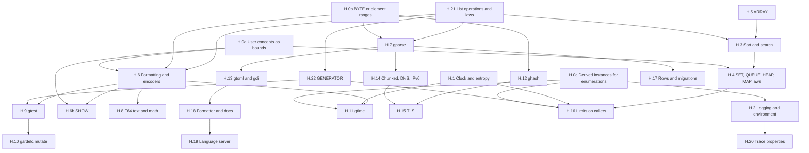

# Phase H: Library Essentials

**Date:** November 12, 2026
**Status:** In progress. Done (2026-11-16 to 2026-11-25): H.0a to H.0e, H.1 to H.6, H.9, H.10, H.21, H.22 and H.22b, but for `HASH_MAP` (H.4). In progress: H.7, whose cursor and `grest`'s move onto it are done (2026-11-27) and whose moves of `ghttp` and `gjson` are not. Not started: H.6b, H.8 and H.11 to H.20. Decisions 1 to 6, 10, 13 and 15 are taken.
**Follows:** [Phase F](verified_libraries.md) (verified libraries) and [Phase G](../ffi/ffi_plan.md) (foreign interfaces).

---

## 1. Objective

After Phases F and G, Gardel can serve JSON over HTTP, call another service, draw a terminal and use a database. It still lacks what most programs need on their first day: the time, a random number, a sort, a set, a way to format text, a test runner. This phase adds them.

The phase delivers, in this order:

1. Host essentials: a clock, entropy, logging and the environment.
2. Core data: the list operations and laws of Bird and Wadler, generators for infinite sequences, sorting, searching, sets, queues, heaps and a flat array.
3. Text and numbers: formatting, encoders, a shared parsing cursor and `F64` text.
4. Testing: a test runner and a mutation tool.
5. Time, hashes and configuration.
6. What a server needs to face the internet: chunked encoding, name lookup, IPv6, TLS, and limits on callers.
7. Typed rows and migrations over the databases of Phase G.
8. Tooling: a formatter, generated documentation, a language server and trace properties.

**The rule of Phase F stays:** nothing goes into a library without a client in this plan that needs it. Each task names its client.

**Not in this phase:** HTTP/2, WebSockets, locale collation, time zones other than UTC, Unicode normalization and display width, a package registry, GPU backends.

**Not in this phase, from Bird and Wadler's *Introduction to Functional Programming*:** each was weighed against the existing features and left out.

- **List comprehension syntax** (B&W §3.2). It desugars to `concat_map` and `filter`, so it would be a second way to write `LIST_OPS` and would need the same laws to verify. H.21 adds `concat_map` and `range`, which cover its uses.
- **Infinite and lazy lists** (B&W ch. 7). Every routine is total and terminates (principle 2), `LIST` is inductive, a `variant` measures `xs.length`, evaluation is strict, and reference counting cannot hold the cyclic structures of B&W §7.6. Laziness would break each of these. What B&W use infinite lists for is covered without them: an infinite sequence becomes a finite value, a state and a step, in H.22's `GENERATOR` (as Elixir's `Stream.unfold`); streams of input are the reactive program's event loop (§11.6); reasoning over infinite runs becomes H.20's trace properties over finite logs.
- **Tuples of more than two fields** (B&W §2.4). `TUPLE[A, B]` covers pairs, and a record covers the rest, with names and an invariant.
- **A composition operator, user operators, sections and currying** (B&W §2.6). `.` is already a method call, `FUNCTION_OPS.compose` carries the laws, and method chains read as pipelines. A partial application is a lambda.

---

## 2. Prerequisites

Some tasks cannot start until the compiler or an earlier phase provides something. Each is listed once here and named by its task.

| # | Prerequisite | Where it comes from | Needed by |
| :--- | :--- | :--- | :--- |
| P1 | **F.13 and F.15 closed.** Recursive helpers with a `require`, and facts at the value of a call | Phase F | Every proof-heavy task: H.3, H.4, H.7, H.11, H.21 |
| P2 | **User concepts as bounds.** Today only `EQ`, `CANONICAL_EQ` and `ORD` have a theory (`E0320`) | New compiler task, H.0a | `HASH` in H.4 and H.12, `SHOW` in H.6b |
| P3 | **A `BYTE` type, or element ranges for `LIST` and `SEQ` of a machine type.** Today an element of `LIST[U64]` has no range in the proof, so `gjson` checks each byte it reads | New compiler task, H.0b | H.6, H.7, H.12 |
| P4 | **A contiguous buffer in the C backend** with a `LIST` model | New compiler task, inside H.5 | H.5, and through it H.3 and H.4 |
| P5 | **Pure foreign routines** (G.0 to G.3) | Phase G | SHA-2 and HMAC in H.12, math in H.8 |
| P6 | **Native commands** (G.6b) | Phase G | H.15 (TLS), H.17 (rows) |
| P7 | **Files and processes** (F.11) | Phase F | H.9, H.10, H.13, H.18 |
| P8 | **Linux CI** | Done here, after H.1 ✅ (2026-11-19): `scripts/linux`, and a Linux job in CI | Every task with host code: H.1, H.2, H.14, H.15 |

P8 is the one with no owner. F.7's POSIX code has never run, and every host task below adds more. Set up a Linux runner before H.1.

**P8, done (2026-11-19).** `scripts/linux/Dockerfile` is the toolchain CI pins for Windows, on Ubuntu 24.04: Rust stable, .NET 6 with Boogie 3.4.3, Z3 4.12.1 (checked against its hash) and gcc 13. `scripts/linux/test.sh` copies the tree into it, without `.git`, the build outputs and the Windows tools, and does what CI does: builds gardelc, verifies the stdlib and every example, and runs `cargo test --no-fail-fast`; its arguments go to `cargo test`. Where apt cannot reach its mirrors, `GARDEL_LINUX_BASE` names an Ubuntu 24.04 image that already has gcc. `.github/workflows/ci.yml` gets the same steps as a job `verify-linux` on `ubuntu-24.04`.
- **Result.** The stdlib and the 16 examples are 0/0 on Linux, and their C builds there. The first run of the tests had 499 of 514 passing (Linux has one unit test more, behind `cfg(unix)`); the 15 failures were in the tests, not in the host or the compiler, and after the fixes all 514 pass, the timing tests alone as on Windows. F.7's sockets, F.11's files and processes, F.16's `WriteFile` and H.1's clock and generator, on POSIX, pass every test written for them on Windows: a connect that is refused, times out or reaches a server and replays, a flood of process output in order, a child given the terminal, a file replaced whole.
- **What the tests had wrong.**
  - `connect.rs` and `files_procs.rs` looked for `build/<stem>_bin` with the platform's suffix, which is none on Linux; gardelc then wrote `_bin.exe` on every platform, as the other tests knew. 11 tests. Since H.21, gardelc writes `_bin` with the platform's suffix, none on Linux and macOS, and every test asks for it so.
  - `derived.rs` expected exit status 421; POSIX keeps the low eight bits, 165.
  - `gtui.rs` and `tablon.rs` gave a 5000-line text in one script token, each byte as `%XX`: about 150 KB, and Linux refuses an environment variable over 128 KiB (`E2BIG`) before the program starts. Only what a script cannot hold as it is is escaped now (84 KB and 106 KB), and Tablon's lines lost their two leading spaces.
  - `gtui`'s full redraw took 24.6 ms a frame beside the other `gtui` tests, and 145 s for the test alone passed; it is one of the tests `check.sh` already runs alone.
- **Known limits.**
  - A script is one environment variable, so on Linux it holds at most 128 KiB. A longer run is a replay of a recorded log, which has no such limit. A `GARDEL_EVENTS_FILE` would lift it, if a test or a user needs one.
  - The CI job has not run: `.github/` is not tracked, and the workflow runs on `main` and `libraries` only. It needs a push to know whether the hosted runner's times fit `timeout-minutes: 120`; the local run took 1 h 50 min in a debug build, as CI builds.
  - macOS is not run anywhere. Its `getentropy` and `clock_gettime` are there, but nothing has compiled the host's C on it.

---

## 3. Task graph

| Task | Size | Delivers | Main risk |
| :--- | :--- | :--- | :--- |
| H.0a | L | A user's own concept as a bound | Touches the verifier core, as F.1 did |
| H.0b | M | Bytes that carry their range | Changing how every list of numbers is typed |
| H.0c | S | `EQ`, `ORD` and ordinals derived for an enumeration | Keeping derived laws out of user proofs' way |
| H.21 | M | The rest of B&W §3.3 in `LIST_OPS`, and the fold laws of §3.5.1 | The duality theorems' quantified premises |
| H.22 | S | `GENERATOR[S, A]`: an infinite sequence as a state and a step | Searches that may not end (`filter`, `find`) |
| H.1 | S | `ReadClock`, `Random` | Secrets in the event log |
| H.2 | S | `Log`, environment variables | Prelude name clashes |
| H.3 | M | Sort and binary search, proven | The permutation proof |
| H.4 | M | `SET`, `QUEUE`, `HEAP`, more `MAP` laws | Heap-order proofs |
| H.5 | L | `ARRAY[A]` with constant-time index | Update in place needs ownership (C.4, deferred) |
| H.6 | M | `STRING_BUILDER`, `TEXT_FORMAT`, hex, base64, percent-encoding | Round-trip proofs for base64 |
| H.6b | M | `concept SHOW` and its instances, derived for enumerations | Built-in instances in the type checker, Boogie and C |
| H.7 | L | `gparse`, a cursor with proven progress | Moving three parsers onto it without losing proofs |
| H.8 | L | `F64` to and from text, a math module | `F64` has only bound axioms in the verifier |
| H.9 | M | `gtest`, `gardelc test` | Keeping test time down |
| H.10 | M | `gardelc mutate` | Mutants that are equivalent to the original |
| H.11 | M | `gtime`: dates, RFC 3339 | The civil-date round trip |
| H.12 | M | `ghash`: CRC32, FNV, SipHash, SHA-2, HMAC | Bitvector proofs are slow |
| H.13 | M | `gtoml`, `gcli` | TOML's size |
| H.14 | M | Chunked encoding, name lookup, IPv6 | Two platforms |
| H.15 | L | TLS in the host | A native dependency in the runtime |
| H.16 | S | Rate limiter, retry, circuit breaker | None large |
| H.17 | M | Typed rows, migrations | Depends on G.6b's final shape |
| H.18 | M | `gardelc fmt`, `gardelc doc` | Comments in the parser |
| H.19 | L | A language server | Verification latency |
| H.20 | M | Properties checked over event logs | Choosing a property language |

---

## 4. Decisions to take

1. **Clock: a command, or a field on every event?** Proposed: a command, `ReadClock(tag)`. A time on every event would change `EVENT`, and most steps do not need it.
2. **Wall clock unit.** Proposed: milliseconds since the Unix epoch as `I64`, UTC, with no leap seconds, as POSIX counts them.
3. **Random bytes in the log.** A replay needs them, so they must be logged, and the log is in the clear (spec §11.6). Proposed: log them, and say in the guide that a log of a program that makes secrets is itself a secret. The alternative, a seed, would make every token predictable from the log too.
4. **`BYTE` type or element ranges (H.0b).** Proposed: element ranges, as F.4 did for fields. It changes no source. A `BYTE` type is cleaner but changes `BYTES`' model from `LIST[U64]` and every proof on it.
5. **Sorting when `equals` and `less_than` disagree.** `ORD` does not promise that they agree (F.3). Proposed: state `sorted` through `less_or_equal` alone, and `permutation` through `=` on a `CANONICAL_EQ` element, with a weaker contract otherwise.
6. **`ARRAY` updates.** Proposed: `set` copies unless the array has one reference, checked at run time by the reference count. This needs no ownership rule in the language. A static rule is C.4's deferred work.
7. **`F64` printing: proven or tested.** Proposed: tested first, against a public corpus, with the algorithm in Gardel over `BIGNAT`. A proof needs an `F64` model the verifier does not have.
8. **Math functions: per platform or bundled.** Proposed: one bundled implementation, linked as a pure foreign routine, so `sin(x)` is the same bits everywhere, as §3 of the spec requires of `F64`.
9. **Where TLS lives.** Proposed: in the host, as `ListenTls` and `ConnectTls`, so a program sees plain bytes and the same `Received` and `Send`. In Gardel code it would need a native command per record, and the keys would pass through the event log.
10. **Test discovery.** Proposed: a package's `tests/` directory is a client package, as `ghttp/tests` and `gjson/tests` already are, and `gardelc test` runs each `program` in it.
11. **Formatter style.** Proposed: one style, no options.
12. **Trace property language.** Proposed: a pure Gardel routine over a list of log entries, so no new language is needed.
13. **Derived instances for enumerations (H.0c).** Proposed: a sum whose variants all have no fields may write `satisfies CANONICAL_EQ` or `satisfies ORD` with no method bodies, and the compiler supplies them, ordered by declaration as in B&W §8.1. No new syntax. A sum with fields still writes its own.
14. **`LIST_OPS` calling style.** `LIST` uses `LIST_OPS.map(xs, f)`, while `SEQ`, `OPTION` and `RESULT` use `s.map(f)`. Proposed: keep both, since `LIST` is also the ghost model, but give every law the same name on every type (`map_fusion`, `filter_append`, ...), as there is no functor concept to share them.
15. **A generator at the end of a bounded type (H.22).** A step over `NAT` overflows after 2^64 items, and the verifier refuses `s + 1` in a step's lambda. Proposed: the library offers both forms, `GENERATOR` with a step that never ends (the client wraps with `+%` or uses `BIGNAT`) and `UNFOLD` with a step that returns `OPTION`, as Elixir's `Stream.unfold` returns `nil`. It does not pick wrapping for the client.

---

## 5. Work breakdown

Every task follows the rules of Phases E and F:

- `--stdlib --strict` stays 0/0, and every example and package stays 0/0 under `--strict`.
- New rules get tests, and mutations on a private copy must each turn a test red. From H.10 on, the tool does this.
- `--compare-with` runs on every package and prelude change.
- A new `COMMAND` or `EVENT` comes with its host code on both platforms, its scripted form and its log form.
- What is not proven is listed as such, with the test that covers it.

### Step 0: Compiler prerequisites

#### Task H.0a: User Concepts as Bounds

Client: `HASH` (H.4, H.12) and `SHOW` (H.6b). Closes F.1's first known limit.

**Status:** ✅ Completed (2026-11-16).

- [x] A `concept` declared by a user gets a theory in a generic module that names it as a bound: one relation or function per method, and its laws as axioms, as `EQ` and `ORD` have today.
- [x] Methods that are not relations: `hash: U64`, `show: STRING`. Today's theory covers only `equals`, `less_than` and `less_or_equal`.
- [x] Instance links (F.1) for a user concept, with the same rule: no link inside a module that the instance's own proofs could rest on.
- [x] `[A: ORD]` together with `where A satisfies C` checks both (F.1's fourth limit).
- [x] A false-law test, as F.1 had: a type whose `hash` breaks `equals implies same hash` must not verify through a bound.
- Acceptance: `module BAG[K: HASH]` verifies, uses `k.hash`, and runs in C. `E0320` is gone for user concepts. All existing `.bpl` output is byte-identical, as no existing code has such a bound.
- **Fix: the theory.** The hand-written block that gave a parameter `K_eq`, `K_less` and their laws is now one piece per concept in the parameter's closure, in the order `EQ`, `CANONICAL_EQ`, `ORD`, then a user's. A user concept's piece (`emit_user_bound_theory`) declares `K_m_<method>(x: K, args...)` per method, with `Current` read as `K`; states the range of a machine number result (`in_u64(K_m_hash(x))`); and translates each law, with `Current` as `K`, through the ordinary expression emitter, so `a.hash` and `a.equals(b)` reach the relations. `HASH refines EQ` brings `EQ`'s piece. A user concept's laws carry the triggers they declare, or none, and the solver picks. The concepts a run declares are kept beside the prelude's (`find_concept`), so refinement, `E0317` and the C backend's own check see them.
- **Fix: links.** At each use, every method of the bound is linked, not only `equals` and `less_than`: `BAG__K_m_hash(_bx) == TOKEN__fn_hash(DefaultFuel, _bx)`, with `<==>` for a `BOOL` result and the arguments as `_b0`, `_b1`. `type_rests_on` is unchanged, so the rule of F.1 applies as it is.
- **Fix: a bound with a `where`.** `check_and_expand_concepts` wrote a `where` concept over the bound, and `declared_bound` then called the bound conditional, so `[A: ORD]` with `where A satisfies HASH` lost the order and was used unchecked. `ModuleDecl.declared_bounds` now keeps what `[A: C]` wrote: every use is checked against it, and inside the module the parameter has the methods and laws of both (`bound_concepts`). A `where CANONICAL_EQ` stays conditional unless the written bound is canonical already.
- **What `E0320` means now.** A bound is refused when the concept has type parameters, or a method with a body (as `ORD.less_or_equal` has), since the proof would need that body for every instance. A method a user concept does not give is still `E0318`.
- **Result.** `cargo test --release` 496/496 (233 unit tests, 33 suites). A debug build overflows its stack in `tests/gtui.rs`, as it already did before H.0a. `tests/bounds.rs` gains six tests: `BAG` over `TOKEN` and through a generic `RELAY[T: HASH]`, with the theory and the link checked in the `.bpl` and the C program run; three lies in a generic and one in a client refused; the false-law test, where `BROKEN`'s `consistent` stays unproven while `BROKEN` itself uses `BAG`; `E0317` at `BAG.bucket(n, 10)` on a `NAT`; `E0320` for a concept with a body, and `E0318` for a method `HASH` does not give; and `KEYED[K: ORD] satisfies HASH where K satisfies HASH` verifying, with `KEYED[TOKEN]` refused. `SHOWN[T: SHOW]` with `show: STRING` verifies and runs too. `--stdlib --strict`, the 8 example files, the 8 example projects, `ghttp`, `gjson`, `grest` and `gtui` stay 0/0, and all 1,216 `.bpl` and `.c` files they generate are byte-identical to those of the previous commit. 11 of 11 mutations of the new code, each on a private copy, turn a test red.
- **Known limits.**
  - A concept method with a body cannot be given to a bound. The plan's `HASH` and `SHOW` need none.
  - An instance whose `hash` uses `*%` does not prove `consistent` within the default resources: the solver stalls on `bv2int(bvmul(int2bv(x), ...))` even when `x` is equal on both sides. With `%` it proves at once. This is H.12's risk, met early, and it needs a fix before H.12's hashes, which all wrap.
  - A link does not tell a client what a string literal of another module holds, so `SHOWN.twice(LABEL.of(1))` needs `LABEL.show` to state its `byte_length` in an `ensure`. This is how a client learns any routine's result, and not new.
  - A law of a user concept with no `trigger` reaches the solver with the triggers it picks. None of the tests needed one.

#### Task H.0b: Bytes That Carry Their Range

Client: every parser. Needs decision 4. Closes F.2's first known limit.

**Status:** ✅ Completed (2026-11-17). Decision 4 taken as proposed: element ranges.

- [x] An element of a `LIST` or `SEQ` of a machine type is in the type's range: at `head`, `LIST_OPS.at`, a `match` binder and a `fold` argument.
- [x] `BYTES.model` elements are below 256 wherever a client reads one, from `BYTES`' invariant, without a call to `at`.
- [x] Remove the per-byte range checks from `gjson`'s reader, and measure.
- [x] Soundness test: a list built from a value out of range must be refused where it is built.
- Acceptance: a client proves `bs.model.head < 256` for a non-empty `BYTES` with no check in its body. `gjson` is 0/0 with the checks removed.
- **Fix: the range of a list.** A list of a machine type carries a predicate, `Seq_in_u64`, `Seq_in_i64` or `Seq_in_char`, over its Boogie `Seq int`. It is assumed of every parameter, field and result whose type is such a list, and checked where one is built: at a call argument, a field of a record, and a routine's result (`range::<name>_elements`). Axioms take it through `empty`, `prepend`, `singleton`, `append`, `head`, `tail`, `at`, `has` and `filter`, and through the prelude's generic routines (`map`, `reverse`, `take`, ...) at each machine type they are used with. A lambda with a machine result keeps its range, so `LIST_OPS.map(xs, fn ...)` does too. A `match` binder and a `fold` accumulator take the range of their type.
- **Fix: nested lists and function values.** `LIST[LIST[U64]]` carries `Seq2_in_u64`, whose items are each `Seq_in_u64`, so a character of a line of a `LIST[LIST[CHAR]]` text is in range (gtui). A function value of type `(a: T1, b: T2) -> R`, of up to three arguments, carries `forall a, b in range :: f(a, b) in range`. It is checked where the function is passed, which refuses `(x: NAT) -> MATH_INT` for `(x: NAT) -> NAT`. That check starts a verification condition of its own (`{:split_here}`). In one condition with a false `require` after it, Z3 ran out of resources on `tests/refined.rs`, after 171 s and 264 s. Split, each takes about 1 s.
- **Fix: Boolean routines.** A `BOOL` routine with no `require` and only number guards besides its lists' ranges is defined as false of a list out of range, and its truth gives its lists' ranges back. So `valid_utf8(bs)` gives `Seq_in_u64(bs)`. Without that axiom, ghttp's test client made about 50 times as many decisions (794k against 15k) and ran out of resources.
- **Fix: `BYTES`.** Four laws in `stdlib/text/bytes.gdl` carry the invariant into the model: `model_octets`, then `octets_head`, `octets_tail` and `octets_at`. A client reads `b.model.head < 256` and `LIST_OPS.at(b.model, i) < 256` with no check. The `>= 0` half needs nothing, since it is `U64`'s range.
- **Measurement.** `gjson` drops the six `>= 0` checks from `json_bytes.gdl` and `json_writer.gdl`, and stays 0/0. The `< 256` checks stay, since a `LIST[U64]` reaches them and not a `BYTES`. Its 70 cases run in 1.16 s both before and after. The generated C differs only where the checks were removed. A `>= 0` test of an unsigned number costs nothing.
- **Result.** `cargo test --release` 499/499 (233 unit tests, 34 suites). `tests/gtui.rs`' frame timing test took 16.99 ms per frame while every suite ran in parallel, and 9.5 ms when run alone, against a limit of 16 ms. The new `tests/elements.rs` has three tests:
  - **Reads.** An element read from a list is in range: at `head`, `at`, a `fold`, an `OPTION` binder, a `SEQ`, a record field, a nested list, `BYTES.model`, a function parameter's result, and a list mapped by a wrapping lambda.
  - **Lies.** A range that does not hold is not proven: `< 256` of a `LIST[U64]`, `< 128` of a byte, `>= 0` of a `LIST[MATH_INT]`, `> -2^63` of a `LIST[I64]`, and `>= 0` of a function into `MATH_INT`.
  - **Built.** A list built out of range is refused where it is built: at a result, through `map`, at an argument, at a field (also of a sum's variant), in a nested list, and a function passed with a `MATH_INT` result.

  `--stdlib --strict`, `gjson`, `ghttp/tests` and `gtui/tests` are 0/0, in 48 s, 40 s, 237 s and 156 s. 15 of 15 mutations of the new code turn a test red. Each removes one of: an axiom, a check at a call, field or result, the nested level, function facts or their guard, the parametric axioms, a lambda's range, a binder's or `SEQ`'s range, the Boolean rule (red in `ghttp`), or the split (red in `tests/refined.rs`).
- **Known limits.**
  - A law's axiom does not state its parameters' ranges and invariants, while its proof assumes them. This predates H.0b, which follows the same convention for lists. A law over `LIST[U64]` is thus stated of every `Seq int`.
  - A routine's own contract is an axiom in its own proof. A false `ensure` on a recursive routine can prove itself through the recursive call. The `tree.gdl` mutant in the unit tests passes, but because Z3 happens to find the failure, not because the rule forbids it.
  - ~~A `U64` literal result is not checked: `big: U64 do 18446744073709551616 end` verifies. Nor is a `MATH_INT` passed to a `U64` parameter.~~ Fixed in H.0d.
  - A function of more than three arguments, a `LIST[SEQ[...]]`, and lists nested three deep get no range facts. Nothing needs them yet.
  - ~~The comment in `gtui`'s `text_zip.gdl` that says a state is passed in a list to keep its range is now out of date.~~ Removed in H.0d.

#### Task H.0c: Derived Instances for Enumerations

Client: `LOG_LEVEL` in H.2 (`GARDEL_LOG_LEVEL` sets the lowest level written, so levels need an order), months and weekdays in H.11, the breaker states in H.16. Today `HTTP_METHOD` and every other enumeration write `equals` by hand. Needs decision 13. Adds what B&W §8.1 gives an enumerated type.

**Status:** ✅ Completed (2026-11-17), except `HASH` and `SHOW`, which move to H.12 and H.6b. Decision 13 taken as proposed.

- [x] On a sum whose variants all have no fields, `satisfies CANONICAL_EQ` or `satisfies ORD` with no bodies gets `equals` and `less_than` from the compiler. The order is the order of declaration.
- [x] `ordinal: NAT`, `from_ordinal(n): OPTION[T]` and `all: LIST[T]`, with laws: `from_ordinal(t.ordinal) = Some(t)`, `a.less_than(b) = (a.ordinal < b.ordinal)`, `all.length` is the number of variants, and every value is in `all`.
- [x] The concept's laws are proven for the generated bodies, as for written ones, so no derived instance is trusted.
- [x] A body written by hand still wins, and a sum with a field asks for one (a new error code).
- [x] Move `HTTP_METHOD` and `HTTP_VERSION` onto it, and record the lines removed.
- [ ] With H.0a: `HASH` and `SHOW` derived the same way. Moved to H.12 and H.6b: neither concept is in the prelude yet, and the compiler cannot tell what a user's `hash` or `show` should mean from its name.
- Acceptance: `module LOG_LEVEL satisfies ORD` with four variants and no feature verifies, and a client proves `Debug.less_than(Error)`. All existing `.bpl` output is byte-identical.
- **Fix: the derivation.** `check_and_expand_concepts` calls `derive_enumeration_instance` before it checks a module's methods. For an enumeration (a sum with no type parameters whose variants have no fields) that leaves out `equals` (for `EQ`) or `less_than` (for `ORD`), the compiler writes the module's instance as Gardel source (`enumeration_source`), parses it, and adds each routine and law the module does not write: `equals` as `Current = other`, `less_than` as `Current.ordinal < other.ordinal`, each with `ensure def`; `ordinal` by a `match`; `from_ordinal` by nested `if`s; `all` by `prepend`s, with `count` and `has_each`; the laws `ordinal_back`, `all_listed` (by cases) and `all_at_ordinal`; and every law of the concepts that the module does not state, under its concept's `specify`. A derived `equals` is structural, so the module also satisfies `CANONICAL_EQ` (otherwise `E0311` refuses its own `=`). A client calls the laws as any other: `LOG_LEVEL.all_listed(t)`.
- **Fix: `E0323: underivable_instance`.** A type that is not an enumeration and leaves out `equals` or `less_than` is refused with a message that says only an enumeration gets them. Other missing methods keep `Missing Concept Operation`.
- **Fix: a bare variant as a receiver.** `Info.less_than(Warn)` in a `program` was translated as `fn_less_than`, with no module, and refused as `E0199`, whether the instance was derived or written. `infer_gardel_type` now gives a variant with no fields the type of the module that declares it.
- **Fix: a proof the solver gives up on is tried under other seeds.** With `HTTP_METHOD` derived, `HTTP_ROUND_TRIP.fields_read_back` ran out of time under Z3's default seed (300 s, then the 600 s backstop) and took 1.3 to 1.9 s under seeds 1 to 3. Deleting `ordinal`'s two definition axioms, which no term of the proof triggers, brought it back to 1.5 s under the default seed; a dummy function of the same shape in their place took 2.2 s. Split into one law per conclusion, ghttp passed, and then `fields_read_values` did the same in `ghttp/tests`' package form. Proofs this close to the edge break with any change to their context, so `gardelc` now retries the whole module under seeds 1, 2 and 3 when the solver gives up (a resource limit, a timeout or the backstop) and no seed was chosen, and keeps the first run in which it does not. The first try stops a procedure after 120 s when retries follow, as this proof never reached its resource budget: ghttp took 769 s with the 600 s first try and 321 s with 120 s. The split was undone; `fields_read_back` is as it was.
- **Lines removed.** `HTTP_METHOD` 138 → 102 and `HTTP_VERSION` 92 → 56: each drops `equals` and its `CANONICAL_EQ` and `EQ` laws, 36 lines. Each gains `ordinal`, `from_ordinal` and `all`.
- **Result.** `cargo test --release` 505/505 (234 unit tests, 35 suites). The new `tests/derived.rs` has four tests:
  - **Instance.** `LOG_LEVEL satisfies ORD` with four variants and nothing else verifies. A client proves `Info.less_than(Warn)`, the ordinals, `all_listed`, `all_at_ordinal` and equality, and keys a `MAP` by it. A program using it runs to the expected exit code. The `.bpl` holds a proof for each derived law and for each `CANONICAL_EQ`, `EQ` and `ORD` law.
  - **Lies.** Four false claims about the derived instance are refused.
  - **Not trusted.** A hand-written `ordinal` of 0 leaves `ORD_total`, `ordinal_back` and `all_at_ordinal` unproven. A hand-written `equals` that is always true leaves `CANONICAL_EQ_agrees_with_structural` unproven.
  - **E0323.** A sum with a field and no `equals`, and a record with no `less_than`, are refused.

  `tests/seed_retry.rs` starves a module with `--z3-rlimit 1` and checks that it is retried under seeds 1 to 3 and still reported as unproven. It checks that `--z3-seed` is not varied, and that a module proven at once is not retried. The stdlib, the 8 examples, the 6 example projects, `ghttp`, `gjson`, `grest` and `gtui` generate byte-identical `.bpl` and `.c` files, before `HTTP_METHOD` and `HTTP_VERSION` moved. After the move, `ghttp` (321 s, one retry, of `HTTP_ROUND_TRIP`), `ghttp/tests` and `grest` are 0/0. 14 of 14 mutations of the new code turn a test red.
- **Known limits.**
  - A retry costs up to three more runs of the module: a module that is truly unprovable now takes about four times as long to be reported.
  - A sum with type parameters, such as `OPTION[T]`, gets nothing derived, even when no variant has a field.

#### Task H.0d: Numbers Checked Where They Are Made

A soundness fix found in H.0b (its known limits). `big: U64 do 18446744073709551616 end` verified. Its frame axiom `in_u64(fn_big)` contradicted its definition `fn_big == 18446744073709551616`, so a caller of `big` could prove `False`. A `MATH_INT` passed to a `U64` parameter, or given to a `U64` field, was not checked either.

**Status:** ✅ Completed (2026-11-18).

- [x] A routine's result of a machine number type is in its range (`<routine>::range::result`).
- [x] An argument passed to a parameter of a machine number type is in its range (`range::<param>_range`), and so is a value given to a field of one (`range::<field>`).
- [x] Every library, example and package stays 0/0, with each proof that breaks fixed by a true range fact, not by weakening the check.
- [x] Remove the outdated comment in `gtui`'s `text_zip.gdl`.
- Acceptance: `big` above, `take(m)` with `m: MATH_INT`, and `{ value = m }` are refused as `Range Violation`. The same with a `require` that bounds `m` verify.
- **Fix: the checks.** H.0b's checks of a list's elements at a result, an argument and a field now also cover `NAT`, `U64`, `I64`, `INT`, `CHAR` and `EXIT_CODE` (`machine_range_obligation`). An argument is not checked again when its own type has the same range: a parameter, a field, or a call of a routine that declares that range, since every such result is checked in the callee (`known_in_range`, `callee_declares`). A built-in, as a fold, and a routine whose result is a type parameter are checked: before, `take(s.fold_left(f, 18446744073709551616))` passed unchecked. A literal, an arithmetic result, a branch and a `let` local are checked. A local's type is inferred, so `let x = 18446744073709551616` is a `NAT` to the inference.
- **Fix: folds.** `s.fold_left(fn(acc: U64, x: U64): U64 do acc *% 10 +% x end, 0)` had no range, and three routines of `examples/seq_ops.gdl` failed. Axioms now state, by induction on the list, that a fold with an accumulator of a machine type is in its range when its start is and each step keeps it there. A step may assume its element's range when the list's elements have one (`emit_fold_range_theory`).
- **Fix: a list's length is trusted (decision taken 2026-11-18).** `xs.length` has no upper bound in the proofs, so `MAP.size`, 7 routines of `gtui` (and 4 obligations of two `on_key`s that rest on them) and 4 of `tablon` failed. Before H.0d, each routine's result axiom asserted the bound unchecked. An axiom that every list's length fits a `U64` would contradict `prepend`. The length of a `LIST` that a program reads is now assumed to be in `U64`'s range where it is read (`emit_list_length_trust`), since no list in memory holds 2^64 elements. The assumption is of the length term itself, as of `LIST_OPS.filter(ps, keep).length`.
- **Fix: a number read out of a generic container is trusted (decision taken 2026-11-18).** The full test run then failed 5 compiler unit tests. Their fixtures read a number out of a generic container: `o.unwrap_or(d)` of an `OPTION[NAT]`, `p.first` of a `TUPLE[U64, BOOL]`, a binder of a `RESULT[U64, ...]`, and `b.twin.twin.get` of a `BOX[I64]`. A container's contents have no range in the proof. Before H.0d each such routine's result axiom asserted the range unchecked. Two reads are now assumed in range: the result of a routine whose declared result is a type parameter of its module, together with a tuple's `first` and `second` (`emit_generic_read_trust`), and a match binder of such a field. A routine's own type parameter, as `B` of `fold[B]`, is made from its arguments, not read out of the container, and is not trusted: trusting it accepted `s.fold_left(f, 18446744073709551616)`. The body's proof assumes a binder in range already, so an arm with no obligation of its own needs nothing more. A routine that declares a machine result is not trusted, since its body is checked. The full fix, range predicates for every generic type at a machine type argument as H.0b gave `LIST`, is H.0e.
- **Fix: a lambda keeps its name.** Each translation of a lambda gave it a new name, `lam_WORK_2` in the obligations and `lam_WORK_3` in the body, so an assumption whose term held a lambda never met the body's term, and the trusts above had to skip such terms. A lifted lambda now reuses the name of an identical one already lifted in the module (`BOOGIE_LAMBDA_NAMES`), and each is declared once.
- **Fix: a fold of a `MAP`.** `m.fold(0, fn(acc: NAT, k: STRING, v: NAT): NAT do ... acc + v ... end)` of `tests/map.rs` had no range. Where such a fold is called, its result is assumed in range when its start is and each step keeps it there, for a value in its type's range: the trust of a read out of a container, stated at the call since a `MAP[K, MATH_INT]` holds ints too (`emit_map_fold_range`).
- **Fix: a wrap is not checked.** A result made by `+%`, `-%` or `*%` at its own type's range, or by a bitwise operator at `U64`'s, is in range by construction, and its check is skipped. Proving `in_u64` of `bv2int(bvadd(int2bv(..)))` made Z3 bit-blast: the compiler's unit test of every expression position went from 2 s to over 15 minutes. It now takes 9 s.
- **Result.** All 507 tests pass: the 234 compiler unit tests and the 36 integration suites. Under load, two tests miss their timing (`gtui`'s 200 by 60 frame, and `files_procs`'s keys for an attached child), and both pass alone. The stdlib is 0/0 in 47 s, `gjson` in 36 s, `gtui/tests` in 158 s, `ghttp/tests` in 163 s and `tablon` in 394 s, 4 projects at a time.
  - **Lies.** `tests/machine_range.rs` gives eleven values out of range, each refused at its place: a literal result too large, `-1` as a `U64`, a `MATH_INT` result, argument, constructor field and record field, a literal through a `let` local, a fold of `MATH_INT` steps, and a fold of a `SEQ` and of a `MAP` whose start is out of range, and such a fold passed as a `U64` argument. A call whose precondition fails is refused for that, and its result is not refused again.
  - **Truths.** The same values bounded by a `require` verify. So do a parameter passed on, a `NAT` passed as a `U64`, a list's length, the length of a `filter` and a `map`, folds at `U64` over `U64` and `BOOL` elements, a `MAP` fold, and reads of an `OPTION[NAT]`, a `TUPLE[U64, BOOL]` and a `Some(x)` binder. The `.bpl` has no trust of a routine that declares a `U64` result, and no check of an argument that is a parameter or a call result of the same range, and one declaration for each lambda.

  The stdlib (`--stdlib --strict`), the 8 single-file examples, and every project are 0/0 with no source change: `api_gateway`, `echo_server`, `gtui_tour`, `hello_api`, `todo_api`, `todo_tui`, `gjson`, `gjson/tests`, `gtui`, `gtui/tests`, `ghttp`, `ghttp/tests`, `grest`, `grest/tests` and `tablon`. 21 of 21 mutations of the new code turn a test red. The last of them, a built-in call taken as in range, survived until the fold passed as an argument joined the lies.
- **Known limits.**
  - A list's length is trusted, not proven. A law or `ensure` that reads the length of a list no program could hold is proven only for lists that fit.
  - A `SEQ`'s or a module's own `length` is a routine, checked in its body, and gets no trust: a `length` defined as the length of an unbounded list must bound it.
  - A fold's range axioms cover an accumulator of a number type, not a list of numbers or a record. A fold of a user generic container has none.
  - **A container built from a number out of range is accepted.** `Some(m)` with `m: MATH_INT`, used as an `OPTION[U64]`, is not refused, while a read of it is trusted to be in range. So a caller can still prove `False` this way. Fixed by H.0e, which also removes the trust of a read.

#### Task H.0e: Containers That Carry Their Range

Found in H.0d (its known limits). A number read out of a generic container is trusted to be in its type's range, and the container is not checked where it is built.

**Status:** ✅ Completed (2026-11-18).

- [x] A range predicate for `OPTION[A]`, `RESULT[E, A]`, `TUPLE[A, B]`, `MAP[K, V]` and a user generic at a machine type argument, as H.0b's `Seq_in_u64` for `LIST`. It is assumed of every parameter, field, binder and result of the type, and checked where one is built.
- [x] Remove H.0d's trust of generic reads (`emit_generic_read_trust`, the binder's range assumption, and the value assumption of `emit_map_fold_range`), and record what that costs.
- [x] Every library, example and package stays 0/0.
- Acceptance: `Some(m)` with `m: MATH_INT` returned as an `OPTION[U64]` is refused as a `Range Violation`. `o.get` of an `OPTION[NAT]` parameter is a `NAT` without trust.
- **Fix: a range is a value.** A range is now a term of a Boogie type `Rng`, and `Rng_holds(p, x)` says that `x` is in it. The leaves `Rng_u64`, `Rng_i64` and `Rng_char` are `in_u64`, `in_i64` and `in_char`. `Rng_seq(p)` is a list whose elements are in `p`, the same as `Seq_in_u64` and its kin, and `Rng_and(p, q)` holds both. Each generic module gets one range function per type parameter that some field holds, as `Rng__OPTION_A(p)`. That works only if every field that holds the parameter has a range itself, so a field of a function type gives the module none (`carries_range`). Two axioms define it. The first says that a constructor term is in range exactly when its fields are. The second says that each field read out of a value in range is in range (`emit_container_range_theory`). A `TUPLE` has `Rng__Tuple2_A` and `Rng__Tuple2_B`. `RESULT[E, A]` has one function per side, and a type with two ranged arguments, as `RESULT[U64, TUPLE[U64, U64]]`, gets the conjunction of both. The names `Rng__*` stay the same when a module is linked or loaded as the prelude, since every module's axioms meet on them.
- **Fix: where a range is assumed and checked.** H.0b's `elements_fact`, assumed of every parameter, field, binder and result and checked where a value is made, now gives a container's range when its type has one (`container_fact`). So `Some(m)`, `(m, True)`, `Ok(m)`, `MAP.empty.put("a", m)`, `CRATE.make(m)` and `Some(LIST.empty.prepend(m))` with `m: MATH_INT`, returned as a container of `U64`, are each refused as a `Range Violation`, and so is a field `held: OPTION[U64]` given `Some(m)`.
- **Fix: a routine passes a range on.** H.0b's axioms that a routine of a generic module keeps its list's range (`emit_parametric_range_axioms`) now take a container argument and the receiver as a source too. A routine's own type parameter, as `K` of `MAP.empty`, may be fixed by the result. A further axiom quantifies over the range itself (`_rp: Rng`). It fires on the result, or on the call together with a source's range. So `m.get(k)` of a `MAP[STRING, NAT]` is an `OPTION` of `NAT`, and `o.unwrap_or(d)` is a `NAT` when `d` is. The receiver is a source only when its type has a range term. A `SEQ`'s range is its `model`'s, and a guard on it unfolds `model` at every call. That guard made the compiler's unit tests take 1980 s, not 657 s, and a false postcondition over a lambda ran out of time instead of being refuted.
- **Fix: no trust.** `emit_generic_read_trust` and the binder's assumption are gone. A `MAP`'s `fold` now assumes its values in range only when the map holds them (`Rng_holds(Rng__MAP_V(..), m)`, in `emit_map_fold_range`). The binder's trust had covered a `SEQ`'s leaf: `elements`'s `seq_leaf` then failed. Two axioms now say that a `Leaf`'s value and a `Concat`'s parts are in range when the `SEQ`'s `model` is.
- **Result.** All 509 tests pass: the 234 compiler unit tests and the 37 integration suites. Under load a third test misses its timing (`gtui`'s key on 5000 lines), and it passes alone. The stdlib, the 8 single-file examples and every project are 0/0 with no source change.
  - **Cost.** Cold and one at a time, H.0d against H.0e: the stdlib 39 s and 41 s, `gjson` 31 s and 34 s, `gtui/tests` 132 s and 143 s, `tablon` 524 s and 543 s, and `ghttp/tests` 218 s and 339 s. The last is one law, `HTTP_ROUND_TRIP.fields_read_back`, which H.0c already found fragile. Under 6 seeds it times out at 2 in H.0d and at 3 in H.0e, and the axioms of H.0e make Z3's default seed one of the 3, so it waits for the limit and then proves under another seed. Leaving out any one of 12 of the 14 range axioms of its routines restores the default seed, so no single axiom loops.
  - **Lies.** `tests/container_range.rs` builds ten containers out of range: the six above, the `HOLDER` field, `takes(Some(m))` refused at its argument, and two reads back from a map that `put` was given a `MATH_INT`. Each is refused at its place, and `takes`, whose argument is a parameter, is not.
  - **Truths.** Reads of an `OPTION[NAT]`, an `OPTION[U64]` with `get`, a `TUPLE[U64, BOOL]`, a `RESULT[STRING, U64]`, a `MAP[STRING, NAT]`, a `CRATE[U64]` by a routine and by its field, an `OPTION[LIST[U64]]`, a `RESULT[U64, TUPLE[U64, U64]]` by a nested pattern, and a `MAP[STRING, OPTION[U64]]` read twice verify. So does each container built from a `U64`, and `Some(xs)` of a `LIST[U64]` parameter and back. A recursive `pick_from(c: CRATE[T], n: NAT): T` unfolds only as far as its fuel goes, so its callers need the range it keeps: from a container argument, and, read as a `CRATE[OPTION[U64]]` and matched, from the carrier's range alone. The `.bpl` assumes no range except a list's length.
- **Mutations.** 14 of 15 mutations of the new code turn a test red. Four first survived and joined the truths: the field axiom with no field read, the list bridge with no `LIST[U64]` parameter, a container argument and the forward trigger with no recursive routine. Within a project a routine's body unfolds, and the field axioms then reach the value without the routine's own. The 15th, a constructor's range taken only from its fields, is equivalent. The other half follows from the field axiom, since Z3 adds `Some_value(Some(x)) = x` for each constructor term. The axiom keeps both halves of the definition.
- **Known limits.**
  - A value given to a type parameter of a generic routine, as `put`'s `v: V`, is not checked: the type parameter has no range of its own. The container it goes into then has no range, and a read of it is refused, not the `put`. The refusal is right, but it comes at the read, not at the `put`.
  - A `SEQ` has no range term. Its range is its `model`'s, as in H.0b, so a container of `SEQ`s gets none.
  - A module whose type parameter is held by a field with no range, as a function, gets no range function.

### Step 1: Host essentials

#### Task H.1: Clock and Entropy

Client: `gtime` (H.11), the rate limiter (H.16), request ids in `grest`. Needs decisions 1 to 3 and P8.

**Status:** ✅ Completed (2026-11-19). Decisions 1 to 3 taken as proposed. P8 was done after it (see §2): its tests pass on Linux too.

- [x] `ReadClock(tag)` answered by `Clock(tag, wall_millis: I64, monotonic_millis: U64)`. The monotonic value is the clock that timers already use.
- [x] `Random(tag, count: NAT)` answered by `RandomBytes(tag, res: RESULT[IO_ERROR, BYTES])`, from the system's generator (`BCryptGenRandom`, `getrandom`). A `count` above 1024 is an `Error`.
- [x] For a `program`: `IO.now: IO[I64]` and `IO.random(count: NAT): IO[RESULT[IO_ERROR, BYTES]]`. Each is a fresh value in the proof, as `IO.read_line` is.
- [x] Scripted forms `Clock:<tag>:<wall>:<mono>` and `RandomBytes:<tag>:<text>`, log forms, and replay.
- [x] Guide: a log holds the random bytes (decision 3).
- [x] `RandomBytes` has the postcondition a client needs stated on a gateway: an `Ok` payload has length `count`. The host checks it, so the assumption is justified, as with `read_line`'s length bound. Done for `IO.random`; see the limits for `RandomBytes`.
- Acceptance: a reactive program prints the time and eight random bytes; its recording replays to the same output on another day. Two `Random` results are not provably equal.
- **The host.** `ReadClock` and `Random` are answered by the loop itself, at once: the answer goes on the queue the helper threads use, so it comes as the next event, after the step's other commands, as every answer does. The loop reads that queue only once a reader or a helper has started, so a flag of its own (`gardel_loop_answered`) says that the loop queued one; without it the first `ReadClock` waited for ever. The wall clock is `GetSystemTimePreciseAsFileTime` or `clock_gettime(CLOCK_REALTIME)`, the monotonic clock `gardel_host_now_ms`, which timers use. The bytes come from `BCryptGenRandom`, found at run time with `LoadLibraryW`, so no program links with anything new, and from `getentropy` in pieces of 256 on POSIX. A `count` above 1024 is `Error(OsError(c))` with the system's invalid-argument code (87, `EINVAL`). The clock and the generator are one block of C, `OS_CLOCK_RANDOM`, emitted for the reactive host and for a `program` that calls `IO.now` or `IO.random`.
- **Scripts and logs.** `Clock:<tag>:<wall>:<mono>`, with a `-` for a time before 1970, `RandomBytes:<tag>:<bytes>` and `RandomFailed:<tag>:<code>` are both a script's tokens and a log's lines; commands are logged as `ReadClock:<tag>` and `Random:<tag>:<count>`, and in a script or a replay written to standard error as `host: ReadClock 1`. A replay reads no clock and draws no bytes.
- **The proof.** `t <- IO.now` is a fresh `I64` (`havoc`, then `assume in_i64(t)`). `r <- IO.random(n)` is a fresh `RESULT` whose `Ok` is a valid `BYTES` of exactly `n` bytes, with `n <= 1024`; so `IO.random(1025)` is known to be an `Error`. Nothing else is assumed: not that a time is after 1970, not that a second read is later, and not that two draws differ or agree.
- **Result.** All 513 tests pass: the 234 unit tests and 38 suites, with `tests/clock_random.rs` new. The stdlib, the 8 single-file examples and every project are 0/0, and no package changed: each `match` on `EVENT` and `COMMAND` already had a `case _`.
  - **Truths.** A real run prints a time within a second of the test's own clock, eight bytes each below 256, and `refused` for 1025; the log has each command and answer; the replay gives the same output with no clock read; a second run draws other bytes. A script gives a time before 1970, the extremes of `I64` and `U64`, bytes that are not text and a failure. A `program` passes `IO.random(8)`'s bytes to a routine that requires eight.
  - **Lies.** Refused: two draws are equal, eight bytes are nine, a time is not before 1970, and a second read is not earlier than the first. Six malformed script tokens stop the program with status 2.
  - **Linux.** The C that gardelc writes for `tests/reactive/clock_random.gdl`, built with gcc 13.3 on Ubuntu 24.04 (glibc 2.39) in a container, compiles with no warning, runs, records, replays to the same output and reads a script; `RandomFailed` there carries `EINVAL` (22).
- **Mutations.** 11 of 12 mutations of the new code turn `tests/clock_random.rs` red. Three first survived, and the tests grew to kill them: the program stopped with 2 at a `Shutdown`, as at a refused token, so a script token out of range passed as refused (it now stops with 4); no run had a time before 1970 in a log (a recorded script now has one, and is replayed); and a `Random` in the same step set the flag a `ReadClock` sets (a run now asks for the clock alone). The 12th leaves out the `havoc` before the assumption, which changes nothing: a Boogie local that is not assigned is already any value, and each bind is a local of its own.
- **Known limits.**
  - `RandomBytes` does not carry the `count` asked for, so a reactive program cannot prove its `Ok` has `count` bytes and checks the length where it takes them in (the guide says so). An event that held the count, or a tag the verifier could relate to its command, would need the host's answers stated per command, which nothing does yet.
  - P8 came after the task, so H.1 was first run on Linux by hand, in a container, as one program. The whole suite has since run there (§2).

#### Task H.2: Logging and the Environment

Client: every server example. `Print` writes to standard output with a newline, so a server has nowhere to write a diagnostic today.

**Status:** ✅ Completed (2026-11-19). The environment is a command, as proposed. `LOG_LEVEL`'s last level is `Severe`, not `Error` (decision taken 2026-11-19, see below).

- [x] `Log(level: LOG_LEVEL, text: STRING)`: one line on standard error. `LOG_LEVEL` is `Debug | Info | Warn | Severe`, ordered by H.0c. `GARDEL_LOG_LEVEL` sets the lowest level written.
- [x] `init` receives the environment: a command `ReadEnv(tag, name)`, answered by `EnvRead(tag, value: OPTION[STRING])`. It keeps `init`'s signature and is logged like any input.
- [x] `IO.log` and `IO.env(name): IO[OPTION[STRING]]` for a `program`. A value that is not UTF-8 is `None`.
- [x] Scripted and log forms. A replay compares `Log` commands as it compares `Print`.
- [x] `grest` logs one line per request at `Info`, as its first client.
- Acceptance: `todo_api` reads its port from the environment and logs each request, and a replay reproduces the log lines.
- **Decision: `Severe`.** With `Error` as a variant, every `Error(e)` of a `RESULT` whose type the resolver does not know for certain was `E0112: ambiguous_constructor`, starting with `stdlib/text/number_text.gdl`. Constructors resolve by name alone (decision 9), so the level was renamed rather than the rule changed.
- **The prelude.** `stdlib/core/log_level.gdl` is `module LOG_LEVEL satisfies ORD` with nothing written: `ordinal`, `from_ordinal`, `all` and the order are derived. Its derived `from_ordinal` gives an `OPTION`, which a prelude module must name by hand in `BoogiePreludeCtx::for_module`; without it a client's `.bpl` held a bare `Some(t)` and was `E0199`. A user module named `LOG_LEVEL` still wins in its package, and is written as `pk<n>_<package>_log_level.bpl`, as any module named like a prelude one.
- **The host.** One block of C, `OS_LOG_ENV`, for the reactive host and for a `program` that calls `IO.log` or `IO.env`. A line is `info: text`, with each byte below 0x20, 0x7F and `\` escaped (`\x0a`, `\\`), so a request's target cannot end a line or forge one; standard output is flushed first, so the line follows what the step printed before it. `GARDEL_LOG_LEVEL` is read in any case, `info` when it is unset, and another value stops the program with status 2: the reactive host checks it before it starts, a `program` at its first log line. `ReadEnv` is answered by the loop, as `ReadClock` is (`gardel_loop_answered`). The value is `GetEnvironmentVariableW` converted with `WC_ERR_INVALID_CHARS`, or `getenv`; a name that is empty or holds `=` or a NUL has none, which on Windows keeps out the hidden `=C:`. Whether the bytes are a `STRING` is decided where the event is built, so a replay, which has the bytes from the log, decides the same.
- **Scripts and logs.** `Log:<level>:<text>` and `ReadEnv:<tag>:<name>` are logged commands; `EnvRead:<tag>:<value>` and `EnvMissing:<tag>` are a script's tokens and a log's events. A `Log` writes its line in a script and a replay too, as `Print` prints; `ReadEnv` is written as `host: ReadEnv 1 NAME`.
- **The proof.** `v <- IO.env(name)` is a fresh `OPTION[STRING]` whose `Some` holds a valid `STRING`, and nothing more. `IO.log(level, text)` is an action like `IO.print_line`, declared as `IO_log(level: LOG_LEVEL, s: STRING)`.
- **`grest`.** `REST_COMMANDS.for_conn_logged` is `for_conn_out` after any number of `Log` lines, and `shaped` asks it of bytes from a connection the server holds. `REST_SERVER.settled` puts one `REST_COMMANDS.request_line` per request the bytes complete before their answers (`REST_COMMANDS.logged`, which keeps the shape and the answers sent to the connection). `for_conn_out` itself is unchanged, so no proof that builds it moved. `REST_SERVER.start_from(port_text, p, api, s)` takes the port as an `OPTION[STRING]`, and `start` is it on the first argument.
- **`todo_api`.** Its state is a `TODO_APP`, `Starting` or `Serving(server)`. With an argument it starts at once; with none it asks for `TODO_API_PORT` and starts when the answer comes, on 8091 when it is unset.
- **Result.** `tests/log_env.rs` has four tests. **Truths:** a real run writes the levels at and above `Info`, escaped, reads a set and an unset variable; the recording has each command and answer and its replay writes the same lines with no variable read; `DeBuG`, `severe` and a variable set to nothing; a script with a space, an unset variable, bytes that are not UTF-8 and an empty value, replayed; in a `program`, a value printed, a value that is not text (`0xFF` on POSIX, a lone surrogate on Windows) as `None`, and the printed text and log lines in order in one file. **Lies:** a variable is not known to be set, two reads are not known to agree, and a `NAT` is not a level. A bad level and five malformed tokens stop with status 2. `tests/todo_api.rs` runs the service on `TODO_API_PORT`, checks `info: POST /todos` and `info: GET /todos/1`, and replays the recording to the same lines. `grest` is 0/0 in 193 s and `todo_api` in 171 s.

  All 517 tests pass: the 234 unit tests and 39 suites, with `tests/log_env.rs` new. Two unit tests counted the stdlib's modules, 22, now 23. The stdlib, the 8 single-file examples and every project are 0/0, and only `grest` and `todo_api` changed: no other `match` on `EVENT` or `COMMAND` lacked a `case _`. On Linux (`scripts/linux/test.sh`), `log_env`, `clock_random` and `derived` pass, the C with no warning.
- **Mutations.** 15 of 16 mutations of the new code turn `tests/log_env.rs` red. Two of them first survived: the `=` check in a name, because the tests ran in no process that has `=C:` (a run under `cmd` now does), and the `program`'s UTF-8 check: on Windows a lone surrogate is already refused by `WideCharToMultiByte`, so only the Linux run kills it (0xFF). The 16th makes a script or a replay read the variable anyway: the answer is queued and never taken, since those runs read no queue, so it changes nothing that a run shows.
- **Known limits.**
  - A level of another type, as `IO.log(3, "x")`, is refused, but as `E0199` (the `.bpl` does not type-check), not with a message about the level.
  - `grest` logs a request when its bytes complete, so a request after one that waits is logged though it is never answered (the connection closes, and the client sends it again). The line has no status code: the response is built after the line is chosen.
  - The variables a reactive program reads are in its recording in the clear, as its other input is.
  - `COMMAND` and `EVENT` now have 26 and 25 variants; grouping them (the prelude growth risk) is still open.

### Step 2: Core data

#### Task H.21: List Operations and Their Laws

Client: sorting (H.3) needs `merge`, `take` and `reverse`; `join` and `split` (H.6) need `concat`; `gparse` (H.7) needs `take_while`. Without this task each writes its own copy, as `BYTES` already did with `list_take`. Needs P1. Brings `LIST_OPS` up to B&W §3.3 to §3.5.

**Status:** ✅ Completed (2026-11-19). It took compiler work after all: see "The proof".

- [x] `list_take` and `list_drop` moved from `stdlib/text/bytes.gdl` into `LIST_OPS` as `take` and `drop`, total, and `BYTES`, `STRING` and `ghttp` use them.
- [x] `reverse` (with `reverse_onto`), `concat`, `take_while`, `drop_while`, `zip`, `zip_with`, `last`, `init`, `concat_map`, `range(lo, hi)` and `iterate_n(f, x, n)`. Each has a `variant`, and each is total except `last` and `init`, which need a non-empty list.
- [x] `filter` states which items it keeps (`kept_case`, `dropped_case`).
- [x] Laws on lists:
  - `take_drop`, `take_while_drop_while`, `reverse_reverse`, `reverse_append`, `reverse_cons`, `init_last`, `map_fusion` and `filter_map`;
  - `zip`'s length, which is the shorter list's, is a contract (`len`).
- [x] Fold laws: `fold_duality_first`, `fold_duality_second`, `fold_duality_third` and `fold_homomorphism`. Each takes its premises as quantified `require`s. The third takes the flipped function as a parameter `g` with the premise `g(q, p) = f(p, q)`, since a law that holds an `fn` is not given to clients.
- [x] `SEQ.reduce(f, e)` folds the two sides of a `Concat` apart. The law `SEQ.reduce_folds` makes it both sequential folds of the model over a monoid, by `fold_homomorphism` and the first duality theorem.
- [x] `concat_map`:
  - `concat_map_is_concat_map` (it is `concat` after `map`) and `concat_map_append`;
  - the monad laws `concat_map_left_unit`, `concat_map_right_identity` and `concat_map_associative`, named as `OPTION`'s. The last two take the unit and the composed function as parameters with premises, for the same reason as the third duality theorem.
- [x] Spec §4.1 lists the built-ins, the new routines and the laws. §3's `slice` says `LIST_OPS.take(LIST_OPS.drop(...))`.
- Acceptance: met. Every law is proven, used by a client and refused in a false version (`tests/list_ops.rs`). The B&W §3.2 pairs are two `concat_map`s over `range(1, 5)`, proven to number six and printed by the program.
- **The proof.**
  - **Built-ins.** `map`, `filter`, `fold_left`, `fold_right` and `at` stay the verifier's built-in `Seq_*` functions, with their trusted axioms.
  - **Ordinary routines.** The new routines are ordinary prelude functions with fuel-guarded definitions and contract axioms, as `BYTES`' are. `LIST_OPS` was never injected into a client, and every `LIST_OPS.x` call was taken for a built-in, so three places changed:
    - a call to any other routine is translated as a call to `LIST_OPS__fn_x`, or to `fn_x` inside `LIST_OPS`;
    - the prelude call target and the call rewriting stop at the five built-ins only, so a client's call to `last` has its `require` checked;
    - `LIST_OPS` is injected, or linked under `--stdlib`, into a module that calls one of its ordinary routines, and into `BYTES` and `SEQ`. That rule follows the loop over representations, which can bring `BYTES` in, as `COMMAND` does. A module that uses only the built-ins gets the same `.bpl` as before.
  - **Boogie bug.** Boogie 3.4.3 never assumes a `requires` that quantifies over a type parameter of its own procedure: `requires (forall p: A :: Fn2_app(f, e, p) == p)` does not prove `Fn2_app(f, e, a) == a` in a ten-line file, while the same formula as an `assume` does, under `/typeEncoding:p` and `:a` alike. A generic routine's or law's quantified `require` is therefore also assumed where its body starts, after the locals. Before this, each fold law failed and one ran out of resources.
  - **Facts.** Inside `LIST_OPS` a law is not an axiom, so the induction steps that other proofs need are private BOOL routines (`onto_fact`, `snoc_fact`, `append_fact`, `monoid_acc_fact`, `mixed_acc_fact` and `concat_map_append_fact`), as `LIST_FACTS` does in `gtui`. Their equalities sit in `check` blocks, since `=` on a list may not run.
- **Result.** `tests/list_ops.rs` has two tests.
  - **Truths.** A program calls each new law and `SEQ.reduce_folds` in a `check`, and proves what the law states. It proves the B&W §3.2 pairs number six. It runs in C and prints `take`, `drop` (also past the end), `reverse`, `take_while`, `drop_while`, `zip_with`, `zip`'s length, `last`, `init`, `concat`, `iterate_n`, `reduce` and the first pair.
  - **Lies.** Nine are refused, one each:
    - `take(xs, n).length = n` without `fits`;
    - `reverse(xs) = xs`;
    - `reverse_append` in the wrong order;
    - the first duality theorem for a function that is no monoid's;
    - the third for a function that is not the flip;
    - `concat_map_associative` with an `h` that is not `f` then `g`;
    - `reduce_folds` for `and` with `False`;
    - `last` of a list that may be empty;
    - seven pairs.
  - **Totals.** All 519 tests pass, the 234 unit tests and 40 suites. The stdlib, the 8 single-file examples, every project and every package are 0/0. Each was proven again, as the prelude changed: `ghttp`, on the moved `take` and `drop`, in 298 s, `api_gateway` in 398 s, `gtui` in 197 s and `grest` in 164 s, and Tablon builds (`tests/tablon.rs`).
  - **Linux.** `scripts/linux/test.sh` passes `list_ops`, `elements`, `inspect_json` and `packages`, the program built by gcc 13 with no warning and run as `build/main_bin`. The suites renamed for the executable without `.exe` (`connect`, `files_procs`, `log_env`, `clock_random`, `derived` and `list_length`) pass there too.
- **Mutations.** Six of seven mutations of the compiler change turn a test red:
  - a client's call to `last` with its `require` unchecked (`list_ops`);
  - the generic `forall` premises not assumed (the stdlib unit test);
  - `LIST_OPS` not injected for a client's call (`list_ops`);
  - `BYTES` not bringing `LIST_OPS` (`elements`);
  - `--stdlib` linking never linking `LIST_OPS` (the project-mode stdlib unit test, not the other one);
  - `last` taken for a built-in (`list_ops`).

  The seventh names a client's call `fn_x` in the fallback for `LIST_OPS` calls, and is equivalent: a client's call is renamed `LIST_OPS__fn_x` by the prelude call rewriting before it reaches the fallback.
- **Known limits.**
  - A premise over a number type quantifies over every integer, because a lambda is defined for every integer. A function on `NAT` such as `max` with identity `0` therefore fails `left_identity` at `-1`. The tests use `BOOL` operators.
  - `SEQ.reduce` first had the monoid premises as its own `require`. A client then had to prove three nested `forall`s inside the instantiated contract axiom, and ran out of resources even on a true call. As a law, `reduce_folds`, the premises are proven once, at the call to the law, as for `LIST_OPS`' laws. A `MONOID` concept (H.0a) would remove the premises altogether, and is not done.
  - A `LIST[U64]` built by `map` or `concat_map` from a function argument that returns a `U64` is not known to hold `U64`s (H.0b's rule for function values covers only a function's own result). The tests map to `BOOL`.
  - A list's length is not known to fit in a `U64`, so `take(xs, n).length + drop(xs, n).length` may overflow in a proof.
  - Each operation recurses once per item, so a list of millions of items can exhaust the C stack. `gtui`'s `LIST_CUT` builds with an accumulator for this, and could now use `reverse_onto`.
  - `gtui`'s `LIST_FACTS` and `LIST_CUT` duplicate part of `LIST_OPS` and are left as they are.

#### Task H.22: `GENERATOR`

Client: H.9's property generators (SplitMix64 from a seed is a state and a step), H.16's retry schedule (an endless list of delays, of which a client takes the first `n`), and B&W ch. 7's examples. Needs H.21 and decision 15. A prototype verified 0/0 under `--strict` and ran in C on 2026-11-16.

**Status:** ✅ Completed (2026-11-20). Decision 15 taken as proposed: both forms, and the library does not pick wrapping for the client. The task took compiler work after all (see "The compiler"), and one gap is recorded as a limit (decision taken 2026-11-20, see "Known limits").

- [x] `module GENERATOR[S, A]` in `stdlib/collections/generator.gdl`, with fields `state: S` and `next: S -> TUPLE[A, S]`. It has `make(s, f)`, `head`, `tail`, `take(n)` (`Result.length = n`), `nth(n)` and `drop(n)`, each recursive one with `variant n` and a contract that unfolds it once.
- [x] Combinators: `map`, `zip` (a pair as its state), `zip_with`, `scan`, `GENERATOR.iterate(x, f)` and `GENERATOR.cycle(xs)` of a non-empty list, with the index as the state. Each but `cycle` states its step (`stepping`), as a client sees no body with a lambda in it.
- [x] Laws: `nth_take`, `take_split` and `map_take`, and `take`'s length is a contract.
  - `take_split` is `g.take(n) = g.take(m).append(g.drop(m).take(n - m))` for `m <= n`, rather than `take(m + n)`, which would overflow.
  - `map`'s step is built by a static `mapped_step(step, f)`, so that a generator and its `tail` map to the same step, which `map_take` needs.
- [x] `module UNFOLD[S, A]` in `stdlib/collections/unfold.gdl`, with `next: S -> OPTION[TUPLE[A, S]]`. `take(n)` gives at most `n` items, and `to_list(measure)` takes a measure the client supplies, never negative and shrinking at each step.
- [x] Bounded searches `find_within(k, p)` and `take_while_within(k, p)`, and no `filter`. The guide says why, with B&W §7.3's sieve on a bounded prefix.
- [x] The worked law in the guide, `capped`: every item of a generator is in a bound when the state is and the step keeps it, by induction on `n`. A client uses it to prove that no delay of a retry schedule is over 10 s.
- [x] The `E0199` from the prototype is fixed (see "The compiler"): a client may build a generator with a record literal.
- [x] The guide compares with Elixir's `Stream`.
- Acceptance: met. `naturals`, `fibs`, SplitMix64 and a retry schedule are clients that see no body. `fibs(0).nth(9) = 34` is proven from the contracts, and a step `s + 1` over `NAT` is refused as an overflow.
- **The compiler.** Four fixes, each found by a prelude routine that failed:
  - **Lambda lifting.** A lambda in a routine with its own type parameters (`map[B]`'s step has a `B`) was lifted with the module's alone, so Boogie saw an undeclared `B`. The parameters in scope are now the module's and those of its routines and laws. A lambda that used `Current`, after a `let step = Current.next` was inlined into it, did not capture it. It does now.
  - **Unused module type parameters.** A static creator such as `iterate[T](x: T, f: T -> T): GENERATOR[T, T]` names none of its module's parameters. Boogie refuses a function or procedure with a type parameter that no argument mentions, so the routine's function and its `Verify_` procedure now keep only those that its signature names. The C backend could not infer them either, and now fixes each to `BOOL`, as any instance is the same routine.
  - **Record literals.** `{ state = 0, next = f }` in a client was translated as the client's own record (`MAIN_Ctor`). When the fields are not the module's own, the record is now the routine's result type's, if that type has exactly those fields. A literal nested inside an argument is not covered.
  - **Tuple ranges.** A lambda that gives a tuple of machine numbers, such as the step `(s, s +% 1)`, now states the range of its parts, for arguments and captures in theirs, as a lambda that gives a number did. The body is already proven to put only values in range there. This made SplitMix64's prefix provable.
- **Result.** `tests/generator.rs` has two tests.
  - **Truths.**
    - Clients see no body: `naturals`, `fibs`, SplitMix64 and a retry schedule. `fibs(0).nth(9) = 34` and `first_five`'s length are proven from the contracts.
    - The three laws are called with `BOOL` items.
    - `capped` proves that no delay is over 10 s, B&W's sieve counts the ten primes below 30, and `pairs_of` is an `UNFOLD` over a list with its length as the measure. A generator is also built with a record literal.
    - The program runs in C and prints 22 lines. SplitMix64's first three outputs from seed 0 are the reference values. The combinators' lines compare the value they compute, as their items' range is not known (until H.22b).
  - **Lies.** Seven are refused, each by a counterexample, which the test checks; a refusal for want of time proves nothing:
    - a step `s + 1` over `NAT`;
    - `fibs.nth(4) = 4`;
    - `take(n).length = n + 1`;
    - `map_take` with another function;
    - `nth_take` at `k = n`;
    - `cycle` of a list that may be empty;
    - `to_list` with a measure that does not shrink.

    `fibs.nth(9) = 35` was first used. It was refused only after the seed retries, and with seed 0 by timeout, so a shallower lie replaced it.
  - **Totals.** All 521 tests pass, the 234 unit tests and 41 suites. The stdlib (25 modules, 0/0 in 65 s), the 8 single-file examples, every project and every package are 0/0.
    - In the full run Tablon's `TABLON_STATE` ran out of time (2644 s for the project). Its `.bpl` is byte-identical under H.21's binary and this one, as is `gjson/tests`'s, and `tests/tablon.rs` builds Tablon with `--strict` and passes (802 s).
    - Every project took 1.5 to 2 times as long as in H.21's run, with the same VCs where compared, so the machine was slower.
  - **Linux.** `generator`, `list_ops`, `refined` and `generic_handlers` pass in `scripts/linux/test.sh`, the C with no warning.
- **Mutations.** All seven mutations of the compiler changes turn a test red:
  - the lambda's routine type parameters (the stdlib unit test);
  - `Current` not captured (the stdlib unit test);
  - unused type parameters kept on the function (the stdlib unit test and `generator`);
  - unused type parameters kept on the procedure (the stdlib unit test);
  - the C backend not fixing them (`generator`);
  - the record literal (`generator`);
  - the tuple range (`generator`).

  The first two only the stdlib catches: a client sees `GENERATOR`'s contracts, not its lambdas.
- **Known limits.**
  - **Item ranges (fixed by H.22b).** The verifier does not know that a `GENERATOR[NAT, NAT]`'s items are `NAT`s: they come from a function-valued field, which H.0e's container ranges do not cover. A prefix it can unfold is known, such as `naturals(1).take(5)`. A prefix of any generator, or of any length, is not, so `g.take(n)` cannot be returned as a `LIST[NAT]`. A client proves the range with a property kept by the step (`capped`'s `>= 0`), or compares a value instead of passing it on. The fix is a range theory for function fields, in which a generator's items hold their range when its state does and its step keeps it, as a follow-up task.
  - `cycle`'s step is not stated. With `%` and `+%` the solver ran out of resources, and without `+%` the step needs a bound on the list's length, which the verifier does not have. Its items can be run, not reasoned about.
  - `UNFOLD.to_list`'s measure must be non-negative for every value of the state type. Over `NAT`, that means every integer, so a measure such as a list's length is the easy case.
  - A generic "every item satisfies `P`" law needs a concept bound on the state (H.0a); the guide's version is for one bound, written by the client.

#### Task H.22b: Ranges of Function Fields

H.22's first known limit: a `GENERATOR[NAT, NAT]`'s items were not known to be `NAT`s, as they come from a function-valued field, which H.0e's container ranges do not cover.

- [x] **Ranges of functions.** `Rng_fn1(p, q)` and `Rng_fn2(p, q, r)` hold of a function that gives a value in the last range for arguments in the others.
  - Only the elimination is an axiom: an application to an argument known in `p` is in `q`.
  - That a function holds one is stated where it is known: of each lifted lambda (with its captures in their ranges, and for a generic lambda with its type parameters' parts at `Rng_any`), as a parameter's fact assumed in the body, and as an obligation where a function is passed or returned.
  - A general introduction axiom ("holds if every application is in range") was tried and removed. Its nested quantifier made Z3 search without end: `truth_nth` went from out of resource to 1.5 s without it.
  - The identity and a composition are not lifted (`Fn1_id`, `Fn1_compose`) and state their ranges by two axioms of their own. The identity was found by `tests/elements.rs`: `applied(fn(x: NAT): NAT do x end, n)` was refused.
    - Each axiom is triggered by the fact it states, so it works only where that fact is asked for.
    - A first version was triggered on every `Rng_fn1(p, p)` with a guard `f == Fn1_id()`, and on every composition. It made `generator`'s `tenth` (`fibs(0).nth(9) = 34`) run out of resource on every seed. Without either axiom, `tenth` took 15M to 22M resources.
- [x] **`Rng_any`** holds of every value. It is the range of a type parameter that has none, such as `BOOL`'s, in a range stated over all of a module's parameters. It is used through equations, so that a range made of it reduces to it, or to the other part of an `Rng_and`. Without them, the step of a `GENERATOR[NAT, BOOL]` did not match its lambda.
- [x] **Joint ranges.** A generic module with a field whose type is a function that mentions a type parameter gets one range over all its parameters, `Rng__GENERATOR(rs, ra)`. A value holds it when its state is in `rs` and its step holds `Rng_fn1(rs, Rng_and(Rng__Tuple2_A(ra), Rng__Tuple2_B(rs)))`. The constructor and selector axioms are H.0e's. This is sound by the logical-relations (parametricity) reading of a range.
- [x] **Parametric axioms over joint types.** A routine whose signature mentions a joint type states, for every range of each type parameter, that its result holds the range when its arguments do. The triggers are the fact, or the term with the containers' facts. Up to two type parameters that nothing covers are also instantiated at `U64`, `I64` and `CHAR`'s ranges.
- [x] The guide's paragraph on `>= 0` is replaced by "A generator's items are in their type's range". A tighter bound, such as `capped`'s `<= 10000`, still needs a property the step keeps.
- **Result.** `tests/generator.rs` has two tests.
  - **Truths.** Clients return `g.take(n)`, `g.nth(n)`, `g.drop(n).tail.take(3)` and `find_within` of a generator parameter of `NAT`s. A `GENERATOR[NAT, BOOL]` is built. The combinators' lines print the values they compute instead of comparing them, except `zip`'s (see the limits). The program prints 23 lines.
  - **Lies.** Ten are refused by a counterexample. The three new ones: a bound the step does not keep (`counting(0).nth(n) < 100`), a generator of `I64`s taken as one of `NAT`s, and `map` to `-1`.
- **Mutations.** All four turn a test red:
  - a function argument's range not a guard (`generator`'s lies);
  - no joint range (both `generator` tests);
  - no `Rng_any` equations (`generator`'s truths);
  - no fact for a generic lambda (the stdlib's `cycle`).
- **`gtui`'s `TEXT_AREA.keyed`** ran out of resources in each of the 12 `gtui` tests in the full run. It is seed-fragile under HEAD too. With seeds 0 to 9 at the 30M limit, it ran out on 4 of 10 under HEAD and 3 of 10 under this change. It is now three routines (`keyed`, `plain_keyed`, `mod_keyed`), each between 1.5M and 5.6M on all ten seeds.
- **`BASE64.symbols`** failed the two stdlib unit tests by wall-clock timeouts under parallel load. It is seed-fragile since H.6: out of resource on 3 of 10 seeds under HEAD and under this change. Each of its 24 obligations passes alone on every seed, so the cost is in proving them together. Its length arithmetic is now a lemma, `group_lengths`, and it runs out on 1 of 10 seeds. A per-procedure split option in `gardelc` would remove the rest.
- **Totals.** No single full run used the final binary, so the result is in parts.
  - **The first full run** (before the fixes below) passed every suite it reached but `elements` and `gtui`, which the fixes address. It was stopped at 9000 s inside `tablon`, under heavy load: `grest` took 3438 s. Run alone, `grest` and `ghttp` took 379 s and 235 s, against 410 s and 252 s under HEAD.
  - **After the fixes:**
    - the 234 unit tests;
    - `generator` (100 s, no seed retry), `gtui` (12, 660 s), `tablon` (18), `todo_api`, `text`, `text_format`, `variant_scope` and `elements`;
    - `container_range`, `list_ops`, `map`, `refined`, `generic_handlers`, `machine_range` and `call_value`.

    The stdlib is 0/0 in 151 s.
  - `gtui`'s frame-time test (16 ms per frame) failed once at 16.5 ms in a run with other suites, and passed alone.
- **Known limits.**
  - A function type with `require` or `ensure`, or with more than two arguments, has no range.
  - **`zip` is costly.** An item of a `zip` of two generators, one of them with a pair as state, is in range, but proving it takes 4M to 30M resources, also over any `n` (`zipped(n) = naturals(1).zip(fibs(0)).nth(n)`). The profile shows `nth`'s unfolding through `zip`'s pointwise step, not a matching loop: 27k instantiations. `generator`'s `line_zip` compares the value, as under H.22 (0.5M on every seed).
  - `tenth` costs a little more than under HEAD: 6.4M to 13.6M resources over seeds 0 to 9, against 5M to 10M.
  - Two translation faults were found on the way, both older than this task:
    - a client lambda `fn(x: NAT): OPTION[NAT] do Some(x) end` is shortened to `Fn1_Some()`, which a client does not declare;
    - `fn(x: NAT): NAT do inc(dbl(x)) end` over two routines is shortened to `Fn1_compose(inc, dbl)`, which names the routines as if they were values.

    Each gives `E0199`.

#### Task H.5: `ARRAY[A]`

Client: sorting (H.3), the heap (H.4), `gtui`'s screen grid (F.10). Needs decision 6. Listed first in this step because H.3 and H.4 build on it.

**Status:** ✅ Completed (2026-11-23). Decision 6 taken as proposed.

- [x] `module ARRAY[A]`, `representation {NONE}` over `items: LIST[A]`, ghost model `model: LIST[A]`. `make(n, x)`, `from_list`, `empty`, `to_list`, `length`, `at(i)`, `set(i, x)`, `swap(i, j)`, `slice(lo, hi)`, `fold(f, init)`.
- [x] Contracts on the model: `set` gives `LIST_OPS.update(model, i, x)`, with the laws `at_set_same` and `at_set_other`, each with a trigger, as `MAP` has.
  - `LIST_OPS.update(xs, i, x)` is new, with the laws `at_update_same` and `at_update_other`, proven by the fact routine `update_fact`. `ARRAY`'s laws follow from them with no `do`.
  - `make`'s contract gives every item (`each`), `swap`'s is two `update`s, `slice`'s is `take` after `drop`, and `fold`'s is `LIST_OPS.fold_left` of the model, proven by a loop over `at` with `LIST_OPS.drop_step`.
- [x] C backend (P4): one counted block, `{ rc, len, data[] }`. `at` and `length` are constant time.
  - `make`, `from_list`, `empty`, `to_list`, `length`, `at`, `set`, `swap` and `slice` are runtime routines. The rest compile from their verified source over them: `fold` is a loop over `at`.
  - `set` and `swap` have one runtime form, `_give(a, …, give)`. With `give` true they take the array: they change it in place when its count is 1, and otherwise copy it and release it. With `give` false they copy.
- [x] When a `set` is given the array. Decision 6 checks the count at run time, but a call borrows its arguments, so a count of 1 means nothing unless the caller is done with the array. The backend gives it:
  - when the array is the result of another call, as each later link of `a.set(i, x).set(j, y)`;
  - when it is a `let` that nothing evaluated after the `set` reads, the same analysis that lets a constructor take a `let` (C.4.3);
  - when it is a parameter that nothing evaluated after the `set` reads. A loop owns its parameters after its first iteration, so the `set` takes it on the condition `_owned`, and the parameter is then `NULL`, which releases nothing;
  - when a chain of `set`s and `swap`s is an argument of a call, as `fill(a.set(i, x), i + 1)`, and no other argument reads the array, since C evaluates arguments in no fixed order.
  - A routine with an `ARRAY` parameter, given an array its caller is done with, gets a variant that owns its parameters (`sink_`, C.4.3). A loop of that kind now owns them from its first iteration (`_owned` starts true); before, such a routine could not be a loop.
  - The arguments of a `set` are read before it changes the array, so `a.set(i, a.at(j))` is in place. A counted item is referenced before the old one is released, as `x` may be that item.
- [x] The verification model stays a list, as `STRING`'s does, so no proof sees the buffer.
- [x] Benchmark, the median of five runs at `-O3`: a loop of 1,000,000 `set` calls on an array held once makes no copy and takes 15 ms, allocating the array and folding it included. The same loop on an array held twice copies once and takes 29 ms. `-DGARDEL_COUNT_ALLOCS` now also counts the copies, `gardel_array_copies()`.
- [x] Leak test in the C.3 style: no live block after 51 runs of the small cases, with counted `STRING` items among them.
- Acceptance: met. The laws are proven, the benchmark is recorded, and a client proves `a.set(i, x).at(i) = x` through the contract alone (`tests/array.rs`).
- Risk, as planned: a copy is silent. The guide shows the loop, the `let` form, and the three patterns that copy: reading the old array after the loop, a later link of a chain that reads it, and a loop argument that reads it beside the one that changes it.

**Tests.** `tests/array.rs` (4 tests):
- a client proves seven facts through the contracts: `at` after `set` at the same index and another, `swap`, `make`, `from_list` then `to_list`, `slice`'s length and `fold`;
- six false claims are refused, each by a failed proof rather than the solver's limits;
- an index past the end is refused, for `at` and for `set`;
- a program (`tests/array_program.gdl`) runs in C with the expected output. A harness counts its copies: two per run of the small cases, where the program still reads the array; none for a million `set`s through a loop, none through a `let` followed by a million swaps; one for an array held twice. It leaks nothing.

**Totals.** 235 unit tests and 303 integration tests in 45 suites pass (the `gtui` frame-time test run alone); the stdlib verifies 33 modules with 0 errors.

**Known limits.**
- No `=` on arrays in running code: like `MAP`'s, the representation is hidden (E0311). Compare `a.to_list`.
- A `set` whose array is read later in the same expression copies, and nothing warns of it. A warning when a loop's `set` copies at every step would need the analysis to report what it did not give.
- `sort_array` and `binary_search` (H.3) are now written on `ARRAY` (2026-11-23), and `HEAP` (H.4) can be.

#### Task H.3: Sort and Search

Client: `MAP.keys` consumers, `gtui` list views, `gtime` tables. Needs decision 5, H.5 and P1.

**Status:** ✅ Completed (2026-11-23). `sort_array` and `binary_search` waited for H.5, as the user chose, and followed it the same day. Decision 5 taken as proposed.

- [x] `module SORTING[K: ORD]`, a module of routines as `KEY_ORDER` is: `sorted(xs)`, `sort(xs)`, `merge(xs, ys)`, and the ghost `count(xs, x)`. `sort_array` waits for H.5.
- [x] Merge sort on `LIST`. The two halves are independent `let`s, so they run as parallel tasks under the existing depth cap.
  - Each step is a loop, since the C backend makes only a self tail call a loop: `take_onto` takes the front half, `merge_onto` merges in reverse onto an accumulator, and `reverse_onto` turns it round. Each is proven equal to the plain recursive definition, `merged`, which the proofs reason about.
  - No `SEQ` version: a client of `SEQ` sees no definition of its model, so it cannot relate a `Concat` to its sides. The `LIST` sort already runs its halves in parallel.
- [x] Proven: `sorted(Result)`, `Result.length = xs.length`, and `forall x: K. count(Result, x) = count(xs, x)`.
  - `sorted` uses `less_or_equal` alone, between neighbours, so `merge` keeps it with no premise.
  - The permutation counts with `=`. A contract may use `=` on a type parameter (only code that runs needs `CANONICAL_EQ`), so this holds for every key. It is stronger than the weaker contract decision 5 allowed for plain `ORD` keys.
  - The law `first_least(xs, j)`: the first item of a sorted list is at most the one at `j`. Chaining `less_or_equal` needs `equals` to be `=`, the premise `agrees`.
- [x] Stability tested, not proven. A program sorts items that tie on their key (`ITEM` in `tests/sorting_item.gdl`) and they keep their order.
  - A proof was written: `keyed(xs, k)` (the items `equals` to `k`), `keyed(sort(xs), k) = keyed(xs, k)`, through `merged` and a lemma that nothing above `y` in a sorted list is `equals` to it.
  - It needs `equals` and `less_than` to agree, `a.equals(b) and b.less_than(c) implies a.less_than(c)` and its mirror. As a `forall` premise over three values, Z3 never uses it: it is three nested quantifiers, and even flattened it has no trigger Z3 picks. With `{K_eq(a, b), K_less(b, c)}` as triggers, added by hand to the `.bpl`, the lemma's steps go through. Its result still fails, because the guard of its contract keeps the nested form.
  - Two ways on: `forall` with triggers in Gardel, or a concept that refines `ORD` with these laws, whose laws are axioms with triggers already.
- [x] `sort_array(a: ARRAY[K])`, after H.5: a merge sort on arrays, stable, with `sort`'s three properties stated on `to_list`.
  - Each half is copied out with `slice` and sorted as a parallel task. `merge_arrays` makes the result with `ARRAY.make`, and the loop `merge_into` fills it with `set`, in place.
  - The proof: `merge_into` keeps `take(out, i + j) ++ merged(drop(x, i), drop(y, j)) = merged(x, y)`, through the new law `LIST_OPS.take_update` and `drop_step`. So the result is `merged` of the sorted halves, and `merged_fact` and `merged_sorted_fact` give the order and the counts.
  - Not in place: a merge sort in place would need a proof that permuting a segment keeps the bounds of the items around it. This one moves about n log2(n) items and allocates about 2n arrays.
- [x] `lower_bound(a, k)` and `binary_search(a: ARRAY[K], k): OPTION[NAT]`, after H.5, adapted from firulete's `BINARY_SEARCH` on lists.
  - `lower_bound`: every item before the result is below `k`, and none from it on is. `binary_search`: a found position holds `k`, and `None` means no item is `k`.
  - Both need `agrees`, as `first_least` does: chaining `less_or_equal` needs `equals` to be `=`. The facts `neighbour_fact`, `below_fact`, `not_below_fact` and `above_fact` carry a bound along a sorted list by induction.
  - The window loop `bound_from(a, k, lo, hi)` states what it finds in `lo` to `hi` as postconditions. A first version took what holds outside the window as `forall` preconditions: they guard the routine's contract axiom, the solver did not prove the guard at the recursive calls, and every postcondition failed.
- [x] Benchmark against C `qsort` on 1,000,000 `U64` from one linear congruential sequence, the median of five runs.
  - `SORTING.sort`: 2.19 s on one thread and 1.80 s on 20.
  - `qsort` on an array: 0.127 s.
  - Each merge level allocates new cells, about 80 million in all, so the sort is bound by allocation and gains little from threads. A sort as fast as `qsort` needs `ARRAY`.
  - After H.5, a program that fills and sorts a million `U64`s with `sort_array`, the median of five runs: 0.68 s on one thread, 0.22 s on twenty. `SORTING.sort` measured the same way took 2.78 s and 2.68 s, and `qsort` about 0.16 s. Another verification was running on the machine at the time, so all three are slower than above, the list sort by about a quarter.
- Acceptance: met. All three properties of `sort` and of `sort_array` are proven. A `NAT` client proves that the first item of a sorted list is at most every other, through the contracts alone (`tests/sorting.rs`), and what `binary_search` finds and misses (`tests/sort_array.rs`).

**Compiler change.** A module with no representation, as `SORTING`, has no value to pass as `Current`. Its `specify` routines took one in the verifier, while a call as `SORTING.count(xs, x)` passed none (E0199, "wrong number of arguments"). They now take none (`specify_takes_current`), as its `create` routines do, so a module of routines can have ghost helpers. Its features keep a receiver: a first version made them static too, and `tests/bounds.rs` showed a client calling one on a value (`c.least(a, a)`). `SORTING` keeps its private helpers in `create {NONE}`.

**Tests.** `tests/sorting.rs` (4 tests):
- a client proves `sorted`, the length, `count`, `merge`'s contract and `first_least`;
- six false claims are refused, each by a failed proof rather than the solver's limits;
- `BYTES` and a client's own module are refused as keys (E0317);
- a program sorts numbers, text, ties and a million numbers in C, with the expected output, and a leak harness finds no live block after 51 calls.

`tests/sort_array.rs` (4 tests), after H.5:
- a client proves `sort_array`'s three properties, what `binary_search` finds and misses, that it finds an item of the array, and `lower_bound`'s bounds on `I64`;
- six false claims are refused, each by a failed proof;
- a search on an array not known to be sorted is refused (`ordered`);
- a program sorts numbers, text, the empty and one-item arrays, ties and a million numbers in C, searches and bounds, finds each of the million, and a leak harness finds no live block after 51 calls.

**Compiler change, after H.5.** A call written with its module's name, as `SORTING.merge_into(x, y, out, 0, 0)`, went through `lower_static`, which dropped the caller's `moves` and `param_moves`. Such a call gave up no array, while the same call written plainly did. `merge_into` copied `out` at every `set`, and sorting a million items did not finish in minutes. `lower_static` now passes them on to the calls of routines only, never to a primitive's arguments.

**Totals, after H.5.** All 542 tests pass: the 235 unit tests and 307 in 46 suites (the `gtui` frame-time test alone). The stdlib is 0/0 (33 modules).

**Totals.** All 534 tests pass: the 235 unit tests and 299 in 44 suites (the `gtui` frame-time test alone). The stdlib is 0/0 (32 modules, 194 s).

**Known limits.**
- A recursive law's call to itself in its `do` is asserted, not assumed as an induction hypothesis with its premises. Induction goes in a private `BOOL` fact routine, as `KEY_ORDER`'s are.
- `LIST_OPS.reverse`'s contract does not say it is `reverse_onto(xs, LIST.empty)`, so `SORTING` uses `reverse_onto` throughout and proves its own double reversal (`back_fact`).
- A search needs `agrees`, which does not hold for `STRING`: `equals` compares the bytes, and two strings with the same bytes are not known to be `=`. An array of strings can be sorted but not searched.
- `sort_array` is not in place (see above).

#### Task H.4: `SET`, `QUEUE`, `HEAP` and `MAP` Laws

**Status:** ✅ Done (2026-11-24), but for `HASH_MAP`, which waits for a client (H.0a was done on 2026-11-16).

Client: `grest`'s waiting table, which F.8 built as a list because `MAP` had no size law; the rate limiter (H.16); timers in `gtui`.

- [x] `MAP`: laws for `size` after `put` and `remove`, and a law relating `fold` to `put`.
  - `put` of a new key adds one, `remove` of an absent key none, and both have a bound that needs no premise. The exact size for a key that is there needs `agrees`: `ORD` alone allows a key equal to `k` to sit above a key that `k` is below, where `put` inserts a second one.
  - `fold_put_last` relates `fold` to the `put` of a new key above every key, where it holds for any function. `keys_put_last` gives the premise of the next `put`. They are stated with `LIST_OPS.at`, which is built in: with `LIST_OPS.last`, a `MAP` client that names no `LIST_OPS` routine did not translate.
- [x] Move F.8's waiting table to `MAP` (`grest` 0.8.0). The proofs allow it.
  - `MAP` gained `filter` and `map`, with laws. The keys are the tags. `taking` is `remove`, `dropping` is a `filter`, and a sweep is a `filter` and a `map`. `REST_WAIT_SWEEP` is gone, and `REST_SERVER` changes in two lines.
  - The invariant `tagged` says that each wait is under its own tag. `offered` is `None` also when a request waits under the next tag, so tags are unique, which F.8 left unproven.
  - New laws, which the list did not have: `holding_keeps`, `taking_keeps`, `dropping_keeps`, `swept_kept`, `swept_gone` and `expired_out_of_time`.
  - The laws of `filter` and `map` see the key that the map keeps, which is `equals` to the one asked for and may not be `=` to it. `respects` asks that the function cannot tell the two apart, and a function of the value alone never can. Only "an entry the function does not hold for is gone" needs `agrees`, as an equal key could sit further on.
  - `waits_on` is a `filter` that is not empty. That no wait is left after `dropping` needed `keys_present`: a map that is not empty has its first key.
  - Mutations, 13, all refused: a tag offered while in use, or when the table is full; a held wait that drops the others, or is under another tag; `taking` and `dropping` that do nothing, or drop all; a sweep that keeps the late, or does not age; `expired` giving all; the same tag given again; and 33 waits.
- [x] `MAP` as a balanced tree, only if a benchmark of `todo_api` with 10,000 todos calls for it (F decision 4). The laws are on the abstract model, so no contract changes. Measured (2026-11-24), and it does not call for it:

  | Todos | `GET` of the last | `POST` of one more | `PUT` of the last | `GET` of all |
  | :--- | :--- | :--- | :--- | :--- |
  | 100 | 0.07 ms | 0.10 ms | 0.08 ms | 1.2 ms |
  | 1,000 | 0.09 ms | 0.16 ms | 0.17 ms | 43 ms |
  | 10,000 | 0.31 ms | 1.3 ms | 1.4 ms | 4.9 s, a `500` |

  Means over a keep-alive socket on one machine, each from one run: 300 requests for the `GET` and the `PUT` of one todo, 90 for `POST`, 5 for all. A request on one todo costs the key walk and the copy of the lists, which is linear as expected. `GET` of all is what does not scale: it grows with the square of the number of todos, and past 64 KiB it is the `500` that the example's README documents. A balanced tree would not change that. Its cause was `JSON.with_item`, which walks the array for each item. It was fixed with H.10: `gjson` 0.2.0's `JSON_ARRAY.of` is linear, and `GET` of all now takes 0.8 ms, 7.8 ms and 86 ms (still a `500`).
- [x] `module SET[K: ORD]` over `KEY_ORDER` directly: `has`, `add`, `remove`, `union`, `intersection`, `size`, with laws on `has`.
- [x] `module QUEUE[A]`: two lists, amortized constant time, model `LIST[A]` (`items`). `push` asks for room, since `size` adds two lengths.
- [x] `module HEAP[K: ORD]` on `ARRAY`: `push`, `pop_min`, `peek`. Proven: `peek` is at most every item, and `pop_min` removes one item.
  - The user chose the array heap over adapting firulete's `BINARY_HEAP`, a skew heap on a tree.
  - `HEAP_ORDER` holds the moves up and down and their proofs, as `KEY_ORDER` does for `MAP`. A first version stated heap order as a `forall` over an item and its parent, and the counts as a `forall` in each contract. It timed out: each such `forall` gives the solver the parent's parent, and so on. Now each predicate is a recursive routine and each proof a fact by induction, and the module verifies in seconds.
  - The moves need `agrees`: without it "not below" is not transitive, and then no order of swaps keeps the heap.
  - Non-recursive predicates state their definition as a postcondition. Unfolding three levels of routines takes more than the default fuel of 2.
- [ ] With H.0a: `concept HASH refines EQ` (`equals` implies equal `hash`), and `HASH_MAP[K: HASH, V]` on `ARRAY`, with `MAP`'s laws.
- Acceptance: met for `MAP`, `SET`, `QUEUE` and `HEAP`. Each structure's laws are proven and used by a client that sees no body, with lies refused, as `tests/map.rs` does (`tests/collections.rs`).

**Compiler changes.**
- *An array in a record.* `HEAP` keeps its array in a field, and a call borrowed the record, so each `push` copied the array. A routine that returns its own type now has a variant that owns a record with an array field, used where the caller is done with the record. The variant takes the array out of the record when nothing else holds it. It may only do so in a record literal that is the routine's result, reads the field once, and reads `Current` only through its fields. A variant whose body branches owns its parameters through `_owned`, as a loop does.
- *A dangling `match` binder* (since H.5). The binders of a `match` on a borrowed value point into what it was read from. An arm could give that array to a `set`, which released what the binder points at: a verified program printed the wrong text, and another crashed. What a borrowed scrutinee names is now given up in no arm, and neither is a field of `Current`.
- *A ghost precondition.* The predicate for a `require` of a ghost routine took a receiver, also in a module with no representation, whose ghost routines have none since H.3.

**Benchmark.** 100,000 pushes and pops on a heap, and as many on a queue: 37 s before the change to records, 0.2 s after.

**Totals, H.4, first part.** All 548 tests pass: the 235 unit tests and 313 in 47 suites (the `gtui` frame-time test run alone). The stdlib is 0/0 (37 modules). Run on Windows only.

**Totals, H.4, with `MAP.filter` and the waiting table.** All 550 tests pass: the 235 unit tests and 315 in 47 suites (the `gtui` frame-time test run alone). The stdlib is 0/0 (37 modules). Run on Windows only.

**Known limits.**
- `sum_last`, a client's proof that a fold with `+%` grows by the value put last, runs out of resources. With wrapping addition left uninterpreted it verifies in a second, so the cost is the bit-vector encoding of `+%`, not the law.
- `HEAP` has no items of type `STRING`, for which `agrees` does not prove.

### Step 3: Text and numbers

#### Task H.6: Formatting and Encoders

Client: every program that prints. Today text is built with `concat`, and there is no interpolation. Needs H.0b.

**Status:** ✅ The library is done (2026-11-20). `SHOW` is its own task, H.6b (decided 2026-11-20). The interpolation decision is open.

- [x] `STRING_BUILDER`, as `BYTES_BUILDER`: `add`, `add_char`, `add_nat`, `add_i64`, `to_string`, with model `LIST[CHAR]`.
- [x] `TEXT_FORMAT`: `pad_left`, `pad_right`, `join(parts, sep)`, `repeat`, ASCII `to_lower` and `to_upper`, each stated on `chars`.
- [x] `join` and a per-step contract for `split`, which F.2 left stating only the number of parts. Law: `join(split(s, c), c)` gives `s` back.
- [x] `HEX`: bytes to text and back, with the round trip proven. `NUMBER_TEXT` gains `nat_to_hex` and `parse_hex` of any length.
- [x] `BASE64`: standard and URL-safe alphabets, with and without padding. Decoding is total and returns `RESULT`. Proven: `decode(encode(bs)) = Ok(bs)`.
- [x] Percent-encoding: the encoder for `grest`'s `URL_TEXT`, which only decodes. Proven: `decode(encode(s)) = Ok(s)`.
- Moved to H.6b: `concept SHOW` and its instances.
- [ ] Decide whether string interpolation (`"Hello, {name}"`) is worth a language change once `STRING_BUILDER` exists. This plan says no for now.
- Acceptance: the three round trips are proven. `hello_api` builds its answers with no `concat`.

**Results.**
- New modules: `STRING_BUILDER`, `TEXT_FORMAT`, `CODEC_ERROR`, `HEX`, `BASE64`, `PERCENT`. `STRING`, `NUMBER_TEXT`, `BYTES` and `LIST_OPS` gain the routines and laws they needed.
- The three round trips are laws, proven, and `tests/text_format.rs` has clients use them and refuses seven false versions. `hello_api` has no `concat`.
- The codecs are loops over `BYTES` into a `BYTES_BUILDER`, so they run in constant stack in C. 32 MB round trips run. The recursive models stay as specifications.
- Ten mutations of the code each fail a proof:
  - hex: a digit, the two digits swapped, and `nat_to_hex`'s digits;
  - percent: `&` for `%`;
  - base64: the alphabet, the third decoded byte, and the order of a group's bytes;
  - `pad_left` padding on the right, `join` losing its first part, and `STRING_BUILDER.add` dropping its string.

  Four of them, base64's third byte and byte order, `pad_left` and `join`, fail only as timeouts, which still leave the proof undone.
- `BASE64`'s proof is about forty small lemmas. Each unfolds `symbols` or `read_groups` once. `decode_from` and `encode_from` only apply them, with a lemma for each way decoding fails.

**Known limits.**
- `STRING.find` is sensitive to the seed: from about 1.4M to 172M resources. The seed retries cover it.
- Text bounds are the caller's: each `add` and `pad_*` asks that the result fit `U64`. `TEXT_FORMAT.join_fits` tests the bound in C, as `MATH_INT` has no C form.
- Recursive routines in C use the stack: `STRING.split_from` and `LIST_OPS`' non-tail routines overflow Windows' 1 MiB stack on long inputs.
- Verification time: the stdlib went from 77 s to 120–160 s, most of it `BASE64`. One proposal was tried and rejected: `{:split_here}` on every `check` made `BASE64` worse (106 min, 10 errors). A per-routine option to split the verification condition, if one is ever needed, would be a language decision.

#### Task H.6b: `SHOW`

Client: every program that prints a value, and `gtest`'s failure messages (H.9). Needs H.0a and H.6. Split from H.6 on 2026-11-20: it is compiler work, where H.6 was a library.

- [ ] `concept SHOW` in the prelude with `show: STRING`, and an `ensure` on its text a client can use, as H.0a's `LABEL.show` needed.
- [ ] Built-in instances for the number types, `BOOL`, `CHAR` and `STRING`, in the type checker, Boogie and C, each stating its text with `NUMBER_TEXT` and `STRING_BUILDER`.
- [ ] Instances for `OPTION[A]` and `LIST[A]` given `A: SHOW`.
- [ ] A derived `SHOW` for an enumeration (H.0c), printing the variant's name.
- Acceptance: a client prints `Some([1, 2])` through `SHOW` and proves its text. A false claim about a shown value is refused.

#### Task H.7: `gparse`

Client: `gjson`, `ghttp` and `grest`'s URL layer each wrote their own reading loop, with their own offset arithmetic and their own F.13 workarounds. Needs H.0b and P1.

- [x] `module CURSOR`: a `BYTES` and an offset, with invariant `offset <= length`. `peek`, `advance`, `take_while(pred)`, `expect(bytes)`, `remaining`. Also `sees`, `since`, `expect_byte`, `skip_while` and `take_some` (2026-11-27, `gparse/`).
- [x] Every reading routine ensures progress or failure: `Result.offset > Current.offset` or an `Error` with the offset. This is the fact each hand-written parser proves again today, and it is what makes `variant remaining` work. `skip_while` and `take_while`, which may read nothing, ensure only that they do not go back.
- [x] `PARSE_ERROR` with an offset and an expected-what code: `PARSE_EXPECTED`, an enumeration. Each reader also says which errors it gives and when, so a client can tell them apart.
- [ ] Number, token and quoted-string readers shared by JSON, HTTP and TOML. Done: `read_nat(limit)`, whose value is `DECIMAL.value` of its digits, checked against the limit before each digit. A token is `take_some` with the format's byte test. Not done: a quoted string, left until a client needs one, as the three formats' escapes differ.
- [ ] Move `grest`'s URL layer onto it first, as the smallest. Then `ghttp`'s head parser. `gjson` last, and only if its scalar round-trip proof survives. `grest`'s URL layer is done (2026-11-27, 0.8.3).
- [ ] Measure parse speed before and after on F.4's 4 MiB document.
- Acceptance: the URL layer and `ghttp` verify on `gparse` with every existing case passing, and are shorter. If `gjson` cannot move without losing a proof, say so and leave it.
- Risk: a shared abstraction between the parser and its proof can cost solver resources, as F.5's three-module split showed. Each move is its own commit, measured.

**First part, done 2026-11-27.** `gparse` verifies in about 5 s. Its `tests/` cases (43, run by `gardelc test gparse`) cover each reader at and past its limits, and a loop. `gardelc/tests/gparse.rs` has a client that proves through the contracts alone where a reader stopped, what it read, which error it gives and why, and that its loop ends; and five claims past the contracts, each refused, none by a timeout.

**`grest`'s URL layer, done 2026-11-27 (`grest` 0.8.3).** `URL_TEXT.decode_from` was the layer's one byte loop: `REQUEST_TARGET` and `PATH_PATTERN` split `STRING`s. It now takes a `CURSOR` in place of `raw` and `i`, reads with `peek` and moves with `advance`, so its variant is `c.remaining` and its `inside` precondition is gone. It is as long as before (25 lines out, 25 in), so the gain is the offset arithmetic, not length. Every case of `grest/tests` passes, and `grest`, its tests and the three examples on it verify under `--strict`. *Measured:* `URL_TEXT` alone, verified again after a change, takes 1.8 s against 1.57 s (three runs each); the extra is `CURSOR`'s facts in scope. A client of `grest` need not list `gparse`, as a package's own dependencies are found.

**Compiler change.** *Two constructors with no fields could not be told apart.* The axioms that make the constructors of a sum differ fire on a test of one (`is_Word(x)`). A constructor with fields puts its own test in play with its projection axiom; one with no fields did not, so `Word != MoreBytes` could not be proven. Each such constructor of a type with no parameters now has `is_Word(Word())` as a fact (`gardelc/tests/derived.rs`, `constructors_without_fields_are_told_apart`).

#### Task H.8: `F64` Text and Math

Client: JSON numbers, which decision 2 of Phase F keeps as text because nothing can read them. Needs decisions 7 and 8, H.6, and P5 for math.

- [ ] `NUMBER_TEXT.parse_f64`: correctly rounded, total, returning `RESULT`. Accepts JSON's grammar.
- [ ] `NUMBER_TEXT.f64_to_text`: the shortest text that reads back as the same value.
- [ ] Tests against a public corpus of hard cases for both directions, and a random round trip of 10,000,000 values. Not proven (decision 7).
- [ ] `gjson`: `JSON.as_f64` on a `JNumber`, and a builder from `F64`.
- [ ] `module MATH`: `sqrt`, `floor`, `ceil`, `round`, `abs`, `min`, `max` in Gardel or as C operators that IEEE-754 defines exactly. `sin`, `cos`, `exp`, `ln`, `pow` from one bundled implementation (decision 8), as pure foreign routines with `trusted` range clauses.
- [ ] The trust report (G.7) lists each math routine.
- Acceptance: the corpus and the random round trip pass on both platforms with the same output, byte for byte.

### Step 4: Testing

#### Task H.9: `gtest` and `gardelc test`

Client: every package. Today each package's tests are a `cases.txt` read on standard input and a Rust test in `gardelc/tests` that runs it. A user without the compiler's source tree has no way to test. Needs decision 10, H.6 and P7.

**Status:** ✅ Completed (2026-11-22). Decision 10 taken as proposed. A test program gets `tests/cases.txt` on its standard input, since only a reactive program can read a file (decision taken 2026-11-22). The runner is pure, as IO belongs to a `program` (spec §11.1).

- [x] `gardelc test [DIR]`: verifies and builds `DIR/tests` once, runs each entry point in it in `tests/` with `cases.txt` on its standard input, and reports each by its exit status, with a failing program's output. `--filter <name>`. Exit 0, 1 for a failure or a build that fails, 2 for a wrong command line. A program is stopped after ten minutes. `--fuel`, `--z3-seed`, `--z3-rlimit` and `--verify-deps` go to the build.
- [x] A shared proof cache: one build verifies the package and its tests against the user's cache, so nothing is proven twice in a run or across runs.
- [x] An unchanged program is not compiled again: a C file is written only when its text changes, and an executable no older than it is kept. This took gcc's 1.4 s off a warm run of `gjson`.
- [x] Package `gtest`:
  - `CHECK.that`, `equal_text`, `equal_nat`, `equal_int`, `equal_shown`, `is_ok`, `is_error`, `is_some` and `is_none`, each giving a `TEST_RESULT`.
  - `TESTS.report` (each failure with its name, then the count) and `TESTS.exit_code`.
  - Without `SHOW` (H.6b) a generic `equal` takes the equality and a `show` function.
- [x] `CASES`: `read` (`Blank`, `Pair(input, expected)`, `NoArrow`), `%XX` decoding (`text`, `bytes`), and `check`, which names a case by its line. `ghttp` and `grest` keep their copies for now: their escapes differ (`\r\n`).
- [x] Property tests: `SPLIT_MIX` (checked against SplitMix64's reference outputs from seed 0), `GEN[A]` and `GENS`, and `PROPERTY.for_all` and `for_all_shown`, which report the seed a failing case was made from, so a run from it makes it first.
- [x] Scripted reactive tests: `SCRIPT.play(step, state, events)` gives `Running` or `Stopped` with every command, and `SCRIPT.printed`. The `GARDEL_EVENTS` tests in Rust are not moved.
- [x] `gjson/tests` moved onto `gtest`, and `tests/gjson.rs` calls `gardelc test`.
- Acceptance: met. `gardelc test gjson` runs its 77 cases with no Rust harness. A second run with no change takes 3.1 s: 1.9 s for the build, all from the cache, and 1.2 s for the cases.

**Compiler changes found on the way.**
- `let xs = LIST.empty.prepend(x)` and `let p = (a, b)` were typed `int` for the verifier, and Boogie refused them (E0199). A test's `main` is written so. Now the list is typed by what is put in it, and a pair by its parts.
- A function whose results are in `Rng_and(q, r)` is now in `Rng_fn1(p, q)` and `Rng_fn1(p, r)`. A lambda giving a pair states both halves (H.22b), while `GEN[A].make` at `NAT` asks only for the half that is not `A`'s.
  - Both axioms are triggered by the fact asked for.
  - They are emitted only into a module with an `assert` of a function's range. A first version, triggered by the stated fact and emitted everywhere, made `api_gateway` fail. `ghttp`'s `HTTP_ROUND_TRIP.request_line_reads_back` passed on 2 of 10 seeds with it, against 4 of 10 without.
  - That law is near its limit with or without them: every pass takes 23M to 29M of 30M. A quantifier profile puts 154k of its 585k instances on one axiom over pairs of `BYTES.decode_utf8` terms, and none on the range axioms. Its verification condition is now the same as before H.9. Split per assertion, it takes 9 s on a seed that fails whole; a first try at moving its facts into a lemma made it worse (0 of 10 seeds).
  - `HTTP_READS_ADD` and `HTTP_READ_FIELDS` need a seed retry, as they did before H.9.
- **A routine the solver gave up on is tried again one assertion at a time.** `api_gateway` and two `packages` tests (`ghttp`'s cases, a service on `grest`) failed in `HTTP_ROUND_TRIP` with the last commit's compiler too, on a byte-identical verification condition. H.22b's final runs did not include them.
  - Under the default seed, `fields_read_back` needs more than the first try's 120 s; under seeds 1 to 3, `request_line_reads_back` runs out at 30.9M. A retry accepts a seed only when the whole module completes, so no seed did.
  - Split per assertion, the module verifies under all four seeds in 8 s to 16 s, each obligation below the limit.
  - Now, when the solver gives up, the module is verified again under the default seed with Boogie's `{:vcs_split_on_every_assert}` on the procedures it gave up on, and then under seeds 1 to 3, splitting each procedure given up on so far. A name that matches no procedure, as a module-wide failure, splits them all. It costs time only where a proof did not complete.
  - A unit test covers which procedures are split.

**Tests.** `gtest/tests` has three programs, run by `gardelc test`: 11 checks of the checks and the report, 27 of `CASES`, SplitMix64, the generators, properties and `SCRIPT`, and 4 cases from its `cases.txt`. `tests/gtest.rs` (6 tests) runs them. It also covers:
- a package with two test programs, one failing, so both are built and the failure is reported;
- `--filter`;
- the cases file, passing and failing;
- a second run that proves and compiles nothing again, and a change that is compiled again;
- the `let` typings;
- wrong command lines.

**Totals.** All 530 tests pass: the 235 unit tests and 295 in 43 suites. The stdlib is 0/0 (31 modules, 150 s).
- The `ranges` and `small` groups ran before the split retry, which only adds a pass where the solver gives up. `seed_retry` ran again after it.
- Everything else ran on the final binary but for the verifier ID's new file, which a unit test then checked. That includes `packages` (49) and `api_gateway` together in 1843 s, `todo_api`, `grest` and `gtui` in 3547 s, `tablon` (18) in 598 s, and `gtui`'s frame-time test alone in 150 s.

**Known limits.**
- A tuple on the line after a `let` is read as a call of the `let`'s value (`let r = f(s)`, then `(a, b)`). A parser fix, left for now; `GENS.both` builds the pairs.
- `SCRIPT.play` is generic, so its result has no range: a routine that returns a `SCRIPTED[NAT]` cannot show its state in range. A test keeps the run in a `let`.
- Inside a lambda, `=` on a value whose type the checker cannot infer is refused (E0311).
- The report stops at about a megabyte of text.
- `ghttp`'s `request_line_reads_back` is fragile as one condition, as above; the split retry proves it, at about 2 extra minutes for each project that verifies `ghttp`. Making it cheap whole is a task of its own: the `decode_utf8` pairs axiom is what costs.

#### Task H.10: `gardelc mutate`

Client: this plan's own rule. Phases E and F made well over a hundred mutations by hand, each on a private copy.

**Status:** ✅ Completed (2026-11-25). The tool was done on 2026-11-24, with its acceptance test met for eleven of `grest`'s modules. The other six followed.

- [x] Mutation operators on `.gdl` source: a constant off by one, a comparison swapped (`<` and `<=`), a condition negated, a branch replaced by the other, a `require` or an invariant clause dropped, an argument pair swapped, a call's result replaced by its argument.
- [x] Each mutant is built in a private copy and run through verification and `gardelc test`. A mutant that passes both is a survivor.
- [x] Report: per mutant, what killed it, the verifier (with the clause) or a test (with its name). This is the split Phase F reports by hand, and it shows what is proven against what is only tested.
- [x] `--only <module>`, and a limit on the number of mutants, chosen by a seed.
- [x] A way to mark a mutant as equivalent, in a file beside the package (`Gardel.mutants`, one a line as the report writes it, with the reason as a comment), so it is not reported again.
- Acceptance: on `grest`, the tool finds no survivor among the operators that Phase F's hand-made mutations covered. On a copy of `grest` with one test case removed, it finds one. Both are met, for all seventeen modules (see the limits for what was not proven).

**How it works.** The AST has no spans, so the parser records where each expression, clause and literal is when it is asked to (`parse_sites`), and a mutant is a change of the source text. `--fail-fast` verifies the mutated module first and stops at the first module with an error. Only code is changed, not what is ghost.

**Results, on `grest` (2026-11-24 and 2026-11-25).**

| Run | Mutants | Verifier | Not proven | Test | Survived | Not a program |
| :--- | :--- | :--- | :--- | :--- | :--- | :--- |
| `REST_WAITING`, 0.8.0 | 102 | 50 | 0 | 0 | 6 | 46 |
| `REST_WAITING`, 0.8.1, 1 marked | 104 | 58 | 0 | 0 | 0 | 46 |
| 100 of the whole package, seed 1 | 100 | 28 | 1 | 5 | 9 | 57 |
| The ten modules below, before | 688 | 209 | 8 | 114 | 16 | 341 |
| Those ten and `REST_WAITING`, after, 8 marked | 782 | 265 | 12 | 118 | 0 | 387 |
| The other six, with the scripts in `grest/tests` | 1649 | 402 | 6 | 153 | 22 | 1066 |
| Those six, 0.8.2, 5 marked | 1627 | 407 | 6 | 150 | 0 | 1064 |

- The ten modules are `URL_TEXT`, `REQUEST_TARGET`, `PATH_PATTERN`, `PATH_SEGMENT`, `URL_ERROR`, `URL_PARAM`, `REST_WAIT`, `REST_ROUTE`, `REST_OUTCOME` and `REST_REQUEST`. The last run took 4759 s with 10 jobs.
- `REST_WAITING`'s six were a real gap. That a held wait replaces an earlier one on its connection was unproven, and that tags are given in order was only a comment. Both are now stated (`holding_replaces`, `next_given`).
- The ten modules' 16: seven were equivalent, and are marked. Two were a `require` that no proof needs, and are gone. Three are refused by a new clause (`PATH_PATTERN.segment_count`, `URL_PARAM.find`, `REST_WAIT.wire`). Four needed a case: a `+` in the name of a query field (two of them), a target with too many fields at the router, and an async handler given a tag, for which `cases.txt` has a new kind, `await`.
- The 12 not proven all drop or move a limit (16 segments, 32 fields) and time out, so they were refused but not shown to be wrong. `cases.txt` has each limit and one past it.
- With a case removed: `REQUEST_TARGET.read_query`'s `32 -> 31` is killed by a test with the whole `cases.txt`, and survives without the 32-field case.
- **The other six: `REST_SERVER`, `REST_COMMANDS`, `REST_REPLIES`, `REST_RESPONSE`, `REST_ROUTER` and `REST_WAKE` (2026-11-25).** They hold two thirds of the mutants, and were only sampled at first: eight of the sample's nine survivors were in them. Most change what only a scripted run in `gardelc/tests/grest.rs` exercised, which `mutate` did not run. Those runs are now `grest/tests/grest_server_test.events`, 58 scripts, with 3 more since. The last run of the six took 7140 s with 10 jobs.
  - The 22 survivors: 9 are refused by a new clause, 1 by a new script, 7 are gone with code that was not needed, 1 was a `require` that no proof needs, and 4 are equivalent, and are marked.
  - **A real gap: `capped` said less than it seemed.** The clause says that no connection gets more than 100 answers. It counts them with `REST_COMMANDS.sent_to` and `REST_SERVER.answered_on`, which had no clause to say what they count: a `sent_to` that always gives 0 passed every proof. Both now state it, and `capped` still holds.
  - That a held request's connection closes after its answer was decided in two places, `replies` and `settled`. Now `replies` decides it only for a request that came after, and `settled` for the rest.
  - After that, five `require` clauses were not needed. Four are gone. The fifth, `woken` of `delivered`, follows from `own`, but without all five `REST_SERVER` times out; with `woken` alone it is proven in 104 s. It stays, and is marked.
  - The 6 not proven are in `REST_SERVER`, and time out.

**Scripts of a server in `grest/tests`.** `CONN_ID` is opaque and only the host makes one, so a plain test program cannot build `Accepted(c)` for `SCRIPT.play`. `gardelc test` now runs a reactive test program from `tests/<name>.events`, if there is one: its words are events, a line `> text` is `Line(Ok(text))`, and a line that starts with `#` is a comment. `GREST_SERVER_TEST` is given its connections as events and each script as a line, which it runs purely with `SCRIPT.run`. `GREST_LIMITS` has 16 checks of the limits of `REST_RESPONSE`, `REST_COMMANDS` and `REST_WAKE`.

**Found on the way, in the compiler: a program that verified could crash. Fixed on 2026-11-26.** `head` and `tail` of a `LIST` have no precondition. `match xs.head case Some(_) then True case None then False end` verifies for any `xs: LIST[OPTION[NAT]]`, and in C it reads through a null pointer when `xs` is empty (a segmentation fault, 2026-11-25, with 0 errors and 0 warnings). An element of a number type is refused only as out of range, by chance. Found by a mutant of `one_answer` with its check for an empty list removed. The fix is an obligation, `length > 0`, at each `head` and `tail` in code, refused as `"Phase 3 Boogie (Empty List)"`. It cost nothing in the stdlib, the examples or the six libraries, whose code already tested the length. One test of `gtest` read the head of a result nothing said was not empty, and now tests it. The mutant of `one_answer` is refused now, and its mark is gone.

**Found on the Linux run, and fixed: `gardelc test` could start no program there** (since H.9). It gave a relative path to the program and ran it in `tests`, and Linux looks a relative path up from the directory the program runs in, so each test program was "not found". Windows looks it up from the caller's, so H.9 and H.10, run on Windows only, passed. The path is now absolute.

**Known limits.**
- A mutant that is not proven is refused, but not shown to be wrong, and its tests are not run. `grest` has 18 of them.
- Half the mutants are of the wrong type, and are refused in 0.3 s to 2 s. A survivor costs the whole package and its tests, about 5 minutes in `grest`.
- A default routine of a concept is not mutated.
- A condition that is one `=` gives two mutants that mean the same, negated and `!=`.
- A call replaced by a part in parentheses, on the line after a `let`, can be read as a call of the `let`'s value (H.9's limit), so it is refused as ill-typed instead of tried.
- Some mutations made by hand are not among the operators: a call to another routine (`off` for `on`), a whole field set to `MAP.empty`.

**Totals, with the `GET /todos` fix (2026-11-24).** All 564 tests pass: the 242 unit tests and 322 in 48 suites (the `gtui` frame-time test run alone). The stdlib is 0/0 (37 modules). Run on Windows only.

**Totals, at the end (2026-11-25).** On Windows, all 560 tests pass: the 242 unit tests and 318 in 48 suites, as the five scripted runs left `tests/grest.rs` and one test came in `tests/gtest.rs`. On Linux, in Docker, all 561 pass (243 unit tests there). The `gtui` frame-time test is run alone on each, and the stdlib is 0/0 on each. `gtest`, `grest` and `mutate` were run again on both after the fix to `gardelc test`.

### Step 5: Time, hashes and configuration

#### Task H.11: `gtime`

Client: an HTTP `Date` header, timestamps in `todo_api`, log lines. Needs H.0c, H.1 and H.6.

- [ ] `module DATE`: year, month, day, with the invariant that the day exists. `from_days(n: I64)` and `to_days`, for years 1 to 9999.
- [ ] Proven: `from_days(to_days(d)) = d` and `to_days(from_days(n)) = n` in range, and that `to_days` is strictly increasing in calendar order. This is the showcase proof of the task.
- [ ] `module INSTANT`: milliseconds since the epoch. `module DATE_TIME`: a date and a time of day, UTC.
- [ ] `DURATION` with checked arithmetic.
- [ ] RFC 3339: `format` and `parse`, with `parse(format(t)) = Ok(t)` proven. An offset other than `Z` is read and converted. A leap second (`:60`) is refused, by decision 2.
- [ ] HTTP date (RFC 9110, IMF-fixdate): format only.
- [ ] `ghttp` sends a `Date` header when its client gives it the time.
- Acceptance: both round trips proven. A table of dates, with every century boundary and leap day rule, passes.

#### Task H.12: `ghash`

Client: `HASH_MAP` (H.4), ETags in `grest`, signed tokens, TLS tests. Needs H.0b and P5.

- [ ] In Gardel, with wrapping and bitwise operators: FNV-1a, CRC32 and SipHash-2-4. Each tested against published vectors.
- [ ] CRC32: prove that the table-driven routine equals the bit-by-bit definition. It is small, and it is the first proof in the tree to use the bitvector theory in earnest, so it tests that path.
- [ ] Through pure foreign routines (G.5's `sha2` example): SHA-256, SHA-512, HMAC, and a constant-time comparison. Each `ensure` states the digest length, and is checked at run time (G-D5).
- [ ] `HASH` instances for `STRING` and `BYTES` by SipHash, with a key from `Random` (H.1), so a client cannot choose colliding keys.
- [ ] UUID version 4 from 16 random bytes, formatted by `HEX`.
- Acceptance: all vectors pass on both platforms. The CRC32 law is proven. The trust report lists the four foreign symbols and no `trusted` clause.

#### Task H.13: `gtoml` and `gcli`

Client: a server's configuration file, and every program's `args: SEQ[STRING]`, which each example parses by hand. Needs H.7 and P7.

- [ ] `gtoml`: a reader for the subset `gardelc` itself accepts in `Gardel.toml`, first. Total, with an offset in each error. Then tables in line, arrays of tables and dates, if a client needs them.
- [ ] Test: `gtoml` and `gardelc`'s own parser agree on every `Gardel.toml` in the repository.
- [ ] `gcli`: a declaration of flags, options with a value, and positional arguments; `parse(args): RESULT[CLI_ERROR, CLI_ARGS]`; generated usage text.
- [ ] Proven: a parsed result holds a value for every required option, so a client reads one with no `OPTION`.
- [ ] `todo_api` and the verification browser of F.11 move onto `gcli`.
- Acceptance: both clients drop their own argument code, and a missing required option prints the usage text and exits with status 2.

### Step 6: Facing the internet

#### Task H.14: Chunked Encoding, Name Lookup and IPv6

Client: `api_gateway`, which can call only an IPv4 literal that sends `Content-Length`. Needs H.7 and P8.

- [ ] `ghttp`: read chunked transfer coding, in the response parser and the request parser, with a proven limit on the body. Answered `501` today.
- [ ] Write chunked, for an answer whose length is not known when its head is sent. This needs a response in parts, so decide first whether `grest` wants it.
- [ ] `Resolve(tag, name)` answered by `Resolved(tag, RESULT[IO_ERROR, LIST[STRING]])`, on a helper thread, as Phase F decision 9 foresaw. Or `Connect` takes a name and resolves it itself: simpler for a client, and proposed.
- [ ] IPv6 literals in `Connect`, and `Listen` on an IPv6 address through `GARDEL_LISTEN_ADDR`.
- [ ] A timeout per `Connect`, which F.7 left as one for the whole program.
- [ ] Scripted and log forms.
- Acceptance: `api_gateway` calls an upstream by name that answers chunked, over real sockets, and every existing split-at-every-byte test passes with chunked bodies added.

#### Task H.15: TLS

Client: any service not behind a proxy, and any client of a public API. Needs decision 9, H.14, P6 and P8. Write `plan/libraries/tls.md` before starting.

- [ ] `ListenTls(port, cert_path, key_path)` and `ConnectTls(tag, host, port)`. Events and later commands are those of TCP, so `ghttp` and `grest` need no change.
- [ ] The host links a TLS library through `[native]` (G-D3). A program that uses neither command links none.
- [ ] Certificate checks on `ConnectTls` use the system's roots and the host name. There is no command to turn them off.
- [ ] Keys and plain text never enter the event log as key material: the log holds the plain bytes received, as it does for TCP, and no handshake data.
- [ ] Scripted and log forms are those of TCP, so a replay needs no certificate.
- [ ] The trust report lists the library.
- Acceptance: `todo_api` serves HTTPS to `curl`, `api_gateway` calls an HTTPS upstream, and a wrong host name is a `ConnectFailed`.

#### Task H.16: Limits on Callers

Client: `grest` and `api_gateway`. Needs H.0c, H.1 and H.4. These are small state machines with invariants, which is what the language is best at.

- [ ] `RATE_LIMITER`: a token bucket per key, in a bounded `MAP`. Proven: no key is granted more than its burst between two refills, and the table stays within its limit.
- [ ] `RETRY`: a schedule with exponential backoff and a cap. Proven: at most `n` tries, and each delay within the cap. Jitter takes its random bytes as an argument.
- [ ] `CIRCUIT_BREAKER`: closed, open, half-open. Proven: when open, no call is let through before its time.
- [ ] `grest`: a rate limit per connection address as a route wrapper, answering `429`.
- [ ] `api_gateway`: a retry of an idempotent request after `Unanswered` (F.8, stage D), and a breaker on its upstream.
- Acceptance: each property is proven, and a mutation of each is refused by the verifier. A scripted run of `api_gateway` with a dead upstream shows the breaker open after the configured failures.

### Step 7: Data

#### Task H.17: Rows and Migrations

Client: `todo_api` on SQLite (G.6b). Needs H.7 and P6.

- [ ] `ROW` and `ROW_DECODER`: a gateway from the service's reply to a typed record, returning `RESULT`, built from field readers (`nat("id")`, `text("title")`).
- [ ] Query parameters are always values, never text joined into SQL. The request type has no routine that takes a query built from input, so injection is excluded by the interface.
- [ ] `MIGRATIONS`: an ordered list of numbered steps and a table of applied ones. Proven: steps are applied in order and none twice, as a property of the pure planner that decides what to run.
- [ ] The same interface over PostgreSQL, when its shim exists.
- Acceptance: `todo_api` has no hand-written decoding, and starting it on an old database file brings it up to date.

### Step 8: Tooling

#### Task H.18: Formatter and Documentation

Client: every contributor and every reader of a package. Needs H.13 and P7.

- [ ] `gardelc fmt`: one style (decision 11). It needs comments kept by the parser, which drops them today. `--check` for CI.
- [ ] Proven by test: formatting twice gives the same text, and the formatted file parses to the same tree.
- [ ] `gardelc doc`: a page per module from its contract-only interface (E.2), with each routine's `require` and `ensure`, its laws, and the first comment above it. Hidden clauses are left out, as a client does not see them.
- [ ] The trust report (G.7) and the list of `assume`s (`--audit`) on the package's front page.
- Acceptance: the stdlib and every package are formatted with no change in any generated `.bpl` or `.c` file. `gardelc doc` on `grest` gives a page for each exported module.

#### Task H.19: A Language Server

Client: an editor. The verification browser of F.11 is the first step; this is the same data on another surface. Needs H.18.

- [ ] Diagnostics from `--json-diagnostics`, with the counterexample and `relevant_lemmas` shown at the failing clause.
- [ ] Go to definition and hover, showing a routine's contract as a client sees it.
- [ ] Verification on save, of the changed module only, through the proof cache.
- [ ] Written in Gardel, as a reactive program on standard input and output, if `gjson` and the host allow it. Otherwise in Rust inside `gardelc`. Decide after F.11.
- Acceptance: an editor shows a failed `ensure` with its counterexample within the time a cached run takes, and a fix clears it.

#### Task H.20: Trace Properties

Client: the properties Phase F lists as "not proven, checked by the scripted run", and liveness, which decision 8 of Phase F excludes. Needs decision 12 and H.2.

- [ ] Package `gtrace`: `LOG_ENTRY` (an event, a command or the exit) and a reader of the log format of spec §11.6 into a list.
- [ ] A property is a pure routine `holds(log: LIST[LOG_ENTRY]): BOOL`. Helpers: `every_request_answered`, `no_send_after_close`, `answered_within(n_events)`.
- [ ] `gardelc check-log <file> <property>` runs it over a recorded log.
- [ ] Apply it to `grest`: that each complete request gets the router's answer, and that `Connection: close` closes, both unproven in F.6 and F.8.
- [ ] One table in `verified_libraries.md` of every unproven property and the test or trace property that covers it.
- Acceptance: the two `grest` properties are checked over the logs of the socket tests, and a mutation of each fails its check.
- This proves nothing about runs that were not recorded. It is a test, and the documents must say so.

---

## 6. Milestones

| Milestone | After | Shows |
| :--- | :--- | :--- |
| **A program knows the time** | H.2 | Clock, entropy, logging and environment, all replayable |
| **Collections a client can prove with** | H.4 | Sort, search, set, heap and array through contracts alone |
| **Text without `concat`** | H.8 | Formatting, encoders, one parsing cursor, `F64` in JSON |
| **A package tests itself** | H.10 | `gardelc test` and `gardelc mutate`, with no Rust harness |
| **A service on the internet** | H.16 | Names, TLS and limits on callers |
| **A service with a schema** | H.17 | Typed rows and migrations |
| **An editor that shows proofs** | H.19 | Formatting, documentation and live diagnostics |

Each milestone can ship alone.

---

## 7. Order

H.0a and H.0b come first, with P1 and P8: half the tasks rest on them. H.0c is small and goes before H.2. H.21 needs only P1 and goes before H.3, H.6 and H.7. H.22 follows H.21 and goes before H.9 and H.16. Step 1 is small and unblocks `gtime` and the limiter. Step 4 (testing) can move ahead of steps 2 and 3 if hand-made mutations and Rust harnesses become the bottleneck; it needs only H.6's builder. Steps 6 and 7 need Phase G. Step 8 can run beside anything after H.13.

If only three tasks can be done, do H.1, H.9 and H.3: the time, a test runner and a sort are what a new user looks for first.

---

## 8. Main risks

- **Verifier capacity.** Every proof-heavy task assumes F.13 and F.15 are closed. If they are not, H.3, H.7 and H.11 will each find their own workaround, as F.4, F.5 and F.8 did.
- **Prelude growth.** H.1, H.2, H.14 and H.15 add about ten names to `COMMAND` and `EVENT`. Each can clash with user code, and each lengthens every `match` on them. Consider grouping new commands under one variant per area before adding them one by one.
- **`ARRAY` performance is not visible in the source.** Whether `set` copies depends on a reference count at run time (decision 6). A program can be correct and slow with no warning.
- **Unproven parts presented as proven.** `F64` text, TLS and the SHA-2 shims are tested or trusted, not proven. The trust report and the per-task "not proven" lists must stay honest, as Phase F's are.
- **Scope.** This is as large as Phase F. The milestones exist so that it can stop after any of them.
