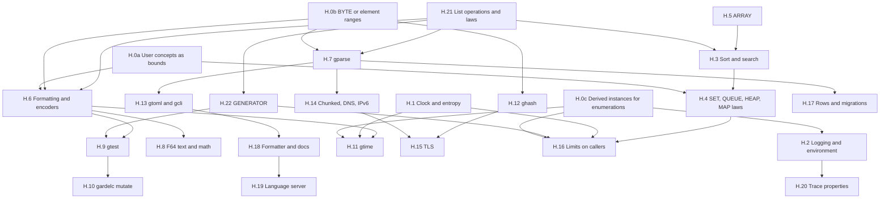

# Phase H: Library Essentials

**Date:** November 12, 2026
**Status:** In progress. H.0a is done (2026-11-16), H.0b and H.0c (2026-11-17), and H.0d (2026-11-18). Decisions 4 and 13 are taken; no other decision below is.
**Follows:** [Phase F](verified_libraries.md) (verified libraries) and [Phase G](../ffi/ffi_plan.md) (foreign interfaces).

---

## 1. Objective

After Phases F and G, Gardel can serve JSON over HTTP, call another service, draw a terminal and use a database. It still lacks what most programs need on their first day: the time, a random number, a sort, a set, a way to format text, a test runner. This phase adds them.

The phase delivers, in this order:

1. Host essentials: a clock, entropy, logging and the environment.
2. Core data: the list operations and laws of Bird and Wadler, generators for infinite sequences, sorting, searching, sets, queues, heaps and a flat array.
3. Text and numbers: formatting, encoders, a shared parsing cursor and `F64` text.
4. Testing: a test runner and a mutation tool.
5. Time, hashes and configuration.
6. What a server needs to face the internet: chunked encoding, name lookup, IPv6, TLS, and limits on callers.
7. Typed rows and migrations over the databases of Phase G.
8. Tooling: a formatter, generated documentation, a language server and trace properties.

**The rule of Phase F stays:** nothing goes into a library without a client in this plan that needs it. Each task names its client.

**Not in this phase:** HTTP/2, WebSockets, locale collation, time zones other than UTC, Unicode normalization and display width, a package registry, GPU backends.

**Not in this phase, from Bird and Wadler's *Introduction to Functional Programming*:** each was weighed against the existing features and left out.

- **List comprehension syntax** (B&W §3.2). It desugars to `concat_map` and `filter`, so it would be a second way to write `LIST_OPS` and would need the same laws to verify. H.21 adds `concat_map` and `range`, which cover its uses.
- **Infinite and lazy lists** (B&W ch. 7). Every routine is total and terminates (principle 2), `LIST` is inductive, a `variant` measures `xs.length`, evaluation is strict, and reference counting cannot hold the cyclic structures of B&W §7.6. Laziness would break each of these. What B&W use infinite lists for is covered without them: an infinite sequence becomes a finite value, a state and a step, in H.22's `GENERATOR` (as Elixir's `Stream.unfold`); streams of input are the reactive program's event loop (§11.6); reasoning over infinite runs becomes H.20's trace properties over finite logs.
- **Tuples of more than two fields** (B&W §2.4). `TUPLE[A, B]` covers pairs, and a record covers the rest, with names and an invariant.
- **A composition operator, user operators, sections and currying** (B&W §2.6). `.` is already a method call, `FUNCTION_OPS.compose` carries the laws, and method chains read as pipelines. A partial application is a lambda.

---

## 2. Prerequisites

Some tasks cannot start until the compiler or an earlier phase provides something. Each is listed once here and named by its task.

| # | Prerequisite | Where it comes from | Needed by |
| :--- | :--- | :--- | :--- |
| P1 | **F.13 and F.15 closed.** Recursive helpers with a `require`, and facts at the value of a call | Phase F | Every proof-heavy task: H.3, H.4, H.7, H.11, H.21 |
| P2 | **User concepts as bounds.** Today only `EQ`, `CANONICAL_EQ` and `ORD` have a theory (`E0320`) | New compiler task, H.0a | `HASH` in H.4 and H.12, `SHOW` in H.6 |
| P3 | **A `BYTE` type, or element ranges for `LIST` and `SEQ` of a machine type.** Today an element of `LIST[U64]` has no range in the proof, so `gjson` checks each byte it reads | New compiler task, H.0b | H.6, H.7, H.12 |
| P4 | **A contiguous buffer in the C backend** with a `LIST` model | New compiler task, inside H.5 | H.5, and through it H.3 and H.4 |
| P5 | **Pure foreign routines** (G.0 to G.3) | Phase G | SHA-2 and HMAC in H.12, math in H.8 |
| P6 | **Native commands** (G.6b) | Phase G | H.15 (TLS), H.17 (rows) |
| P7 | **Files and processes** (F.11) | Phase F | H.9, H.10, H.13, H.18 |
| P8 | **Linux CI** | Not planned anywhere yet | Every task with host code: H.1, H.2, H.14, H.15 |

P8 is the one with no owner. F.7's POSIX code has never run, and every host task below adds more. Set up a Linux runner before H.1.

---

## 3. Task graph

| Task | Size | Delivers | Main risk |
| :--- | :--- | :--- | :--- |
| H.0a | L | A user's own concept as a bound | Touches the verifier core, as F.1 did |
| H.0b | M | Bytes that carry their range | Changing how every list of numbers is typed |
| H.0c | S | `EQ`, `ORD` and ordinals derived for an enumeration | Keeping derived laws out of user proofs' way |
| H.21 | M | The rest of B&W §3.3 in `LIST_OPS`, and the fold laws of §3.5.1 | The duality theorems' quantified premises |
| H.22 | S | `GENERATOR[S, A]`: an infinite sequence as a state and a step | Searches that may not end (`filter`, `find`) |
| H.1 | S | `ReadClock`, `Random` | Secrets in the event log |
| H.2 | S | `Log`, environment variables | Prelude name clashes |
| H.3 | M | Sort and binary search, proven | The permutation proof |
| H.4 | M | `SET`, `QUEUE`, `HEAP`, more `MAP` laws | Heap-order proofs |
| H.5 | L | `ARRAY[A]` with constant-time index | Update in place needs ownership (C.4, deferred) |
| H.6 | M | `STRING_BUILDER`, `TEXT_FORMAT`, hex, base64, percent-encoding | Round-trip proofs for base64 |
| H.7 | L | `gparse`, a cursor with proven progress | Moving three parsers onto it without losing proofs |
| H.8 | L | `F64` to and from text, a math module | `F64` has only bound axioms in the verifier |
| H.9 | M | `gtest`, `gardelc test` | Keeping test time down |
| H.10 | M | `gardelc mutate` | Mutants that are equivalent to the original |
| H.11 | M | `gtime`: dates, RFC 3339 | The civil-date round trip |
| H.12 | M | `ghash`: CRC32, FNV, SipHash, SHA-2, HMAC | Bitvector proofs are slow |
| H.13 | M | `gtoml`, `gcli` | TOML's size |
| H.14 | M | Chunked encoding, name lookup, IPv6 | Two platforms |
| H.15 | L | TLS in the host | A native dependency in the runtime |
| H.16 | S | Rate limiter, retry, circuit breaker | None large |
| H.17 | M | Typed rows, migrations | Depends on G.6b's final shape |
| H.18 | M | `gardelc fmt`, `gardelc doc` | Comments in the parser |
| H.19 | L | A language server | Verification latency |
| H.20 | M | Properties checked over event logs | Choosing a property language |

---

## 4. Decisions to take

1. **Clock: a command, or a field on every event?** Proposed: a command, `ReadClock(tag)`. A time on every event would change `EVENT`, and most steps do not need it.
2. **Wall clock unit.** Proposed: milliseconds since the Unix epoch as `I64`, UTC, with no leap seconds, as POSIX counts them.
3. **Random bytes in the log.** A replay needs them, so they must be logged, and the log is in the clear (spec §11.6). Proposed: log them, and say in the guide that a log of a program that makes secrets is itself a secret. The alternative, a seed, would make every token predictable from the log too.
4. **`BYTE` type or element ranges (H.0b).** Proposed: element ranges, as F.4 did for fields. It changes no source. A `BYTE` type is cleaner but changes `BYTES`' model from `LIST[U64]` and every proof on it.
5. **Sorting when `equals` and `less_than` disagree.** `ORD` does not promise that they agree (F.3). Proposed: state `sorted` through `less_or_equal` alone, and `permutation` through `=` on a `CANONICAL_EQ` element, with a weaker contract otherwise.
6. **`ARRAY` updates.** Proposed: `set` copies unless the array has one reference, checked at run time by the reference count. This needs no ownership rule in the language. A static rule is C.4's deferred work.
7. **`F64` printing: proven or tested.** Proposed: tested first, against a public corpus, with the algorithm in Gardel over `BIGNAT`. A proof needs an `F64` model the verifier does not have.
8. **Math functions: per platform or bundled.** Proposed: one bundled implementation, linked as a pure foreign routine, so `sin(x)` is the same bits everywhere, as §3 of the spec requires of `F64`.
9. **Where TLS lives.** Proposed: in the host, as `ListenTls` and `ConnectTls`, so a program sees plain bytes and the same `Received` and `Send`. In Gardel code it would need a native command per record, and the keys would pass through the event log.
10. **Test discovery.** Proposed: a package's `tests/` directory is a client package, as `ghttp/tests` and `gjson/tests` already are, and `gardelc test` runs each `program` in it.
11. **Formatter style.** Proposed: one style, no options.
12. **Trace property language.** Proposed: a pure Gardel routine over a list of log entries, so no new language is needed.
13. **Derived instances for enumerations (H.0c).** Proposed: a sum whose variants all have no fields may write `satisfies CANONICAL_EQ` or `satisfies ORD` with no method bodies, and the compiler supplies them, ordered by declaration as in B&W §8.1. No new syntax. A sum with fields still writes its own.
14. **`LIST_OPS` calling style.** `LIST` uses `LIST_OPS.map(xs, f)`, while `SEQ`, `OPTION` and `RESULT` use `s.map(f)`. Proposed: keep both, since `LIST` is also the ghost model, but give every law the same name on every type (`map_fusion`, `filter_append`, ...), as there is no functor concept to share them.
15. **A generator at the end of a bounded type (H.22).** A step over `NAT` overflows after 2^64 items, and the verifier refuses `s + 1` in a step's lambda. Proposed: the library offers both forms, `GENERATOR` with a step that never ends (the client wraps with `+%` or uses `BIGNAT`) and `UNFOLD` with a step that returns `OPTION`, as Elixir's `Stream.unfold` returns `nil`. It does not pick wrapping for the client.

---

## 5. Work breakdown

Every task follows the rules of Phases E and F:

- `--stdlib --strict` stays 0/0, and every example and package stays 0/0 under `--strict`.
- New rules get tests, and mutations on a private copy must each turn a test red. From H.10 on, the tool does this.
- `--compare-with` runs on every package and prelude change.
- A new `COMMAND` or `EVENT` comes with its host code on both platforms, its scripted form and its log form.
- What is not proven is listed as such, with the test that covers it.

### Step 0: Compiler prerequisites

#### Task H.0a: User Concepts as Bounds

Client: `HASH` (H.4, H.12) and `SHOW` (H.6). Closes F.1's first known limit.

**Status:** ✅ Completed (2026-11-16).

- [x] A `concept` declared by a user gets a theory in a generic module that names it as a bound: one relation or function per method, and its laws as axioms, as `EQ` and `ORD` have today.
- [x] Methods that are not relations: `hash: U64`, `show: STRING`. Today's theory covers only `equals`, `less_than` and `less_or_equal`.
- [x] Instance links (F.1) for a user concept, with the same rule: no link inside a module that the instance's own proofs could rest on.
- [x] `[A: ORD]` together with `where A satisfies C` checks both (F.1's fourth limit).
- [x] A false-law test, as F.1 had: a type whose `hash` breaks `equals implies same hash` must not verify through a bound.
- Acceptance: `module BAG[K: HASH]` verifies, uses `k.hash`, and runs in C. `E0320` is gone for user concepts. All existing `.bpl` output is byte-identical, as no existing code has such a bound.
- **Fix: the theory.** The hand-written block that gave a parameter `K_eq`, `K_less` and their laws is now one piece per concept in the parameter's closure, in the order `EQ`, `CANONICAL_EQ`, `ORD`, then a user's. A user concept's piece (`emit_user_bound_theory`) declares `K_m_<method>(x: K, args...)` per method, with `Current` read as `K`; states the range of a machine number result (`in_u64(K_m_hash(x))`); and translates each law, with `Current` as `K`, through the ordinary expression emitter, so `a.hash` and `a.equals(b)` reach the relations. `HASH refines EQ` brings `EQ`'s piece. A user concept's laws carry the triggers they declare, or none, and the solver picks. The concepts a run declares are kept beside the prelude's (`find_concept`), so refinement, `E0317` and the C backend's own check see them.
- **Fix: links.** At each use, every method of the bound is linked, not only `equals` and `less_than`: `BAG__K_m_hash(_bx) == TOKEN__fn_hash(DefaultFuel, _bx)`, with `<==>` for a `BOOL` result and the arguments as `_b0`, `_b1`. `type_rests_on` is unchanged, so the rule of F.1 applies as it is.
- **Fix: a bound with a `where`.** `check_and_expand_concepts` wrote a `where` concept over the bound, and `declared_bound` then called the bound conditional, so `[A: ORD]` with `where A satisfies HASH` lost the order and was used unchecked. `ModuleDecl.declared_bounds` now keeps what `[A: C]` wrote: every use is checked against it, and inside the module the parameter has the methods and laws of both (`bound_concepts`). A `where CANONICAL_EQ` stays conditional unless the written bound is canonical already.
- **What `E0320` means now.** A bound is refused when the concept has type parameters, or a method with a body (as `ORD.less_or_equal` has), since the proof would need that body for every instance. A method a user concept does not give is still `E0318`.
- **Result.** `cargo test --release` 496/496 (233 unit tests, 33 suites). A debug build overflows its stack in `tests/gtui.rs`, as it already did before H.0a. `tests/bounds.rs` gains six tests: `BAG` over `TOKEN` and through a generic `RELAY[T: HASH]`, with the theory and the link checked in the `.bpl` and the C program run; three lies in a generic and one in a client refused; the false-law test, where `BROKEN`'s `consistent` stays unproven while `BROKEN` itself uses `BAG`; `E0317` at `BAG.bucket(n, 10)` on a `NAT`; `E0320` for a concept with a body, and `E0318` for a method `HASH` does not give; and `KEYED[K: ORD] satisfies HASH where K satisfies HASH` verifying, with `KEYED[TOKEN]` refused. `SHOWN[T: SHOW]` with `show: STRING` verifies and runs too. `--stdlib --strict`, the 8 example files, the 8 example projects, `ghttp`, `gjson`, `grest` and `gtui` stay 0/0, and all 1,216 `.bpl` and `.c` files they generate are byte-identical to those of the previous commit. 11 of 11 mutations of the new code, each on a private copy, turn a test red.
- **Known limits.**
  - A concept method with a body cannot be given to a bound. The plan's `HASH` and `SHOW` need none.
  - An instance whose `hash` uses `*%` does not prove `consistent` within the default resources: the solver stalls on `bv2int(bvmul(int2bv(x), ...))` even when `x` is equal on both sides. With `%` it proves at once. This is H.12's risk, met early, and it needs a fix before H.12's hashes, which all wrap.
  - A link does not tell a client what a string literal of another module holds, so `SHOWN.twice(LABEL.of(1))` needs `LABEL.show` to state its `byte_length` in an `ensure`. This is how a client learns any routine's result, and not new.
  - A law of a user concept with no `trigger` reaches the solver with the triggers it picks. None of the tests needed one.

#### Task H.0b: Bytes That Carry Their Range

Client: every parser. Needs decision 4. Closes F.2's first known limit.

**Status:** ✅ Completed (2026-11-17). Decision 4 taken as proposed: element ranges.

- [x] An element of a `LIST` or `SEQ` of a machine type is in the type's range: at `head`, `LIST_OPS.at`, a `match` binder and a `fold` argument.
- [x] `BYTES.model` elements are below 256 wherever a client reads one, from `BYTES`' invariant, without a call to `at`.
- [x] Remove the per-byte range checks from `gjson`'s reader, and measure.
- [x] Soundness test: a list built from a value out of range must be refused where it is built.
- Acceptance: a client proves `bs.model.head < 256` for a non-empty `BYTES` with no check in its body. `gjson` is 0/0 with the checks removed.
- **Fix: the range of a list.** A list of a machine type carries a predicate, `Seq_in_u64`, `Seq_in_i64` or `Seq_in_char`, over its Boogie `Seq int`. It is assumed of every parameter, field and result whose type is such a list, and checked where one is built: at a call argument, a field of a record, and a routine's result (`range::<name>_elements`). Axioms take it through `empty`, `prepend`, `singleton`, `append`, `head`, `tail`, `at`, `has` and `filter`, and through the prelude's generic routines (`map`, `reverse`, `take`, ...) at each machine type they are used with. A lambda with a machine result keeps its range, so `LIST_OPS.map(xs, fn ...)` does too. A `match` binder and a `fold` accumulator take the range of their type.
- **Fix: nested lists and function values.** `LIST[LIST[U64]]` carries `Seq2_in_u64`, whose items are each `Seq_in_u64`, so a character of a line of a `LIST[LIST[CHAR]]` text is in range (gtui). A function value of type `(a: T1, b: T2) -> R`, of up to three arguments, carries `forall a, b in range :: f(a, b) in range`. It is checked where the function is passed, which refuses `(x: NAT) -> MATH_INT` for `(x: NAT) -> NAT`. That check starts a verification condition of its own (`{:split_here}`). In one condition with a false `require` after it, Z3 ran out of resources on `tests/refined.rs`, after 171 s and 264 s. Split, each takes about 1 s.
- **Fix: Boolean routines.** A `BOOL` routine with no `require` and only number guards besides its lists' ranges is defined as false of a list out of range, and its truth gives its lists' ranges back. So `valid_utf8(bs)` gives `Seq_in_u64(bs)`. Without that axiom, ghttp's test client made about 50 times as many decisions (794k against 15k) and ran out of resources.
- **Fix: `BYTES`.** Four laws in `stdlib/text/bytes.gdl` carry the invariant into the model: `model_octets`, then `octets_head`, `octets_tail` and `octets_at`. A client reads `b.model.head < 256` and `LIST_OPS.at(b.model, i) < 256` with no check. The `>= 0` half needs nothing, since it is `U64`'s range.
- **Measurement.** `gjson` drops the six `>= 0` checks from `json_bytes.gdl` and `json_writer.gdl`, and stays 0/0. The `< 256` checks stay, since a `LIST[U64]` reaches them and not a `BYTES`. Its 70 cases run in 1.16 s both before and after. The generated C differs only where the checks were removed. A `>= 0` test of an unsigned number costs nothing.
- **Result.** `cargo test --release` 499/499 (233 unit tests, 34 suites). `tests/gtui.rs`' frame timing test took 16.99 ms per frame while every suite ran in parallel, and 9.5 ms when run alone, against a limit of 16 ms. The new `tests/elements.rs` has three tests:
  - **Reads.** An element read from a list is in range: at `head`, `at`, a `fold`, an `OPTION` binder, a `SEQ`, a record field, a nested list, `BYTES.model`, a function parameter's result, and a list mapped by a wrapping lambda.
  - **Lies.** A range that does not hold is not proven: `< 256` of a `LIST[U64]`, `< 128` of a byte, `>= 0` of a `LIST[MATH_INT]`, `> -2^63` of a `LIST[I64]`, and `>= 0` of a function into `MATH_INT`.
  - **Built.** A list built out of range is refused where it is built: at a result, through `map`, at an argument, at a field (also of a sum's variant), in a nested list, and a function passed with a `MATH_INT` result.

  `--stdlib --strict`, `gjson`, `ghttp/tests` and `gtui/tests` are 0/0, in 48 s, 40 s, 237 s and 156 s. 15 of 15 mutations of the new code turn a test red. Each removes one of: an axiom, a check at a call, field or result, the nested level, function facts or their guard, the parametric axioms, a lambda's range, a binder's or `SEQ`'s range, the Boolean rule (red in `ghttp`), or the split (red in `tests/refined.rs`).
- **Known limits.**
  - A law's axiom does not state its parameters' ranges and invariants, while its proof assumes them. This predates H.0b, which follows the same convention for lists. A law over `LIST[U64]` is thus stated of every `Seq int`.
  - A routine's own contract is an axiom in its own proof. A false `ensure` on a recursive routine can prove itself through the recursive call. The `tree.gdl` mutant in the unit tests passes, but because Z3 happens to find the failure, not because the rule forbids it.
  - ~~A `U64` literal result is not checked: `big: U64 do 18446744073709551616 end` verifies. Nor is a `MATH_INT` passed to a `U64` parameter.~~ Fixed in H.0d.
  - A function of more than three arguments, a `LIST[SEQ[...]]`, and lists nested three deep get no range facts. Nothing needs them yet.
  - ~~The comment in `gtui`'s `text_zip.gdl` that says a state is passed in a list to keep its range is now out of date.~~ Removed in H.0d.

#### Task H.0c: Derived Instances for Enumerations

Client: `LOG_LEVEL` in H.2 (`GARDEL_LOG_LEVEL` sets the lowest level written, so levels need an order), months and weekdays in H.11, the breaker states in H.16. Today `HTTP_METHOD` and every other enumeration write `equals` by hand. Needs decision 13. Adds what B&W §8.1 gives an enumerated type.

**Status:** ✅ Completed (2026-11-17), except `HASH` and `SHOW`, which move to H.12 and H.6. Decision 13 taken as proposed.

- [x] On a sum whose variants all have no fields, `satisfies CANONICAL_EQ` or `satisfies ORD` with no bodies gets `equals` and `less_than` from the compiler. The order is the order of declaration.
- [x] `ordinal: NAT`, `from_ordinal(n): OPTION[T]` and `all: LIST[T]`, with laws: `from_ordinal(t.ordinal) = Some(t)`, `a.less_than(b) = (a.ordinal < b.ordinal)`, `all.length` is the number of variants, and every value is in `all`.
- [x] The concept's laws are proven for the generated bodies, as for written ones, so no derived instance is trusted.
- [x] A body written by hand still wins, and a sum with a field asks for one (a new error code).
- [x] Move `HTTP_METHOD` and `HTTP_VERSION` onto it, and record the lines removed.
- [ ] With H.0a: `HASH` and `SHOW` derived the same way. Moved to H.12 and H.6: neither concept is in the prelude yet, and the compiler cannot tell what a user's `hash` or `show` should mean from its name.
- Acceptance: `module LOG_LEVEL satisfies ORD` with four variants and no feature verifies, and a client proves `Debug.less_than(Error)`. All existing `.bpl` output is byte-identical.
- **Fix: the derivation.** `check_and_expand_concepts` calls `derive_enumeration_instance` before it checks a module's methods. For an enumeration (a sum with no type parameters whose variants have no fields) that leaves out `equals` (for `EQ`) or `less_than` (for `ORD`), the compiler writes the module's instance as Gardel source (`enumeration_source`), parses it, and adds each routine and law the module does not write: `equals` as `Current = other`, `less_than` as `Current.ordinal < other.ordinal`, each with `ensure def`; `ordinal` by a `match`; `from_ordinal` by nested `if`s; `all` by `prepend`s, with `count` and `has_each`; the laws `ordinal_back`, `all_listed` (by cases) and `all_at_ordinal`; and every law of the concepts that the module does not state, under its concept's `specify`. A derived `equals` is structural, so the module also satisfies `CANONICAL_EQ` (otherwise `E0311` refuses its own `=`). A client calls the laws as any other: `LOG_LEVEL.all_listed(t)`.
- **Fix: `E0323: underivable_instance`.** A type that is not an enumeration and leaves out `equals` or `less_than` is refused with a message that says only an enumeration gets them. Other missing methods keep `Missing Concept Operation`.
- **Fix: a bare variant as a receiver.** `Info.less_than(Warn)` in a `program` was translated as `fn_less_than`, with no module, and refused as `E0199`, whether the instance was derived or written. `infer_gardel_type` now gives a variant with no fields the type of the module that declares it.
- **Fix: a proof the solver gives up on is tried under other seeds.** With `HTTP_METHOD` derived, `HTTP_ROUND_TRIP.fields_read_back` ran out of time under Z3's default seed (300 s, then the 600 s backstop) and took 1.3 to 1.9 s under seeds 1 to 3. Deleting `ordinal`'s two definition axioms, which no term of the proof triggers, brought it back to 1.5 s under the default seed; a dummy function of the same shape in their place took 2.2 s. Split into one law per conclusion, ghttp passed, and then `fields_read_values` did the same in `ghttp/tests`' package form. Proofs this close to the edge break with any change to their context, so `gardelc` now retries the whole module under seeds 1, 2 and 3 when the solver gives up (a resource limit, a timeout or the backstop) and no seed was chosen, and keeps the first run in which it does not. The first try stops a procedure after 120 s when retries follow, as this proof never reached its resource budget: ghttp took 769 s with the 600 s first try and 321 s with 120 s. The split was undone; `fields_read_back` is as it was.
- **Lines removed.** `HTTP_METHOD` 138 → 102 and `HTTP_VERSION` 92 → 56: each drops `equals` and its `CANONICAL_EQ` and `EQ` laws, 36 lines. Each gains `ordinal`, `from_ordinal` and `all`.
- **Result.** `cargo test --release` 505/505 (234 unit tests, 35 suites). The new `tests/derived.rs` has four tests:
  - **Instance.** `LOG_LEVEL satisfies ORD` with four variants and nothing else verifies. A client proves `Info.less_than(Warn)`, the ordinals, `all_listed`, `all_at_ordinal` and equality, and keys a `MAP` by it. A program using it runs to the expected exit code. The `.bpl` holds a proof for each derived law and for each `CANONICAL_EQ`, `EQ` and `ORD` law.
  - **Lies.** Four false claims about the derived instance are refused.
  - **Not trusted.** A hand-written `ordinal` of 0 leaves `ORD_total`, `ordinal_back` and `all_at_ordinal` unproven. A hand-written `equals` that is always true leaves `CANONICAL_EQ_agrees_with_structural` unproven.
  - **E0323.** A sum with a field and no `equals`, and a record with no `less_than`, are refused.

  `tests/seed_retry.rs` starves a module with `--z3-rlimit 1` and checks that it is retried under seeds 1 to 3 and still reported as unproven. It checks that `--z3-seed` is not varied, and that a module proven at once is not retried. The stdlib, the 8 examples, the 6 example projects, `ghttp`, `gjson`, `grest` and `gtui` generate byte-identical `.bpl` and `.c` files, before `HTTP_METHOD` and `HTTP_VERSION` moved. After the move, `ghttp` (321 s, one retry, of `HTTP_ROUND_TRIP`), `ghttp/tests` and `grest` are 0/0. 14 of 14 mutations of the new code turn a test red.
- **Known limits.**
  - A retry costs up to three more runs of the module: a module that is truly unprovable now takes about four times as long to be reported.
  - A sum with type parameters, such as `OPTION[T]`, gets nothing derived, even when no variant has a field.

#### Task H.0d: Numbers Checked Where They Are Made

A soundness fix found in H.0b (its known limits). `big: U64 do 18446744073709551616 end` verified. Its frame axiom `in_u64(fn_big)` contradicted its definition `fn_big == 18446744073709551616`, so a caller of `big` could prove `False`. A `MATH_INT` passed to a `U64` parameter, or given to a `U64` field, was not checked either.

**Status:** ✅ Completed (2026-11-18).

- [x] A routine's result of a machine number type is in its range (`<routine>::range::result`).
- [x] An argument passed to a parameter of a machine number type is in its range (`range::<param>_range`), and so is a value given to a field of one (`range::<field>`).
- [x] Every library, example and package stays 0/0, with each proof that breaks fixed by a true range fact, not by weakening the check.
- [x] Remove the outdated comment in `gtui`'s `text_zip.gdl`.
- Acceptance: `big` above, `take(m)` with `m: MATH_INT`, and `{ value = m }` are refused as `Range Violation`. The same with a `require` that bounds `m` verify.
- **Fix: the checks.** H.0b's checks of a list's elements at a result, an argument and a field now also cover `NAT`, `U64`, `I64`, `INT`, `CHAR` and `EXIT_CODE` (`machine_range_obligation`). An argument is not checked again when its own type has the same range: a parameter, a field, or a call of a routine that declares that range, since every such result is checked in the callee (`known_in_range`, `callee_declares`). A built-in, as a fold, and a routine whose result is a type parameter are checked: before, `take(s.fold_left(f, 18446744073709551616))` passed unchecked. A literal, an arithmetic result, a branch and a `let` local are checked. A local's type is inferred, so `let x = 18446744073709551616` is a `NAT` to the inference.
- **Fix: folds.** `s.fold_left(fn(acc: U64, x: U64): U64 do acc *% 10 +% x end, 0)` had no range, and three routines of `examples/seq_ops.gdl` failed. Axioms now state, by induction on the list, that a fold with an accumulator of a machine type is in its range when its start is and each step keeps it there. A step may assume its element's range when the list's elements have one (`emit_fold_range_theory`).
- **Fix: a list's length is trusted (decision taken 2026-11-18).** `xs.length` has no upper bound in the proofs, so `MAP.size`, 7 routines of `gtui` (and 4 obligations of two `on_key`s that rest on them) and 4 of `tablon` failed. Before H.0d, each routine's result axiom asserted the bound unchecked. An axiom that every list's length fits a `U64` would contradict `prepend`. The length of a `LIST` that a program reads is now assumed to be in `U64`'s range where it is read (`emit_list_length_trust`), since no list in memory holds 2^64 elements. The assumption is of the length term itself, as of `LIST_OPS.filter(ps, keep).length`.
- **Fix: a number read out of a generic container is trusted (decision taken 2026-11-18).** The full test run then failed 5 compiler unit tests. Their fixtures read a number out of a generic container: `o.unwrap_or(d)` of an `OPTION[NAT]`, `p.first` of a `TUPLE[U64, BOOL]`, a binder of a `RESULT[U64, ...]`, and `b.twin.twin.get` of a `BOX[I64]`. A container's contents have no range in the proof. Before H.0d each such routine's result axiom asserted the range unchecked. Two reads are now assumed in range: the result of a routine whose declared result is a type parameter of its module, together with a tuple's `first` and `second` (`emit_generic_read_trust`), and a match binder of such a field. A routine's own type parameter, as `B` of `fold[B]`, is made from its arguments, not read out of the container, and is not trusted: trusting it accepted `s.fold_left(f, 18446744073709551616)`. The body's proof assumes a binder in range already, so an arm with no obligation of its own needs nothing more. A routine that declares a machine result is not trusted, since its body is checked. The full fix, range predicates for every generic type at a machine type argument as H.0b gave `LIST`, is H.0e.
- **Fix: a lambda keeps its name.** Each translation of a lambda gave it a new name, `lam_WORK_2` in the obligations and `lam_WORK_3` in the body, so an assumption whose term held a lambda never met the body's term, and the trusts above had to skip such terms. A lifted lambda now reuses the name of an identical one already lifted in the module (`BOOGIE_LAMBDA_NAMES`), and each is declared once.
- **Fix: a fold of a `MAP`.** `m.fold(0, fn(acc: NAT, k: STRING, v: NAT): NAT do ... acc + v ... end)` of `tests/map.rs` had no range. Where such a fold is called, its result is assumed in range when its start is and each step keeps it there, for a value in its type's range: the trust of a read out of a container, stated at the call since a `MAP[K, MATH_INT]` holds ints too (`emit_map_fold_range`).
- **Fix: a wrap is not checked.** A result made by `+%`, `-%` or `*%` at its own type's range, or by a bitwise operator at `U64`'s, is in range by construction, and its check is skipped. Proving `in_u64` of `bv2int(bvadd(int2bv(..)))` made Z3 bit-blast: the compiler's unit test of every expression position went from 2 s to over 15 minutes. It now takes 9 s.
- **Result.** All 507 tests pass: the 234 compiler unit tests and the 36 integration suites. Under load, two tests miss their timing (`gtui`'s 200 by 60 frame, and `files_procs`'s keys for an attached child), and both pass alone. The stdlib is 0/0 in 47 s, `gjson` in 36 s, `gtui/tests` in 158 s, `ghttp/tests` in 163 s and `tablon` in 394 s, 4 projects at a time.
  - **Lies.** `tests/machine_range.rs` gives eleven values out of range, each refused at its place: a literal result too large, `-1` as a `U64`, a `MATH_INT` result, argument, constructor field and record field, a literal through a `let` local, a fold of `MATH_INT` steps, and a fold of a `SEQ` and of a `MAP` whose start is out of range, and such a fold passed as a `U64` argument. A call whose precondition fails is refused for that, and its result is not refused again.
  - **Truths.** The same values bounded by a `require` verify. So do a parameter passed on, a `NAT` passed as a `U64`, a list's length, the length of a `filter` and a `map`, folds at `U64` over `U64` and `BOOL` elements, a `MAP` fold, and reads of an `OPTION[NAT]`, a `TUPLE[U64, BOOL]` and a `Some(x)` binder. The `.bpl` has no trust of a routine that declares a `U64` result, and no check of an argument that is a parameter or a call result of the same range, and one declaration for each lambda.

  The stdlib (`--stdlib --strict`), the 8 single-file examples, and every project are 0/0 with no source change: `api_gateway`, `echo_server`, `gtui_tour`, `hello_api`, `todo_api`, `todo_tui`, `gjson`, `gjson/tests`, `gtui`, `gtui/tests`, `ghttp`, `ghttp/tests`, `grest`, `grest/tests` and `tablon`. 21 of 21 mutations of the new code turn a test red. The last of them, a built-in call taken as in range, survived until the fold passed as an argument joined the lies.
- **Known limits.**
  - A list's length is trusted, not proven. A law or `ensure` that reads the length of a list no program could hold is proven only for lists that fit.
  - A `SEQ`'s or a module's own `length` is a routine, checked in its body, and gets no trust: a `length` defined as the length of an unbounded list must bound it.
  - A fold's range axioms cover an accumulator of a number type, not a list of numbers or a record. A fold of a user generic container has none.
  - **A container built from a number out of range is accepted.** `Some(m)` with `m: MATH_INT`, used as an `OPTION[U64]`, is not refused, while a read of it is trusted to be in range. So a caller can still prove `False` this way. Fixed by H.0e, which also removes the trust of a read.

#### Task H.0e: Containers That Carry Their Range

Found in H.0d (its known limits). A number read out of a generic container is trusted to be in its type's range, and the container is not checked where it is built.

**Status:** ✅ Completed (2026-11-18).

- [x] A range predicate for `OPTION[A]`, `RESULT[E, A]`, `TUPLE[A, B]`, `MAP[K, V]` and a user generic at a machine type argument, as H.0b's `Seq_in_u64` for `LIST`. It is assumed of every parameter, field, binder and result of the type, and checked where one is built.
- [x] Remove H.0d's trust of generic reads (`emit_generic_read_trust`, the binder's range assumption, and the value assumption of `emit_map_fold_range`), and record what that costs.
- [x] Every library, example and package stays 0/0.
- Acceptance: `Some(m)` with `m: MATH_INT` returned as an `OPTION[U64]` is refused as a `Range Violation`. `o.get` of an `OPTION[NAT]` parameter is a `NAT` without trust.
- **Fix: a range is a value.** A range is now a term of a Boogie type `Rng`, and `Rng_holds(p, x)` says that `x` is in it. The leaves `Rng_u64`, `Rng_i64` and `Rng_char` are `in_u64`, `in_i64` and `in_char`. `Rng_seq(p)` is a list whose elements are in `p`, the same as `Seq_in_u64` and its kin, and `Rng_and(p, q)` holds both. Each generic module gets one range function per type parameter that some field holds, as `Rng__OPTION_A(p)`. That works only if every field that holds the parameter has a range itself, so a field of a function type gives the module none (`carries_range`). Two axioms define it. The first says that a constructor term is in range exactly when its fields are. The second says that each field read out of a value in range is in range (`emit_container_range_theory`). A `TUPLE` has `Rng__Tuple2_A` and `Rng__Tuple2_B`. `RESULT[E, A]` has one function per side, and a type with two ranged arguments, as `RESULT[U64, TUPLE[U64, U64]]`, gets the conjunction of both. The names `Rng__*` stay the same when a module is linked or loaded as the prelude, since every module's axioms meet on them.
- **Fix: where a range is assumed and checked.** H.0b's `elements_fact`, assumed of every parameter, field, binder and result and checked where a value is made, now gives a container's range when its type has one (`container_fact`). So `Some(m)`, `(m, True)`, `Ok(m)`, `MAP.empty.put("a", m)`, `CRATE.make(m)` and `Some(LIST.empty.prepend(m))` with `m: MATH_INT`, returned as a container of `U64`, are each refused as a `Range Violation`, and so is a field `held: OPTION[U64]` given `Some(m)`.
- **Fix: a routine passes a range on.** H.0b's axioms that a routine of a generic module keeps its list's range (`emit_parametric_range_axioms`) now take a container argument and the receiver as a source too. A routine's own type parameter, as `K` of `MAP.empty`, may be fixed by the result. A further axiom quantifies over the range itself (`_rp: Rng`). It fires on the result, or on the call together with a source's range. So `m.get(k)` of a `MAP[STRING, NAT]` is an `OPTION` of `NAT`, and `o.unwrap_or(d)` is a `NAT` when `d` is. The receiver is a source only when its type has a range term. A `SEQ`'s range is its `model`'s, and a guard on it unfolds `model` at every call. That guard made the compiler's unit tests take 1980 s, not 657 s, and a false postcondition over a lambda ran out of time instead of being refuted.
- **Fix: no trust.** `emit_generic_read_trust` and the binder's assumption are gone. A `MAP`'s `fold` now assumes its values in range only when the map holds them (`Rng_holds(Rng__MAP_V(..), m)`, in `emit_map_fold_range`). The binder's trust had covered a `SEQ`'s leaf: `elements`'s `seq_leaf` then failed. Two axioms now say that a `Leaf`'s value and a `Concat`'s parts are in range when the `SEQ`'s `model` is.
- **Result.** All 509 tests pass: the 234 compiler unit tests and the 37 integration suites. Under load a third test misses its timing (`gtui`'s key on 5000 lines), and it passes alone. The stdlib, the 8 single-file examples and every project are 0/0 with no source change.
  - **Cost.** Cold and one at a time, H.0d against H.0e: the stdlib 39 s and 41 s, `gjson` 31 s and 34 s, `gtui/tests` 132 s and 143 s, `tablon` 524 s and 543 s, and `ghttp/tests` 218 s and 339 s. The last is one law, `HTTP_ROUND_TRIP.fields_read_back`, which H.0c already found fragile. Under 6 seeds it times out at 2 in H.0d and at 3 in H.0e, and the axioms of H.0e make Z3's default seed one of the 3, so it waits for the limit and then proves under another seed. Leaving out any one of 12 of the 14 range axioms of its routines restores the default seed, so no single axiom loops.
  - **Lies.** `tests/container_range.rs` builds ten containers out of range: the six above, the `HOLDER` field, `takes(Some(m))` refused at its argument, and two reads back from a map that `put` was given a `MATH_INT`. Each is refused at its place, and `takes`, whose argument is a parameter, is not.
  - **Truths.** Reads of an `OPTION[NAT]`, an `OPTION[U64]` with `get`, a `TUPLE[U64, BOOL]`, a `RESULT[STRING, U64]`, a `MAP[STRING, NAT]`, a `CRATE[U64]` by a routine and by its field, an `OPTION[LIST[U64]]`, a `RESULT[U64, TUPLE[U64, U64]]` by a nested pattern, and a `MAP[STRING, OPTION[U64]]` read twice verify. So does each container built from a `U64`, and `Some(xs)` of a `LIST[U64]` parameter and back. A recursive `pick_from(c: CRATE[T], n: NAT): T` unfolds only as far as its fuel goes, so its callers need the range it keeps: from a container argument, and, read as a `CRATE[OPTION[U64]]` and matched, from the carrier's range alone. The `.bpl` assumes no range except a list's length.
- **Mutations.** 14 of 15 mutations of the new code turn a test red. Four first survived and joined the truths: the field axiom with no field read, the list bridge with no `LIST[U64]` parameter, a container argument and the forward trigger with no recursive routine. Within a project a routine's body unfolds, and the field axioms then reach the value without the routine's own. The 15th, a constructor's range taken only from its fields, is equivalent. The other half follows from the field axiom, since Z3 adds `Some_value(Some(x)) = x` for each constructor term. The axiom keeps both halves of the definition.
- **Known limits.**
  - A value given to a type parameter of a generic routine, as `put`'s `v: V`, is not checked: the type parameter has no range of its own. The container it goes into then has no range, and a read of it is refused, not the `put`. The refusal is right, but it comes at the read, not at the `put`.
  - A `SEQ` has no range term. Its range is its `model`'s, as in H.0b, so a container of `SEQ`s gets none.
  - A module whose type parameter is held by a field with no range, as a function, gets no range function.

### Step 1: Host essentials

#### Task H.1: Clock and Entropy

Client: `gtime` (H.11), the rate limiter (H.16), request ids in `grest`. Needs decisions 1 to 3 and P8.

**Status:** ✅ Completed (2026-11-19). Decisions 1 to 3 taken as proposed. P8 in part: the host's C ran on Linux in a container, not in CI (see below).

- [x] `ReadClock(tag)` answered by `Clock(tag, wall_millis: I64, monotonic_millis: U64)`. The monotonic value is the clock that timers already use.
- [x] `Random(tag, count: NAT)` answered by `RandomBytes(tag, res: RESULT[IO_ERROR, BYTES])`, from the system's generator (`BCryptGenRandom`, `getrandom`). A `count` above 1024 is an `Error`.
- [x] For a `program`: `IO.now: IO[I64]` and `IO.random(count: NAT): IO[RESULT[IO_ERROR, BYTES]]`. Each is a fresh value in the proof, as `IO.read_line` is.
- [x] Scripted forms `Clock:<tag>:<wall>:<mono>` and `RandomBytes:<tag>:<text>`, log forms, and replay.
- [x] Guide: a log holds the random bytes (decision 3).
- [x] `RandomBytes` has the postcondition a client needs stated on a gateway: an `Ok` payload has length `count`. The host checks it, so the assumption is justified, as with `read_line`'s length bound. Done for `IO.random`; see the limits for `RandomBytes`.
- Acceptance: a reactive program prints the time and eight random bytes; its recording replays to the same output on another day. Two `Random` results are not provably equal.
- **The host.** `ReadClock` and `Random` are answered by the loop itself, at once: the answer goes on the queue the helper threads use, so it comes as the next event, after the step's other commands, as every answer does. The loop reads that queue only once a reader or a helper has started, so a flag of its own (`gardel_loop_answered`) says that the loop queued one; without it the first `ReadClock` waited for ever. The wall clock is `GetSystemTimePreciseAsFileTime` or `clock_gettime(CLOCK_REALTIME)`, the monotonic clock `gardel_host_now_ms`, which timers use. The bytes come from `BCryptGenRandom`, found at run time with `LoadLibraryW`, so no program links with anything new, and from `getentropy` in pieces of 256 on POSIX. A `count` above 1024 is `Error(OsError(c))` with the system's invalid-argument code (87, `EINVAL`). The clock and the generator are one block of C, `OS_CLOCK_RANDOM`, emitted for the reactive host and for a `program` that calls `IO.now` or `IO.random`.
- **Scripts and logs.** `Clock:<tag>:<wall>:<mono>`, with a `-` for a time before 1970, `RandomBytes:<tag>:<bytes>` and `RandomFailed:<tag>:<code>` are both a script's tokens and a log's lines; commands are logged as `ReadClock:<tag>` and `Random:<tag>:<count>`, and in a script or a replay written to standard error as `host: ReadClock 1`. A replay reads no clock and draws no bytes.
- **The proof.** `t <- IO.now` is a fresh `I64` (`havoc`, then `assume in_i64(t)`). `r <- IO.random(n)` is a fresh `RESULT` whose `Ok` is a valid `BYTES` of exactly `n` bytes, with `n <= 1024`; so `IO.random(1025)` is known to be an `Error`. Nothing else is assumed: not that a time is after 1970, not that a second read is later, and not that two draws differ or agree.
- **Result.** All 513 tests pass: the 234 unit tests and 38 suites, with `tests/clock_random.rs` new. The stdlib, the 8 single-file examples and every project are 0/0, and no package changed: each `match` on `EVENT` and `COMMAND` already had a `case _`.
  - **Truths.** A real run prints a time within a second of the test's own clock, eight bytes each below 256, and `refused` for 1025; the log has each command and answer; the replay gives the same output with no clock read; a second run draws other bytes. A script gives a time before 1970, the extremes of `I64` and `U64`, bytes that are not text and a failure. A `program` passes `IO.random(8)`'s bytes to a routine that requires eight.
  - **Lies.** Refused: two draws are equal, eight bytes are nine, a time is not before 1970, and a second read is not earlier than the first. Six malformed script tokens stop the program with status 2.
  - **Linux.** The C that gardelc writes for `tests/reactive/clock_random.gdl`, built with gcc 13.3 on Ubuntu 24.04 (glibc 2.39) in a container, compiles with no warning, runs, records, replays to the same output and reads a script; `RandomFailed` there carries `EINVAL` (22).
- **Mutations.** 11 of 12 mutations of the new code turn `tests/clock_random.rs` red. Three first survived, and the tests grew to kill them: the program stopped with 2 at a `Shutdown`, as at a refused token, so a script token out of range passed as refused (it now stops with 4); no run had a time before 1970 in a log (a recorded script now has one, and is replayed); and a `Random` in the same step set the flag a `ReadClock` sets (a run now asks for the clock alone). The 12th leaves out the `havoc` before the assumption, which changes nothing: a Boogie local that is not assigned is already any value, and each bind is a local of its own.
- **Known limits.**
  - `RandomBytes` does not carry the `count` asked for, so a reactive program cannot prove its `Ok` has `count` bytes and checks the length where it takes them in (the guide says so). An event that held the count, or a tag the verifier could relate to its command, would need the host's answers stated per command, which nothing does yet.
  - P8 is done only by hand: the Linux run was in a local container, of one program. The workflow in `.github/workflows/ci.yml` is not tracked and has a Windows job only. A Linux job needs Boogie, Z3 and the test suite there, none of which has run on Linux yet.

#### Task H.2: Logging and the Environment

Client: every server example. `Print` writes to standard output with a newline, so a server has nowhere to write a diagnostic today.

- [ ] `Log(level: LOG_LEVEL, text: STRING)`: one line on standard error. `LOG_LEVEL` is `Debug | Info | Warn | Error`, ordered by H.0c. `GARDEL_LOG_LEVEL` sets the lowest level written.
- [ ] `init` receives the environment: decide between a second parameter and a command `ReadEnv(tag, name)`. A command keeps `init`'s signature and is logged like any input, so it is proposed.
- [ ] `IO.log` and `IO.env(name): IO[OPTION[STRING]]` for a `program`. A value that is not UTF-8 is `None`.
- [ ] Scripted and log forms. A replay compares `Log` commands as it compares `Print`.
- [ ] `grest` logs one line per request at `Info`, as its first client.
- Acceptance: `todo_api` reads its port from the environment and logs each request, and a replay reproduces the log lines.

### Step 2: Core data

#### Task H.21: List Operations and Their Laws

Client: sorting (H.3) needs `merge`, `take` and `reverse`; `join` and `split` (H.6) need `concat`; `gparse` (H.7) needs `take_while`. Without this task each writes its own copy, as `BYTES` already did with `list_take`. Needs P1. No compiler work. Brings `LIST_OPS` up to B&W §3.3 to §3.5.

- [ ] Move `list_take` and `list_drop` from `stdlib/text/bytes.gdl` into `LIST_OPS` as `take` and `drop`, and have `BYTES` use them.
- [ ] Add `reverse`, `concat`, `take_while`, `drop_while`, `zip`, `zip_with`, `last`, `init`, `concat_map`, `range(lo, hi)` and `iterate_n(f, x, n)`. Each is total, with a `variant`.
- [ ] Give `filter` a `cons_case`, as `map` has. Today it states only `not_longer` and `empty_case`, so a client cannot prove which items are kept.
- [ ] Laws on lists (B&W §3.3, §3.4): `take(n, xs).append(drop(n, xs)) = xs`, `take_while` and `drop_while` the same, `reverse(reverse(xs)) = xs`, `reverse(xs.append(ys)) = reverse(ys).append(reverse(xs))`, `zip`'s length is the shorter one's, map fusion on `LIST` (only `SEQ` has it), and `filter(map(xs, f), p) = map(filter(xs, compose(p, f)), f)`.
- [ ] Fold laws (B&W §3.5.1), each stated with a `require` that the operators are associative and `init` is their identity, as quantified premises:
  - First duality theorem: `fold_right` and `fold_left` agree over a monoid.
  - Second duality theorem: for two operators that associate with each other.
  - Third duality theorem: `fold_right(xs, f, a) = fold_left(reverse(xs), flip(f), a)`.
  - Homomorphism: a monoid fold of `xs.append(ys)` is the operator applied to the folds of each.
- [ ] Use the first duality theorem in `SEQ`: its parallel fold matches the sequential `LIST` model, which is what H.3's parallel merge sort and F.14's cutoff rest on.
- [ ] `concat_map` gets the monad laws `OPTION` and `RESULT` have, under the same names.
- [ ] Fix spec §4.1, which lists `append`, `length` and `reverse` in `LIST_OPS`: the first two are `LIST` built-ins, and the third is added here.
- Acceptance: every law is proven, and each is used by a client that sees no body, with a false version refused. A client writes B&W §3.2's `[(i, j) | i <- [1..4]; j <- [i+1..4]]` as two `concat_map` calls over `range` and proves its length is 6.
- Risk: a law with a `forall` over a function's associativity can stall the solver. If one does, state it for a named operator in a concept once H.0a exists (`MONOID`), and record which.

#### Task H.22: `GENERATOR`

Client: H.9's property generators (SplitMix64 from a seed is a state and a step), H.16's retry schedule (an endless list of delays, of which a client takes the first `n`), and B&W ch. 7's examples. Needs H.21 and decision 15. No compiler work: a prototype verified 0/0 under `--strict` and ran in C on 2026-11-16.

- [ ] `module GENERATOR[S, A]`, `representation {ANY}` with fields `state: S` and `next: S -> TUPLE[A, S]`. `make(s, f)` in `create`. `head`, `tail`, `take(n): LIST[A]` (ensure `Result.length = n`), `nth(n)` and `drop(n)`, each with `variant n`.
- [ ] Total combinators: `map`, `zip`, `zip_with`, `scan`, `iterate(x, f)` and `cycle(xs)` of a non-empty list, with the index as the state. `zip` of two generators has a pair as its state.
- [ ] Laws, with triggers: `take(n).length = n`, `nth(k) = LIST_OPS.at(take(n), k)` for `k < n`, `take(m + n) = take(m).append(drop(m).take(n))`, and `map(g, f).take(n) = LIST_OPS.map(g.take(n), f)`, so a client reasons about a prefix with H.21's list laws.
- [ ] `module UNFOLD[S, A]` with `next: S -> OPTION[TUPLE[A, S]]` (decision 15): `take(n)` gives at most `n` items, and `to_list` takes a `variant` the client supplies on `S`.
- [ ] Searches are bounded: `find_within(k, p): OPTION[A]` and `take_while_within(k, p)`. There is no `filter` on a generator, since its next item may never come. Say so in the guide, with the B&W §7.3 prime sieve written with a bound as the example.
- [ ] A worked law in the guide: every item of a generator satisfies `P` when `P` holds of the first state and `next` keeps it, proven by induction on `n` for a named generator. A generic version over any `P` needs a concept bound on the state and waits for H.0a.
- [ ] Look into `E0199` from the prototype: a record literal `{ state = ..., next = ... }` of `GENERATOR` written in another module is typed as that module's record, and the verifier cannot translate it. Until fixed, clients build through `make`.
- [ ] Guide: a comparison with Elixir's `Stream` (`unfold`, `iterate`, `cycle`, `Enum.take`). The differences are a search that may never end (refused here), overflow (chosen by the client), a visible state type (no existentials), and no effects (those are reactive programs).
- Acceptance: `naturals` and `fibs` from the prototype, SplitMix64 and a retry schedule are clients that see no body. A client proves `fibs(0).nth(9) = 34` by the laws, and a step written with `s + 1` over `NAT` is refused as an overflow.

#### Task H.5: `ARRAY[A]`

Client: sorting (H.3), the heap (H.4), `gtui`'s screen grid (F.10). Needs decision 6. Listed first in this step because H.3 and H.4 build on it.

- [ ] `module ARRAY[A]`, `representation {NONE}`, ghost model `model: LIST[A]`. `make(n, x)`, `from_list`, `to_list`, `length`, `at(i)`, `set(i, x)`, `swap(i, j)`, `slice`, `fold`.
- [ ] Contracts on the model: `set` gives `LIST_OPS.update(model, i, x)`, with laws `at_set_same` and `at_set_other`, each with a trigger, as `MAP` has.
- [ ] C backend (P4): one contiguous block. `at` is constant time. `set` writes in place when the reference count is 1, and copies otherwise.
- [ ] The verification model stays a list, as `STRING`'s does, so no proof sees the buffer.
- [ ] Benchmark: a loop of 1,000,000 `set` calls on an array held once makes no allocation. The same loop on an array held twice copies once.
- [ ] Leak test in the C.3 style.
- Acceptance: the laws are proven, the benchmark is recorded, and a client proves `a.set(i, x).at(i) = x` through the contract alone.
- Risk: a `let` that keeps the old array alive turns each `set` into a copy, silently. The benchmark must show how to write the loop, and the guide must say it.

#### Task H.3: Sort and Search

Client: `MAP.keys` consumers, `gtui` list views, `gtime` tables. Needs decision 5, H.5 and P1.

- [ ] `module SORTING[K: ORD]`, a module of routines as `KEY_ORDER` is: `sorted(xs)`, `sort(xs: LIST[K])`, `sort_array`, `merge`.
- [ ] Merge sort on `LIST`, and on `SEQ` with the two halves as independent `let`s, so it runs in parallel. F.14's cost model decides the cutoff.
- [ ] Proven: `sorted(Result)`, `Result.length = xs.length`, and `permutation(xs, Result)`, stated by decision 5.
- [ ] Stability, as a separate law, if the permutation proof leaves room. Otherwise tested.
- [ ] `binary_search(a: ARRAY[K], k): OPTION[NAT]` with `require sorted`, and `found`, `absent` postconditions as `STRING.find` has. The midpoint is the spec's own §3 example.
- [ ] Benchmark against C `qsort` on 1,000,000 `U64`, on 1 and on all threads.
- Acceptance: all three properties of `sort` proven. A client proves that the first item of a sorted non-empty list is at most every other.

#### Task H.4: `SET`, `QUEUE`, `HEAP` and `MAP` Laws

Client: `grest`'s waiting table, which F.8 built as a list because `MAP` had no size law; the rate limiter (H.16); timers in `gtui`.

- [ ] `MAP`: laws for `size` after `put` and `remove`, and a law relating `fold` to `put`. Then move F.8's waiting table to `MAP` if the proofs allow, and record whether they do.
- [ ] `MAP` as a balanced tree, only if a benchmark of `todo_api` with 10,000 todos calls for it (F decision 4). The laws are on the abstract model, so no contract changes.
- [ ] `module SET[K: ORD]` over `MAP[K, UNIT]` or `KEY_ORDER` directly: `has`, `add`, `remove`, `union`, `intersection`, `size`, with laws on `has`.
- [ ] `module QUEUE[A]`: two lists, amortized constant time, model `LIST[A]`.
- [ ] `module HEAP[K: ORD]` on `ARRAY`: `push`, `pop_min`, `peek`. Proven: `peek` is at most every item, and `pop_min` removes one item.
- [ ] With H.0a: `concept HASH refines EQ` (`equals` implies equal `hash`), and `HASH_MAP[K: HASH, V]` on `ARRAY`, with `MAP`'s laws.
- Acceptance: each structure's laws are proven and used by a client that sees no body, with lies refused, as `tests/map.rs` does.

### Step 3: Text and numbers

#### Task H.6: Formatting and Encoders

Client: every program that prints. Today text is built with `concat`, and there is no interpolation. Needs H.0b.

- [ ] `STRING_BUILDER`, as `BYTES_BUILDER`: `add`, `add_char`, `add_nat`, `add_i64`, `to_string`, with model `LIST[CHAR]`.
- [ ] `TEXT_FORMAT`: `pad_left`, `pad_right`, `join(parts, sep)`, `repeat`, ASCII `to_lower` and `to_upper`, each stated on `chars`.
- [ ] `join` and a per-step contract for `split`, which F.2 left stating only the number of parts. Law: `join(split(s, c), c)` gives `s` back.
- [ ] `HEX`: bytes to text and back, with the round trip proven. `NUMBER_TEXT` gains `nat_to_hex` and `parse_hex` of any length.
- [ ] `BASE64`: standard and URL-safe alphabets, with and without padding. Decoding is total and returns `RESULT`. Proven: `decode(encode(bs)) = Ok(bs)`.
- [ ] Percent-encoding: the encoder for `grest`'s `URL_TEXT`, which only decodes. Proven: `decode(encode(s)) = Ok(s)`.
- [ ] With H.0a: `concept SHOW` with `show: STRING`, and instances for the number types, `BOOL`, `CHAR`, `STRING`, `OPTION` and `LIST`.
- [ ] Decide whether string interpolation (`"Hello, {name}"`) is worth a language change once `STRING_BUILDER` exists. This plan says no for now.
- Acceptance: the three round trips are proven. `hello_api` builds its answers with no `concat`.

#### Task H.7: `gparse`

Client: `gjson`, `ghttp` and `grest`'s URL layer each wrote their own reading loop, with their own offset arithmetic and their own F.13 workarounds. Needs H.0b and P1.

- [ ] `module CURSOR`: a `BYTES` and an offset, with invariant `offset <= length`. `peek`, `advance`, `take_while(pred)`, `expect(bytes)`, `remaining`.
- [ ] Every reading routine ensures progress or failure: `Result.offset > Current.offset` or an `Error` with the offset. This is the fact each hand-written parser proves again today, and it is what makes `variant remaining` work.
- [ ] `PARSE_ERROR` with an offset and an expected-what code.
- [ ] Number, token and quoted-string readers shared by JSON, HTTP and TOML.
- [ ] Move `grest`'s URL layer onto it first, as the smallest. Then `ghttp`'s head parser. `gjson` last, and only if its scalar round-trip proof survives.
- [ ] Measure parse speed before and after on F.4's 4 MiB document.
- Acceptance: the URL layer and `ghttp` verify on `gparse` with every existing case passing, and are shorter. If `gjson` cannot move without losing a proof, say so and leave it.
- Risk: a shared abstraction between the parser and its proof can cost solver resources, as F.5's three-module split showed. Each move is its own commit, measured.

#### Task H.8: `F64` Text and Math

Client: JSON numbers, which decision 2 of Phase F keeps as text because nothing can read them. Needs decisions 7 and 8, H.6, and P5 for math.

- [ ] `NUMBER_TEXT.parse_f64`: correctly rounded, total, returning `RESULT`. Accepts JSON's grammar.
- [ ] `NUMBER_TEXT.f64_to_text`: the shortest text that reads back as the same value.
- [ ] Tests against a public corpus of hard cases for both directions, and a random round trip of 10,000,000 values. Not proven (decision 7).
- [ ] `gjson`: `JSON.as_f64` on a `JNumber`, and a builder from `F64`.
- [ ] `module MATH`: `sqrt`, `floor`, `ceil`, `round`, `abs`, `min`, `max` in Gardel or as C operators that IEEE-754 defines exactly. `sin`, `cos`, `exp`, `ln`, `pow` from one bundled implementation (decision 8), as pure foreign routines with `trusted` range clauses.
- [ ] The trust report (G.7) lists each math routine.
- Acceptance: the corpus and the random round trip pass on both platforms with the same output, byte for byte.

### Step 4: Testing

#### Task H.9: `gtest` and `gardelc test`

Client: every package. Today each package's tests are a `cases.txt` read on standard input and a Rust test in `gardelc/tests` that runs it. A user without the compiler's source tree has no way to test. Needs decision 10, H.6 and P7.

- [ ] `gardelc test`: verifies and builds each `program` in `tests/`, runs it, and reports by exit status. `--filter <name>`.
- [ ] A shared proof cache for one `gardelc test` run. F.6 measured 8 minutes for `cargo test --test grest`, because each client project had a cache of its own.
- [ ] Package `gtest`: `CHECK.equal`, `CHECK.is_ok` and others returning a `TEST_RESULT`; a runner that takes a list of named checks, prints each failure with its name, and returns the exit status.
- [ ] `CASES`: the `cases.txt` pattern as a library. A reader of lines into fields, used by `ghttp`, `gjson` and `grest` today in three copies.
- [ ] Property tests: a pure generator (`SplitMix64`, with wrapping operators) from a seed, generators for numbers, lists and text, and `for_all(gen, n, prop)` that reports the seed of a failure. Deterministic, so a failure reproduces.
- [ ] Scripted reactive tests: a helper that runs a `step` over a list of events and collects the commands, in Gardel, so the `GARDEL_EVENTS` tests need no Rust.
- [ ] Move `gjson/tests` onto `gtest` as the first client.
- Acceptance: `gardelc test` in `gjson` runs its 70 cases with no Rust harness, and a second run with no change takes under 5 seconds.

#### Task H.10: `gardelc mutate`

Client: this plan's own rule. Phases E and F made well over a hundred mutations by hand, each on a private copy.

- [ ] Mutation operators on `.gdl` source: a constant off by one, a comparison swapped (`<` and `<=`), a condition negated, a branch replaced by the other, a `require` or an invariant clause dropped, an argument pair swapped, a call's result replaced by its argument.
- [ ] Each mutant is built in a private copy and run through verification and `gardelc test`. A mutant that passes both is a survivor.
- [ ] Report: per mutant, what killed it, the verifier (with the clause) or a test (with its name). This is the split Phase F reports by hand, and it shows what is proven against what is only tested.
- [ ] `--only <module>`, and a limit on the number of mutants, chosen by a seed.
- [ ] A way to mark a mutant as equivalent, in a file beside the package, so it is not reported again.
- Acceptance: on `grest`, the tool finds no survivor among the operators that Phase F's hand-made mutations covered. On a copy of `grest` with one test case removed, it finds one.

### Step 5: Time, hashes and configuration

#### Task H.11: `gtime`

Client: an HTTP `Date` header, timestamps in `todo_api`, log lines. Needs H.0c, H.1 and H.6.

- [ ] `module DATE`: year, month, day, with the invariant that the day exists. `from_days(n: I64)` and `to_days`, for years 1 to 9999.
- [ ] Proven: `from_days(to_days(d)) = d` and `to_days(from_days(n)) = n` in range, and that `to_days` is strictly increasing in calendar order. This is the showcase proof of the task.
- [ ] `module INSTANT`: milliseconds since the epoch. `module DATE_TIME`: a date and a time of day, UTC.
- [ ] `DURATION` with checked arithmetic.
- [ ] RFC 3339: `format` and `parse`, with `parse(format(t)) = Ok(t)` proven. An offset other than `Z` is read and converted. A leap second (`:60`) is refused, by decision 2.
- [ ] HTTP date (RFC 9110, IMF-fixdate): format only.
- [ ] `ghttp` sends a `Date` header when its client gives it the time.
- Acceptance: both round trips proven. A table of dates, with every century boundary and leap day rule, passes.

#### Task H.12: `ghash`

Client: `HASH_MAP` (H.4), ETags in `grest`, signed tokens, TLS tests. Needs H.0b and P5.

- [ ] In Gardel, with wrapping and bitwise operators: FNV-1a, CRC32 and SipHash-2-4. Each tested against published vectors.
- [ ] CRC32: prove that the table-driven routine equals the bit-by-bit definition. It is small, and it is the first proof in the tree to use the bitvector theory in earnest, so it tests that path.
- [ ] Through pure foreign routines (G.5's `sha2` example): SHA-256, SHA-512, HMAC, and a constant-time comparison. Each `ensure` states the digest length, and is checked at run time (G-D5).
- [ ] `HASH` instances for `STRING` and `BYTES` by SipHash, with a key from `Random` (H.1), so a client cannot choose colliding keys.
- [ ] UUID version 4 from 16 random bytes, formatted by `HEX`.
- Acceptance: all vectors pass on both platforms. The CRC32 law is proven. The trust report lists the four foreign symbols and no `trusted` clause.

#### Task H.13: `gtoml` and `gcli`

Client: a server's configuration file, and every program's `args: SEQ[STRING]`, which each example parses by hand. Needs H.7 and P7.

- [ ] `gtoml`: a reader for the subset `gardelc` itself accepts in `Gardel.toml`, first. Total, with an offset in each error. Then tables in line, arrays of tables and dates, if a client needs them.
- [ ] Test: `gtoml` and `gardelc`'s own parser agree on every `Gardel.toml` in the repository.
- [ ] `gcli`: a declaration of flags, options with a value, and positional arguments; `parse(args): RESULT[CLI_ERROR, CLI_ARGS]`; generated usage text.
- [ ] Proven: a parsed result holds a value for every required option, so a client reads one with no `OPTION`.
- [ ] `todo_api` and the verification browser of F.11 move onto `gcli`.
- Acceptance: both clients drop their own argument code, and a missing required option prints the usage text and exits with status 2.

### Step 6: Facing the internet

#### Task H.14: Chunked Encoding, Name Lookup and IPv6

Client: `api_gateway`, which can call only an IPv4 literal that sends `Content-Length`. Needs H.7 and P8.

- [ ] `ghttp`: read chunked transfer coding, in the response parser and the request parser, with a proven limit on the body. Answered `501` today.
- [ ] Write chunked, for an answer whose length is not known when its head is sent. This needs a response in parts, so decide first whether `grest` wants it.
- [ ] `Resolve(tag, name)` answered by `Resolved(tag, RESULT[IO_ERROR, LIST[STRING]])`, on a helper thread, as Phase F decision 9 foresaw. Or `Connect` takes a name and resolves it itself: simpler for a client, and proposed.
- [ ] IPv6 literals in `Connect`, and `Listen` on an IPv6 address through `GARDEL_LISTEN_ADDR`.
- [ ] A timeout per `Connect`, which F.7 left as one for the whole program.
- [ ] Scripted and log forms.
- Acceptance: `api_gateway` calls an upstream by name that answers chunked, over real sockets, and every existing split-at-every-byte test passes with chunked bodies added.

#### Task H.15: TLS

Client: any service not behind a proxy, and any client of a public API. Needs decision 9, H.14, P6 and P8. Write `plan/libraries/tls.md` before starting.

- [ ] `ListenTls(port, cert_path, key_path)` and `ConnectTls(tag, host, port)`. Events and later commands are those of TCP, so `ghttp` and `grest` need no change.
- [ ] The host links a TLS library through `[native]` (G-D3). A program that uses neither command links none.
- [ ] Certificate checks on `ConnectTls` use the system's roots and the host name. There is no command to turn them off.
- [ ] Keys and plain text never enter the event log as key material: the log holds the plain bytes received, as it does for TCP, and no handshake data.
- [ ] Scripted and log forms are those of TCP, so a replay needs no certificate.
- [ ] The trust report lists the library.
- Acceptance: `todo_api` serves HTTPS to `curl`, `api_gateway` calls an HTTPS upstream, and a wrong host name is a `ConnectFailed`.

#### Task H.16: Limits on Callers

Client: `grest` and `api_gateway`. Needs H.0c, H.1 and H.4. These are small state machines with invariants, which is what the language is best at.

- [ ] `RATE_LIMITER`: a token bucket per key, in a bounded `MAP`. Proven: no key is granted more than its burst between two refills, and the table stays within its limit.
- [ ] `RETRY`: a schedule with exponential backoff and a cap. Proven: at most `n` tries, and each delay within the cap. Jitter takes its random bytes as an argument.
- [ ] `CIRCUIT_BREAKER`: closed, open, half-open. Proven: when open, no call is let through before its time.
- [ ] `grest`: a rate limit per connection address as a route wrapper, answering `429`.
- [ ] `api_gateway`: a retry of an idempotent request after `Unanswered` (F.8, stage D), and a breaker on its upstream.
- Acceptance: each property is proven, and a mutation of each is refused by the verifier. A scripted run of `api_gateway` with a dead upstream shows the breaker open after the configured failures.

### Step 7: Data

#### Task H.17: Rows and Migrations

Client: `todo_api` on SQLite (G.6b). Needs H.7 and P6.

- [ ] `ROW` and `ROW_DECODER`: a gateway from the service's reply to a typed record, returning `RESULT`, built from field readers (`nat("id")`, `text("title")`).
- [ ] Query parameters are always values, never text joined into SQL. The request type has no routine that takes a query built from input, so injection is excluded by the interface.
- [ ] `MIGRATIONS`: an ordered list of numbered steps and a table of applied ones. Proven: steps are applied in order and none twice, as a property of the pure planner that decides what to run.
- [ ] The same interface over PostgreSQL, when its shim exists.
- Acceptance: `todo_api` has no hand-written decoding, and starting it on an old database file brings it up to date.

### Step 8: Tooling

#### Task H.18: Formatter and Documentation

Client: every contributor and every reader of a package. Needs H.13 and P7.

- [ ] `gardelc fmt`: one style (decision 11). It needs comments kept by the parser, which drops them today. `--check` for CI.
- [ ] Proven by test: formatting twice gives the same text, and the formatted file parses to the same tree.
- [ ] `gardelc doc`: a page per module from its contract-only interface (E.2), with each routine's `require` and `ensure`, its laws, and the first comment above it. Hidden clauses are left out, as a client does not see them.
- [ ] The trust report (G.7) and the list of `assume`s (`--audit`) on the package's front page.
- Acceptance: the stdlib and every package are formatted with no change in any generated `.bpl` or `.c` file. `gardelc doc` on `grest` gives a page for each exported module.

#### Task H.19: A Language Server

Client: an editor. The verification browser of F.11 is the first step; this is the same data on another surface. Needs H.18.

- [ ] Diagnostics from `--json-diagnostics`, with the counterexample and `relevant_lemmas` shown at the failing clause.
- [ ] Go to definition and hover, showing a routine's contract as a client sees it.
- [ ] Verification on save, of the changed module only, through the proof cache.
- [ ] Written in Gardel, as a reactive program on standard input and output, if `gjson` and the host allow it. Otherwise in Rust inside `gardelc`. Decide after F.11.
- Acceptance: an editor shows a failed `ensure` with its counterexample within the time a cached run takes, and a fix clears it.

#### Task H.20: Trace Properties

Client: the properties Phase F lists as "not proven, checked by the scripted run", and liveness, which decision 8 of Phase F excludes. Needs decision 12 and H.2.

- [ ] Package `gtrace`: `LOG_ENTRY` (an event, a command or the exit) and a reader of the log format of spec §11.6 into a list.
- [ ] A property is a pure routine `holds(log: LIST[LOG_ENTRY]): BOOL`. Helpers: `every_request_answered`, `no_send_after_close`, `answered_within(n_events)`.
- [ ] `gardelc check-log <file> <property>` runs it over a recorded log.
- [ ] Apply it to `grest`: that each complete request gets the router's answer, and that `Connection: close` closes, both unproven in F.6 and F.8.
- [ ] One table in `verified_libraries.md` of every unproven property and the test or trace property that covers it.
- Acceptance: the two `grest` properties are checked over the logs of the socket tests, and a mutation of each fails its check.
- This proves nothing about runs that were not recorded. It is a test, and the documents must say so.

---

## 6. Milestones

| Milestone | After | Shows |
| :--- | :--- | :--- |
| **A program knows the time** | H.2 | Clock, entropy, logging and environment, all replayable |
| **Collections a client can prove with** | H.4 | Sort, search, set, heap and array through contracts alone |
| **Text without `concat`** | H.8 | Formatting, encoders, one parsing cursor, `F64` in JSON |
| **A package tests itself** | H.10 | `gardelc test` and `gardelc mutate`, with no Rust harness |
| **A service on the internet** | H.16 | Names, TLS and limits on callers |
| **A service with a schema** | H.17 | Typed rows and migrations |
| **An editor that shows proofs** | H.19 | Formatting, documentation and live diagnostics |

Each milestone can ship alone.

---

## 7. Order

H.0a and H.0b come first, with P1 and P8: half the tasks rest on them. H.0c is small and goes before H.2. H.21 needs only P1 and goes before H.3, H.6 and H.7. H.22 follows H.21 and goes before H.9 and H.16. Step 1 is small and unblocks `gtime` and the limiter. Step 4 (testing) can move ahead of steps 2 and 3 if hand-made mutations and Rust harnesses become the bottleneck; it needs only H.6's builder. Steps 6 and 7 need Phase G. Step 8 can run beside anything after H.13.

If only three tasks can be done, do H.1, H.9 and H.3: the time, a test runner and a sort are what a new user looks for first.

---

## 8. Main risks

- **Verifier capacity.** Every proof-heavy task assumes F.13 and F.15 are closed. If they are not, H.3, H.7 and H.11 will each find their own workaround, as F.4, F.5 and F.8 did.
- **Prelude growth.** H.1, H.2, H.14 and H.15 add about ten names to `COMMAND` and `EVENT`. Each can clash with user code, and each lengthens every `match` on them. Consider grouping new commands under one variant per area before adding them one by one.
- **`ARRAY` performance is not visible in the source.** Whether `set` copies depends on a reference count at run time (decision 6). A program can be correct and slow with no warning.
- **Unproven parts presented as proven.** `F64` text, TLS and the SHA-2 shims are tested or trusted, not proven. The trust report and the per-task "not proven" lists must stay honest, as Phase F's are.
- **Scope.** This is as large as Phase F. The milestones exist so that it can stop after any of them.
