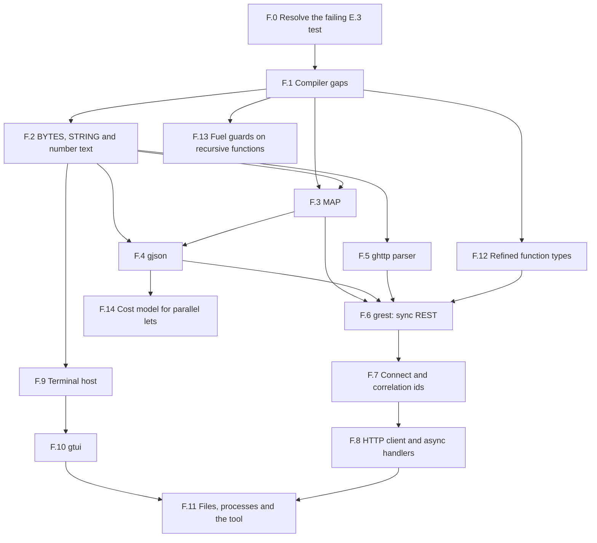

# Phase F: Verified Libraries and Applications

**Date:** November 6, 2026
**Status:** In progress. Tasks F.0 to F.5 and F.12 are completed, and the decisions below are taken.
**Roadmap entry:** [Phase F in Roadmap.md](../Roadmap.md#phase-f-verified-libraries-and-applications)
**Probed at:** commit `1349cb6`

---

## 1. Objective

Phases A to E built a verifier, a reactive runtime and a package system. Phase F uses them to build real software, and lets that software decide what the core libraries need.

The phase delivers, in this order:

1. The unexplained test failure resolved, and the compiler gaps closed.
2. Core text, number and map libraries, each written for a known client.
3. `gjson`, a verified JSON package.
4. A correct `ghttp` parser, and `grest`, a small REST library with sync handlers.
5. Outgoing connections, an HTTP client and async handlers.
6. A terminal library, `gtui`, and a tool built on it.

**Rule for the phase:** nothing goes into a library without a client in this plan that needs it. A proof that no client uses has not been tested, because contracts only get tested when someone has to prove something with them.

**Not in this phase:** TLS, HTTP/2, WebSockets, chunked transfer encoding, printing `F64` as text, databases, handling events in parallel, full liveness proofs (Phase D excluded these, and decision 8 keeps them out), and terminal display width tables (`gtui` counts one cell per code point).

---

## 2. Findings from probing the plan against `gardelc`

Small programs shaped like the plan were run through the compiler and the built `hello_api`.

| # | Finding | Effect on the plan |
| :--- | :--- | :--- |
| 1 | **`ghttp` does not parse a request split across TCP reads.** `HTTP_PARSER_STATE` keeps a byte count and no bytes. `feed` then returns a hard-coded `HTTP_REQUEST.make_simple(Get, "/")`. Over a real socket, `GET /he` + `llo HTTP/1.1...` was answered by `GET /`, and a split `GET /nope` got `200 OK` where a whole one gets `404`. | A real correctness bug in a package the Roadmap calls complete. The parser contracts only say the result is one of three outcomes, so nothing ties it to the bytes received. Task F.5. |
| 2 | **Headers and bodies are not parsed.** A request is complete when the last byte of a chunk is `\n`. `POST` with `Content-Length: 2` and body `hi` does not end in `\n`, so the server waited and the client timed out. `make_from_wire` keeps only the method and target. | A REST API cannot accept a body today, so `ghttp` is further from REST than it looked. Task F.5. |
| 3 | **Nested recursion through `LIST[SELF]` cannot be proven.** A type with `| A(items: LIST[J])` declares and builds. A measure over it fails: `variant Current` with a helper's `variant xs.length` gives `variant_decrease` errors in both routines. `variant xs` on a list is `E0199` (`Seq J1 and int` to `<`). | `LIST[JSON]` cannot be used for JSON values today. Decision 1, Task F.1. |
| 4 | **A flat cell form works.** `Item(value: J, rest: J)` and `Field(key: STRING, value: J, rest: J)` with `variant Current` verify. A `lookup` by key verifies 0/0. `depth + 1` fails only on a real overflow check. | The JSON type needs no compiler change. A bounded depth is required anyway, which also protects the parser. Task F.4. |
| 5 | **A method from a concept bound does not translate.** In `module SORTED[K: ORD]`, `a.less_than(b)` is `E0199` (undeclared function). A map with no comparison verifies; a sorted one cannot be written. | A generic ordered `MAP` is blocked. Task F.1. |
| 6 | **`.equals` on a match binder does not translate.** `key.equals(k)` inside `case Field(key, ...)` in a recursive routine is `E0199` (`fn_equals`). The same call through a helper with typed parameters verifies. | Probably the same root as finding 5: a receiver with no known type. Task F.1. |
| 7 | **`KV_MAP[STRING, NAT]` was accepted with `K: ORD`,** though `STRING` satisfies only `EQ`. That map never compares keys, so this does not yet show a false proof. | Check that bounds are enforced where a type is used. Task F.1. `STRING` also needs `ORD` to be a map key, Task F.2. |
| 8 | **A record with a function field verifies but does not build.** The C backend stops with `equality on function type`. A closure passed as a parameter works, which is what `hello_api` does. | A route cannot hold its handler today, so `ghttp` uses numeric ids. Task F.1. |
| 9 | **`BYTES` has no concat, slice or search,** only `at`, `length`, `to_list` and `equals`. `STRING` has no find, split, trim or slice. Nothing in the stdlib turns a number into text or back. | Task F.2 is required by every later task. |
| 10 | **These core proofs work today.** A `find` over `character_at` with an exact postcondition verified 0/0. Digits least significant first, with `value_of(digits(n)) = n`, verified 0/0. | Tasks F.2 and F.4 are feasible, and the order of digits is settled: most significant first needs an extra lemma. |
| 11 | **`Print` always adds a newline** (`gardel_io_print_line`). The host does not turn on VT mode on Windows, and has no terminal size. `KEY` has no Home, End, Page keys, Delete or Ctrl chords. | `gtui` cannot draw a screen yet. Task F.9. |
| 12 | **The host has no outgoing connection, file or process command.** `COMMAND` has `Print`, `SetTimer`, `ReadLine`, `ReadKey`, `Listen`, `Send` and `Close`. Timers cannot be cancelled. | Tasks F.7 and F.11. Each new command also needs the scripted source and the event log (D.8). |

Each finding except 7 is a behaviour seen in a run. The causes given for 5 and 6 are not yet confirmed, and F.1 confirms them.

---

## 3. Task graph

`F.5` could ship before `gjson`, as it depends only on F.2. It is the one correctness bug in published code, so do it as soon as F.2 allows.

| Task | Size | Delivers | Main risk |
| :--- | :--- | :--- | :--- |
| F.0 | S | A known cause, or a test that says what failed | May not reproduce |
| F.1 | M | Generic bounds, match binders, function fields in C | Touches the verifier core |
| F.2 | M | Text and bytes operations, number text | Proof effort on slices |
| F.3 | M | `MAP[K, V]` | Sorted-order proofs |
| F.4 | L | `gjson` | The round-trip proof |
| F.5 | L | A parser that means what the bytes say | Proof over a buffer; a breaking change |
| F.12 | Not sized | `require` and `ensure` on function types enforced | Checking a lambda against a contract where it is passed |
| F.13 | S | Fuel guards that hold when a function is applied within its `require` | Changing every routine axiom; proof time |
| F.14 | S | Parallel `let`s only where they pay | Keeping `seq_bench`'s speedup |
| F.6 | M | `grest` | Fitting a library around a `reactive program` |
| F.7 | M | `Connect`, tags | Non-blocking connect on two platforms |
| F.8 | L | `HTTP_CLIENT`, async handlers | The design of a waiting handler |
| F.9 | M | Raw output, size, more keys | Console differences on Windows |
| F.10 | L | Screen, layout, widgets | Redraw performance |
| F.11 | L | Files, processes, the tool | Keeping replay exact |

---

## 4. Decisions to take

All twelve were taken on 2026-11-07, each as proposed here. Each task lists the decisions it needs.

1. **Shape of a JSON value.** Taken: flat cells behind an opaque module, so clients use `items`, `field` and builders. No compiler change, and the cells stay hidden if nested recursion is added later. The alternative was teaching the termination check to measure through `LIST`, which helps every tree-of-lists type but is a change to the verifier core.
2. **JSON numbers.** Taken: `JInt(I64)` for integers, and `JNumber(text: STRING)` holding any other valid literal unchanged. The round trip then holds exactly, and no `F64` printing is needed.
3. **Order of `STRING`.** Taken: byte order of the UTF-8 form, which equals code point order. It is a map key order, not a locale collation.
4. **`MAP` representation.** Taken: a sorted list, with the laws stated on the abstract model, so a balanced tree can replace it with no contract change. Replace it only if a benchmark calls for it.
5. **Where REST lives.** Taken: a new package, `grest`, on `ghttp` and `gjson`. `ghttp` stays usable without JSON, and it tests a package with two dependencies.
6. **Handlers in routes.** Taken: a route stores its handler as a function, replacing numeric ids. F.1 allows it.
7. **What an async handler returns.** Taken: a sum type, `Reply(response)` or `Await(state, commands)`. A sync handler is a pure function wrapped in `Reply`. A waiting request lives in a bounded table in the server state, keyed by tag. Hidden continuations are rejected: state must stay visible to the verifier.
8. **What "every request gets an answer" means.** Taken: a safety property, not liveness. Every entry in the waiting table has an armed timeout, and proven invariants say each entry leaves the table on its answer or its timeout. The proof assumes the host delivers the timer. This narrows what was first suggested, because Phase D has no liveness proofs.
9. **Addresses for `Connect`.** Taken: IPv4 literals and `localhost` first. Name lookup blocks, so it would need a helper thread (Phase D decision 5). Add it when a program needs it.
10. **What the tool is.** Taken: a verification browser. It runs `gardelc --json-diagnostics` on a project, lists failed obligations, and shows each one in its source. It suits the project and it needs files, a process, a list view and a text view, so it tests all of `gtui`.
11. **Reach of file and process commands.** Taken: a process takes a program and an argument list, never a shell string, and its output arrives as events. A replay reads every result from the log and runs nothing.
12. **Clauses on a refined function type.** Taken: enforce them, as §8 of the spec already promises, in a task of their own before F.6 (Task F.12). If that proves too large, remove the syntax instead. Leaving them inert is rejected: a reader would trust clauses that do nothing.

---

## 5. Work breakdown

Every task follows the rules of Phase E:

- `--stdlib --strict` stays 0/0, and every example and package stays 0/0 under `--strict`.
- New rules get tests, and mutations of those rules on a private copy must each turn a test red.
- `--compare-with` is run on every package change. A breaking change bumps `version`. This is E.7's first real use.
- A new `COMMAND` or `EVENT` is added only with its host code, its scripted form and its log form, as a closed type must never promise what the host cannot do (Phase D decision 3).
- The spec, `guide/GUIDE.md`, `CHANGELOG.md` and the Roadmap change with the code.

### Step 1: Foundations

#### Task F.0: Resolve the Failing E.3 Test

`test_e3_a_forged_entry_cannot_prove_a_false_contract` failed once in six full runs, at `gardelc/src/main.rs:23523`, because `tool_versions` returned `None`. That can mean a spawn failure, a 30 second timeout, empty output or a failed exit status, and the code cannot tell them apart.

**Status:** ✅ Completed.

- [x] Make `tool_versions` say which tool failed and why.
- [x] Run the suite repeatedly under load until it fails, or until enough clean runs are recorded.
- [x] Fix the cause. If it only happens under load, cache the versions for one process or raise the limit, and record the measurement.
- [x] Acceptance: the cause is named in the Roadmap and its known-limit line is removed. If it does not reproduce, the line stays, and a future failure names the tool and reason.
- **Cause.** With the reason reported, a failure read `boogie.exe /version gave no answer in 30 s`. Stacks of a stuck process show `Main` in `ExecutionEngine.Dispose`, joining a worker in `CustomStackSizePoolTaskScheduler.RunItem` that waits on `Task.Result`. In Boogie 3.1.6, a worker past its `IsCancellationRequested` check that calls `queue.Dequeue()` after `Dispose` has run `Cancel` and `queue.Clear` adds a wait that nothing ends. Boogie's `master` adds `thread.Interrupt()` before the join.
- **Why neither proposed fix was used.** Raising the limit cannot help, as a stuck process was still stuck after 270 s. Caching the versions for one process is already done (`ProofCache::tools`), and each run of `gardelc` is a new process.
- **Fix.** A limit of 10 s, and up to three tries. Only a hang is tried again. A failed status or empty output is reported at once, and a version counts only from a run that ended well, so the cache keys do not change. Accepting the line a stuck process had already printed was rejected, as it would drop that rule.
- **Measured under load, with the test suite running.** Hangs: 4 in 1,500 `/version` calls, 4 in another 694, and 4 in 1,500 with `/vcsCores:1`, which does not help. Runs that ended took at most 2.3 s. Hangs can come in groups: the 4 in 694 came within seconds of each other. A real proof of a small file: 0 in 1,500.
- **Result.** Before: `proof_cache` failed 3 of 23 runs. After: 30 of 30 passed, with 12 of 12 unit test runs beside them. `cargo test` 216/216, 47/47, 48/48, 4/4, 17/17 and 9/9. Four mutations, each on a private copy, turn a test red: no retry, one try too many, retrying every failure, and ignoring a failed status.
- **Boogie moved to 3.4.3 (2026-11-07).** The fix is in Boogie 3.2.4, not only `master`, so the 3.1.6 race is gone. 3.5.1 and 3.5.8 were rejected: the verdict on `SEQ.filter` varies between runs of the same file. At 30M resources, 3.5.8 passed 31 of 36 and 3.5.1 passed 21 of 24, and a failure took 78 to 255 s against 1 to 5 s for a pass. The stdlib also failed once in 3 runs at 100M on 3.5.8, so raising the limit is not the answer.
- **Measured on 3.4.3.** `SEQ.filter`: 120 of 120, and 24 of 24 each on 3.2.4, 3.2.5 and 3.3.3. `/version`: 0 hangs in 9,000 calls, 3,000 of them beside the test suite, against 3 in 6,000 on 3.1.6. `cargo test` 216/216, 47/47, 48/48, 4/4, 17/17 and 9/9. The stdlib and every example under `--strict`, 3 of 3, and the stdlib on seeds 0 to 3.
- **Known limits.**
  - No verdict changed, but the resource figures in the Roadmap's calibration were not measured again on 3.4.3, so the margin of the 30M limit is unconfirmed.
  - Why `SEQ.filter` varies on 3.5.x is not known. `/proverLog` from a passing and a failing run would show whether the input to Z3 differs. A proof that only some paths finish may be fragile on 3.4.3 too, and moving past 3.4.3 needs this answered.
  - All three tries can still hang on an older Boogie. That run has no cache and says why, and a test that counts cache hits then fails, naming the tool.

#### Task F.1: Compiler Gaps

Needs decision 1 only if the nested recursion option is chosen.

**Status:** ✅ Completed. Decision 1 was taken as proposed, flat cells, so this task adds no nested recursion, and finding 3's probe now gives `E0319`.

- [x] Confirm the root cause of findings 5 and 6, then make a method from a concept bound translate, using the instance chosen at each call. Add a false-contract test: a lie about `less_than` must not verify through a bound.
- [x] A bound must be checked at each use. `KV_MAP[STRING, NAT]` with `K: ORD` must be an error while `STRING` is not `ORD`.
- [x] Make `.equals` work on a match binder.
- [x] Let the C backend build a record with a function field. Such a record has no equality, and `=` on one stays an error.
- [x] `variant` on a value with no measure must be a clear error, not `E0199`.
- Acceptance: the probes of findings 3, 5, 6 and 8 give the right result, each with a test. All output for existing examples stays byte-identical, or the difference is explained.
- **Causes.** The plan guessed that findings 5 and 6 had one root, a receiver with no known type. They have two. Finding 5: `K_less` and its laws were already in the module's theory, but only `equals` was routed to it, so `less_than` fell through to a routine named `fn_less_than`. Finding 6: a match binder got its type where a procedure declares locals, and not on the path that builds a function's axiom. Finding 8 was not the record: `LIST[T]` always generated `__eq` and `__has`, so any list of such records failed, and a lone record built.
- **Fix: instances.** On a type parameter, `less_than`, `less_or_equal` and `equals` are relations carrying the laws of the bound. A walk of each module collects every use of a bounded generic, written or inferred from a call, a constructor, a binder, a quantifier or a lambda. A use that does not satisfy the bound is `E0317`. A use that does gets one link, for example `SORTED__K_less(x, y) <==> LEVEL__fn_less_than(DefaultFuel, x, y)`, so a client can use a generic's contract as a fact about its type. `NAT`, `I64`, `U64`, `CHAR` and `BOOL` gained the three methods, in the proof and in C.
- **Soundness of a link.** A link assumes the type keeps the laws of the bound. Assumed inside the type's own file, it would prove those laws for any order: this is the lie the task asked about, and `an_order_cannot_prove_its_laws_through_its_own_use` is a false `total` that it would pass. So a link is skipped in any module that the type's proofs could rest on, and it is written beside the procedures rather than in the theory, so no client inherits it. The C backend checks each instance again, as it sees every one, including what inference cannot.
- **Beyond the checklist.** `r.handler(x)` applied nothing: it parsed as a routine call, so a record could hold a function and never call it. It now applies the field in the proof, in type inference and in C. A field of another module's record was also `E0199`, and a route is used from another module, so it now translates. `E0318` is a method a bound does not give, and `E0320` a bound with no theory.
- **Result.** `cargo test` 223/223, 17/17, 47/47, 48/48, 4/4, 17/17 and 9/9, with `tests/bounds.rs` new. `--stdlib --strict`, every example, `ghttp` and `hello_api` stay 0/0. All 66 `.bpl` and 66 `.c` files that they generate are byte-identical to those of the previous commit, as no existing code has a declared bound. 24 of 24 mutations, each on a private copy, turn a test red. A closure held by a record in a list is freed: 0 live allocations after 51 runs.
- **Known limits.**
  - A bound is `EQ`, `CANONICAL_EQ` or `ORD`, as only those have a theory. Any other is `E0320`, and that includes a user's own concept.
  - A `LIST` or `TUPLE` satisfies no concept, so it is not a type argument for a bound.
  - Stdlib modules skip this walk, as they did for `E0314`. A prelude module that uses `MAP` at a wrong type is caught by the C check only, so F.3 should check this.
  - `[A: ORD]` together with `where A satisfies C` keeps only the `where`, and the bound is not checked.
  - A link does not reach a client's client. A contract that mentions the order must be restated on the concrete type to pass through.
  - `Current.handler(x)` needs `Current.`: a bare `handler(x)` is `E0199`, as a bare field already was in a contract.
  - Clauses on a refined function type have no effect in a proof. `require` is not checked at an application and `ensure` is not assumed, for a field and a parameter alike, on this commit and the one before. Nothing false follows, as a lambda body is proven for every argument, but the clauses are not what they appear to be. The spec needs a decision before F.6 stores handlers.

### Step 2: Core Libraries

#### Task F.2: `BYTES`, `STRING` and Number Text

Client: everything after this task. Needs decision 3.

**Status:** ✅ Completed (2026-11-08). Spec §3 and §3.1 (layers 2 and 3, and the new part 5, number text), §4.1, GUIDE §3 "Working with text" and §17, and `CHANGELOG.md` describe the new operations, the conversions and both fixes.

- [x] `BYTES`: `concat`, `slice`, `index_of` (a byte or a sequence), `starts_with`, and a builder that does not copy on each append.
- [x] `STRING`: `find`, `slice`, `split`, `trim`, `starts_with`, `ends_with`, `satisfies ORD`.
- [x] Number text: `NAT` and `I64` to and from decimal, plus hex for `\uXXXX`. State `parse(to_text(n)) = Some(n)`, built on least-significant-first digits (finding 10). Overflow is an `Error`, never a wrap. The laws state `Ok(n)`, as a parse returns a `RESULT`. The text is most significant first, as text must be, and the proof goes through `absorb(n, k)`, the number `k` followed by the digits of `n`.
- [x] Contracts state results on the `chars` or byte model, as with `character_at`.
- [x] Measure `concat` and `at` on 64 KB input. Parsers call these per byte, so a linear `at` would make them quadratic.
- Acceptance, met: the three round trips are proven; `--compare-with` against the prelude of `4785e21` reports 0 breaking changes and 36 additions, and 0 of each for `ghttp` and `hello_api`; the benchmark is recorded below.

What was built:

- `BYTES`: `concat`, `slice`, `matches_at`, `starts_with`, `index_of_byte`, `index_of`, `list_less`, `utf8_offset` and the split laws. `BYTES_BUILDER` joins its parts once, in `to_bytes`.
- `STRING`: `satisfies ORD`, by the byte order of its UTF-8 form, and `slice`, `matches_at`, `starts_with`, `ends_with`, `find`, `find_char`, `trim`, `count_char`, `split`.
- `NUMBER_TEXT` and `NUMBER_ERROR`: `nat_to_text`, `parse_nat`, `i64_to_text`, `parse_i64`, `hex4_text` and `parse_hex4`, with the laws `nat_round_trip`, `i64_round_trip` and `hex4_round_trip`.
- `NAT.from_i64` and `I64.from_nat`, each with an `in_range` obligation.
- Soundness fixes: `forall` and `exists` over a machine type now carry its range. `--compare-with` no longer calls `EQ` to `ORD` a break.
- Benchmark on 64 KB: building with the builder and summing with `at`, and `find`, stay within start-up noise (55 to 65 ms). Building with per-byte `concat` costs about 35 ms more, as it is quadratic.
- Mutations (2026-11-08), each on a private worktree, checked by `--stdlib --strict` and `tests/text.rs` (and `tests/compat.rs` for M6): 12 of 12 red.
  - Compiler: M1 `forall` over a machine type loses its range; M2 `exists` loses it; M3 `NAT.from_i64` loses `>= 0`; M4 `I64.from_nat` bound off by one; M5 the every-value invariant axiom dropped; M6 `--compare-with` loses the refinement closure.
  - C runtime: M7 `STRING.less_than` puts a longer prefix first; M8 `STRING.slice` takes an index as a byte offset; M9 the builder joins its parts reversed.
  - Stdlib: M10 `parse_digits` loses its overflow guard; M11 `list_less` says empty < empty; M12 `STRING.find` never finds.
  - M2 and M4 first survived, and new tests now catch them: two `exists` lies and one-past-the-edge conversions. `exists k: NAT. k < 0` was no test, as it fails even with no range: Z3 proves an `exists` only from a term matching its body, so the lie needs a call in the `require` as its witness.
  - Caught by the stdlib run alone: M5 (in `BYTES_BUILDER`, so no client test rests on that axiom) and M11 (`less_irreflexive`).
  - At first M12 was caught by the runtime test alone, as `find` stated only that a match it returns is real, not that it finds one. `STRING.find` and `BYTES.index_of` now also state `first` and `absent`, as `find_char` did, and a client test proves `find` is `Some` from a match. M12 and M13 (`index_of` never finds) are now caught by the proof itself: `absent` fails.
- **`hex4_round_trip` was at the edge of the solver's limit.** It ran out of resources in one mutation run, and again once `index_of` gained its clauses, though nothing it uses changed. Its digit arithmetic is now the helper `hex4_sum`, proven on its own. At half the default `rlimit` the whole stdlib verifies; at a quarter only `law_utf8_split_left` fails.
- **Result.** `cargo test --release` 371/371 in 8 suites, and `--stdlib --strict` 0/0. Mutations M1 to M13 all red.
- **Comparison with `4785e21`**, the commit before F.1 and F.2. Every example, `echo_server`, `hello_api`, `reactive_clock`, `reactive_game` and `ghttp` stays 0/0 under `--strict` with both compilers, and they emit the same 110 `.bpl` and `.c` files. 10 are byte-identical. In the rest, each `.bpl` difference is new prelude theory, the range guards of the quantifier fix, or the `BYTES` laws `reflexive`, `symmetric` and `transitive` numbered 15 to 17 in place of 7 to 9. Each `.c` difference only adds lines: the new runtime helpers, and an ASCII fast path in `character_at`.
- Known limits:
  - Elements of a `LIST[U64]` have no lower bound in the model. The axiom that every value of a prelude type satisfies its invariant is an assumption, the same as the existing one on parameters. Stdlib modules skip the `E0317` walk.
  - `split` states how many parts it gives, not their text. `gjson` and `ghttp` should use `find` and `slice`, whose contracts are exact. The GUIDE says so with an example. A per-step contract for `split` is a step in F.5.
  - `--compare-with` cannot be combined with `--stdlib`. The prelude was compared as a package: both trees under `src/` of a `Gardel.toml`, with `--no-prelude`.

#### Task F.13: Fuel Guards on Recursive Functions

Found during the F.5 follow-up (`ghttp` 0.3.0), and numbered last because it was added last. It blocks nothing, but every library with a recursive helper over `BYTES`, `STRING` or `LIST` can meet it.

Cause: `gardelc` (`main.rs`, the routine axioms) emits each `require` of a routine as a guard on all three of its axioms: the definition at `SuccFuel(_fuel)`, the step from `SuccFuel(SuccFuel(_fuel))` to `SuccFuel(_fuel)`, and the contract. Every guard is evaluated at `_fuel`. When a `require` calls a function, such as `i <= a.length`, that call is at a fuel where nothing is known, so a deeper unfolding is never tied to a shallower one. In `HTTP_HEADER.same_ci`, the lemma `same_ci_equal` could not prove `same_ci(a, b, i)` from `same_ci(a, b, i + 1)` until the `require` was removed. `BYTES.at` has the same guard on its fuel step.

- [ ] Evaluate a guard so that it holds whenever the function is applied within its `require`: at the fuel of the application, or with fuel-free (fuel-insensitive) helpers.
- [ ] A regression test: a recursive function with `require i <= a.length` and a lemma that unfolds it one step, which fails today.
- [ ] Put the `require` back on `HTTP_HEADER.same_ci`, and remove the limit from the GUIDE (section 9).
- [ ] Check that no example, `ghttp` or the prelude gets slower or loses a proof, as F.2's benchmark did.
- Acceptance: the regression test verifies, and nothing that verified before stops verifying.
- **Tried in F.4.** Both obvious fixes cost proofs. A guard at `DefaultFuel` on every axiom made `NUMBER_TEXT`'s round-trip laws run out of resources. A guard at the fuel of the application on the defining and step axioms made `STRING.find` run out. A fix must keep the extra unfolding to the routines that need it. `gjson` avoids the limit by keeping its reader total.

#### Task F.14: A Cost Model for Parallel `let`s

Found in F.4, and numbered last because it was added last. It blocks nothing.

The C backend runs each group of independent `let`s as OpenMP tasks, whatever they cost. In `gjson`, a `let` of `larger(a, b)` beside a `let` of a constructor, in a loop over 200,000 items, took 36 s against 0.65 s without OpenMP.

- [ ] Run a group in parallel only when at least two of its `let`s may be costly, for example a call into a recursive group, or above a size threshold such as `GARDEL_PAR_THRESHOLD`.
- [ ] A benchmark: a loop with small independent `let`s costs no more with OpenMP than without, and `seq_bench` keeps its parallel speedup.
- Acceptance: both measurements recorded, and `gjson` can use independent `let`s in its loops again.

#### Task F.3: `MAP[K, V]`

Client: `gjson` objects and the waiting table of F.8. Needs decision 4.

**Status:** ✅ Completed (2026-11-08). `MAP` and `KEY_ORDER` are prelude modules, in `stdlib/collections/`.

- [x] `module MAP[K: ORD, V]`, with `empty`, `get`, `put`, `remove`, `size`, `keys` and `fold`, and also `has` and `values`.
- [x] Laws on the abstract model: `get` after `put` of the same key, `get` after `put` of another key, `get` after `remove`, keys sorted and unique.
- [x] Runs in C with `STRING` keys, with no leaks in the C.3 leak tests.
- Acceptance: met. The laws are proven, and `tests/map.rs` proves facts through them in a client that sees no body.

What was done:

- **Representation.** Decision 4: the keys in ascending order, and their values in a list beside them, both hidden. The invariant says the two lists have one length and the keys ascend. Each operation walks the lists, so it is linear in the size.
- **Laws.** `get_empty`, `get_put_same`, `get_put_other`, `get_remove_same`, `get_remove_other` and `keys_ascending` (a key at a lower index is below one at a higher index, so no key repeats). Each is proven by a lemma by induction on the key list, and each has a `trigger`, so a client uses it with no call. A client writes `m.put(1, x).get(2) = m.get(2)` and it verifies.
- **`ORD` does not promise that `less_than` agrees with `equals`.** A key `equals` to `k` could sit anywhere in the order. So `remove` drops every equal key, `put` keeps the old key when it finds an equal one, and every law rests on the `EQ` and `ORD` laws alone. A law `a.equals(b) and b.less_than(c) implies a.less_than(c)` on `ORD` would allow an early exit in `get`. It is not added: every `ORD` instance would have to prove it.
- **`KEY_ORDER[K: ORD]`.** The routines on keys alone (`above`, `ascending`, `put_keys`, `remove_keys` and their lemmas) live in their own module, because the verifier quantifies every routine of `MAP[K, V]` over both parameters, and one that never mentions `V` is `E0199` (`type variable must occur in function arguments`). No routine there has a `require` on a function of its arguments, the F.13 limit.
- **Compiler gaps found and fixed.**
  - A function type of three parameters, `(acc: B, k: K, v: V) -> B`, which `fold` needs, became an invalid `Fn1` type. The verifier now has `Fn3` beside `Fn1` and `Fn2`, for the type, an application and a lambda.
  - A law of another module was emitted in a client without its parameters' types, so `not j.equals(k)` on a bounded `K` became `OPTION`'s `equals`, and the client was `E0199`. A law's parameters are now typed as a routine's are.
  - The prelude theory a client gets is chosen from a fixed list, which now has `KEY_ORDER` and `MAP`. Without them a client saw an opaque `MAP` and every call was `E0199`.
  - Verifying a prelude module on its own, without the linked project, did not know the type of `xs.head` or `LIST_OPS.at(xs, i)` for `xs: LIST[K]`, so `xs.head.equals(k)` on a bounded `K` was `E0199` there. Both now give the element type.
  - The C backend compared a `let`'s declared type with its value's as text, so `let m: MAP[STRING, NAT] = MAP.empty` was refused, as the value's type said `U64`. Both are now normalized first.
- **Tests.** `tests/map.rs`: a client proves eight facts through the laws, including `keys` in order and a `STRING` value read back with `.equals`. Six lies are refused, among them a value put under another key, a key still there after `remove`, the old value after a second `put`, and keys in the wrong order. `BYTES` and a client module are refused as keys (`E0317`). A program puts text keys out of order, one twice, removes one, folds twice, and uses number keys with text values; its output is checked, and 51 runs leave 0 live blocks.
- **Mutations.** Six, on renamed copies verified as user modules, all refused: `put` keeping the old value, `remove` keeping the first equal key, a smaller key put after the head, `find` ignoring the key, the invariant without the order, and `put` on an empty map losing the value.
- **Result.** `cargo test --release` 376/376, with `tests/map.rs` new. `--stdlib --strict` (20 modules), every example, `ghttp` and `hello_api` stay 0/0.
- **Compatibility.** `--compare-with` against the prelude of `9b7f25e` reports 0 breaking changes and 2 additions, `KEY_ORDER` and `MAP`.
- **Known limits.**
  - A routine of a generic module must mention all of its type parameters, or it is `E0199`.
  - `=` on `OPTION[STRING]` is `E0311`, so a client compares what `get` gives through `.get.equals`. The laws themselves use structural `=`, which holds as the value is the one stored.
  - `fold` has only its empty case as a contract. A law relating `fold` to `put` waits for a client that needs it.

### Step 3: `gjson`

#### Task F.4: The `gjson` Package

Client: `grest`. Needs decisions 1 and 2. A new package at `gjson/`, like `ghttp/`.

**Status:** ✅ Completed (2026-11-09), with the round trip proven for scalars and strings. Arrays and objects are covered by tests, as the task allowed. `gjson/README.md` describes the package.

- [x] `JSON` value type, opaque, with builders and queries. Object keys are unique, by the type's invariant.
- [x] Serializer to `BYTES` per RFC 8259: escapes, and a canonical key order.
- [x] Parser over `BYTES`, total, returning `RESULT[JSON_ERROR, JSON]`. An error carries a byte offset. Input size and nesting depth have proven limits.
- [x] Prove `parse(serialize(v))` gives `v` back, in stages: scalars, strings with escapes, arrays and objects. Stages 1 and 2 are proven. Stage 3, arrays and objects, is not: it is covered by tests.
- [x] Test against a table of valid and invalid documents, including deep nesting, bad UTF-8, lone surrogates and duplicate keys.
- Acceptance: met. `gjson --strict` is 0/0 with no `assume`. Every malformed case gives an `Error`, and the round trip is proven for scalars and strings.

What was done:

- **The value.** Decision 1: flat cells (`JSON_CELL`): scalars, `JArray(items)` and `JObject(fields)`, with chains of `JItem` and `JField` ending in `JEnd`. Text is kept as its UTF-8 bytes, so `=` on a value is its equality and `JSON` is `CANONICAL_EQ`. `JSON` holds one cell, with the invariant `cell.ok(64)`: text is valid UTF-8, keys strictly ascend in byte order, so none repeats, and nesting is at most 64 levels. Decision 2: an integer in the range of `I64` is `JInt`, and any other number keeps its literal. `-0` keeps its sign, as a `JNumber`.
- **The reader** (`JSON_READER`) works on the document as a byte list. Each array, object, string and number is read by a routine that calls itself last, which C runs as a loop, so only nesting uses the stack. Its routines have no `require` on a function call (F.13): a byte is read through `JSON_BYTES.first` and an error offset through `left`, so a proof can unfold them as deep as it needs. An object's fields are collected in descending order and inserted in place, so keys in ascending order cost one comparison each. Every result is proven valid.
- **The writer** (`JSON_WRITER`) pushes bytes in order onto a list it reverses once. It adds no white space and writes keys in order, so equal values give equal bytes.
- **The round trip.** `JSON_WIRE` states the writer's text head first. `JSON_ROUND_TRIP` proves the reader finds each scalar in it. The law `JSON.scalar_round_trip` gives `parse(v.to_bytes) = Ok(v)` for every scalar whose text fits `max_input`. The scalar builders state their text length, so a client proves `parse(JSON.int(i).to_bytes) = Ok(JSON.int(i))` for every `i`, and the same for booleans, `null` and strings of up to 100,000 bytes.
- **Why stage 3 stops.** Stated head first, the writer's text of a chain is the reverse of what it builds. The proof needs the reverse lemmas for chains, already proven for validity, tied to both the reader's and the writer's chains. The reader's `items` and `fields` have a `require` on the chain they collect, which F.13 stops the solver from unfolding twice. They would have to be made total first, as the scalar readers were.
- **Changes outside `gjson`.**
  - `NUMBER_TEXT.digits_step`, a law with no trigger that gives one step of `digits`. A client cannot see a prelude body, and the integer proof needs to.
  - gardelc: a field of a machine number type (`NAT`, `U64`, `I64`, `CHAR`) of a sum type or record is in range. Before, `JInt(w)` gave `w` no range, so no contract that needs one applied to it. This closes F.2's known limit for fields. Elements of a `LIST[U64]` still have none, which is why `gjson` checks each byte it reads.
  - gardelc: substitution avoids capture. A call's argument that mentions `k` was put into a `require` that binds its own `k` in a `match`, and the binder captured it. `JSON_CELL.reverse_down_ok` is the case: it is refused without the fix. The fix renames a `match` binder, a quantified variable, a lambda parameter or a `let` that an argument mentions.
- **Tests.** `gjson/tests` is a client package, with 70 cases in `cases.txt`: every scalar form, every escape, the canonical order of keys, each error with its offset, and generated limits: 64 and 65 levels, 200,000 items, 300,000 bytes of text, 50,000 escapes, 3,000 fields in reverse order and a document over 4 MiB. Each accepted value must read back as itself, which covers stage 3. They run in 1.3 s. `tests/gjson.rs` runs them, proves the client facts above, refuses three lies, and checks the range of a field.
- **Mutations.** Ten, each on a private copy, all red. The proof catches a raw `"`, a dropped minus sign and no depth limit. The cases catch a tab not treated as space, a trailing comma accepted, a duplicate key kept, no comma between fields, `-0` read as an integer, a raw control character accepted, and a lone surrogate accepted.
- **Result.** `cargo test --release` passes, with `tests/gjson.rs` new. `--stdlib --strict`, every example, `ghttp`, `hello_api` and `gjson` stay 0/0. `--compare-with` against the prelude of `bb7e6cb` reports 0 breaking changes and 1 addition, `digits_step`.
- **Found on the way, and not fixed.**
  - `LIST.length` walks the list in C, so a loop that tests `bs.length` is quadratic. `gjson` tests `bs = LIST.empty`, which is constant. `MAP` and `NUMBER_TEXT.parse_digits` test `length`, and are quadratic in C. Fixed in F.6, step 0: `length` is constant time.
  - A call that is not a tail call takes a stack frame in C, and a 1 MB stack holds 30,000 to 60,000 of them. A loop over an input must be a tail call.
  - Independent `let`s run as OpenMP tasks, with no cost model. In a loop over 200,000 items this took 36 s against 0.65 s without OpenMP. `gjson` avoids independent `let`s in its loops. Task F.14 is a cost model.
  - Under `/typeEncoding:p`, the list axioms do not fire on a term that holds a prelude routine's result, such as `digits(n, ys).append(zs)`. Naming the result with `let` first works around it.
  - Two arms of one `match` that bind the same name at different types are `E0199`.
  - A call such as `b.to_bytes`, in a module that has a routine named `to_bytes`, counts as recursion in the call graph.
  - F.13 was tried. Guarding every routine at `DefaultFuel` made `NUMBER_TEXT.nat_round_trip` and `i64_round_trip` run out of resources. Guarding the defining and step axioms at the fuel of the application made `STRING.find` run out. Both were reverted.

### Step 4: REST

#### Task F.5: A Parser That Means What the Bytes Say

Client: `grest`. Fixes findings 1 and 2.

**Status:** ✅ Completed (2026-11-08), except the round-trip proof, which moves to F.8. `ghttp` is now 0.2.0. The `ghttp` README, `CHANGELOG.md` and the test files describe the change.

- [x] `HTTP_PARSER_STATE` keeps the bytes it has received, within its limits.
- [x] Parse the request line, headers and a `Content-Length` body. A request is complete when its framing says so, not when a chunk ends in `
`.
- [x] Reject what the limits do not allow: conflicting `Content-Length`, a body with a safe method (the current invariant, now the error `BodyNotAllowed`), oversized parts. Chunked encoding is answered `501`.
- [x] Return extra bytes as the remainder, for a pipelined request.
- [x] Remove the hard-coded `GET /`, and change the test that accepted it.
- [x] State the meaning. `HTTP_FRAMING.faithful(state, buf, r)` holds of every parse result: a waiting state holds `buf` under the same limits; after `Complete(req, rest)`, `rest` is the tail of `buf` and `req.body` the bytes just before it. `feed` adds that a waiting state holds every byte received so far, in order.
- [ ] Prove that serializing a request and parsing it gives the same request. Not done: `ghttp` has no request serializer yet, and the proof needs the head parser's searches to be tied to the serialized text. It belongs with `HTTP_CLIENT` (F.8), which needs that serializer anyway.
- [x] Test every request in the suite split at every byte offset, against the unsplit result.
- [x] Cut header lines and the request target with `find`/`find_char` and `slice`, not `split`. The parser uses `BYTES.index_of`, `index_of_byte` and `slice` only, so `STRING.split` stays as F.2 left it.
- [x] `HELLO_API` over real sockets repeats finding 1's probe and now gets the right answers.
- Acceptance: met. All splits agree, a `POST` body arrives, and `--compare-with` reports the breaking change, with `ghttp` moved to a new version.

What was done:

- **Parser.** `HTTP_PARSER` holds `feed`, `parse`, `parse_buffer` and `parse_head`. `HTTP_HEAD_PARSER` reads the request line and the header fields into an `HTTP_HEAD`, with no proof about the buffer to carry. `HTTP_FRAMING` holds `faithful` and the body framing. Each `feed` appends the chunk and parses the whole buffer again, so the answer depends on the bytes alone. Over a real socket, `GET /he` + `llo HTTP/1.1...` now gets `/hello`'s answer and a split `GET /nope` gets `404`. A `POST` body arrives whole and split three ways, and chunked encoding gets `501`.
- **Why three modules.** In one module, `frame`, `parse_head` and `parse_fields` ran out of solver resources, though `frame` alone verified. Moving the header loop's result into `HTTP_HEAD`, so that only three routines prove `faithful`, and splitting the modules brought `ghttp` to 0/0 in 49 s.
- **Two proof lessons.** `let n = if c then a else b end` lost the type of `n`, which made `start + n` an overflow error. A helper routine, `declared_length`, fixed it. The remainder is stated as a slice of `buf` (`take(drop(...), rest.length)`), because nothing proves that taking a whole list gives the list back.
- **Tests.** `ghttp/tests` is now a client package of `ghttp`, so it sees only contracts. Its cases are in `ghttp/tests/cases.txt`, read on standard input: string literals in a module with `ghttp` cost more than linearly (3 cases took 40 s, 6 over 500 s), and one module of 24 cases never finished. There are 27 cases: accepted requests, pipelined remainders, waiting states, and every refusal. Each runs whole and cut at every byte. A cut inside a pipelined second request is compared with the second read added to the remainder, as a server would see it. `cargo test` runs the suite (`ghttp_parses_every_case_whole_and_split`) and the socket probe (`a_service_on_ghttp_verifies_and_answers`).
- **Mutations.** Six, all red. A waiting state that forgets the bytes, a body one byte short, and a request complete without its body fail the proofs. A repeated `Content-Length` not compared, `Transfer-Encoding` ignored, and case-sensitive header names fail the cases.
- **Compatibility.** `--compare-with` against 0.1.0 reports 8 breaking changes (`HTTP_ERROR`'s representation, `HTTP_REQUEST.make`, and six removed routines) and 11 additions. `hello_api` needed no change but its new route, `POST /echo`.
- **Known limit.** The server still closes the connection after each answer, so the remainder is returned but not served. Persistent connections are now a step of F.8.
- **Follow-up, `ghttp` 0.3.0.** F.5's other two limits were fixed at once, before F.3 builds on the API: `lookup_header` compared names case-sensitively, and `HTTP_RESPONSE` took its `Content-Length` as text from the caller.
  - `HTTP_HEADERS.lookup_header` ignores the case of field names (RFC 9110, section 5.1), through `HTTP_HEADER.name_matches`. The law `found_after_add` proves that a field just added is found by any spelling of its name, and `value_of` gives the value or `""`. Four cases in `cases.txt` look up `Content-Type` under three spellings and one near miss.
  - `HTTP_RESPONSE` works out `Content-Length` from the body. `ok_text`, `created_text` and `make_text` lose their length argument, and `content_length_header_value` promises `NUMBER_TEXT.parse_nat(Result) = Ok(response_body_length)`. To bound its digits, `NUMBER_TEXT.digit_count` gains the bounds `n < 10^k implies Result <= k`, for `k` from 2 to 10, each proven from the one before it.
  - A proof lesson: a recursive function with a `require` on `a.length` could not be unfolded one step deeper, because gardelc guards its fuel axiom with `length` at zero fuel, where nothing is known. `same_ci` is total instead, with no `require`. Task F.13 fixes the cause, and the GUIDE (section 9) describes the limit.
  - Two mutations, both rejected by the verifier: exact name comparison breaks `found_after_add`, and a length one too large breaks `says_body`.
  - `--compare-with` against 0.2.0 reports 3 breaking changes (the three signatures) and 6 additions. `hello_api` drops its own length computation, and the socket probe checks a 12-byte echo sent with a lower-case `content-length`.

#### Task F.12: Refined Function Types

Needs decision 12. Found during F.1, and numbered last because it was added last. It runs before F.6.

**Status:** ✅ Completed (2026-11-09). The clauses are enforced, and where nothing would enforce them they are an error. Spec §8, GUIDE §11 and `CHANGELOG.md` describe the rules.

- [x] A `require` on a function type is checked at each application, for a parameter and a field. A field may not have a `require` (`E0321`), so a field has nothing to check: see below.
- [x] A lambda or routine passed where such a type is expected is checked against its clauses there.
- [x] An `ensure` on a function type is assumed at an application, and only once the check above exists.
- [ ] If this proves too large, make the syntax an error instead, and say so in the spec. Not needed, except for the positions `E0321` refuses.
- Acceptance: met. A call outside a stated `require` is refused, a lambda that breaks a stated `ensure` is refused, and `tests/refined.rs` refuses eight lies told through one.

What was done:

- **One rule, applied when a module is parsed** (`gardelc/src/refined.rs`). Each `ensure` becomes a contract of the place that holds the function, stated for every argument its `require` allows. On a parameter `f`, `f_bounded: forall x: NAT. (x < 100) implies (f(x) <= x)` is a `require` of the routine. On a record field it is an invariant of the record, `<field>_<tag>`. On a result it is an `ensure`, `result_<tag>`. A law's parameter is a parameter. So calls within a module, across modules and across packages, and the interface a client sees, all go through checks that already existed.
- **In the verifier.** Each application, `f(k)`, `f.apply(k)` or `r.handler(k)`, proves the `require` of the function's type. A lambda passed straight to a parameter of a refined type may assume the type's `require` in its body, so `fn(a: NAT, b: NAT): NAT do b - a end` verifies under `require ordered: a <= b`.
- **Soundness of that assumption.** A lambda proven under a `require` must never be applied outside it. So a parameter whose type has a `require` may only be applied, or passed as an argument where the verifier proves that the receiving type's `require` implies its own. Bound to a name, returned or stored, it is `E0322`, checked when the module is parsed. Passed where no refined type of the same arity is expected, such as `LIST_OPS.map` or `Some`, the call is refused. For the same reason a `require` is accepted on a parameter only: on a field or a result it would leave the function in the open.
- **`E0321`.** Clauses where nothing would enforce them: a `let`, a lambda's parameter or result, a quantifier, a type argument such as `LIST[...]`, a function type nested in another, a variant's field, and a `require` on a field or a result.
- **The type stays text.** A type is a string in `gardelc`, so the clauses are read back from it. A clause that does not read back as written is a parse error. None in the probes needed it.
- **Fixed on the way.**
  - `let a = f(k)`, with `f` a function parameter, gave `a` the module's type, and the module was `E0199`. It now has `f`'s result type.
  - `refined.rs` is in `VERIFIER_SOURCES`, so it is part of the proof cache key, as `test_e3_the_verifier_id_covers_every_source_file` requires.
- **Tests.** `tests/refined.rs` has five tests:
  - Accepted: a lambda, a lambda with a capture, passing `f` on under a weaker `require`, a function of two parameters whose lambda uses the `require`, a refined result, and a law.
  - Eight lies, refused nine times: a lambda that breaks the `ensure`; a stronger `require` passed on, refused twice (`g_tiny` and `f_bounded`); an `ensure` claimed beyond the type; an application outside the `require`, in the body and in a lambda; passing to `LIST_OPS.map` and to `Some`; and a result that breaks its own `ensure`.
  - Function fields: a field's contract holds for a list element in another module. A program builds and runs, exit 28. Records built from a plain `NAT -> NAT` or from a lambda that breaks the contract are refused.
  - Ten positions refused with `E0321` or `E0322`.
- **Mutations.** Eight, each on a private copy, all red: no check at an application, no `require` from an `ensure`, no escape check, no implication check when passing on, no field invariant, no result `ensure`, no position check, and a lambda that never assumes the `require`. The result mutant first survived: within a project a client sees the routine's body, so the client test proved the fact from the lambda itself. The lie `grows` now catches it.
- **Result.** `cargo test --release` passes, with `tests/refined.rs` new. `--stdlib --strict`, every example, `ghttp`, `hello_api`, `gjson` and their test packages stay 0/0. All 216 `.bpl` and `.c` files they generate are byte-identical to those of `fb69558`, as no existing code has clauses on a function type.
- **Known limits.**
  - A field's function cannot have a `require`. A handler that needs one must check its input and return an error. F.6 will show whether that is enough.
  - A named routine passed as a function value, `apply_small(halve, 7)`, is `E0199` in the verifier, as it was before this task. Fixed in F.6, step 0, for a routine of the same module.
  - In `let g: (x: NAT) -> NAT ensure le: Result <= x = fn ...`, the clause reads `= fn ...` as part of its expression, which is a parse error. With parentheses round the type it is `E0321`.
  - A quantifier in a clause ranges over every value of its type, without the type's invariant, so a function must keep its `ensure` even for values a client could never build.

#### Task F.6: `grest`, Sync REST

Client: `examples/hello_api`, moved to `grest`. Needs decisions 5 and 6, and Task F.12.

**Status:** In progress. Step 0, a spike on three earlier findings that would hit `grest`, is done (2026-11-09).

- [x] Step 0: string literals, a routine as a function value, and `LIST.length` in C.
- [ ] Path patterns such as `/users/:id`, and query parsing with percent decoding. A proven limit on segments.
- [ ] A route holds its handler. A handler is a pure function from a typed request to a response.
- [ ] `REST_REQUEST` gives `param`, `query`, `header` and `json_body`, and `REST_RESPONSE` gives `json`, `text` and status helpers.
- [ ] A bad or missing body is a `400` with a JSON error, by default.
- [ ] `REST_SERVER` holds the connection loop now written by hand in `hello_api`: `init` and `step` are one line each in a client.
- [ ] Proven server safety, carried over from `ghttp`: connection limit, one answer per request, and a `Close` after an error.
- [ ] `examples/todo_api`: create, read, update and delete over JSON, with a proven invariant on its state.
- Acceptance: `hello_api` is little more than routes and handlers, and `todo_api` passes an end-to-end test over real sockets under `--strict`.

Step 0, what was found and fixed:

- **String literals.** F.5 found literals costly in a module with `ghttp`. A route table is mostly literals, so this was measured first: a module that registers N routes, each `HTTP_ROUTE.make(Get, "/path/number_i", i)`, beside `ghttp`. With N = 1, 3, 6 and 10 it verified in 2 to 7 s. With N = 30 it took 530 s and failed 56 times, every literal's lemma out of resources. Each solver run cost the same in every procedure of the module: 1.6M at N = 10, 5.4M at N = 20.
  - **Cause.** Each literal's definition, `str_lit_k == make_empty(..).push_ascii(..)...`, one step per character, was a ground axiom of the module's theory. So every proof, each literal's own lemma included, internalized the construction terms of all the literals, and the cost grew with their total length. Removing the other literals' definitions brought one lemma at N = 20 from 5.4M to 0.3M.
  - **Fix.** A literal's definition is one quantified axiom whose only trigger is `str_lit_k_defined(b)`, which only `Verify_string_literal_k` mentions. Other proofs know the literal through that lemma's facts (invariant, `chars`, byte length, code point count), as they did. At N = 20 a lemma costs 0.4M to 0.5M and the routine 0.6M. At N = 30 the module verifies 0/0 in 76 s, `ghttp` included, as the cache key changed. The axiom stays a conservative extension, as `str_lit_k_defined` may be the identity. Its body must use `b`: with `str_lit_k_defined(b) == str_lit_k_defined(b)` the solver simplified the guard away and the cost came back. `--compare-with` keeps plain definitions, as its claims call no lemma.
- **A routine as a function value.** `apply_to(halve, 7)` was `E0199` (`undeclared identifier: halve`), so every route would have needed a wrapping lambda. A parse-time rewrite, beside `desugar_nullary_calls`, turns a free name of a non-generic routine with parameters into `fn(x: NAT): NAT do halve(x) end`. Every later phase sees the lambda a client would write: F.12 checks it against a refined type, the routine's `require` is proven inside it, and `E0315` still sees recursion through it. `tests/refined.rs` has `a_routine_name_is_a_function_value`: a name passed to a refined parameter, to `LIST_OPS.map` and to a record's function field (the program runs, exit 10), a shadowing parameter, and two lies refused (an `ensure` too weak, a `require` too strong).
- **`LIST.length` in C** walked the list, so `MAP` and `NUMBER_TEXT.parse_digits` were quadratic. Each cell now keeps the length of the list it starts, set by `prepend` and `append`, so `length` is constant time. A loop over 50,000 items that tests `length` on each step went from 1.7 to 1.8 s to 54 to 117 ms. The leak-checked `tests/map.rs` and `tests/text.rs` pass. `tests/list_length.rs` is new: it prints the length after `prepend`, after `append` with either side empty, of a list shared by two others, and of a 1,000-item list with five appended.
  - Writing that test found a C bug, which is fixed: a value declared `LIST[NAT]` called `LIST_NAT__prepend`, while the runtime is emitted as `LIST_U64`, so the program did not link. `lower_list_method` now names the instance from the normalized type.
- **Mutations.** Eight, each on a private copy, all red: no rewrite of a routine name; a local that no longer hides one; a literal's lemma that never reveals its definition; a guard the solver can simplify away (`str_lit_k_defined(b) == str_lit_k_defined(b)`); `prepend` giving length 1; `append` not counting down; `append` ignoring its second list; and a list instance named from the unnormalized type.
- **Known limits.**
  - In a `module`, a lambda that calls a sibling routine is `E0199` (`undeclared identifier: Current`), whether written by hand or made from a name, as a lifted lambda does not capture `Current`. Handlers live in `functions` and `program` modules, so `grest` is not blocked.
  - A routine of another module, `OTHER.halve`, is not a function value: it parses as a call with no arguments. A generic routine is not converted either.

### Step 5: Async

#### Task F.7: `Connect` and Correlation Ids

Needs decision 9.

- [ ] `Connect(tag: NAT, host: STRING, port: NAT)`, with `Connected(tag, conn)` and `ConnectFailed(tag, err)`.
- [ ] Non-blocking connect on the shared `poll` / `WSAPoll` loop, behind the event source interface.
- [ ] `CancelTimer(id)`: an async program must be able to clear a timeout it no longer needs, or a stale `Tick` could hit a reused id.
- [ ] Scripted and log forms, and replay through a connect.
- [ ] Check prelude name clashes with existing users, as Phase D did for `EVENT` and `KEY`.
- Acceptance: over real TCP, a refused, timed out and successful connect each give the right event. A replay reproduces the commands exactly.

#### Task F.8: HTTP Client and Async Handlers

Needs decisions 7 and 8.

- [ ] `HTTP_CLIENT`: serialize a request and parse a response incrementally, reusing F.5's framing.
- [ ] Prove that parsing a serialized request gives the same request, moved here from F.5.
- [ ] Persistent connections, moved here from F.5's known limits, on the server and the client. The server serves `Complete`'s remainder as the next request instead of closing. It closes after `Connection: close`, and by default after an HTTP/1.0 request. An idle timeout and a cap on requests per connection keep one client from holding a connection forever. Prove that each connection has at most one answer outstanding and that the cap holds.
- [ ] Handlers return `Reply` or `Await`, with a tag and a timeout. A pure handler stays usable unchanged.
- [ ] A bounded waiting table in `MAP`. A full table is a `503`, never unbounded growth.
- [ ] Prove: each waiting entry has a timeout armed, the table stays within its limit, a closed client connection frees its entry, and a late answer is dropped.
- [ ] `examples/api_gateway`: a route that calls another service and returns its data, with one test for a slow upstream and one for a dead one.
- Acceptance: the gateway serves other requests while one waits, and a test shows it. Removing the timeout from a waiting entry is rejected by the verifier.

### Step 6: TUI

#### Task F.9: Terminal Host

- [ ] `Write(text)`, with no newline, and a flush at the end of a step.
- [ ] VT mode on Windows, restored on exit, like raw mode today.
- [ ] `TerminalSize`, answered by `Resized(width, height)`, which also arrives on a resize.
- [ ] `KEY` gains Home, End, PageUp, PageDown, Delete and Ctrl chords.
- [ ] Scripted and log forms.
- Acceptance: the same scripted run gives the same bytes on both platforms, and the terminal is restored after a Ctrl-C.

#### Task F.10: The `gtui` Package

Client: the tool in F.11.

- [ ] `SCREEN`: a grid of cells, and a diff of two screens to the fewest writes. Prove every write stays within the grid.
- [ ] Layout: rows, columns and fixed or flexible sizes. Prove that children stay inside their parent and do not overlap.
- [ ] Widgets: text view, list with selection, status bar and input line. Each one is a pure function of its state.
- [ ] Elm-style loop: `update(state, event)` and `view(state)`, wrapped in a `reactive program`.
- [ ] `examples/todo_tui`.
- Acceptance: the layout proofs hold, and no output is written outside the screen in a scripted run. A full redraw of a 200 by 60 screen fits inside one 16 ms frame, measured.

#### Task F.11: Files, Processes and the Tool

Needs decisions 10 and 11.

- [ ] `ReadFile(tag, path)` and `FileRead(tag, RESULT[IO_ERROR, BYTES])`, on a helper thread.
- [ ] `RunProcess(tag, program, args)`, with output events and an exit event, on a helper thread.
- [ ] Scripted and log forms, so a replay runs nothing.
- [ ] Parse `--json-diagnostics` with `gjson`.
- [ ] The tool, a reactive program using `gtui`, `gjson`, files and a process.
- Acceptance: the tool, written in Gardel, verifies under `--strict` and browses the failures of a broken project. A replay of a session reproduces its screen with no process run.

---

## 6. Milestones

| Milestone | After | Shows |
| :--- | :--- | :--- |
| **Libraries a client can prove with** | F.3 | `STRING`, numbers and `MAP` used through their contracts alone |
| **JSON** | F.4 | A package proven against its own format |
| **A real REST service** | F.6 | `todo_api` over real sockets, with split requests and bodies |
| **Services that call services** | F.8 | Concurrent waiting with proven limits and no thread per request |
| **A tool written in Gardel** | F.11 | The language used to work on itself |

Each milestone can ship alone, so the phase can stop at any of them with something finished.

---

## 7. Main risks

- **The JSON round trip may not close.** It is the most ambitious proof here, so F.4 proves it in stages, and it falls back to tests, stated as such, rather than an `assume`.
- **Per-byte access may be too slow.** If `BYTES.at` is linear, F.2's measurement will show it before the parsers rest on it.
- **`ghttp` clients break.** F.5 changes contracts. The only client today is `hello_api`, which makes this the cheapest time to do it.
- **Prelude growth.** Each new command adds names that can clash with user code, which is why F.7 and F.9 check for clashes.
- **Scope.** F.9 to F.11 are a second project. The milestones exist so that REST can finish first.
