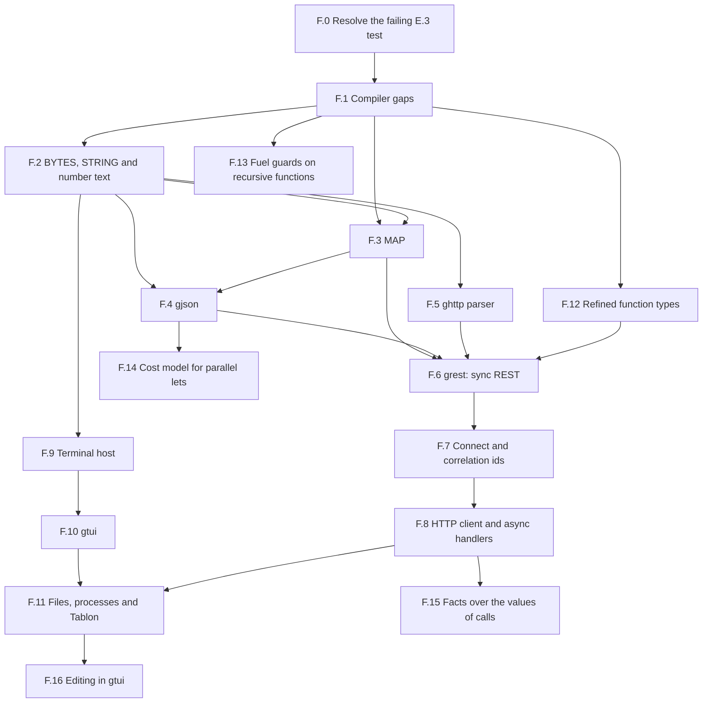

# Phase F: Verified Libraries and Applications

**Date:** November 6, 2026
**Status:** In progress. Tasks F.0 to F.10, F.12, F.13 and F.14 are completed (F.7 on Windows only), and the decisions below are taken.
**Roadmap entry:** [Phase F in Roadmap.md](../Roadmap.md#phase-f-verified-libraries-and-applications)
**Probed at:** commit `1349cb6`

---

## 1. Objective

Phases A to E built a verifier, a reactive runtime and a package system. Phase F uses them to build real software, and lets that software decide what the core libraries need.

The phase delivers, in this order:

1. The unexplained test failure resolved, and the compiler gaps closed.
2. Core text, number and map libraries, each written for a known client.
3. `gjson`, a verified JSON package.
4. A correct `ghttp` parser, and `grest`, a small REST library with sync handlers.
5. Outgoing connections, an HTTP client and async handlers.
6. A terminal library, `gtui`, and a tool built on it.

**Rule for the phase:** nothing goes into a library without a client in this plan that needs it. A proof that no client uses has not been tested, because contracts only get tested when someone has to prove something with them.

**Not in this phase:** TLS, HTTP/2, WebSockets, chunked transfer encoding, printing `F64` as text, databases, handling events in parallel, full liveness proofs (Phase D excluded these, and decision 8 keeps them out), and terminal display width tables (`gtui` counts one cell per code point).

---

## 2. Findings from probing the plan against `gardelc`

Small programs shaped like the plan were run through the compiler and the built `hello_api`.

| # | Finding | Effect on the plan |
| :--- | :--- | :--- |
| 1 | **`ghttp` does not parse a request split across TCP reads.** `HTTP_PARSER_STATE` keeps a byte count and no bytes. `feed` then returns a hard-coded `HTTP_REQUEST.make_simple(Get, "/")`. Over a real socket, `GET /he` + `llo HTTP/1.1...` was answered by `GET /`, and a split `GET /nope` got `200 OK` where a whole one gets `404`. | A real correctness bug in a package the Roadmap calls complete. The parser contracts only say the result is one of three outcomes, so nothing ties it to the bytes received. Task F.5. |
| 2 | **Headers and bodies are not parsed.** A request is complete when the last byte of a chunk is `\n`. `POST` with `Content-Length: 2` and body `hi` does not end in `\n`, so the server waited and the client timed out. `make_from_wire` keeps only the method and target. | A REST API cannot accept a body today, so `ghttp` is further from REST than it looked. Task F.5. |
| 3 | **Nested recursion through `LIST[SELF]` cannot be proven.** A type with `| A(items: LIST[J])` declares and builds. A measure over it fails: `variant Current` with a helper's `variant xs.length` gives `variant_decrease` errors in both routines. `variant xs` on a list is `E0199` (`Seq J1 and int` to `<`). | `LIST[JSON]` cannot be used for JSON values today. Decision 1, Task F.1. |
| 4 | **A flat cell form works.** `Item(value: J, rest: J)` and `Field(key: STRING, value: J, rest: J)` with `variant Current` verify. A `lookup` by key verifies 0/0. `depth + 1` fails only on a real overflow check. | The JSON type needs no compiler change. A bounded depth is required anyway, which also protects the parser. Task F.4. |
| 5 | **A method from a concept bound does not translate.** In `module SORTED[K: ORD]`, `a.less_than(b)` is `E0199` (undeclared function). A map with no comparison verifies; a sorted one cannot be written. | A generic ordered `MAP` is blocked. Task F.1. |
| 6 | **`.equals` on a match binder does not translate.** `key.equals(k)` inside `case Field(key, ...)` in a recursive routine is `E0199` (`fn_equals`). The same call through a helper with typed parameters verifies. | Probably the same root as finding 5: a receiver with no known type. Task F.1. |
| 7 | **`KV_MAP[STRING, NAT]` was accepted with `K: ORD`,** though `STRING` satisfies only `EQ`. That map never compares keys, so this does not yet show a false proof. | Check that bounds are enforced where a type is used. Task F.1. `STRING` also needs `ORD` to be a map key, Task F.2. |
| 8 | **A record with a function field verifies but does not build.** The C backend stops with `equality on function type`. A closure passed as a parameter works, which is what `hello_api` does. | A route cannot hold its handler today, so `ghttp` uses numeric ids. Task F.1. |
| 9 | **`BYTES` has no concat, slice or search,** only `at`, `length`, `to_list` and `equals`. `STRING` has no find, split, trim or slice. Nothing in the stdlib turns a number into text or back. | Task F.2 is required by every later task. |
| 10 | **These core proofs work today.** A `find` over `character_at` with an exact postcondition verified 0/0. Digits least significant first, with `value_of(digits(n)) = n`, verified 0/0. | Tasks F.2 and F.4 are feasible, and the order of digits is settled: most significant first needs an extra lemma. |
| 11 | **`Print` always adds a newline** (`gardel_io_print_line`). The host does not turn on VT mode on Windows, and has no terminal size. `KEY` has no Home, End, Page keys, Delete or Ctrl chords. | `gtui` cannot draw a screen yet. Task F.9, done. |
| 12 | **The host has no outgoing connection, file or process command.** `COMMAND` has `Print`, `SetTimer`, `ReadLine`, `ReadKey`, `Listen`, `Send` and `Close`. Timers cannot be cancelled. | Tasks F.7 and F.11. Each new command also needs the scripted source and the event log (D.8). |

Each finding except 7 is a behaviour seen in a run. The causes given for 5 and 6 are not yet confirmed, and F.1 confirms them.

---

## 3. Task graph

`F.5` could ship before `gjson`, as it depends only on F.2. It is the one correctness bug in published code, so do it as soon as F.2 allows.

| Task | Size | Delivers | Main risk |
| :--- | :--- | :--- | :--- |
| F.0 | S | A known cause, or a test that says what failed | May not reproduce |
| F.1 | M | Generic bounds, match binders, function fields in C | Touches the verifier core |
| F.2 | M | Text and bytes operations, number text | Proof effort on slices |
| F.3 | M | `MAP[K, V]` | Sorted-order proofs |
| F.4 | L | `gjson` | The round-trip proof |
| F.5 | L | A parser that means what the bytes say | Proof over a buffer; a breaking change |
| F.12 | Not sized | `require` and `ensure` on function types enforced | Checking a lambda against a contract where it is passed |
| F.13 | S | Fuel guards that hold when a function is applied within its `require` | Changing every routine axiom; proof time |
| F.14 | S | Parallel `let`s only where they pay | Keeping `seq_bench`'s speedup |
| F.15 | M | Facts over a user type that reach a value a call gives back | Changing how every procedure binds its values |
| F.16 | L | A text editor in `gtui` and in Tablon | Key modifiers on the Windows console; a key's cost on a long file |
| F.6 | M | `grest` | Fitting a library around a `reactive program` |
| F.7 | M | `Connect`, tags | Non-blocking connect on two platforms |
| F.8 | L | `HTTP_CLIENT`, async handlers | The design of a waiting handler |
| F.9 | M | Raw output, size, more keys | Console differences on Windows |
| F.10 | L | Screen, layout, widgets | Redraw performance |
| F.11 | XL | Files, processes, Tablon | Keeping replay exact; handing the terminal to a child |

---

## 4. Decisions to take

All twelve were taken on 2026-11-07, each as proposed here. Each task lists the decisions it needs.

1. **Shape of a JSON value.** Taken: flat cells behind an opaque module, so clients use `items`, `field` and builders. No compiler change, and the cells stay hidden if nested recursion is added later. The alternative was teaching the termination check to measure through `LIST`, which helps every tree-of-lists type but is a change to the verifier core.
2. **JSON numbers.** Taken: `JInt(I64)` for integers, and `JNumber(text: STRING)` holding any other valid literal unchanged. The round trip then holds exactly, and no `F64` printing is needed.
3. **Order of `STRING`.** Taken: byte order of the UTF-8 form, which equals code point order. It is a map key order, not a locale collation.
4. **`MAP` representation.** Taken: a sorted list, with the laws stated on the abstract model, so a balanced tree can replace it with no contract change. Replace it only if a benchmark calls for it.
5. **Where REST lives.** Taken: a new package, `grest`, on `ghttp` and `gjson`. `ghttp` stays usable without JSON, and it tests a package with two dependencies.
6. **Handlers in routes.** Taken: a route stores its handler as a function, replacing numeric ids. F.1 allows it.
7. **What an async handler returns.** Taken: a sum type, `Reply(response)` or `Await(state, commands)`. A sync handler is a pure function wrapped in `Reply`. A waiting request lives in a bounded table in the server state, keyed by tag. Hidden continuations are rejected: state must stay visible to the verifier.
8. **What "every request gets an answer" means.** Taken: a safety property, not liveness. Every entry in the waiting table has an armed timeout, and proven invariants say each entry leaves the table on its answer or its timeout. The proof assumes the host delivers the timer. This narrows what was first suggested, because Phase D has no liveness proofs.
9. **Addresses for `Connect`.** Taken: IPv4 literals and `localhost` first. Name lookup blocks, so it would need a helper thread (Phase D decision 5). Add it when a program needs it.
10. **What the tool is.** Taken: a verification browser. It runs `gardelc --json-diagnostics` on a project, lists failed obligations, and shows each one in its source. It suits the project and it needs files, a process, a list view and a text view, so it tests all of `gtui`. Widened on 2026-11-13: Tablon, a tool for a Gardel project, with four views. **Check** verifies and browses the failures, as above. **Modules** lists the project's modules and shows each one's short form (its contracts without bodies). **Build** compiles the entry point and shows the compiler's errors. **Run** runs what was built. It is not an editor: a file is opened in `$EDITOR` (or `GARDEL_EDITOR`), with the terminal handed over, and checked again on return. The screen is three panes, after `issues/image.png`: the project's modules and files on the left, the chosen module's views on the right, and problems, build and run output below (F.11d).
11. **Reach of file and process commands.** Taken: a process takes a program and an argument list, never a shell string, and its output arrives as events. A replay reads every result from the log and runs nothing.
12. **Clauses on a refined function type.** Taken: enforce them, as §8 of the spec already promises, in a task of their own before F.6 (Task F.12). If that proves too large, remove the syntax instead. Leaving them inert is rejected: a reader would trust clauses that do nothing.

---

## 5. Work breakdown

Every task follows the rules of Phase E:

- `--stdlib --strict` stays 0/0, and every example and package stays 0/0 under `--strict`.
- New rules get tests, and mutations of those rules on a private copy must each turn a test red.
- `--compare-with` is run on every package change. A breaking change bumps `version`. This is E.7's first real use.
- A new `COMMAND` or `EVENT` is added only with its host code, its scripted form and its log form, as a closed type must never promise what the host cannot do (Phase D decision 3).
- The spec, `guide/GUIDE.md`, `CHANGELOG.md` and the Roadmap change with the code.

### Step 1: Foundations

#### Task F.0: Resolve the Failing E.3 Test

`test_e3_a_forged_entry_cannot_prove_a_false_contract` failed once in six full runs, at `gardelc/src/main.rs:23523`, because `tool_versions` returned `None`. That can mean a spawn failure, a 30 second timeout, empty output or a failed exit status, and the code cannot tell them apart.

**Status:** ✅ Completed.

- [x] Make `tool_versions` say which tool failed and why.
- [x] Run the suite repeatedly under load until it fails, or until enough clean runs are recorded.
- [x] Fix the cause. If it only happens under load, cache the versions for one process or raise the limit, and record the measurement.
- [x] Acceptance: the cause is named in the Roadmap and its known-limit line is removed. If it does not reproduce, the line stays, and a future failure names the tool and reason.
- **Cause.** With the reason reported, a failure read `boogie.exe /version gave no answer in 30 s`. Stacks of a stuck process show `Main` in `ExecutionEngine.Dispose`, joining a worker in `CustomStackSizePoolTaskScheduler.RunItem` that waits on `Task.Result`. In Boogie 3.1.6, a worker past its `IsCancellationRequested` check that calls `queue.Dequeue()` after `Dispose` has run `Cancel` and `queue.Clear` adds a wait that nothing ends. Boogie's `master` adds `thread.Interrupt()` before the join.
- **Why neither proposed fix was used.** Raising the limit cannot help, as a stuck process was still stuck after 270 s. Caching the versions for one process is already done (`ProofCache::tools`), and each run of `gardelc` is a new process.
- **Fix.** A limit of 10 s, and up to three tries. Only a hang is tried again. A failed status or empty output is reported at once, and a version counts only from a run that ended well, so the cache keys do not change. Accepting the line a stuck process had already printed was rejected, as it would drop that rule.
- **Measured under load, with the test suite running.** Hangs: 4 in 1,500 `/version` calls, 4 in another 694, and 4 in 1,500 with `/vcsCores:1`, which does not help. Runs that ended took at most 2.3 s. Hangs can come in groups: the 4 in 694 came within seconds of each other. A real proof of a small file: 0 in 1,500.
- **Result.** Before: `proof_cache` failed 3 of 23 runs. After: 30 of 30 passed, with 12 of 12 unit test runs beside them. `cargo test` 216/216, 47/47, 48/48, 4/4, 17/17 and 9/9. Four mutations, each on a private copy, turn a test red: no retry, one try too many, retrying every failure, and ignoring a failed status.
- **Boogie moved to 3.4.3 (2026-11-07).** The fix is in Boogie 3.2.4, not only `master`, so the 3.1.6 race is gone. 3.5.1 and 3.5.8 were rejected: the verdict on `SEQ.filter` varies between runs of the same file. At 30M resources, 3.5.8 passed 31 of 36 and 3.5.1 passed 21 of 24, and a failure took 78 to 255 s against 1 to 5 s for a pass. The stdlib also failed once in 3 runs at 100M on 3.5.8, so raising the limit is not the answer.
- **Measured on 3.4.3.** `SEQ.filter`: 120 of 120, and 24 of 24 each on 3.2.4, 3.2.5 and 3.3.3. `/version`: 0 hangs in 9,000 calls, 3,000 of them beside the test suite, against 3 in 6,000 on 3.1.6. `cargo test` 216/216, 47/47, 48/48, 4/4, 17/17 and 9/9. The stdlib and every example under `--strict`, 3 of 3, and the stdlib on seeds 0 to 3.
- **Known limits.**
  - No verdict changed, but the resource figures in the Roadmap's calibration were not measured again on 3.4.3, so the margin of the 30M limit is unconfirmed.
  - Why `SEQ.filter` varies on 3.5.x is not known. `/proverLog` from a passing and a failing run would show whether the input to Z3 differs. A proof that only some paths finish may be fragile on 3.4.3 too, and moving past 3.4.3 needs this answered.
  - All three tries can still hang on an older Boogie. That run has no cache and says why, and a test that counts cache hits then fails, naming the tool.

#### Task F.1: Compiler Gaps

Needs decision 1 only if the nested recursion option is chosen.

**Status:** ✅ Completed. Decision 1 was taken as proposed, flat cells, so this task adds no nested recursion, and finding 3's probe now gives `E0319`.

- [x] Confirm the root cause of findings 5 and 6, then make a method from a concept bound translate, using the instance chosen at each call. Add a false-contract test: a lie about `less_than` must not verify through a bound.
- [x] A bound must be checked at each use. `KV_MAP[STRING, NAT]` with `K: ORD` must be an error while `STRING` is not `ORD`.
- [x] Make `.equals` work on a match binder.
- [x] Let the C backend build a record with a function field. Such a record has no equality, and `=` on one stays an error.
- [x] `variant` on a value with no measure must be a clear error, not `E0199`.
- Acceptance: the probes of findings 3, 5, 6 and 8 give the right result, each with a test. All output for existing examples stays byte-identical, or the difference is explained.
- **Causes.** The plan guessed that findings 5 and 6 had one root, a receiver with no known type. They have two. Finding 5: `K_less` and its laws were already in the module's theory, but only `equals` was routed to it, so `less_than` fell through to a routine named `fn_less_than`. Finding 6: a match binder got its type where a procedure declares locals, and not on the path that builds a function's axiom. Finding 8 was not the record: `LIST[T]` always generated `__eq` and `__has`, so any list of such records failed, and a lone record built.
- **Fix: instances.** On a type parameter, `less_than`, `less_or_equal` and `equals` are relations carrying the laws of the bound. A walk of each module collects every use of a bounded generic, written or inferred from a call, a constructor, a binder, a quantifier or a lambda. A use that does not satisfy the bound is `E0317`. A use that does gets one link, for example `SORTED__K_less(x, y) <==> LEVEL__fn_less_than(DefaultFuel, x, y)`, so a client can use a generic's contract as a fact about its type. `NAT`, `I64`, `U64`, `CHAR` and `BOOL` gained the three methods, in the proof and in C.
- **Soundness of a link.** A link assumes the type keeps the laws of the bound. Assumed inside the type's own file, it would prove those laws for any order: this is the lie the task asked about, and `an_order_cannot_prove_its_laws_through_its_own_use` is a false `total` that it would pass. So a link is skipped in any module that the type's proofs could rest on, and it is written beside the procedures rather than in the theory, so no client inherits it. The C backend checks each instance again, as it sees every one, including what inference cannot.
- **Beyond the checklist.** `r.handler(x)` applied nothing: it parsed as a routine call, so a record could hold a function and never call it. It now applies the field in the proof, in type inference and in C. A field of another module's record was also `E0199`, and a route is used from another module, so it now translates. `E0318` is a method a bound does not give, and `E0320` a bound with no theory.
- **Result.** `cargo test` 223/223, 17/17, 47/47, 48/48, 4/4, 17/17 and 9/9, with `tests/bounds.rs` new. `--stdlib --strict`, every example, `ghttp` and `hello_api` stay 0/0. All 66 `.bpl` and 66 `.c` files that they generate are byte-identical to those of the previous commit, as no existing code has a declared bound. 24 of 24 mutations, each on a private copy, turn a test red. A closure held by a record in a list is freed: 0 live allocations after 51 runs.
- **Known limits.**
  - A bound is `EQ`, `CANONICAL_EQ` or `ORD`, as only those have a theory. Any other is `E0320`, and that includes a user's own concept.
  - A `LIST` or `TUPLE` satisfies no concept, so it is not a type argument for a bound.
  - Stdlib modules skip this walk, as they did for `E0314`. A prelude module that uses `MAP` at a wrong type is caught by the C check only, so F.3 should check this.
  - `[A: ORD]` together with `where A satisfies C` keeps only the `where`, and the bound is not checked.
  - A link does not reach a client's client. A contract that mentions the order must be restated on the concrete type to pass through.
  - `Current.handler(x)` needs `Current.`: a bare `handler(x)` is `E0199`, as a bare field already was in a contract.
  - Clauses on a refined function type have no effect in a proof. `require` is not checked at an application and `ensure` is not assumed, for a field and a parameter alike, on this commit and the one before. Nothing false follows, as a lambda body is proven for every argument, but the clauses are not what they appear to be. The spec needs a decision before F.6 stores handlers.

### Step 2: Core Libraries

#### Task F.2: `BYTES`, `STRING` and Number Text

Client: everything after this task. Needs decision 3.

**Status:** ✅ Completed (2026-11-08). Spec §3 and §3.1 (layers 2 and 3, and the new part 5, number text), §4.1, GUIDE §3 "Working with text" and §17, and `CHANGELOG.md` describe the new operations, the conversions and both fixes.

- [x] `BYTES`: `concat`, `slice`, `index_of` (a byte or a sequence), `starts_with`, and a builder that does not copy on each append.
- [x] `STRING`: `find`, `slice`, `split`, `trim`, `starts_with`, `ends_with`, `satisfies ORD`.
- [x] Number text: `NAT` and `I64` to and from decimal, plus hex for `\uXXXX`. State `parse(to_text(n)) = Some(n)`, built on least-significant-first digits (finding 10). Overflow is an `Error`, never a wrap. The laws state `Ok(n)`, as a parse returns a `RESULT`. The text is most significant first, as text must be, and the proof goes through `absorb(n, k)`, the number `k` followed by the digits of `n`.
- [x] Contracts state results on the `chars` or byte model, as with `character_at`.
- [x] Measure `concat` and `at` on 64 KB input. Parsers call these per byte, so a linear `at` would make them quadratic.
- Acceptance, met: the three round trips are proven; `--compare-with` against the prelude of `4785e21` reports 0 breaking changes and 36 additions, and 0 of each for `ghttp` and `hello_api`; the benchmark is recorded below.

What was built:

- `BYTES`: `concat`, `slice`, `matches_at`, `starts_with`, `index_of_byte`, `index_of`, `list_less`, `utf8_offset` and the split laws. `BYTES_BUILDER` joins its parts once, in `to_bytes`.
- `STRING`: `satisfies ORD`, by the byte order of its UTF-8 form, and `slice`, `matches_at`, `starts_with`, `ends_with`, `find`, `find_char`, `trim`, `count_char`, `split`.
- `NUMBER_TEXT` and `NUMBER_ERROR`: `nat_to_text`, `parse_nat`, `i64_to_text`, `parse_i64`, `hex4_text` and `parse_hex4`, with the laws `nat_round_trip`, `i64_round_trip` and `hex4_round_trip`.
- `NAT.from_i64` and `I64.from_nat`, each with an `in_range` obligation.
- Soundness fixes: `forall` and `exists` over a machine type now carry its range. `--compare-with` no longer calls `EQ` to `ORD` a break.
- Benchmark on 64 KB: building with the builder and summing with `at`, and `find`, stay within start-up noise (55 to 65 ms). Building with per-byte `concat` costs about 35 ms more, as it is quadratic.
- Mutations (2026-11-08), each on a private worktree, checked by `--stdlib --strict` and `tests/text.rs` (and `tests/compat.rs` for M6): 12 of 12 red.
  - Compiler: M1 `forall` over a machine type loses its range; M2 `exists` loses it; M3 `NAT.from_i64` loses `>= 0`; M4 `I64.from_nat` bound off by one; M5 the every-value invariant axiom dropped; M6 `--compare-with` loses the refinement closure.
  - C runtime: M7 `STRING.less_than` puts a longer prefix first; M8 `STRING.slice` takes an index as a byte offset; M9 the builder joins its parts reversed.
  - Stdlib: M10 `parse_digits` loses its overflow guard; M11 `list_less` says empty < empty; M12 `STRING.find` never finds.
  - M2 and M4 first survived, and new tests now catch them: two `exists` lies and one-past-the-edge conversions. `exists k: NAT. k < 0` was no test, as it fails even with no range: Z3 proves an `exists` only from a term matching its body, so the lie needs a call in the `require` as its witness.
  - Caught by the stdlib run alone: M5 (in `BYTES_BUILDER`, so no client test rests on that axiom) and M11 (`less_irreflexive`).
  - At first M12 was caught by the runtime test alone, as `find` stated only that a match it returns is real, not that it finds one. `STRING.find` and `BYTES.index_of` now also state `first` and `absent`, as `find_char` did, and a client test proves `find` is `Some` from a match. M12 and M13 (`index_of` never finds) are now caught by the proof itself: `absent` fails.
- **`hex4_round_trip` was at the edge of the solver's limit.** It ran out of resources in one mutation run, and again once `index_of` gained its clauses, though nothing it uses changed. Its digit arithmetic is now the helper `hex4_sum`, proven on its own. At half the default `rlimit` the whole stdlib verifies; at a quarter only `law_utf8_split_left` fails.
- **Result.** `cargo test --release` 371/371 in 8 suites, and `--stdlib --strict` 0/0. Mutations M1 to M13 all red.
- **Comparison with `4785e21`**, the commit before F.1 and F.2. Every example, `echo_server`, `hello_api`, `reactive_clock`, `reactive_game` and `ghttp` stays 0/0 under `--strict` with both compilers, and they emit the same 110 `.bpl` and `.c` files. 10 are byte-identical. In the rest, each `.bpl` difference is new prelude theory, the range guards of the quantifier fix, or the `BYTES` laws `reflexive`, `symmetric` and `transitive` numbered 15 to 17 in place of 7 to 9. Each `.c` difference only adds lines: the new runtime helpers, and an ASCII fast path in `character_at`.
- Known limits:
  - Elements of a `LIST[U64]` have no lower bound in the model. The axiom that every value of a prelude type satisfies its invariant is an assumption, the same as the existing one on parameters. Stdlib modules skip the `E0317` walk.
  - `split` states how many parts it gives, not their text. `gjson` and `ghttp` should use `find` and `slice`, whose contracts are exact. The GUIDE says so with an example. A per-step contract for `split` is a step in F.5.
  - `--compare-with` cannot be combined with `--stdlib`. The prelude was compared as a package: both trees under `src/` of a `Gardel.toml`, with `--no-prelude`.

#### Task F.13: Fuel Guards on Recursive Functions

Found during the F.5 follow-up (`ghttp` 0.3.0), and numbered last because it was added last. It blocks nothing, but every library with a recursive helper over `BYTES`, `STRING` or `LIST` can meet it.

Cause: `gardelc` (`main.rs`, the routine axioms) emits each `require` of a routine as a guard on all three of its axioms: the definition at `SuccFuel(_fuel)`, the step from `SuccFuel(SuccFuel(_fuel))` to `SuccFuel(_fuel)`, and the contract. Every guard is evaluated at `_fuel`. When a `require` calls a function, such as `i <= a.length`, that call is at a fuel where nothing is known, so a deeper unfolding is never tied to a shallower one. In `HTTP_HEADER.same_ci`, the lemma `same_ci_equal` could not prove `same_ci(a, b, i)` from `same_ci(a, b, i + 1)` until the `require` was removed. `BYTES.at` has the same guard on its fuel step.

**Status:** ✅ Completed (2026-11-12). The fuel step of a routine now goes from each fuel to the one below it.

- [x] Evaluate a guard so that it holds whenever the function is applied within its `require`. Neither way proposed here was kept: the guards stay where they were, and the step reaches `ZeroFuel`, so that a function a guard calls is known there (see below).
- [x] A regression test: `tests/fuel_guard.rs`. `SCAN.same_equal` proves `same(a, b, i)` from `same(a, b, i + 1)` under `require i <= SCAN.size(a)`, and a client proves `put(b, x).first = x` through `b.add(x)` one fuel below it. Two claims past the `require` are refused. Both proofs failed before.
- [x] Put the `require` back on `HTTP_HEADER.same_ci`, and remove the limit from the GUIDE (section 9).
- [x] Check that no example, `ghttp` or the prelude gets slower or loses a proof. Everything verifies cold, and times stay within the machine's run-to-run spread (the prelude took 33 to 48 s on HEAD across runs, and 45 to 54 s with the fix). Stage C of `ghttp`'s round trip had proofs on the edge, which needed sturdier steps: see below.
- Acceptance: met.

What was done:

- **The case `BYTES.length` no longer showed.** A routine whose body a module cannot see is one function at every fuel (F.6), so a `require` on `a.length` alone already verified. The limit remained for a guard calling a function whose body is seen, as `size(a)` in the same module, or `has_header_room` under `HTTP_HEADERS.add`.
- **The cause, precisely.** A definition is guarded one fuel below its application. When that application is itself one fuel below its caller, as `b.add(x)` in the body of `put(b, x)`, its definition is at `SuccFuel(ZeroFuel)` and its guard `room` at `ZeroFuel`. The step went from `SuccFuel(SuccFuel(f))` to `SuccFuel(f)`, never down to `ZeroFuel`, so `room` there was unknown.
- **The fix.** The step is triggered on `fn(SuccFuel(f), ..)` and states it equal to `fn(f, ..)`, under the guard at `f`, as before. This ties `room` at `ZeroFuel` to `room` where the caller knows it. Triggered on the higher term, it only makes the lower one, so it cannot loop.
- **Tried and dropped, each measured on every package cold.**
  - Dropping the step's guard: `HTTP_WRITER_HEAD` lost its proofs.
  - Also guarding the definition at the fuel of its application: that, and `law_line_end_found` running out of resources in `ghttp`, `grest` and the examples.
  - The definition guarded at `DefaultFuel`: `head_blank` ran out.
  - The new step only for the routines a `require` calls: `STRING.find` and `law_fields_lines` ran out, though it adds less than the fix. Those proofs were on the edge.
- **Stage C made sturdier.** The fix, and F.15's, left `ghttp`'s own proofs verifying, but under seeds 1 to 3 `ghttp/tests` lost `HTTP_WRITER_HEAD`, `HTTP_ROUND_TRIP` and `check_line`. At the commit before, `head_line` already needed 25.7 million of the 30 million resources under seed 2. Nothing they claim changed.
  - New modules `HTTP_HEAD_WHOLE` (the head as one list), `HTTP_HEAD_PARTS` and `HTTP_WRITER_PARTS` (each part's facts as one named predicate), and `HTTP_WIRE_PREFIX` (the searches over bytes that start with a prefix).
  - `check_line` moved from `GHTTP_TEXT` to its own test module, `GHTTP_LINE`, where it assumes the facts of the 9 literals it can meet instead of 51.
  - The heaviest of these proofs went from up to 28 million resources to about 1 million.
  - Causes seen: `Seq_append` associativity re-matching where an operand may be empty; steps that cost far more together than apart; and the literal facts.
  - In the prelude, `STRING.space_start` ran out of resources under the default seed when `STRING` was verified alone, as two unit tests do. That was `BYTES.decode_injective`, whose trigger is a pair of decodings, at 29,000 instances. A `check` that `character_at(j - 1)` is the character at `j - 1` takes it to 0.4 to 3.5 million under seeds 0 to 7.
  - Now `ghttp` and `ghttp/tests` verify under seeds 0 to 3. The heaviest left are `HTTP_WRITER_FIELDS.fields_lines` (up to 11.8 million) and `GHTTP_TEXT.two_exchanges` (11.8 million).
- **Met again in F.8, stage D of the round trip**, now with a client: one step of `HTTP_HEAD_PARSER.fields` unfolds `HTTP_HEADERS.add` one fuel below its caller, guarded by `has_header_room` at fuel zero. The guards of the defining and step axioms read at `DefaultFuel`, and no guard on the step axiom, which every fuel makes sound, proved the step, and all of `ghttp` verified with them. The prelude was not checked with them, which F.4's attempt says to do first.
- **Tried in F.4.** Both obvious fixes cost proofs. A guard at `DefaultFuel` on every axiom made `NUMBER_TEXT`'s round-trip laws run out of resources. A guard at the fuel of the application on the defining and step axioms made `STRING.find` run out. A fix must keep the extra unfolding to the routines that need it. `gjson` avoids the limit by keeping its reader total.

#### Task F.14: A Cost Model for Parallel `let`s

Found in F.4, and numbered last because it was added last. It blocks nothing.

The C backend runs each group of independent `let`s as OpenMP tasks, whatever they cost. In `gjson`, a `let` of `larger(a, b)` beside a `let` of a constructor, in a loop over 200,000 items, took 36 s against 0.65 s without OpenMP.

**Status:** ✅ Completed (2026-11-12).

- [x] Run a group in parallel only when at least two of its `let`s may be costly, for example a call into a recursive group, or above a size threshold such as `GARDEL_PAR_THRESHOLD`. The first: no size threshold was needed.
- [x] A benchmark: a loop with small independent `let`s costs no more with OpenMP than without, and `seq_bench` keeps its parallel speedup.
- Acceptance: met. Both measurements are below, and `gjson` can use independent `let`s in its loops again.

What was done:

- **What counts as costly.** A `let` may do unbounded work when lowering it reaches a call of a routine on a cycle of calls, directly or through routines that are not, applies a function value, or does IO. `TypedC::routine_costly` walks a callee's body once and keeps the answer. Where it cannot tell which routine a method names, because the receiver's type is not known in the walk, every module routine of that name counts. A constructor, arithmetic, a field, a runtime method such as `LIST.length`, and a lambda made but not applied are cheap. When in doubt the walk says costly, which keeps a fork that was there before.
- **The rule.** A group of independent `let`s forks only when two or more are costly; otherwise its `let`s run in order, with no OpenMP call. The depth cutoff of C.3 (`GARDEL_TASK_DEPTH`) still applies to the groups that fork.
- **No fork inside a loop.** A routine that calls itself only in tail position compiles to a `while` loop. A fork in its step makes a task on every iteration, and the depth cutoff never stops it, since a loop does not get deeper. Whether a recursive call does a little work (`digits`, about 20 steps) or a lot (`sum` over a big `SEQ`) cannot be seen, so a loop's groups run in order, costly or not. A routine that also calls itself other than in tail position is divide-and-conquer, and its groups still fork. This is known only once the whole routine is lowered, so each costly group leaves a marker, and `TypedC::settle_groups` puts the forked or the sequential form there. Lambdas are never loops and decide at once. This is not about mutual recursion: plain self-recursion in the callee was enough, and forbidding mutual recursion would not have changed it.
- **Measured** (i9-12900HK, 20 logical cores, wall clock with process start, one run each for the loop, best of 3 for `seq_bench`):
  - A loop of 1,000,000 steps with `let m = larger(acc, i % 7)` and `let o = Some(i)`: 255 ms on 1 thread and 4,478 ms on 20 before; 139 ms and 82 ms after.
  - `seq_bench`, n = 4,000,000: 238 and 123 ms before, 235 and 126 ms after (x1.9 both). Its C is byte-identical, as `from_range` and `sum` fork two recursive calls.
  - A loop of 1,000,000 steps with `let a = depth(i % 8)` and `let b = depth(i % 5)`, where `depth` is recursive (best of 3): 182 ms on 1 thread and 4,514 ms on 20 before; 61 ms and 57 ms after.
- **Test.** `test_f14_let_groups_fork_only_when_two_lets_may_be_costly`: two cheap `let`s, one costly beside one cheap, a closure made beside a recursive call, and a loop whose step has two recursive calls, do not fork; two recursive calls, one of them through a non-recursive routine, two applications of a function parameter, and a routine with both a tail and a non-tail self call do. The program runs natively and gives the expected result. Mutations, each on a private worktree, 7 of 7 red: forking on one costly `let`, a function value counted as cheap, a cycle counted as cheap, a lambda's body counted where it is made, a callee's body not walked, loops allowed to fork, and a non-tail self call ignored.
- **Every package and example**, compiled by the compiler before and after: each verifies 0/0 under `--strict` with both and builds. The C of `seq_bench`, `echo_server`, `json_reader`, `json_writer` and most `ghttp` modules is byte-identical. Elsewhere only forks go: for example `HTTP_SERIALIZER` from 6 to 0, `REST_SERVER` from 11 to 4 and `JSON_ROUND_TRIP` from 27 to 7. The forks removed are around cheap calls such as `NUMBER_TEXT.hex_value`; those left are around recursive ones such as `NUMBER_TEXT.digits`. The loop rule changes none of these counts: no package has a loop whose step holds two costly `let`s. No file gains a fork.
- **Result.** `cargo test --release` passes every suite, 230 unit tests among them.
- **Known limits.** A loop whose step does two heavy calls, such as summing two large `SEQ`s, runs them in order: write it as divide-and-conquer to get them in parallel. A loop through mutual recursion (`f` tail-calls `g`, which tail-calls `f`) is not a C loop and keeps its forks. The walk does not know a receiver's type, so a cheap method that shares its name with a recursive one elsewhere counts as costly. A runtime method that is linear, such as `BYTES.concat`, counts as cheap.

**To evaluate: explicit parallelism in the language.** F.14 makes the compiler guess where a fork pays, from the shape of the code. The alternative is to let the programmer say so, for example `par let a = ...` or a `par` block, and never fork anything else. Not decided; to weigh before the cost model grows further.

- For:
  - Predictable: what runs in parallel is written in the source, and a change elsewhere (a helper that becomes recursive) cannot add or remove a fork.
  - The programmer knows the sizes the compiler cannot: that `sum(seq)` is large and `digits(n)` is small.
  - The cost model, the loop rule and their heuristics (`routine_costly`, `settle_groups`) could go, or be kept only as a lint (`par` on two cheap `let`s, or on a loop's step).
  - Nothing changes for the verifier: a `par let` has the meaning of a `let`, as evaluation order cannot change a pure, total result (§10, item 1).
- Against:
  - It reverses a v0.4 decision: `fork` was removed so that parallelism falls out of divide-and-conquer code with no syntax (§10, §16), and the README and spec promise automatic fork-join.
  - Every program that relies on it today (`SEQ.map`, `filter`, `from_range`, `seq_bench`) would need `par`, and code that forgets it silently runs on one core.
  - It is a target hint inside a language about meaning; Bend v2, the intended GPU route, parallelises on its own and would ignore it.
  - It moves a performance question onto every author, including AI agents that write Gardel, who have no better view of sizes than the compiler has.
- Middle ways to compare:
  - Keep the automatic rule and add `par` only as an override that forces a fork the cost model would not make, such as two heavy calls in a loop's step.
  - Use the size the `variant` gives: a callee whose variant halves (`hi - lo`, `n / 2`) does logarithmic work, one that decreases by one does linear work.
  - A runtime check, for example a task only while fewer than about two tasks per thread are waiting. It bounds how many tasks wait, not what each costs, so it would not have saved the loops above, where idle threads take every task at once.
- What would decide it: a program from Phase F or later that loses real speed under the automatic rule. None does yet.

#### Task F.15: Facts Over a User Type at the Values of Calls

Found in F.8, stage D of the round-trip proof, and numbered last because it was added last. With F.13, it blocks stage D, which tests cover meanwhile.

Under `/typeEncoding:p`, an axiom quantified over a user type is not instantiated at a term that a call gives back, while it is at a parameter or a local of that type. A Boogie test of `HTTP_READ_FIELDS` showed it three ways: `HTTP_HEADERS`' invariant held for the parameter `acc` and not for `reads(buf, pos, hs.tail, acc)`; a law over an `HTTP_HEADERS` did not apply to that call even with its premises assumed; and both held once the call was assigned to a local. A small file with the same shapes verifies, so the cause is in what `gardelc` emits around it, not yet found. Step 3 met the same gap in a routine (`calling`'s outcome), and a `let` worked around it there; a law has no `let`.

**Status:** The verifier's part is done (2026-11-12): a fact over a type now applies at the value of a call. Stage D of the round trip is still open.

- [x] Find what blocks the instantiation. A bug in Boogie 3.4.3, which `boogie_params` already worked around for generic functions.
- [x] Fix it where it is emitted: `boogie_params` now moves the scalars of every function last, not only of generic ones.
- [x] A regression test: `tests/call_value.rs`. A law of another module about a `BOX`, with an invariant, applies at `twice(n, b)`, and the `LIST` facts at `NUMBER_TEXT.digits(n, ys).append(zs)`. A claim past the law is refused. Both proofs failed before.
- [ ] Then stage D of F.8's round trip, whose lemmas wait outside the tree. With F.13 alone, the step through `HTTP_HEADERS.add` (`HTTP_FIELD_STEP.plain_step`) verifies, which F.13 blocked. `HTTP_READ_FIELDS.reads_back` and `HTTP_READ_STEPS.fields_steps` still fail, and with both fixes they run past the time limit. They need proof work, as stage C did, rather than a fix in the verifier.
- Acceptance: the regression test verifies and nothing that verified before stops verifying, both met; stage D is not proven yet.

What was done:

- **The cause.** Under `/typeEncoding:p`, Boogie states the type of a function's result with an axiom that guards each argument's type. After an `int` or `bool` argument the guards are shifted by one. For `NUMBER_TEXT__fn_digits(fuel: Fuel, n: int, rest: (Seq int))` the axiom required `type(rest) == int`, so it never applied, and a call's result had no type. Every fact quantified over a type is guarded by the type of its variable, so none reached that result. A local, or a parameter, has its type stated directly, which is why a `let` worked around it.
  - Shown by `/typeEncoding:a`, under which the same file verifies.
  - Shown in the SMT log, by the guard on the result-type axiom (`funType:NUMBER_TEXT__fn_digits`).
  - The small file of F.8 verified because its functions had no scalar before another argument. The GUIDE's second limit, the `LIST` facts at `digits(n, ys).append(zs)`, was the same gap.
- **The fix, narrowed.** A function that is not generic and gives an `int` or a `bool` is left as written: those are the solver's own sorts, with no type to lose. Reordering them anyway only moved terms. In `HTTP_WRITER_HEAD`, four functions are reordered.
- **What it cost.** More facts now apply, so proofs that were on the edge tipped under some seeds. The same proofs as F.13's were made sturdier (see F.13).

#### Task F.3: `MAP[K, V]`

Client: `gjson` objects and the waiting table of F.8. Needs decision 4.

**Status:** ✅ Completed (2026-11-08). `MAP` and `KEY_ORDER` are prelude modules, in `stdlib/collections/`.

- [x] `module MAP[K: ORD, V]`, with `empty`, `get`, `put`, `remove`, `size`, `keys` and `fold`, and also `has` and `values`.
- [x] Laws on the abstract model: `get` after `put` of the same key, `get` after `put` of another key, `get` after `remove`, keys sorted and unique.
- [x] Runs in C with `STRING` keys, with no leaks in the C.3 leak tests.
- Acceptance: met. The laws are proven, and `tests/map.rs` proves facts through them in a client that sees no body.

What was done:

- **Representation.** Decision 4: the keys in ascending order, and their values in a list beside them, both hidden. The invariant says the two lists have one length and the keys ascend. Each operation walks the lists, so it is linear in the size.
- **Laws.** `get_empty`, `get_put_same`, `get_put_other`, `get_remove_same`, `get_remove_other` and `keys_ascending` (a key at a lower index is below one at a higher index, so no key repeats). Each is proven by a lemma by induction on the key list, and each has a `trigger`, so a client uses it with no call. A client writes `m.put(1, x).get(2) = m.get(2)` and it verifies.
- **`ORD` does not promise that `less_than` agrees with `equals`.** A key `equals` to `k` could sit anywhere in the order. So `remove` drops every equal key, `put` keeps the old key when it finds an equal one, and every law rests on the `EQ` and `ORD` laws alone. A law `a.equals(b) and b.less_than(c) implies a.less_than(c)` on `ORD` would allow an early exit in `get`. It is not added: every `ORD` instance would have to prove it.
- **`KEY_ORDER[K: ORD]`.** The routines on keys alone (`above`, `ascending`, `put_keys`, `remove_keys` and their lemmas) live in their own module, because the verifier quantifies every routine of `MAP[K, V]` over both parameters, and one that never mentions `V` is `E0199` (`type variable must occur in function arguments`). No routine there has a `require` on a function of its arguments, the F.13 limit.
- **Compiler gaps found and fixed.**
  - A function type of three parameters, `(acc: B, k: K, v: V) -> B`, which `fold` needs, became an invalid `Fn1` type. The verifier now has `Fn3` beside `Fn1` and `Fn2`, for the type, an application and a lambda.
  - A law of another module was emitted in a client without its parameters' types, so `not j.equals(k)` on a bounded `K` became `OPTION`'s `equals`, and the client was `E0199`. A law's parameters are now typed as a routine's are.
  - The prelude theory a client gets is chosen from a fixed list, which now has `KEY_ORDER` and `MAP`. Without them a client saw an opaque `MAP` and every call was `E0199`.
  - Verifying a prelude module on its own, without the linked project, did not know the type of `xs.head` or `LIST_OPS.at(xs, i)` for `xs: LIST[K]`, so `xs.head.equals(k)` on a bounded `K` was `E0199` there. Both now give the element type.
  - The C backend compared a `let`'s declared type with its value's as text, so `let m: MAP[STRING, NAT] = MAP.empty` was refused, as the value's type said `U64`. Both are now normalized first.
- **Tests.** `tests/map.rs`: a client proves eight facts through the laws, including `keys` in order and a `STRING` value read back with `.equals`. Six lies are refused, among them a value put under another key, a key still there after `remove`, the old value after a second `put`, and keys in the wrong order. `BYTES` and a client module are refused as keys (`E0317`). A program puts text keys out of order, one twice, removes one, folds twice, and uses number keys with text values; its output is checked, and 51 runs leave 0 live blocks.
- **Mutations.** Six, on renamed copies verified as user modules, all refused: `put` keeping the old value, `remove` keeping the first equal key, a smaller key put after the head, `find` ignoring the key, the invariant without the order, and `put` on an empty map losing the value.
- **Result.** `cargo test --release` 376/376, with `tests/map.rs` new. `--stdlib --strict` (20 modules), every example, `ghttp` and `hello_api` stay 0/0.
- **Compatibility.** `--compare-with` against the prelude of `9b7f25e` reports 0 breaking changes and 2 additions, `KEY_ORDER` and `MAP`.
- **Known limits.**
  - A routine of a generic module must mention all of its type parameters, or it is `E0199`.
  - `=` on `OPTION[STRING]` is `E0311`, so a client compares what `get` gives through `.get.equals`. The laws themselves use structural `=`, which holds as the value is the one stored.
  - `fold` has only its empty case as a contract. A law relating `fold` to `put` waits for a client that needs it.

### Step 3: `gjson`

#### Task F.4: The `gjson` Package

Client: `grest`. Needs decisions 1 and 2. A new package at `gjson/`, like `ghttp/`.

**Status:** ✅ Completed (2026-11-09), with the round trip proven for scalars and strings. Arrays and objects are covered by tests, as the task allowed. `gjson/README.md` describes the package.

- [x] `JSON` value type, opaque, with builders and queries. Object keys are unique, by the type's invariant.
- [x] Serializer to `BYTES` per RFC 8259: escapes, and a canonical key order.
- [x] Parser over `BYTES`, total, returning `RESULT[JSON_ERROR, JSON]`. An error carries a byte offset. Input size and nesting depth have proven limits.
- [x] Prove `parse(serialize(v))` gives `v` back, in stages: scalars, strings with escapes, arrays and objects. Stages 1 and 2 are proven. Stage 3, arrays and objects, is not: it is covered by tests.
- [x] Test against a table of valid and invalid documents, including deep nesting, bad UTF-8, lone surrogates and duplicate keys.
- Acceptance: met. `gjson --strict` is 0/0 with no `assume`. Every malformed case gives an `Error`, and the round trip is proven for scalars and strings.

What was done:

- **The value.** Decision 1: flat cells (`JSON_CELL`): scalars, `JArray(items)` and `JObject(fields)`, with chains of `JItem` and `JField` ending in `JEnd`. Text is kept as its UTF-8 bytes, so `=` on a value is its equality and `JSON` is `CANONICAL_EQ`. `JSON` holds one cell, with the invariant `cell.ok(64)`: text is valid UTF-8, keys strictly ascend in byte order, so none repeats, and nesting is at most 64 levels. Decision 2: an integer in the range of `I64` is `JInt`, and any other number keeps its literal. `-0` keeps its sign, as a `JNumber`.
- **The reader** (`JSON_READER`) works on the document as a byte list. Each array, object, string and number is read by a routine that calls itself last, which C runs as a loop, so only nesting uses the stack. Its routines have no `require` on a function call (F.13): a byte is read through `JSON_BYTES.first` and an error offset through `left`, so a proof can unfold them as deep as it needs. An object's fields are collected in descending order and inserted in place, so keys in ascending order cost one comparison each. Every result is proven valid.
- **The writer** (`JSON_WRITER`) pushes bytes in order onto a list it reverses once. It adds no white space and writes keys in order, so equal values give equal bytes.
- **The round trip.** `JSON_WIRE` states the writer's text head first. `JSON_ROUND_TRIP` proves the reader finds each scalar in it. The law `JSON.scalar_round_trip` gives `parse(v.to_bytes) = Ok(v)` for every scalar whose text fits `max_input`. The scalar builders state their text length, so a client proves `parse(JSON.int(i).to_bytes) = Ok(JSON.int(i))` for every `i`, and the same for booleans, `null` and strings of up to 100,000 bytes.
- **Why stage 3 stops.** Stated head first, the writer's text of a chain is the reverse of what it builds. The proof needs the reverse lemmas for chains, already proven for validity, tied to both the reader's and the writer's chains. The reader's `items` and `fields` have a `require` on the chain they collect, which F.13 stops the solver from unfolding twice. They would have to be made total first, as the scalar readers were.
- **Changes outside `gjson`.**
  - `NUMBER_TEXT.digits_step`, a law with no trigger that gives one step of `digits`. A client cannot see a prelude body, and the integer proof needs to.
  - gardelc: a field of a machine number type (`NAT`, `U64`, `I64`, `CHAR`) of a sum type or record is in range. Before, `JInt(w)` gave `w` no range, so no contract that needs one applied to it. This closes F.2's known limit for fields. Elements of a `LIST[U64]` still have none, which is why `gjson` checks each byte it reads.
  - gardelc: substitution avoids capture. A call's argument that mentions `k` was put into a `require` that binds its own `k` in a `match`, and the binder captured it. `JSON_CELL.reverse_down_ok` is the case: it is refused without the fix. The fix renames a `match` binder, a quantified variable, a lambda parameter or a `let` that an argument mentions.
- **Tests.** `gjson/tests` is a client package, with 70 cases in `cases.txt`: every scalar form, every escape, the canonical order of keys, each error with its offset, and generated limits: 64 and 65 levels, 200,000 items, 300,000 bytes of text, 50,000 escapes, 3,000 fields in reverse order and a document over 4 MiB. Each accepted value must read back as itself, which covers stage 3. They run in 1.3 s. `tests/gjson.rs` runs them, proves the client facts above, refuses three lies, and checks the range of a field.
- **Mutations.** Ten, each on a private copy, all red. The proof catches a raw `"`, a dropped minus sign and no depth limit. The cases catch a tab not treated as space, a trailing comma accepted, a duplicate key kept, no comma between fields, `-0` read as an integer, a raw control character accepted, and a lone surrogate accepted.
- **Result.** `cargo test --release` passes, with `tests/gjson.rs` new. `--stdlib --strict`, every example, `ghttp`, `hello_api` and `gjson` stay 0/0. `--compare-with` against the prelude of `bb7e6cb` reports 0 breaking changes and 1 addition, `digits_step`.
- **Found on the way, and not fixed.**
  - `LIST.length` walks the list in C, so a loop that tests `bs.length` is quadratic. `gjson` tests `bs = LIST.empty`, which is constant. `MAP` and `NUMBER_TEXT.parse_digits` test `length`, and are quadratic in C. Fixed in F.6, step 0: `length` is constant time.
  - A call that is not a tail call takes a stack frame in C, and a 1 MB stack holds 30,000 to 60,000 of them. A loop over an input must be a tail call.
  - Independent `let`s ran as OpenMP tasks, with no cost model: in a loop over 200,000 items this took 36 s against 0.65 s without OpenMP, so `gjson` avoids independent `let`s in its loops. Task F.14 added the cost model, and such `let`s now run in order.
  - Under `/typeEncoding:p`, the list axioms do not fire on a term that holds a prelude routine's result, such as `digits(n, ys).append(zs)`. Naming the result with `let` first works around it.
  - Two arms of one `match` that bind the same name at different types are `E0199`.
  - A call such as `b.to_bytes`, in a module that has a routine named `to_bytes`, counts as recursion in the call graph.
  - F.13 was tried. Guarding every routine at `DefaultFuel` made `NUMBER_TEXT.nat_round_trip` and `i64_round_trip` run out of resources. Guarding the defining and step axioms at the fuel of the application made `STRING.find` run out. Both were reverted.

### Step 4: REST

#### Task F.5: A Parser That Means What the Bytes Say

Client: `grest`. Fixes findings 1 and 2.

**Status:** ✅ Completed (2026-11-08), except the round-trip proof, which moves to F.8. `ghttp` is now 0.2.0. The `ghttp` README, `CHANGELOG.md` and the test files describe the change.

- [x] `HTTP_PARSER_STATE` keeps the bytes it has received, within its limits.
- [x] Parse the request line, headers and a `Content-Length` body. A request is complete when its framing says so, not when a chunk ends in `
`.
- [x] Reject what the limits do not allow: conflicting `Content-Length`, a body with a safe method (the current invariant, now the error `BodyNotAllowed`), oversized parts. Chunked encoding is answered `501`.
- [x] Return extra bytes as the remainder, for a pipelined request.
- [x] Remove the hard-coded `GET /`, and change the test that accepted it.
- [x] State the meaning. `HTTP_FRAMING.faithful(state, buf, r)` holds of every parse result: a waiting state holds `buf` under the same limits; after `Complete(req, rest)`, `rest` is the tail of `buf` and `req.body` the bytes just before it. `feed` adds that a waiting state holds every byte received so far, in order.
- [ ] Prove that serializing a request and parsing it gives the same request. Not done: `ghttp` has no request serializer yet, and the proof needs the head parser's searches to be tied to the serialized text. It belongs with `HTTP_CLIENT` (F.8), which needs that serializer anyway.
- [x] Test every request in the suite split at every byte offset, against the unsplit result.
- [x] Cut header lines and the request target with `find`/`find_char` and `slice`, not `split`. The parser uses `BYTES.index_of`, `index_of_byte` and `slice` only, so `STRING.split` stays as F.2 left it.
- [x] `HELLO_API` over real sockets repeats finding 1's probe and now gets the right answers.
- Acceptance: met. All splits agree, a `POST` body arrives, and `--compare-with` reports the breaking change, with `ghttp` moved to a new version.

What was done:

- **Parser.** `HTTP_PARSER` holds `feed`, `parse`, `parse_buffer` and `parse_head`. `HTTP_HEAD_PARSER` reads the request line and the header fields into an `HTTP_HEAD`, with no proof about the buffer to carry. `HTTP_FRAMING` holds `faithful` and the body framing. Each `feed` appends the chunk and parses the whole buffer again, so the answer depends on the bytes alone. Over a real socket, `GET /he` + `llo HTTP/1.1...` now gets `/hello`'s answer and a split `GET /nope` gets `404`. A `POST` body arrives whole and split three ways, and chunked encoding gets `501`.
- **Why three modules.** In one module, `frame`, `parse_head` and `parse_fields` ran out of solver resources, though `frame` alone verified. Moving the header loop's result into `HTTP_HEAD`, so that only three routines prove `faithful`, and splitting the modules brought `ghttp` to 0/0 in 49 s.
- **Two proof lessons.** `let n = if c then a else b end` lost the type of `n`, which made `start + n` an overflow error. A helper routine, `declared_length`, fixed it. The remainder is stated as a slice of `buf` (`take(drop(...), rest.length)`), because nothing proves that taking a whole list gives the list back.
- **Tests.** `ghttp/tests` is now a client package of `ghttp`, so it sees only contracts. Its cases are in `ghttp/tests/cases.txt`, read on standard input: string literals in a module with `ghttp` cost more than linearly (3 cases took 40 s, 6 over 500 s), and one module of 24 cases never finished. There are 27 cases: accepted requests, pipelined remainders, waiting states, and every refusal. Each runs whole and cut at every byte. A cut inside a pipelined second request is compared with the second read added to the remainder, as a server would see it. `cargo test` runs the suite (`ghttp_parses_every_case_whole_and_split`) and the socket probe (`a_service_on_ghttp_verifies_and_answers`).
- **Mutations.** Six, all red. A waiting state that forgets the bytes, a body one byte short, and a request complete without its body fail the proofs. A repeated `Content-Length` not compared, `Transfer-Encoding` ignored, and case-sensitive header names fail the cases.
- **Compatibility.** `--compare-with` against 0.1.0 reports 8 breaking changes (`HTTP_ERROR`'s representation, `HTTP_REQUEST.make`, and six removed routines) and 11 additions. `hello_api` needed no change but its new route, `POST /echo`.
- **Known limit.** The server still closes the connection after each answer, so the remainder is returned but not served. Persistent connections are now a step of F.8.
- **Follow-up, `ghttp` 0.3.0.** F.5's other two limits were fixed at once, before F.3 builds on the API: `lookup_header` compared names case-sensitively, and `HTTP_RESPONSE` took its `Content-Length` as text from the caller.
  - `HTTP_HEADERS.lookup_header` ignores the case of field names (RFC 9110, section 5.1), through `HTTP_HEADER.name_matches`. The law `found_after_add` proves that a field just added is found by any spelling of its name, and `value_of` gives the value or `""`. Four cases in `cases.txt` look up `Content-Type` under three spellings and one near miss.
  - `HTTP_RESPONSE` works out `Content-Length` from the body. `ok_text`, `created_text` and `make_text` lose their length argument, and `content_length_header_value` promises `NUMBER_TEXT.parse_nat(Result) = Ok(response_body_length)`. To bound its digits, `NUMBER_TEXT.digit_count` gains the bounds `n < 10^k implies Result <= k`, for `k` from 2 to 10, each proven from the one before it.
  - A proof lesson: a recursive function with a `require` on `a.length` could not be unfolded one step deeper, because gardelc guards its fuel axiom with `length` at zero fuel, where nothing is known. `same_ci` is total instead, with no `require`. Task F.13 fixes the cause, and the GUIDE (section 9) describes the limit.
  - Two mutations, both rejected by the verifier: exact name comparison breaks `found_after_add`, and a length one too large breaks `says_body`.
  - `--compare-with` against 0.2.0 reports 3 breaking changes (the three signatures) and 6 additions. `hello_api` drops its own length computation, and the socket probe checks a 12-byte echo sent with a lower-case `content-length`.

#### Task F.12: Refined Function Types

Needs decision 12. Found during F.1, and numbered last because it was added last. It runs before F.6.

**Status:** ✅ Completed (2026-11-09). The clauses are enforced, and where nothing would enforce them they are an error. Spec §8, GUIDE §11 and `CHANGELOG.md` describe the rules.

- [x] A `require` on a function type is checked at each application, for a parameter and a field. A field may not have a `require` (`E0321`), so a field has nothing to check: see below.
- [x] A lambda or routine passed where such a type is expected is checked against its clauses there.
- [x] An `ensure` on a function type is assumed at an application, and only once the check above exists.
- [ ] If this proves too large, make the syntax an error instead, and say so in the spec. Not needed, except for the positions `E0321` refuses.
- Acceptance: met. A call outside a stated `require` is refused, a lambda that breaks a stated `ensure` is refused, and `tests/refined.rs` refuses eight lies told through one.

What was done:

- **One rule, applied when a module is parsed** (`gardelc/src/refined.rs`). Each `ensure` becomes a contract of the place that holds the function, stated for every argument its `require` allows. On a parameter `f`, `f_bounded: forall x: NAT. (x < 100) implies (f(x) <= x)` is a `require` of the routine. On a record field it is an invariant of the record, `<field>_<tag>`. On a result it is an `ensure`, `result_<tag>`. A law's parameter is a parameter. So calls within a module, across modules and across packages, and the interface a client sees, all go through checks that already existed.
- **In the verifier.** Each application, `f(k)`, `f.apply(k)` or `r.handler(k)`, proves the `require` of the function's type. A lambda passed straight to a parameter of a refined type may assume the type's `require` in its body, so `fn(a: NAT, b: NAT): NAT do b - a end` verifies under `require ordered: a <= b`.
- **Soundness of that assumption.** A lambda proven under a `require` must never be applied outside it. So a parameter whose type has a `require` may only be applied, or passed as an argument where the verifier proves that the receiving type's `require` implies its own. Bound to a name, returned or stored, it is `E0322`, checked when the module is parsed. Passed where no refined type of the same arity is expected, such as `LIST_OPS.map` or `Some`, the call is refused. For the same reason a `require` is accepted on a parameter only: on a field or a result it would leave the function in the open.
- **`E0321`.** Clauses where nothing would enforce them: a `let`, a lambda's parameter or result, a quantifier, a type argument such as `LIST[...]`, a function type nested in another, a variant's field, and a `require` on a field or a result.
- **The type stays text.** A type is a string in `gardelc`, so the clauses are read back from it. A clause that does not read back as written is a parse error. None in the probes needed it.
- **Fixed on the way.**
  - `let a = f(k)`, with `f` a function parameter, gave `a` the module's type, and the module was `E0199`. It now has `f`'s result type.
  - `refined.rs` is in `VERIFIER_SOURCES`, so it is part of the proof cache key, as `test_e3_the_verifier_id_covers_every_source_file` requires.
- **Tests.** `tests/refined.rs` has five tests:
  - Accepted: a lambda, a lambda with a capture, passing `f` on under a weaker `require`, a function of two parameters whose lambda uses the `require`, a refined result, and a law.
  - Eight lies, refused nine times: a lambda that breaks the `ensure`; a stronger `require` passed on, refused twice (`g_tiny` and `f_bounded`); an `ensure` claimed beyond the type; an application outside the `require`, in the body and in a lambda; passing to `LIST_OPS.map` and to `Some`; and a result that breaks its own `ensure`.
  - Function fields: a field's contract holds for a list element in another module. A program builds and runs, exit 28. Records built from a plain `NAT -> NAT` or from a lambda that breaks the contract are refused.
  - Ten positions refused with `E0321` or `E0322`.
- **Mutations.** Eight, each on a private copy, all red: no check at an application, no `require` from an `ensure`, no escape check, no implication check when passing on, no field invariant, no result `ensure`, no position check, and a lambda that never assumes the `require`. The result mutant first survived: within a project a client sees the routine's body, so the client test proved the fact from the lambda itself. The lie `grows` now catches it.
- **Result.** `cargo test --release` passes, with `tests/refined.rs` new. `--stdlib --strict`, every example, `ghttp`, `hello_api`, `gjson` and their test packages stay 0/0. All 216 `.bpl` and `.c` files they generate are byte-identical to those of `fb69558`, as no existing code has clauses on a function type.
- **Known limits.**
  - A field's function cannot have a `require`. A handler that needs one must check its input and return an error. F.6 will show whether that is enough.
  - A named routine passed as a function value, `apply_small(halve, 7)`, is `E0199` in the verifier, as it was before this task. Fixed in F.6, step 0, for a routine of the same module.
  - In `let g: (x: NAT) -> NAT ensure le: Result <= x = fn ...`, the clause reads `= fn ...` as part of its expression, which is a parse error. With parentheses round the type it is `E0321`.
  - A quantifier in a clause ranges over every value of its type, without the type's invariant, so a function must keep its `ensure` even for values a client could never build.

#### Task F.6: `grest`, Sync REST

Client: `examples/hello_api`, moved to `grest`. Needs decisions 5 and 6, and Task F.12.

**Status:** Done (2026-11-10). Step 0, a spike on three earlier findings that would hit `grest`, step 1, the URL layer (2026-11-09), step 2, requests, responses and routes, step 3, the server, and step 4, handlers with state and `todo_api` (2026-11-10).

- [x] Step 0: string literals, a routine as a function value, and `LIST.length` in C.
- [x] Step 1: Path patterns such as `/users/:id`, and query parsing with percent decoding. A proven limit on segments.
- [x] Step 2: A route holds its handler. A handler is a pure function from a typed request to a response.
- [x] Step 2: `REST_REQUEST` gives `param`, `query`, `header` and `json_body`, and `REST_RESPONSE` gives `json`, `text` and status helpers.
- [x] Step 2: A bad or missing body is a `400` with a JSON error, by default.
- [x] Step 3: `REST_SERVER` holds the connection loop now written by hand in `hello_api`: `init` and `step` are one line each in a client.
- [x] Step 3: Proven server safety, carried over from `ghttp`: connection limit, one answer per request, and a `Close` after an error.
- [x] Step 4: handlers with state. `REST_ROUTE[S]`, `REST_ROUTER[S]` and `REST_SERVER[S]`, and a handler gives the next state with its answer (`grest` 0.4.0).
- [x] `examples/todo_api`: create, read, update and delete over JSON, with a proven invariant on its state.
- Acceptance: `hello_api` is little more than routes and handlers, and `todo_api` passes an end-to-end test over real sockets under `--strict`.

Step 0, what was found and fixed:

- **String literals.** F.5 found literals costly in a module with `ghttp`. A route table is mostly literals, so this was measured first: a module that registers N routes, each `HTTP_ROUTE.make(Get, "/path/number_i", i)`, beside `ghttp`. With N = 1, 3, 6 and 10 it verified in 2 to 7 s. With N = 30 it took 530 s and failed 56 times, every literal's lemma out of resources. Each solver run cost the same in every procedure of the module: 1.6M at N = 10, 5.4M at N = 20.
  - **Cause.** Each literal's definition, `str_lit_k == make_empty(..).push_ascii(..)...`, one step per character, was a ground axiom of the module's theory. So every proof, each literal's own lemma included, internalized the construction terms of all the literals, and the cost grew with their total length. Removing the other literals' definitions brought one lemma at N = 20 from 5.4M to 0.3M.
  - **Fix.** A literal's definition is one quantified axiom whose only trigger is `str_lit_k_defined(b)`, which only `Verify_string_literal_k` mentions. Other proofs know the literal through that lemma's facts (invariant, `chars`, byte length, code point count), as they did. At N = 20 a lemma costs 0.4M to 0.5M and the routine 0.6M. At N = 30 the module verifies 0/0 in 76 s, `ghttp` included, as the cache key changed. The axiom stays a conservative extension, as `str_lit_k_defined` may be the identity. Its body must use `b`: with `str_lit_k_defined(b) == str_lit_k_defined(b)` the solver simplified the guard away and the cost came back. `--compare-with` keeps plain definitions, as its claims call no lemma.
- **A routine as a function value.** `apply_to(halve, 7)` was `E0199` (`undeclared identifier: halve`), so every route would have needed a wrapping lambda. A parse-time rewrite, beside `desugar_nullary_calls`, turns a free name of a non-generic routine with parameters into `fn(x: NAT): NAT do halve(x) end`. Every later phase sees the lambda a client would write: F.12 checks it against a refined type, the routine's `require` is proven inside it, and `E0315` still sees recursion through it. `tests/refined.rs` has `a_routine_name_is_a_function_value`: a name passed to a refined parameter, to `LIST_OPS.map` and to a record's function field (the program runs, exit 10), a shadowing parameter, and two lies refused (an `ensure` too weak, a `require` too strong).
- **`LIST.length` in C** walked the list, so `MAP` and `NUMBER_TEXT.parse_digits` were quadratic. Each cell now keeps the length of the list it starts, set by `prepend` and `append`, so `length` is constant time. A loop over 50,000 items that tests `length` on each step went from 1.7 to 1.8 s to 54 to 117 ms. The leak-checked `tests/map.rs` and `tests/text.rs` pass. `tests/list_length.rs` is new: it prints the length after `prepend`, after `append` with either side empty, of a list shared by two others, and of a 1,000-item list with five appended.
  - Writing that test found a C bug, which is fixed: a value declared `LIST[NAT]` called `LIST_NAT__prepend`, while the runtime is emitted as `LIST_U64`, so the program did not link. `lower_list_method` now names the instance from the normalized type.
- **Mutations.** Eight, each on a private copy, all red: no rewrite of a routine name; a local that no longer hides one; a literal's lemma that never reveals its definition; a guard the solver can simplify away (`str_lit_k_defined(b) == str_lit_k_defined(b)`); `prepend` giving length 1; `append` not counting down; `append` ignoring its second list; and a list instance named from the unnormalized type.
- **Known limits.**
  - In a `module`, a lambda that calls a sibling routine is `E0199` (`undeclared identifier: Current`), whether written by hand or made from a name, as a lifted lambda does not capture `Current`. Handlers live in `functions` and `program` modules, so `grest` is not blocked.
  - A routine of another module, `OTHER.halve`, is not a function value: it parses as a call with no arguments. A generic routine is not converted either.

Step 1, the URL layer:

- **`grest` 0.1.0** has five modules under `src/url/`, with no dependency yet: `URL_TEXT` (percent decoding, with `+` as a space in a query), `REQUEST_TARGET` (decoded segments and query fields), `PATH_PATTERN` and `PATH_SEGMENT` (`/users/:id`), `URL_PARAM` (a name and a value) and `URL_ERROR` (each refusal, a `400`). `ghttp` and `gjson` come in with the request type, the next step.
- **Proven.** A parsed target has at most 16 segments and 32 query fields, and a target with more is refused. A match gives exactly one value per parameter of the pattern, so at most 16, and only a valid pattern matches. Decoding never makes text longer, and text with no `%` (nor `+` in a query) decodes to itself, with no copy. `tests/grest.rs` has a client prove the limits and the plain-text fact through the contracts alone, and three claims past them refused: 15 segments, 31 fields, and plain text decoded as itself in a query.
- **A pattern is total.** `PATH_PATTERN.parse` takes any text, and a bad pattern (no leading `/`, more than 16 segments, a `?` or `%`, or `:` with no name) is not valid and matches nothing. A precondition on the pattern text would need the solver to evaluate `count_char` over a literal one character at a time at every route, which step 0 showed is where cost comes from. The cost of the choice is that a typo makes a route that never matches. The router can report invalid routes when it is built, in the next step.
- **Splitting.** A target and a pattern are split the same way: `/` is one empty segment, and `/users/` is `users` and an empty one, so it does not match `/users`. A segment is decoded after the split, so `%2F` stays inside it. Patterns are written decoded.
- **Tests.** `grest/tests/cases.txt` has 101 cases, run in C by `cargo test`: decoding in a path and in a query, every kind of bad escape, decoded bytes that are not UTF-8 (a lone lead byte, an overlong form, a surrogate), targets at and past both limits, patterns, and matches.
- **Mutations.** Fourteen on a private copy of `grest`, all red: four caught by the verifier (a fast path that ignores `+`, limits of 17 segments and 33 fields, a longer request that matches) and ten by the cases. One survived at first, `+` decoded in a path, because every `+` case in a path had no `%` and took the fast path. The cases now mix them. Two more on the compiler, both red: no renaming of binders (`tests/binders.rs`), and `STRING.make_empty` not lowered (`tests/grest.rs`).
- **Compiler fixes found on the way**, each with a test:
  - Two `match` binders of one name and different types in a routine, such as `case Some(e)` beside `case Error(e)`, or a binder that reuses a parameter's name, declared one local twice in the proof, and the module was `E0199`. A pass after parsing, `rename_repeated_binders`, renames a binder whose name is already bound in its routine. `tests/binders.rs` has a program with a binder of a parameter's name, a `let`'s name and another binder's name, which verifies and computes the same values in C, and a lie about one refused.
  - `STRING.make_empty` compiled to a constructor that does not exist in C. It is now the static empty string.
- **Known limits.**
  - A list's length has no upper bound in the proof, so `count(tail) + 1` over a list cannot be proven not to overflow. A routine that counts over a list needs a precondition that bounds it, as `PATH_SEGMENT.params_in` has (`ps.length <= 16`). When such an overflow fails, the routine's whole contract is withdrawn for the next pass, so the first error to read is the overflow.
  - A call with a constructor as an argument, such as `pick(Some(7), b)`, is `E0199` (`fn_get`) when the callee's `require` calls a method on that parameter, such as `a.get`. Binding the value with a typed `let` works. This is older than F.6.
  - `=` on two binders taken from an `OPTION[NAT]` is `E0311`, as their type is not inferred. `<` works. This is older than F.6.

Step 2, requests, responses and routes:

- **`grest` 0.2.0** depends on `ghttp` and `gjson` (decision 5) and adds four modules under `src/rest/`:
  - `REST_ROUTE`: a method, a pattern as written and parsed, and a handler, `(r: REST_REQUEST) -> HTTP_RESPONSE`, stored as a function (decision 6). `with_json` wraps a handler of the request and the body: a body that is not one JSON value, or none, is `REST_RESPONSE.bad_body`, a `400` with the byte where it went wrong, and the handler is not called.
  - `REST_ROUTER`: up to 64 routes, tried in the order added (`on_get`, `on_post`, `on_put`, `on_delete`, `on_json`). `dispatch` gives a `400` for a target that cannot be read, the first matching route's answer (`HEAD` by a `GET` route), a `405` when a route matches the path but not the method, and otherwise a `404`. `invalid_route` names the first pattern that is not valid, which is how step 1's total patterns are reported: the server can refuse to start.
  - `REST_REQUEST`: `param`, `param_nat`, `query`, `header` (case-insensitive), `body`, `json_body` and the `http` request.
  - `REST_RESPONSE`: `json`, `ok_json`, `created_json`, `text`, `ok_text`, `no_content`, and errors as `{"error": ...}` (`error`, `bad_request`, `not_found`, `method_not_allowed`, `bad_target`, `bad_body`).
- **`ghttp` 0.4.0.** A REST answer needs a `Content-Type`, and `ghttp` sent none, so `HTTP_RESPONSE` gains a media type from a fixed set, `HTTP_CONTENT_TYPE` (`Unstated`, `PlainText`, `Json`), and `with_content_type`. The serializer's head is still stated exactly, now 35 to 85 bytes. A fixed set keeps a line break out of the head with no proof about text. Writing the 409 case found that `HTTP_STATUS.code_digits` sent `500` for any code it did not list, so `HTTP_STATUS.make(409)` went out as `500`; it now sends the code. Responses with no media type are sent as before, so `hello_api` and the `ghttp` cases are unchanged.
- **Proven, through the contracts alone** (`tests/grest.rs`): a target that cannot be read is a `400` whatever the routes; a router with no routes answers `404`; `bad_body` and `bad_target` are `400`; `error(st, m)` keeps `st`, even for a code `HTTP_STATUS` has no constructor for; `ok_json` is a `200` or, when the text is over 64 KiB, a `500`; a router has at most 64 routes. Three lies are refused: a `404` from an empty router for every request, a `200` from every `ok_json`, and a route that never answers `400`.
- **A client lists its packages.** A package sees only the packages its manifest names, so a `grest` client names `ghttp` and `gjson` too. As in Cargo, there is no re-export.
- **Tests.** `grest/tests/src/grest_api.gdl` is a nine-route API whose handlers are routine names. `cases.txt` gains 32 requests and 4 answers compared as sent, with each CRLF written `|`: route order (`/users/me` before `/users/:id`), `HEAD`, `405` against `404`, JSON bodies echoed and edited, a missing, broken and trailing body, query fields, a header in another case, every kind of bad target, the `Content-Type` of JSON and text, a `204` with no type, and a `409`. 140 cases in all.
- **Mutations.** Fourteen on a private copy, all red. Three were caught by the verifier: a bad target answered `404`, an error that loses its status when its body cannot be built, and a head without its `Content-Type` line. Eleven were caught by the cases: `HEAD` not answered by `GET`, no `405`, the last route tried first, a bad body reaching the handler, JSON sent with no type, a parameter read from the query, an invalid route not reported, a bad body without its offset, a header ignored, other codes sent as `500`, and a misspelled media type. One more on the compiler is listed below.
- **Compiler fix found on the way.** A `let` bound to a `match` expression, `let s = match a case Some(x) then x case None then "" end`, was declared an integer in the proof, and the module was `E0199`. `infer_gardel_type` had no arm for `match`, and the arms' binders were typed after the `let`. The binders are now typed first, and a `match` has the type of its first arm whose type is known. `tests/let_match.rs` has a program whose `let`s take a `STRING` and an `OPTION[NAT]` from a `match`, which verifies and prints the same values in C, and a lie about one refused. Removing the `match` arm of `infer_gardel_type` turns it red.
- **Cost.** `grest` verifies in about 20 s on a warm cache of `ghttp` and `gjson`, and its test package in under a minute. `cargo test --test grest` takes about 8 minutes, as each client project verifies the three packages in a cache of its own.
- **Known limits.**
  - A `405` has no `Allow` header: `HTTP_RESPONSE` has no headers but `Content-Type` and `Content-Length`.
  - A `HEAD` request gets the `GET` route's body too. The server closes the connection after each answer, so a client is not misled about where the answer ends.
  - A handler in a `module` cannot call a sibling routine (step 0), so handlers live in `functions` and `program` modules.

Step 3, the server:

- **`grest` 0.3.0** adds `REST_SERVER`, a `module` holding `ghttp`'s `HTTP_SERVER_STATE` and a `REST_ROUTER`. A client's `init` is `REST_SERVER.start(args, 8090, routes)` and its `step` is `s.serve(e)`. `start` listens on the port the first argument names, or on the one given. A route whose pattern is not valid (step 2's `invalid_route`) or an argument that is not a port from 1 to 65535 stops the program with exit status 2 and a message, before it listens. `--compare-with` against 0.2.0 reports one addition, the new name.
- **Proven.** `serve`'s `ensure` is `REST_SERVER.within(Current, e, Result)`, for every state and event: the limit on connections is the same after the step, so with `HTTP_SERVER_STATE`'s invariant the number open never exceeds it; an event about a connection `c` (`Accepted`, `Received`, `SendFailed`, `Closed`) gives no command, `Close(c)`, or `Send(c, _)` then `Close(c)`; any other event gives at most one command, which names no connection. So a request, or bytes that cannot be one, get one answer, an error answer is followed by its `Close`, and no connection hears an answer meant for another. `within` and its parts are defined by their `ensure`, with `match` on `STEP`, `EVENT` and `COMMAND`, so a client can state them too. `start` is proven to stop on an invalid route.
- **Client.** `examples/hello_api` 0.2.0 is four handlers, a router of four routes (`/`, `/hello`, `/hello/:name` giving JSON, `POST /echo`), and the two lines. Its 101-line connection loop is gone. The socket test in `tests/packages.rs` now checks the `Content-Type` of each answer, the JSON `404` and `405`, and a parameter cut across two writes and decoded.
- **Tests.** `tests/grest.rs` has a client prove `within`, the `Shutdown` stop, the limit, the invalid-route stop and a fresh server's count through the contracts alone, and refuses four lies in one module: a server that never stops, one that always answers, one never full, and one that starts with any argument. A scripted service checks what the contracts do not: exit status 2 for an invalid route and a bad port, 1 for a failed `Listen`, and, with 65 connections offered, that the 65th is closed and its request not answered, a second request on an answered connection is not answered, and the two connections freed by their answers let a 66th in.
- **Mutations.** Ten on a private copy, with `hello_api` as the client. All red. Six were caught by the verifier: an answer with no `Close`, a parse error answered with no `Close`, a full server that admits a connection, a `Shutdown` that continues, an invalid route that starts, and two answers to one request. Four were caught by the scripted run, as the contract allows them: a connection kept after its answer (the 66th is never let in), a failed `Listen` ignored, a bad port replaced by the default, and an answer sent to a connection the server never admitted, which the contract allows because it is one answer and a `Close`.
- **Known limits.**
  - One request per connection: the connection is closed after its answer, and bytes after the request are dropped. Persistent connections are F.8.
  - A handler cannot change state. `todo_api` needs one that does: the next step decides how a route reaches a service's own state. Done in step 4.
  - The contract bounds what a step sends, not what it says: that a complete request gets the router's answer, and not only a `Close`, is checked by the scripted and socket tests, not proven.

Step 4, handlers with state (decided 2026-11-10: a handler takes the service's state and returns the next state with its answer, so `REST_ROUTE`, `REST_ROUTER` and `REST_SERVER` take the state type as a parameter; the other option, a server that hands a request out and is answered later, is F.8's waiting table). A spike came first, as in step 0: a generic package with `OUTCOME[S]`, `ROUTE[S]` holding `(s: S, n: NAT) -> OUTCOME[S]`, `ROUTER[S]` and a reactive `SERVER[S]`, and a client whose state is a module with an invariant.

- **Spike findings, both fixed in the compiler:**
  - Boogie 3.4.3, under `/typeEncoding:p`, gives a generic function a type axiom whose argument guards are shifted by one after an `int` or `bool` parameter: for `on<S>(x: R S, k: int, h: Fn1 S S)` it guards `h` as an `int`. The type of a call is then unknown, and no axiom fires on a term that has such a call as an argument: `cnt(on(on(x, 1, h), 2, h)) == 2` fails while each step alone verifies. An eight-line Boogie file reproduces it, for any parameter after the scalar. `src/boogie_params.rs` moves the scalar parameters of each generic, non-inline function after the others, in its declaration and every call, as a pass over the emitted program. This is also what the F.4 finding above (list axioms that do not fire on `digits(n, ys).append(zs)`) may have been.
  - The contract axiom of a routine whose type parameters no argument mentions, such as `ROUTER[S].empty`, carried the result type in its trigger only, so Boogie read it as a fact of `ROUTER[int]`. Its calls in that axiom are now typed. Typing more (the definitional axioms, or `RESULT.ok`, whose `E` only its result fixes) made `STRING.find` and `matches_at` run out of resources, so it is kept to that case.
  - `/typeEncoding:a` was tried and rejected: the spike's generic router lost its own invariant facts.
- **Spike result.** The client, `ROUTER.empty.on(1, peek).on(2, add)` with two handlers on a capped counter, verifies 0/0 in about 7 s cold and runs in C with the right answers, the cap kept. `tests/generic_handlers.rs` holds it, and a lie about it refused. Two compiler mutants, each fix undone, turn it red. The stdlib, every example and every package stay 0/0, and `cargo test` passes, 404 tests.
- **`grest` 0.4.0.** `REST_OUTCOME[S]` (a `state` and a `response`), `REST_ROUTE[S]` holding `(s: S, r: REST_REQUEST) -> REST_OUTCOME[S]`, `REST_ROUTER[S]` and `REST_SERVER[S]`, which holds the state beside the connections and the router. `REST_ROUTE.plain`, `viewing` and `with_json` wrap a handler that ignores the state, one that only reads it, and one given the body as JSON, each as a lambda over `S`. The routines of `REST_SERVER` that mention no state (`for_conn`, `shaped`, `answer`, `port_of`, ...) moved to `REST_COMMANDS`: in a generic module, a type parameter that nothing fixes is the case the spike found. `serve`'s safety contract is the same. `REST_OUTCOME.make` ensures `state = s`, and `dispatch` keeps the state for a target that cannot be read and for a router with no routes. `--compare-with` against 0.3.0: 42 breaking changes, 8 additions.
- **Three more compiler faults, found by the conversion:**
  - A lambda whose types mention a type parameter was emitted as its body, outside any binder of its parameters (`undeclared identifier: s`). It is now lifted to a generic Boogie function `lam_M_k<S>(captures)`, and each call carries its function type, as a parameter only the result fixes needs.
  - Whether an argument mentions a type parameter was decided on the text of its type, so `S` was found in `REST_REQUEST`. The trigger of `REST_ROUTE[S].plain` was then left untyped, which Boogie refuses. Types are compared by name.
  - A `match` binder of a number type, `id` in `case Some(id)` on an `OPTION[NAT]`, was not known to be in its range, so `TODO_STORE.find(id)`'s facts, guarded by `in_u64(id)`, never applied. It is assumed now, as every value of the type is in range.
  - A Gardel name that Boogie reserves, such as `old` in `case Some(old)`, was a parse error in the emitted program (`E0199`). `src/boogie_reserved.rs` renames, in each routine, every parameter, `let`, binder, lambda parameter and quantified variable so named (`old_1`), at its bindings and its uses in scope, right after parsing. `tests/boogie_reserved.rs` has a program use `old`, `var`, `type`, `function` and `int`, verify, run, and refuse a lie about them.
- **`examples/todo_api`.** The state is `TODO_STORE`, a `MAP[NAT, TODO]` and the next id. Its invariant: each todo is kept under its own id (`items.get(k).get.todo_id = k`), and none has an id at or past the next (`items.get(k).is_none` for `k >= next`), so no id is given twice, even after a delete. Each change, `add`, `replace` and `remove`, is proven to keep it from `MAP`'s laws (`get_put_same`, `get_put_other`, `get_remove_*`), with no lemma of its own. Five routes: `GET /todos`, `POST /todos`, `GET`, `PUT` and `DELETE /todos/:id`. The service verifies 0/0 under `--strict` in about 45 s with `grest` cached, and the generic `grest` in about 105 s cold with `ghttp` and `gjson`.
- **Tests.** `tests/todo_api.rs`: a client proves the invariant through the contracts (`keyed`, `fresh`, that an added todo leaves the ids past it free, that a delete keeps the next id), three claims past it are refused, and a session of 14 requests over real sockets gets the exact answers, a deleted id not given again among them. `tests/grest.rs` adds a scripted service whose state is a count: each request that reaches its handler adds one, in the order the requests complete, and one refused by the router or the parser does not; and the state facts of `dispatch`, with a lie (a routed request keeps the state) refused.
- **Mutations,** eight, all red:
  - Caught by the verifier: `add` keeping the next id, `add` putting a todo under the wrong key (both the invariant), and `PUT` making a todo with the next id instead of its own (`TODO.from_json`'s `require`).
  - Caught by the scripted run: `remove` that keeps the todo, `POST` that drops the new state, the server dropping the state a handler gave back, a JSON route that never calls its handler, and `on_view` adding a `POST` route instead of a `GET` one.
  - So the invariant is proven, but that a handler's change reaches the next request, and that a delete deletes, are checked by the runs, not proven: `REST_SERVER`'s contract says nothing of the state, and `TODO_STORE`'s says nothing of which todos it holds after a change, as a `find` fact stated through the hidden map is a visibility warning under `--strict`.
- **Follow-up (2026-11-10): both are proven now.**
  - `TODO_STORE`'s `add`, `replace` and `remove` ensure what `find` gives after them: the added todo is found, the replaced one has its new `done`, the removed id is not found, and every other id is found as before. They are stated through `find`, so `--strict` has no visibility warning.
  - They did not verify at first, for a reason in the compiler: a routine whose body is hidden from a module, `MAP.get` here, had a step axiom between fuels but was otherwise a different function at each fuel. Its laws speak of it at `DefaultFuel`, and `find`'s body unfolds to a `get` one fuel lower, so no law reached it. Such a routine is now one function at every fuel (an axiom `F(f, x) = F(DefaultFuel, x)`, emitted only where its body is hidden). `tests/hidden_body_fuel.rs` fails without it.
  - `grest` 0.4.1: `REST_SERVER.completed(c, data)`, the request bytes complete, and `on_bytes` ensures that the next state is `router.dispatch(state, req).state` for that request, or the same when there is none. `serve` ensures `moves_to(e, Result)`, a ghost query in `specify {ANY}`. Stating it only through `moves_to` did not verify in `on_bytes`: `moves_to` unfolds `completed`, which unfolds to calls at one fuel less again; stated on `on_bytes` directly, it does, and `serve`'s follows. The mutation of the server dropping the handler's state, which only the scripted run caught, is now caught by the verifier (`served`).
  - `rename_reserved` still does not cover law parameters.

### Step 5: Async

#### Task F.7: `Connect` and Correlation Ids

Needs decision 9.

**Status:** Done on Windows (2026-11-10). The POSIX side is written beside the Windows one, but no Linux or macOS machine has run it yet.

- [x] `Connect(tag: NAT, host: STRING, port: NAT)`, with `Connected(tag, conn)` and `ConnectFailed(tag, err)`.
- [x] Non-blocking connect on the shared `poll` / `WSAPoll` loop, behind the event source interface.
- [x] `CancelTimer(id)`: an async program must be able to clear a timeout it no longer needs, or a stale `Tick` could hit a reused id.
- [x] Scripted and log forms, and replay through a connect.
- [x] Check prelude name clashes with existing users, as Phase D did for `EVENT` and `KEY`.
- Acceptance: over real TCP, a refused, timed out and successful connect each give the right event. A replay reproduces the commands exactly.

What was done:

- **Prelude.** `COMMAND` gains `Connect(tag, host, port)` and `CancelTimer(id)`, and `EVENT` gains `Connected(tag, conn)` and `ConnectFailed(tag, err)`, each at the end. No program, package or test in the repository declares these names, and every `match` on `EVENT` or `COMMAND` in them ends with `case _`, so none changed.
- **Addresses (decision 9).** An IPv4 address in four decimal parts, or `localhost`. Anything else, `example.com`, `127.0.0` or `256.1.1.1`, and a port of 0 or above 65535, is a `ConnectFailed` at once, with no socket. The parser is the runtime's own, as `inet_addr` takes forms such as `127.1` and `0x7f.0.0.1`.
- **The loop.** A connect that cannot finish at once is a pending entry, watched for writing in the same pass as the listeners and connections (`FD_CONNECT` on Windows, which wakes the loop). When it is ready, `SO_ERROR` says `Connected` or `ConnectFailed`. A connected socket becomes a connection like an accepted one, with the next id of the same sequence, so the handle rules of spec 11.6 hold for both. A pending connect has a deadline, 10 s, or `GARDEL_CONNECT_TIMEOUT_MS`; past it, it fails with the system's timeout code (10060, `ETIMEDOUT`), and the loop's wait never sleeps past it. `Stop` closes pending connects.
- **`CancelTimer`.** It removes the pending timer with that id. A `Tick` is made only when its timer is due, so none can be left over for a later `SetTimer` of the id.
- **Script and log.** Events `Connected:<tag>:<id>` and `ConnectFailed:<tag>:<code>`. Commands `Connect:<tag>:<host>:<port>` and `CancelTimer:<id>` in the log, and `net: Connect <tag> <host> <port>` on standard error in a script.
- **Tests.** `tests/connect.rs` runs `tests/reactive/net_client.gdl`, verified under `--strict`: a connect to a server on `127.0.0.1` and on `localhost` sends `ping`, gets `pong`, is recorded and replays with the same output; a refused port fails (about 2 s on Windows, which retries the SYN); `10.255.255.1` with a 300 ms limit times out (`ConnectFailed:5:10060` on this machine); five hosts or ports that are not valid fail; and a script gives both events, with four malformed tokens refused. The timer set and cancelled in `init` never ticks.
- Known limits: no name lookup; IPv4 only; the timeout is one for the whole program, not one per `Connect`.

#### Task F.8: HTTP Client and Async Handlers

Needs decisions 7 and 8.

**Status:** ✅ Completed (2026-11-11), with stage D of the round-trip proof covered by tests, its proof left to F.13 and F.15. Step 1, the client side of `ghttp` (0.5.0), has its writer and its response reader, and stages A and B of the round-trip proof (2026-11-10). Step 2, persistent connections, is done: the server side (`ghttp` 0.6.0, `grest` 0.5.0), the idle timeout (`ghttp` 0.7.0, `grest` 0.6.0) and the client side (`ghttp` 0.8.0). Step 3, async handlers, is done (`ghttp` 0.9.0, `grest` 0.7.0, 2026-11-11), and step 4, `examples/api_gateway` (2026-11-11), and stage C of the round-trip proof (2026-11-11). Steps: 1, the client in `ghttp`; 2, persistent connections; 3, async handlers in `grest`; 4, `examples/api_gateway`.

- [x] `HTTP_CLIENT`: serialize a request and parse a response incrementally, reusing F.5's framing. Done as `HTTP_REQUEST_WRITER` and `HTTP_RESPONSE_PARSER`:
  - The writer writes only what `sendable` accepts, so that a request reads back as itself: an origin-form target of printable ASCII; token field names; field values with no control byte but tab and no space or tab at either end, as a parser trims them; and no `Content-Length` or `Transfer-Encoding`, since the writer frames the body itself. It is a test a client makes before sending, not a proof obligation on its callers' data. `HTTP_HEADER.make` still accepts any text, which a server never sends: a field is checked where it would reach the wire.
  - The reader keeps the request parser's contract (`faithful`, `keeps_bytes`). A mutation that hands the body back as remaining bytes fails five obligations. The response is a new type, `HTTP_CLIENT_RESPONSE`, because `HTTP_RESPONSE` holds a UTF-8 body and no fields but its media type, which suits a server building one and not a client receiving one.
  - Chunked transfer coding is refused, as on the server, so the reader serves upstreams that send `Content-Length` or close after the body, which `grest` and `ghttp` do. A 1xx is taken as a whole response with no body: a client that sends no `Expect` should not get one.
  - Tests: every request `cases.txt` accepts is written without its framing and parsed back; a writer that sends the fields in reverse order fails the first case with two fields. 29 response lines, each read whole and cut at every byte.
- [x] Prove that parsing a serialized request gives the same request, moved here from F.5. Stages A, B and C are proven (A and B 2026-11-10, C 2026-11-11), in `HTTP_ROUND_TRIP`; D is covered by tests, its proof blocked by the verifier (F.13, F.15):
  - A, `request_line_reads_back`: any bytes that start with the line `line_text` writes parse, up to its end, to the same method, target and version. Its proof needed facts the verifier did not have: a literal's bytes, which each literal's lemma now proves with its characters; an item of an append and of a tail, now `Seq` axioms that `LIST_OPS.at_append` and `at_tail` prove by induction; an item of a slice (`BYTES.slice_at`, triggered); and list extensionality (`BYTES.same_items`). The parser compares a method with `HTTP_METHOD.to_string`, so the writer's spelling and the parser's are one, and `wire_distinct` proves no two methods, or versions, alike.
  - B, `body_reads_back`: after a head that declares the length of the body that follows, `HTTP_FRAMING.frame` gives back that body and nothing after it, with the request line and the fields of the head.
  - C, `line_end_found` and `head_end_found`: in bytes that start with the head the writer writes for a `sendable` request, the parser's search for the first `\r\n` finds the end of the writer's request line, and its search for `\r\n\r\n` from there finds the writer's blank line, the head's last four bytes. The proof is in layers, each a module, as a law cannot use a law of its own module:
    - `HTTP_WIRE_FACTS`: a line with no CR, then CR LF, is a "run of lines" (bytes that end with CR LF, in which no CR has another CR two bytes on), and two runs joined are one; where `index_of` and a search for `\r\n\r\n` first find their pattern, from `index_of`'s contract (it has no body); and no CR in a token, a field value or the digits of a number.
    - `HTTP_WRITER_LINES`: the request line holds no CR (the method's and the version's spellings are printable, `wire_visible`), and a field line the writer accepts is a run of one line. `HTTP_WRITER_FIELDS`: all the field lines are a run, by induction. `HTTP_HEAD_SHAPE`, over plain lists: a head made of those parts has its request line's break after the line, its blank line at the end, and no CR before it with another two bytes on. `HTTP_WRITER_HEAD`: the same, of `head_text`.
    - What the proof needed of the code, with no change in behaviour: the parser searches for `HTTP_HEAD_PARSER.crlf` and `blank_line`, whose bytes their contracts state, as a client cannot see another module's literals; `serialize_line`, `head_text` and `length_line` state their bytes, spelled out without literals for the same reason; and `length_line` states that it holds no CR but the one of its line break.
    - Found on the way: the property "no CR two bytes after a CR", stated as `at(k) = 13 implies at(k + 2) != 13`, is a matching loop (each instance makes the term of the next); stated over two positions, `k < j and at(k) = 13 and at(j) = 13 implies j != k + 2`, it only uses terms that are there. A function's ensure that mentions the function at the tail of its argument, as `fields_text(hs)` did of `fields_text(hs.tail)`, is a matching loop too. An ensure or a law weighs on every proof that sees its module, not only on the ones that use it: stage D's facts, added to the writer, made stage C's proofs run out of resources until they were taken out. And z3 4.12.1, the one `gardelc` uses, loops on `head_blank` where z3 4.14.1 proves it in 3 s; its proof states the head's last bytes step by step.
  - D, not proven: that `HTTP_HEAD_PARSER.fields` gives back the writer's fields in order, and the `Content-Length` it adds. Tried in full, and blocked by the verifier, not by the proof:
    - What was proven, and kept outside the tree as the start of the next attempt: a field line read back by `field_at` as the writer's name and value; the `Content-Length` line read back, its value parsed to the body's length; and one step of `fields` stated through values that compare by `=` (whether it read, the names and values as bytes, the framing), as a `RESULT` of fields has no canonical equality.
    - F.13, again: one step of `fields` unfolds `HTTP_HEADERS.add` at one fuel below the caller, whose `require` (`has_header_room`) is then read at fuel zero, where nothing is known, so nothing after an add is known. Reading the guards of the defining and step axioms at `DefaultFuel`, and dropping the guard of the step axiom (every fuel is one function), made the step provable, and all of `ghttp` verified with both. The prelude, `grest` and the examples were not checked with them, which F.13's history says to do.
    - F.15: under `/typeEncoding:p`, a quantified fact over a user type, such as a law's axiom or "every value keeps the invariant", is not instantiated at a value a call gives back, such as `reads(buf, pos, hs.tail, acc)`, while it is at a local of that type. A routine works around it with `let`; a law has no `let`. Binding the arguments of a law call to locals in `gardelc` made the law usable, but the unfolding of the induction still met the gap inside the solver, where no source can bind it.
  - Mutations: each part of A's and B's claims, changed, fails, and so does B without the hypothesis that the head declares the body's length. Of C's, six fail: a line break found a byte late; a blank line found two bytes early; bytes that need not start with the head; a blank-line search that ignores what comes before it; a writer that accepts a CR in a field value; and a line-break search that needs no LF after the CR. The first three fail by running out of resources rather than by a counterexample.
  - Found before committing C, fixed in the compiler: `ghttp/tests` ran out of resources in `check_response`. It did at the commit before too, under seeds 2 and 3, as did `check_exchange` and `two_exchanges`: every procedure of a module called the lemma of each of its literals, 51 in `GHTTP_TEXT`, and C's new axioms moved the default seed onto a failing path. A procedure now calls the lemmas of the literals it may meet: those it names, and those named by an axiom that a function it names can trigger, transitively, from the outermost function of each trigger term (a helper inside one, such as `SuccFuel`, would lead everywhere). Naming alone was not enough: `HTTP_METHOD.wire_visible` meets its literals only through `to_string`'s definition. `ghttp/tests` verifies under seeds 0 to 3. `test_f8_a_procedure_assumes_only_the_literals_it_names` pins the rule. Six mutations fail: a helper inside a trigger term leading on, no transitive step, the names in the procedure ignored, no bytes, every literal as before, and a step constant `str_lit_k_s0` read as the literal.
  - Found on the way: in a law, a call of another law of the same module is checked rather than used, so a law can only build on laws of other modules. That is why the helper laws live in `HTTP_METHOD`, `HTTP_VERSION`, `HTTP_HEAD_PARSER`, `BYTES` and `LIST_OPS`.
- [x] Persistent connections, moved here from F.5's known limits, on the server and the client. The server serves `Complete`'s remainder as the next request instead of closing. It closes after `Connection: close`, and by default after an HTTP/1.0 request. An idle timeout and a cap on requests per connection keep one client from holding a connection forever. Prove that each connection has at most one answer outstanding and that the cap holds. Stages A and B, the server side, and C, the idle timeout, are done (2026-11-10), and D, the client side (2026-11-11):
  - A, `ghttp` 0.6.0. `HTTP_PERSISTENCE.request_keeps_open`: HTTP/1.1 and no `close` among the options of any `Connection` field, in any case and with spaces around it. HTTP/1.0 closes: taking part in its `keep-alive` would need the answer to say so. `HTTP_SERIALIZER.serialize_answer(resp, head_only, closing)` adds `Connection: close` (RFC 9112, section 9.6) and leaves out a `HEAD` answer's body, which a persistent connection needs, as the bytes after the head would be read as the next answer. `HTTP_SERVER`, `ghttp`'s own sample, still answers one request per connection, and now says so.
  - B, the server. `HTTP_PIPELINE.split(conn, data)` gives the requests that the bytes complete, read one after another from what the last one left, and how the batch ends: `ReadOn(conn)`, `CloseAfter`, or `FailAfter(err)`. It is in `ghttp`, as it does not depend on a service's state. `HTTP_CONNECTION` counts the requests answered, below `max_requests` (100) by its invariant, and the 100th is answered with a close. `REST_SERVER.on_bytes` answers a batch with `replies`, which runs each handler in the state the one before gave back. Proven: `served`, the state after the step is `router.run(state, completed(c, data))`, the fold of the handlers over the batch; `capped`, a step's answers with those sent before (`answered_on`) are at most 100; and the shape, answers to `c` and then perhaps a close, nothing after it. As all answers of a batch are sent in the step its bytes arrive, a connection never has an answer outstanding, so that part of the item holds by construction; F.8's waiting handlers will need it stated.
  - Not proven, checked by `tests/grest.rs`'s scripted run: that `Connection: close` and HTTP/1.0 close the connection, and that a `HEAD` answer has no body. `serve`'s contract allows a server that keeps every connection open.
  - Found on the way, fixed in the compiler: a generic module's invariant was not known of a value that is not a parameter, such as the router read from a field of `REST_SERVER`. Every contract of a module is guarded by its invariant, so `REST_ROUTER[S].run`'s did not apply in `REST_SERVER`. A non-generic type had `forall x: T :: T_Invariant(x)` in its clients' files; a generic one now has `forall<S> x: (T S)`. `tests/generic_invariant.rs` fails without it.
  - Also found: `v = Http11 and not p` did not prove what `v.is_http11 and not p` does, in an `ensure` that compared both. Not looked into further.
  - Tests: `hello_api`'s socket test sends two requests in turn on one connection, then three at once (`GET`, `HEAD`, and one asking to close), and an HTTP/1.0 request; its earlier requests now ask to close. `todo_api`'s session of 14 requests runs over one connection, read by `Content-Length`, and the last, a `PATCH` that `ghttp` refuses, closes it. The scripted run checks the cap with 101 requests in one read and 99 then 2.
  - Mutations, five, all red. The verifier caught the cap one late, the state not passed from one request to the next, and the close dropped from a batch; the scripted run caught a request that asks to close read on, and a closing batch that keeps its connection.
  - Cost: `grest` verifies cold in about 3 minutes, against 136 s before.
  - C, the idle timeout, `ghttp` 0.7.0 and `grest` 0.6.0. One sweep timer, not one per connection: `REST_SERVER.start` sets timer 0 (`REST_COMMANDS.sweep_timer`) for 1000 ms, and each sweep closes the idle connections and sets it again. `HTTP_CONNECTION` counts the sweeps since it was accepted or last answered, below `max_idle_ticks` (5) by its invariant: `answered` sets the count to 0, and bytes that complete no request leave it. The sweep that would reach 5 closes the connection, so a connection that completes no request in 4 to 5 seconds is closed, unanswered; this also bounds a client that sends a request a byte at a time. Proven: the sweep keeps or closes every connection (`accounted`, kept plus closed is the number open), counts itself on each it keeps (`HTTP_SWEEP.all_waited`), and sets the next sweep, last (`REST_COMMANDS.for_sweep`); `start` sets the first; and no other step sets or cancels timer 0 (`quiet` now excludes it), so once set, the sweep comes back for as long as the server runs. Not proven: that the sweep closes the connections it should, rather than the right number of some others; the scripted run checks it.
  - Tests: `tests/grest.rs`'s scripted run, three connections, one closed on its fifth sweep, one that sends a request a few bytes at a time and is closed all the same, one whose answers set its count back, and ten ticks of another timer that do nothing. `hello_api`'s socket test opens a connection that sends nothing and one that sends half a request, and both are closed unanswered after 3 to 8 seconds.
  - Mutations, four, all red. The verifier caught a sweep that does not set the next, one that keeps a connection without counting the sweep, and another timer's tick that cancels the sweep; the scripted run caught a sweep that closes one sweep early.
  - D, the client side, `ghttp` 0.8.0. `HTTP_CLIENT_CONNECTION` is one connection seen by a client: free, or waiting for the answer to the one request sent on it. `sending(req)` takes a free connection and gives one that waits, reading the answer as the answer to `req`'s method and noting whether `req` keeps the connection open; only an answer frees it, so a connection never has two answers outstanding, by its type. `HTTP_CLIENT.receive(conn, data)` gives an `HTTP_EXCHANGE`: `Waiting(conn)`, `Reuse(conn, response)`, `Done(response)` or `Broken(err)`; `HTTP_CLIENT.closed(conn)`, for a close while waiting, gives `Done`, `Broken` or `Unanswered`, the last when no byte of the answer came, which on a reused connection may be the server's idle close crossing the request (RFC 9112, section 9.3.1), so that a client may send an idempotent request again on a new connection. A connection is reused only when the request and the answer both keep it open (`HTTP_PERSISTENCE.request_keeps_open` and `response_keeps_open`), nothing came after the answer, and it has had fewer than 100 answers (`max_exchanges`, below 100 by its invariant, as many as a `grest` server gives). An answer whose body runs to the close completes only at `closed`, so it is never reused. Bytes on a free connection answer no request, and the client closes it. Proven: `receive`'s `waits`, a connection that waits holds every byte of the answer received, in order, and the same request; `reuses`, a reused connection is free, counts one more answer, and both the request and the answer keep it open; and `closed` never waits or reuses, and gives `Unanswered` when nothing came. Not proven: that nothing came after a reused answer, which the tests check.
  - Tests: `cases.txt`'s `exchange` lines, 16, each read whole and cut into two reads at every byte: reuse after a `GET`, a `HEAD` with a declared length, a 204, and `Connection: keep-alive`; done after a request or an answer that asks to close, in any case and among other options, after HTTP/1.0, and after bytes beyond the answer; a body that runs to the close waits and is done at the close; a close mid-answer, a close before any byte, and an answer that cannot be read. `again` lines send two `GET`s on one connection, and a `cap` line counts 99 reuses and then a `Done`. A socket test against a `grest` service waits for `examples/api_gateway` (step 4), the first client of the client.
  - Mutations, seven, all red. The verifier caught a reuse that ignores the request's close, one that ignores the answer's, the cap one late, an answer freed without being counted, and a request sent without noting whether it asks to close; `cases.txt` caught a reuse with bytes after the answer, and an answer that runs to the close taken as `Unanswered`.
  - Found on the way: a parameter named `fuel` breaks translation (E0199, "more than one declaration of variable name: fuel"), as `old` did; it was renamed in the test. One run of `ghttp/tests` stopped at the 600 s backstop and did not happen again; its line-reading checks take 20 to 29 million of the 30 million resources each, and `check_response`, which is older, the most.
- [x] Handlers return `Reply` or `Await`, with a tag and a timeout. A pure handler stays usable unchanged.
- [x] A bounded waiting table ~~in `MAP`~~, a list of at most 32. A full table is a `503`, never unbounded growth.
- [x] Prove: each waiting entry has a timeout armed, the table stays within its limit, a closed client connection frees its entry, and a late answer is dropped.
- Step 3, async handlers, `ghttp` 0.9.0 and `grest` 0.7.0 (2026-11-11):
  - Decision 7 as taken, in `REST_OUTCOME[S]`: `make(s, resp)` is the reply, and `waiting(s, tag, cmds, sweeps, late)` the await, which gives the state, the commands that start the work (a `Connect`, say), the tag, how many sweeps of one second it waits (1 to 30), and `late`, the answer sent if no answer comes in time. A wait cannot be made without its timeout and its late answer, by its type. A route made with `REST_ROUTER.on_await(m, p, h)` has a handler `(s, r, tag) -> REST_OUTCOME[S]`, given the tag the server offers; with no room to wait, the request is a `503` (`REST_RESPONSE.unavailable`) and `h` is not called. Every other route is unchanged: `REST_ROUTE.make` gives its handler no tag. A handler that waits with a tag it was not given is answered at once with its late answer, and its commands are not sent.
  - The service's other events. `REST_SERVER.start_waking(args, p, routes, wake, s)` takes a handler `(s, e) -> REST_WAKE[S]` for every event that is not the server's own: a `Connected` or `ConnectFailed`, bytes, a close or a failed send on a connection the server does not hold (one the service opened), a timer other than the sweep's. It gives the next state, commands, and perhaps the answer to a waiting request by its tag (`REST_WAKE.answering`). `start` is `start_waking` with `REST_WAKE.unknown`, which closes a connection it did not open that sends bytes, as before. The server sends only the service's commands that name none of its connections and leave timer 0 alone (`REST_COMMANDS.own`), so a service cannot answer a client itself, nor stop the sweep. Of more than 16 commands, none is sent.
  - The waiting table, `REST_WAITING`: at most 32 waits (`REST_WAIT`), each with its connection, tag, the sweeps it has waited and its limit, its late answer, whether it was a `HEAD`, and whether its connection closes after the answer. Tags are given in turn, wrapping after a billion. Not in `MAP`, as planned: `MAP` has no law for its size after a `put` nor one that walks it, and the sweep needs both; a list keyed by tag, like `ghttp`'s connection table, has them by induction.
  - Timeouts by the sweep, not a timer per wait: the sweep of stage C counts once against every waiting request, and the one that reaches its limit answers it late. So a wait times out on its `n`th sweep, after `n - 1` to `n` seconds. A timer per wait would need the program to know which timers the host holds, and to cancel each on its answer; with the sweep, "each wait has a timeout armed" is the sweep being armed, which is already proven, and each wait's count below its limit.
  - One answer outstanding per connection. A request that waits ends its batch: its connection is `HTTP_CONNECTION.awaiting` (`ConnWriting`), reads nothing, and is not swept as idle (`ghttp` 0.9.0) until its answer, after which it is `resumed`, not idle. Requests sent after it, in the same bytes or the bytes still buffered, are not answered and the connection closes after the answer, so the client sends them again (RFC 9112, section 9.3.2, allows closing with requests unanswered); bytes that arrive while it waits close the connection, unanswered. A client that waits for each answer, as `ghttp`'s does by its type, is never closed this way.
  - Proven: the table holds at most 32 (`REST_WAITING`'s invariant) and every wait's count is below its limit, of at most 30 (`REST_WAIT`'s); a wait is held only under the tag offered, which is offered only when there is room (`holding`'s precondition); the sweep keeps or times out every wait (`accounted`), counts itself on each it keeps (`REST_WAIT_SWEEP.all_aged`), and is set again, last; a connection that closes or fails frees its wait (`serve`'s `frees`); an answer under a tag no request waits under reaches none of the server's connections (`on_wake`'s `late_dropped`); and `within` now covers the service's events: commands of its own, then perhaps one answer. The state after bytes is `router.run_as(state, completed(c, data), offered)`, the fold of the handlers up to the first that waits, and after a service's event the state its handler gave.
  - Not proven: that a late answer is the one sent when the time runs out, rather than another, and that an answered wait leaves the table; the scripted run checks both. That tags are unique: they would repeat only after a billion waits.
  - Tests: `tests/grest.rs`'s scripted relay, a route that waits through 6 sweeps for a `Connect` to an upstream: answered by the upstream's bytes while another connection is served; a `504` on the sixth sweep, with the connection not swept as idle meanwhile, and the upstream's late answer dropped; a failed connect is a `502`; a closed connection's answer dropped; a forged tag answered at once, with no `Connect`; a request after the waiting one unanswered and the connection closed after the answer; bytes while waiting close the connection; and the 33rd waiting request a `503`.
  - Mutations, twelve, all red. The verifier caught a sweep that keeps a wait without counting itself (`aged`), one that never times a wait out (the `room` of `aged`, and `accounted`), a wait with no limit (`REST_WAIT`'s invariant), a server that offers a tag when the table is full (`holding`'s `tagged`), one that holds a request waiting with any tag (`replies`' `held_tag`), a closed connection that keeps its wait (`freed`), a service's commands sent unfiltered (`on_wake`'s `woken` and `late_dropped`), and, in the functions themselves, `offered` and `held_by` changed. The scripted run caught a waiting connection swept as idle, a request after a waiting one that leaves the connection open, and an answered wait left in the table, which then also times out
  - Found on the way, in the compiler: a name that is a field of the module being verified is taken for it elsewhere. `out.waits`, a query of `REST_OUTCOME`, was refused as the hidden field `waits` of `REST_SERVER` (renamed `queue`), and a field named `head` was translated as the list's `head` (renamed `for_head`). And in the verifier's type encoding (`/typeEncoding:p`), a constructor of a type with number fields, nested in a call of a generic function, stops Z3 from using the axioms of the call: `LIST.empty.prepend(Connect(t, h, p)).length <= 16` is "unknown (incomplete quantifiers)", while it proves with a `Close(c)`, with the constructor bound to a variable first, or under `/typeEncoding:a`. So `REST_OUTCOME.waiting` and `REST_WAKE` take any list rather than require a short one, and `REST_REPLIES` keeps a held wait's parts rather than an `OPTION[REST_WAIT]`. The encoding is left as it is: changing it is a change for every proof.
- [x] `examples/api_gateway`: a route that calls another service and returns its data, with one test for a slow upstream and one for a dead one.
- Acceptance: the gateway serves other requests while one waits, and a test shows it. Removing the timeout from a waiting entry is rejected by the verifier. Both hold: see below.
- Step 4, `examples/api_gateway` 0.1.0 (2026-11-11):
  - `GET /todos/:id` is an `on_await` route: it makes a `GATEWAY_CALL` under the tag the server gives, and waits through 5 sweeps with a `504` as its late answer, after a `Connect` to the upstream (on `127.0.0.1`, its port the second argument) and a `SetTimer` of 8 s for the call. The tag names the request, the call and its `Connect`, and, plus one, its timer. `wake` sends the call's request, written by `HTTP_REQUEST_WRITER` with `Connection: close`, on `Connected`; feeds the bytes to `HTTP_CLIENT.receive`; answers the request by its tag with the upstream's status, media type and body; and answers `502` when the connect fails, the upstream closes with no answer, or its answer cannot be read. The call's timer closes the upstream connection of a call that outlives its request. `GET /health` is answered by the gateway itself.
  - Proven, in the client, through `grest`'s and `ghttp`'s contracts: at most 32 calls (`GATEWAY_CALLS`'s invariant), and only a request makes one (`wake`'s `not_more`); a request waits only under its own tag, with a call under it (`fetch_todo`'s `own_tag`); an answer goes only to a request a call was made for (`answers_a_call`); a closed upstream connection ends its call (`freed`); and each call's client side waits for its answer, as `receive` requires (`GATEWAY_CALL`'s invariant). Tags are below a billion as `REST_WAITING` gives them, but no contract says so, so the route checks it, so that the timer's id cannot overflow.
  - Not proven: that each call's timer is set and cancelled, and that bytes on a connection are the answer of the call on it. The socket test checks the first.
  - Tests, `tests/api_gateway.rs`, the first socket test of `ghttp`'s client, against a fake upstream in the test: an answer relayed, its head and body sent apart; a `404` relayed; an upstream that closes unanswered is a `502`; while a slow and a silent upstream are waited for, another connection gets `/health` and a relayed answer at once; both get a `504` after 3 to 7 s; the slow one's answer at 6 s reaches no one, and the connection that waited serves the next request; the silent one's connection is closed by the timer at 7 to 10 s; the upstream gets the writer's request with the gateway's `Host`; and a dead upstream is a `502` within 4 s. A copy whose wait is `0` sweeps, and one of `31`, is refused (`timed`).
  - Mutations, eight, all red. The verifier caught a finished call that keeps its connection's entry (`freed`), a failed connect that answers a tag with no call (`answers_a_call`), a timer that answers its id, a request that waits with no call made (`own_tag`), a call under another tag, a call whose client side may be free (the invariant), and a call made with 32 upstream (`calling`'s `room`); the socket test caught a call with no timer, whose silent upstream is never closed.
  - Found on the way, in the compiler: the type-encoding gap of step 3 again, twice. `calling`'s `waiting(s.adding(k), ..., LIST.empty.prepend(SetTimer(k.timer, deadline))...)` proved nothing about the outcome until the state and the commands were bound by `let`, and `fetch_todo`'s `calling(s, GATEWAY_CALL.make(tag, req))` until the call was. And a routine named `connected` that calls `k.connected(c)` is taken for recursion through a function value (E0315), as `to_bytes` was: renamed `on_connected`.

### Step 6: TUI

#### Task F.9: Terminal Host

**Status:** ✅ Completed (2026-11-12).

- [x] `Write(text)`, with no newline, and a flush at the end of a step. Standard output is fully buffered (64 KiB) and flushed after each list of commands, so a frame goes out together. On Windows it is binary, so no `\r` is added.
- [x] VT mode on Windows, restored on exit, like raw mode today. VT processing and the UTF-8 code page are set on a console at start, and restored through the same path as raw mode: after `Stop`, after a `Shutdown`, and through `exit`.
- [x] `TerminalSize`, answered by `Resized(width, height)`, which also arrives on a resize. The answer comes before input that is waiting. On POSIX a resize is a `SIGWINCH`, written to a third wake pipe. On Windows the console reports a resize only to a read of its input, which happens only for a `ReadKey`, so the loop looks at the size every 100 ms once a `TerminalSize` was asked. Output that is not a terminal is 80 by 24.
- [x] `KEY` gains Home, End, PageUp, PageDown, Delete and Ctrl chords. `Ctrl(c)` holds the lowercase letter. Ctrl-H, Ctrl-I, Ctrl-J and Ctrl-M send the bytes of `Backspace`, `Tab` and `Enter`, so on both platforms they are those keys. A modifier, as in `ESC [ 1 ; 5 C`, is dropped, as Windows reports the key alone.
- [x] Scripted and log forms: `Write:<text>`, `TerminalSize`, `Resized:<w>:<h>`, `Key:Home` and the like, and `Key:Ctrl:<letter>`. A script cannot give `Ctrl` for h, i, j or m, which no terminal sends.
- Acceptance: met. The same C, built on Windows and on Linux (Debian bookworm, gcc, in Docker), writes the same bytes for the same script, and for the same bytes on standard input, and the two event logs are byte for byte the same. In a real pty on Linux (`script`), Ctrl-Z and Ctrl-\ arrive as keys, Ctrl-C ends the run through `Shutdown`, and `stty -g` after the run equals `stty -g` before; with the restore removed, it differs.

What was done beyond the list:

- **Raw mode on POSIX makes Ctrl-C the only signal.** It also turns off the suspend and quit characters (`VSUSP`, `VQUIT`, `VDSUSP`), `IXON` and `IEXTEN`. Before, Ctrl-Z stopped a program with the terminal raw, Ctrl-\ killed it with no restore, and Ctrl-S froze its output. They are now keys, as on Windows.
- **Input that is not a console is decoded the same way on Windows as on POSIX.** `gardel_byte_soon` was always false on Windows, so `ESC [ H` from a pipe was Escape, `[` and `H`. It now waits up to 50 ms on a pipe, as `poll` does on POSIX, and a file has its bytes at once.
- **A dependency's constructor resolves before the prelude's** (spec §4.1). Adding `KEY.Delete` made a bare `Delete` ambiguous with `ghttp`'s `HTTP_METHOD.Delete` in `grest`, `todo_api` and both test packages (`E0112`). The prelude now comes last for constructors, so it can grow without breaking a program, which F.11 needs too. A type known for certain still chooses among all of them, the prelude's included. Module names keep their one level: bare `COMMAND` can only be the prelude's.
- **Found, not fixed: a constructor of the wrong type nested in another is refused only by the verifier.** `Some(Fine)` where `OPTION[RESULT[U64, U64]]` is expected, or a pattern `Some(Error(e))` whose `Error` is another module's, is `E0199` (`verifier_translation_failed`), which blames `gardelc`, rather than a type error at the constructor. This holds within one package too, so it predates the new rule, which only makes it easier to meet. It belongs with the type checking of constructor arguments.

Tests: `test_f9_a_scripted_terminal_run_writes_exact_bytes` compares stdout byte for byte, round-trips every new form through a log and a replay, and refuses nine malformed tokens. `test_f9_keys_are_decoded_from_terminal_bytes` gives 25 keys as raw bytes, the new ones and the Ctrl mapping included, and replays the run. `a_known_type_breaks_a_constructor_tie` (`tests/packages.rs`) now pins the prelude coming last. Ten mutations, each run on a private copy after a baseline that passes, all turn a test red: `Write` adding a newline, stdout left in text mode, PageUp and PageDown swapped, no Ctrl chords, a script taking Ctrl-H, the log dropping a height, a pipe given no time for a sequence, Ctrl-Z read as Escape, no fallback size, and the prelude put back on the dependencies' level.

Not done: the Windows console's own restore after Ctrl-C was not seen in a real console, as no console is available here. It runs through the same code as raw mode, which `Stop` and `Shutdown` take; the Linux pty run checks that path.

#### Task F.10: The `gtui` Package

Client: the tool in F.11.

**Status:** ✅ Completed (2026-11-13). `gtui` 0.1.0, `gtui/tests` (a bench) and `examples/todo_tui` 0.1.0. No compiler change.

- [x] `SCREEN`: a grid of cells, and a diff of two screens to the fewest writes. Prove every write stays within the grid.
  - `SCREEN` holds rows of `CELL`s, at most 65535 by 65535. `text(clip, x, y, s, style)` and `fill(clip, c, style)` change only cells inside both `clip` and the screen. A cell is a character and a `STYLE` (bold, dim, underlined, reversed), and never holds a control character (`CELL`'s invariant): one becomes `?`, a tab a space, so drawn text cannot move the cursor. One code point is one cell, as section 1 says.
  - `SCREEN_DIFF.changes(old, new)` reads each row once and writes runs of changed cells, joining runs closer than four unchanged cells, since a cursor move costs more bytes than a few cells written again. That is fewer bytes rather than strictly fewer writes: one write per changed row would be fewer writes and more bytes. Proven: `within`, every write is on a row of the new screen and ends at or before its right edge. Not proven, tested: that the writes turn the old screen into the new one.
  - `VT_TEXT.frame` writes a cursor move per write and an SGR sequence where the style changes, from a reset pen.
- [x] Layout: rows, columns and fixed or flexible sizes. Prove that children stay inside their parent and do not overlap.
  - `RECT`, with every corner within 65535, and cuts along each side (`take_top(n)`, `drop_top(n)` and so on). `cut_top`, `cut_bottom`, `cut_left` and `cut_right`: both pieces inside, disjoint, and holding all the rows or columns. `inside_trans` and `disjoint_inside` carry this through nesting.
  - `LAYOUT.rows(r, sizes)` and `columns(r, sizes)`, with `SIZE.fixed(n)` and `SIZE.flex(w)`, `w` from 1 to 1000: the flexible children share what the fixed ones leave, by weight, the last taking what rounding leaves, and children are cut short in order when the sizes ask for more than there is. Proven: one child per size, laid along the axis in order (`across`, `down`); each inside the parent (`across_inside`, `down_inside`); and any two disjoint (`LAYOUT_APART.columns_apart`, `rows_apart`). A client proves all of these through the contracts.
  - Nested layouts are calls on a child, not a tree of layouts, as a tree through `LIST` cannot be measured (finding 3).
- [x] Widgets: text view, list with selection, status bar and input line. Each one is a pure function of its state. `TEXT_VIEW` (its first line is one of its lines), `LIST_VIEW` (the selection is an item, or 0 when empty, and on the page shown), `STATUS_BAR`, and `INPUT_LINE` (a cursor, at most 4096 characters, the part around the cursor shown when it is too long). Each has a `draw(screen, rect, ...)`, and an `on_key` that gives a new value. `update` does not know the layout, so a list or a text view is given the height it is drawn in.
- [x] Elm-style loop: `update(state, event)` and `view(state)`, wrapped in a `reactive program`. `TUI[S]`: `update` gives `Next(state, cmds)` or `Quit(code, after)` (`TUI_NEXT`), and `view(state, blank)` draws on a blank screen of the terminal's size. The first frame and every resize clear and draw whole, other steps write only the changed cells, in one `Write`, and a key is followed by a read of the next. `update`'s `Print`, `Write`, `TerminalSize`, `ReadLine` and `ReadKey` are dropped (`TUI_COMMANDS.own`). `Quit` and `Shutdown` put the screen and cursor back. A client's program is two lines, as with `grest`.
- [x] `examples/todo_tui`: a title bar, the list beside a column of help, and a bottom bar that becomes an input line while an item is added, laid out with `LAYOUT.rows` and `columns`. Its state keeps one label per item by its invariant.
- Acceptance: met. The layout proofs hold, and a client uses them. In a scripted run of `todo_tui`, read by a VT terminal in `tests/gtui.rs`, every character lands inside the size the script last gave, and no other control byte appears; the cells the diffs leave equal those of a full redraw, styles included. A full redraw of 200 by 60, every cell changed, takes about 7.3 ms (300 frames in 2.19 s over a baseline run), measured with `gtui/tests`'s bench, against 16 ms; the test takes the best of three runs and fails at 16 ms.

What was done beyond the list:

- **The size of a view is checked, not proven.** `view` was first given a refined type, `ensure same_size: Result.width = blank.width and ...`, so that `TUI` could rely on it. A generic module's function field of that type did not take a parameter of the same type: `make` failed the field's invariant (`draw_same_size`) and `start`'s call `view_same_size`. Not looked into further. `TUI` now draws the blank screen when a view gives back one of another size (`SCREEN.fitted`), which asks nothing of clients; `SCREEN`'s routines keep the size.
- **Writes inside the screen do not rest on the rows' lengths.** The diff walks columns 0 to the width and reads a missing cell as blank, so `within` follows from the walk, and `SCREEN` needs no invariant over its rows.

Found on the way, none fixed, as each has a workaround:

- A law's call of itself written with its module, `LAYOUT.across_after(...)`, is taken as a proof step to assert, not the induction hypothesis, and fails as `proof_step`. Written bare, it works. A diagnostic, or accepting the qualified form, would save the search.
- A routine of a generic module that does not mention its type parameter is `E0199` ("type variable must occur in function arguments"). `reads_after` moved to `TUI_COMMANDS` and `fitted` to `SCREEN`.
- A query in a `feature` section called with its module, as in `CELL.is_printable(glyph)` from an invariant, is `E0199` (an argument too few), where it could be a resolution error. Such helpers belong in a `create` section, as `STRING.is_space` does.
- A field named `first` is taken for a tuple's projection (`E0199`), as `head` was in F.8: `topmost`.
- `a = not b` does not parse; `a != b` does.
- A fact of a `RECT` that `LIST_OPS.at` gives back, such as `x <= 65535`, is not known, so `items.x + 1` could not be proven not to overflow (F.15's gap). `todo_tui` cuts the rectangle instead.

Tests: `tests/gtui.rs`. `a_session_draws_only_inside_the_screen` verifies `todo_tui` and runs 220 events through the VT terminal: twelve items in a list five rows high, one too long for the screen, one holding a tab, an escape and a bell, a line typed past the width, paging, marking, removing, two resizes, and a last resize to the same size, against which the cells are compared. `a_shutdown_puts_the_terminal_back_and_a_replay_repeats_the_run` checks the alternate screen taken and given back, and that a replay of the log writes the same bytes. `a_full_redraw_of_200_by_60_fits_a_frame` times the bench. `a_client_proves_the_layout_through_the_contracts` proves the cuts, `inside` and `apart` in a client, and refuses a child as wide as its parent and a child apart from itself. Ten mutations, each on a private copy after baselines that pass, all turn red. The verifier caught a child not cut to the room left, the next child starting where the last one did, a run opened a column late, a row read past its last column, a control character kept in a cell, and a list that does not scroll down to its selection; the VT session caught a run that writes the old cell, a pen compared on bold alone, and a resize drawn without a clear, and the shutdown test a shutdown that keeps the alternate screen.
#### Task F.11: Files, Processes and Tablon

Needs decisions 10 and 11. Done in four steps, each of which ships alone.

**F.11a: host commands.** ✅ Completed on 2026-11-13. Each is scripted and logged, so a replay reads every result from the log and runs nothing.

- [x] `ReadFile(tag, path)` and `FileRead(tag, RESULT[IO_ERROR, BYTES])`, on a helper thread. At most 256 MiB.
- [x] `ListDir(tag, path)` and `DirListed(tag, RESULT[IO_ERROR, LIST[DIR_ENTRY]])`, so Tablon finds `src/` and `Gardel.toml` without a process. Sorted by the bytes of the names, so a listing is the same on every system; a name that is not UTF-8 is left out.
- [x] `RunProcess(tag, program, args, dir)`, answered by `ProcessStarted(tag, proc)` or `ProcessFailed(tag, err)`, then `ProcessOutput(proc, bytes)`, `ProcessErrorOutput(proc, bytes)` and, last, `ProcessExited(proc, code)`, read and waited for on helper threads. `WriteProcess(proc, bytes)` and `CloseInput(proc)` feed its standard input through a writer thread, and `StopProcess(proc)` ends it and what it started.
- [x] `RunAttached(tag, program, args, dir)`: the host gives the terminal back as it found it and parks its key reader, the child owns the terminal, and on its exit the host takes them back and sends `AttachedEnded(tag, res)` and then `Resized`. The alternate screen is not the host's: `TUI` leaves it before and enters it after (F.11c).
- [x] Program and arguments only, never a shell string (decision 11). A program not found is `ProcessFailed`, not a crash.
- Acceptance: every command runs for real, from a script and from a log; a replay with the files gone gives the same output and runs no process; an attached child gets the keys the program was waiting for; on Windows, and on Linux in a container.

Changed from the list above, each for a reason:

- **A process handle.** A tag names the start, as `Connect`'s does, and `PROC_ID`, opaque like `CONN_ID`, names the running process. With tags alone, a `RunProcess` on a tag still running would have two `ProcessExited`s or none. The handle gets spec §11.6's guarantees: every output of a process comes before its one `ProcessExited`, and nothing after it.
- **Two output events**, rather than one with a stream field, so that a `match` names what it handles and no prelude type is added for the stream.
- **`dir`** on `RunProcess` and `RunAttached`, since `gardelc` writes `build/` in its current directory.
- **`AttachedEnded`**, not `ProcessExited`: an attached child has no handle, as nothing can be written to it or read from it.

How it works:

- Everything that blocks runs on a helper thread: one per file command, and for a captured child a reader each for its output and its errors, a waiter, and a writer once something is written. Their answers join the reader's queue. A helper builds no Gardel value: it hands over malloc'd bytes, which the loop turns into values as it takes them, so the allocator stays the loop's.
- While 8 MiB of output, or 1024 events, wait in the queue, the readers wait, so a child that writes without end is held back instead of filling the memory.
- **Windows.** A child is created suspended, put in a job object that kills what it started when it is stopped or when the program ends, and then resumed. A captured child has no console (`CREATE_NO_WINDOW`), so Ctrl-C and the screen stay the program's. The program is looked up in `PATH` with `SearchPathW`, never first in the current directory, as `CreateProcessW` would. The arguments are quoted for the C runtime's rules. A `.bat` or `.cmd` is refused, since `cmd.exe` would read the arguments as a shell does.
- **POSIX.** `fork` and `execvp`, with a pipe closed on `exec` that brings back an `exec` that failed. A captured child leads a process group of its own, which `StopProcess` kills with `SIGKILL`. The exit is seen with `waitid(WNOWAIT)` before the child is reaped, so a stop under the lock cannot reach a pid that was reused.
- **Attached.** The reader waits for a key in a gate: on a Windows console, on the console's handle and an event; on a Windows pipe, by looking every 5 ms; on POSIX, with `poll` on standard input and a wake pipe. `RunAttached` wakes it and waits for it to park, then gives the terminal back. While a child is attached, Ctrl-C is the child's (the console handler and the `SIGINT` handler pass it by). A `ReadLine` waiting refuses a `RunAttached`, as a line being read cannot be called back.

Found on the way:

- A Gardel string literal holding `\"`, such as `"c\"d"`, made any program `E0199`. `boogie_params.rs`, which moves scalar parameters last in the Boogie text, took the escaped quote in the comment `// str_lit_3 = "c\"d"` for the end of the quoted text, and rewrote no call after it. Fixed: comments are copied as they are, and escapes are honoured. A unit test covers it.
- A program named `A` is `E0199`: Boogie already uses `A` as a type variable (not fixed).

Tests: `tests/files_procs.rs`, with `tests/reactive/files_procs.gdl`, `attach_keys.gdl`, `proc_flood.gdl`, `proc_order.gdl` and a child in C, `files_child.c`. `files_and_processes_give_their_events_and_a_replay_runs_none` lists a directory, whose order NTFS would give differently, reads a file and a missing one, runs a child with an argument holding a space, one a quote, one ending in a backslash and an empty one, in a directory, writes it a line and closes its input, stops a child that sleeps for ever, runs a program that does not exist and a child attached, checks the log, and replays it with the files deleted. `a_script_gives_file_and_process_events` covers every token and refuses seven malformed ones. `an_attached_child_gets_the_keys_the_program_was_waiting_for` runs a child attached while a key read waits, and has a `ReadLine` refuse one. `a_flood_of_output_arrives_whole_and_in_order` reads 30 MB. `a_process_ends_after_all_its_output` runs a child that ends at once and leaves a child of its own to write half a second later, and gets that output before `ProcessExited`. Every run has a time limit, so a child never stopped fails the test instead of hanging it. The same programs, compiled from the same C on Debian 13 in Docker, give the same output, a stopped child ending with 137. That is the first run of the reactive host's POSIX code on Linux beyond F.9's terminal checks.

Mutations, each on a private copy: ten, all red after a baseline that passes. `ProcessExited` sent when the waiter alone is done, the writer dropping what it is given, `CloseInput` not waking the writer, the reader not parked while a child is attached, backslashes before the closing quote not doubled, a listing in the disk's order, a `ReadLine` waiting not counted, a scripted listing reading `d` as a file, `StopProcess` killing nothing, and a replay reading its files. The first and the third survived the first round, as the tests closed the input before the writer waited and read all output before the child ended; the tests were changed (`CloseInput` after the child answers, and `proc_order.gdl`) and both turned red.

Open: once in about 27 runs of the baseline, `a_script_gives_file_and_process_events` found a line of the program's standard error trace missing, while its standard output was exact. The mutation script kept only the panic's first line, and 26 further runs did not repeat it, so the cause is not known.

**F.11b: what the compiler gives Tablon.** ✅ Completed on 2026-11-13. Before it, `--inspect` printed text and refused a project with errors, `gcc`'s errors were not reported, `--json-diagnostics` built nothing, and `--run` also ran Boogie a second time.

- [x] `--inspect --json-diagnostics` gives each module's short form as JSON: name, kind, and per feature its signature, `require` and `ensure`, and its source line.
- [x] `--inspect` with `--no-verify` shows short forms after type checking only, marked as not verified, so the Modules view works while proofs fail.
- [x] A failed `gcc` is a diagnostic (`E0401`, its first 20 lines, the C file and the line it names), and the executable's path is in the JSON, so Build can show both.
- [x] `--inspect --json-diagnostics` also gives each module's suppliers and the concepts it satisfies, from which Tablon derives clients and instances.
- [x] Spec §12 and the GUIDE describe the JSON forms. `tests/inspect_json.rs` pins them, as Tablon depends on them.

Changed from the list above, each for a reason:

- **One object under `--inspect`.** `--inspect --json-diagnostics` prints `{ "verified", "modules", "concepts", "diagnostics" }`, also when the run stops early (a parse error, a name that does not resolve), so Tablon reads one shape. Without `--inspect` the document stays the array of diagnostics that agents read.
- **No summary object for a build.** The array of `--json-diagnostics` has always been a list of diagnostics, and a test pins `[]` for a clean run, so the executable is a diagnostic of level `note` (rule `Build`, tag `executable`, its path in `span.file`) rather than a second document. A missing `gcc` is `W0401`.
- **`--json-diagnostics` now builds.** It used to stop after the proofs, so a tool had no way to build and read the result. It now does what the text mode does; the steps go to standard error, and standard output stays one document.
- **`--no-verify` is Boogie's `/noVerify`.** Most of Gardel's type checking is Boogie's, so a run without Boogie would check less than a type check. With `/noVerify` Boogie resolves and type checks each module and proves nothing: 10 s for `todo_tui`'s 22 modules, against 48 s for proofs with an empty cache. A type check is never stored in the cache, and `--no-verify` goes only with `--inspect`.
- **The JSON gives every package.** Text `--inspect` shows the project's modules; the object shows a dependency's as well, each with its `package`, as Tablon's tree lists each dependency.
- **The concepts declared in the run** are in the object too, with what each refines, as Instances lists a concept that no module satisfies yet.
- **`--run` runs the executable only.** The proofs are checked before the build, so the second Boogie run, which also ignored the cache and `--z3-rlimit`, is gone.

How it works:

- A short form in JSON is built from the same contract-only module as the text one, so what is hidden from clients is in neither, and `short` holds the text.
- The AST has no source positions, so a declaration's line is found in the source: from the module's header, a declaration is a line at the indentation of the first line after its section's keyword (`create`, `feature`, `specify`, `invariant`). A contract tag named like a feature, `size: ...`, sits deeper and is never taken for it.
- Suppliers are read from the module's Gardel text (types, contracts, bodies, invariants), not from the debug text of its syntax tree, which the linker reads and which holds names of the compiler's own: `satisfies: None` made every module a client of `OPTION`, whose constructor is `None`.

Found on the way:

- A counterexample listed every function of Z3's model, about 90 entries such as `"Fn1Type": "{"`, besides the routine's own values. It now keeps the names in the failing routine's scope: its parameters, `Current`, `Result` and its `let`s. A model with none of them is given whole, as a refutation always carries a counterexample.

Tests: `tests/inspect_json.rs`, with the fixture `tests/inspect/` (a module with a representation, an invariant, a creator with a contract, a hidden feature, a law, a contract tag named like the feature after it, and a concept that refines another; a module that uses it) and its expected object, `expected.json`, which the first test compares byte for byte and reads with a small JSON reader. `no_verify_gives_the_short_forms_of_a_module_whose_proof_fails` (also with an `assume` that `--strict` refuses, and the counterexample's names), `a_type_check_is_never_kept_as_a_proof`, `an_inspection_that_stops_early_is_still_the_object`, `no_verify_goes_only_with_inspect`, and `a_build_names_its_executable_and_a_failed_c_compiler_is_a_diagnostic`, which puts a C compiler that fails first in `PATH`.

Mutations, each on a private copy: ten, all red after a baseline that passes. No `/noVerify`; a line deeper than a declaration taken for one; suppliers from the debug text; a failed `gcc` that is no diagnostic; the whole model as counterexample; an early stop that prints the array; the `gcc` span always on line 1; JSON mode building nothing; `--no-verify` withholding the short forms on a failure; and the cache used under `--no-verify`. The cache has two guards, `main` opening none and `verify_unless_cached` storing nothing, and each alone survives, so the mutation removes both. `--no-verify` withholding the short forms survived the first round, as no check failed under it; the `assume` case was added and it turned red. A baseline once failed because the copy's refreshed sources kept their old times, so cargo reused the last mutation's build; it passed in three runs after.

Packages and examples: `--stdlib --strict`, `gjson`, `ghttp`, `grest`, `gtui` and every example verify with 0 errors and 0 warnings under `--strict`, and build as before.

**F.11c: what `gtui` needs for it** (version 0.2.0).

- [ ] `TABS`: a row of titles, one chosen, each with its key (`Text(t)`), chosen by key or by Tab.
- [ ] `TREE_VIEW`: nodes that open and close, drawn with `▸` and `▾`, on `LIST_VIEW`'s selection and paging.
- [ ] `TEXT_VIEW` with line numbers, a marked line, and styled spans per line, so a view can colour what a lexer found.
- [ ] Colours: `STYLE` gains a foreground from the 16 standard ones, and `VT_TEXT` writes them.
- [ ] `FRAME`: a box with a title in its top edge, which shows which pane has the keys.
- [ ] `PALETTE`: a list drawn over the screen, narrowed as one types after `/`, each entry a command and what it does.
- [ ] `FOCUS`: which pane gets the keys; Tab moves it to the next. `KEY` has no Shift-Tab yet (F.16).

**F.11d: Tablon**, `tools/tablon`, a reactive program on `gtui`, `gjson`, files and processes. Its layout follows `issues/image.png`, with three panes:

- **Left, the project:** tabs `Modules | Files`. Modules is a tree: the project, each dependency, the prelude, and under each its modules by kind. Files is `src/` as a tree.
- **Right, the module chosen:** a frame titled with the module and the view, and a row of views, each with its key:
  - `Text(t)`: the source, with line numbers and Gardel's keywords, strings and comments coloured by a small lexer written in Gardel.
  - `Short(s)`: the contract view, from `--inspect`.
  - `Features(f)`, `Creators(n)`, `Laws(l)`, `Invariants(i)`: the parts of the short form, one per line; Enter opens the source at that feature.
  - `Concepts(a)` and `Instances(d)`: the concepts the module satisfies, and the modules that satisfy a concept (Gardel's ancestors and descendants).
  - `Clients(c)` and `Suppliers(u)`: the modules that use it, and those it uses.
- **Bottom, the output:** tabs `Output | Problems (n) | Build | Run`.
  - Problems: the failures of the last check, file, line, kind and obligation. Enter shows the line in Text, marked.
  - Build: the compiler's steps and `gcc`'s errors, then the executable.
  - Run: an ordinary program's output streams in, with an input line for its standard input and a key to stop it. A reactive program, which needs the terminal, is run attached.
  - Output: what each `gardelc` run printed, as it came.
- **Commands:** `/` opens the palette: `/check`, `/build`, `/run [ARGS]`, `/stop`, `/edit` (the source in `$EDITOR`, attached, then a check), `/open DIR`, `/quit`. The common ones have keys too, shown in the status bar.
- [ ] A long run shows that it is running, and keys still work: every process is a command, never a wait.
- Left out: editing in place, which is Task F.16 (`/edit` stands in until then), a debugger, a terminal pane and an AI pane.
- Acceptance: Tablon verifies under `--strict`. On a broken project it browses the failures to their lines; it shows every view of a module of `gtui`; it builds and runs `examples/todo_tui` attached and an ordinary example with its output captured. A replay of a session reproduces its screen with no process run.

#### Task F.16: Editing in `gtui`

Needs F.11. Makes Tablon's Text view an editor, so a failure can be fixed where it is shown. `tui_dev` is the reference: its `TEXT_AREA_STATE`, `UNICODE_WIDTH`, bracketed paste, cursor shape and OSC 52 clipboard, and what it found about terminals. Its findings that bear on this task: most terminals do not answer a clipboard read (Windows Terminal and conhost not at all), so paste comes from the terminal's own paste; and undo works best in steps, one per typed word or run of deletes.

A decision to take first: **how modifiers enter `KEY`.** A `Mod(key, shift, alt, ctrl)` constructor keeps every `match` on `KEY` working, as a client that does not list it falls to `case _`. A field on every key breaks every client. Proposed: the constructor.

**F.16a: the host.**

- [ ] Keys: Shift with the arrows, Home and End (selection), Ctrl with the arrows (by word), Shift-Tab, Insert and F1 to F12, decoded from VT and from Windows key records alike, as F.9 did.
- [ ] Bracketed paste: `Pasted(text)`, one event, sanitised like a cell, rather than a key per character.
- [ ] `WriteFile(tag, path, bytes)` and `FileWritten(tag, RESULT[IO_ERROR, UNIT])`, written to a file beside it and renamed over it, so a crash leaves the old file or the new one.
- [ ] The cursor: a frame may end by placing the terminal's cursor, shown, in a bar shape; `leave` gives the default back.
- [ ] Copy through OSC 52 (write only). No clipboard read.
- [ ] Logged and scripted like every command, so a replay writes no file.

**F.16b: `gtui` 0.3.0.**

- [ ] Display width: a table of wide and zero-width code points generated from the Unicode data, so a CJK character takes two cells and a combining mark none. This lifts F.10's one-cell limit for every widget, and `SCREEN`'s proofs keep holding with a continuation cell.
- [ ] `TEXT_AREA`: lines held as a zipper (lines above, the line being edited, lines below), so a key costs the length of one line, not of the file. Cursor, both scrolls, selection by an anchor, cut, copy, paste, go to line, find, and undo and redo in bounded steps.
- [ ] Proven: the cursor is in the text and on the page shown; `TEXT_AREA.of_text(t).text = t` for text with LF line ends; undo after an edit gives back the text and cursor before it; the selection is inside the text.
- [ ] Highlighting by line, each line lexed from the state the line before ends in (inside a string or a comment), so an edit relexes only to where the state stops changing.

**F.16c: Tablon edits.**

- [ ] Text is editable; the frame's title marks an unsaved file. Ctrl-S saves and checks again, and Problems moves to the new lines.
- [ ] Quitting with unsaved files asks first. `/edit` stays, for those who want their own editor.
- Acceptance: in Tablon, a failure of a broken project is fixed and saved, and the check that follows is clean. A session that types, selects, pastes, undoes and saves replays to the same screen and the same file bytes with no file written. A key on a 5000-line file draws within one 16 ms frame.

---

## 6. Milestones

| Milestone | After | Shows |
| :--- | :--- | :--- |
| **Libraries a client can prove with** | F.3 | `STRING`, numbers and `MAP` used through their contracts alone |
| **JSON** | F.4 | A package proven against its own format |
| **A real REST service** | F.6 | `todo_api` over real sockets, with split requests and bodies |
| **Services that call services** | F.8 | Concurrent waiting with proven limits and no thread per request |
| **A tool written in Gardel** | F.11 | The language used to work on itself: Tablon, which checks, shows contracts, builds and runs |

Each milestone can ship alone, so the phase can stop at any of them with something finished.

---

## 7. Main risks

- **The JSON round trip may not close.** It is the most ambitious proof here, so F.4 proves it in stages, and it falls back to tests, stated as such, rather than an `assume`.
- **Per-byte access may be too slow.** If `BYTES.at` is linear, F.2's measurement will show it before the parsers rest on it.
- **`ghttp` clients break.** F.5 changes contracts. The only client today is `hello_api`, which makes this the cheapest time to do it.
- **Prelude growth.** Each new command adds names that can clash with user code, which is why F.7 and F.9 check for clashes.
- **Scope.** F.9 to F.11 are a second project. The milestones exist so that REST can finish first.
