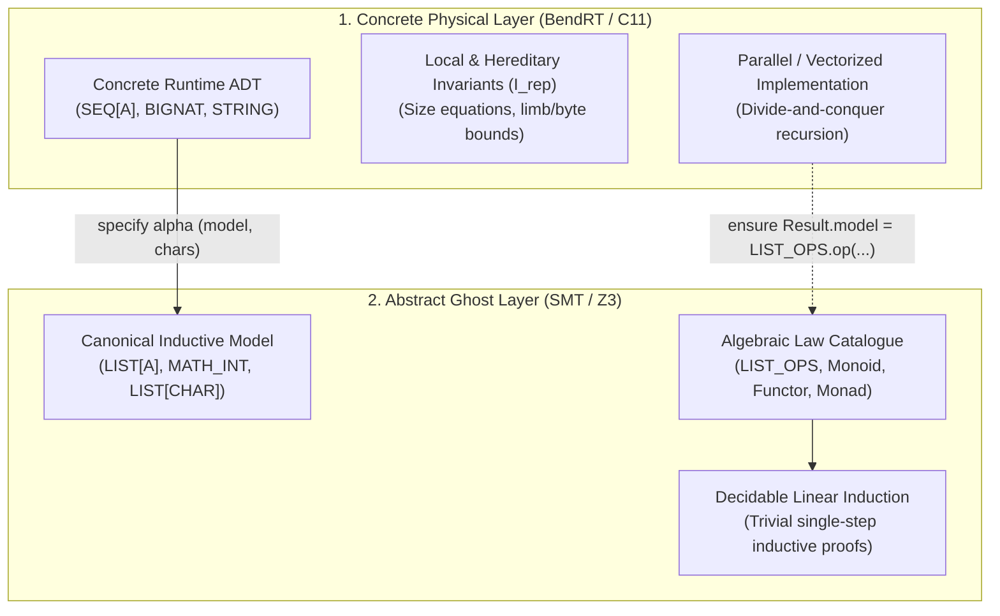

# Gardel Language Specification (Draft v0.4)

Oct 27, 2026 · @Javier

## 1. Overview and changes since v0.2 / v0.3

Gardel is a pure, total, deterministic, statically verified language designed for AI-driven code generation and human readability. Version 0.4 transitions the execution backend from HVM2 (24-bit interaction nets) to **Bend v2 / BendRT** (portable C11 for single-core and multi-core CPUs, plus CUDA and Apple Metal for GPUs), upgrades numerics to standard 64-bit machine words, and removes special-purpose recursion constructs (`fold` and `unfold`) in favor of uniform structural recursion with `let` bindings.

| Area | Problem in v0.2 / v0.3 | Resolution in v0.4 |
| --- | --- | --- |
| Backend target | HVM2 restricted numbers to 24 bits, ran 3x–5x slower than C on single cores, and locked GPUs to NVIDIA CUDA | Target **Bend v2 / BendRT** (and portable C11), unlocking native C single-core speed and parallel CPU, CUDA, and Metal execution (§10, §13) |
| Numerics | `U24`/`I24`/`F24` overflowed at 16.7 million due to HVM2 node tags; missing bitwise operators | Standard 64-bit `U64` (`NAT`), `I64` (`INT`), and `F64` with Z3 overflow proofs, bitwise operators, and deterministic IEEE-754 evaluation (§3) |
| Recursion & Parallelism | `fold` and `unfold` caused variable-type shadowing, duplicated `ensure` blocks, and lacked postconditions on `unfold` | Removed `fold`, `unfold`, `fork`, `Subject`, and `@`. All recursion uses standard `match`/`if` and `variant`; independent `let` bindings run in parallel (§10, §14) |
| Local bindings | Grammar had no `let` binding, forcing repeated expressions and preventing intermediate `check` references | Added `Block` (`Stmt* Expr`) supporting `let x = e`, `check`, `assume`, and `reveal` inside `do`, `then`, `else`, and `case` branches (§5, §15) |
| Closures | Closures capturing closures were marked affine due to HVM2 lambda-duplication anomalies | Compile-time closure conversion (lambda lifting to first-order ADT records) allows unrestricted closure use and parallel duplication (§8, §13) |
| Invariant visibility | A friend module in `representation {FRIEND}` could fail to verify if the invariant called private queries | Added Visibility Rule 5: every symbol in an `invariant` must be visible to at least the representation's visibility list (§4) |
| Standard Prelude & Modules | Ambient file containers (`group`) forced library code duplication in user programs | Implicit Standard Prelude (`OPTION`, `RESULT`, `SEQ`, `STRING`, `BIGNAT`, `EQ`, `ORD`); `group` re-scoped to mutual-recursion verification barriers; one module per file convention (§4, §5) |
| Error Handling | Inconsistent mix of preconditions, partial functions, and ad-hoc error handling | Error Handling Doctrine: preconditions (`require`) reject programmer bugs statically; fallible operations return monadic `RESULT[E, A]` (§5, §7) |
| Text & Strings | Strings tied directly to byte buffers; missing Unicode character abstraction | Three-layer text model (`CHAR`, `STRING`, `BYTES`) with Unicode scalar ghost model (`LIST[CHAR]`) and string literal desugaring (§3, §11, §15) |
| Dual-Layer Model Refinement | Ad-hoc verification tricks for data structures | Principle 9: Dual-Layer Model Refinement pairing parallel structures (`SEQ`, `BIGNAT`, `STRING`) with inductive ghost models (`LIST`, `MATH_INT`, `LIST[CHAR]`) (§2, §6) |
| Equality & Algebraic Laws | Inconsistent Leibniz `=` on non-canonical types; missing law catalogue | Strict equality hierarchy (`=`, `.equals()`, `.model = .model`) and normative Bird & Wadler algebraic law catalogue with AI diagnostic surfacing (§9, §12) |
| AI Diagnostics | Solver failures only described human-oriented error text | Specified `gardelc --json-diagnostics` with structured counterexamples, contract tags, and cross-module law recommendations for automated LLM repair loops (§12, §13) |

---

## 2. Core design principles

Gardel trades mutation, inheritance, and ad-hoc loops for mathematical proofs, strict determinism, and implicit parallelism:

1. **One module, one ADT.** A `module` defines one data type, its operations, and its invariant. `functions` and `program` modules hold free functions and entry points.
2. **Pure, total, deterministic.** Every routine terminates and nothing mutates. Evaluation order never changes a result for exact discrete types (`U64`, `I64`, `MATH_INT`, `BOOL`, `CHAR`, and algebraic data types, satisfying strict Church-Rosser bit-for-bit confluence). `F64` operations follow strict IEEE-754 expression-tree semantics without compiler re-association. Command-query separation becomes queries versus transformers that return a new value. `old` and `modifies` are unnecessary.
3. **Contracts are proofs, not checks.** `require`, `ensure`, `invariant`, `variant`, and `check` are discharged by the verifier and erased. Nothing is evaluated at runtime.
4. **Invariants are types.** A module's invariant is part of what its type means, so it holds for every value wherever that value travels.
5. **Selective export is a verification firewall.** Visibility lists control both name access and which facts the solver sees.
6. **Concepts with laws replace inheritance.** Polymorphism comes from `concept` declarations whose laws are proven, guaranteeing unique, deterministic behavior across generic code.
7. **Runtime numbers are 64-bit machine numbers.** Contracts reason in unbounded mathematics (`MATH_INT`), but every runtime operation must be proven not to overflow.
8. **Erase to Bend v2 and C.** After verification, only pure ADTs, tail/divide-and-conquer recursion, and native 64-bit arithmetic remain, compiling to Bend v2 / BendRT for parallel CPU and GPU execution.
9. **Dual-Layer Model Refinement.** High-performance, divide-and-conquer runtime data structures (such as `SEQ[A]`, `BIGNAT`, and `STRING`) are decoupled from their mathematical specifications by pairing them with inductive mathematical ghost models (`LIST[A]`, `MATH_INT`, `LIST[CHAR]`). Runtime operations establish abstraction refinement postconditions (`Result.model = LIST_OPS.op(Current.model, ...)`, `Result.model = ...`, `Result.chars = ...`), enabling simple, decidable structural induction in SMT while executing in parallel on BendRT rings or native vectorized loops.

### Principle 9: Dual-Layer Model Refinement Architecture

Modern high-performance execution environments (such as Bend v2 / BendRT interaction nets and vectorized C11 loops) and automated deductive verifiers (such as Z3 via Boogie) place diametrically opposed demands on data structure design:

- **The Runtime Performance Demand:** Execution engines require divide-and-conquer tree layouts (`SEQ[A]`) to distribute tasks across parallel thread rings and GPU SIMD lanes, multi-limb representations (`BIGNAT`) for 64-bit integer arithmetic, and bounded byte buffers (`STRING`) for cache locality and zero-allocation text handling.
- **The SMT Verification Demand:** First-order automated theorem provers scale reliably on simple, linear algebraic data types with a single inductive step (such as cons-lists `LIST[A]` or unbounded mathematical integers `MATH_INT`). Proving inductive functional properties directly over branching trees, limb carries, or multi-byte UTF-8 encodings causes quantifier instability, non-linear arithmetic explosions, and solver timeouts.

Gardel resolves this tension by formalizing **Dual-Layer Model Refinement** as a foundational language principle:



The architecture consists of four interrelated components:

1. **Concrete Carrier Type ($C$):** An algebraic data type optimized for hardware evaluation. Its `invariant` section is restricted strictly to **local, hereditary representation invariants** ($I_{\text{rep}}$), guaranteeing that physical constraints (such as field size equations, limb count bounds, or byte validity) hold unconditionally without breaking subterm destructuring or parallel assembly (§6).
2. **Abstract Ghost Model ($A$):** A canonical mathematical type (`LIST[A]`, `MATH_INT`, `LIST[CHAR]`) referenced only in `specify` and contract blocks. The ghost model is entirely erased at compile time and incurs zero runtime memory or execution cost.
3. **Abstraction Function ($\alpha: C \to A$):** A total ghost query defined in `specify` over the concrete type—such as `model: LIST[A]` on `SEQ[A]`, `model: MATH_INT` (via recursive Horner evaluation `value_of`) on `BIGNAT`, or `chars: LIST[CHAR]` (alongside `byte_model: LIST[U64]`) on `STRING`—that projects each concrete instance to its canonical mathematical denotation.
4. **Refinement Commutativity Postconditions:** Every runtime constructor, transformer, and query establishes an abstraction refinement postcondition proving that the runtime operation commutes with the corresponding mathematical operation over the ghost model:
   $$\alpha(f_C(x_1, \dots, x_n)) = f_A(\alpha(x_1), \dots, \alpha(x_n))$$
   In Gardel code:
   ```eiffel
   ensure
     model_concat: Result.model = Current.model.append(other.model)
     model_map: Result.model = LIST_OPS.map(Current.model, f)
   ```

**SMT Verification vs. Runtime Decoupling:**
The module author proves the commutativity postcondition once within the module implementation, using structural induction on the tree and algebraic homomorphism laws in `functions LIST_OPS` (such as `law map_append`, `law filter_append`, `law fold_left_append`, and `law fold_right_append` in §8). In all client code and caller modules, Z3 treats the concrete operations as abstract transformers whose functional behavior is defined by the linear ghost model. Client proofs perform simple structural induction on `LIST[A]` or linear integer arithmetic on `MATH_INT`, entirely insulated from tree balancing, limb splitting, or byte-packing mechanics.

---

## 3. Primitive types, numerics and text

Gardel distinguishes between **primitive machine/SMT scalar types** and **Standard Prelude ADTs** (§4, §5). Primitives map directly to hardware registers, C11 scalars, and native SMT theories (linear integer arithmetic, bitvectors, and IEEE-754 floats). Rich data structures such as `OPTION[A]`, `RESULT[E, A]`, `SEQ[A]`, `STRING`, and `BIGNAT` are defined as algebraic data types in the Standard Prelude, rather than ad-hoc compiler primitives.

Runtime numbers are standard 64-bit machine values, and every checked arithmetic operation carries an overflow proof obligation. This removes the gap between what Z3 proves and what the CPU or GPU computes while avoiding HVM2's 24-bit ceiling.

| Type | Runtime representation | Meaning in contracts |
| --- | --- | --- |
| `UNIT` (alias `()`) | Bend v2 `0` / C `void` (0-byte singleton) | unit value `()`; empty tuple / zero-argument return |
| `U64` (alias `NAT`) | Bend v2 `U64` / C `uint64_t` | integer in $[0, 2^{64} - 1]$; `NAT.max` $= 18\,446\,744\,073\,709\,551\,615$ |
| `I64` (alias `INT`) | Bend v2 `I64` / C `int64_t` | integer in $[-2^{63}, 2^{63} - 1]$ |
| `F64` | Bend v2 `F64` / C `double` | IEEE-754 binary64 values with bound axioms; strict expression-tree evaluation |
| `BOOL` | `uint8_t` | boolean truth values (`True`, `False`) |
| `CHAR` | `uint32_t` | Unicode scalar value in $[0, 0\text{xD7FF}] \cup [0\text{xE000}, 0\text{x10FFFF}]$ |
| `MATH_INT` | none (ghost) | unbounded integer; legal only in `specify` and contracts |

Rules:

- **Contracts use mathematics.** Runtime numbers lift implicitly to `MATH_INT` inside contracts, so `Result = a + b` in an `ensure` means the true mathematical sum.
- **Checked operators.** `+`, `-`, `*` on runtime numbers generate a proof obligation that the mathematical result is in $[0, 2^{64} - 1]$ for `U64` (or $[-2^{63}, 2^{63} - 1]$ for `I64`). `/` and `%` require a non-zero divisor (and for `I64`, `a != INT.min or b != -1`).
- **Wrapping and bitwise operators.** `+%`, `-%`, `*%` are total and defined modulo $2^{64}$. Bitwise operators `&`, `|`, `^`, `<<`, `>>` operate on `U64` (with shift amounts required to be $< 64$). They are verified with Z3's `(_ BitVec 64)` theory and never mix with checked operators without an explicit conversion.
- **Deterministic floating point.** `F64` operations follow strict IEEE-754 evaluation order matching the syntactic expression tree. Compiler re-association (such as `-ffast-math` contractions or fused multiply-add `fma` synthesis across distinct operations) is strictly forbidden (`-ffp-contract=off`), and quiet/signaling NaN representations are canonicalized, ensuring that execution along a given expression tree is deterministic across CPU and GPU backends. However, because floating-point addition and multiplication are mathematically non-associative ($(a+b)+c \neq a+(b+c)$), parallel reductions do not claim bit-for-bit equivalence across dynamically re-partitioned trees; exact Church-Rosser confluence is guaranteed for discrete types (`NAT`, `INT`, `MATH_INT`, `BOOL`, `CHAR`, and ADTs).
- **Unit type.** `UNIT` is a primitive type with exactly one value, written `()`. It represents computations evaluated purely for sequenced effects (such as `IO.print(...) : IO[UNIT]`), and erases at runtime.
- **Conversions are explicit.** `NAT.of(m)` from a `MATH_INT` requires a proof that `0 <= m and m <= NAT.max`.
- **Large numbers.** A prelude library type `BIGNAT` stores limbs in a `SEQ[U64]` and has `MATH_INT` as its ghost model (Dual-Layer Model Refinement, §2).

### Three-Layer Text Model and String Literals

Text processing in Gardel is structured into three distinct layers to cleanly separate physical encoding performance from mathematical specification:

1. **`CHAR` (Unicode Scalar Primitive):** A primitive 32-bit scalar value representing a valid Unicode code point (excluding surrogate halves).
2. **`STRING` (Standard Prelude Text ADT):** An opaque prelude ADT (`representation {NONE}`) representing verified, immutable Unicode text. Internally, `STRING` may be stored as packed 64-bit words or a UTF-8 byte buffer with an inductive representation invariant `valid_utf8`. Externally, its specification is entirely governed by its ghost model `specify chars: LIST[CHAR]`.
3. **`BYTES` (Raw Boundary Buffer):** Untrusted byte sequences at I/O and foreign boundaries. Unchecked external byte streams cannot enter the verified core as `STRING` without decoding via `STRING.from_utf8(bytes: BYTES): RESULT[STRING_ERROR, STRING]` (§11).

**String Literal Desugaring:**
String literals (`"..."`) in Gardel source code are syntactic sugar for verified prelude `STRING` values. The compiler validates the literal's UTF-8 encoding at compile time and emits a `STRING` instance whose ghost abstraction property is statically proven:
```eiffel
-- Writing "hello" desugars to a verified prelude STRING literal:
ensure
  Result.chars = LIST.empty.prepend('o').prepend('l').prepend('l').prepend('e').prepend('h')
```
At runtime, string literals lower directly to pre-allocated, null-terminated static UTF-8 byte slices in the C11/BendRT backend with zero runtime allocation.

The classic midpoint shows the effect. The version below verifies; `(lo + hi) / 2` is rejected because `lo + hi` may exceed `NAT.max`.

```eiffel
midpoint(lo: NAT, hi: NAT): NAT
  require
    ordered: lo <= hi
  do
    let diff = hi - lo
    lo + diff / 2
  ensure
    in_range: lo <= Result and Result <= hi
  end
```

---

## 4. Module architecture and compilation units

A `module` is one abstract data type organized into four visibility-controlled sections. Two further kinds cover what a pure ADT cannot: a `functions` module holds free functions and a `program` holds the entry point.

Inside a module, `Current` is the immutable receiver, `Result` is the return value in `ensure` clauses, and field projection and zero-argument queries share the same dot syntax (uniform access).

| Section | Purpose | Compiled? | Visible to the solver in client `M` |
| --- | --- | --- | --- |
| `representation {Vis}` | Sum or product layout of the type | Yes | Only if `M` is in `{Vis}`; otherwise the type is opaque. `{NONE}` hides it from all clients |
| `create {Vis}` | Constructors that need no receiver | Yes | Signature and `ensure` if `M` is in `{Vis}` |
| `feature {Vis}` | Runtime queries and transformers on `Current` | Yes | Signature and contracts if `M` is in `{Vis}` |
| `specify {Vis}` | Ghost queries, lemmas, concept law proofs | No (erased) | Usable in contracts of `M` if `M` is in `{Vis}`; forbidden in `do` bodies |

Sections may appear in any order, and `feature` and `specify` may repeat with different visibility lists. A module-wide `invariant` closes the module (§6).

**Visibility rules** (enforced during name resolution):

1. **Contract visibility.** Every symbol in a `require` clause of a routine exported to `{Vis}` must itself be exported to at least `{Vis}`. Callers must be able to read what they are asked to prove.
2. **Visible ensures only.** A client sees only the `ensure` clauses whose symbols it may see. A hidden clause stays usable inside the module, and the compiler warns when a client-facing routine loses clauses this way.
3. **Ghost stays ghost.** `specify` symbols may appear in any contract (`require`, `ensure`, `invariant`, `check`, `assume`, `variant`) but never in runtime expressions.
4. **Runtime-checkable preconditions.** A precondition of an exported routine should be written with exported runtime queries so callers can branch on it. Otherwise the compiler warns `ghost_precondition` (§7).
5. **Invariant visibility.** Every symbol referenced in a module's `invariant` must be exported to at least the visibility list of its `representation` section, ensuring friend modules that construct values directly can see and prove the invariant (§6).

A `functions` module has `feature` and `specify` sections only. A `program` has a `main` routine and is the only module that may use `IO` (§11).

### 4.1 The Standard Prelude

Every standard Gardel compilation run automatically loads and injects the **Standard Prelude** ($\Gamma_{\text{prelude}}$) into the global symbol table. User programs and modules access standard concepts, types, and operations directly without copy-pasting library declarations or writing explicit `import` statements.

#### 1. Automatic Scope Injection
The Standard Prelude is ambiently present in the root typing environment $\Gamma_0$ and the underlying SMT verification context:
- All prelude types, variant constructors, and concept definitions are registered prior to user AST ingestion.
- Prelude routines, axioms, and ghost lemmas are accessible across all user modules without namespace qualification or header directives.
- Source code remains clean and free of boilerplate imports, preserving Eiffel's concise, declaration-focused aesthetic.

#### 2. Normative Prelude Inventory
The Standard Prelude provides an irreducible core of verified concepts, algebraic data types, and mathematical specification abstractions:

- **Foundational Concepts (§9):**
  - `concept EQ`: Behavioral equivalence interface (`equals(other: Current): BOOL`) with reflexive, symmetric, and transitive algebraic laws.
  - `concept CANONICAL_EQ refines EQ`: Axiomatizes that behavioral equality coincides with structural Leibniz equality (`equals(other) = (Current = other)`).
  - `concept ORD refines EQ`: Strict total ordering interface (`less_than`, `less_or_equal`) with irreflexivity, asymmetry, transitivity, and totality laws.

- **Core Algebraic Data Types (§3, §5, §10):**
  - `module OPTION[A]`: The canonical optionality sum type (`None | Some(val: A)`) providing total queries (`is_some`, `is_none`, `unwrap`) and monadic combinators (`map`, `and_then`).
  - `module RESULT[E, A]`: The canonical error-handling sum type (`Error(err: E) | Ok(val: A)`) underpinning Gardel's Error Handling Doctrine (§7).
  - `module SEQ[A]`: The standard parallel divide-and-conquer sequence ADT with balanced tree representation, stored `U64` length, and ghost model `specify model: LIST[A]` (§10).
  - `module STRING`: The standard opaque text ADT (`representation {NONE}`) with ghost model `specify chars: LIST[CHAR]` (§3). String literals (`"..."`) desugar directly to verified prelude `STRING` values.
  - `module BIGNAT`: Arbitrary-precision natural numbers represented as limbs in `SEQ[U64]` with ghost model `specify math: MATH_INT` (§3).

- **Mathematical Ghost Types & Specification Modules (§2, §6, §8):**
  - `LIST[A]`: The canonical inductive ghost sequence ADT (`Nil | Cons(head: A, tail: LIST[A])`) used exclusively in specification contexts (`specify`, `require`, `ensure`, `invariant`) and erased at runtime.
  - `MATH_INT`: The built-in unbounded mathematical integer sort ($\mathbb{Z}$) mapping directly to native SMT linear integer arithmetic (`Int`).
  - `functions LIST_OPS`: Inductive mathematical list operations over `LIST[A]` (`append`, `length`, `map`, `filter`, `fold_left`, `fold_right`, `reverse`) serving as reference targets for Dual-Layer Model Refinement (§2).
  - `functions FUNCTION_OPS`: Pointwise combinators (`id_fn`, `compose`) with verified category-theoretic identity and associativity laws.

#### 3. Namespace Collision, Shadowing & Bootstrap Rules
- **No Prelude Shadowing:** Prelude types and concepts reside in the root namespace. In standard compilation mode, user modules, functions, or concepts CANNOT redeclare or shadow any prelude identifier. Attempting to declare a top-level `module OPTION` or `concept EQ` is rejected by the compiler with fatal error `E0101: duplicate_prelude_symbol`.
- **Standard Library Bootstrap (`--no-prelude`):** When compiling or verifying the Standard Prelude source files themselves (e.g., `stdlib/*.gdl` or `--stdlib`), the compiler operates in `--no-prelude` bootstrap mode, suppressing automatic prelude injection so prelude modules can be defined and verified from source without self-collision.
- **Lexical Scoping of Type Parameters:** Type parameters (such as `[A]`, `[E]`, `[T]`) are lexically scoped to their declaring module or routine. A generic parameter `[A]` in `module STACK[A]` shadows any ambient type `A` strictly within the syntactic bounds of that module.

#### 4. Verification Decoupling
Prelude modules are verified against their contracts and algebraic laws. During user project compilation, the compiler injects sound background axioms and verified inductive lemmas for prelude abstractions into the SMT solver, eliminating re-verification overhead while guaranteeing sound cross-module reasoning.

---

### 4.2 Multi-File Architecture & Project Organization

Gardel establishes a clear separation between logical modularity and physical file layout, designed for scalable verification and AI-assisted pair programming.

#### 1. One-Module-Per-File Physical Convention
- **1:1 Mapping Convention:** By normative convention, each standalone top-level unit (`module`, `concept`, `functions`, or `program`) resides in its own dedicated source file (`.gdl`).
- **File Naming Rule:** The file basename should match the lowercase `snake_case` of the primary declared module or concept identifier:
  - `module BOUNDED_STACK` $\longrightarrow$ `bounded_stack.gdl`
  - `concept NUMERIC` $\longrightarrow$ `numeric.gdl`
  - `functions MATH_UTILS` $\longrightarrow$ `math_utils.gdl`
  - `program MAIN` $\longrightarrow$ `main.gdl`
- **Static Linting & Diagnostics:** This physical layout is enforced as a static analysis rule rather than a rigid syntactic restriction in the parser. In standard compilation mode, a mismatch between the file basename and a standalone module emits style warning `W0201: file_module_name_mismatch`. In `--strict` verification mode, this convention is enforced as an error.

#### 2. Flat Global Project Namespace
- **No Path Imports:** Gardel source code contains no lexical path imports (`import "./sub/foo"` or `using a.b.c`).
- **Global Uniqueness:** All top-level module, concept, and free function identifiers within a project exist in a flat, globally unique namespace.
- **Direct Cross-Module Referencing:** Any module `M` in a project may reference any other module `N` by its identifier directly (e.g., `let s: BOUNDED_STACK[I64] = ...`), subject strictly to the `{Vis}` visibility annotations declared on `N`'s sections.
- **Duplicate Detection:** Defining the same top-level module or concept identifier across two distinct files in a project triggers fatal error `E0102: duplicate_module_name`.

#### 3. Multi-File Compilation Workflow
A Gardel project is verified and transpiled by passing all constituent source files to `gardelc` (§13):
```bash
gardelc src/*.gdl --strict          # Verify all project modules with Boogie/Z3
gardelc src/*.gdl --run             # Verify, transpile to C11/Bend v2, and execute
```
The multi-file compilation pipeline proceeds through five deterministic stages:
1. **Source Ingestion & Parsing:** All `.gdl` files are parsed independently into `CompilationUnit` AST nodes (§15).
2. **Global Namespace Registration:** The compiler registers all declared top-level symbols across files and verifies global identifier uniqueness (`E0102`).
3. **Prelude Injection:** Unless `--no-prelude` is active, the Standard Prelude ($\Gamma_{\text{prelude}}$) is merged into the global symbol table.
4. **Representation DAG & Type Checking:** The compiler checks routine signatures and types across the global symbol table. Cross-module references in routine signatures are freely permitted across files, whereas cyclic nesting in **data representations** (`representation` fields or sum variants) is rejected unless the participating types are co-declared within an explicit `group` block (§4.3).
5. **Modular Verification Condition Generation (VCG):** For each module (or mutual `group`), the verifier constructs Boogie proof obligations using the public contracts, ghost models, and visible invariants of referenced dependencies, verifying units independently or in parallel.

---

### 4.3 Semantic Re-Scoping of `group { A, B }`

In earlier language drafts and prototypes, `group { ... }` was occasionally placed at the head of files (such as `stdlib.gdl`) as an ambient file container or multi-module package header. **In Gardel v0.4, this ambient usage is formally obsolete.**

#### 1. Strict Purpose: Mutual-Recursion Verification Barrier
The `group` construct is **strictly a mutual-recursion verification barrier** for interdependent types and routines whose representations, invariants, or termination proofs depend cyclically on one another.
- Independent modules that do not form a mutual representation or recursive verification cycle SHOULD NOT be enclosed in `group` blocks.
- When two or more ADTs exhibit cyclic structural references in their `representation` sections (e.g., abstract syntax trees where `EXPR` contains `STMT` and `STMT` contains `EXPR`, or mutually recursive `TREE` and `FOREST` types), they MUST be declared together in a single file headed by `group { M1, M2, ... }`.

#### 2. SMT & Simultaneous Inductive Semantics
Because Gardel is purely functional and values are immutable, a module invariant $I_M(x)$ is a refinement type predicate defining the set of valid values of type $M$ (§6). There is no in-place mutation and no temporal "invariant relaxation": every constructed value of type $M$ must satisfy $I_M$ at the point of construction.

When types $M_1, M_2, \dots, M_n$ form a mutual dependency cycle inside `group { M1, M2, ... }`, the verifier treats the group as a single **simultaneous inductive unit**:
1. **Simultaneous Structural Induction for Invariants:** The representation invariants $I_{M_1}, \dots, I_{M_n}$ may mutually reference one another (e.g., $I_{\text{EXPR}}(e)$ asserts that sub-statements satisfy $I_{\text{STMT}}(s)$, and vice versa). The Boogie translation axiomatizes and verifies $I_{M_1}, \dots, I_{M_n}$ via simultaneous structural induction over the mutually recursive constructors of the group.
2. **Mutual Termination & Explicit `variant` Measures:** To prove termination of mutually recursive routines across grouped modules (e.g., `EXPR.eval` calling `STMT.exec` which calls `EXPR.eval`), every routine in the mutual call cycle must decrease along a shared well-founded ordering:
   - For direct structural descent over mutually recursive ADTs, `variant Current` decreases along the simultaneous subterm ordering of the grouped representations.
   - For general mutual recursion, routines must declare compatible `variant` expressions (such as a shared non-negative `MATH_INT` size metric or lexicographical tuple `variant rank, metric`) that the SMT solver verifies to strictly decrease at every intra-group recursive call site.

#### 3. Group Physical Organization
- A source file defining mutually recursive modules begins with the `group` header:
  ```eiffel
  group { EXPR, STMT }

  module EXPR
    -- ...
  end

  module STMT
    -- ...
  end
  ```
- **Group Membership Check:** Every module identifier listed in `group { M1, M2, ... }` must be defined in that file (enforced by `check_group_packaging`), and a `group` header must list at least two interdependent modules ($n \ge 2$). Co-located helper `concept` or `functions` declarations closely tied to the mutually recursive group may reside in the same compilation unit.
- **File Naming for Groups:** The file name reflects the collective domain or primary abstraction (e.g., `ast_nodes.gdl` or `expr_stmt.gdl`).

---

## 5. Data representations and local bindings

A `representation` block declares either a product (named fields) or a sum (variants), and its visibility list decides who may build and take apart values directly.

- **Product.** Fields are declared as `name: Type`. A record literal is `{ f = v, g = w }` and a functional update is `{ x with f = v }`.
- **Sum.** Variants are declared as `| Name(field: Type, ...)`. Clients in the visibility list may construct variants and use them in `match`.
- **Local `let` bindings and statement blocks.** The body of any `do`, `then`, `else`, or `case` branch is a `Block` consisting of zero or more statements (`let name = expr`, `check`, `assume`, `reveal`) followed by a final result expression. `let` bindings are immutable and enter the proof context (`name = expr`) for all subsequent statements and the final expression.
- **Refinement-aware matching.** Exhaustiveness is checked against the proof context. A branch that the context rules out (for example `None` under `require Current.is_some`) may be omitted. A reachable branch that is missing is an error. Omitted branches generate no code, and the verifier has proven they cannot run.
- **Opaque and friend representations.** `representation {NONE}` hides the layout from every client. `representation {M1, M2}` shares it with named friends. Any direct construction outside the module triggers the invariant check of §6.
- **Mutual recursion.** Types that refer to each other are declared in one `group { A, B }` file. The verifier treats the group as a single unit for termination and invariants (§4.3).

```eiffel
module OPTION[A]

representation {ANY}
  | None
  | Some(value: A)

feature {ANY}

  is_some: BOOL
    do
      match Current
        case None    then False
        case Some(_) then True
      end
    end

  is_none: BOOL
    do
      match Current
        case None    then True
        case Some(_) then False
      end
    ensure
      definition: Result = not Current.is_some
    end

  get: A
    require
      present: Current.is_some
    do
      match Current
        case Some(v) then v
      end
    end

  unwrap_or(default: A): A
    do
      match Current
        case None    then default
        case Some(v) then v
      end
    ensure
      none_case: Current.is_none implies Result = default
      some_case: Current.is_some implies Result = Current.get
    end

  map[B](f: A -> B): OPTION[B]
    do
      match Current
        case None    then None
        case Some(v) then Some(f(v))
      end
    ensure
      preserves_status: Result.is_some = Current.is_some
      mapped_val: Current.is_some implies Result.get = f(Current.get)
    end

  and_then[B](f: A -> OPTION[B]): OPTION[B]
    do
      match Current
        case None    then None
        case Some(v) then f(v)
      end
    ensure
      none_bind: Current.is_none implies Result = None
      some_bind: Current.is_some implies Result = f(Current.get)
    end

end

module RESULT[E, A]

representation {ANY}
  | Error(err: E)
  | Ok(val: A)

feature {ANY}

  is_ok: BOOL
    do
      match Current
        case Ok(_)    then True
        case Error(_) then False
      end
    end

  is_error: BOOL
    do
      match Current
        case Error(_) then True
        case Ok(_)    then False
      end
    ensure
      opposite: Result = not Current.is_ok
    end

  get: A
    require
      success: Current.is_ok
    do
      match Current
        case Ok(v) then v
      end
    end

  get_error: E
    require
      failure: Current.is_error
    do
      match Current
        case Error(e) then e
      end
    end

  unwrap_or(default: A): A
    do
      match Current
        case Error(_) then default
        case Ok(v)    then v
      end
    ensure
      err_case: Current.is_error implies Result = default
      ok_case: Current.is_ok implies Result = Current.get
    end

  map[B](f: A -> B): RESULT[E, B]
    do
      match Current
        case Ok(v)    then Ok(f(v))
        case Error(e) then Error(e)
      end
    ensure
      preserves_status: Result.is_ok = Current.is_ok
      mapped_val: Current.is_ok implies Result.get = f(Current.get)
      preserved_err: Current.is_error implies Result.get_error = Current.get_error
    end

  map_error[F](f: E -> F): RESULT[F, A]
    do
      match Current
        case Ok(v)    then Ok(v)
        case Error(e) then Error(f(e))
      end
    ensure
      preserves_status: Result.is_ok = Current.is_ok
      preserved_val: Current.is_ok implies Result.get = Current.get
      mapped_err: Current.is_error implies Result.get_error = f(Current.get_error)
    end

  and_then[B](f: A -> RESULT[E, B]): RESULT[E, B]
    do
      match Current
        case Ok(v)    then f(v)
        case Error(e) then Error(e)
      end
    ensure
      bind_ok: Current.is_ok implies Result = f(Current.get)
      bind_err: Current.is_error implies Result = Error(Current.get_error)
    end

end
```

---

## 6. Invariants as refinement types

A module's `invariant` is part of its type: every value of type `M` anywhere in a program satisfies it. Formally, `M` denotes the refinement type $\{ x : M_{\text{raw}} \mid I(x) \}$, where $I$ is the conjunction of the invariant clauses.

- **Checked at every construction site.** A record literal, functional update, or variant constructor that produces an `M` is a construction site. The verifier must prove $I(v)$ there, using the path conditions, local `let` definitions, the `require` clauses, and $I(\mathit{Current})$. It does not matter whether the value is returned directly or nested in a `TUPLE`, `OPTION`, or `LIST`. Local `check` blocks or lemmas may immediately precede construction sites to establish inductive properties required by $I(v)$.
- **Assumed everywhere else.** Any value of type `M` can be used knowing $I(x)$ with no re-proof, because values never change.
- **Destructuring and recursive sum types.** When destructuring an inductive sum type (e.g., `match t` with `case Node(l, r)`), the branch context assumes subterms satisfy the module invariant ($I(l)$ and $I(r)$) if and only if $I$ is proven hereditary (i.e., inductive over subterms: $\forall l, r.\; I(\text{Node}(l, r)) \implies I(l) \land I(r)$).
- **Ghost models and Dual-Layer Model Refinement.** A core principle in Gardel is the separation of local physical representation invariants from abstract functional specifications (formalized in *Interaction Between Ghost Models and Hereditary Representation Invariants* below):
  - *Local & Hereditary Representation Invariants:* Invariants declared in `invariant` blocks are strictly local and (for recursive sum types) hereditary, ensuring physical consistency (e.g., field size equations `size = limbs.length`, capacity bounds `size <= limit`, or recursive byte bounds `all_bytes_valid(bytes)`). On recursive sum types, heredity guarantees that destructuring subterms in `match` automatically yields valid invariant-satisfying instances without auxiliary inversion lemmas.
  - *Ghost Abstraction Models:* Non-hereditary properties, global balance conditions that would burden parallel divide-and-conquer assembly, and non-canonical quotient equivalences are NOT placed in `invariant` blocks. Instead, they are formulated via **Dual-Layer Model Refinement** (§2): the module defines a ghost abstraction query (`model: LIST[A]` on `SEQ[A]`, `model: MATH_INT` via `value_of` on `BIGNAT`, or `chars: LIST[CHAR]` on `STRING`) mapping the concrete representation to a canonical inductive mathematical model. Routine postconditions assert model preservation (`Result.model = Current.model.append(other.model)` or `Result.model = LIST_OPS.map(Current.model, f)`), allowing clients to reason via structural induction over the ghost model while the runtime executes parallel divide-and-conquer operations on BendRT.
- **Privileged modules.** A friend module listed in `representation {FRIEND}` that builds an `M` directly pays the same obligation at its own construction site (guaranteed visible by Visibility Rule 5 in §4).
- **Generic containers need no special rules.** `LIST[M]` holds only values that already satisfy $I$.

The bounded stack below stores its count so that every operation is constant time and the `U64` overflow checks of §3 are proven automatically from the invariant.

```eiffel
module BOUNDED_STACK[A]

representation {NONE}
  items: LIST[A]
  size: NAT
  limit: NAT

create {ANY}

  make(cap: NAT): BOUNDED_STACK[A]
    require
      positive_capacity: cap > 0
    do
      { items = LIST.empty, size = 0, limit = cap }
    ensure
      is_empty: Result.count = 0
      capacity_set: Result.capacity = cap
    end

feature {ANY}

  count: NAT
    do
      Current.size
    end

  capacity: NAT
    do
      Current.limit
    end

  push(x: A): BOUNDED_STACK[A]
    require
      not_full: Current.count < Current.capacity
    do
      { items = Current.items.prepend(x),
        size = Current.size + 1,
        limit = Current.limit }
    ensure
      count_incremented: Result.count = Current.count + 1
      capacity_unchanged: Result.capacity = Current.capacity
    end

  pop: TUPLE[A, BOUNDED_STACK[A]]
    require
      not_empty: Current.count > 0
    do
      let rest = { items = Current.items.tail,
                   size = Current.size - 1,
                   limit = Current.limit }
      (Current.items.head, rest)
    ensure
      count_decremented: Result.second.count = Current.count - 1
    end

invariant
  positive_capacity: limit > 0
  size_matches: size = items.length
  within_bounds: size <= limit

end
```

The record literal assigned to `rest` inside `pop` is a construction site, so the verifier proves `size - 1 = items.tail.length` and `size - 1 <= limit` there. The addition `Current.size + 1` in `push` cannot overflow `NAT.max` because `size < limit <= NAT.max` follows from `not_full` and the invariant.

### Interaction Between Ghost Models and Hereditary Representation Invariants

A central innovation in Gardel's verification model is the formal separation between **local physical representation invariants** ($I_{\text{rep}}$) and **abstract functional specifications** ($M$):

#### 1. Mathematical Foundations of Representation Invariants ($I_{\text{rep}}$)

Gardel supports two categories of data representations (§5), and the verifier handles their `invariant` blocks according to their inductive structure:

1. **Product (Record) ADTs (`BOUNDED_STACK`, `BIGNAT`, `STRING`):**  
   A product module with fields $f_1 : T_1, \dots, f_k : T_k$ refines the record carrier into $\{ (f_1, \dots, f_k) \mid I_{\text{rep}}(f_1, \dots, f_k) \}$. Its invariant clauses constrain scalar field bounds (`size = limbs.length`, `size <= 1024`) or invoke recursive ghost predicates over inner canonical `LIST` fields (`all_bytes_valid(bytes)`). Because product fields are not directly self-referential, projecting a field $x.f_j$ already yields a value of type $T_j$ satisfying $T_j$'s own invariant.
2. **Recursive Sum ADTs (`SEQ[A]`, `TREE`):**  
   For a recursive sum type $T$ with variant constructors $K_1, \dots, K_m$ where $K_i : T_{i,1} \times \dots \times T_{i,n_i} \to T$, any module invariant $I_{\text{rep}} : T \to \text{BOOL}$ MUST be **hereditary**—every constructor must preserve the invariant down to all recursive subterms of type $T$:
   $$\forall i \in \{1, \dots, m\},\; \forall x_1 \dots x_{n_i}.\; I_{\text{rep}}(K_i(x_1, \dots, x_{n_i})) \implies \bigwedge_{j:\, T_{i,j} = T} I_{\text{rep}}(x_j)$$

**The Hereditary Soundness Theorem and Boogie Verification (`Verify_Hereditary_Invariant_<M>`):**  
When a recursive sum type `M` declares a non-empty `invariant` block, `gardelc` automatically emits a Boogie proof obligation `Verify_Hereditary_Invariant_<M>(Current)` that assumes `M_Invariant(Current)` and asserts `M_Invariant(subterm)` for every recursive variant field. Once heredity is proven, destructuring an expression `t : M` in a `match` branch:
```eiffel
match t
  case Concat(left, right, len) then ...
end
```
soundly injects `M_Invariant(left)` and `M_Invariant(right)` into the branch proof context without requiring manual induction at the `match` site.

> [!WARNING]
> **Shallow Pattern Matches on Recursive Sum Types Are Not Hereditary:**  
> Writing a one-level `match Current case Concat(l, r, ln) then ln = l.length + r.length end` inside `invariant` is **not** hereditary when `l.length` reads a cached field in $O(1)$: a root node `Concat(l, Leaf(z), 1000)` where `l = Concat(Leaf(x), Leaf(y), 999)` satisfies the root equation (`1000 = 999 + 1`), while its child `l` violates it (`999 != 1 + 1`), causing `Verify_Hereditary_Invariant_<M>` to fail in Z3. To make an invariant over a recursive sum type hereditary, either:
> 1. Call a recursive ghost predicate defined in `specify` that explicitly conjoins validity across subtrees (`tree_valid(l) and tree_valid(r)`), or
> 2. Maintain subtree invariants inductively through constructor and transformer `ensure` contracts (`Result.length = Current.length + other.length`), as `SEQ[A]` does below.

#### 2. Why Non-Local, Balance, and Quotient Properties Belong in Ghost Models

Three distinct classes of properties must be expressed through **Dual-Layer Model Refinement** (`specify` ghost models and `ensure` contracts) rather than `invariant` blocks:

1. **Non-Hereditary Root or Aggregate Properties:**  
   Predicates that hold only at the root of a tree or over a global aggregate—such as *"the root of a Red-Black tree is black"* (where a black root's child may itself be red) or *"the total leaf sum is even"*—violate the hereditary implication $I_{\text{rep}}(K_i(\bar{x})) \implies I_{\text{rep}}(x_j)$ and are rejected by `Verify_Hereditary_Invariant_<M>`.
2. **Global Balance Constraints that Burden Parallel Assembly:**  
   Even when a balance condition is mathematically hereditary (such as AVL height balance $|h(l) - h(r)| \le 1$), placing it in `invariant` forces *every* variant construction site to prove global height balance. In divide-and-conquer parallel combinators such as `SEQ.filter`, where `let fl = l.filter(keep)` and `let fr = r.filter(keep)` run independently and assemble `Concat(fl, fr, fl.length + fr.length)`, the filtered subtrees `fl` and `fr` can have arbitrary relative heights. Keeping height balance out of `invariant` allows zero-overhead parallel assembly.
3. **Non-Canonical (Quotient) Equivalence:**  
   In parallel collections and multi-limb numbers, distinct physical structures—such as `Concat(Leaf(1), Concat(Leaf(2), Leaf(3), 2), 3)` and `Concat(Concat(Leaf(1), Leaf(2), 2), Leaf(3), 3)`—denote the exact same abstract value (`[1, 2, 3]`). Functional correctness is therefore specified over the canonical ghost model (`model: LIST[A]`), leaving the physical representation free to vary.

> [!IMPORTANT]
> **The Representation Invariant Doctrine:**  
> A module's `invariant` block MUST contain only **local physical predicates** (and, on recursive sum types, predicates proven hereditary by `Verify_Hereditary_Invariant_<M>`). Functional semantics, quotient equivalence, and algebraic laws MUST be formulated via **Dual-Layer Model Refinement** using ghost queries in `specify`. Note also that every `invariant` block must appear at the very end of the `module` declaration immediately before `end` (§4, §15), and every symbol it references must obey Visibility Rule 5 (§4).

#### 3. Abstraction Functions and Commutative Refinement

To specify behavioral semantics cleanly, a dual-layer module defines an **abstraction function** $\alpha : T \to M$ in its `specify` section, where $M$ is a canonical inductive mathematical type:

| Concrete ADT ($T$) | Hardware Representation | Ghost Model ($M$) | Abstraction Query ($\alpha$) | Canonical Reference |
| :--- | :--- | :--- | :--- | :--- |
| `module SEQ[A]` | Parallel binary tree (`Empty`, `Leaf`, `Concat`) | `LIST[A]` | `model: LIST[A]` | `LIST.append` & `functions LIST_OPS` |
| `module BIGNAT` | Radix-$2^{64}$ limbs (`limbs: LIST[U64]`, `size: NAT`) | `MATH_INT` | `model: MATH_INT` (via `value_of`) | Unbounded $\mathbb{Z}$ in SMT |
| `module STRING` | Bounded byte buffer (`bytes: LIST[U64]`, `size`, `limit`) | `LIST[CHAR]` | `chars: LIST[CHAR]` & `byte_model` | Unicode scalar sequence |

For any runtime operation $f_T : T \times U \to T$ that corresponds to a mathematical operation $f_M : M \times U' \to M$, the routine postcondition establishes the **Commutative Refinement Law**:
$$\alpha(f_T(x, u)) = f_M(\alpha(x), \beta(u))$$

```
              Concrete Domain T:
                    x ------------ f_T(x, u) ------------> Result
                    |                                       |
           alpha(x) |                                       | alpha(Result)
                    v                                       v
              Abstract Domain M:
                 x.model -------- f_M(x.model, u') ------> Result.model
```

#### 4. The Standard Prelude Core Triad in Detail

The three verified Standard Prelude modules below (`stdlib/stdlib.gdl`) demonstrate how ghost models and representation invariants work together in practice.

##### A. `module SEQ[A]` refines to `LIST[A]` via `LIST.append` and `functions LIST_OPS`
The parallel collection `SEQ[A]` is a binary concatenation tree with $O(1)$ cached subtree lengths (`len: NAT`) and ghost model `model: LIST[A]`:
```eiffel
module SEQ[A] satisfies EQ where A satisfies EQ

representation {ANY}
  | Empty
  | Leaf(value: A)
  | Concat(left: SEQ[A], right: SEQ[A], len: NAT)

specify {ANY}

  model: LIST[A]
    variant
      Current
    do
      match Current
        case Empty           then LIST.empty
        case Leaf(v)         then LIST.empty.prepend(v)
        case Concat(l, r, _) then l.model.append(r.model)
      end
    end

create {ANY}

  empty: SEQ[A]
    do
      Empty
    ensure
      empty_len: Result.length = 0
      empty_model: Result.model = LIST.empty
    end

  singleton(x: A): SEQ[A]
    do
      Leaf(x)
    ensure
      unit_len: Result.length = 1
      unit_model: Result.model = LIST.empty.prepend(x)
    end

feature {ANY}

  length: NAT
    variant
      Current
    do
      match Current
        case Empty            then 0
        case Leaf(_)          then 1
        case Concat(_, _, ln) then ln
      end
    end

  concat(other: SEQ[A]): SEQ[A]
    require
      fits: Current.length <= 18446744073709551615 - other.length
    do
      Concat(Current, other, Current.length + other.length)
    ensure
      len_sum: Result.length = Current.length + other.length
      model_concat: Result.model = Current.model.append(other.model)
    end

  map[B](f: A -> B): SEQ[B]
    variant
      Current
    do
      match Current
        case Empty then
          Empty
        case Leaf(v) then
          Leaf(f(v))
        case Concat(l, r, ln) then
          let ml = l.map(f)
          let mr = r.map(f)
          Concat(ml, mr, ln)
      end
    ensure
      same_length: Result.length = Current.length
      model_map: Result.model = LIST_OPS.map(Current.model, f)
    end

end
```
Within `SEQ[A]`, verifying `map` on a `Concat(l, r, ln)` node requires proving:
$$l.\text{map}(f).\text{model}.\text{append}(r.\text{map}(f).\text{model}) = \text{LIST\_OPS.map}(l.\text{model}.\text{append}(r.\text{model}), f)$$
This proof obligation is discharged automatically by the algebraic homomorphism law `law map_append` proven once in `specify {ANY}` of `functions LIST_OPS` (§8). Outside `SEQ[A]`, clients reason about `seq.map(f).model` entirely via `LIST_OPS.map`, never unfolding tree nodes.

##### B. `module BIGNAT` refines to `MATH_INT` via Horner Polynomial `value_of`
The arbitrary-precision natural number type `BIGNAT` stores little-endian 64-bit limbs in radix $R = 2^{64}$ (`18446744073709551616`), pairing a local product `invariant` at the end of the module with the ghost abstraction query `model: MATH_INT`:
```eiffel
module BIGNAT satisfies ORD

representation {NONE}
  limbs: LIST[U64]
  size: NAT

specify {ANY}

  value_of(ls: LIST[U64]): MATH_INT
    variant
      ls.length
    do
      if ls.length = 0 then
        0
      else
        ls.head + 18446744073709551616 * value_of(ls.tail)
      end
    end

  model: MATH_INT
    do
      reveal value_of
      value_of(Current.limbs)
    end

create {ANY}

  zero: BIGNAT
    do
      { limbs = LIST.empty, size = 0 }
    ensure
      value_is_zero: Result.model = 0
      zero_limbs: Result.limb_count = 0
    end

feature {ANY}

  limb_count: NAT
    do
      Current.size
    end

  push_high_limb(limb: U64): BIGNAT
    require
      not_full: Current.limb_count < 1024
    do
      { limbs = Current.limbs.prepend(limb),
        size = Current.size + 1 }
    ensure
      limb_added: Result.limb_count = Current.limb_count + 1
      model_updated: Result.model = limb + 18446744073709551616 * Current.model
    end

invariant
  size_matches: size = limbs.length
  bounded_limbs: size <= 1024

end
```
Here, the local product invariant `size_matches` and `bounded_limbs` guarantees that `Current.size + 1` in `push_high_limb` never overflows `U64`, while `Result.model` refinements let callers reason in Z3's unbounded linear integer arithmetic (`MATH_INT`).

##### C. `module STRING` refines to `LIST[CHAR]` with Inductive Byte Invariant
The verified text type `STRING` encapsulates its byte representation behind `representation {NONE}`, enforcing byte range validity through the recursive ghost predicate `all_bytes_valid` and exposing `chars: LIST[CHAR]` as its logical text model:
```eiffel
module STRING

representation {NONE}
  bytes: LIST[U64]
  size: NAT
  limit: NAT

specify {ANY}

  all_bytes_valid(bs: LIST[U64]): BOOL
    variant
      bs.length
    do
      if bs.length = 0 then
        True
      else
        bs.head < 256 and all_bytes_valid(bs.tail)
      end
    end

  byte_model: LIST[U64]
    do
      Current.bytes
    end

  chars: LIST[CHAR]
    do
      Current.bytes
    end

create {ANY}

  make_empty(cap: NAT): STRING
    require
      positive_cap: cap > 0
    do
      { bytes = LIST.empty, size = 0, limit = cap }
    ensure
      empty_bytes: Result.byte_length = 0
      empty_str: Result.is_empty
    end

feature {ANY}

  byte_length: NAT
    do
      Current.size
    end

  capacity: NAT
    do
      Current.limit
    end

  is_empty: BOOL
    do
      Current.size = 0
    ensure
      def: Result = (Current.byte_length = 0)
    end

  push_byte(b: U64): STRING
    require
      is_byte: b < 256
      has_room: Current.byte_length < Current.capacity
    do
      { bytes = Current.bytes.prepend(b),
        size = Current.size + 1,
        limit = Current.limit }
    ensure
      grew: Result.byte_length = Current.byte_length + 1
      non_empty: not Result.is_empty
    end

invariant
  positive_capacity: limit > 0
  size_matches: size = bytes.length
  within_bounds: size <= limit
  valid_bytes: all_bytes_valid(bytes)

end
```
At the record construction site in `push_byte`, the precondition `b < 256` together with the assumed invariant `all_bytes_valid(Current.bytes)` allows Z3 to prove `all_bytes_valid(Current.bytes.prepend(b))` in one unfolding step.

#### 5. Verification Decoupling and Proof Scalability

The Dual-Layer Model Refinement architecture provides three formal verification guarantees:

1. **Solver Decidability:** Inductive proofs over linear structures (`LIST[A]`, `MATH_INT`) fall into decidable or efficiently solvable SMT fragments. Client modules avoid tree-path quantifiers and nonlinear induction.
2. **Implementation Freedom:** The physical representation of a dual-layer type can be upgraded (e.g., transitioning `STRING` from byte lists to packed UTF-8 slices or ropes, or `SEQ[A]` to finger trees) without modifying a single client contract or proof, as long as the ghost abstraction query and commutativity contracts are preserved.
3. **Implicit Parallelism Without Proof Clutter:** Parallel evaluation on BendRT rings operates on tree forks (`let ml = l.map(f)` and `let mr = r.map(f)`), while verification conditions reason about flat lists (`LIST_OPS.map`). Parallelism is achieved at runtime with zero verification overhead for client code.

---

## 7. Contracts, ghost code and the proof boundary

Contracts are never evaluated at runtime, so a program must be able to establish every precondition from data it actually has. Gardel provides five mechanisms for this and explicit rules for when the solver needs guidance.

1. **Ghost versus runtime.** `specify` queries exist only for proofs. `feature` queries are compiled. Contracts may call both, and `do` bodies (outside `check`/`assume`) may call only runtime queries.
2. **Path conditions.** The condition of an `if` and the pattern of a `match` enter the proof context of each branch, so a runtime test discharges a precondition:

   ```eiffel
   push_or_same(x: A): BOUNDED_STACK[A]
     do
       if Current.count < Current.capacity
         then Current.push(x)
         else Current
       end
     end
   ```
3. **Runtime-checkable preconditions.** Write preconditions of exported routines with exported runtime queries, as `push` does with `count` and `capacity`. A precondition that uses only ghost symbols draws the warning `ghost_precondition`, because callers can then only discharge it statically.
4. **Checked constructors at the boundary.** Untrusted data from outside becomes an invariant-carrying value only through a routine that returns `OPTION` or `RESULT`:

   ```eiffel
   try_make(cap: NAT): OPTION[BOUNDED_STACK[A]]
     do
       if cap > 0
         then Some(BOUNDED_STACK.make(cap))
         else None
       end
     ensure
       accepted: Result.is_some = (cap > 0)
     end

   try_make_result(cap: NAT): RESULT[STRING, BOUNDED_STACK[A]]
     do
       if cap > 0
         then Ok(BOUNDED_STACK.make(cap))
         else Error("capacity must be positive")
       end
     ensure
       accepted: Result.is_ok = (cap > 0)
       err_message: Result.is_error implies Result.get_error = "capacity must be positive"
     end
   ```
5. **Opaque bodies and fuel.** Outside its module a function is known only by its signature and `ensure` clauses. Inside, recursive functions unfold up to a `fuel` limit (default 2), and `reveal f` unfolds one definition fully for the remainder of the current block. State key facts as `ensure` clauses so clients can use them without unfolding.

### The Error Handling Doctrine

Gardel strictly separates programmer specification defects from runtime environmental fallibility:

1. **Preconditions (`require`): Bugs Rejected at Compile Time.**
   Preconditions define caller obligations for total internal operations (e.g., non-empty queue, positive divisor, index in range). A precondition violation represents a programmer logic error. Because all preconditions are statically discharged by Z3 before compilation, verified binaries incur zero runtime checking overhead, and no runtime contract exceptions or panics can ever occur.
2. **Fallible Values (`RESULT[E, A]`): Total Domain Fallibility.**
   Operations that process untrusted external inputs (such as parsing strings, decoding bytes, reading disk or network I/O, or validating user forms) cannot assume preconditions statically. These operations must be total functions returning the prelude sum type `RESULT[E, A]` (or `OPTION[A]` when diagnostic reasons are unneeded). Gardel has no exceptions, `null`, or undefined behavior.
3. **Railway-Oriented Monadic Composition:**
   Fallible operations compose sequentially without special language syntax or early-return keywords. Using the Standard Prelude combinators `map`, `map_error`, and `and_then`, complex workflows form transparent, total, railway-oriented pipelines:

   ```eiffel
   parse_and_verify(raw: BYTES): RESULT[STRING, PARSED_CONFIG]
     do
       STRING.from_utf8(raw).map_error(fn(e: STRING_ERROR): STRING do
         "Invalid UTF-8 payload"
       end).and_then(fn(s: STRING): RESULT[STRING, PARSED_CONFIG] do
         CONFIG_PARSER.parse(s)
       end)
     end
   ```

   Successful results (`Ok`) propagate through transformations, while failures (`Error`) short-circuit cleanly to the caller with full error context.

**When the solver returns unknown.** The build fails. The author or AI agent may add `check tag: pred end` hints, bind intermediate values with `let`, split the proof into lemmas under `specify`, or write `assume tag: predicate end`. An `assume` adds the fact without proof. `gardelc --audit` lists every `assume`, and `--strict` rejects them.

---

## 8. Functions, closures and higher-order code

Functions are first-class values that carry contracts in their types, so libraries such as `map` and `filter` can be specified and verified.

- **Function types.** `A -> B` is a total, pure function. A refined function type names its parameter and adds clauses: `(x: NAT) -> NAT require small: x < 100 ensure bounded: Result <= x`.
- **Lambdas.** `fn(x: NAT): NAT do x + 1 end` is checked against the contract of the expected function type at the point of use.
- **Totality.** Function arguments must be total. There are no partial functions and no exceptions.
- **Compile-time closure conversion (lambda lifting).** Any lambda that captures variables from its enclosing scope is transformed by `gardelc` into a first-order environment ADT record paired with a top-level combinator function before Bend v2 / C emission. Because environments are standard first-order values ( satisfying their captured types' invariants), closures may be freely duplicated across parallel branches without affine restrictions or interaction-net superposition anomalies.

```eiffel
functions LIST_OPS

feature {ANY}

  map[A, B](xs: LIST[A], f: A -> B): LIST[B]
    variant
      xs.length
    do
      if xs.length = 0 then
        LIST.empty
      else
        LIST_OPS.map(xs.tail, f).prepend(f(xs.head))
      end
    ensure
      same_length: Result.length = xs.length
      empty_case: xs.length = 0 implies Result = LIST.empty
      cons_case: xs.length > 0 implies Result = LIST_OPS.map(xs.tail, f).prepend(f(xs.head))
    end

  filter[A](xs: LIST[A], keep: A -> BOOL): LIST[A]
    variant
      xs.length
    do
      if xs.length = 0 then
        LIST.empty
      else
        let rest = LIST_OPS.filter(xs.tail, keep)
        if keep(xs.head) then
          rest.prepend(xs.head)
        else
          rest
        end
      end
    ensure
      not_longer: Result.length <= xs.length
      empty_case: xs.length = 0 implies Result = LIST.empty
    end

  fold_left[A, B](xs: LIST[A], f: (acc: B, x: A) -> B, init: B): B
    variant
      xs.length
    do
      if xs.length = 0 then
        init
      else
        LIST_OPS.fold_left(xs.tail, f, f(init, xs.head))
      end
    ensure
      empty_case: xs.length = 0 implies Result = init
      cons_case: xs.length > 0 implies Result = LIST_OPS.fold_left(xs.tail, f, f(init, xs.head))
    end

  fold_right[A, B](xs: LIST[A], f: (x: A, acc: B) -> B, init: B): B
    variant
      xs.length
    do
      if xs.length = 0 then
        init
      else
        f(xs.head, LIST_OPS.fold_right(xs.tail, f, init))
      end
    ensure
      empty_case: xs.length = 0 implies Result = init
      cons_case: xs.length > 0 implies Result = f(xs.head, LIST_OPS.fold_right(xs.tail, f, init))
    end

specify {ANY}

  law map_empty[A, B](f: A -> B)
    ensure
      is_empty: LIST_OPS.map(LIST.empty, f) = LIST.empty
    end

  law map_singleton[A, B](x: A, f: A -> B)
    ensure
      is_single: LIST_OPS.map(LIST.empty.prepend(x), f) = LIST.empty.prepend(f(x))
    end

  law map_append[A, B](xs: LIST[A], ys: LIST[A], f: A -> B)
    ensure
      distributes: LIST_OPS.map(xs.append(ys), f) = LIST_OPS.map(xs, f).append(LIST_OPS.map(ys, f))
    end

  law filter_append[A](xs: LIST[A], ys: LIST[A], keep: A -> BOOL)
    ensure
      distributes: LIST_OPS.filter(xs.append(ys), keep) = LIST_OPS.filter(xs, keep).append(LIST_OPS.filter(ys, keep))
    end

  law fold_left_append[A, B](xs: LIST[A], ys: LIST[A], f: (acc: B, x: A) -> B, init: B)
    ensure
      chains: LIST_OPS.fold_left(xs.append(ys), f, init) = LIST_OPS.fold_left(ys, f, LIST_OPS.fold_left(xs, f, init))
    end

  law fold_right_append[A, B](xs: LIST[A], ys: LIST[A], f: (x: A, acc: B) -> B, init: B)
    ensure
      chains: LIST_OPS.fold_right(xs.append(ys), f, init) = LIST_OPS.fold_right(xs, f, LIST_OPS.fold_right(ys, f, init))
    end

  law fold_map_fusion[A, B, C](xs: LIST[A], g: A -> B, f: (acc: C, b: B) -> C, init: C)
    ensure
      fused: LIST_OPS.fold_left(LIST_OPS.map(xs, g), f, init) =
             LIST_OPS.fold_left(xs, fn(acc: C, x: A): C do f(acc, g(x)) end, init)
    end

end
```

> [!NOTE]
> Because `LIST[A]` is a canonical inductive ghost data type, structural Leibniz equality (`Result = LIST.empty`) is sound in its specification contracts. In contrast, runtime collection types with non-canonical representations (such as `SEQ[A]`, where different tree balance shapes denote identical sequences) MUST NOT use Leibniz `=`; their contracts specify behavioral equivalence via `.equals()` or ghost model equality (`Result.model = ...`) (§9).

```eiffel
functions FUNCTION_OPS

feature {ANY}

  identity[A](x: A): A
    do
      x
    ensure
      is_id: Result = x
    end

  id_fn[A]: A -> A
    do
      fn(x: A): A do x end
    ensure
      pointwise_id: forall x: A. Result(x) = x
    end

  compose[A, B, C](f: B -> C, g: A -> B): A -> C
    do
      fn(x: A): C do f(g(x)) end
    ensure
      pointwise: forall x: A. Result(x) = f(g(x))
    end

specify {ANY}

  law compose_pointwise[A, B, C](f: B -> C, g: A -> B, x: A)
    ensure
      applied: FUNCTION_OPS.compose(f, g)(x) = f(g(x))
    end

  law compose_associative[A, B, C, D](f: C -> D, g: B -> C, h: A -> B, x: A)
    ensure
      assoc: FUNCTION_OPS.compose(FUNCTION_OPS.compose(f, g), h)(x) = FUNCTION_OPS.compose(f, FUNCTION_OPS.compose(g, h))(x)
    end

end
```

---

## 9. Concepts, laws and conformance

A `concept` lists required operations and the algebraic laws they must obey. A module conforms to a concept with `satisfies` and proves the concept laws in a `specify` block. Gardel has no implementation inheritance and no subtyping.

### The Three Levels of Equality

To avoid unsoundness and false negatives in SMT proofs, Gardel standardizes a three-level hierarchy for equality:

1. **Structural Leibniz Equality (`=`):**
   Denotes built-in syntactic/term identity in SMT. Permitted **only** for primitive scalar types (`U64`, `I64`, `BOOL`, `CHAR`, `MATH_INT`) and algebraic types that satisfy `CANONICAL_EQ` (where structural representation is strictly bijective with mathematical equivalence, such as `OPTION[A]` when `A satisfies CANONICAL_EQ`).
2. **Behavioral Equivalence (`a.equals(b)`):**
   Defined by the root concept `EQ`. Required for all generic comparisons and non-canonical/quotient types (such as `SEQ[A]`, `BIGNAT`, `SET[A]`, and `RAT`). Two sequences with different tree branching or balancing shapes are behaviorally equivalent (`a.equals(b)`) even when their physical memory layouts are not Leibniz-identical ($a \neq b$).
3. **Ghost Model Equality (`a.model = b.model`):**
   The standard technique for specifying behavioral equality on non-canonical types against canonical mathematical ghost models (Dual-Layer Model Refinement, §2). For example, `SEQ[A].equals` is verified by proving `Result = (a.model = b.model)`.

```eiffel
concept EQ

  equals(other: Current): BOOL

  law reflexive(a: Current)
    ensure
      refl: a.equals(a)
    end

  law symmetric(a: Current, b: Current)
    require
      ab: a.equals(b)
    ensure
      ba: b.equals(a)
    end

  law transitive(a: Current, b: Current, c: Current)
    require
      ab: a.equals(b)
      bc: b.equals(c)
    ensure
      ac: a.equals(c)
    end

end

concept CANONICAL_EQ refines EQ

  law agrees_with_structural(a: Current, b: Current)
    ensure
      sound: a.equals(b) = (a = b)
    end

end

concept ORD refines EQ

  less_than(other: Current): BOOL

  less_or_equal(other: Current): BOOL
    do
      Current.less_than(other) or Current.equals(other)
    ensure
      definition: Result = (Current.less_than(other) or Current.equals(other))
    end

  law irreflexive(a: Current)
    ensure
      not_less_than_self: not a.less_than(a)
    end

  law transitive(a: Current, b: Current, c: Current)
    require
      a_lt_b: a.less_than(b)
      b_lt_c: b.less_than(c)
    ensure
      a_lt_c: a.less_than(c)
    end

  law total(a: Current, b: Current)
    ensure
      comparable: a.less_than(b) or a.equals(b) or b.less_than(a)
    end

  law antisymmetric(a: Current, b: Current)
    require
      ab: a.less_or_equal(b)
      ba: b.less_or_equal(a)
    ensure
      eq: a.equals(b)
    end

end
```

### The Bird & Wadler Algebraic Law Catalogue

Gardel incorporates a formal catalogue of algebraic equations across five primary mathematical families. These laws are proven in `specify` blocks and indexed for automated AI proof synthesis and lemma dispatch (§12):

1. **Monoid Laws:**
   For associative binary operations with identity elements (such as `concat` on `SEQ[A]` and `append` on `LIST[A]` with `empty`):
   - *Associativity:* `a.concat(b).concat(c).equals(a.concat(b.concat(c)))`
   - *Left Identity:* `empty.concat(a).equals(a)`
   - *Right Identity:* `a.concat(empty).equals(a)`
2. **Functor Laws and Map Fusion:**
   For structure-preserving transformations (`map` on `SEQ`, `LIST`, `OPTION`, `RESULT`):
   - *Identity Preservation:* `xs.map(FUNCTION_OPS.id_fn).equals(xs)`
   - *Functor Composition / Map Fusion:* `xs.map(g).map(f).equals(xs.map(fn(x) do f(g(x)) end))`
3. **Monad Laws:**
   For sequential monadic computation (`and_then` on `OPTION` and `RESULT`):
   - *Left Unit:* `Some(x).and_then(f) = f(x)` and `Ok(x).and_then(f) = f(x)`
   - *Right Unit:* `m.and_then(fn(x) do Some(x) end) = m` and `m.and_then(fn(x) do Ok(x) end) = m`
   - *Associativity:* `m.and_then(f).and_then(g) = m.and_then(fn(x) do f(x).and_then(g) end)`
4. **Fold Laws and Homomorphisms:**
   For divide-and-conquer reductions and aggregations:
   - *Fold-Map Fusion:* `xs.map(g).fold_left(f, init) = xs.fold_left(fn(acc, x) do f(acc, g(x)) end, init)`
   - *Homomorphism over Concatenation:* When `op` is associative with identity `id`:  
     `concat(xs, ys).fold_left(op, id) = op(xs.fold_left(op, id), ys.fold_left(op, id))`
   - *Duality:* For commutative operations, `xs.fold_left(op, id) = xs.fold_right(op, id)`
5. **Order Laws:**
   For total orders (`ORD refines EQ`):
   - Strict totality and antisymmetry consistent with `a.equals(b)`.

Rules:

- **Proofs.** Each law is proven in a `specify {CONCEPT}` block, by structural recursion with a `variant` when the type is recursive.
- **Conditional conformance.** `module LIST[A] satisfies EQ where A satisfies EQ` makes a generic module conform only when its parameter does.
- **Constrained generics.** In `module SORTED_LIST[A: ORD]` the laws of `ORD` enter the proof context as quantified axioms about `A`.
- **Triggers.** Each law is instantiated by an SMT trigger pattern. The default is the predicates of its `require` clause, and `trigger a.less_than(b)` overrides it to prevent quantifier instantiation loops.
- **No runtime dictionaries.** All generic code is monomorphized before Bend v2 / C codegen.

---

## 10. Parallelism: divide-and-conquer and BendRT

Gardel removes the special-purpose `fold` and `unfold` syntax of v0.2. Instead, parallelism arises directly from standard divide-and-conquer recursion, `let` bindings, and the `SEQ[A]` collection type, compiled to **Bend v2 / BendRT**.

1. **Deterministic confluence.** Because every routine is pure and total (§2), evaluating two sub-expressions in parallel or sequentially always produces the exact same value for all exact discrete types (`U64`, `I64`, `MATH_INT`, `BOOL`, `CHAR`, and ADTs). Race conditions and schedule-dependent outputs cannot exist. Floating-point (`F64`) expressions strictly preserve their specified expression-tree structure without compiler re-association.
2. **Automatic fork-join on independent bindings.** When a block contains two or more independent `let` bindings (or constructor arguments) that make recursive calls—such as `let ml = l.max_value` followed by `let mr = r.max_value` where `mr` does not depend on `ml`—`gardelc` emits a parallel fork (`ml mr = max_value(l) max_value(r)` in Bend v2 / BendRT task rings).
3. **Tail recursion to loops.** Self-recursive tail calls are lowered directly to native C loops / BendRT tail jumps with zero stack frame allocation.
4. **Tree generation without `unfold`.** Building a balanced parallel structure from a scalar seed uses a standard recursive routine with a decreasing numeric `variant` (such as `variant hi - lo`), giving the generator full access to `require` and `ensure` contracts (§14).
5. **SEQ and Verified Functional Core.** The default collection for parallel work is `SEQ[A]`, a balanced binary tree with stored `U64` length and a ghost `model: LIST[A]`. Standard recursive operations over `SEQ` split work evenly across CPU threads or GPU SIMD groups via independent `let` bindings (`let l_res = l.map(f)` and `let r_res = r.map(f)`). Core combinators on `SEQ[A]` (`map`, `filter`, `fold_left`, `fold_right`) carry explicit model-refinement postconditions connecting `Result.model` directly to the canonical inductive definitions in `functions LIST_OPS` (`Result.model = LIST_OPS.map(Current.model, f)`, etc.). Structural homomorphism laws on `LIST_OPS` distribute over `LIST.append`, enabling deterministic SMT verification of divide-and-conquer parallelism. `LIST[A]` remains the inductive specification model and sequential reference. Higher-order function combinators (`id_fn`, `compose`) in `functions FUNCTION_OPS` are specified pointwise (`forall x: A. Result(x) = f(g(x))`), avoiding higher-order quantifier instability while guaranteeing category-theoretic identity and associativity laws.

---

## 11. Effects and IO

Gardel keeps a pure core and moves all input and output to the program boundary through a linear action type `IO[A]`.

1. **Where IO lives.** Only a `program` module and routines typed `IO[A]` may perform effects. Core modules stay pure and verified.
2. **Linear actions and affine consumption.** An `IO[A]` value represents an unexecuted linear action token that must be consumed exactly once along every execution path in a `with IO` sequence. An `IO[...]` value cannot be duplicated, dropped silently in a branch, or captured by a multi-use closure (`fn`). Every branch of a conditional (`if` or `match`) within an IO routine must uniformly consume or return an `IO` action.
3. **Typing rules for `with IO`.** Sequences within a `with IO` block obey explicit monadic sequencing rules:
   - Binding statement `x <- e`: requires $e : \text{IO}[A]$, and binds $x : A$ in all subsequent statements of the block.
   - Bare statement $e$: requires $e : \text{IO}[\text{UNIT}]$, executing the effect and discarding the unit result.
   - Final expression: the trailing expression $e_{\text{final}}$ of `with IO ... end` must have type $\text{IO}[R]$, making the entire `with IO` block evaluate to $\text{IO}[R]$.
4. **External data is untrusted and boundary-decoded.** External inputs (network packets, file bytes, environment variables, command-line arguments) enter as raw untrusted byte buffers (`BYTES`). They become invariant-carrying ADTs only through boundary routines returning `RESULT` (§7). Specifically, text decoding enforces:
   ```eiffel
   STRING.from_utf8(bytes: BYTES): RESULT[STRING_ERROR, STRING]
   ```
   If the byte sequence contains invalid UTF-8 byte sequences or surrogate codepoints, `from_utf8` returns `Error(STRING_ERROR.invalid_utf8)`. If valid, it returns `Ok(str)` where `str` satisfies the representation invariant `valid_utf8` and establishes `str.chars` equal to the parsed Unicode scalar sequence.
5. **Limited specifications.** Contracts on an `IO` routine cover its pure arguments and result. The verifier does not model the outside world.

```eiffel
program GREETER

feature {ANY}

  main(args: LIST[STRING]): IO[EXIT_CODE]
    do
      with IO
        name <- IO.read_line
        IO.print("Hello, " + name)
        IO.exit(0)
      end
    end

end
```

---

## 12. Verification semantics and AI diagnostics

Every proof obligation reduces to a validity query for Boogie and Z3. Contracts use unbounded integers (`MATH_INT`), and 64-bit bitvectors appear only where wrapping or bitwise operators are used.

Let $I$ be the invariant of a module, $P$ the `require` clauses, and $Q$ the `ensure` clauses. The two core routine obligations are:

$$\forall \bar{a}.\; P(\bar{a}) \Rightarrow Q(\bar{a}, \mathit{Result}) \land I(\mathit{Result}) \qquad \text{(create)}$$

$$\forall c, \bar{a}.\; I(c) \land P(c, \bar{a}) \Rightarrow Q(c, \bar{a}, \mathit{Result}) \land ( \mathit{Result} : M \implies I(\mathit{Result}) ) \qquad \text{(routine on Current)}$$

Both `create` and `feature` routines returning an instance of `Current` (or any refined type $M$) carry the explicit postcondition obligation $I(\mathit{Result})$. This ensures that whenever a routine produces or transforms a value of type $M$—including via conditional branches, function compositions, or generic wrappers—the invariant is verified at the routine interface boundary in addition to checking construction sites.

| Obligation | Generated at | Must be proven |
| --- | --- | --- |
| Creation | each `create` routine | $P$ implies $Q$ and $I(\mathit{Result})$ |
| Routine | each `feature` and `specify` routine | $I(\mathit{Current})$ and $P$ imply $Q$, plus $I(\mathit{Result})$ if returning `Current` or a refined type $M$ |
| Construction site | every record literal, update, or variant constructor that builds an `M` | active context implies $I(v)$ |
| Overflow & Shift | each checked `+`, `-`, `*`, `/`, `%`, `<<`, `>>` | mathematical result in `U64`/`I64` range; divisor $\neq 0$; shift $< 64$ |
| Termination | each recursive routine and law proof | `variant` strictly decreases in a well-founded order |
| Exhaustiveness | each `match` | every omitted case is unreachable in the branch proof context |
| Law | each `satisfies` | every law of the concept holds |
| `check` | each `check` block | the predicate holds, then joins the active proof context |
| `assume` | each `assume` block | none; joins the proof context and is listed by `gardelc --audit` |

**Structured Diagnostics for AI Agents (`--json-diagnostics`):**
When verification fails, `gardelc --json-diagnostics` emits a deterministic JSON report designed for automated AI coding agent repair loops:
- `contract_tag`: the exact failing label (e.g., `"not_full"`, `"upper_bound"`, or `"overflow_add"`).
- `span`: file, line, and column range of the failing expression or postcondition.
- `path_conditions`: list of active branch conditions and `let` bindings in scope at the failure point.
- `counterexample`: Z3 model values translated back into Gardel record and variant syntax.
- `relevant_lemmas`: a prioritized list of in-scope concept laws, algebraic catalogue lemmas (§9), and `specify` postconditions sharing operational symbols with the failed goal.

**Concept Law Indexing and Automated Repair Loop:**
The compiler indexes all in-scope algebraic laws (Monoid associativity/identity, Functor map fusion, Monad unit/associativity, Fold homomorphisms, and Order relations) by their signature symbols. When a verification obligation fails—such as proving an inductive step over a tree reduction or verifying map fusion—`gardelc` identifies relevant algebraic laws and emits their exact call syntax and prerequisites in `relevant_lemmas`.

AI coding agents use these deterministic recommendations to:
1. Synthesize intermediate `check tag: law(...) end` assertions that guide Z3 without human intervention.
2. Formulate correct inductive lemmas under `specify`.
3. Perform equational program derivations using Bird & Wadler algebraic identities without introducing unsound `assume` directives.

---

## 13. Compiler pipeline and Bend v2 / C mapping

The compiler `gardelc` verifies first and erases second, so everything that reaches the backend is total, memory-safe, pure code.

1. **Parse and resolve names.** Enforce selective export and all five visibility rules (§4).
2. **Check types and concepts.** Resolve `Current`, uniform-access dot calls, and `satisfies` obligations.
3. **Generate verification conditions.** Translate representations, ghost code, `let` blocks, contracts, variants, and 64-bit numerics to Boogie, then query Z3.
4. **Erase.** Remove `specify` blocks, laws, contracts, `check`, `assume`, `reveal`, and `variant`.
5. **Monomorphize and closure-convert.** Specialize generic modules and concepts; lift capturing lambdas into first-order environment ADT structs and top-level combinators.
6. **Analyze parallelism and emit Bend v2 / C.** Identify independent recursive `let` bindings for parallel fork-join scheduling and emit either **Bend v2** (`.bend`) or standalone **BendRT C11** (`.c`) for compilation to CPU (Clang/GCC), NVIDIA GPU (CUDA), or Apple GPU (Metal).

| Gardel construct | Bend v2 / BendRT (C11) target |
| --- | --- |
| ADT module (sum / product) | Bend `type` datatype / C tagged struct |
| `match` | `match` / C `switch`, with provably unreachable cases dropped |
| Independent recursive `let` bindings | Parallel fork-join task pair (`a b = f(x) g(y)`) on BendRT rings |
| Tail-recursive routine | Direct C `while` loop / zero-allocation tail jump |
| `U64`, `I64`, `F64`, `CHAR`, `BOOL` | Native 64-bit `U64`/`uint64_t`, `I64`/`int64_t`, `F64`/`double`, `U32`, `U8` |
| First-class closure | Lambda-lifted environment ADT + top-level function |
| Concept use | Monomorphized; zero runtime dictionary overhead |
| Contracts and ghost code | Erased completely |
| `IO[A]` | Host C / Bend v2 IO primitives at `program` boundary |

---

## 14. Worked example: verified parallel tree construction and maximum

This example builds a balanced binary tree over a range `[lo, hi]` in parallel and finds its largest leaf in parallel. Using standard `match`/`if`, `variant`, and `let` bindings, the verifier proves termination, absence of 64-bit overflow, and functional correctness without needing `fold` or `unfold`.

```eiffel
module TREE

representation {ANY}
  | Leaf(value: NAT)
  | Node(left: TREE, right: TREE)

specify {ANY}

  leaves: LIST[NAT]
    variant
      Current
    do
      match Current
        case Leaf(v)    then LIST.empty.prepend(v)
        case Node(l, r) then l.leaves.append(r.leaves)
      end
    end

create {ANY}

  from_range(lo: NAT, hi: NAT): TREE
    require
      valid_range: lo <= hi
    variant
      hi - lo
    do
      if lo = hi then
        Leaf(lo)
      else
        let mid = lo + (hi - lo) / 2
        let left_tree = TREE.from_range(lo, mid)
        let right_tree = TREE.from_range(mid + 1, hi)
        Node(left_tree, right_tree)
      end
    ensure
      non_empty: Result.leaves.length > 0
      contains_lo: Result.leaves.has(lo)
      contains_hi: Result.leaves.has(hi)
    end

feature {ANY}

  max_value: NAT
    variant
      Current
    do
      match Current
        case Leaf(v) then
          v
        case Node(l, r) then
          let ml = l.max_value
          let mr = r.max_value
          if ml >= mr then ml else mr end
      end
    ensure
      upper_bound: forall x: NAT. Current.leaves.has(x) implies x <= Result
      attained: Current.leaves.has(Result)
    end

end
```

What the verifier and compiler do:

1. **`from_range` termination and overflow safety.** When `lo < hi`, `mid = lo + (hi - lo) / 2` satisfies `lo <= mid` and `mid < hi`, so `mid + 1` cannot overflow `U64` and both recursive calls strictly decrease the `variant hi - lo`.
2. **`max_value` structural induction.** In the `Leaf(v)` case, `leaves` is `[v]`, so `v` is both an upper bound and attained. In the `Node(l, r)` case, `l` and `r` are structurally smaller than `Current` (`variant Current`), so the verifier assumes the `ensure` postconditions for `l.max_value` (`ml`) and `r.max_value` (`mr`). Whichever is larger bounds all leaves of `l.leaves.append(r.leaves)` and is a member of one of them.
3. **Parallel execution.** In both `from_range` (`left_tree` and `right_tree`) and `max_value` (`ml` and `mr`), the two recursive `let` bindings are independent, so `gardelc` lowers them to parallel fork-join tasks in Bend v2 / BendRT.

---

## 15. Grammar (EBNF)

Block syntax is locked to `end`-delimited blocks to maximize structural accuracy during LLM code generation and automated proof repair.

```ebnf
CompilationUnit ::= GroupDecl? ModuleUnit+

GroupDecl       ::= "group" "{" UpperIdent ( "," UpperIdent )+ "}"
ModuleUnit      ::= ModuleDecl | FunctionsDecl | ProgramDecl | ConceptDecl

ModuleDecl    ::= "module" UpperIdent TypeParams? Satisfies?
                    ( RepresentationSection | CreateSection
                    | FeatureSection | SpecifySection )*
                    InvariantBlock?
                  "end"
FunctionsDecl ::= "functions" UpperIdent ( FeatureSection | SpecifySection )* "end"
ProgramDecl   ::= "program" UpperIdent FeatureSection* "end"
ConceptDecl   ::= "concept" UpperIdent TypeParams? Refines?
                    ( Signature | RoutineDecl | LawDecl )*
                  "end"
```

A compilation project comprises multiple `CompilationUnit` source files linked into a flat, global module namespace. While the grammar permits `ModuleUnit+` for bootstrap bundles, test fixtures, and co-located helpers, standard user code follows the one-module-per-file physical convention (§4.2, enforced by `W0201: file_module_name_mismatch`). Mutually recursive types are co-declared in a single file prefixed by `GroupDecl`, establishing a simultaneous structural induction and termination boundary for the SMT solver (§4.3). Unless `--no-prelude` is active, the Standard Prelude (`OPTION`, `RESULT`, `SEQ`, `STRING`, `BIGNAT`, `LIST`, `MATH_INT`, `EQ`, `CANONICAL_EQ`, `ORD`, `LIST_OPS`, `FUNCTION_OPS`) is implicitly injected into every compilation run (§4.1). String literals (`"..."`) desugar into verified instances of prelude `STRING` with `chars: LIST[CHAR]` (§3).

```ebnf
TypeParams    ::= "[" TypeParam ( "," TypeParam )* "]"
TypeParam     ::= UpperIdent ( ":" UpperIdent )?
Satisfies     ::= "satisfies" UpperIdent ( "," UpperIdent )*
                    ( "where" UpperIdent "satisfies" UpperIdent )?
Refines       ::= "refines" UpperIdent ( "," UpperIdent )*

VisList       ::= "{" UpperIdent ( "," UpperIdent )* "}"
RepresentationSection ::= "representation" VisList ( FieldDecl+ | VariantDecl+ )
FieldDecl     ::= LowerIdent ":" Type
VariantDecl   ::= "|" UpperIdent ( "(" FieldDecl ( "," FieldDecl )* ")" )?
CreateSection ::= "create" VisList RoutineDecl+
FeatureSection::= "feature" VisList RoutineDecl+
SpecifySection::= "specify" VisList ( RoutineDecl | LawDecl )+

RoutineDecl   ::= LowerIdent TypeParams? Params? ":" Type
                    RequireBlock? VariantBlock?
                    "do" Block
                    EnsureBlock?
                  "end"
Signature     ::= LowerIdent Params? ":" Type
Params        ::= "(" Param ( "," Param )* ")"
Param         ::= LowerIdent ":" Type

LawDecl       ::= "law" LowerIdent Params
                    RequireBlock? TriggerBlock? VariantBlock?
                    ( "do" Block )?
                    EnsureBlock?
                  "end"

RequireBlock  ::= "require" TaggedPred+
EnsureBlock   ::= "ensure" TaggedPred+
InvariantBlock::= "invariant" TaggedPred+
VariantBlock  ::= "variant" Expr ( "," Expr )*
TriggerBlock  ::= "trigger" Expr ( "," Expr )*
TaggedPred    ::= LowerIdent ":" Expr

Block         ::= ( Stmt ( "\n" | ";" )+ )* Expr
Stmt          ::= "let" LowerIdent ( ":" Type )? "=" Expr
                | CheckBlock
                | AssumeBlock
                | "reveal" LowerIdent

Type          ::= UpperIdent TypeArgs?
                | Type "->" Type
                | "(" ( Param ( "," Param )* )? ")" "->" Type RequireBlock? EnsureBlock?
TypeArgs      ::= "[" Type ( "," Type )* "]"

Expr          ::= Literal | LowerIdent | UpperIdent Args? | Expr "." LowerIdent Args? | LowerIdent Args
                | Expr BinOp Expr | UnOp Expr | "(" Expr ( "," Expr )* ")"
                | "if" Expr "then" Block "else" Block "end"
                | MatchExpr | LambdaExpr | WithIoExpr
                | RecordLit | RecordUpdate | QuantExpr
Args          ::= "(" ( Expr ( "," Expr )* )? ")"
MatchExpr     ::= "match" Expr ( "case" Pattern "then" Block )+ "end"
Pattern       ::= "_" | LowerIdent | Literal
                | UpperIdent ( "(" Pattern ( "," Pattern )* ")" )?
                | "(" Pattern ( "," Pattern )* ")"
LambdaExpr    ::= "fn" Params ":" Type "do" Block "end"
WithIoExpr    ::= "with" "IO" ( IoStmt ( "\n" | ";" )+ )* Expr "end"
IoStmt        ::= LowerIdent "<-" Expr | Expr
RecordLit     ::= "{" LowerIdent "=" Expr ( "," LowerIdent "=" Expr )* "}"
RecordUpdate  ::= "{" Expr "with" LowerIdent "=" Expr ( "," LowerIdent "=" Expr )* "}"
QuantExpr     ::= ( "forall" | "exists" ) LowerIdent ":" Type "." Expr
CheckBlock    ::= "check" TaggedPred+ "end"
AssumeBlock   ::= "assume" TaggedPred+ "end"

UpperIdent    ::= [A-Z] [A-Za-z0-9_]*      (* Types, Modules, Concepts, Variant Constructors *)
LowerIdent    ::= [a-z] [a-z0-9_]*        (* Routines, Parameters, Variables, Fields, Contract Tags *)
Literal       ::= Integer | Float | String | Char | Bool | "()"
```

---

## 16. Open questions and roadmap

The table below records the architectural decisions locked in v0.4 alongside the remaining items for experimentation.

| Question | Decision / Default in v0.4 | Status |
| --- | --- | --- |
| Block syntax | `end`-delimited blocks | **Locked in v0.4** (optimal for LLM patching) |
| Execution backend | Bend v2 / BendRT (portable C11 + CUDA + Metal) | **Locked in v0.4** (replaces HVM2) |
| Recursion primitives | Standard `match` + `variant` + parallel `let` | **Locked in v0.4** (`fold`/`unfold` removed) |
| Closure semantics | Unrestricted via compile-time closure conversion | **Locked in v0.4** (replaces affine rule) |
| Verifier backend | Boogie and Z3 (with Phase 0 Dafny prototype) | Active |
| Memory management in C | Perceus reference counting with in-place reuse vs. BendRT arena | To benchmark in Phase 1 |
| Gradual verification | None; `assume` audited by `--audit` / `--strict` | **Locked in v0.4** (failure-as-value `RESULT[E, A]` standardized with full combinators and verified algebraic laws) |
| Step 1: Foundations | Horner polynomial `value_of` on `BIGNAT`, non-overflow `concat` on `SEQ`, valid UTF-8 invariant on `STRING` | **Locked in v0.4** (Verified with 0 errors/warnings) |
| Step 2: Sum Types & Combinators | `RESULT[E, A]` and `OPTION[A]` verified constructors, extractors, and monadic combinators (`map`, `and_then`) | **Locked in v0.4** (Verified with 0 errors/warnings) |
| Step 3: Verified Functional Core | Dual-layer model refinement (`SEQ` over `LIST_OPS`), homomorphism laws, pointwise composition (`FUNCTION_OPS`) | **Locked in v0.4** (Verified with 0 errors/warnings) |
| Step 4: Algebraic Law Catalogue & Concepts | Standard concepts (`EQ`, `CANONICAL_EQ`, `ORD`), conditional conformance (`satisfies ... where ...`), Bird & Wadler algebraic catalogue across `SEQ`/`OPTION`/`RESULT`/`LIST_OPS`/`FUNCTION_OPS`, SMT diagnostics & relevant lemma surfacing | **Locked in v0.4** (Verified with 0 errors, 0 warnings under strict mode; 36/36 tests passing) |
| Standard Prelude & Module System | Automatic prelude injection (`OPTION`, `RESULT`, `SEQ`, `STRING`, `BIGNAT`, `EQ`, `ORD`); `group` scoped to mutual recursion | **Locked in v0.4** (Harmonized in Spec §4) |
| Dual-Layer Model Refinement | Principle 9: Pairing high-performance parallel structures with canonical inductive ghost models | **Locked in v0.4** (Harmonized in Spec §2, §6) |
| Three-Layer Text Model & Strings | `CHAR` scalar primitive, opaque `STRING` ADT with `chars: LIST[CHAR]`, raw `BYTES`, string literal desugaring | **Locked in v0.4** (Harmonized in Spec §3, §11, §15) |

**Consolidated Evolution Roadmap**

1. **Phase A: Language Specification Harmonization (`spec v0.4`).** [**COMPLETED**]  
   Formalized Dual-Layer Model Refinement (§2, §6), Standard Prelude & multi-file compilation (§4, §15), `RESULT[E, A]` & Error Handling Doctrine (§5, §7), Three-Layer Text Model & literal desugaring (§3, §11, §15), Strict Equality & Bird-Wadler Law Catalogue (§9), and AI Diagnostic Law Surfacing in `--json-diagnostics` (§12).
2. **Phase B: Compiler Engine & Prelude Tooling (`gardelc`).** [**IN PROGRESS**]  
   Automatic prelude AST injection (`phase4_stdlib_source()`), cleanup of example programs (`greeter.gdl`, `peano_ord.gdl`), compiler desugaring of string literals to prelude `STRING`, and multi-file project CLI compilation (`gardelc src/*.gdl`).
3. **Phase C: Standard Library Modularization & Smart String Implementation.** [**PLANNED**]  
   Physical file decomposition of `stdlib/` into modular subdirectories (`concepts/`, `core/`, `collections/`, `numeric/`, `text/`, `functional/`), packed UTF-8 Smart String implementation, and comprehensive SMT benchmark regression testing with zero errors and zero warnings.