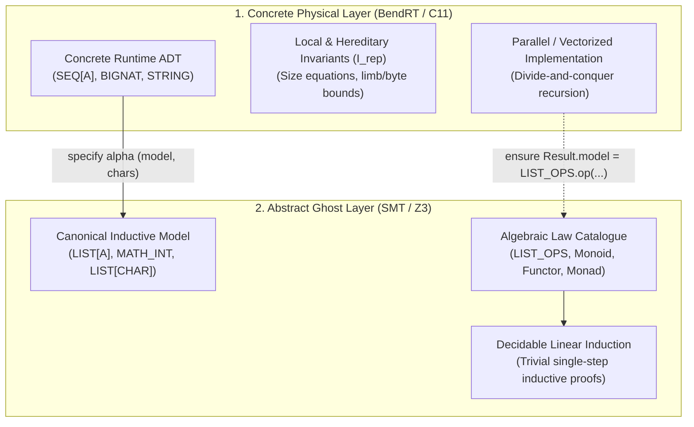
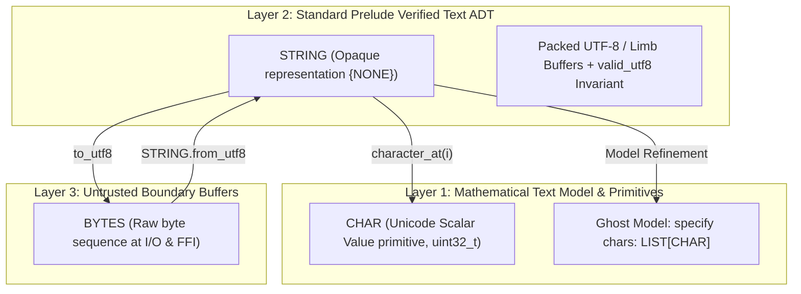
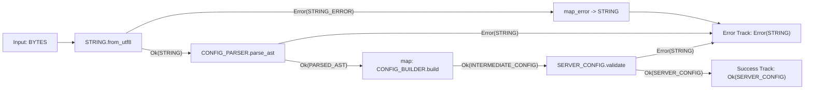
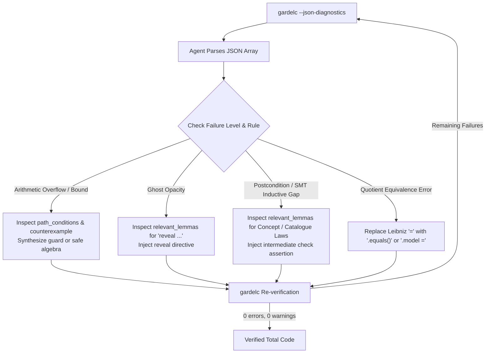
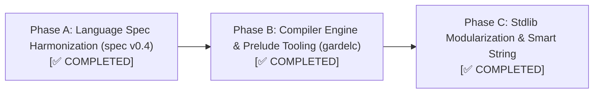

# Gardel Language Specification (Draft v0.5)

Nov 4, 2026 · @Javier

## 1. Overview and changes since v0.2 / v0.3

Gardel is a pure, total, deterministic, statically verified language designed for AI-driven code generation and human readability. Version 0.4 transitions the execution backend from HVM2 (24-bit interaction nets) to **Bend v2 / BendRT** (portable C11 for single-core and multi-core CPUs, plus CUDA and Apple Metal for GPUs), upgrades numerics to standard 64-bit machine words, and removes special-purpose recursion constructs (`fold` and `unfold`) in favor of uniform structural recursion with `let` bindings.

| Area | Problem in v0.2 / v0.3 | Resolution in v0.4 |
| --- | --- | --- |
| Backend target | HVM2 restricted numbers to 24 bits, ran 3x–5x slower than C on single cores, and locked GPUs to NVIDIA CUDA | Target **Bend v2 / BendRT** (and portable C11), unlocking native C single-core speed and parallel CPU, CUDA, and Metal execution (§10, §13) |
| Numerics | `U24`/`I24`/`F24` overflowed at 16.7 million due to HVM2 node tags; missing bitwise operators | Standard 64-bit `U64` (`NAT`), `I64` (`INT`), and `F64` with Z3 overflow proofs, bitwise operators, and deterministic IEEE-754 evaluation (§3) |
| Recursion & Parallelism | `fold` and `unfold` caused variable-type shadowing, duplicated `ensure` blocks, and lacked postconditions on `unfold` | Removed `fold`, `unfold`, `fork`, `Subject`, and `@`. All recursion uses standard `match`/`if` and `variant`; independent `let` bindings run in parallel (§10, §14) |
| Local bindings | Grammar had no `let` binding, forcing repeated expressions and preventing intermediate `check` references | Added `Block` (`Stmt* Expr`) supporting `let x = e`, `check`, `assume`, and `reveal` inside `do`, `then`, `else`, and `case` branches (§5, §15) |
| Closures | Closures capturing closures were marked affine due to HVM2 lambda-duplication anomalies | Compile-time closure conversion (lambda lifting to first-order ADT records) allows unrestricted closure use and parallel duplication (§8, §13) |
| Invariant visibility | A friend module in `representation {FRIEND}` could fail to verify if the invariant called private queries | Added Visibility Rule 5: every symbol in an `invariant` must be visible to at least the representation's visibility list (§4) |
| Standard Prelude & Modules | Ambient file containers (`group`) forced library code duplication in user programs | Implicit Standard Prelude (`OPTION`, `RESULT`, `SEQ`, `STRING`, `BYTES`, `STRING_ERROR`, `IO_ERROR`, `BIGNAT`, `LIST`, `MATH_INT`, `EQ`, `CANONICAL_EQ`, `ORD`, `LIST_OPS`, `FUNCTION_OPS`) with `--no-prelude` bootstrap mode; `group` re-scoped to mutual-recursion verification barriers; one module per file convention (§4, §5, §15) |
| Error Handling | Inconsistent mix of preconditions, partial functions, and ad-hoc error handling | Error Handling Doctrine: preconditions (`require`) reject programmer bugs statically; fallible operations return monadic `RESULT[E, A]` (§5, §7) |
| Text & Strings | Strings tied directly to byte buffers; missing Unicode character abstraction | Three-layer text model (`CHAR`, `STRING`, `BYTES`) with Unicode scalar ghost model (`LIST[CHAR]`) and string literal desugaring (§3, §11, §15) |
| Dual-Layer Model Refinement | Ad-hoc verification tricks for data structures | Principle 9: Dual-Layer Model Refinement pairing parallel structures (`SEQ`, `BIGNAT`, `STRING`) with inductive ghost models (`LIST`, `MATH_INT`, `LIST[CHAR]`) (§2, §6) |
| Equality & Algebraic Laws | Inconsistent Leibniz `=` on non-canonical types; missing law catalogue | Strict equality hierarchy (`=`, `.equals()`, `.model = .model`) and normative Bird & Wadler algebraic law catalogue with AI diagnostic surfacing (§9, §12) |
| AI Diagnostics | Solver failures only described human-oriented error text | Specified `gardelc --json-diagnostics` with structured counterexamples, contract tags, and cross-module law recommendations for automated LLM repair loops (§12, §13) |

### Changes in v0.5

| Area | Change |
| --- | --- |
| Non-termination | New unit kind `reactive program`. Every routine stays total. A program runs without end only through the runtime's event loop (§2, §4, §11.6). |
| Prelude | `STEP`, `COMMAND`, `EVENT`, `KEY` and `CONN_ID` join the prelude inventory (§4.1, §11.6). A user constructor wins over a prelude constructor of the same name (§4.1). |
| `match` | A catch-all arm must be the last arm (`E0316`, §5.1). |
| Solver limit | Verification is bounded by solver work, not by time, so a verdict does not depend on machine load. A solver that gives up is reported as unproven, never as verified or refuted (§7.3, §12). |
| Entry points | Nothing may refer to a `program` or `reactive program` (`E0104`, §4). |
| `EXIT_CODE` | Defined in §3. |

**Implementation status:** the `match` rule, the solver limit and the entry-point rule are implemented. Reactive programs run, with timers, console input, sockets, the terminal, files, processes and replay (§16.5, §11.6).

---

## 2. Core design principles

Gardel trades mutation, inheritance, and ad-hoc loops for mathematical proofs, strict determinism, and implicit parallelism:

1. **One module, one ADT.** A `module` defines one data type, its operations, and its invariant. `functions` and `program` modules hold free functions and entry points.
2. **Pure, total, deterministic.** Every routine terminates and nothing mutates. A whole program can run without end only as a `reactive program`, through the runtime's event loop (§11.6); its routines are total too. Evaluation order never changes a result for exact discrete types (`U64`, `I64`, `MATH_INT`, `BOOL`, `CHAR`, and algebraic data types, satisfying strict Church-Rosser bit-for-bit confluence). `F64` operations follow strict IEEE-754 expression-tree semantics without compiler re-association. Command-query separation becomes queries versus transformers that return a new value. `old` and `modifies` are unnecessary.
3. **Contracts are proofs, not checks.** `require`, `ensure`, `invariant`, `variant`, and `check` are discharged by the verifier and erased. Nothing is evaluated at runtime.
4. **Invariants are types.** A module's invariant is part of what its type means, so it holds for every value wherever that value travels.
5. **Selective export is a verification firewall.** Visibility lists control both name access and which facts the solver sees.
6. **Concepts with laws replace inheritance.** Polymorphism comes from `concept` declarations whose laws are proven, guaranteeing unique, deterministic behavior across generic code.
7. **Runtime numbers are 64-bit machine numbers.** Contracts reason in unbounded mathematics (`MATH_INT`), but every runtime operation must be proven not to overflow.
8. **Erase to Bend v2 and C.** After verification, only pure ADTs, tail/divide-and-conquer recursion, and native 64-bit arithmetic remain, compiling to Bend v2 / BendRT for parallel CPU and GPU execution.
9. **Dual-Layer Model Refinement.** High-performance, divide-and-conquer runtime data structures (such as `SEQ[A]`, `BIGNAT`, and `STRING`) are decoupled from their mathematical specifications by pairing them with inductive mathematical ghost models (`LIST[A]`, `MATH_INT`, `LIST[CHAR]`). Runtime operations establish abstraction refinement postconditions (`Result.model = LIST_OPS.op(Current.model, ...)`, `Result.model = ...`, `Result.chars = ...`), enabling simple, decidable structural induction in SMT while executing in parallel on BendRT rings or native vectorized loops.

### Principle 9: Dual-Layer Model Refinement Architecture

Modern high-performance execution environments (such as Bend v2 / BendRT interaction nets and vectorized C11 loops) and automated deductive verifiers (such as Z3 via Boogie) place diametrically opposed demands on data structure design:

- **The Runtime Performance Demand:** Execution engines require divide-and-conquer tree layouts (`SEQ[A]`) to distribute tasks across parallel thread rings and GPU SIMD lanes, multi-limb representations (`BIGNAT`) for 64-bit integer arithmetic, and bounded byte buffers (`STRING`) for cache locality and zero-allocation text handling.
- **The SMT Verification Demand:** First-order automated theorem provers scale reliably on simple, linear algebraic data types with a single inductive step (such as cons-lists `LIST[A]` or unbounded mathematical integers `MATH_INT`). Proving inductive functional properties directly over branching trees, limb carries, or multi-byte UTF-8 encodings causes quantifier instability, non-linear arithmetic explosions, and solver timeouts.

Gardel resolves this tension by formalizing **Dual-Layer Model Refinement** as a foundational language principle:



The architecture consists of four interrelated components:

1. **Concrete Carrier Type ($C$):** An algebraic data type optimized for hardware evaluation. Its `invariant` section is restricted strictly to **local, hereditary representation invariants** ($I_{\text{rep}}$), guaranteeing that physical constraints (such as field size equations, limb count bounds, or byte validity) hold unconditionally without breaking subterm destructuring or parallel assembly (§6).
2. **Abstract Ghost Model ($A$):** A canonical mathematical type (`LIST[A]`, `MATH_INT`, `LIST[CHAR]`) referenced only in `specify` and contract blocks. The ghost model is entirely erased at compile time and incurs zero runtime memory or execution cost.
3. **Abstraction Function ($\alpha: C \to A$):** A total ghost query defined in `specify` over the concrete type—such as `model: LIST[A]` on `SEQ[A]`, `model: MATH_INT` (via recursive Horner evaluation `value_of`) on `BIGNAT`, or `chars: LIST[CHAR]` (alongside `byte_model: LIST[U64]`) on `STRING`—that projects each concrete instance to its canonical mathematical denotation.
4. **Refinement Commutativity Postconditions:** Every runtime constructor, transformer, and query establishes an abstraction refinement postcondition proving that the runtime operation commutes with the corresponding mathematical operation over the ghost model:
   $$\alpha(f_C(x_1, \dots, x_n)) = f_A(\alpha(x_1), \dots, \alpha(x_n))$$
   In Gardel code:
   ```eiffel
   ensure
     model_concat: Result.model = Current.model.append(other.model)
     model_map: Result.model = LIST_OPS.map(Current.model, f)
   ```

**SMT Verification vs. Runtime Decoupling:**
The module author proves the commutativity postcondition once within the module implementation, using structural induction on the tree and algebraic homomorphism laws in `functions LIST_OPS` (such as `law map_append`, `law filter_append`, `law fold_left_append`, and `law fold_right_append` in §8). In all client code and caller modules, Z3 treats the concrete operations as abstract transformers whose functional behavior is defined by the linear ghost model. Client proofs perform simple structural induction on `LIST[A]` or linear integer arithmetic on `MATH_INT`, entirely insulated from tree balancing, limb splitting, or byte-packing mechanics.

---

## 3. Primitive types, numerics and text

Gardel distinguishes between **primitive machine/SMT scalar types** and **Standard Prelude ADTs** (§4, §5). Primitives map directly to hardware registers, C11 scalars, and native SMT theories (linear integer arithmetic, bitvectors, and IEEE-754 floats). Rich data structures such as `OPTION[A]`, `RESULT[E, A]`, `SEQ[A]`, `STRING`, and `BIGNAT` are defined as algebraic data types in the Standard Prelude, rather than ad-hoc compiler primitives.

Runtime numbers are standard 64-bit machine values, and every checked arithmetic operation carries an overflow proof obligation. This removes the gap between what Z3 proves and what the CPU or GPU computes while avoiding HVM2's 24-bit ceiling.

| Type | Runtime representation | Meaning in contracts |
| --- | --- | --- |
| `UNIT` (alias `()`) | Bend v2 `0` / C `void` (0-byte singleton) | unit value `()`; empty tuple / zero-argument return |
| `U64` (alias `NAT`) | Bend v2 `U64` / C `uint64_t` | integer in $[0, 2^{64} - 1]$; `NAT.max` $= 18\,446\,744\,073\,709\,551\,615$ |
| `I64` (alias `INT`) | Bend v2 `I64` / C `int64_t` | integer in $[-2^{63}, 2^{63} - 1]$ |
| `F64` | Bend v2 `F64` / C `double` | IEEE-754 binary64 values with bound axioms; strict expression-tree evaluation |
| `BOOL` | `uint8_t` | boolean truth values (`True`, `False`) |
| `CHAR` | `uint32_t` | Unicode scalar value in $[0, 0\text{xD7FF}] \cup [0\text{xE000}, 0\text{x10FFFF}]$ |
| `MATH_INT` | none (ghost) | unbounded integer; legal only in `specify` and contracts |

`EXIT_CODE` is an alias of `U64`: the process exit status returned by `main` and carried by `Stop` (§11.6).

Rules:

- **Contracts use mathematics.** Runtime numbers lift implicitly to `MATH_INT` inside contracts, so `Result = a + b` in an `ensure` means the true mathematical sum.
- **Checked operators.** `+`, `-`, `*` on runtime numbers generate a proof obligation that the mathematical result is in $[0, 2^{64} - 1]$ for `U64` (or $[-2^{63}, 2^{63} - 1]$ for `I64`). `/` and `%` require a non-zero divisor (and for `I64`, `a != INT.min or b != -1`). `/` truncates toward zero and `%` takes the sign of the dividend, as in C, in running code and in contracts. Unary `-` must fit its type, so `-x` needs `x != INT.min` for `I64` and `x = 0` for `U64`.
- **Wrapping and bitwise operators.** `+%`, `-%`, `*%` are total and defined modulo $2^{64}$. Bitwise operators `&`, `|`, `^`, `<<`, `>>` operate on `U64` (with shift amounts required to be $< 64$), and are rejected on `I64`. Wrapping on `I64` is two's complement. They are verified with Z3's `(_ BitVec 64)` theory and never mix with checked operators without an explicit conversion.
- **Deterministic floating point.** `F64` operations follow strict IEEE-754 evaluation order matching the syntactic expression tree. Compiler re-association (such as `-ffast-math` contractions or fused multiply-add `fma` synthesis across distinct operations) is strictly forbidden (`-ffp-contract=off`), and quiet/signaling NaN representations are canonicalized, ensuring that execution along a given expression tree is deterministic across CPU and GPU backends. However, because floating-point addition and multiplication are mathematically non-associative ($(a+b)+c \neq a+(b+c)$), parallel reductions do not claim bit-for-bit equivalence across dynamically re-partitioned trees; exact Church-Rosser confluence is guaranteed for discrete types (`NAT`, `INT`, `MATH_INT`, `BOOL`, `CHAR`, and ADTs).
- **Unit type.** `UNIT` is a primitive type with exactly one value, written `()`. It represents computations evaluated purely for sequenced effects (such as `IO.print(...) : IO[UNIT]`), and erases at runtime.
- **Conversions are explicit.** `NAT.of(m)` from a `MATH_INT` requires a proof that `0 <= m and m <= NAT.max`. Between the two machine types, `NAT.from_i64(i)` requires `i >= 0` and `I64.from_nat(n)` requires `n <= INT.max`, each as the obligation `in_range`. The result is the same number (`Result = i`, `Result = n`), and in C it is a plain cast.
- **Quantifiers range over the type.** `forall k: NAT. P(k)` means P for every `k` in $[0, 2^{64} - 1]$, and `exists k: I64. P(k)` needs a witness in $[-2^{63}, 2^{63} - 1]$. The same holds for `U64`, `I64` and `CHAR`, and only `MATH_INT` ranges over all of $\mathbb{Z}$. A number outside the range is no value of the type, so it neither refutes a `forall` nor proves an `exists`. (Before Task F.2, the translation dropped the range, and a witness such as $-1$ could prove an `exists` over `NAT`.)
- **Fields range over their type.** A field of type `NAT`, `U64`, `I64` or `CHAR` of a sum type or record holds a value of that type, so a value bound from it, as `w` in `case JInt(w)` or `r.count`, is in the type's range (Task F.4). An element of a `LIST` or `SEQ` of a machine type does not yet carry its range in the proof.
- **Large numbers.** A prelude library type `BIGNAT` stores little-endian limbs in a `LIST[U64]` and has `MATH_INT` as its ghost model (Dual-Layer Model Refinement, §2).

The classic midpoint shows the effect. The version below verifies; `(lo + hi) / 2` is rejected because `lo + hi` may exceed `NAT.max`.

```eiffel
midpoint(lo: NAT, hi: NAT): NAT
  require
    ordered: lo <= hi
  do
    let diff = hi - lo
    lo + diff / 2
  ensure
    in_range: lo <= Result and Result <= hi
  end
```

### 3.1 The Three-Layer Text Architecture and String Literals

Text processing in Gardel is structured into three distinct layers to cleanly separate physical encoding performance from mathematical specification, preventing representation leaks and eliminating the conflation of code points, bytes, and user-perceived grapheme clusters:



#### 1. Layer 1: `CHAR` (Unicode Scalar Primitive)
- **Runtime Representation:** Standard 32-bit machine scalar value (`uint32_t`).
- **Domain & Invariant:** A valid Unicode scalar value is an integer in $[0, 0\text{xD7FF}] \cup [0\text{xE000}, 0\text{x10FFFF}]$. High and low surrogate code points ($[0\text{xD800}, 0\text{xDFFF}]$) are strictly excluded.
- **Literal Syntax:** Enclosed in single quotes: `'a'`, `'Z'`, `'\n'`, `'世'`, `'\u{1F980}'`.
- **Supported Escape Sequences:**
  - `\n` (newline, U+000A)
  - `\r` (carriage return, U+000D)
  - `\t` (horizontal tab, U+0009)
  - `\\` (literal backslash, U+005C)
  - `\'` (single quote, U+0027)
  - `\"` (double quote, U+0022)
  - `\0` (null character, U+0000)
  - `\u{H...}` (arbitrary Unicode scalar value, where `H...` is 1 to 6 hexadecimal digits specifying a valid Unicode scalar value).
- **Semantics & Distinction:** `CHAR` denotes exactly one Unicode scalar value (code point). It is fundamentally distinct from physical bytes (which vary with encoding) and user-perceived grapheme clusters (which may comprise multiple code points, such as an accented character `'e'` followed by combining mark `\u{0301}`, or multi-part emoji sequences).
- **Standard Operations:**
  - `c.code: NAT`: receiver query on `CHAR` yielding the numeric Unicode scalar value in $[0, 0\text{xD7FF}] \cup [0\text{xE000}, 0\text{x10FFFF}]$.
  - `CHAR.from_code(n: NAT): OPTION[CHAR]`: total creation routine returning `Some(c)` (with `c.code = n`) if $n \le 0\text{xD7FF} \lor (0\text{xE000} \le n \land n \le 0\text{x10FFFF})$, and `None` otherwise. This is the boundary form for unvalidated integers.
  - `CHAR.from_scalar(n: NAT): CHAR`: partial creation routine for integers already known to be scalar values. Precondition: `require valid_scalar: n <= 0xD7FF or (0xE000 <= n and n <= 0x10FFFF)`. Postcondition: `ensure Result.code = n`. It is injective (`a.code = b.code` implies `a = b`) and lowers to a plain `uint32_t` conversion with no runtime check.
  - Conforms natively to `CANONICAL_EQ` and `ORD`.

#### 2. Layer 2: `STRING` (Standard Prelude Text ADT)
- **Opaque Representation (`representation {NONE}`):** `STRING` is an immutable Standard Prelude ADT whose physical layout is hidden from all client modules. Whether implemented using 64-bit word lists, packed contiguous UTF-8 byte arrays, or balanced ropes, client code is completely decoupled from physical storage.
- **Dual-Layer Ghost Model (`specify chars: LIST[CHAR]`):**
  The mathematical specification of `STRING` is governed by an inductive ghost sequence of Unicode scalar values projecting the internal UTF-8 representation:
  ```eiffel
  specify {ANY}
    chars: LIST[CHAR]
      do
        BYTES.decode_utf8(Current.bytes)
      end
  ```
  `BYTES.decode_utf8` is the exact RFC 3629 decoder over well-formed octet sequences (Layer 3). The prelude verification model stores the octets as `bytes: LIST[U64]` (one octet per element, invariant `BYTES.valid_utf8(bytes)`, plus `size`, the cached `char_count` and a builder capacity `limit`); the C11 runtime stores the same octets packed in one contiguous NUL-terminated buffer together with the byte length and the cached code-point count (`GardelString`).
  Every public query and transformer establishes its postconditions against `chars`:
  - `code_point_count: NAT`: Returns the number of Unicode scalar values (distinct from byte length and grapheme cluster count). Postcondition: `Result = Current.chars.length`.
  - `byte_length: NAT`: Returns the number of bytes required by its physical UTF-8 encoding.
  - `is_empty: BOOL`: Equivalent to `Current.code_point_count = 0`. Postcondition: `Result = (Current.chars = LIST.empty)`.
  - `character_at(index: NAT): CHAR`: Indexed code-point lookup. Precondition: `require in_bounds: index < Current.code_point_count`. Postcondition: `Result = LIST_OPS.at(Current.chars, index)`.
  - `concat(other: STRING): STRING`: String concatenation. Precondition: `require fits: Current.byte_length <= U64.max - other.byte_length` (the only one; capacity plays no role). Postconditions: `Result.chars = Current.chars.append(other.chars)`, byte length and code-point count add up. Input lines are shorter than $2^{48}$ bytes (§11), so `"Hello, ".concat(name)` on an `IO.read_line` result is provable.
  - `equals(other: STRING): BOOL`: Behavioral text equality (`STRING satisfies EQ`). Postcondition: `Result = (Current.chars = other.chars)`. Because two `STRING` values with identical `chars` may differ in hidden physical metadata (such as buffer capacity `limit` or internal tree balance), `STRING` conforms to `EQ` (and `ORD`) rather than `CANONICAL_EQ` (§9).
  - `less_than(other: STRING): BOOL` and `less_or_equal`: `STRING satisfies ORD`, with the laws proven. Postcondition: `Result = BYTES.list_less(Current.byte_model, other.byte_model)`, the byte order of the UTF-8 form: the first byte that differs decides, and a prefix comes first. On well-formed UTF-8 this is also the order of the code points. It is an order for keys, not a collation, so `"Z"` comes before `"a"`. In C it is one `memcmp`.
  - `slice(lo: NAT, hi: NAT): STRING`: The scalars from index `lo` up to, not including, `hi`. Preconditions: `lo <= hi` and `hi <= Current.code_point_count`. Postconditions: `Result.chars = BYTES.list_take(BYTES.list_drop(Current.chars, lo), hi - lo)` and `Result.code_point_count = hi - lo`. The indices count scalars, not bytes. In C the result shares the buffer and costs no copy. A slice at a scalar boundary stays well-formed by the laws `BYTES.utf8_split_left` and `utf8_split_right`.
  - `starts_with(prefix)`, `ends_with(suffix)` and `matches_at(other, offset, i)`: each is defined exactly on `chars` (`ensure def`).
  - `find(other: STRING, from: NAT): OPTION[NAT]`: The first scalar index at or after `from` where `other` occurs. Precondition: `from <= Current.code_point_count`. Postconditions: `found`, the match is real; `first`, no index between `from` and the result matches; `absent`, `None` means no index at or after `from` matches. `find_char(c, from)` is the same for one `CHAR`.
  - `trim: STRING`: Without the ASCII white space (space, tab, `\n`, `\r`) at either end, stated on `chars` through `space_end` and `space_start`.
  - `count_char(c, i)`, `split(sep: CHAR): LIST[STRING]`: `split` gives `count_char(sep, 0) + 1` parts. The contract states the number of parts only, not their text. Code that must prove something about a part uses `find`/`find_char` and `slice` instead. A per-step contract (the first part, then the split of the rest) is planned with Task F.5, once a client needs it.
- **Internal Invariant Encapsulation:** The module's internal representation invariant (inductive UTF-8 validity `BYTES.valid_utf8`, the cached count and capacity constraints) is proven once and for all within `STRING`, using the UTF-8 laws that `BYTES` proves by induction (`utf8_octets`, `utf8_append`, `decode_injective`) and exports as verified contracts. No UTF-8 fact is axiomatized. Callers reason purely about `Current.chars`, enjoying complete immunity from low-level byte corruption or encoding invariants.

#### 3. Layer 3: `BYTES` (Untrusted Boundary Buffers)
- **Definition:** `module BYTES` is an opaque Standard Prelude ADT (`representation {NONE}`) encapsulating a sequence of 8-bit octets (`items: LIST[U64]` with module invariant `all_octets(items)`, every element $< 256$) and exposing the canonical ghost model `specify model: LIST[U64]`. It also hosts the UTF-8 theory of octet sequences: `valid_utf8(bs)` (RFC 3629 well-formedness: shortest form, no surrogates, at most U+10FFFF), the decoder `decode_utf8(bs): LIST[CHAR]` (requires `valid_utf8(bs)`), and three laws proven by structural induction: `utf8_octets` (well-formed sequences are octets), `utf8_append` (well-formedness is closed under concatenation and decoding distributes over it) and `decode_injective` (decoding is injective on well-formed sequences, which makes `STRING.equals` byte equality and character equality at once).
- **Operations (Task F.2).** Each one is stated on `model`:
  - `concat(other: BYTES): BYTES`. Precondition: the total length fits a `U64`. Postcondition: `Result.model = Current.model.append(other.model)`.
  - `slice(lo, hi)`: `Result.model = list_take(list_drop(Current.model, lo), hi - lo)`, with `lo <= hi <= Current.length`. In C it shares the buffer.
  - `matches_at(other, offset, i)`, `starts_with(prefix)`, `index_of_byte(b, from)` and `index_of(other, from)`. The two searches give the first offset at or after `from`, and `None` only when there is none (`found`, `first`, `absent`, as for `STRING.find`).
  - `list_less(xs, ys)` is the byte order that `STRING` uses, with the laws `less_irreflexive`, `less_transitive` and `less_total`. `utf8_offset(bs, i)` is the byte offset of scalar `i`.
  - `at(i)` is constant time in C. On 64 KB input, summing every byte with `at`, and `find`, stay within start-up noise. `concat` copies both sides, so building a buffer one byte at a time with it is quadratic: use `BYTES_BUILDER`.
- **`BYTES_BUILDER`.** An opaque builder (`representation {NONE}`) with ghost model `model: LIST[U64]`: `empty`, `add(b: BYTES)`, `add_text(s: STRING)`, `add_byte(x: U64)` (requires `x < 256`), `length` and `to_bytes`. Each `add` postcondition appends to `model`, and `to_bytes` gives `Result.model = Current.model`. An `add` is constant time, as it keeps the parts in reverse, and `to_bytes` joins them in one copy.
- **Boundary Role:** All external input from the outside world (network streams, disk files, command-line arguments, environment variables) enters the runtime as untrusted `BYTES` (§11).
- **Boundary Decoding:** Raw byte buffers cannot be cast directly to `STRING`. They must cross the verification boundary via explicit decoding:
  ```eiffel
  STRING.from_utf8(bytes: BYTES): RESULT[STRING_ERROR, STRING]
  ```
  It accepts exactly the well-formed inputs: `ensure ok_iff_valid: Result.is_ok = BYTES.valid_utf8(bytes.model)`. On success `s.chars = BYTES.decode_utf8(bytes.model)`. Otherwise it returns `Error(err)` with the first error found, as a `STRING_ERROR` variant (`InvalidByte(offset, byte_val)`, `TruncatedSequence(offset, expected)`, `OverlongEncoding(offset)`, or `UnpairedSurrogate(offset)`, §11), without exceptions or crashes. For a multi-byte lead byte the checks run in a fixed order: (1) every continuation byte present must be in `0x80..0xBF` (`InvalidByte` at its offset), (2) the sequence must be complete (`TruncatedSequence`), (3) the lead-specific second-byte range (`E0`/`F0` overlong, `ED` surrogate, `F4` above U+10FFFF as `InvalidByte`). Lead bytes `C0`/`C1` are `OverlongEncoding`; `80..BF` and `F5..FF` are `InvalidByte`. The C runtime decoder used by `IO.read_line` follows the same order.
- **Safe Serialization:** Verified strings can be serialized safely and totally to bytes via the feature query `to_utf8: BYTES` (`str.to_utf8`), guaranteed to produce a canonically encoded UTF-8 byte sequence (`ensure Result.model = Current.byte_model` and `BYTES.valid_utf8(Result.model)`).

#### 4. String Literal Desugaring
String literals (`"..."`) in Gardel source code are syntactic sugar for verified prelude `STRING` values.

- **Compile-Time Validation:** At compile time, `gardelc` parses the literal contents, verifies that the string contains well-formed UTF-8 scalar values with valid escape sequences, and rejects malformed escape sequences or surrogate halves with static compiler errors.
- **Model Refinement Equivalence:** The compiler emits a `STRING` instance whose ghost abstraction property is statically proven:
  ```eiffel
  -- Writing "hello" desugars to a verified prelude STRING literal:
  ensure
    Result.chars = LIST.empty.prepend('o').prepend('l').prepend('l').prepend('e').prepend('h')
  ```
- **Zero-Allocation Runtime Lowering:** At runtime, string literals lower directly to pre-allocated, null-terminated static UTF-8 byte slices in the C11/BendRT backend (`static const uint8_t literal_0[] = "hello";`), avoiding dynamic heap allocation or runtime decoding overhead.
- **Realization (Roadmap Tasks B.3, C.2).** Every Unicode scalar is allowed in a literal (`E0303` was removed by Task C.2); malformed escapes (`E0302`) and surrogates (`E0304`) are always rejected. A literal $[c_0, \dots, c_{n-1}]$ whose UTF-8 encoding has $b$ bytes denotes `STRING.make_empty(max(b, 1))` followed by one builder call per scalar, last to first: `push_ascii(c)` for a 1-byte scalar and `push_utf8_2/3/4(b0, ..)` with the scalar's encoded bytes otherwise. In Boogie it is a constant *defined* by that term of verified prelude routines (no other axiom), and a per-literal lemma proves the routine preconditions, the `STRING` invariant, `Result.chars = LIST.empty.prepend(c_{n-1})...prepend(c_0)`, `Result.byte_length = b` and `Result.code_point_count = n`. Because `STRING` is not `CANONICAL_EQ`, `=` with a `STRING` operand is rejected (`E0311`; use `equals` or compare `chars`), as are `+` on `STRING` (`E0312`) and string-literal `match` patterns (`E0313`).

#### 5. Number Text (`NUMBER_TEXT`)
A prelude module of routines only (Task F.2), called as `NUMBER_TEXT.parse_nat(s)`, that turns numbers into decimal text and back. A value too large for its type is an error, never a wrapped number.

- `nat_to_text(n: NAT): STRING` and `i64_to_text(i: I64): STRING`: decimal with no leading zero, and a `-` before a negative number. Postcondition: `Result.byte_model` is the ASCII digits of `n`, most significant first.
- `parse_nat(s: STRING): RESULT[NUMBER_ERROR, NAT]`: decimal digits only, with no sign or space. Leading zeros are allowed. `parse_i64` accepts one optional `-` first. Both are total, and their contracts define the result on `s.byte_model`.
- `NUMBER_ERROR` is `NoDigits`, `NotADigit(offset: NAT)` (the byte offset of the first byte that is not a digit) or `OutOfRange`.
- `hex4_text(n: NAT): BYTES` (requires `n < 65536`) writes four lowercase hex digits, as in a JSON `\uXXXX` escape. `parse_hex4(bs: BYTES, at: NAT): OPTION[NAT]` reads four at offset `at`, in either case.
- `digits(n: NAT, rest: LIST[U64]): LIST[U64]` puts the ASCII digits of `n` in front of `rest`. It is the model of `nat_to_text`. The law `digits_step` (Task F.4) gives one step of it: `rest.prepend(48 + n)` for `n < 10`, and `digits(n / 10, rest.prepend(48 + n % 10))` otherwise. It has no trigger, so a client calls it where a proof needs it.
- Laws, proven: `nat_round_trip`, `parse_nat(nat_to_text(n)) = Ok(n)`; `i64_round_trip`, `parse_i64(i64_to_text(i)) = Ok(i)`, which includes `INT.min`; and `hex4_round_trip`, `parse_hex4(hex4_text(n), 0) = Some(n)` for `n < 65536`. Each is an axiom for clients, triggered by the composed call.

---

## 4. Module architecture and compilation units

A `module` is one abstract data type organized into four visibility-controlled sections. Three further kinds cover what a pure ADT cannot: a `functions` module holds free functions, a `program` holds the entry point of a run that terminates, and a `reactive program` holds the entry points of a run that continues until it stops (§11.6).

Inside a module, `Current` is the immutable receiver, `Result` is the return value in `ensure` clauses, and field projection and zero-argument queries share the same dot syntax (uniform access).

| Section | Purpose | Compiled? | Visible to the solver in client `M` |
| --- | --- | --- | --- |
| `representation {Vis}` | Sum or product layout of the type | Yes | Only if `M` is in `{Vis}`; otherwise the type is opaque. `{NONE}` hides it from all clients |
| `create {Vis}` | Constructors that need no receiver | Yes | Signature and `ensure` if `M` is in `{Vis}` |
| `feature {Vis}` | Runtime queries and transformers on `Current` | Yes | Signature and contracts if `M` is in `{Vis}` |
| `specify {Vis}` | Ghost queries, lemmas, concept law proofs | No (erased) | Usable in contracts of `M` if `M` is in `{Vis}`; forbidden in `do` bodies |

Sections may appear in any order, and `feature` and `specify` may repeat with different visibility lists. A module-wide `invariant` closes the module (§6).

**Visibility rules** (enforced during name resolution):

1. **Contract visibility.** Every symbol in a `require` clause of a routine exported to `{Vis}` must itself be exported to at least `{Vis}`. Callers must be able to read what they are asked to prove.
2. **Visible ensures only.** A client sees only the `ensure` clauses whose symbols it may see. A hidden clause stays usable inside the module, and the compiler warns when a client-facing routine loses clauses this way.
3. **Ghost stays ghost.** `specify` symbols may appear in any contract (`require`, `ensure`, `invariant`, `check`, `assume`, `variant`) but never in runtime expressions.
4. **Runtime-checkable preconditions.** A precondition of an exported routine should be written with exported runtime queries so callers can branch on it. Otherwise the compiler warns `ghost_precondition` (§7).
5. **Invariant visibility.** Every symbol referenced in a module's `invariant` must be exported to at least the visibility list of its `representation` section, ensuring friend modules that construct values directly can see and prove the invariant (§6).

A `functions` module has `feature` and `specify` sections only. A `program` has a `main` routine and is the only module that may use `IO` (§11). A `reactive program` has `feature` sections only, with the routines `init` and `step` and no `main`, and uses commands instead of `IO` (§11.6).

A `program` and a `reactive program` are entry points, the roots of a run. Nothing may refer to one: `E0104: entry_point_reference`. Code that two units share goes in a `functions` module.

### 4.1 The Standard Prelude

Every standard Gardel compilation run automatically loads and injects the **Standard Prelude** ($\Gamma_{\text{prelude}}$) into the global symbol table. User programs and modules access standard concepts, types, and operations directly without copy-pasting library declarations or writing explicit `import` statements.

#### 1. Automatic Scope Injection
The Standard Prelude is ambiently present in the root typing environment $\Gamma_0$ and the underlying SMT verification context:
- All prelude types, variant constructors, and concept definitions are registered prior to user AST ingestion.
- Prelude routines, axioms, and ghost lemmas are accessible across all user modules without namespace qualification or header directives.
- Source code remains clean and free of boilerplate imports, preserving Eiffel's concise, declaration-focused aesthetic.

#### 2. Normative Prelude Inventory
The Standard Prelude provides an irreducible core of verified concepts, algebraic data types, and mathematical specification abstractions:

- **Foundational Concepts (§9):**
  - `concept EQ`: Behavioral equivalence interface (`equals(other: Current): BOOL`) with reflexive, symmetric, and transitive algebraic laws.
  - `concept CANONICAL_EQ refines EQ`: Axiomatizes that behavioral equality coincides with structural Leibniz equality (`equals(other) = (Current = other)`).
  - `concept ORD refines EQ`: Strict total ordering interface (`less_than`, `less_or_equal`) with irreflexivity, asymmetry, transitivity, and totality laws.

- **Core Algebraic Data Types (§3, §5, §10, §11):**
  - `module OPTION[A]`: The canonical optionality sum type (`None | Some(val: A)`) providing total queries (`is_some`, `is_none`, `unwrap`) and monadic combinators (`map`, `and_then`).
  - `module RESULT[E, A]`: The canonical error-handling sum type (`Error(err: E) | Ok(val: A)`) underpinning Gardel's Error Handling Doctrine (§7).
  - `module SEQ[A]`: The standard parallel divide-and-conquer sequence ADT with balanced tree representation, stored `U64` length, and ghost model `specify model: LIST[A]` (§10).
  - `module STRING`: The standard opaque text ADT (`representation {NONE}`) with ghost model `specify chars: LIST[CHAR]` (§3). String literals (`"..."`) desugar directly to verified prelude `STRING` values.
  - `module BYTES`: The standard opaque boundary byte buffer ADT (`representation {NONE}`) with ghost model `specify model: LIST[U64]` (§3.1, §11).
  - `module BYTES_BUILDER`: Appends parts at constant cost and joins them once into `BYTES` (§3.1).
  - `module MAP[K: ORD, V]`: A finite map with a hidden representation (`representation {NONE}`): `empty`, `get`, `has`, `put`, `remove`, `size`, `keys`, `values` and `fold`. Its laws state what `get` gives after `put` and `remove`, of the same key and of another, and that `keys` ascend (`keys_ascending`). Each law has a `trigger`, so a client uses it with no call. Keys are compared with `K`'s `equals`, and `remove` drops every key equal to the one given, as `ORD` does not promise that `less_than` agrees with `equals`. `module KEY_ORDER[K: ORD]` holds the ascending-list predicates and the key edits it proves them for.
  - `module NUMBER_TEXT` & `module NUMBER_ERROR`: Decimal and hex text of `NAT` and `I64`, with proven round trips, and why a parse failed (§3.1).
  - `module STRING_ERROR` & `module IO_ERROR`: Standard boundary error sum types for text decoding (`STRING.from_utf8`) and external I/O operations (§11).
  - `module BIGNAT`: Arbitrary-precision natural numbers represented as little-endian limbs in `LIST[U64]` with ghost model `specify model: MATH_INT` (§3, §6.4.B).
  - `module STEP[S]`, `module COMMAND`, `module EVENT`, `module KEY`: The result of a reactive step, the effects a step requests, the outside events it receives, and a key press (§11.6). `module CONN_ID` and `module PROC_ID`: Opaque connection and process handles (§11.6). `module DIR_ENTRY`: An entry of a directory listing (§11.6). Their variants are added with the runtime that can deliver them (§16.5).

- **Mathematical Ghost Types & Specification Modules (§2, §6, §8):**
  - `LIST[A]`: The canonical inductive sequence ADT (`Nil | Cons(head: A, tail: LIST[A])`). `LIST` has **dual status**: it is the canonical ghost model of Dual-Layer Model Refinement (§2) *and* an ordinary sequential runtime structure that may appear in `representation` sections (e.g., `BOUNDED_STACK.items`, `BIGNAT.limbs`, `STRING.bytes`) and in runtime `do` bodies. Only its use as a model (inside `specify` queries and contracts) is erased.
  - `MATH_INT`: The built-in unbounded mathematical integer sort ($\mathbb{Z}$) mapping directly to native SMT linear integer arithmetic (`Int`). Unlike `LIST`, `MATH_INT` is **strictly ghost-only** (§3).
  - `functions LIST_OPS`: Inductive list operations over `LIST[A]` (`append`, `length`, `at`, `map`, `filter`, `fold_left`, `fold_right`, `reverse`) serving as reference targets for Dual-Layer Model Refinement (§2). Its `feature {ANY}` routines are executable (sequential, $O(n)$); its `specify` laws are erased.
  - `functions FUNCTION_OPS`: Pointwise combinators (`id_fn`, `compose`) with verified category-theoretic identity and associativity laws.

#### 3. Namespace Collision, Shadowing & Bootstrap Rules
- **Prelude names can be reused:** Prelude types and concepts belong to the package `gardel.core`, with the alias `GARDEL`. A user module, `functions` module or concept may declare any prelude name. In its package the bare name then means the user's declaration, and `GARDEL::OPTION` means the prelude's. A name `gardelc` builds in, such as `EVENT`, `STEP` or `STRING`, is always the prelude's, so a program with its own `STEP` spells `GARDEL::STEP[S]` in `init` and `step`.
- **Constructors:** A bare constructor resolves nearest first: the module's own, then its package's, then the direct dependencies', then the prelude's. The prelude comes last so that a constructor added to it cannot make a name a program already uses ambiguous: with `ghttp` as a dependency, a bare `Delete` is `HTTP_METHOD.Delete` and not the prelude's `KEY.Delete`. `MODULE.Leaf(1)`, `ALIAS::MODULE.Leaf(1)` and `case MODULE.Leaf(x)` name one constructor directly, and `ALIAS::Leaf` does when that package declares it once. A type known for certain chooses among the candidates outside the package, the prelude's included: the scrutinee of a `match`, or the declared result of a routine that returns the constructor directly, including through `if` and `match`. So `case Delete` on a `KEY` is the key, as the dependency's would not fit. Several candidates left among the dependencies are `E0112`. A module with its own `Stop` writes `STEP.Stop(0, cmds)` for the prelude's. The prelude's own constructor names are unique across its modules.
- **Standard Library Bootstrap (`--no-prelude`):** When compiling or verifying the Standard Prelude source files themselves, the compiler operates in `--no-prelude` bootstrap mode, suppressing automatic prelude injection so prelude modules can be defined and verified from source. The prelude sources are the one-module-per-file tree `stdlib/` (`concepts/`, `core/`, `collections/`, `numeric/`, `text/`, `functional/`), embedded into `gardelc` at build time. A file is recognized as a prelude source by its location in that tree, not by its text. Because the prelude modules depend on each other, `gardelc --stdlib`, `gardelc stdlib/` and `gardelc stdlib/<dir>/<file>.gdl` all verify the whole tree as one linked project (§4.2); prelude files cannot be compiled together with user files. A copy of a prelude file elsewhere is an ordinary user file and collides with the prelude (`E0101`).
- **Lexical Scoping of Type Parameters:** Type parameters (such as `[A]`, `[E]`, `[T]`) are lexically scoped to their declaring module or routine. A generic parameter `[A]` in `module STACK[A]` shadows any ambient type `A` strictly within the syntactic bounds of that module.

#### 4. Verification Decoupling
Prelude modules are verified against their contracts and algebraic laws. During user project compilation, the compiler injects sound background axioms and verified inductive lemmas for prelude abstractions into the SMT solver, eliminating re-verification overhead while guaranteeing sound cross-module reasoning.

---

### 4.2 Multi-File Architecture & Project Organization

Gardel establishes a clear separation between logical modularity and physical file layout, designed for scalable verification and AI-assisted pair programming.

#### 1. One-Module-Per-File Physical Convention
- **1:1 Mapping Convention:** By normative convention, each standalone top-level unit (`module`, `concept`, `functions`, or `program`) resides in its own dedicated source file (`.gdl`).
- **File Naming Rule:** The file basename should match the lowercase `snake_case` of the primary declared module or concept identifier:
  - `module BOUNDED_STACK` $\longrightarrow$ `bounded_stack.gdl`
  - `concept NUMERIC` $\longrightarrow$ `numeric.gdl`
  - `functions MATH_UTILS` $\longrightarrow$ `math_utils.gdl`
  - `program MAIN` $\longrightarrow$ `main.gdl`
- **Static Linting & Diagnostics:** This physical layout is enforced as a static analysis rule rather than a rigid syntactic restriction in the parser. In standard compilation mode, a mismatch between the file basename and a standalone module emits style warning `W0201: file_module_name_mismatch`. In `--strict` verification mode, this convention is enforced as an error.

#### 2. Flat Global Project Namespace
- **No Path Imports:** Gardel source code contains no lexical path imports (`import "./sub/foo"` or `using a.b.c`).
- **Global Uniqueness:** All top-level module, concept, and free function identifiers within a project exist in a flat, globally unique namespace.
- **Direct Cross-Module Referencing:** Any module `M` in a project may reference any other module `N` by its identifier directly (e.g., `let s: BOUNDED_STACK[I64] = ...`), subject strictly to the `{Vis}` visibility annotations declared on `N`'s sections.
- **Duplicate Detection:** Defining the same top-level module or concept identifier across two distinct files in a project triggers fatal error `E0102: duplicate_module_name`.

#### 3. Multi-File Compilation Workflow
A Gardel project is verified and transpiled by passing all constituent source files to `gardelc` (§13):
```bash
gardelc src/*.gdl --strict          # Verify all project modules with Boogie/Z3
gardelc src/*.gdl --run             # Verify, transpile to C11/Bend v2, and execute
```
The multi-file compilation pipeline proceeds through five deterministic stages:
1. **Source Ingestion & Parsing:** All `.gdl` files are parsed independently into `CompilationUnit` AST nodes (§15).
2. **Global Namespace Registration:** The compiler registers all declared top-level symbols across files and verifies global identifier uniqueness (`E0102`).
3. **Prelude Injection:** Unless `--no-prelude` is active, the Standard Prelude ($\Gamma_{\text{prelude}}$) is merged into the global symbol table.
4. **Representation DAG & Type Checking:** The compiler checks routine signatures and types across the global symbol table. Cross-module references in routine signatures are freely permitted across files, whereas cyclic nesting in **data representations** (`representation` fields or sum variants) is rejected unless the participating types are co-declared within an explicit `group` block (§4.3).
5. **Modular Verification Condition Generation (VCG):** For each module (or mutual `group`), the verifier constructs Boogie proof obligations using the public contracts, ghost models, and visible invariants of referenced dependencies, verifying units independently or in parallel.

**CLI input rules (`gardelc`, Task B.4):**
- Input operands may be any number of `.gdl` files, directories, and wildcard patterns. A directory without a `Gardel.toml` stands for its `*.gdl` files, searched recursively, skipping `build/` and `target/`. A wildcard in the file-name part of an operand (`src/*.gdl`) is expanded by `gardelc` itself when the shell has not expanded it (e.g. PowerShell, `cmd`). Files named twice are compiled once.
- A run with more than one file, a directory, or a wildcard operand is a *project run*: the files share one flat namespace (`E0102`), each file is checked for `W0201`, and each module is verified once, in a context that holds the background theories (contracts, invariants, laws) of the other-file modules it references, transitively. Those contracts are trusted only because the referenced modules are verified in the same run; calls assert the callee's `require` clauses.
- A single-file run is unchanged and does not apply `W0201`.
- **Acyclic cross-file dependencies:** user modules in different files that reference each other in a cycle are rejected with fatal error `E0103: cyclic_module_dependency`, because each module's proof would trust the other's contracts. Mutually dependent modules must be co-declared in one file under `group` (§4.3). Modules in the same file are not linked to each other by `gardelc` yet; simultaneous `group` verification is not yet implemented.

#### 4. Project Manifest (`Gardel.toml`, Task E.1)
A project may declare its identity and boundaries via a `Gardel.toml` file in its root directory.
- **`[project]` table:** Declares project metadata:
  ```toml
  [project]
  name = "echo-server"
  version = "0.1.0"
  ```
- **Package naming rules:**
  - Package names contain only ASCII lowercase letters, digits, `-`, and `.`.
  - Segments separated by `.` cannot be empty, must start with an ASCII lowercase letter (`a`–`z`), and cannot end with `-`.
  - The package name cannot start with `gardel.` or derive the default alias `GARDEL`, which is reserved for the Standard Prelude.
  - The default alias of a package is the uppercase form of its last segment with `-` replaced by `_` (e.g. `acme.http-client` $\longrightarrow$ `HTTP_CLIENT`, `echo-server` $\longrightarrow$ `ECHO_SERVER`).
- **TOML subset:** Manifest parsing enforces a strict, dependency-free TOML 1.0 subset (tables, quoted and bare keys, basic strings, inline tables of strings, and comments). Constructs outside this subset, duplicate keys, duplicate tables, or bad escape sequences fail statically with 1-based line numbers.
- **Project layout & CLI invocation:**
  - Standard source code resides in `src/`.
  - Invoking `gardelc --project <DIR>`, `gardelc <DIR>` on a directory containing `Gardel.toml`, or `gardelc` without input operands in such a directory reads the manifest, resolves sources under `src/`, and compiles in project mode. Files outside `src/` are not part of the project, and a project cannot be combined with other input operands.
  - A manifest without dependencies changes nothing about what a source file means: constituent modules share the flat project namespace with the prelude in scope.
- **`[dependencies]` table:** Lists the packages this one uses, by full name. A name containing `.` is quoted:
  ```toml
  [dependencies]
  ghttp = { path = "../ghttp" }
  "acme.json" = { path = "../json", as = "J" }
  ```
  - `path` is the package's directory, relative to the manifest. `as` is optional, and is the alias, an upper-case identifier defaulting to the one derived above. An alias belongs to one manifest, is never part of a package's identity, and reaches no generated symbol. Two dependencies with one alias, and the alias `GARDEL`, are errors.
  - The package found at `path` must have the declared name. A dependency cycle is an error. One package reached along two paths is one package, and two different packages of one name in a build are an error.
  - **Compatibility.** `gardelc --compare-with <dir>` compares the root package, once verified, with the older version in `<dir>`, which is read but not verified. Only `{ANY}` items of non-entry modules are compared, and any breaking change is the error `breaking_change`.
    - Parameters correspond by position. For a routine or law, the old `require` must imply each new `require`, and the old `require` with the new `ensure`s must imply each old `ensure`. Each old public `invariant` must follow from the new ones.
    - Removing an item or making it less visible, changing a signature, a type parameter, a bound or a `where` clause, dropping a satisfied concept, changing an exported representation, or renaming the package is breaking.
    - A public concept is compared exactly, as a client both supplies it and relies on it: a removed, added or changed signature or law, a removed or changed default routine contract, or changed type parameters or `refines` are breaking. A default body is not compared.
    - A new `assume` anywhere in the build is breaking, as `--strict` refuses it in every client. So is a package that is new to the build, or one at another `version`, as a build holds one package of a name.
    - A new module, concept or public representation is the warning `new_public_name`, even under `--strict`, as a client using that name bare from another package must then qualify it.
    - A dependency with other text at the same `version` is the warning `dependency_moved`, and an `assume` the old version also had is the warning `rests_on_assume`, as what it gives is not proved.
    - An implication counts only if the solver proves it, or if the clause appears unchanged on the other side. The solver is given no contract or law of a user module, so what it proves holds whatever those routines mean, and a change in their meaning is reported at the routine itself.
  - **Identity.** A module, concept or constructor is identified by (package, name), as in `acme.json::PARSER` and `gardel.core::COMMAND`, the prelude being the package `gardel.core`. Boogie and C symbols derive from the full package name.
  - **Name resolution.** Each package resolves names against its own manifest, nearest first: the package's own names win, and the prelude and the package's direct dependencies are then on one level. A name provided twice on that level is an error used bare (`E0105`, `E0112`), and neither provider takes precedence. Constructors are the exception (§4.1, Constructors): a dependency's comes before the prelude's. A dependency of a dependency provides no names. A type parameter shadows a module of its name.
  - **Qualified names.** `ALIAS::NAME` names a module, type or concept of that alias in an expression, a type or a type argument at any depth, and the prelude's alias is `GARDEL`. A qualifier is allowed where it is not needed, and means what the bare name means. It opens nothing: a hidden member stays hidden. An export list names the package's own modules, and takes no qualifier.
  - **Boundaries.** A client sees a dependency's contracts and never its bodies. An export list names modules of its own package, or a concept (`E0114`). A dependency's entry point is not a root of the build, is not exported, and provides no name. `--strict` covers every package of the build.

---

**Name resolution.** Before verification, every name in a run must resolve against the project and the prelude. Each failure is fatal and reported at its source location:

| Rule | Meaning |
| --- | --- |
| `E0106: unknown_module` | A module that is not in the run or the prelude |
| `E0107: unknown_type` | A type that is not declared |
| `E0108: unknown_routine` | A routine or field the module does not have, or a `reveal` of no routine |
| `E0109: unknown_constructor` | A constructor no module declares |
| `E0110: unknown_variable` | A name that is not a parameter, local, field or routine |
| `E0111: wrong_argument_count` | A call to a known routine with the wrong number of arguments |
| `E0112: ambiguous_constructor` | A constructor declared by two other user modules, or provided by two of a package's dependencies, or by a dependency and the prelude. A module's own constructor always wins, as it does over the prelude's (§4.1) |
| `E0113: hidden_member` | A private routine or hidden field of another module, or a constructor of a representation not exported to the module. A hidden representation can be neither built nor matched. The verifier reports a private target that name resolution could not type under the same rule |
| `E0105: ambiguous_module_reference` | A bare module, type or concept that two of a package's dependencies, or a dependency and the prelude, provide. The message gives the qualified spellings |
| `E0114: export_outside_package` | An export list naming a module of another package or the prelude |
| `E0115: reserved_name` | A declared name of the form `PK<n>_...`, which is how a dependency's names are held internally |
| `E0116: let_type_mismatch` | A `let x: T = e` whose value has another type, as far as it can be told. An integer literal must fit `T`. A value of unknown type is built at `T` by the back ends, or refused |

A receiver's type is followed through parameters, `let`s, routine results with their type arguments, `if`, `match`, pattern bindings and constructor calls. A `require` of an exported law may not mention what the law's clients cannot see, as for a routine: a client given the conclusion without the hypothesis could prove `False`. Beyond that, what the verifier cannot translate is `E0199: verifier_translation_failed`: the module is not verified, and the fault is reported as a limit of `gardelc`, not of the program. An unknown command-line flag is an error.

---

### 4.3 Semantic Re-Scoping of `group { A, B }`

In earlier language drafts and prototypes, `group { ... }` was occasionally placed at the head of files (such as `stdlib.gdl`) as an ambient file container or multi-module package header. **In Gardel v0.4, this ambient usage is formally obsolete.**

#### 1. Strict Purpose: Mutual-Recursion Verification Barrier
The `group` construct is **strictly a mutual-recursion verification barrier** for interdependent types and routines whose representations, invariants, or termination proofs depend cyclically on one another.
- Independent modules that do not form a mutual representation or recursive verification cycle SHOULD NOT be enclosed in `group` blocks.
- When two or more ADTs exhibit cyclic structural references in their `representation` sections (e.g., abstract syntax trees where `EXPR` contains `STMT` and `STMT` contains `EXPR`, or mutually recursive `TREE` and `FOREST` types), they MUST be declared together in a single file headed by `group { M1, M2, ... }`.

#### 2. SMT & Simultaneous Inductive Semantics
Because Gardel is purely functional and values are immutable, a module invariant $I_M(x)$ is a refinement type predicate defining the set of valid values of type $M$ (§6). There is no in-place mutation and no temporal "invariant relaxation": every constructed value of type $M$ must satisfy $I_M$ at the point of construction.

When types $M_1, M_2, \dots, M_n$ form a mutual dependency cycle inside `group { M1, M2, ... }`, the verifier treats the group as a single **simultaneous inductive unit**:
1. **Simultaneous Structural Induction for Invariants:** The representation invariants $I_{M_1}, \dots, I_{M_n}$ may mutually reference one another (e.g., $I_{\text{EXPR}}(e)$ asserts that sub-statements satisfy $I_{\text{STMT}}(s)$, and vice versa). The Boogie translation axiomatizes and verifies $I_{M_1}, \dots, I_{M_n}$ via simultaneous structural induction over the mutually recursive constructors of the group.
2. **Mutual Termination & Explicit `variant` Measures:** To prove termination of mutually recursive routines across grouped modules (e.g., `EXPR.eval` calling `STMT.exec` which calls `EXPR.eval`), every routine in the mutual call cycle must decrease along a shared well-founded ordering:
   - For direct structural descent over mutually recursive ADTs, `variant Current` decreases along the simultaneous subterm ordering of the grouped representations.
   - For general mutual recursion, routines must declare compatible `variant` expressions (such as a shared non-negative `MATH_INT` size metric or lexicographical tuple `variant rank, metric`) that the SMT solver verifies to strictly decrease at every intra-group recursive call site.

#### 3. Group Physical Organization
- A source file defining mutually recursive modules begins with the `group` header:
  ```eiffel
  group { EXPR, STMT }

  module EXPR
    -- ...
  end

  module STMT
    -- ...
  end
  ```
- **Group Membership Check:** Every module identifier listed in `group { M1, M2, ... }` must be defined in that file (enforced by `check_group_packaging`), and a `group` header must list at least two interdependent modules ($n \ge 2$). Co-located helper `concept` or `functions` declarations closely tied to the mutually recursive group may reside in the same compilation unit.
- **File Naming for Groups:** The file name reflects the collective domain or primary abstraction (e.g., `ast_nodes.gdl` or `expr_stmt.gdl`).

---

## 5. Data representations and local bindings

A `representation` block declares either a product (named fields) or a sum (variants), and its visibility list decides who may build and take apart values directly.

### 5.1 Representation Forms and Matching Mechanics

1. **Product Representations:**
   Fields are declared as `name: Type`. A record literal is `{ f = v, g = w }` and a functional update is `{ x with f = v }`. Record construction sites verify representation invariants ($I_{\text{rep}}$) for the constructed record (§6).
2. **Sum Representations:**
   Variants are declared with the pipe prefix: `| Name(field: Type, ...)`. Parameterless variants are declared as `| Name`. Clients in the visibility list may construct variants directly (`Name(args...)`) and destructure them via `match`.
3. **Visibility & Encapsulation:**
   - `representation {ANY}`: Public representation. Any module in the program may construct variants or records directly and inspect them via `match`. Standard sum types (`OPTION[A]`, `RESULT[E, A]`) declare `{ANY}` visibility.
   - `representation {NONE}`: Opaque representation. The internal layout is hidden from all clients; values can only be constructed and queried through exported `create` and `feature` routines.
   - `representation {M1, M2}`: Friend visibility. The internal layout is shared exclusively with named friend modules.
4. **Local `let` Bindings & Statement Blocks:**
   The body of any `do`, `then`, `else`, or `case` branch is a `Block` consisting of zero or more statements (`let name = expr`, `check`, `assume`, `reveal`) followed by a final result expression. `let` bindings are immutable and enter the proof context (`name = expr`) for all subsequent statements and the final expression.
5. **Refinement-Aware Matching & Dead Branch Elimination:**
   Exhaustiveness is checked against the active proof context. A branch that the context rules out (for example, `case None` under `require Current.is_some`, or `case Error` under `require Current.is_ok`) MAY be safely omitted. A reachable branch that is missing is rejected by the compiler. Omitted dead branches generate no runtime code and require no fallback handling, because the verifier has proven they cannot be executed.

   Arms are tried in order. A catch-all arm (`case _`, or a bare binder `case x`) matches every value and must be the last arm: an arm after it can never run and is rejected with `E0316: unreachable_match_arm`. This holds in routines, contracts, invariants and laws.
6. **Mutual Recursion Barriers:**
   Types whose representations or invariants refer to each other cyclically are declared within a `group { A, B }` block (§4.3), enabling simultaneous structural induction. Independent sum types reside in standard compilation units.

---

### 5.2 The Standard Prelude Sum Types: `OPTION[A]` and `RESULT[E, A]`

Gardel provides two foundational, universally available sum types in the Standard Prelude (§4.1) for modeling partiality, presence, and fallibility:
- **`OPTION[A]` (Absence):** Represents the possible absence of a value without error diagnostic information (`None | Some(value: A)`).
- **`RESULT[E, A]` (Domain Fallibility):** Represents the outcome of an operation that can fail with structured error context `E` or succeed with value `A` (`Error(err: E) | Ok(val: A)`).

Both prelude sum types delegate element comparisons in `equals` to behavioral equivalence (`v1.equals(v2)` and `e1.equals(e2)`), respecting the Strict Equality Semantics of §9. Furthermore, both conditionally satisfy `CANONICAL_EQ` whenever their generic parameters satisfy `CANONICAL_EQ`, ensuring their behavioral equality coincides with structural Leibniz equality (`equals(other) = (Current = other)`).

The `feature {ANY}` postconditions of `equals` are therefore stated **case-wise**, delegating to the element `equals`. The unconditional clause `Result = (Current = other)` is deliberately *not* a feature postcondition: it is false whenever a type argument has a coarser behavioral equality than term identity (e.g., `OPTION[SEQ[U64]]`, where two differently balanced trees are `equals` but not `=`). It is proven only as `law agrees_with_structural` in `specify {CANONICAL_EQ}`, which is in force exactly when the `where` bound holds.

#### 1. Specification of `module OPTION[A]`

```eiffel
module OPTION[A] satisfies CANONICAL_EQ where A satisfies CANONICAL_EQ

representation {ANY}
  | None
  | Some(value: A)

feature {ANY}

  equals(other: OPTION[A]): BOOL
    do
      match Current
        case None then other.is_none
        case Some(v1) then
          match other
            case None then False
            case Some(v2) then v1.equals(v2)
          end
      end
    ensure
      none_eq: (Current.is_none and other.is_none) implies Result
      some_eq: (Current.is_some and other.is_some) implies (Result = Current.get.equals(other.get))
      variant_mismatch: (Current.is_some = other.is_none) implies not Result
    end

  is_some: BOOL
    do
      match Current
        case None    then False
        case Some(_) then True
      end
    ensure
      def: Result = (not (Current = None))
    end

  is_none: BOOL
    do
      match Current
        case None    then True
        case Some(_) then False
      end
    ensure
      def: Result = (not Current.is_some)
      is_empty_variant: Result = (Current = None)
    end

  get: A
    require
      present: Current.is_some
    do
      match Current
        case Some(v) then v
      end
    ensure
      matches_some: Current = Some(Result)
    end

  unwrap_or(default: A): A
    do
      match Current
        case None    then default
        case Some(v) then v
      end
    ensure
      when_some: Current.is_some implies Result = Current.get
      when_none: Current.is_none implies Result = default
    end

  map[B](f: A -> B): OPTION[B]
    do
      match Current
        case None    then None
        case Some(v) then Some(f(v))
      end
    ensure
      preserves_some: Result.is_some = Current.is_some
      preserves_none: Result.is_none = Current.is_none
      mapped_val: Current.is_some implies Result = Some(f(Current.get))
    end

  and_then[B](f: A -> OPTION[B]): OPTION[B]
    do
      match Current
        case None    then None
        case Some(v) then f(v)
      end
    ensure
      none_propagates: Current.is_none implies Result.is_none
      some_chains: Current.is_some implies Result = f(Current.get)
    end

specify {CANONICAL_EQ}

  law agrees_with_structural(a: OPTION[A], b: OPTION[A])
    ensure
      sound: a.equals(b) = (a = b)
    end

specify {EQ}

  law reflexive(a: OPTION[A])
    ensure
      refl: a.equals(a)
    end

  law symmetric(a: OPTION[A], b: OPTION[A])
    require
      ab: a.equals(b)
    ensure
      ba: b.equals(a)
    end

  law transitive(a: OPTION[A], b: OPTION[A], c: OPTION[A])
    require
      ab: a.equals(b)
      bc: b.equals(c)
    ensure
      ac: a.equals(c)
    end

specify {ANY}

  law none_is_not_some(opt: OPTION[A])
    ensure
      disjoint: opt.is_none = (not opt.is_some)
    end

  law unwrap_or_some(v: A, default: A)
    ensure
      extracts: Some(v).unwrap_or(default) = v
    end

  law unwrap_or_none(default: A)
    ensure
      defaults: None.unwrap_or(default) = default
    end

  law map_preserves_none[B](f: A -> B)
    ensure
      none_mapped: None.map(f) = None
    end

  law map_some[B](v: A, f: A -> B)
    ensure
      some_mapped: Some(v).map(f) = Some(f(v))
    end

  law map_identity(opt: OPTION[A])
    ensure
      id_mapped: opt.map(fn(x: A): A do x end) = opt
    end

  law map_composition[B, C](opt: OPTION[A], f: B -> C, g: A -> B)
    ensure
      composed: opt.map(g).map(f) = opt.map(fn(x: A): C do f(g(x)) end)
    end

  law and_then_left_unit[B](v: A, f: A -> OPTION[B])
    ensure
      left_id: Some(v).and_then(f) = f(v)
    end

  law and_then_none[B](f: A -> OPTION[B])
    ensure
      absorbs: None.and_then(f) = None
    end

  law and_then_right_identity(opt: OPTION[A])
    ensure
      right_id: opt.and_then(fn(x: A): OPTION[A] do Some(x) end) = opt
    end

  law and_then_associative[B, C](opt: OPTION[A], f: A -> OPTION[B], g: B -> OPTION[C])
    ensure
      assoc: opt.and_then(f).and_then(g) =
             opt.and_then(fn(x: A): OPTION[C] do f(x).and_then(g) end)
    end

end
```

#### 2. Specification of `module RESULT[E, A]`

`RESULT[E, A]` is parameterized by error type `E` first and value type `A` second, aligning the success channel with standard covariant functor and monad combinators. It provides factory creation routines (`RESULT.ok`, `RESULT.error`) alongside direct variant construction (`Ok(v)`, `Error(e)`), total safe fallback (`unwrap_or`), error adaptation (`map_error`), and error erasure (`to_option`).

```eiffel
module RESULT[E, A] satisfies CANONICAL_EQ where E satisfies CANONICAL_EQ, A satisfies CANONICAL_EQ

representation {ANY}
  | Error(err: E)
  | Ok(val: A)

create {ANY}

  ok(v: A): RESULT[E, A]
    do
      Ok(v)
    ensure
      is_ok_res: Result.is_ok
      val_set: Result.get = v
    end

  error(e: E): RESULT[E, A]
    do
      Error(e)
    ensure
      is_err_res: Result.is_error
      err_set: Result.get_error = e
    end

feature {ANY}

  equals(other: RESULT[E, A]): BOOL
    do
      match Current
        case Error(e1) then
          match other
            case Error(e2) then e1.equals(e2)
            case Ok(_)     then False
          end
        case Ok(v1) then
          match other
            case Error(_)  then False
            case Ok(v2)    then v1.equals(v2)
          end
      end
    ensure
      err_eq: (Current.is_error and other.is_error) implies (Result = Current.get_error.equals(other.get_error))
      ok_eq: (Current.is_ok and other.is_ok) implies (Result = Current.get.equals(other.get))
      variant_mismatch: (Current.is_ok = other.is_error) implies not Result
    end

  is_ok: BOOL
    do
      match Current
        case Error(_) then False
        case Ok(_)    then True
      end
    ensure
      def: Result = (match Current case Error(_) then False case Ok(_) then True end)
    end

  is_error: BOOL
    do
      match Current
        case Error(_) then True
        case Ok(_)    then False
      end
    ensure
      complement: Result = (not Current.is_ok)
    end

  get: A
    require
      ok_present: Current.is_ok
    do
      match Current
        case Ok(v) then v
      end
    ensure
      matches_ok: Current = Ok(Result)
    end

  get_error: E
    require
      err_present: Current.is_error
    do
      match Current
        case Error(e) then e
      end
    ensure
      matches_err: Current = Error(Result)
    end

  unwrap_or(default: A): A
    do
      match Current
        case Error(_) then default
        case Ok(v)    then v
      end
    ensure
      when_ok: Current.is_ok implies Result = Current.get
      when_err: Current.is_error implies Result = default
    end

  to_option: OPTION[A]
    do
      match Current
        case Error(_) then None
        case Ok(v)    then Some(v)
      end
    ensure
      preserves_status: Result.is_some = Current.is_ok
    end

  map[B](f: A -> B): RESULT[E, B]
    do
      match Current
        case Error(e) then Error(e)
        case Ok(v)    then Ok(f(v))
      end
    ensure
      preserves_ok: Result.is_ok = Current.is_ok
      preserves_err: Current.is_error implies Result.get_error = Current.get_error
      mapped_ok: Current.is_ok implies Result = Ok(f(Current.get))
    end

  map_error[F](f: E -> F): RESULT[F, A]
    do
      match Current
        case Error(e) then Error(f(e))
        case Ok(v)    then Ok(v)
      end
    ensure
      preserves_ok: Result.is_ok = Current.is_ok
      preserves_val: Current.is_ok implies Result.get = Current.get
      mapped_err: Current.is_error implies Result = Error(f(Current.get_error))
    end

  and_then[B](f: A -> RESULT[E, B]): RESULT[E, B]
    do
      match Current
        case Error(e) then Error(e)
        case Ok(v)    then f(v)
      end
    ensure
      err_propagates: Current.is_error implies (Result.is_error and Result.get_error = Current.get_error)
      ok_chains: Current.is_ok implies Result = f(Current.get)
    end

specify {CANONICAL_EQ}

  law agrees_with_structural(a: RESULT[E, A], b: RESULT[E, A])
    ensure
      sound: a.equals(b) = (a = b)
    end

specify {EQ}

  law reflexive(a: RESULT[E, A])
    ensure
      refl: a.equals(a)
    end

  law symmetric(a: RESULT[E, A], b: RESULT[E, A])
    require
      ab: a.equals(b)
    ensure
      ba: b.equals(a)
    end

  law transitive(a: RESULT[E, A], b: RESULT[E, A], c: RESULT[E, A])
    require
      ab: a.equals(b)
      bc: b.equals(c)
    ensure
      ac: a.equals(c)
    end

specify {ANY}

  law ok_not_error(r: RESULT[E, A])
    ensure
      dichotomy: r.is_error = (not r.is_ok)
    end

  law map_ok[B](v: A, f: A -> B)
    ensure
      ok_mapped: Ok(v).map(f) = Ok(f(v))
    end

  law map_preserves_error[B](e: E, f: A -> B)
    ensure
      err_untouched: Error(e).map(f) = Error(e)
    end

  law map_identity(res: RESULT[E, A])
    ensure
      id_mapped: res.map(fn(x: A): A do x end) = res
    end

  law map_composition[B, C](res: RESULT[E, A], f: B -> C, g: A -> B)
    ensure
      composed: res.map(g).map(f) = res.map(fn(x: A): C do f(g(x)) end)
    end

  law map_error_err[F](e: E, f: E -> F)
    ensure
      err_mapped: Error(e).map_error(f) = Error(f(e))
    end

  law map_error_preserves_ok[F](v: A, f: E -> F)
    ensure
      ok_untouched: Ok(v).map_error(f) = Ok(v)
    end

  law and_then_ok[B](v: A, f: A -> RESULT[E, B])
    ensure
      chain_ok: Ok(v).and_then(f) = f(v)
    end

  law and_then_error[B](e: E, f: A -> RESULT[E, B])
    ensure
      chain_err: Error(e).and_then(f) = Error(e)
    end

  law and_then_right_identity(res: RESULT[E, A])
    ensure
      right_id: res.and_then(fn(x: A): RESULT[E, A] do Ok(x) end) = res
    end

  law and_then_associative[B, C](res: RESULT[E, A], f: A -> RESULT[E, B], g: B -> RESULT[E, C])
    ensure
      assoc: res.and_then(f).and_then(g) =
             res.and_then(fn(x: A): RESULT[E, C] do f(x).and_then(g) end)
    end

end
```

---

### 5.3 Monadic Properties & First-Order SMT Formulations

In Gardel, higher-order abstractions are formulated to ensure deterministic, decidable SMT verification:
1. **Pointwise Combinators:** Higher-order routines (`map`, `and_then`, `map_error`) are specified pointwise on the underlying variants (`Result = Ok(f(Current.get))` or `Result = Error(e)`). This avoids higher-order function extensionality quantifiers that can trigger SMT solver non-termination.
2. **First-Class Function Theory:** Function parameters (`f: A -> B`) translate to an uninterpreted function sort `Fn1 A B` in Boogie, equipped with an application axiom `Fn1_app(f, x)`.
3. **Verified Category-Theoretic Laws:**
   - **Constructor Reduction:** `Ok(v).map(f) = Ok(f(v))` and `Error(e).map(f) = Error(e)`.
   - **Functor Identity:** `res.map(fn(x: A): A do x end) = res` and `opt.map(fn(x: A): A do x end) = opt`.
   - **Functor Composition (Map Fusion):** `res.map(g).map(f) = res.map(fn(x: A): C do f(g(x)) end)`.
   - **Monad Left Unit:** `Ok(v).and_then(f) = f(v)`.
   - **Monad Right Unit:** `res.and_then(fn(x: A): RESULT[E, A] do Ok(x) end) = res`.
   - **Monad Associativity:** `res.and_then(f).and_then(g) = res.and_then(fn(x: A): RESULT[E, C] do f(x).and_then(g) end)`.
   - **Error Absorption:** `Error(e).and_then(f) = Error(e)`.

---

## 6. Invariants as refinement types

A module's `invariant` is part of its type: every value of type `M` anywhere in a program satisfies it. Formally, `M` denotes the refinement type $\{ x : M_{\text{raw}} \mid I(x) \}$, where $I$ is the conjunction of the invariant clauses.

- **Checked at every construction site.** A record literal, functional update, or variant constructor that produces an `M` is a construction site. The verifier must prove $I(v)$ there, using the path conditions, local `let` definitions, the `require` clauses, and $I(\mathit{Current})$. It does not matter whether the value is returned directly or nested in a `TUPLE`, `OPTION`, or `LIST`. Local `check` blocks or lemmas may immediately precede construction sites to establish inductive properties required by $I(v)$.
- **Assumed everywhere else.** Any value of type `M` can be used knowing $I(x)$ with no re-proof, because values never change.
- **Destructuring and recursive sum types.** When destructuring an inductive sum type (e.g., `match t` with `case Node(l, r)`), the branch context assumes subterms satisfy the module invariant ($I(l)$ and $I(r)$) if and only if $I$ is proven hereditary (i.e., inductive over subterms: $\forall l, r.\; I(\text{Node}(l, r)) \implies I(l) \land I(r)$).
- **Ghost models and Dual-Layer Model Refinement.** A core principle in Gardel is the separation of local physical representation invariants from abstract functional specifications (formalized in *Interaction Between Ghost Models and Hereditary Representation Invariants* below):
  - *Local & Hereditary Representation Invariants:* Invariants declared in `invariant` blocks are strictly local and (for recursive sum types) hereditary, ensuring physical consistency (e.g., field size equations `size = limbs.length`, capacity bounds `size <= limit`, or recursive byte bounds `all_bytes_valid(bytes)`). On recursive sum types, heredity guarantees that destructuring subterms in `match` automatically yields valid invariant-satisfying instances without auxiliary inversion lemmas.
  - *Ghost Abstraction Models:* Non-hereditary properties, global balance conditions that would burden parallel divide-and-conquer assembly, and non-canonical quotient equivalences are NOT placed in `invariant` blocks. Instead, they are formulated via **Dual-Layer Model Refinement** (§2): the module defines a ghost abstraction query (`model: LIST[A]` on `SEQ[A]`, `model: MATH_INT` via `value_of` on `BIGNAT`, or `chars: LIST[CHAR]` on `STRING`) mapping the concrete representation to a canonical inductive mathematical model. Routine postconditions assert model preservation (`Result.model = Current.model.append(other.model)` or `Result.model = LIST_OPS.map(Current.model, f)`), allowing clients to reason via structural induction over the ghost model while the runtime executes parallel divide-and-conquer operations on BendRT.
- **Privileged modules.** A friend module listed in `representation {FRIEND}` that builds an `M` directly pays the same obligation at its own construction site (guaranteed visible by Visibility Rule 5 in §4).
- **Generic containers need no special rules.** `LIST[M]` holds only values that already satisfy $I$.

The bounded stack below stores its count so that every operation is constant time and the `U64` overflow checks of §3 are proven automatically from the invariant.

```eiffel
module BOUNDED_STACK[A]

representation {NONE}
  items: LIST[A]
  size: NAT
  limit: NAT

create {ANY}

  make(cap: NAT): BOUNDED_STACK[A]
    require
      positive_capacity: cap > 0
    do
      { items = LIST.empty, size = 0, limit = cap }
    ensure
      is_empty: Result.count = 0
      capacity_set: Result.capacity = cap
    end

feature {ANY}

  count: NAT
    do
      Current.size
    end

  capacity: NAT
    do
      Current.limit
    end

  push(x: A): BOUNDED_STACK[A]
    require
      not_full: Current.count < Current.capacity
    do
      { items = Current.items.prepend(x),
        size = Current.size + 1,
        limit = Current.limit }
    ensure
      count_incremented: Result.count = Current.count + 1
      capacity_unchanged: Result.capacity = Current.capacity
    end

  pop: TUPLE[A, BOUNDED_STACK[A]]
    require
      not_empty: Current.count > 0
    do
      let rest = { items = Current.items.tail,
                   size = Current.size - 1,
                   limit = Current.limit }
      (Current.items.head, rest)
    ensure
      count_decremented: Result.second.count = Current.count - 1
    end

invariant
  positive_capacity: limit > 0
  size_matches: size = items.length
  within_bounds: size <= limit

end
```

The record literal assigned to `rest` inside `pop` is a construction site, so the verifier proves `size - 1 = items.tail.length` and `size - 1 <= limit` there. The addition `Current.size + 1` in `push` cannot overflow `NAT.max` because `size < limit <= NAT.max` follows from `not_full` and the invariant.

### Interaction Between Ghost Models and Hereditary Representation Invariants

A central innovation in Gardel's verification model is the formal separation between **local physical representation invariants** ($I_{\text{rep}}$) and **abstract functional specifications** ($M$):

#### 1. Mathematical Foundations of Representation Invariants ($I_{\text{rep}}$)

Gardel supports two categories of data representations (§5), and the verifier handles their `invariant` blocks according to their inductive structure:

1. **Product (Record) ADTs (`BOUNDED_STACK`, `BIGNAT`, `STRING`):**  
   A product module with fields $f_1 : T_1, \dots, f_k : T_k$ refines the record carrier into $\{ (f_1, \dots, f_k) \mid I_{\text{rep}}(f_1, \dots, f_k) \}$. Its invariant clauses constrain scalar field bounds (`size = limbs.length`, `size <= 1024`) or invoke recursive ghost predicates over inner canonical `LIST` fields (`all_bytes_valid(bytes)`). Because product fields are not directly self-referential, projecting a field $x.f_j$ already yields a value of type $T_j$ satisfying $T_j$'s own invariant.
2. **Recursive Sum ADTs (`SEQ[A]`, `TREE`):**  
   For a recursive sum type $T$ with variant constructors $K_1, \dots, K_m$ where $K_i : T_{i,1} \times \dots \times T_{i,n_i} \to T$, any module invariant $I_{\text{rep}} : T \to \text{BOOL}$ MUST be **hereditary**—every constructor must preserve the invariant down to all recursive subterms of type $T$:
   $$\forall i \in \{1, \dots, m\},\; \forall x_1 \dots x_{n_i}.\; I_{\text{rep}}(K_i(x_1, \dots, x_{n_i})) \implies \bigwedge_{j:\, T_{i,j} = T} I_{\text{rep}}(x_j)$$

**The Hereditary Soundness Theorem and Boogie Verification (`Verify_Hereditary_Invariant_<M>`):**  
When a recursive sum type `M` declares a non-empty `invariant` block, `gardelc` automatically emits a Boogie proof obligation `Verify_Hereditary_Invariant_<M>(Current)` that assumes `M_Invariant(Current)` and asserts `M_Invariant(subterm)` for every recursive variant field. Once heredity is proven, destructuring an expression `t : M` in a `match` branch:
```eiffel
match t
  case Concat(left, right, len) then ...
end
```
soundly injects `M_Invariant(left)` and `M_Invariant(right)` into the branch proof context without requiring manual induction at the `match` site.

> [!WARNING]
> **Shallow Pattern Matches on Recursive Sum Types Are Not Hereditary:**  
> Writing a one-level `match Current case Concat(l, r, ln) then ln = l.length + r.length end` inside `invariant` is **not** hereditary when `l.length` reads a cached field in $O(1)$: a root node `Concat(l, Leaf(z), 1000)` where `l = Concat(Leaf(x), Leaf(y), 999)` satisfies the root equation (`1000 = 999 + 1`), while its child `l` violates it (`999 != 1 + 1`), causing `Verify_Hereditary_Invariant_<M>` to fail in Z3. To make an invariant over a recursive sum type hereditary, either:
> 1. Call a recursive ghost predicate defined in `specify` that explicitly conjoins validity across subtrees (`tree_valid(l) and tree_valid(r)`), or
> 2. Maintain subtree invariants inductively through constructor and transformer `ensure` contracts (`Result.length = Current.length + other.length`), as `SEQ[A]` does below.

#### 2. Why Non-Local, Balance, and Quotient Properties Belong in Ghost Models

Three distinct classes of properties must be expressed through **Dual-Layer Model Refinement** (`specify` ghost models and `ensure` contracts) rather than `invariant` blocks:

1. **Non-Hereditary Root or Aggregate Properties:**  
   Predicates that hold only at the root of a tree or over a global aggregate—such as *"the root of a Red-Black tree is black"* (where a black root's child may itself be red) or *"the total leaf sum is even"*—violate the hereditary implication $I_{\text{rep}}(K_i(\bar{x})) \implies I_{\text{rep}}(x_j)$ and are rejected by `Verify_Hereditary_Invariant_<M>`.
2. **Global Balance Constraints that Burden Parallel Assembly:**  
   Even when a balance condition is mathematically hereditary (such as AVL height balance $|h(l) - h(r)| \le 1$), placing it in `invariant` forces *every* variant construction site to prove global height balance. In divide-and-conquer parallel combinators such as `SEQ.filter`, where `let fl = l.filter(keep)` and `let fr = r.filter(keep)` run independently and assemble `Concat(fl, fr, fl.length + fr.length)`, the filtered subtrees `fl` and `fr` can have arbitrary relative heights. Keeping height balance out of `invariant` allows zero-overhead parallel assembly.
3. **Non-Canonical (Quotient) Equivalence:**  
   In parallel collections and multi-limb numbers, distinct physical structures—such as `Concat(Leaf(1), Concat(Leaf(2), Leaf(3), 2), 3)` and `Concat(Concat(Leaf(1), Leaf(2), 2), Leaf(3), 3)`—denote the exact same abstract value (`[1, 2, 3]`). Functional correctness is therefore specified over the canonical ghost model (`model: LIST[A]`), leaving the physical representation free to vary.

> [!IMPORTANT]
> **The Representation Invariant Doctrine:**  
> A module's `invariant` block MUST contain only **local physical predicates** (and, on recursive sum types, predicates proven hereditary by `Verify_Hereditary_Invariant_<M>`). Functional semantics, quotient equivalence, and algebraic laws MUST be formulated via **Dual-Layer Model Refinement** using ghost queries in `specify`. Note also that every `invariant` block must appear at the very end of the `module` declaration immediately before `end` (§4, §15), and every symbol it references must obey Visibility Rule 5 (§4).

#### 3. Abstraction Functions and Commutative Refinement

To specify behavioral semantics cleanly, a dual-layer module defines an **abstraction function** $\alpha : T \to M$ in its `specify` section, where $M$ is a canonical inductive mathematical type:

| Concrete ADT ($T$) | Hardware Representation | Ghost Model ($M$) | Abstraction Query ($\alpha$) | Canonical Reference |
| :--- | :--- | :--- | :--- | :--- |
| `module SEQ[A]` | Parallel binary tree (`Empty`, `Leaf`, `Concat`) | `LIST[A]` | `model: LIST[A]` | `LIST.append` & `functions LIST_OPS` |
| `module BIGNAT` | Radix-$2^{64}$ limbs (`limbs: LIST[U64]`, `size: NAT`) | `MATH_INT` | `model: MATH_INT` (via `value_of`) | Unbounded $\mathbb{Z}$ in SMT |
| `module STRING` | Bounded byte buffer (`bytes: LIST[U64]`, `size`, `limit`) | `LIST[CHAR]` | `chars: LIST[CHAR]` & `byte_model` | Unicode scalar sequence |

For any runtime operation $f_T : T \times U \to T$ that corresponds to a mathematical operation $f_M : M \times U' \to M$, the routine postcondition establishes the **Commutative Refinement Law**:
$$\alpha(f_T(x, u)) = f_M(\alpha(x), \beta(u))$$

```
              Concrete Domain T:
                    x ------------ f_T(x, u) ------------> Result
                    |                                       |
           alpha(x) |                                       | alpha(Result)
                    v                                       v
              Abstract Domain M:
                 x.model -------- f_M(x.model, u') ------> Result.model
```

#### 4. The Standard Prelude Core Triad in Detail

The three verified Standard Prelude modules below (`stdlib/collections/seq.gdl`, `stdlib/numeric/bignat.gdl`, `stdlib/text/string.gdl`) demonstrate how ghost models and representation invariants work together in practice.

> [!NOTE]
> **Abridged listings.** The `SEQ[A]` and `BIGNAT` listings below are abridged to the refinement-relevant members. Their concept members — `SEQ.equals` with `specify {EQ}`, and `BIGNAT.equals` / `less_than` / `less_or_equal` with `specify {EQ}` and `specify {ORD}` — appear in full in `stdlib/stdlib.gdl` and in the §9 law catalogue. Every module that declares `satisfies C` must discharge all laws of `C` (and of every concept `C` refines); omission is rejected as `Phase 2 (Missing Law Proof)`.

> [!NOTE]
> **Visibility Rule 3 applies without exception (resolved in Roadmap Task B.5b).** The former bootstrap exemption that let the runtime bodies of `SEQ.equals`, `BIGNAT.equals`, and `BIGNAT.less_than` read the ghost query `model` has been removed from `gardelc`. `SEQ.equals` compares the runtime list views `to_list` (with `ensure is_model: Result = Current.model`), and `BIGNAT.equals` / `less_than` compare limb counts and then limbs from the most significant end. Their model postconditions (`Result = (Current.model = other.model)`, `Result = (Current.model < other.model)`) are proven, relying on the `BIGNAT` normalization invariant `no_zero_high_limb` (§6.4.B), under which equal models imply equal limb lists.

##### A. `module SEQ[A]` refines to `LIST[A]` via `LIST.append` and `functions LIST_OPS`
The parallel collection `SEQ[A]` is a binary concatenation tree with $O(1)$ cached subtree lengths (`len: NAT`) and ghost model `model: LIST[A]`:
```eiffel
module SEQ[A] satisfies EQ where A satisfies CANONICAL_EQ

representation {ANY}
  | Empty
  | Leaf(value: A)
  | Concat(left: SEQ[A], right: SEQ[A], len: NAT)

specify {ANY}

  model: LIST[A]
    variant
      Current
    do
      match Current
        case Empty           then LIST.empty
        case Leaf(v)         then LIST.empty.prepend(v)
        case Concat(l, r, _) then l.model.append(r.model)
      end
    end

create {ANY}

  empty: SEQ[A]
    do
      Empty
    ensure
      empty_len: Result.length = 0
      empty_model: Result.model = LIST.empty
    end

  singleton(x: A): SEQ[A]
    do
      Leaf(x)
    ensure
      unit_len: Result.length = 1
      unit_model: Result.model = LIST.empty.prepend(x)
    end

feature {ANY}

  length: NAT
    variant
      Current
    do
      match Current
        case Empty            then 0
        case Leaf(_)          then 1
        case Concat(_, _, ln) then ln
      end
    end

  concat(other: SEQ[A]): SEQ[A]
    require
      fits: Current.length <= 18446744073709551615 - other.length
    do
      Concat(Current, other, Current.length + other.length)
    ensure
      len_sum: Result.length = Current.length + other.length
      model_concat: Result.model = Current.model.append(other.model)
    end

  map[B](f: A -> B): SEQ[B]
    variant
      Current
    do
      match Current
        case Empty then
          Empty
        case Leaf(v) then
          Leaf(f(v))
        case Concat(l, r, ln) then
          let ml = l.map(f)
          let mr = r.map(f)
          Concat(ml, mr, ln)
      end
    ensure
      same_length: Result.length = Current.length
      model_map: Result.model = LIST_OPS.map(Current.model, f)
    end

end
```
Within `SEQ[A]`, verifying `map` on a `Concat(l, r, ln)` node requires proving:
$$l.\text{map}(f).\text{model}.\text{append}(r.\text{map}(f).\text{model}) = \text{LIST\_OPS.map}(l.\text{model}.\text{append}(r.\text{model}), f)$$
This proof obligation is discharged automatically by the algebraic homomorphism law `law map_append` proven once in `specify {ANY}` of `functions LIST_OPS` (§8). Outside `SEQ[A]`, clients reason about `seq.map(f).model` entirely via `LIST_OPS.map`, never unfolding tree nodes.

##### B. `module BIGNAT` refines to `MATH_INT` via Horner Polynomial `value_of`
The arbitrary-precision natural number type `BIGNAT` stores little-endian 64-bit limbs in radix $R = 2^{64}$ (`18446744073709551616`), pairing a local product `invariant` at the end of the module with the ghost abstraction query `model: MATH_INT`:
```eiffel
module BIGNAT satisfies ORD

representation {NONE}
  limbs: LIST[U64]
  size: NAT

specify {ANY}

  value_of(ls: LIST[U64]): MATH_INT
    variant
      ls.length
    do
      if ls.length = 0 then
        0
      else
        ls.head + 18446744073709551616 * value_of(ls.tail)
      end
    end

  model: MATH_INT
    do
      reveal value_of
      value_of(Current.limbs)
    end

create {ANY}

  zero: BIGNAT
    do
      { limbs = LIST.empty, size = 0 }
    ensure
      value_is_zero: Result.model = 0
      zero_limbs: Result.limb_count = 0
    end

feature {ANY}

  limb_count: NAT
    do
      Current.size
    end

  shift_in_low_limb(limb: U64): BIGNAT
    require
      not_full: Current.limb_count < 1024
      no_leading_zero: limb > 0 or Current.limb_count > 0
    do
      { limbs = Current.limbs.prepend(limb),
        size = Current.size + 1 }
    ensure
      limb_added: Result.limb_count = Current.limb_count + 1
      model_updated: Result.model = limb + 18446744073709551616 * Current.model
    end

invariant
  size_matches: size = limbs.length
  bounded_limbs: size <= 1024
  limbs_in_u64: limbs_in_range(limbs)
  no_zero_high_limb: normalized(limbs)

end
```
Here, the local product invariant `size_matches` and `bounded_limbs` guarantees that `Current.size + 1` in `shift_in_low_limb` never overflows `U64`, while `Result.model` refinements let callers reason in Z3's unbounded linear integer arithmetic (`MATH_INT`).

**Limb order.** `limbs.head` is the *least* significant limb: $\text{value\_of}(\ell_0 :: \ell_1 :: \dots) = \ell_0 + R \cdot \ell_1 + R^2 \cdot \ell_2 + \dots$ with $R = 2^{64}$. Prepending a limb therefore inserts it at the **low** end and shifts every existing limb up by one position, which is exactly `model_updated: Result.model = limb + R * Current.model`. As its name says, `shift_in_low_limb` does *not* append a new most-significant limb; it shifts the existing limbs up and inserts `limb` as the new least-significant limb (it was named `push_high_limb` before Roadmap Task B.5 renamed it). Appending a most-significant limb would instead be `limbs.append(LIST.empty.prepend(limb))` with model $\text{Current.model} + \text{limb} \cdot R^{\text{size}}$.

**Normalization invariant.** `no_zero_high_limb: normalized(limbs)` requires the *last* element of `limbs` (the most significant limb) to be non-zero whenever `size > 0`; zero is represented only by the empty limb list. The ghost predicates `normalized(ls)` and `limbs_in_range(ls)` (every limb in $[0, 2^{64})$) are declared in `specify {ANY}` (abridged here). Normalization makes the representation canonical (without it `[5]` and `[5, 0]` would have equal models but different limb lists), so `equals` / `less_than` can compare limb counts and then limbs from the most significant end, with their model postconditions proven via the ghost lemmas `value_bounds` and `shorter_is_smaller`. Every construction site establishes the invariant: `zero` and `from_u64` (which maps `0` to the empty list) directly, and `shift_in_low_limb` through its precondition `no_leading_zero`, which forbids inserting a zero limb into an empty (zero) `BIGNAT`.

##### C. `module STRING` refines to `LIST[CHAR]` with Inductive UTF-8 / Byte Invariant
The verified text type `STRING` (`stdlib/text/string.gdl`) encapsulates its byte representation behind `representation {NONE}` and exposes `chars: LIST[CHAR]` as its logical text model. Its UTF-8 theory lives in `BYTES` (`stdlib/text/bytes.gdl`, §3 Layer 3), where it is proven by induction once; `STRING` uses it only through the verified contracts and laws of `BYTES`, which reach `STRING`'s verification context as linked client axioms (§4.1). No UTF-8 property is axiomatized.

**Full RFC 3629 UTF-8 (Roadmap Task C.2).** The representation is an octet list (one octet per element) satisfying `BYTES.valid_utf8`: 1–4 byte sequences in shortest form, no surrogates (U+D800..U+DFFF), nothing above U+10FFFF. Consequently:
- `BYTES.decode_utf8` is the *exact* UTF-8 decoder for every representable value and never drops input;
- `code_point_count` is a cached field (`char_count = BYTES.decode_utf8(bytes).length` is an invariant), distinct from `byte_length`;
- byte equality and `chars` equality coincide (`BYTES` law `decode_injective`), so `equals` is sound;
- concatenation preserves validity and distributes over decoding (`BYTES` law `utf8_append`), so `concat` needs no precondition beyond byte-length overflow.

Abridged listing (helper routines `nth_char` and `validate_and_count`, the `push_utf8_3/4` builders and some postconditions are omitted; the source files are normative):
```eiffel
-- stdlib/text/bytes.gdl (UTF-8 theory, abridged)
  valid_utf8(bs: LIST[U64]): BOOL          -- RFC 3629 well-formedness (Unicode Table 3-7)
  decode_utf8(bs: LIST[U64]): LIST[CHAR]   -- require valid_utf8(bs)

  law utf8_octets(xs: LIST[U64])           -- valid_utf8(xs) implies all_octets(xs)
  law utf8_append(xs: LIST[U64], ys: LIST[U64])
    require
      xs_valid: valid_utf8(xs)
      ys_valid: valid_utf8(ys)
    trigger
      xs.append(ys)
    variant
      xs.length
    do
      if xs.length = 0 then True
      else
        if xs.head < 128 then utf8_append(xs.tail, ys)
        else
          if xs.head <= 223 then utf8_append(xs.tail.tail, ys)
          else ... end            -- 3- and 4-byte steps likewise
        end
      end
    ensure
      append_valid: valid_utf8(xs.append(ys))
      chars_append: decode_utf8(xs.append(ys)) = decode_utf8(xs).append(decode_utf8(ys))
    end
  law decode_injective(xs: LIST[U64], ys: LIST[U64])
    -- valid xs, ys with decode_utf8(xs) = decode_utf8(ys) imply xs = ys (same induction)

-- stdlib/text/string.gdl (abridged)
module STRING satisfies EQ

representation {NONE}
  bytes: LIST[U64]
  size: NAT
  char_count: NAT
  limit: NAT

specify {ANY}
  chars: LIST[CHAR]
    do
      BYTES.decode_utf8(Current.bytes)
    end

create {ANY}
  make_empty(cap: NAT): STRING                               -- require cap > 0
  from_utf8(bytes: BYTES): RESULT[STRING_ERROR, STRING]
    ensure
      ok_iff_valid: Result.is_ok = BYTES.valid_utf8(bytes.model)
      ok_chars: Result.is_ok implies Result.get.chars = BYTES.decode_utf8(bytes.model)

feature {ANY}
  equals(other: STRING): BOOL
    do
      Current.bytes = other.bytes
    ensure
      byte_equality: Result = (Current.byte_model = other.byte_model)
      char_equality: Result = (Current.chars = other.chars)    -- by decode_injective
    end
  byte_length: NAT; code_point_count: NAT; is_empty: BOOL; capacity: NAT
  character_at(index: NAT): CHAR             -- require index < Current.code_point_count
  concat(other: STRING): STRING              -- require byte lengths fit in U64
  to_utf8: BYTES
  push_ascii(c: CHAR): STRING                -- literal builders (§3.1.4): each prepends
  push_utf8_2(b0: U64, b1: U64): STRING      -- one complete encoded scalar
  ...

invariant
  positive_capacity: limit > 0
  size_matches: size = bytes.length
  char_count_matches: char_count = BYTES.decode_utf8(bytes).length
  char_count_bounded: char_count <= size
  within_bounds: size <= limit
  valid_bytes: BYTES.valid_utf8(bytes)
end
```
**Proof structure.** Each `BYTES` law is proven by structural induction on `xs`, with one step per encoded scalar (1–4 bytes): the recursive call is the induction hypothesis on the shorter tail, and Z3 closes each step by unfolding the definitions once. In `law utf8_octets`, intermediate *proof steps* (`utf8_octets(xs.tail.tail) and all_octets(xs.tail)`) walk back one byte at a time, since a 4-byte step needs more unfoldings than the default fuel; a plain boolean term in a law's `do` body is asserted at that point and then known (§15, Law Proof Bodies). Injectivity rests on the shortest-form rules: the first scalar's value fixes its byte count (below 0x80, below 0x800, below 0x10000 or above), and the bounded continuation ranges then fix every byte. Removing any shortest-form rule makes `decode_injective` fail verification (`test_c2_utf8_laws_are_proven_not_assumed`).

**Runtime representation.** The C11 runtime stores a `STRING` as a contiguous, NUL-terminated buffer of the same octets with its byte length and cached code-point count (`GardelString { data, len, chars }`): `byte_length`, `code_point_count` and `is_empty` are $O(1)$, `concat` copies both buffers, and `character_at` scans to the code point ($O(n)$, inherent to code-point indexing of UTF-8). The `LIST[U64]` representation is the verification model only.

#### 5. Verification Decoupling and Proof Scalability

The Dual-Layer Model Refinement architecture provides three formal verification guarantees:

1. **Solver Decidability:** Inductive proofs over linear structures (`LIST[A]`, `MATH_INT`) fall into decidable or efficiently solvable SMT fragments. Client modules avoid tree-path quantifiers and nonlinear induction.
2. **Implementation Freedom:** The physical representation of a dual-layer type can be upgraded (e.g., transitioning `STRING` from byte lists to packed UTF-8 slices or ropes, or `SEQ[A]` to finger trees) without modifying a single client contract or proof, as long as the ghost abstraction query and commutativity contracts are preserved.
3. **Implicit Parallelism Without Proof Clutter:** Parallel evaluation on BendRT rings operates on tree forks (`let ml = l.map(f)` and `let mr = r.map(f)`), while verification conditions reason about flat lists (`LIST_OPS.map`). Parallelism is achieved at runtime with zero verification overhead for client code.

---

## 7. Contracts, ghost code and the proof boundary

Contracts are never evaluated at runtime, so a program must be able to establish every precondition from data it actually has. Gardel provides five core boundary mechanisms and explicit rules for when the solver needs guidance.

### 7.1 Boundary Verification Architecture & Core Mechanisms

1. **Ghost versus Runtime:**
   `specify` queries exist solely for mathematical specification and proofs, erased before compilation. `feature` queries generate runtime code. Contracts (`require`, `ensure`, `invariant`) may reference both ghost and runtime queries, whereas `do` bodies (outside explicit `check` and `assume` blocks) may invoke only runtime queries.
2. **Path Conditions:**
   The boolean guard of an `if` statement and the pattern-matched variant of a `match` expression automatically enter the proof context ($\Gamma \vdash P$) for the corresponding branch. A simple runtime test therefore discharges downstream preconditions statically:

   ```eiffel
   push_or_same(x: A): BOUNDED_STACK[A]
     do
       if Current.count < Current.capacity then
         Current.push(x)
       else
         Current
       end
     end
   ```
3. **Runtime-Checkable Preconditions:**
   Public preconditions of exported routines must be expressed via exported runtime queries (as `push` uses `count < capacity`). A precondition that references purely ghost symbols emits the static warning `ghost_precondition`, because external callers cannot establish it via runtime control flow.
4. **Checked Constructors at the Boundary:**
   Untrusted external data crosses the proof boundary into invariant-carrying verified ADTs strictly via total routines that return `RESULT[E, A]` or `OPTION[A]` (§7.2.2).
5. **Opaque Bodies and Fuel:**
   Outside its declaring module, a function is known to the SMT solver strictly by its signature, precondition, and `ensure` postconditions. Inside its module, recursive functions unfold up to a configurable `fuel` bound (default 2), and `reveal f` unfolds a definition fully for the scope of the enclosing block. Key inductive facts must be stated as explicit `ensure` clauses so callers can utilize them without body unfolding.
6. **Contracts at a Call:**
   At a call, each parameter in the callee's `require` and `ensure` is replaced by the argument given for it. The replacement avoids capture: a name the contract binds itself, in a `match` arm, a `forall` or `exists`, a lambda or a `let`, is renamed where an argument mentions the same name, so the contract means at the call what it means at its declaration (Task F.4). Before, a `require` that bound `k` in a `match`, called with an argument that mentions the caller's `k`, could be refused though it held.

---

### 7.2 The Error Handling Doctrine

Gardel enforces an architectural separation between **programmer specification bugs** and **runtime environmental fallibility**. There are no runtime exceptions (`throw`/`catch`), no `try/except` constructs, no `null`/`nil` references, and no uncatchable panics. All possible runtime failure modes are total, explicit, and strongly typed.

#### 7.2.1 Philosophical Separation: Static Contract Bugs vs Dynamic Domain Fallibility

The foundational doctrine rests on two distinct, complementary mechanisms:

| Dimension | Preconditions (`require`) & Invariants (`invariant`) | Fallible Values (`RESULT[E, A]` & `OPTION[A]`) |
| :--- | :--- | :--- |
| **Domain** | Internal program logic, algorithmic contracts, representation invariants. | External boundary inputs, I/O, parsing, network, validation. |
| **Meaning of Failure** | **Programmer bug.** The calling code broke the agreed contract. | **Expected runtime condition.** The world or input is imperfect. |
| **Enforcement** | **Static proof (Compile-time).** Discharged by SMT (Boogie/Z3). | **Value propagation (Runtime).** Modeled as algebraic sum types. |
| **Runtime Overhead** | **Zero.** Contract assertions generate no code in verified binaries. | **Predictable.** Efficient tag-and-payload variant dispatch. |
| **Failure Recovery** | Not applicable; program does not compile if contracts fail. | Railway-oriented composition via `and_then`, `map`, `unwrap_or`. |

1. **Preconditions (`require`): Bugs Rejected at Compile Time:**
   Preconditions state the domain of total internal functions (e.g., non-empty stack for `pop`, non-zero divisor for division, valid index for array access). A precondition violation represents an internal software defect. Because `gardelc` mandates that all preconditions be verified statically before compilation, **runtime assertion checks and panic handlers do not exist in Gardel binaries.** If the solver cannot prove that a precondition always holds, the build fails.
2. **Fallible Values (`RESULT[E, A]`): Total Domain Fallibility:**
   Operations that process untrusted external inputs (such as parsing strings, decoding bytes, reading disk or network I/O, or validating user forms) cannot assume preconditions statically. These operations must be total functions returning the prelude sum type `RESULT[E, A]` (or `OPTION[A]` when error diagnostics are unneeded).

#### 7.2.2 The Invariant Gateway Pattern (Boundary Ingestion & Invariant Establishment)

Untrusted external data enters the verified core through the **Invariant Gateway Pattern**:
1. External or untrusted raw data is ingested as unrefined boundary types (`BYTES`, raw integers, or untrusted strings).
2. A boundary constructor (a "try-constructor") performs complete runtime validation without preconditions (`require True`) and returns `RESULT[E, TargetType]`.
3. Inside the `Ok(val)` branch, the verifier knows that `val` satisfies `TargetType`'s module invariant ($I_{\text{rep}}$).
4. All subsequent internal operations on `val` take `val` by its refined type, requiring preconditions that are proven statically from the invariant and preceding path conditions without any runtime overhead.

```eiffel
-- Boundary constructors on BOUNDED_STACK[A] (§6): total, enforce invariants
  try_make(cap: NAT): OPTION[BOUNDED_STACK[A]]
    do
      if cap > 0 then
        Some(BOUNDED_STACK.make(cap))
      else
        None
      end
    ensure
      accepted: Result.is_some = (cap > 0)
    end

  try_make_result(cap: NAT): RESULT[STRING, BOUNDED_STACK[A]]
    do
      if cap > 0 then
        Ok(BOUNDED_STACK.make(cap))
      else
        Error("capacity must be strictly positive")
      end
    ensure
      accepted: Result.is_ok = (cap > 0)
      err_spec: Result.is_error implies Result.get_error.equals("capacity must be strictly positive")
    end
```

#### 7.2.3 Railway-Oriented Monadic Pipeline Architecture

In Gardel, sequential fallible workflows compose using **Railway-Oriented Monadic Pipelines** without requiring special language syntax (such as Rust's `?`, Haskell's `do` notation, or Java's `try/catch`). Control flow is made explicit through standard method chaining on `RESULT[E, A]`:



The pipeline operates on two distinct logical tracks:
1. **The Success Track (`Ok`):** Carries intermediate values through successive transformations.
2. **The Failure Track (`Error`):** Short-circuits remaining computation and carries the error diagnostic directly to the caller.

##### Pipeline Combinator Toolbox

- **`and_then[B](f: A -> RESULT[E, B]): RESULT[E, B]` (Monadic Bind):**
  Chains a fallible computation. If `Current` is `Ok(v)`, it executes `f(v)`. If `Current` is `Error(e)`, execution skips `f` entirely and immediately propagates `Error(e)`.
- **`map[B](f: A -> B): RESULT[E, B]` (Functor Transform):**
  Applies a pure transformation `f` to the success value if `Current` is `Ok(v)`. Leaves `Error(e)` untouched.
- **`map_error[F](f: E -> F): RESULT[F, A]` (Error Adaptation):**
  Transforms error payloads across domain boundaries. Low-level I/O or parser errors are mapped to high-level application domain errors without disturbing the success channel.
- **`to_option: OPTION[A]` (Absence Projection):**
  Converts `Ok(v)` to `Some(v)` and `Error(_)` to `None`, discarding diagnostic details when callers only require presence/absence information.

##### Concrete Railway Pipeline Example

The following verified routine demonstrates an end-to-end railway pipeline ingesting raw untrusted bytes, decoding UTF-8, adapting the error type, parsing application configuration, and validating business rules:

```eiffel
module CONFIG_LOADER

feature {ANY}

  load_config(payload: BYTES): RESULT[STRING, SERVER_CONFIG]
    do
      STRING.from_utf8(payload)
        .map_error(fn(err: STRING_ERROR): STRING do
          "Malformed UTF-8 payload in config byte stream"
        end)
        .and_then(fn(text: STRING): RESULT[STRING, PARSED_AST] do
          CONFIG_PARSER.parse_ast(text)
        end)
        .map(fn(ast: PARSED_AST): INTERMEDIATE_CONFIG do
          CONFIG_BUILDER.build(ast)
        end)
        .and_then(fn(cfg: INTERMEDIATE_CONFIG): RESULT[STRING, SERVER_CONFIG] do
          SERVER_CONFIG.validate(cfg)
        end)
    ensure
      err_non_empty: Result.is_error implies Result.get_error.byte_length > 0
    end

end
```

#### 7.2.4 Checked Extraction vs Safe Fallbacks

Gardel provides two complementary paradigms for consuming values from `RESULT[E, A]` and `OPTION[A]`:

1. **Total Safe Fallback (`unwrap_or`):**
   `unwrap_or(default: A): A` provides unconditional, total value extraction. If the receiver is `Ok(v)` or `Some(v)`, it yields `v`; if `Error(_)` or `None`, it returns `default`. It carries no preconditions and can never fail:
   ```eiffel
   let timeout = config.get_timeout.unwrap_or(30)
   ```
2. **Statically Verified Checked Extraction (`get` & `get_error`):**
   When a caller has established that a result succeeded (via an `if res.is_ok` branch or pattern match), `res.get` extracts the inner value with zero runtime checking overhead:
   ```eiffel
   if res.is_ok then
     process(res.get)   -- Proven safe by SMT via path condition; no panic possible
   else
     log(res.get_error) -- Proven safe by SMT via negative path condition
   end
   ```
   Calling `res.get` without proving `res.is_ok` fails verification with `contract_tag: "ok_present"`, presenting an `Error(...)` counterexample in `--json-diagnostics` (§12).

#### 7.2.5 Formal Verification of Monadic Pipelines

Monadic composition in Gardel is fully transparent to the SMT solver:
- The postconditions of `and_then`:
  ```eiffel
  ensure
    err_propagates: Current.is_error implies (Result.is_error and Result.get_error = Current.get_error)
    ok_chains: Current.is_ok implies Result = f(Current.get)
  ```
  provide exact equality substitution for Boogie/Z3. Calling `r.and_then(f)` when `r` is known to be `Ok(v)` allows the solver to replace the invocation with `f(v)` in a single deduction step.
- The monad laws (`and_then_left_unit`, `and_then_right_identity`, `and_then_associative`) proven in `specify {ANY}` guarantee that refactoring a monolithic pipeline into helper functions or re-associating nested binds never alters the program's mathematical semantics or verification conditions.

---

### 7.3 Solver Guidance, Fuel & Proof Failure Handling

When Boogie/Z3 returns `unknown` or fails to prove an obligation:
1. **Compilation Fails:** The build terminates immediately; unverified code cannot be transpiled or executed. A module passes only when Boogie reports a clean result. A crash, a missing summary or an unknown outcome is an error, never a pass.
2. **Diagnostic Feedback:** `gardelc --json-diagnostics` emits counterexamples, the violated contract clause tag, and relevant concept laws (§12).
3. **Programmer Guidance:**
   - Add intermediate assertion steps: `check tag: predicate end`.
   - Name intermediate values with `let` to split large expressions.
   - Adjust function unfolding with `reveal f` or increase routine `fuel`.
   - Formulate ghost lemmas in `specify` blocks proving inductive sub-goals.
   - In rare exploratory phases, mark an unproven assumption with `assume tag: predicate end`. `gardelc --audit` lists all ambient assumptions, and production compilation (`--strict`) strictly rejects any remaining `assume` blocks.
4. **Solver Limit.** Each Boogie procedure has a budget of Z3 resources (`--z3-rlimit <N>` overrides the default). The budget counts solver work, not time, so a verdict does not depend on machine load. An obligation that exhausts it is *unproven*, not refuted: it is reported as `Phase 3 Boogie (Verification Resource Limit)`, without a counterexample. Prefer a lemma to a higher limit. A matching loop can outrun the solver's own checks of this budget, so `gardelc` also stops a Boogie run after 600 seconds (`GARDEL_SOLVER_BACKSTOP` overrides it, in seconds). That is a hang, not a verdict, and the module is reported as unproven. `--z3-seed <N>` (or `GARDEL_Z3_SEED`) fixes Z3's random seed for proof stability checks; an invalid value in either option is an error.
5. **Local Cache.** A proof may be reused only on the machine that made it, and only for the same verification condition, `gardelc`, Boogie and Z3 versions, limits and seed. A cached proof is a saved solver run, not evidence: a result from elsewhere is never accepted, and `--verify-deps` runs the solver on every module and proves the prelude this `gardelc` carries. `--bounded-check` proves nothing, so it is never cached. `--strict` and `--audit` cover every `assume` in the run, wherever it is written, and a dependency's `assume`s are always reported to its client.

---

## 8. Functions, closures and higher-order code

Functions are first-class values that carry contracts in their types, so libraries such as `map` and `filter` can be specified and verified.

- **Function types.** `A -> B` is a total, pure function, of one, two or three parameters: `(acc: B, k: K, v: V) -> B`. A refined function type names its parameter and adds clauses: `(x: NAT) -> NAT require small: x < 100 ensure bounded: Result <= x`.
- **Refined function types are enforced** (Task F.12). Each clause binds where the function is held:
  - On a routine or law parameter `f`, each `ensure` is a `require` of the routine, tagged `f_<tag>`: `forall x: NAT. x < 100 implies f(x) <= x`. A caller proves it of what it passes, and the body assumes it.
  - Each `require` is proven at every application of the function, `f(k)`, as a call proves a routine's `require`.
  - A lambda passed where a refined type is expected is proven against that type there, and its body may assume the type's `require`.
  - On a record field, each `ensure` is an invariant of the record, tagged `<field>_<tag>`, so it is proven where the record is built and holds wherever one is read. On a routine's result, each `ensure` is an `ensure` of the routine, tagged `result_<tag>`.
  - A parameter whose type has a `require` may only be applied, or passed as an argument where the receiving type's `require` implies its own. Bound to a name, returned or stored, it could be applied outside its `require`, which is `E0322: refined_function_escapes`. Passed to a plain function type, such as `LIST_OPS.map`'s `A -> B`, or to a constructor, the implication cannot be proven, and the call is refused.
  - A `require` is accepted on a parameter only. Clauses anywhere else, on a field's or result's `require`, a variant's field, a `let`, a lambda's parameter, a quantifier, a type argument such as `LIST[...]`, or a function type nested in another, are `E0321: refined_function_type_position`, as nothing would enforce them there.
  - A clause is kept in the type as text. One that does not read back as written is a parse error.
- **Functions in data.** A record field or a list element may hold a function, and `r.f(x)` applies field `f`. A function has no equality, so neither has a type that holds one: `=` on it does not build, nor does `has` on a list of it.
- **Lambdas.** `fn(x: NAT): NAT do x + 1 end` is checked against the contract of the expected function type at the point of use. The obligations of its body (§12) are proven where the lambda is created, under what holds there, for every argument of its parameter types, because it can be applied to any of them.
- **Totality.** Function arguments must be total. There are no partial functions and no exceptions.
- **A `variant` needs a measure.** Each component is a number, or `Current`, or a parameter of a sum type, which is measured by its size. In a law the parameter must have the module's own type. Anything else is `E0319: variant_no_measure`: a `LIST` is measured by `xs.length`.
- **Recursion only through direct calls.** A `variant` is checked at each direct call within a recursive call group (§7), by relating the callee's variant at the call's arguments to the caller's. A call that sits inside a lambda body, or a routine passed as a function value, can be applied anywhere and at any argument, so no variant can be checked for it. Inside its own recursive group, a routine may therefore be reached only by direct calls; a call to the group inside a lambda, or a reference to a group member as a function value (`apply(f, n)` inside `f`), is rejected with `E0315: higher_order_recursion`. Passing non-recursive routines and lambdas to higher-order routines is unrestricted.
- **Compile-time closure conversion (lambda lifting).** Any lambda that captures variables from its enclosing scope is transformed by `gardelc` into a first-order environment ADT record paired with a top-level combinator function before Bend v2 / C emission. Because environments are standard first-order values ( satisfying their captured types' invariants), closures may be freely duplicated across parallel branches without affine restrictions or interaction-net superposition anomalies.

```eiffel
functions LIST_OPS

feature {ANY}

  at[A](xs: LIST[A], index: NAT): A
    require
      in_bounds: index < xs.length
    variant
      index
    do
      if index = 0 then
        xs.head
      else
        LIST_OPS.at(xs.tail, index - 1)
      end
    ensure
      zero_case: index = 0 implies Result = xs.head
      step_case: index > 0 implies Result = LIST_OPS.at(xs.tail, index - 1)
    end

  map[A, B](xs: LIST[A], f: A -> B): LIST[B]
    variant
      xs.length
    do
      if xs.length = 0 then
        LIST.empty
      else
        LIST_OPS.map(xs.tail, f).prepend(f(xs.head))
      end
    ensure
      same_length: Result.length = xs.length
      empty_case: xs.length = 0 implies Result = LIST.empty
      cons_case: xs.length > 0 implies Result = LIST_OPS.map(xs.tail, f).prepend(f(xs.head))
    end

  filter[A](xs: LIST[A], keep: A -> BOOL): LIST[A]
    variant
      xs.length
    do
      if xs.length = 0 then
        LIST.empty
      else
        let rest = LIST_OPS.filter(xs.tail, keep)
        if keep(xs.head) then
          rest.prepend(xs.head)
        else
          rest
        end
      end
    ensure
      not_longer: Result.length <= xs.length
      empty_case: xs.length = 0 implies Result = LIST.empty
    end

  fold_left[A, B](xs: LIST[A], f: (acc: B, x: A) -> B, init: B): B
    variant
      xs.length
    do
      if xs.length = 0 then
        init
      else
        LIST_OPS.fold_left(xs.tail, f, f(init, xs.head))
      end
    ensure
      empty_case: xs.length = 0 implies Result = init
      cons_case: xs.length > 0 implies Result = LIST_OPS.fold_left(xs.tail, f, f(init, xs.head))
    end

  fold_right[A, B](xs: LIST[A], f: (x: A, acc: B) -> B, init: B): B
    variant
      xs.length
    do
      if xs.length = 0 then
        init
      else
        f(xs.head, LIST_OPS.fold_right(xs.tail, f, init))
      end
    ensure
      empty_case: xs.length = 0 implies Result = init
      cons_case: xs.length > 0 implies Result = f(xs.head, LIST_OPS.fold_right(xs.tail, f, init))
    end

specify {ANY}

  law map_empty[A, B](f: A -> B)
    ensure
      is_empty: LIST_OPS.map(LIST.empty, f) = LIST.empty
    end

  law map_singleton[A, B](x: A, f: A -> B)
    ensure
      is_single: LIST_OPS.map(LIST.empty.prepend(x), f) = LIST.empty.prepend(f(x))
    end

  law map_append[A, B](xs: LIST[A], ys: LIST[A], f: A -> B)
    ensure
      distributes: LIST_OPS.map(xs.append(ys), f) = LIST_OPS.map(xs, f).append(LIST_OPS.map(ys, f))
    end

  law filter_append[A](xs: LIST[A], ys: LIST[A], keep: A -> BOOL)
    ensure
      distributes: LIST_OPS.filter(xs.append(ys), keep) = LIST_OPS.filter(xs, keep).append(LIST_OPS.filter(ys, keep))
    end

  law fold_left_append[A, B](xs: LIST[A], ys: LIST[A], f: (acc: B, x: A) -> B, init: B)
    ensure
      chains: LIST_OPS.fold_left(xs.append(ys), f, init) = LIST_OPS.fold_left(ys, f, LIST_OPS.fold_left(xs, f, init))
    end

  law fold_right_append[A, B](xs: LIST[A], ys: LIST[A], f: (x: A, acc: B) -> B, init: B)
    ensure
      chains: LIST_OPS.fold_right(xs.append(ys), f, init) = LIST_OPS.fold_right(xs, f, LIST_OPS.fold_right(ys, f, init))
    end

  law fold_map_fusion[A, B, C](xs: LIST[A], g: A -> B, f: (acc: C, b: B) -> C, init: C)
    ensure
      fused: LIST_OPS.fold_left(LIST_OPS.map(xs, g), f, init) =
             LIST_OPS.fold_left(xs, fn(acc: C, x: A): C do f(acc, g(x)) end, init)
    end

end
```

> [!NOTE]
> Because `LIST[A]` is a canonical inductive ghost data type, structural Leibniz equality (`Result = LIST.empty`) is sound in its specification contracts. In contrast, runtime collection types with non-canonical representations (such as `SEQ[A]`, where different tree balance shapes denote identical sequences) MUST NOT use Leibniz `=`; their contracts specify behavioral equivalence via `.equals()` or ghost model equality (`Result.model = ...`) (§9).

```eiffel
functions FUNCTION_OPS

feature {ANY}

  identity[A](x: A): A
    do
      x
    ensure
      is_id: Result = x
    end

  id_fn[A]: A -> A
    do
      fn(x: A): A do x end
    ensure
      pointwise_id: forall x: A. Result(x) = x
    end

  compose[A, B, C](f: B -> C, g: A -> B): A -> C
    do
      fn(x: A): C do f(g(x)) end
    ensure
      pointwise: forall x: A. Result(x) = f(g(x))
    end

specify {ANY}

  law identity_law[A](x: A)
    ensure
      fixed: FUNCTION_OPS.identity(x) = x
    end

  law compose_pointwise[A, B, C](f: B -> C, g: A -> B, x: A)
    ensure
      applied: FUNCTION_OPS.compose(f, g)(x) = f(g(x))
    end

  law compose_left_identity[A, B](f: A -> B, x: A)
    ensure
      left_id: FUNCTION_OPS.compose(FUNCTION_OPS.id_fn, f)(x) = f(x)
    end

  law compose_right_identity[A, B](f: A -> B, x: A)
    ensure
      right_id: FUNCTION_OPS.compose(f, FUNCTION_OPS.id_fn)(x) = f(x)
    end

  law compose_associative[A, B, C, D](f: C -> D, g: B -> C, h: A -> B, x: A)
    ensure
      assoc: FUNCTION_OPS.compose(FUNCTION_OPS.compose(f, g), h)(x) = FUNCTION_OPS.compose(f, FUNCTION_OPS.compose(g, h))(x)
    end

end
```

> [!NOTE]
> **Strict Equality and Function Extensionality:** In first-order SMT, functions `A -> B` cannot be compared directly using structural Leibniz equality (`f = g`) due to the undecidability of higher-order extensionality. Consequently, Gardel specifies higher-order combinators strictly pointwise (`forall x: A. Result(x) = f(g(x))`). Category-theoretic monoid and category laws (identity and associativity) are proven pointwise for arbitrary inputs `x: A`, guaranteeing sound first-order reasoning without higher-order quantifier traps.

---

## 9. Concepts, laws and conformance

A `concept` lists required operations and the algebraic laws they must obey. A module conforms to a concept with `satisfies` and proves the concept laws in a `specify` block. Gardel has no implementation inheritance and no subtyping.

### The Three Levels of Equality

To eliminate verification unsoundness, eliminate false negatives in automated theorem proving, and decouple physical data structures from mathematical specifications, Gardel establishes a strict, three-level equality hierarchy:

| Level | Syntax / Form | Applicable Types | SMT Interpretation (Z3 / Boogie) | Semantic Property & Role |
| :--- | :--- | :--- | :--- | :--- |
| **1. Structural Leibniz Equality** | `a = b` | Exact discrete primitive scalars (`UNIT`, `U64`, `I64`, `BOOL`, `CHAR`, `MATH_INT`), canonical ghost models (`LIST[A]`), and types satisfying `CANONICAL_EQ` | Native SMT equality (`a == b`) | Syntactic/term identity. Obeys Indiscernibility of Identicals ($\forall P.\; a = b \implies (P(a) \iff P(b))$). Prohibited on `F64` and quotient or non-canonical ADTs. |
| **2. Behavioral Equivalence** | `a.equals(b)` | All types conforming to `EQ` (including non-canonical types `SEQ[A]`, `BIGNAT`, `STRING`, `SET[A]`, `RAT[A]`) | Uninterpreted function or relational predicate `T_eq(a, b)` constrained by equivalence axioms | Equivalence relation modulo abstraction (reflexive, symmetric, transitive). Compares observable computational value regardless of physical memory layout. |
| **3. Ghost Model Equality** | `a.model = b.model` (or `a.chars = b.chars`) | Non-canonical runtime ADTs paired with canonical inductive ghost models (§2 Principle 9) | SMT equality over canonical ghost domains (`LIST == LIST`, `int == int`) | Foundational verification bridge. Enables decidable structural induction in SMT without unfolding runtime tree or buffer layouts. |

#### 1. Structural Leibniz Equality (`=`)
Structural Leibniz equality denotes syntactic term identity in First-Order Logic SMT. It is governed by the classical axiom of Indiscernibility of Identicals:
$$\forall x, y \in T.\; x = y \implies (\forall P.\; P(x) \iff P(y))$$

**Scope of Validity:**
Leibniz equality (`=`) is canonical for:
1. Exact discrete primitive scalar types (`UNIT`, `U64`, `I64`, `BOOL`, `CHAR`, and `MATH_INT`). Floating-point `F64` is explicitly excluded because IEEE-754 `NaN != NaN` and signed zeroes (`+0.0` vs `-0.0`) violate reflexivity and Leibniz indiscernibility (§3).
2. Canonical inductive ghost models (`LIST[A]`).
3. User ADTs that explicitly prove conformance to `concept CANONICAL_EQ refines EQ`.

`E0311: non_canonical_equality` enforces it, differently where `=` runs and where it is only proven:

- **In code that runs**, `=` is a real structural comparison, so two equal `SEQ` values of different shapes would compare unequal. The type must be canonical as above (a `TUPLE` or `LIST` of canonical types is), and it must be known: a type parameter needs a `CANONICAL_EQ` bound, and operands whose type cannot be inferred are refused. The one exception is a comparison with a constructor that has no fields, `l = Red`, on a type allowed in contracts: it asks which constructor a value has, as `match` does.
- **In a contract** (`require`, `ensure`, `check`, `specify`, laws), `=` is a proven statement about values, and is refused only where the type says it is not its equality: a type that declares `EQ` without `CANONICAL_EQ` (`SEQ`, `BIGNAT`, `STRING`), a type holding one (`OPTION[SEQ[U64]]`, `EVENT`), `F64`, and a type opaque to the module, whose layout is not the module's to compare. A type parameter is allowed: the catalogue laws such as `Some(v).map(f) = Some(f(v))` say that a generic routine returns this very value, and no `equals` exists on an unbounded `B` to say it with.

**The Non-Canonical / Quotient Unsoundness Hazard:**
For runtime collections and quotient structures with internal structural degrees of freedom (such as binary tree balance in `SEQ[A]`, chunk boundaries, or buffer capacity in `STRING`), two distinct physical terms represent the exact same mathematical value. For example, in `SEQ[NAT]`:
$$s_1 = \text{Concat}(\text{Leaf}(1), \text{Leaf}(2), 2) \qquad \text{and} \qquad s_2 = \text{Concat}(\text{Concat}(\text{Empty}, \text{Leaf}(1), 1), \text{Leaf}(2), 2)$$
Both values represent the sequence $[1, 2]$. However, because their syntactic AST terms are distinct, SMT provers strictly deduce $s_1 \neq s_2$. If a programmer or specification asserts Leibniz equality $s_1 = s_2$, the SMT solver produces a contradiction or false negative, rejecting valid programs. Therefore, asserting $a = b$ on non-canonical types is strictly forbidden.

#### 2. Behavioral Equivalence (`a.equals(b)`)
Behavioral equivalence defines computational indistinguishability with respect to all public operations. It is codified by the root concept `EQ`:

```eiffel
concept EQ

  equals(other: Current): BOOL

  law reflexive(a: Current)
    ensure
      refl: a.equals(a)
    end

  law symmetric(a: Current, b: Current)
    require
      ab: a.equals(b)
    ensure
      ba: b.equals(a)
    end

  law transitive(a: Current, b: Current, c: Current)
    require
      ab: a.equals(b)
      bc: b.equals(c)
    ensure
      ac: a.equals(c)
    end

end
```

Any type where distinct memory representations denote equivalent values (such as `SEQ[A]`, `STRING`, `BIGNAT`, `SET[A]`, or `RAT[A]`) must conform to `EQ` by implementing `equals(other: Current): BOOL` and discharging the three equivalence relation laws in a `specify {EQ}` block.

##### Canonical Equivalence (`CANONICAL_EQ`)
When an algebraic data type possesses a strictly canonical representation—meaning every mathematical equivalence class corresponds to exactly one syntactic term—it refines `EQ` by declaring conformance to `CANONICAL_EQ`:

```eiffel
concept CANONICAL_EQ refines EQ

  law agrees_with_structural(a: Current, b: Current)
    ensure
      sound: a.equals(b) = (a = b)
    end

end
```

Examples of canonical types include `OPTION[A]` (when `A satisfies CANONICAL_EQ`), `RESULT[E, A]` (when `E, A satisfy CANONICAL_EQ`), and natural numbers `PEANO`.

> [!IMPORTANT]
> **Negative Soundness Theorem:** A non-canonical type CANNOT satisfy `CANONICAL_EQ`. Attempting to declare `module SEQ[A] satisfies CANONICAL_EQ` forces the proof obligation `agrees_with_structural: a.equals(b) = (a = b)`. Because two different tree layouts can have equal ghost models (`a.equals(b) = True`) while being structurally non-identical ($a = b$ is `False`), Z3 immediately rejects the postcondition, preventing unsound structural equality assumptions.

##### Total Order (`ORD`)
Total ordering refines `EQ` with a strict weak order (`less_than`) that is irreflexive, transitive, and trichotomous (`total`) with respect to behavioral equivalence, alongside a derived default `less_or_equal`:

```eiffel
concept ORD refines EQ

  less_than(other: Current): BOOL

  less_or_equal(other: Current): BOOL
    do
      Current.less_than(other) or Current.equals(other)
    ensure
      definition: Result = (Current.less_than(other) or Current.equals(other))
    end

  law irreflexive(a: Current)
    ensure
      not_less_than_self: not a.less_than(a)
    end

  law transitive(a: Current, b: Current, c: Current)
    require
      a_lt_b: a.less_than(b)
      b_lt_c: b.less_than(c)
    ensure
      a_lt_c: a.less_than(c)
    end

  law total(a: Current, b: Current)
    ensure
      comparable: a.less_than(b) or a.equals(b) or b.less_than(a)
    end

end
```

Because `less_or_equal` is defined as `Current.less_than(other) or Current.equals(other)`, antisymmetry (`a.less_or_equal(b) and b.less_or_equal(a) implies a.equals(b)`) follows automatically as a derived consequence of `irreflexive`, `transitive`, and `EQ.symmetric`.

#### 3. Ghost Model Equality (`a.model = b.model`)
Ghost model equality is the verification mechanism of Dual-Layer Model Refinement (§2 Principle 9). Non-canonical runtime data structures project their state into canonical inductive mathematical models in `specify`:
- `SEQ[A]` projects to `specify model: LIST[A]`.
- `BIGNAT` projects to `specify model: MATH_INT` (via Horner polynomial evaluation).
- `STRING` projects to `specify chars: LIST[CHAR]`.

Because the ghost model (`LIST[A]`, `MATH_INT`, `LIST[CHAR]`) is canonical and purely mathematical, First-Order SMT equality (`=`) is sound over the ghost domain. Runtime `equals` routines specify their functional contract by equating the boolean result to ghost model equality in `ensure`:
```eiffel
feature {ANY}

  equals(other: SEQ[A]): BOOL
    do
      ...
    ensure
      model_equality: Result = (Current.model = other.model)
    end
```
In all client contracts and algebraic proofs, specifications express equivalence and behavioral transformations directly on the ghost model:
```eiffel
ensure
  model_concat: Result.model = Current.model.append(other.model)
```
This guarantees that caller routines discharge functional specifications through simple, linear structural induction over `LIST[A]` or `MATH_INT`, completely insulated from runtime tree balancing, chunking, or memory layouts.

---

### The Bird & Wadler Algebraic Law Catalogue

Gardel incorporates a formal, normative catalogue of algebraic equations across five primary mathematical families (the Standard Prelude sources under `stdlib/`). Codified as concept laws and module specifications, these equations are verified by SMT and indexed into `--json-diagnostics` for AI-guided program derivation and automated proof repair (§12):

#### 1. Monoid Laws & Length Homomorphisms
For associative binary operations with identity elements (such as `concat` on `SEQ[A]` with `SEQ.empty` and `append` on `LIST[A]` with `LIST.empty`):

```eiffel
-- Inside module SEQ[A] satisfies EQ where A satisfies CANONICAL_EQ
specify {ANY}

  law concat_associative(a: SEQ[A], b: SEQ[A], c: SEQ[A])
    require
      no_overflow_1: a.length <= 18446744073709551615 - b.length
      no_overflow_2: (a.length + b.length) <= 18446744073709551615 - c.length
      no_overflow_3: b.length <= 18446744073709551615 - c.length
      no_overflow_4: a.length <= 18446744073709551615 - (b.length + c.length)
    ensure
      assoc: a.concat(b).concat(c).equals(a.concat(b.concat(c)))
    end

  law concat_left_identity(a: SEQ[A])
    ensure
      left_id: SEQ.empty.concat(a).equals(a)
    end

  law concat_right_identity(a: SEQ[A])
    ensure
      right_id: a.concat(SEQ.empty).equals(a)
    end

  law concat_length_homomorphism(a: SEQ[A], b: SEQ[A])
    require
      no_overflow: a.length <= 18446744073709551615 - b.length
    ensure
      len_homo: a.concat(b).length = a.length + b.length
    end

end
```

#### 2. Functor Laws & Map Fusion
For structure-preserving mappings (`map` on `SEQ`, `LIST`, `OPTION`, `RESULT`):
- **Identity Preservation:** Mapping the identity function (`FUNCTION_OPS.id_fn`) over a container yields an equivalent container.
- **Functor Composition / Map Fusion:** Chaining two successive `map` traversals collapses into a single traversal applying `FUNCTION_OPS.compose(f, g)`, eliminating intermediate allocations.
- **Base Case Refinement:** For unconstrained target types `B` (which need not satisfy `EQ`), empty and singleton preservation laws are stated using Level 3 ghost model equality (`.model = ...`).

```eiffel
-- Inside module SEQ[A] satisfies EQ where A satisfies CANONICAL_EQ
specify {ANY}

  law map_preserves_empty[B](f: A -> B)
    ensure
      empty_mapped: SEQ.empty.map(f).model = LIST.empty
    end

  law map_singleton_refines[B](x: A, f: A -> B)
    ensure
      single_mapped: SEQ.singleton(x).map(f).model = LIST.empty.prepend(f(x))
    end

  law map_identity(s: SEQ[A])
    ensure
      id_preserved: s.map(FUNCTION_OPS.id_fn).equals(s)
    end

  law map_fusion[B, C](s: SEQ[A], f: B -> C, g: A -> B)
    ensure
      fusion: s.map(g).map(f).model = s.map(FUNCTION_OPS.compose(f, g)).model
    end

  law filter_conjunction(s: SEQ[A], p: A -> BOOL, q: A -> BOOL)
    ensure
      conjunction: s.filter(p).filter(q).equals(s.filter(fn(x: A): BOOL do p(x) and q(x) end))
    end

end
```

#### 3. Monad Laws (Railway-Oriented Sequencing)
For sequential fallible and optional computation (`and_then` on `OPTION[A]` and `RESULT[E, A]`, where variant constructors `Some`, `None`, `Ok`, and `Error` are canonical):
- **Left Unit:** Injecting a value into `Some(v)` or `Ok(v)` and binding `f` is equivalent to applying `f(v)` directly.
- **Right Unit:** Binding the monadic constructor over a container yields the original container unchanged.
- **Associativity:** Chaining multiple dependent operations is associative, guaranteeing that pipeline grouping does not alter the outcome.
- **Failure Preservation:** `None` and `Error(e)` short-circuit the pipeline immediately.

```eiffel
-- Inside module OPTION[A] satisfies CANONICAL_EQ where A satisfies CANONICAL_EQ
specify {ANY}

  law and_then_left_unit[B](v: A, f: A -> OPTION[B])
    ensure
      left_id: Some(v).and_then(f) = f(v)
    end

  law and_then_none[B](f: A -> OPTION[B])
    ensure
      absorbs: None.and_then(f) = None
    end

  law and_then_right_identity(opt: OPTION[A])
    ensure
      right_id: opt.and_then(fn(x: A): OPTION[A] do Some(x) end) = opt
    end

  law and_then_associative[B, C](opt: OPTION[A], f: A -> OPTION[B], g: B -> OPTION[C])
    ensure
      assoc: opt.and_then(f).and_then(g) =
             opt.and_then(fn(x: A): OPTION[C] do f(x).and_then(g) end)
    end

end

-- Inside module RESULT[E, A] satisfies CANONICAL_EQ where E satisfies CANONICAL_EQ, A satisfies CANONICAL_EQ
specify {ANY}

  law and_then_ok[B](v: A, f: A -> RESULT[E, B])
    ensure
      chain_ok: Ok(v).and_then(f) = f(v)
    end

  law and_then_error[B](e: E, f: A -> RESULT[E, B])
    ensure
      chain_err: Error(e).and_then(f) = Error(e)
    end

  law and_then_right_identity(res: RESULT[E, A])
    ensure
      right_id: res.and_then(fn(x: A): RESULT[E, A] do Ok(x) end) = res
    end

  law and_then_associative[B, C](res: RESULT[E, A], f: A -> RESULT[E, B], g: B -> RESULT[E, C])
    ensure
      assoc: res.and_then(f).and_then(g) =
             res.and_then(fn(x: A): RESULT[E, C] do f(x).and_then(g) end)
    end

end
```

#### 4. Fold Laws & Homomorphisms
For aggregations and divide-and-conquer reductions across `LIST_OPS` and `SEQ[A]`:
- **Fold-Map Fusion:** Aggregating after a mapping is equivalent to aggregating the transformed elements in a single pass.
- **Homomorphism over Concatenation:** Reducing an appended list chains the accumulator through the left and right segments (`fold_left_append`, `fold_right_append`).
- **Singleton Reductions:** Reducing a singleton sequence applies the step function directly to the initial accumulator and element.

```eiffel
-- Inside functions LIST_OPS
specify {ANY}

  law fold_left_append[A, B](xs: LIST[A], ys: LIST[A], f: (acc: B, x: A) -> B, init: B)
    ensure
      chains: LIST_OPS.fold_left(xs.append(ys), f, init) =
              LIST_OPS.fold_left(ys, f, LIST_OPS.fold_left(xs, f, init))
    end

  law fold_right_append[A, B](xs: LIST[A], ys: LIST[A], f: (x: A, acc: B) -> B, init: B)
    ensure
      chains: LIST_OPS.fold_right(xs.append(ys), f, init) =
              LIST_OPS.fold_right(xs, f, LIST_OPS.fold_right(ys, f, init))
    end

  law fold_map_fusion[A, B, C](xs: LIST[A], g: A -> B, f: (acc: C, b: B) -> C, init: C)
    ensure
      fused: LIST_OPS.fold_left(LIST_OPS.map(xs, g), f, init) =
             LIST_OPS.fold_left(xs, fn(acc: C, x: A): C do f(acc, g(x)) end, init)
    end

end

-- Inside module SEQ[A]
specify {ANY}

  law fold_left_singleton[B](x: A, f: (acc: B, item: A) -> B, init: B)
    ensure
      single_folded: SEQ.singleton(x).fold_left(f, init) = f(init, x)
    end

  law fold_right_singleton[B](x: A, f: (item: A, acc: B) -> B, init: B)
    ensure
      single_folded: SEQ.singleton(x).fold_right(f, init) = f(x, init)
    end

end
```

#### 5. Order & Arithmetic Laws
For totally ordered and arbitrary-precision numeric structures (`BIGNAT satisfies ORD`):
- **Model Consistency:** The `less_than` postcondition (`model_lt: Result = (Current.model < other.model)`) connects runtime ordering to mathematical integer ordering over `MATH_INT`.
- **Total Order Conformance:** `specify {ORD}` discharges `irreflexive`, `transitive`, and `total` against `equals`.

```eiffel
-- Inside module BIGNAT satisfies ORD
specify {ORD}

  law irreflexive(a: BIGNAT)
    ensure
      not_less_than_self: not a.less_than(a)
    end

  law transitive(a: BIGNAT, b: BIGNAT, c: BIGNAT)
    require
      a_lt_b: a.less_than(b)
      b_lt_c: b.less_than(c)
    ensure
      a_lt_c: a.less_than(c)
    end

  law total(a: BIGNAT, b: BIGNAT)
    ensure
      comparable: a.less_than(b) or a.equals(b) or b.less_than(a)
    end

end
```

Rules for Concept Conformance and Law Verification:

- **Proofs.** Each law is proven in a `specify {CONCEPT}` block, using structural recursion with a decreasing `variant` when the carrier type is recursive.
- **Conditional Conformance.** `module SEQ[A] satisfies EQ where A satisfies CANONICAL_EQ` establishes that the container conforms exactly when its element type conforms to the stated concept. The bound is `CANONICAL_EQ`, not `EQ`, because `SEQ.equals` compares elements structurally (`Current.model = other.model` over `LIST[A]`): that coincides with behavioral element equality only for canonical elements. For `SEQ[SEQ[U64]]` or `SEQ[STRING]` it would distinguish behaviorally equal elements (two differently balanced inner trees, two strings with different capacity). The bound is enforced at use sites: calling a routine of a concept that a module lists *directly* in `satisfies` (e.g. `equals` of `EQ` on `SEQ[T]`) requires the type arguments to satisfy the `where` constraints, otherwise `gardelc` reports `E0314: unsatisfied_where_constraint`. Primitive scalars satisfy `CANONICAL_EQ` and `ORD`; a type parameter satisfies its declared bound (`[A: CANONICAL_EQ]`); a module type satisfies the concepts it lists when its own `where` constraints hold. (`OPTION`/`RESULT` list only `CANONICAL_EQ`; their `equals` delegates to the element's own `equals` (§5), so `OPTION[SEQ[U64]].equals` remains available.)
- **Constrained Generics.** In `module SORTED_LIST[A: ORD]`, the laws of `ORD` enter the Boogie proof context as quantified axioms about `A`, and `a.less_than(b)`, `a.less_or_equal(b)` and `a.equals(b)` on values of `A` are relations with those laws. A bound is `EQ`, `CANONICAL_EQ` or `ORD`; any other is `E0320: unsupported_bound`. A routine's own type parameters take no bound. A method that the bound does not give, or any method on an unbounded parameter, is `E0318: method_not_in_bound`.
- **A bound is checked at each use.** `SORTED_LIST[T]` needs `T` to satisfy the bound, whether `T` is written or inferred from a call, a constructor or a pattern. A use that does not is `E0317: unsatisfied_bound`. A primitive scalar satisfies `EQ`, `CANONICAL_EQ` and `ORD`, and `F64` satisfies none. A `LIST` or a `TUPLE` satisfies none today, as it has no `equals` routine. A parameter satisfies its own bound. A `where` constraint is not a bound: it limits what a module claims, and `OPTION[STRING]` stays legal. The C backend checks every instance again, so a use that inference cannot see still does not build.
- **The instance is chosen at each use.** At `SORTED_LIST[T]`, a method from the bound means `T`'s own: its routine, or on a scalar the value order, with `False` below `True`. A client may therefore use `SORTED_LIST`'s contracts as statements about `T`. That link assumes `T` keeps the bound's laws, which is safe because `T`'s own file proves them. So it is never assumed in a module whose proofs `T` could rest on, including `T` itself: inside `T`, a contract of `SORTED_LIST[T]` says nothing about `T`'s order. The link belongs to the module that chose the instance, and its clients do not inherit it.
- **Triggers.** Each law is instantiated by an SMT trigger pattern. The default is the predicates of its `require` clause, and `trigger a.less_than(b)` overrides it to prevent quantifier instantiation loops.
- **No Runtime Dictionaries.** All generic code and concept dispatch are monomorphized before Bend v2 / C11 codegen, incurring zero runtime dictionary or vtable overhead.

---

## 10. Parallelism: divide-and-conquer and BendRT

Gardel removes the special-purpose `fold` and `unfold` syntax of v0.2. Instead, parallelism arises directly from standard divide-and-conquer recursion, `let` bindings, and the `SEQ[A]` collection type, compiled to **Bend v2 / BendRT**.

1. **Deterministic confluence.** Because every routine is pure and total (§2), evaluating two sub-expressions in parallel or sequentially always produces the exact same value for all exact discrete types (`U64`, `I64`, `MATH_INT`, `BOOL`, `CHAR`, and ADTs). Race conditions and schedule-dependent outputs cannot exist. Floating-point (`F64`) expressions strictly preserve their specified expression-tree structure without compiler re-association.
2. **Automatic fork-join on independent bindings.** When a block contains two or more independent `let` bindings (or constructor arguments) that make recursive calls—such as `let ml = l.max_value` followed by `let mr = r.max_value` where `mr` does not depend on `ml`—`gardelc` emits a parallel fork (`ml mr = max_value(l) max_value(r)` in Bend v2 / BendRT task rings). The C backend forks a group of independent `let`s only when at least two of them may do unbounded work: a `let` may when it calls a routine on a cycle of calls, directly or through other routines, applies a function value, or does IO. The other groups run in order, since a task costs far more than a constructor or a call that returns at once. Nor does it fork in a routine that calls itself only in tail position (item 3): that routine is a loop, and a fork in it would make a task on every iteration. A routine that also calls itself other than in tail position is divide-and-conquer, and forks. Below a depth cutoff (`GARDEL_TASK_DEPTH`) a forked group becomes OpenMP tasks; past it, it runs in order. The schedule never changes a result (item 1).
3. **Tail recursion to loops.** Self-recursive tail calls are lowered directly to native C loops / BendRT tail jumps with zero stack frame allocation.
4. **Tree generation without `unfold`.** Building a balanced parallel structure from a scalar seed uses a standard recursive routine with a decreasing numeric `variant` (such as `variant hi - lo`), giving the generator full access to `require` and `ensure` contracts (§14).
5. **SEQ and Verified Functional Core.** The default collection for parallel work is `SEQ[A]`, a balanced binary tree with stored `U64` length and a ghost `model: LIST[A]`. Standard recursive operations over `SEQ` split work evenly across CPU threads or GPU SIMD groups via independent `let` bindings (`let l_res = l.map(f)` and `let r_res = r.map(f)`). Core combinators on `SEQ[A]` (`map`, `filter`, `fold_left`, `fold_right`) carry explicit model-refinement postconditions connecting `Result.model` directly to the canonical inductive definitions in `functions LIST_OPS` (`Result.model = LIST_OPS.map(Current.model, f)`, etc.). Structural homomorphism laws on `LIST_OPS` distribute over `LIST.append`, enabling deterministic SMT verification of divide-and-conquer parallelism. `LIST[A]` remains the inductive specification model and sequential reference. Higher-order function combinators (`id_fn`, `compose`) in `functions FUNCTION_OPS` are specified pointwise (`forall x: A. Result(x) = f(g(x))`), avoiding higher-order quantifier instability while guaranteeing category-theoretic identity and associativity laws.

---

## 11. Effects and IO

Gardel keeps a pure core and moves all input and output to the program boundary through a linear action type `IO[A]`.

1. **Where IO lives.** Only a `program` module and routines typed `IO[A]` may perform effects. Core modules stay pure and verified. A `reactive program` uses no `IO`: it requests effects as commands (§11.6).
2. **Linear actions and affine consumption.** An `IO[A]` value represents an unexecuted linear action token that must be consumed exactly once along every execution path in a `with IO` sequence. An `IO[...]` value cannot be duplicated, dropped silently in a branch, or captured by a multi-use closure (`fn`). Every branch of a conditional (`if` or `match`) within an IO routine must uniformly consume or return an `IO` action.
3. **Typing rules for `with IO`.** Sequences within a `with IO` block obey explicit monadic sequencing rules:
   - Binding statement `x <- e`: requires $e : \text{IO}[A]$, and binds $x : A$ in all subsequent statements of the block.
   - Bare statement $e$: requires $e : \text{IO}[\text{UNIT}]$, executing the effect and discarding the unit result.
   - Final expression: the trailing expression $e_{\text{final}}$ of `with IO ... end` must have type $\text{IO}[R]$, making the entire `with IO` block evaluate to $\text{IO}[R]$.
4. **External data is untrusted and boundary-decoded.** External inputs (network packets, file bytes, environment variables, command-line arguments) enter as raw untrusted byte buffers (`BYTES`). They become invariant-carrying ADTs only through boundary routines returning `RESULT` (§7).

   Text decoding strictly gates untrusted byte sequences before they can enter the verified core:
   ```eiffel
   STRING.from_utf8(bytes: BYTES): RESULT[STRING_ERROR, STRING]
   ```
   where `STRING_ERROR` is a Standard Prelude ADT representing specific decoding failure modes:
   ```eiffel
   module STRING_ERROR
   representation {ANY}
     | InvalidByte(offset: NAT, byte_val: U64)
     | TruncatedSequence(offset: NAT, expected: NAT)
     | OverlongEncoding(offset: NAT)
     | UnpairedSurrogate(offset: NAT)
   end
   ```
   The I/O boundary routines below report failures through the companion prelude sum type `IO_ERROR`. Its current variant set (in `stdlib/core/io_error.gdl`) is:
   ```eiffel
   module IO_ERROR
   representation {ANY}
     | EndOfInput
     | Decode(cause: STRING_ERROR)
     | OsError(code: I64)
   end
   ```
   Path-carrying variants (`NotFound(path: STRING)`, `PermissionDenied(path: STRING)`) are added together with `IO.read_file` / `IO.write_file` (Phase C).
   `BYTES` (§3.1) is the opaque boundary byte buffer (`representation {NONE}`, `bytes: SEQ[U64]` with every element $< 256$). Its public surface is `length: NAT`, `at(i: NAT): U64` (`require i < Current.length`, `ensure Result < 256`), and the ghost model `specify model: LIST[U64]` with `length` and `at` refining to `model.length` and `LIST_OPS.at(model, i)`. `BYTES` satisfies `EQ` via `Result = (Current.model = other.model)`.
   If `bytes` contains malformed byte sequences, truncated multi-byte sequences, overlong encodings (such as non-shortest UTF-8 sequences), or surrogate halves ($[0\text{xD800}, 0\text{xDFFF}]$), `from_utf8` returns `Error(...)` identifying the precise failure mode and byte offset. If valid, it returns `Ok(str)` where `str` satisfies the internal representation invariant `valid_utf8` and establishes that `str.chars` equals the parsed Unicode scalar sequence.

   Conversely, verified `STRING` instances are safely and totally serialized back to raw boundary bytes via:
   ```eiffel
   str.to_utf8: BYTES
   ```
   guaranteeing round-trip model and behavioral idempotency (in accordance with the Strict Equality Hierarchy of §9):
   ```eiffel
   match STRING.from_utf8(str.to_utf8)
     case Ok(decoded) then decoded.chars = str.chars and decoded.equals(str)
     case Error(_)    then False
   end
   ```

   Standard text and binary I/O operations maintain this strict separation:
   - `IO.print(s: STRING): IO[UNIT]`: emits verified text to standard output.
   - `IO.print_line(s: STRING): IO[UNIT]`: emits verified text followed by a newline.
   - **Command-line arguments.** `main(args: SEQ[STRING])` receives the arguments after the program name, in order. They cross the same boundary as input lines: each must be well-formed UTF-8 (RFC 3629, the `read_line` check), and if one is not, the runtime prints a message to standard error and exits with code 2 before `main` runs. On Windows the arguments are taken from the UTF-16 command line and converted (an unpaired surrogate is invalid). This check is what makes every element of `args` a valid `STRING`, as its type says.
   - `IO.read_line: IO[RESULT[IO_ERROR, STRING]]`: reads a line from standard input, performing boundary UTF-8 decoding. A line is shorter than $2^{48}$ bytes (a longer one yields `Error(OsError(EOVERFLOW))`; no 64-bit system can hold one anyway); a trailing `\n` or `\r\n` is removed. End of input before any byte yields `Error(EndOfInput)`, a read failure yields `Error(OsError(errno))`, and malformed UTF-8 yields `Error(Decode(e))` with the first `STRING_ERROR` in the check order of `STRING.from_utf8` (§3, Layer 3). Only a well-formed line becomes `Ok(s)`. The verifier models each read as a fresh, unknown value (two reads are never assumed equal) and assumes only that an `Ok` payload satisfies the `STRING` invariant and has `byte_length` $< 2^{48}$; the runtime checks above are what justify that assumption. The length bound is what lets a client prove that combining input with other text cannot overflow (e.g. `"Hello, ".concat(name)`).
   - `IO.read_file(path: STRING): IO[RESULT[IO_ERROR, BYTES]]`: reads raw binary contents from a file path.
   - `IO.write_file(path: STRING, data: BYTES): IO[RESULT[IO_ERROR, UNIT]]`: writes raw binary data to a file path.
5. **Limited specifications.** Contracts on an `IO` routine cover its pure arguments and result. The verifier does not model the outside world.

```eiffel
program GREETER

feature {ANY}

  main(args: SEQ[STRING]): IO[EXIT_CODE]
    do
      with IO
        line_res <- IO.read_line
        match line_res
          case Ok(name) then
            with IO
              IO.print("Hello, ")
              IO.print_line(name)
              IO.exit(0)
            end
          case Error(_) then
            IO.exit(1)
        end
      end
    end

end
```

### 11.6 Reactive programs

A `reactive program` is correct when it runs until told to stop, as a server, a terminal interface or a game does. It keeps principle 2 (§2): every routine is total, and non-termination lives in one visible place, the runtime's event loop, which is host code and not Gardel code. The design rationale is in `plan/reactive/reactive_programs.md`. Implementation status: §16.5.

```eiffel
reactive program NAME

feature {ANY}

  init(args: SEQ[STRING]): STEP[S]
    do
      ...
    end

  step(s: S, e: EVENT): STEP[S]
    do
      ...
    ensure
      ...
    end

end
```

The runtime calls `init`, performs the commands it returns, waits for an event, calls `step`, and repeats until a step returns `Stop`. `S` is the state type. It is normally an opaque `module` in its own file (`representation {NONE}`) whose `invariant` states the safety properties and whose routines carry the guards in `require`.

```eiffel
module STEP[S]
representation {ANY}
  | Continue(next: S, cmds: LIST[COMMAND])
  | Stop(code: EXIT_CODE, cmds: LIST[COMMAND])
end
```

`STEP.is_stop` and `EVENT.is_shutdown` are prelude queries. The complete variant sets are below. `CONN_ID` and `PROC_ID` are opaque (`representation {NONE}`, `satisfies CANONICAL_EQ, ORD`): a program can compare and store a handle but never forge one. `DIR_ENTRY` is a record of `name: STRING` and `is_dir: BOOL`.

```eiffel
module COMMAND
representation {ANY}
  | Print(text: STRING)               -- text and a newline on standard output
  | SetTimer(id: NAT, millis: U64)    -- answered by Tick(id)
  | ReadLine                          -- answered by Line
  | ReadKey                           -- answered by Key
  | Listen(port: NAT)                 -- answered by Accepted / ListenFailed
  | Send(conn: CONN_ID, data: BYTES)  -- a failure is answered by SendFailed
  | Close(conn: CONN_ID)
  | Connect(tag: NAT, host: STRING, port: NAT)  -- answered by Connected / ConnectFailed
  | CancelTimer(id: NAT)              -- the pending Tick(id), if any, never comes
  | Write(text: STRING)               -- text on standard output, with no newline
  | TerminalSize                      -- answered by Resized, and then by each resize
  | ReadFile(tag: NAT, path: STRING)  -- answered by FileRead
  | ListDir(tag: NAT, path: STRING)   -- answered by DirListed
  | RunProcess(tag: NAT, program: STRING, args: LIST[STRING], dir: STRING)
                                      -- answered by ProcessStarted / ProcessFailed
  | WriteProcess(proc: PROC_ID, data: BYTES)  -- to its standard input
  | CloseInput(proc: PROC_ID)         -- its standard input ends
  | StopProcess(proc: PROC_ID)        -- it is killed, and ProcessExited follows
  | RunAttached(tag: NAT, program: STRING, args: LIST[STRING], dir: STRING)
                                      -- answered by AttachedEnded
end

module EVENT
representation {ANY}
  | Tick(id: NAT)
  | Key(key: KEY)
  | Line(res: RESULT[IO_ERROR, STRING])
  | Accepted(conn: CONN_ID)
  | ListenFailed(port: NAT, err: IO_ERROR)
  | Received(conn: CONN_ID, data: BYTES)
  | SendFailed(conn: CONN_ID, err: IO_ERROR)
  | Closed(conn: CONN_ID)
  | Shutdown
  | Connected(tag: NAT, conn: CONN_ID)
  | ConnectFailed(tag: NAT, err: IO_ERROR)
  | Resized(width: NAT, height: NAT)  -- in cells
  | FileRead(tag: NAT, res: RESULT[IO_ERROR, BYTES])
  | DirListed(tag: NAT, res: RESULT[IO_ERROR, LIST[DIR_ENTRY]])
  | ProcessStarted(tag: NAT, proc: PROC_ID)
  | ProcessFailed(tag: NAT, err: IO_ERROR)
  | ProcessOutput(proc: PROC_ID, data: BYTES)       -- from its standard output
  | ProcessErrorOutput(proc: PROC_ID, data: BYTES)  -- from its standard error
  | ProcessExited(proc: PROC_ID, code: I64)
  | AttachedEnded(tag: NAT, res: RESULT[IO_ERROR, I64])
end

module KEY
representation {ANY}
  | Char(c: CHAR)
  | Up
  | Down
  | Left
  | Right
  | Enter
  | Escape
  | Backspace
  | Tab
  | Home
  | End
  | PageUp
  | PageDown
  | Delete
  | Ctrl(c: CHAR)  -- Ctrl with a letter, given lowercase; not h, i, j or m
  | Other      -- any other key, and malformed input
  | KeysEnded  -- standard input ended
end
```

Rules:

1. **Form.** A `reactive program` has exactly the entry points `init` and `step` and no `main`; `step` and `init` must agree on `S`. It may have helper routines. It has no `specify` section (lemmas go in the state module or a `functions` module) and no type parameters. `reactive` is a keyword only directly before `program`.
2. **Totality.** `init` and `step` are ordinary total routines, with the termination obligation of §12. They are pure: no routine of a reactive program has an `IO` type or a `with IO`, so `IO.exit` cannot appear and `Stop` is the only way out. `init` and `step` have no `require`: the runtime calls them with every input and proves nothing, so a precondition would be an unchecked assumption. A case to refuse is handled in the body, for example with `Stop`.
3. **Invariants.** Because `S` is a module type, its invariant holds for every value of `S` (§6). The obligations of the state module's routines therefore give "the invariant holds after `init` and after every step", for an unbounded run, with no new kind of verification condition.
4. **Shutdown must stop.** `step` has the implicit postcondition `e.is_shutdown implies Result.is_stop`, tagged `shutdown_must_stop`. It is always added, so a clause the programmer writes cannot replace it. Constructor queries are used because `EVENT` is not `CANONICAL_EQ` (§9).
5. **Commands never block.** Commands in one `cmds` list run in order. A command that can fail reports the failure as a later event, never as a crash (§7.2). Output is flushed after each list, before the program waits. The commands of a `Stop` run before the process exits, and its `code` is the exit status. If `init` returns `Stop`, `step` is never called.
6. **Events are untrusted.** The verifier assumes nothing about a payload beyond its type. Payloads become invariant-carrying values only through `RESULT`-returning boundary routines (§7.2, §11.4).
7. **Handles.** Each `CONN_ID` comes from exactly one `Accepted` or `Connected` event, and an id is never used again. After `Close(c)` runs, at most one more event mentions `c`, and it is `Closed(c)`. No event mentions `c` after `Closed(c)`, and a command naming a closed connection does nothing. Likewise each `PROC_ID` comes from exactly one `ProcessStarted`, every `ProcessOutput` and `ProcessErrorOutput` of a process comes before its one `ProcessExited`, no event mentions it after that, and a command naming a process that has exited does nothing.
8. **Closed types.** `COMMAND` and `EVENT` are closed, and adding a variant is a prelude change. A program should end a `match` on `EVENT` with `case _` (§5.1).

**Timers.** A timer fires once: `SetTimer(id, millis)` is answered by one `Tick(id)` after at least `millis` milliseconds, on a monotonic clock. A repeating timer sets the next one in `step`. Setting an id that is pending replaces it, and `CancelTimer(id)` removes it, so no `Tick(id)` comes for it, even when the id is set again later; cancelling an id with no pending timer does nothing. Timers fire in deadline order, and in the order they were set on a tie. A pending `Shutdown` comes before any timer that is due, so a program that keeps setting a zero timer can still be stopped. Timers end with the program.

**Console input.** `ReadLine` and `ReadKey` ask for one line or one key, and are answered by one `Line` or `Key` event. A program asks again for the next. Requests are served in order, on a thread of their own, so a blocked read never holds up timers or a `Shutdown`. `Line` carries the result of `IO.read_line` (§11, item 4): an `Error` for malformed UTF-8 or the end of input. `KEY` has no error case: malformed input is `Other`, so `Char` always holds a valid `CHAR`, and the end of input is `KeysEnded`, so a program cannot hang on a closed input. `ReadKey` puts a terminal in raw mode, with no line editing or echo, and `ReadLine` takes it back. Ctrl-C stays a `Shutdown` in raw mode, and is the only chord that does not arrive as a key: Ctrl with a letter is `Ctrl(c)`, given lowercase, except Ctrl-H, Ctrl-I, Ctrl-J and Ctrl-M, which send the bytes of `Backspace`, `Tab` and `Enter` and are those keys. On POSIX, raw mode therefore also turns off the suspend and quit characters and output flow control, so Ctrl-Z, Ctrl-\, Ctrl-S and Ctrl-Q are keys there as on Windows, and cannot stop or kill a program whose terminal is raw. A key with a modifier, such as Ctrl-Right, is the key alone. Bytes that do not come from a console, such as a pipe, are decoded the same way on every platform, so the same bytes give the same keys. The terminal is restored when the program ends through `Stop`, a `Shutdown` or a host error. It cannot be restored after a crash or `SIGKILL`.

**Terminal output.** `Print(text)` writes the text and a newline, and `Write(text)` the text alone, so a program can draw a screen with VT sequences. Bytes go out as written, with no `\r` added on Windows, and output is flushed after each list of commands, so a frame goes out together. On a Windows console the runtime turns on VT processing and UTF-8 output while the program runs, and restores both when it ends, as it does raw mode. `TerminalSize` is answered by `Resized(width, height)`, the size in cells of the window standard output shows, before any input that is waiting. From the first `TerminalSize` on, each change of size is also reported as `Resized`: on POSIX on `SIGWINCH`, and on Windows, whose console reports a resize only to a read of its input, by looking at the size every 100 ms. Output that is not a terminal is 80 by 24.

**Sockets.** `Listen(port)` opens a TCP listening socket on IPv4, on the loopback address unless the variable `GARDEL_LISTEN_ADDR` names another one (`0.0.0.0` is every interface), so a program is on the network only when its operator says so. Success has no event: `Accepted` follows when a client connects. `ListenFailed` reports a port that is taken, an address that is not valid, a port above 65535, and port 0, since the program could not learn which port it got.

`Received` carries what one read returned. TCP is a stream, so one `Send` may arrive as several `Received`, and several as one. `Send` never blocks. What the system will not take at once waits in the connection's queue, and the runtime stops reading a connection while 64 KiB wait in its queue, so a client that sends and never reads fills its own TCP window and not this process. A `Send` made while 1 MiB waits fails.

A connection ends in one way, with `Closed`. It comes after `Close`, once the queue has gone out, after the peer closes, once the queue has gone out, or after an error. A peer that closes only its sending side therefore still gets what was queued for it, but a program cannot answer it afterwards: it has seen `Closed`. A failed `Send` ends the connection, since the stream would have a hole, so `SendFailed` is always followed by `Closed`, and the handle guarantee means nothing is reported after a `Close`. A queue that takes no data for 5 seconds is dropped while its connection is ending. The commands of a `Stop` run first, and the program then waits at most 1 second for queues to empty.

`Connect(tag, host, port)` opens a TCP connection, and is answered by one `Connected(tag, conn)` or one `ConnectFailed(tag, err)`, so a program tells its connects apart by the tag it chose. It never blocks: a connect that cannot finish at once is watched by the loop with the other sockets. `host` is an IPv4 address in four decimal parts or `localhost`; a name is not looked up, since a lookup blocks. A host that is neither, and a port that is 0 or above 65535, fail at once with no socket. A connect that has not finished after 10 seconds, or the milliseconds that `GARDEL_CONNECT_TIMEOUT_MS` gives, fails with the system's code for a timeout. A connection made by `Connect` is a connection as any other: `Send`, `Received`, `Close` and `Closed` work on it as on an accepted one, and its id comes from the same sequence.

Every ready socket gets one event per pass, and sockets and timers take turns, so no client, and no zero timer, starves the rest. A pending `Shutdown` comes first.

**Files and processes.** Each runs on a helper thread of its own, so a slow disk or a child that never ends holds up nothing, and its answer comes as an event like any other.

`ReadFile(tag, path)` is answered by one `FileRead(tag, res)`: the whole file as `BYTES`, or the system's error. A file longer than 256 MiB fails. `ListDir(tag, path)` is answered by one `DirListed(tag, res)`: the entries of the directory, without `.` and `..`, in byte order of their names, so a listing is the same on every system. An entry whose name is not UTF-8, which only POSIX allows, is left out, as it has no `STRING`. An empty path lists the current directory. A path with a NUL fails.

`RunProcess(tag, program, args, dir)` starts a program with these arguments, in directory `dir`, or in the program's own when `dir` is empty. There is no shell: the arguments reach the child as given, so no character in them has a meaning. A program with no path separator is looked up in `PATH` only, never first in the current directory; a path is taken from the current directory of the running program, not from `dir`. On Windows the arguments are quoted so that the child's C runtime reads them back unchanged, `.exe` is added to a name with no extension, and a batch file (`.bat`, `.cmd`) is refused with `ERROR_BAD_EXE_FORMAT`, since `cmd.exe` would read its arguments as a shell does. The command is answered by `ProcessStarted(tag, proc)`, or by `ProcessFailed(tag, err)` when the program cannot be started, for example when it does not exist. The child's standard output and standard error arrive as `ProcessOutput` and `ProcessErrorOutput`, each carrying what one read returned, and its end as `ProcessExited(proc, code)`. On POSIX a child killed by a signal ends with `128 +` the signal's number, as a shell reports it. While 8 MiB of output, or 1024 events, wait to be delivered, the host stops reading the child's output, so a child that writes without end waits instead of filling the memory.

`WriteProcess(proc, data)` writes to the child's standard input, in order, on a helper thread, so a child that does not read cannot block the program; what a child that no longer reads is sent is dropped. `CloseInput(proc)` ends that input once what was queued is written. `StopProcess(proc)` kills the child and what it started: on Windows every child is in a job object, which `TerminateJobObject` ends, with exit code 1; on POSIX every child leads a process group of its own, which `SIGKILL` ends, and so Ctrl-C at the terminal is not sent to it. A captured child has no console on Windows. When the program ends, every child still running is killed.

`RunAttached(tag, program, args, dir)` starts a program the same way, with the terminal: its standard input, output and error are the program's own. The host first restores the terminal as the program found it, as at exit, and the reader stops reading keys, so a `ReadKey` waiting gets none of the child's input; Ctrl-C is the child's. When the child ends, the host takes the terminal back and answers `AttachedEnded(tag, Ok(code))`, and, once `TerminalSize` has run, a `Resized` follows, since the child may have changed the size or the screen. A program that drew a screen draws it again then. It fails at once, with `AttachedEnded(tag, Error(err))`, when the program cannot be started, when another attached child runs, or when a `ReadLine` is waiting, since a line being read cannot be called back. One attached child runs at a time; captured children run alongside it.

For tests and replay, `GARDEL_EVENTS` replaces the outside world with a script: event names separated by spaces, such as `Tick:1 Key:Up Key:113 Line:hello%20there LineEnd LineFailed:5 Accepted:1 Received:1:hi%20there SendFailed:1:32 ListenFailed:8888:98 Closed:1 Connected:5:2 ConnectFailed:6:111 Shutdown`. `Connected:<tag>:<id>` and `ConnectFailed:<tag>:<code>` give the tag first. `Resized:<width>:<height>` is a size. Files and processes are `FileRead:<tag>:<text>`, `FileReadFailed:<tag>:<code>`, `DirListed:<tag>:<entries>`, `DirListFailed:<tag>:<code>`, `ProcessStarted:<tag>:<id>`, `ProcessFailed:<tag>:<code>`, `ProcessOutput:<id>:<text>`, `ProcessErrorOutput:<id>:<text>`, `ProcessExited:<id>:<code>`, `AttachedEnded:<tag>:<code>` and `AttachFailed:<tag>:<code>`, where the entries of a listing are each `d` for a directory or `f` for anything else, the name and a `/`, which no name holds, as in `DirListed:1:dsrc/fGardel.toml/`. `Key:<n>` is a `Char` by scalar value, `Key:Ctrl:<letter>` a `Ctrl` chord, and `Key:Home`, `Key:PageUp` and the like name the other keys, and `%XX` in a line or in received data is a byte, so a script can hold a space or malformed input. `LineEnd` is the end of input, and `LineFailed:<code>` a read that failed. Timers, reads, sockets, files, processes and the terminal's size do not run in a script, so it does not depend on the clock, the terminal, the disk or the network; `Listen`, `Connect`, `Send` and `Close` are written to standard error as lines such as `net: Send 1 hi%20there` or `net: Connect 5 127%2E0%2E0%2E1 8080`, and the file and process commands as `file: ReadFile 2 notes%2Etxt` or `proc: RunProcess 3 gcc %2D%2Dversion in src`. An unknown name stops the program with exit status 2. The end of a script is a `Shutdown`, so a scripted run always ends.

**Event log and replay.** With `GARDEL_RECORD=<file>` a run writes a log, and with `GARDEL_REPLAY=<file>` the program runs from one. These are environment variables, as `GARDEL_EVENTS` is, because the command line belongs to the program: a flag taken from it would change `args`, and `args` is an input to the run.

A log is text, with one line for each thing that happened, in order: a `gardel-log 1 <PROGRAM>` header, an `arg <text>` line per argument, an `event <token>` line per delivered event, in the script syntax above, a `command <token>` line per command, as `Print:<text>`, `SetTimer:<id>:<millis>`, `ReadLine`, `ReadKey`, `Listen:<port>`, `Send:<id>:<text>`, `Close:<id>`, `Connect:<tag>:<host>:<port>`, `CancelTimer:<id>`, `Write:<text>`, `TerminalSize`, `ReadFile:<tag>:<path>`, `ListDir:<tag>:<path>`, `RunProcess:<tag>:<program>:<dir>` followed by `:<arg>` for each argument, `RunAttached` in the same form, `WriteProcess:<id>:<text>`, `CloseInput:<id>` or `StopProcess:<id>`, and finally `exit <code>`. Texts use `%XX`. Each event reaches the file before `step` runs, so a run that dies leaves the event that killed it, and a command is logged before it is performed.

A replay is a scripted run: arguments and events come from the log, and timers, reads, sockets, files and processes do not run, so a replay needs none of the files the run read and starts none of its processes. Each command, and the exit code, is compared with the log before it takes effect. The first difference stops the program with exit status 3 and a message giving the log line, what the log says and what the program did. A log that is not for this program, malformed text, arguments on the command line, or `GARDEL_REPLAY` with `GARDEL_RECORD` or `GARDEL_EVENTS` stop it with exit status 2.

A log with no `exit` line is a run that was cut short, by a kill or a full disk. A last line with no line break is dropped, and the replay checks what is there, gets the `Shutdown` of a script's end, says on standard error that the rest was not checked, and exits with the program's own code. If the log cannot be written, the run continues without one and warns once: a recording does not end a server.

A log holds everything the program received and typed-in text, in the clear, and it grows for as long as the run does. On POSIX a new log is readable by its owner only.

Guaranteed, given the proof obligations hold: no crash, out-of-bounds access or overflow in any step; the state invariant after every step; finite handling of each event by Gardel code; every run that receives `Shutdown` ends with the code chosen by `step`; and determinism: the states and commands are a function of `args` and the observed event sequence, which a replay checks for a recorded run.

Not guaranteed, because the verifier does not model the outside world (§11, item 5): that events arrive, that commands succeed or how long they take, the arrival order of concurrent events, liveness, or delivery of `Shutdown` on `SIGKILL` or power loss. `Shutdown` is delivered for SIGINT, SIGTERM and the Windows console control events.

---

## 12. Verification semantics and AI diagnostics

Every proof obligation reduces to a validity query for Boogie and Z3. Contracts use unbounded integers (`MATH_INT`), and 64-bit bitvectors appear only where wrapping or bitwise operators are used.

Let $I$ be the invariant of a module, $P$ the `require` clauses, and $Q$ the `ensure` clauses. The two core routine obligations are:

$$\forall \bar{a}.\; P(\bar{a}) \Rightarrow Q(\bar{a}, \mathit{Result}) \land I(\mathit{Result}) \qquad \text{(create)}$$

$$\forall c, \bar{a}.\; I(c) \land P(c, \bar{a}) \Rightarrow Q(c, \bar{a}, \mathit{Result}) \land ( \mathit{Result} : M \implies I(\mathit{Result}) ) \qquad \text{(routine on Current)}$$

Both `create` and `feature` routines returning an instance of `Current` (or any refined type $M$) carry the explicit postcondition obligation $I(\mathit{Result})$. This ensures that whenever a routine produces or transforms a value of type $M$—including via conditional branches, function compositions, or generic wrappers—the invariant is verified at the routine interface boundary in addition to checking construction sites.

| Obligation | Generated at | Must be proven |
| --- | --- | --- |
| Creation | each `create` routine | $P$ implies $Q$ and $I(\mathit{Result})$ |
| Routine | each `feature` and `specify` routine | $I(\mathit{Current})$ and $P$ imply $Q$, plus $I(\mathit{Result})$ if returning `Current` or a refined type $M$ |
| Construction site | every record literal, update, or variant constructor that builds an `M` | active context implies $I(v)$ |
| Overflow & Shift | each checked `+`, `-`, `*`, `/`, `%`, `<<`, `>>` | mathematical result in `U64`/`I64` range; divisor $\neq 0$; shift $< 64$ |
| Termination | each recursive routine and law proof | `variant` strictly decreases in a well-founded order |
| Exhaustiveness | each `match` | every omitted case is unreachable in the branch proof context |
| Reactive shutdown | `step` of each `reactive program` | `e.is_shutdown implies Result.is_stop` (tag `shutdown_must_stop`, §11.6) |
| Law | each `satisfies` | every law of the concept holds |
| `check` | each `check` block | the predicate holds, then joins the active proof context |
| `assume` | each `assume` block | none; joins the proof context and is listed by `gardelc --audit` |

Static rules introduced in v0.5: `E0104: entry_point_reference` (§4), `E0316: unreachable_match_arm` (§5.1), `E0317: unsatisfied_bound`, `E0318: method_not_in_bound` and `E0320: unsupported_bound` (§9), `E0319: variant_no_measure` (§7), `E0321: refined_function_type_position` and `E0322: refined_function_escapes` (§8), and the family `"Phase 4 (Reactive Violation)"` with the tags `missing_init`, `missing_step`, `main_in_reactive`, `bad_init_signature`, `bad_step_signature`, `state_type_mismatch`, `entry_point_require`, `io_in_reactive` and `shutdown_must_stop` (§11.6).

A solver result that is neither proof nor refutation is an error with its own rule, and its message says that the obligation is unproven: `"Phase 3 Boogie (Verification Resource Limit)"` for an obligation that exhausted the solver limit (§7.3), `"Phase 3 Boogie (Verification Timeout)"` for a procedure that did not finish, and `"Phase 3 Boogie (Verification Incomplete)"` when Boogie gives no clean result. A refutation always carries a counterexample.

### Structured Diagnostics for AI Agents (`--json-diagnostics`)

When verification or compilation fails under the `--json-diagnostics` flag, `gardelc` bypasses human-readable console formatting and emits a machine-actionable, deterministic JSON array over standard output. This diagnostic protocol is purpose-built for closed-loop AI coding agents (such as Antigravity, Claude, and Gemini) to perform autonomous fault localization, proof synthesis, and program derivation.

```bash
gardelc <path.gdl> --json-diagnostics [--strict] [--fuel <N>]
```

#### JSON Diagnostic Wire Schema

The diagnostic output adheres to the following deterministic JSON schema:

| Field | Type | Description |
| :--- | :--- | :--- |
| `level` | `string` | Severity level: `"error"`, `"warning"`, or `"audit"`. |
| `rule` | `string` | Static rule or verification phase categorization (e.g., `"Phase 3 Boogie (Postcondition Violation)"`, `"Phase 3 Boogie (Arithmetic Overflow)"`, `"Phase 3 Boogie (Check Assertion Failed)"`, `"Phase 3 Boogie (Invariant Violation)"`, `"Phase 3 Boogie (Non-Exhaustive Match)"`, `"Phase 3 Boogie (Termination Variant Violation)"`). |
| `module` | `string` | Identifier of the enclosing or declaring module (`"UNKNOWN"` if parse fails prior to module declaration). |
| `routine` | `string` | Identifier of the enclosing routine, constructor, or law. |
| `tag` | `string` | Backwards-compatible alias of `contract_tag` identifying the verification goal label. |
| `contract_tag` | `string` | Canonical failing contract clause tag (e.g., `"upper_bound"`, `"not_full"`), arithmetic check tag (`"overflow_add"`), or assertion identifier. |
| `span` | `object` | Source code location: `{ "file": string, "line": int, "column": int, "end_line": int, "end_column": int }`. |
| `path_conditions` | `string[]` | Ordered sequence of active branch conditions, loop variants, and `let` constraints governing the program point where verification failed. |
| `counterexample` | `object` | Map of variable identifiers to concrete valuations generated by the SMT solver (Z3), rendered in Gardel value syntax. |
| `relevant_lemmas` | `string[]` | Prioritized, deduplicated list of in-scope concept laws, algebraic catalogue identities (§9), local `specify` routines, and `reveal` directives sharing signature symbols with the failed goal. |
| `message` | `string` | Human- and model-interpretable explanation of the failed proof obligation or compiler diagnostic. |

#### Representative Diagnostic Payloads

##### 1. Arithmetic Overflow with Branch Path Conditions and SMT Counterexample
When a checked arithmetic operation cannot be proven free of 64-bit unsigned overflow:
```json
[
  {
    "level": "error",
    "rule": "Phase 3 Boogie (Arithmetic Overflow)",
    "module": "NUMERICS",
    "routine": "midpoint",
    "tag": "overflow_add",
    "contract_tag": "overflow_add",
    "span": { "file": "numerics.gdl", "line": 14, "column": 20, "end_line": 14, "end_column": 27 },
    "path_conditions": [
      "(lo <= hi)"
    ],
    "counterexample": { "hi": "18446744073709551615", "lo": "1" },
    "relevant_lemmas": [],
    "message": "Arithmetic operation `+` may overflow 64-bit integer range in `midpoint`"
  }
]
```
*AI Action:* The agent detects that `lo + hi` overflows when `hi = 18446744073709551615` (`2^64 - 1`) and rewrites the expression to `lo + (hi - lo) / 2`.

##### 2. Inductive Postcondition Failure with Surfaced Algebraic Catalogue Laws
When verifying an inductive operation over `SEQ[A]` where Z3 requires associative rearrangement:
```json
[
  {
    "level": "error",
    "rule": "Phase 3 Boogie (Postcondition Violation)",
    "module": "PARALLEL_TREE",
    "routine": "flatten",
    "tag": "assoc_flatten",
    "contract_tag": "assoc_flatten",
    "span": { "file": "tree.gdl", "line": 42, "column": 5, "end_line": 42, "end_column": 68 },
    "path_conditions": [
      "!(Current is Leaf)",
      "left_seq.length > 0"
    ],
    "counterexample": {},
    "relevant_lemmas": [
      "law LIST_OPS.map_append.distributes",
      "law SEQ.concat_associative.assoc",
      "law SEQ.concat_length_homomorphism.len_homo",
      "law SEQ.concat_right_identity.right_id"
    ],
    "message": "Formal verification condition `assoc_flatten` failed in `flatten`"
  }
]
```
*AI Action:* The agent inspects `relevant_lemmas`, identifies `law SEQ.concat_associative.assoc`, and injects an intermediate `check assoc: SEQ.concat_associative(l, m, r) end` (which desugars into the law's instantiated `ensure` predicate `l.concat(m).concat(r).equals(l.concat(m.concat(r)))`) to discharge the goal.

##### 3. Non-Canonical Equivalence / Quotient Mismatch
When an assertion incorrectly uses structural Leibniz equality (`=`) on a quotient type:
```json
[
  {
    "level": "error",
    "rule": "Phase 3 Boogie (Postcondition Violation)",
    "module": "SEQUENCE_ALGORITHMS",
    "routine": "reverse_reverse",
    "tag": "involutive",
    "contract_tag": "involutive",
    "span": { "file": "seq_algo.gdl", "line": 28, "column": 5, "end_line": 28, "end_column": 45 },
    "path_conditions": [],
    "counterexample": {
      "Current": "Concat(Leaf(1), Leaf(2), 2)",
      "Result": "Concat(Concat(Empty, Leaf(1), 1), Leaf(2), 2)"
    },
    "relevant_lemmas": [
      "CANONICAL_EQ.agrees_with_structural",
      "EQ.reflexive",
      "EQ.symmetric",
      "EQ.transitive"
    ],
    "message": "Postcondition `involutive` failed: structural Leibniz equality `=` is invalid for quotient type `SEQ[A]`"
  }
]
```
*AI Action:* The agent observes from `counterexample` that representations have different tree structures denoting identical sequences, and rewrites `Result = Current` to `Result.equals(Current)` or `Result.model = Current.model`.

##### 4. Definitional Opacity of Ghost Abstraction Query
When a postcondition references a ghost query (`model`) that transitively depends on an unrevealed recursive specification query (`value_of`):
```json
[
  {
    "level": "error",
    "rule": "Phase 3 Boogie (Postcondition Violation)",
    "module": "BIGNAT",
    "routine": "shift_in_low_limb",
    "tag": "model_updated",
    "contract_tag": "model_updated",
    "span": { "file": "bignat.gdl", "line": 52, "column": 5, "end_line": 52, "end_column": 78 },
    "path_conditions": [
      "Current.limb_count < 1024"
    ],
    "counterexample": {},
    "relevant_lemmas": [
      "reveal model",
      "reveal value_of"
    ],
    "message": "Formal verification condition `model_updated` failed in `shift_in_low_limb`"
  }
]
```
*AI Action:* The agent adds `reveal value_of` (or `reveal model`) to the body of `shift_in_low_limb`.

---

### Concept Law & Catalogue Lemma Indexing Specification

The compiler indexing engine systematically maps verification obligations to relevant lemmas using parameter-scoped signature symbol intersection, relational operator analysis, concept conformance, and algebraic category tagging.

#### 1. Parameter-Scoped Signature Symbol & Operator Extraction
Let $G$ be an unproven verification goal AST (such as an `ensure` predicate, `check` assertion, module `invariant`, or termination `variant`) inside routine $R$ with formal parameters $\text{Params}(R)$. The compiler computes:
- $\text{Symbols}(G) \subseteq \text{Ident} \setminus (\text{Params}(R) \cup \{\text{`Current`}, \text{`Result`}\})$: all non-local routine names, method call identifiers, and field queries accessed in $G$.
- $\text{Ops}(G) \subseteq \{ \text{`=`}, \text{`!=`}, \text{`<`}, \text{`<=`}, \text{`>`}, \text{`>=`} \}$: all relational and equality binary operators appearing in $G$.

#### 2. Concept Law Indexing Rules (§9)
- **Equivalence Concepts:**
  $$\text{if } \text{`equals`} \in \text{Symbols}(G) \lor \big( \{ \text{`=`}, \text{`!=`} \} \cap \text{Ops}(G) \neq \emptyset \land M \text{ satisfies } \text{`EQ`} \big) \implies \left\{ \begin{array}{l} \text{`EQ.reflexive`}, \text{`EQ.symmetric`}, \text{`EQ.transitive`}, \\ \text{`CANONICAL_EQ.agrees_with_structural`} \end{array} \right\}$$
- **Total Order Concepts:**
  $$\text{if } \{ \text{`less_than`}, \text{`less_or_equal`} \} \cap \text{Symbols}(G) \neq \emptyset \lor \{ \text{`<`}, \text{`<=`}, \text{`>`}, \text{`>=`} \} \cap \text{Ops}(G) \neq \emptyset \implies \left\{ \text{`ORD.irreflexive`}, \text{`ORD.transitive`}, \text{`ORD.total`} \right\}$$

#### 3. Bird & Wadler Algebraic Catalogue Indexing Rules (§9)
The cross-module algebraic law catalogue codified in §9 is indexed by foundational functional operators:

| Operator Symbols | Surfaced Catalogue Laws & Lemmas | Category |
| :--- | :--- | :--- |
| `concat`, `append` | `law SEQ.concat_associative.assoc`<br>`law SEQ.concat_left_identity.left_id`<br>`law SEQ.concat_right_identity.right_id`<br>`law SEQ.concat_length_homomorphism.len_homo`<br>`law LIST_OPS.map_append.distributes`<br>`law LIST_OPS.filter_append.distributes`<br>`law LIST_OPS.fold_left_append.chains`<br>`law LIST_OPS.fold_right_append.chains` | Monoid & Tree Concatenation |
| `map` | `law SEQ.map_identity.id_preserved`<br>`law SEQ.map_fusion.fusion`<br>`law LIST_OPS.map_append.distributes`<br>*(plus `OPTION.map_*` / `RESULT.map_*` when `OPTION` / `RESULT` is in scope)* | Functor Composition & Map Fusion |
| `filter` | `law SEQ.filter_conjunction.conjunction`<br>`law LIST_OPS.filter_append.distributes` | Filter Fusion & Distributivity |
| `and_then` | `law OPTION.and_then_right_identity.right_id`<br>`law OPTION.and_then_associative.assoc`<br>`law RESULT.and_then_right_identity.right_id`<br>`law RESULT.and_then_associative.assoc` | Monad Laws & Kleisli Composition |
| `fold_left`, `fold_right` | `law LIST_OPS.fold_map_fusion.fused`<br>`law LIST_OPS.fold_left_append.chains`<br>`law LIST_OPS.fold_right_append.chains`<br>`law SEQ.fold_left_singleton.single_folded`<br>`law SEQ.fold_right_singleton.single_folded` | Fold Homomorphisms & Dualities |
| `compose`, `id_fn`, `identity` | `law FUNCTION_OPS.compose_pointwise.applied`<br>`law FUNCTION_OPS.compose_left_identity.left_id`<br>`law FUNCTION_OPS.compose_right_identity.right_id`<br>`law FUNCTION_OPS.compose_associative.assoc` | Category & Combinator Laws |

#### 4. Module-Local Ghost Queries, Postconditions, and Invariants
In addition to global catalogue laws, the indexer queries the current module:
1. **Transitive Ghost Query Opacity:** Let $\text{ReachableSpecify}(G)$ be the transitive closure of `specify` queries called by any $sr \in \text{Symbols}(G)$, and let $\text{Revealed}(R)$ be the set of queries already revealed via `reveal` in $R$. For each $sr \in \text{ReachableSpecify}(G) \setminus \text{Revealed}(R)$, the indexer surfaces `reveal sr`.
2. **Scoped Local Contract Lemmas:** Let $\mathcal{T} = \{ \text{`model`}, \text{`length`}, \text{`size`}, \text{`empty`}, \dots \}$ be ubiquitous projection symbols. For each sibling routine $r$ and law $l$ in scope, parameter names $\text{Params}(r)$ and trivial projections $\mathcal{T}$ are stripped before computing symbol intersection:
   $$\text{if } (\text{Symbols}(G) \setminus \mathcal{T}) \cap (\text{Symbols}(r.\text{ensure}) \setminus \mathcal{T}) \neq \emptyset \implies r.\text{name}.\text{ensure}.tag$$
3. **Module Invariants:** For each invariant $inv$:
   $$\text{if } \text{Symbols}(G) \cap \text{Symbols}(inv.\text{expr}) \neq \emptyset \implies \text{invariant}.inv.tag$$

#### 5. Deterministic Ordering and Prioritization
The resulting recommendations are filtered, deduplicated, and sorted in deterministic lexicographical order:
$$\mathit{relevant\_lemmas} = \mathrm{dedup}(\mathrm{sort}(\mathit{ConceptLaws} \cup \mathit{CatalogueLaws} \cup \mathit{RevealHints} \cup \mathit{LocalLemmas}))$$
This determinism guarantees that AI agent prompts and automated proof search procedures receive identical suggestions across repeated compiler invocations.

---

### AI Coding Agent Automated Proof Repair & Program Derivation Architecture

Autonomous AI agents utilize `--json-diagnostics` to implement a deterministic, closed-loop repair and optimization cycle without relying on unsound heuristics or human intervention.



#### The Four Core AI Proof Repair Patterns

##### Pattern 1: SMT Quantifier Instantiation via `check` Injection
SMT solvers (Z3) struggle with automatic quantifier instantiation across recursive data structures. When an agent receives an inductive proof failure with catalogue suggestions:

*Failing Source:*
```eiffel
feature {ANY}
  combine_trees(a: SEQ[U64], b: SEQ[U64], c: SEQ[U64]): SEQ[U64]
    require
      fits: a.length + b.length + c.length <= 18446744073709551615
    do
      (a.concat(b)).concat(c)
    ensure
      associative_match: Result.equals(a.concat(b.concat(c)))
    end
```
*Compiler Diagnostics:*
Surfaces `"contract_tag": "associative_match"`, with `"relevant_lemmas": ["law SEQ.concat_associative.assoc"]`.

*Repaired Source (Synthesized by AI Agent):*
```eiffel
feature {ANY}
  combine_trees(a: SEQ[U64], b: SEQ[U64], c: SEQ[U64]): SEQ[U64]
    require
      fits: a.length + b.length + c.length <= 18446744073709551615
    do
      check assoc: SEQ.concat_associative(a, b, c) end
      (a.concat(b)).concat(c)
    ensure
      associative_match: Result.equals(a.concat(b.concat(c)))
    end
```
The precondition `fits` (evaluated in `MATH_INT`, §3) is required in both versions: it discharges the `fits` precondition of all four `concat` calls and the four `no_overflow_*` preconditions of `law concat_associative`. Without it, the example fails with precondition violations before the associativity goal is even attempted. In `check` blocks, law instantiation calls (`SEQ.concat_associative(a, b, c)`) automatically desugar into the law's instantiated `ensure` predicate (`a.concat(b).concat(c).equals(a.concat(b.concat(c)))`). Equivalently, the agent may write the expanded boolean predicate directly. Either form provides the exact lemma trigger required by Boogie/Z3, discharging the postcondition instantly.

##### Pattern 2: Ghost Query Opacity Repair via `reveal`
To maintain modular verification performance, Gardel keeps recursive ghost functions uninterpreted by default (§4). When an agent receives a postcondition violation paired with a `reveal <name>` hint:

*Failing Source:*
```eiffel
feature {ANY}
  add_element(x: U64): COLLECTION
    do
      { items = Current.items.prepend(x), count = Current.count + 1 }
    ensure
      model_grows: Result.abstract_size = Current.abstract_size + 1
    end
```
*Compiler Diagnostics:*
`"relevant_lemmas": ["reveal abstract_size"]`.

*Repaired Source:*
```eiffel
feature {ANY}
  add_element(x: U64): COLLECTION
    do
      reveal abstract_size
      { items = Current.items.prepend(x), count = Current.count + 1 }
    ensure
      model_grows: Result.abstract_size = Current.abstract_size + 1
    end
```

##### Pattern 3: Automated Equational Program Derivation (Bird & Wadler Fusion)
When an AI agent designs or refactors functional pipelines, it uses surfaced catalogue laws to replace multi-pass intermediate allocations with single-pass fused combinators:

1. **Map Fusion Derivation:**
   - Unoptimized: `xs.map(g).map(f)` (allocates two intermediate trees).
   - Agent references `law SEQ.map_fusion.fusion`:
     $$\text{map}(f, \text{map}(g, s)) \equiv \text{map}(f \circ g, s)$$
   - Optimized Derivation: `xs.map(FUNCTION_OPS.compose(f, g))` (single-pass tree traversal).
2. **Filter Fusion Derivation:**
   - Unoptimized: `xs.filter(p).filter(q)`
   - Agent references `law SEQ.filter_conjunction.conjunction`:
     $$\text{filter}(p, \text{filter}(q, s)) \equiv \text{filter}(\lambda x.\; p(x) \land q(x), s)$$
   - Optimized Derivation: `xs.filter(fn(x: A): BOOL do p(x) and q(x) end)`.
3. **Fold-Map Fusion Derivation:**
   - Unoptimized: `LIST_OPS.fold_left(LIST_OPS.map(xs, g), f, init)`
   - Agent references `law LIST_OPS.fold_map_fusion.fused`:
     $$\text{fold\_left}(\text{map}(xs, g), f, \text{init}) \equiv \text{fold\_left}(xs, \lambda \text{acc}, x.\; f(\text{acc}, g(x)), \text{init})$$
   - Optimized Derivation: `LIST_OPS.fold_left(xs, fn(acc: C, x: A): C do f(acc, g(x)) end, init)`.

Because each transformation step corresponds directly to a verified catalogue law in §9, the derived program verifies with **0 errors and 0 warnings** without requiring any unsound `assume` blocks or axiom postulates.

---

## 13. Compiler pipeline and Bend v2 / C mapping

The compiler `gardelc` verifies first and erases second, so everything that reaches the backend is total, memory-safe, pure code.

0. **Project manifest & workspace resolution.** When invoked with `--project <DIR>` or with no input operands in a directory containing `Gardel.toml`, `gardelc` parses the manifest via its strict TOML 1.0 subset parser, validates package identity, loads each dependency's manifest, and collects the source files of every package from its `src/` into the multi-file project pipeline (§4.2.4).
1. **Parse and resolve names.** Enforce selective export and all five visibility rules (§4).
2. **Check types and concepts.** Resolve `Current`, uniform-access dot calls, and `satisfies` obligations.
3. **Generate verification conditions.** Translate representations, ghost code, `let` blocks, contracts, variants, and 64-bit numerics to Boogie, then query Z3.
4. **Erase.** Remove `specify` blocks, laws, contracts, `check`, `assume`, `reveal`, and `variant`.
5. **Monomorphize and closure-convert.** Specialize generic modules and concepts; lift capturing lambdas into first-order environment ADT structs and top-level combinators.
6. **Analyze parallelism and emit Bend v2 / C.** Identify independent recursive `let` bindings for parallel fork-join scheduling and emit either **Bend v2** (`.bend`) or standalone **BendRT C11** (`.c`) for compilation to CPU (Clang/GCC), NVIDIA GPU (CUDA), or Apple GPU (Metal).

| Gardel construct | Bend v2 / BendRT (C11) target |
| --- | --- |
| ADT module (sum / product) | Bend `type` datatype / C tagged struct |
| `match` | `match` / C `switch`, with provably unreachable cases dropped |
| Independent recursive `let` bindings | Parallel fork-join task pair (`a b = f(x) g(y)`) on BendRT rings |
| Tail-recursive routine | Direct C `while` loop / zero-allocation tail jump |
| `U64`, `I64`, `F64`, `CHAR`, `BOOL` | Native 64-bit `U64`/`uint64_t`, `I64`/`int64_t`, `F64`/`double`, `U32`, `U8` |
| First-class closure | Lambda-lifted environment ADT + top-level function |
| Concept use | Monomorphized; zero runtime dictionary overhead |
| Contracts and ghost code | Erased completely |
| `IO[A]` | Host C / Bend v2 IO primitives at `program` boundary |
| `reactive program` | Host C event loop around `init` and `step` (§11.6) |

---

## 14. Worked example: verified parallel tree construction and maximum

This example builds a balanced binary tree over a range `[lo, hi]` in parallel and finds its largest leaf in parallel. Using standard `match`/`if`, `variant`, and `let` bindings, the verifier proves termination, absence of 64-bit overflow, and functional correctness without needing `fold` or `unfold`.

```eiffel
module TREE

representation {ANY}
  | Leaf(value: NAT)
  | Node(left: TREE, right: TREE)

specify {ANY}

  leaves: LIST[NAT]
    variant
      Current
    do
      match Current
        case Leaf(v)    then LIST.empty.prepend(v)
        case Node(l, r) then l.leaves.append(r.leaves)
      end
    end

create {ANY}

  from_range(lo: NAT, hi: NAT): TREE
    require
      valid_range: lo <= hi
    variant
      hi - lo
    do
      if lo = hi then
        Leaf(lo)
      else
        let mid = lo + (hi - lo) / 2
        let left_tree = TREE.from_range(lo, mid)
        let right_tree = TREE.from_range(mid + 1, hi)
        Node(left_tree, right_tree)
      end
    ensure
      non_empty: Result.leaves.length > 0
      contains_lo: Result.leaves.has(lo)
      contains_hi: Result.leaves.has(hi)
    end

feature {ANY}

  max_value: NAT
    variant
      Current
    do
      match Current
        case Leaf(v) then
          v
        case Node(l, r) then
          let ml = l.max_value
          let mr = r.max_value
          if ml >= mr then ml else mr end
      end
    ensure
      upper_bound: forall x: NAT. Current.leaves.has(x) implies x <= Result
      attained: Current.leaves.has(Result)
    end

end
```

What the verifier and compiler do:

1. **`from_range` termination and overflow safety.** When `lo < hi`, `mid = lo + (hi - lo) / 2` satisfies `lo <= mid` and `mid < hi`, so `mid + 1` cannot overflow `U64` and both recursive calls strictly decrease the `variant hi - lo`.
2. **`max_value` structural induction.** In the `Leaf(v)` case, `leaves` is `[v]`, so `v` is both an upper bound and attained. In the `Node(l, r)` case, `l` and `r` are structurally smaller than `Current` (`variant Current`), so the verifier assumes the `ensure` postconditions for `l.max_value` (`ml`) and `r.max_value` (`mr`). Whichever is larger bounds all leaves of `l.leaves.append(r.leaves)` and is a member of one of them.
3. **Parallel execution.** In both `from_range` (`left_tree` and `right_tree`) and `max_value` (`ml` and `mr`), the two recursive `let` bindings are independent, so `gardelc` lowers them to parallel fork-join tasks in Bend v2 / BendRT.
4. **Strict Equality Semantics & Ghost Model Specifications (§9).** `TREE` illustrates Dual-Layer Model Refinement and the Strict Equality Hierarchy:
   - Because `specify {ANY}` queries (`leaves: LIST[NAT]`) are erased before code generation, runtime `do` bodies (`from_range`, `max_value`) manipulate only concrete `TREE` constructors and `NAT` scalars, never invoking `leaves` at runtime (§4, §7).
   - Two trees with different branching shapes (e.g., left-leaning vs. right-leaning trees over `[1, 2, 3]`) are structurally distinct terms in SMT ($t_1 \neq t_2$), so `TREE` cannot satisfy `CANONICAL_EQ`.
   - Instead, all `ensure` contracts state properties over the canonical ghost model `Current.leaves: LIST[NAT]`, where first-order SMT equality (`t1.leaves = t2.leaves`) and linear structural induction are sound.

---

## 15. Grammar (EBNF)

Block syntax is locked to `end`-delimited blocks to maximize structural accuracy during LLM code generation and automated proof repair.

```ebnf
CompilationUnit ::= GroupDecl? ModuleUnit+

GroupDecl       ::= "group" "{" UpperIdent ( "," UpperIdent )+ "}"
ModuleUnit      ::= ModuleDecl | FunctionsDecl | ProgramDecl
                  | ReactiveProgramDecl | ConceptDecl

ModuleDecl    ::= "module" UpperIdent TypeParams? Satisfies?
                    ( RepresentationSection | CreateSection
                    | FeatureSection | SpecifySection )*
                    InvariantBlock?
                  "end"
FunctionsDecl ::= "functions" UpperIdent ( FeatureSection | SpecifySection )* "end"
ProgramDecl   ::= "program" UpperIdent FeatureSection* "end"
ReactiveProgramDecl ::= "reactive" "program" UpperIdent FeatureSection* "end"
ConceptDecl   ::= "concept" UpperIdent TypeParams? Refines?
                    ( Signature | RoutineDecl | LawDecl )*
                  "end"
```

A compilation project comprises multiple `CompilationUnit` source files linked into a flat, global module namespace. While the grammar permits `ModuleUnit+` for bootstrap bundles, test fixtures, and co-located helpers, standard user code follows the one-module-per-file physical convention (§4.2, enforced by `W0201: file_module_name_mismatch`). Mutually recursive types are co-declared in a single file prefixed by `GroupDecl`, establishing a simultaneous structural induction and termination boundary for the SMT solver (§4.3). Unless `--no-prelude` is active, the Standard Prelude (`OPTION`, `RESULT`, `SEQ`, `STRING`, `BYTES`, `STRING_ERROR`, `IO_ERROR`, `BIGNAT`, `LIST`, `MATH_INT`, `EQ`, `CANONICAL_EQ`, `ORD`, `LIST_OPS`, `FUNCTION_OPS`) is implicitly injected into every compilation run (§4.1). String literals (`"..."`) desugar into verified instances of prelude `STRING` with `chars: LIST[CHAR]` (§3).

```ebnf
TypeParams    ::= "[" TypeParam ( "," TypeParam )* "]"
TypeParam     ::= UpperIdent ( ":" UpperIdent )?
Satisfies     ::= "satisfies" UpperIdent ( "," UpperIdent )*
                    ( "where" WhereClause ( "," WhereClause )* )?
WhereClause   ::= UpperIdent "satisfies" UpperIdent
Refines       ::= "refines" UpperIdent ( "," UpperIdent )*

VisList       ::= "{" UpperIdent ( "," UpperIdent )* "}"
RepresentationSection ::= "representation" VisList ( FieldDecl+ | VariantDecl+ )
FieldDecl     ::= LowerIdent ":" Type
VariantDecl   ::= "|" UpperIdent ( "(" FieldDecl ( "," FieldDecl )* ")" )?
CreateSection ::= "create" VisList RoutineDecl+
FeatureSection::= "feature" VisList RoutineDecl+
SpecifySection::= "specify" VisList ( RoutineDecl | LawDecl )+

RoutineDecl   ::= LowerIdent TypeParams? Params? ":" Type
                    RequireBlock? VariantBlock?
                    "do" Block
                    EnsureBlock?
                  "end"
Signature     ::= LowerIdent Params? ":" Type
Params        ::= "(" Param ( "," Param )* ")"
Param         ::= LowerIdent ":" Type

LawDecl       ::= "law" LowerIdent TypeParams? Params?
                    RequireBlock? TriggerBlock? VariantBlock?
                    ( "do" Block )?
                    EnsureBlock?
                  "end"

RequireBlock  ::= "require" TaggedPred+
EnsureBlock   ::= "ensure" TaggedPred+
InvariantBlock::= "invariant" TaggedPred+
VariantBlock  ::= "variant" Expr ( "," Expr )*
TriggerBlock  ::= "trigger" Expr ( "," Expr )*
TaggedPred    ::= LowerIdent ":" Expr

Block         ::= ( Stmt ( "\n" | ";" )+ )* Expr
Stmt          ::= "let" LowerIdent ( ":" Type )? "=" Expr
                | CheckBlock
                | AssumeBlock
                | "reveal" LowerIdent

Type          ::= UpperIdent TypeArgs?
                | "()"                                  (* alias of UNIT, §3 *)
                | Type "->" Type
                | "(" ( Param ( "," Param )* )? ")" "->" Type RequireBlock? EnsureBlock?
TypeArgs      ::= "[" Type ( "," Type )* "]"

Expr          ::= Literal | LowerIdent | UpperIdent Args? | Expr "." LowerIdent Args? | LowerIdent Args
                | Expr BinOp Expr | UnOp Expr | "(" Expr ( "," Expr )* ")"
                | "if" Expr "then" Block "else" Block "end"
                | MatchExpr | LambdaExpr | WithIoExpr
                | RecordLit | RecordUpdate | QuantExpr
Args          ::= "(" ( Expr ( "," Expr )* )? ")"
MatchExpr     ::= "match" Expr ( "case" Pattern "then" Block )+ "end"   (* a catch-all arm must be last, §5.1 *)
Pattern       ::= "_" | LowerIdent | Literal
                | UpperIdent ( "(" Pattern ( "," Pattern )* ")" )?
                | "(" Pattern ( "," Pattern )* ")"
LambdaExpr    ::= "fn" Params ":" Type "do" Block "end"
WithIoExpr    ::= "with" "IO" ( IoStmt ( "\n" | ";" )+ )* Expr "end"
IoStmt        ::= LowerIdent "<-" Expr | Expr
RecordLit     ::= "{" LowerIdent "=" Expr ( "," LowerIdent "=" Expr )* "}"
RecordUpdate  ::= "{" Expr "with" LowerIdent "=" Expr ( "," LowerIdent "=" Expr )* "}"
QuantExpr     ::= ( "forall" | "exists" ) LowerIdent ":" Type "." Expr
CheckBlock    ::= "check" TaggedPred+ "end"
AssumeBlock   ::= "assume" TaggedPred+ "end"

UpperIdent    ::= [A-Z] [A-Za-z0-9_]*      (* Types, Modules, Concepts, Variant Constructors *)
LowerIdent    ::= [a-z] [a-z0-9_]*        (* Routines, Parameters, Variables, Fields, Contract Tags *)
Literal       ::= Integer | Float | String | Char | Bool | "()"

BinOp         ::= "+" | "-" | "*" | "/" | "%" | "+%" | "-%" | "*%"
                | "&" | "|" | "^" | "<<" | ">>"
                | "=" | "!=" | "<" | "<=" | ">" | ">="
                | "and" | "or" | "implies"
UnOp          ::= "-" | "not" | "~"

Integer       ::= DecInt | HexInt | BinInt
DecInt        ::= "0" | [1-9] ( "_"? [0-9] )*
HexInt        ::= "0x" HexDigit ( "_"? HexDigit )*
BinInt        ::= "0b" [01] ( "_"? [01] )*
Float         ::= [0-9] ( "_"? [0-9] )* "." [0-9] ( "_"? [0-9] )* ( [eE] [+-]? [0-9] ( "_"? [0-9] )* )?
Bool          ::= "True" | "False"
Char          ::= "'" ( [^'\\\n\r] | EscapeSeq ) "'"
String        ::= '"' ( [^"\\\n\r] | EscapeSeq )* '"'
EscapeSeq     ::= "\\" ( "n" | "r" | "t" | "\\" | "'" | '"' | "0" | UnicodeEscape )
UnicodeEscape ::= "u{" HexDigit ( HexDigit ( HexDigit ( HexDigit ( HexDigit HexDigit? )? )? )? )? "}"
HexDigit      ::= [0-9a-fA-F]
```

#### Law Proof Bodies

A law's optional `do` block is its proof; it is checked, never trusted. Within it, `if` and `match` split the proof into cases, and `a and b` establishes `a`, then `b`. A *recursive* call `law(args)` is an induction hypothesis: the verifier checks the law's preconditions at `args` and that the `variant` strictly decreases (lexicographically; structural size for parameters of the module's own type), then assumes the law's conclusion at `args`. Any other boolean term is an intermediate proof step: it is asserted at that point (so it must be provable from what is known there) and is known afterwards. `True` and calls to *other* laws contribute nothing, so no law can be assumed through another one (which could be circular). A law is never assumed in its own module's verification context; with a `trigger`, it reaches client modules as a quantified axiom guarded by its preconditions (§9).

#### String and Character Literal Lexical Semantics & Desugaring

1. **Character Literals (`Char`):**
   - Syntactically enclosed in single quotes `'...'`.
   - Denotes a 32-bit Unicode scalar value primitive (`CHAR`, range $[0, 0\text{xD7FF}] \cup [0\text{xE000}, 0\text{x10FFFF}]$).
   - Valid escape sequences include `\n` (newline), `\r` (carriage return), `\t` (horizontal tab), `\\` (backslash), `\'` (single quote), `\"` (double quote), `\0` (null), and `\u{H...}` where `H...` represents 1 to 6 hexadecimal digits specifying a valid Unicode scalar value.
   - Surrogate code points ($0\text{xD800}$ through $0\text{xDFFF}$) and codepoints exceeding $0\text{x10FFFF}$ are rejected at compile time.

2. **String Literals (`String`):**
   - Syntactically enclosed in double quotes `"..."`.
   - String literals are desugared at compile time into immutable, verified instances of the Standard Prelude `STRING` ADT (§3).
   - During AST elaboration, `gardelc` parses the literal into a canonical sequence of Unicode scalar values $[c_0, c_1, \dots, c_{n-1}]$, statically proving that the resulting `STRING` satisfies its representation invariant `valid_utf8` and establishing the ghost postcondition:
     ```eiffel
     Result.chars = LIST.empty.prepend(c_{n-1})...prepend(c_0)
     ```
   - In target C11 / BendRT code generation, string literals are lowered directly to static read-only UTF-8 byte buffers (`static const uint8_t literal_k[] = "...";`) with precomputed length, requiring zero dynamic allocation and zero runtime decoding overhead.

---

## 16. Open questions and roadmap

### 16.1 Architectural Decisions & Baseline Foundations Status

The table below records the architectural decisions locked in v0.4 alongside the completed Phase 4 standard library remediation milestones (Steps 1–4) and remaining runtime benchmarking items.

| Decision / Milestone | Decision / Default in v0.4 | Status |
| --- | --- | --- |
| Block syntax | `end`-delimited blocks | **Locked in v0.4** (optimal for LLM patching and structured block analysis) |
| Execution backend | Bend v2 / BendRT (portable C11 + CUDA + Metal) | **Locked in v0.4** (replaces HVM2; unlocks C single-core speed & parallel scaling) |
| Recursion primitives | Standard `match` + `variant` + parallel `let` | **Locked in v0.4** (`fold`/`unfold`/`fork`/`Subject` removed; clean induction) |
| Closure semantics | Unrestricted via compile-time closure conversion | **Locked in v0.4** (lambda lifting to first-order ADTs replaces affine restriction) |
| Verifier backend | Boogie and Z3 (with native SMT diagnostic indexing) | **Locked in v0.4** (Direct Boogie/Z3 pipeline replaces Phase 0 Dafny prototype; verified under `gardelc --strict`. The Dafny emitter was removed in Roadmap Task B.12: Boogie is the only verifier) |
| Memory management in C | Atomic reference counting of immutable, acyclic values | **Implemented** (Task C.3 follow-ups). Optimizations: Task C.4 (size-classed free lists, ownership transfer on last use); an arena per reactive step was prototyped and rejected |
| Non-termination | `reactive program`: total `init` and `step`, runtime-owned event loop (§11.6) | **Implemented** (Phase D, §16.5) |
| Catch-all `match` arms | Must be last (`E0316`, §5.1) | **Locked in v0.5** |
| Verification budget | Z3 resource limit, with no pass unless Boogie reports a clean result (§7.3) | **Locked in v0.5** |
| Gradual verification | None; `assume` audited by `--audit` / `--strict` | **Locked in v0.4** (failure-as-value `RESULT[E, A]` standardized with full combinators) |
| Standard Prelude & Module System | Automatic prelude injection (`OPTION`, `RESULT`, `SEQ`, `STRING`, `BYTES`, `STRING_ERROR`, `IO_ERROR`, `BIGNAT`, `LIST`, `MATH_INT`, `EQ`, `CANONICAL_EQ`, `ORD`, `LIST_OPS`, `FUNCTION_OPS`) with `--no-prelude` bootstrap flag; `group` scoped strictly to mutual recursion | **Locked in v0.4** (Formalized in Spec §4, §15) |
| Dual-Layer Model Refinement | Principle 9: Pairing high-performance parallel structures with canonical inductive ghost models | **Locked in v0.4** (Formalized in Spec §2, §6) |
| Three-Layer Text Model & Strings | `CHAR` scalar primitive, opaque `STRING` ADT with `chars: LIST[CHAR]`, raw `BYTES`, string literal desugaring | **Locked in v0.4** (Formalized in Spec §3, §11, §15) |
| Strict Equality Hierarchy | Structural Leibniz `=` restricted to primitives & `CANONICAL_EQ`; `.equals()` for `EQ`; ghost model equality `a.model = b.model` | **Locked in v0.4** (Formalized in Spec §9) |
| **Step 1: Foundations** | Horner polynomial `value_of` on `BIGNAT`, non-overflow `concat` on `SEQ`, inductive byte invariant on `STRING` (ASCII subset of UTF-8; full `valid_utf8` in Task C.2) | **Locked in v0.4** (Verified with 0 errors/warnings) |
| **Step 2: Sum Types & Combinators** | `RESULT[E, A]` and `OPTION[A]` verified constructors, extractors, and monadic combinators (`map`, `and_then`) | **Locked in v0.4** (Verified with 0 errors/warnings) |
| **Step 3: Verified Functional Core** | Dual-Layer model refinement (`SEQ` over `LIST_OPS`), homomorphism laws, pointwise composition (`FUNCTION_OPS`) | **Locked in v0.4** (Verified with 0 errors/warnings) |
| **Step 4: Algebraic Law Catalogue & Concepts** | Standard concepts (`EQ`, `CANONICAL_EQ`, `ORD`), conditional conformance (`satisfies ... where ...`), Bird & Wadler algebraic catalogue across `SEQ`/`OPTION`/`RESULT`/`LIST_OPS`/`FUNCTION_OPS`, SMT diagnostics & relevant lemma surfacing | **Locked in v0.4** (Verified with 0 errors, 0 warnings under strict mode; 36/36 tests passing) |

---

### 16.2 Compiler & Verification Architecture Roadmap (Phases 0–4)

The `gardelc` compiler pipeline (§13) and its `--json-diagnostics` `"rule"` taxonomy (§12) are organized around five incremental compiler and library engineering phases:

1. **Phase 0: Feasibility & Parallel Prototype — [✅ Locked in v0.4]**
   - Core subset (`U64`, ADTs, `let`, `match`, contracts) verified and executed in parallel on CPU and GPU (CUDA/Metal) across the canonical benchmark routines `TREE.from_range` and `TREE.max_value` (§14).
2. **Phase 1: Front-End, Visibility Rules & C11/Bend Emitter — [✅ Locked in v0.4]**
   - Lexer, EBNF parser (§15), name resolution, enforcement of Visibility Rules 1–5 (§4), compile-time closure conversion via lambda lifting (§8), and direct Bend v2 / BendRT C11 code generation (§13).
3. **Phase 2: Concepts, Conditional Conformance & Monomorphization — [✅ Locked in v0.4]**
   - `concept` declarations, `refines` hierarchies, conditional module conformance (`satisfies ... where ...`), concept law proof obligations, SMT quantifier `trigger` attributes, and zero-overhead monomorphization (§9, §13). Static and verification diagnostics emit `"Phase 2 (...)"` rules (§12).
4. **Phase 3: Direct Boogie Verifier & AI Diagnostic Tooling — [✅ Locked in v0.4]**
   - Direct Boogie (`.bpl`) verification condition generation, Z3 discharge, fuel-bounded recursive unfolding, `reveal` directives for opaque `specify` queries (§7.5), counterexample translation, and deterministic `--json-diagnostics` with `relevant_lemmas` law indexing (§12). Verification diagnostics emit `"Phase 3 (...)"` and `"Phase 3 Boogie (...)"` rules.
5. **Phase 4: Standard Library & Linear IO Architecture — [🔄 Steps 1–4 and Evolution Plan Phases A–D Completed]**
   - Standard Prelude package (`phase4_stdlib_source()`), linear `IO[A]` boundary and branch enforcement emitting `"Phase 4 (IO Boundary Violation)"` and `"Phase 4 (Linear IO Violation)"` diagnostics (§11), foundational library remediation (**Steps 1–4**, §16.3), and modular packaging & tooling (**Phases A–C**, §16.4).

---

### 16.3 Phase 4 Standard Library Milestones (Steps 1–4 Completed)

Within **Phase 4 (Standard Library & IO)**, Steps 1 through 4 completed the verification and algebraic foundation of the standard library (then the single file `stdlib.gdl`, split into the `stdlib/` tree by Task C.1), all locked in v0.4:

1. **Step 1 — Foundations Remediation (`BIGNAT`, `SEQ`, `STRING`):**
   - Repaired `BIGNAT` with a true Horner polynomial evaluation `value_of(limbs)` over radix $2^{64}$ yielding an unbounded `MATH_INT` ghost model.
   - Repaired `SEQ[A]` with $O(1)$ cached subtree lengths (`Concat(l, r, len)`) and non-overflow preconditions on `concat`. `SEQ[A]` declares **no** `invariant` block: cached-length consistency is maintained inductively through constructor and transformer postconditions (`len_sum: Result.length = Current.length + other.length`, `same_length`), because a shallow `len = l.length + r.length` invariant is not hereditary (§6, *Shallow Pattern Matches on Recursive Sum Types Are Not Hereditary*).
   - Established the inductive `all_bytes_valid` representation invariant on `STRING` (ASCII subset of UTF-8, §6.4.C). The full multi-byte `valid_utf8` invariant was delivered by Task C.2.

2. **Step 2 — Sum Types & Composable Fallibility (`RESULT[E, A]`, `OPTION[A]`):**
   - Standardized `RESULT[E, A]` (`Error(err: E) | Ok(val: A)`) and `OPTION[A]` (`None | Some(val: A)`) with verified constructors, total predicates, safe extractors (`unwrap`, `unwrap_or`), and railway-oriented monadic combinators (`map`, `map_error`, `and_then`, §5, §7).

3. **Step 3 — Verified Functional Core (`LIST_OPS`, `SEQ[A]`, `FUNCTION_OPS`):**
   - Implemented canonical inductive list operations in `functions LIST_OPS` (`append`, `length`, `at`, `map`, `filter`, `fold_left`, `fold_right`, `reverse`).
   - Proved Dual-Layer Model Refinement postconditions on parallel divide-and-conquer `SEQ[A]` routines against `LIST_OPS` (`Result.model = LIST_OPS.op(Current.model, ...)`, §2, §6, §10.5).
   - Added pointwise function combinators in `functions FUNCTION_OPS` (`id_fn`, `compose`).

4. **Step 4 — Algebraic Law Catalogue, Concept Conformance & AI Diagnostics (§9, §12):**
   - **Standard Concept Hierarchy (§9.2–§9.4):** Defined `concept EQ` (`reflexive`, `symmetric`, `transitive`), `concept CANONICAL_EQ refines EQ` (`agrees_with_structural`: `a.equals(b) = (a = b)`), and `concept ORD refines EQ` (`irreflexive`, `transitive`, `total` over `less_than` and `equals`).
   - **Conditional Conformance & Equivalence Soundness (§9.1, §9.5):**
     - Conditional conformance follows the §15 EBNF syntax `module M[T] satisfies C where T satisfies C` (concepts operate on `Current` without type arguments).
     - `module SEQ[A] satisfies EQ where A satisfies CANONICAL_EQ` (bound tightened from `EQ` in Task B.8; enforced by `E0314`) defines behavioral equivalence via canonical **Ghost Model Equality** (`Result = (Current.model = other.model)` over `LIST[A]`, §9.1 Tier 3), avoiding false-negative SMT contradictions on distinct balanced tree shapes.
     - `module OPTION[A] satisfies CANONICAL_EQ where A satisfies CANONICAL_EQ` and `module RESULT[E, A] satisfies CANONICAL_EQ where E satisfies CANONICAL_EQ, A satisfies CANONICAL_EQ` prove full agreement with structural Leibniz equality (`=`).
     - `module BIGNAT satisfies ORD` (where `concept ORD refines EQ`) proves total ordering via `less_than` and `less_or_equal` refining to `<` and `<=` on its `model: MATH_INT` (`value_of(limbs)`).
   - **Bird & Wadler Algebraic Law Catalogue (§9.6):**
     - **Monoid Laws:** Associativity (`concat_associative`, `append_associative`), left/right identity (`concat_left_identity`, `concat_right_identity`), and the length homomorphism (`concat_length_homomorphism`) on `SEQ[A]` and `LIST[A]`.
     - **Functor Laws & Map Fusion:** Identity preservation (`s.map(id_fn).equals(s)`) and composition fusion (`s.map(g).map(f).equals(s.map(FUNCTION_OPS.compose(f, g)))` on `SEQ[A]`, and `LIST_OPS.map(LIST_OPS.map(xs, g), f) = LIST_OPS.map(xs, FUNCTION_OPS.compose(f, g))` on `LIST[A]`, where `compose(f, g)(x) = f(g(x))`).
     - **Monad Laws:** Left unit (`and_then_left_unit` on `OPTION`, `and_then_ok` on `RESULT`), right identity (`and_then_right_identity`), and associativity (`and_then_associative`) for `OPTION[A]` and `RESULT[E, A]`.
     - **Fold & Filter Laws:** Accumulator chaining over concatenation (`fold_left_append`: `LIST_OPS.fold_left(xs.append(ys), f, init) = LIST_OPS.fold_left(ys, f, LIST_OPS.fold_left(xs, f, init))` and `fold_right_append`: `LIST_OPS.fold_right(xs.append(ys), f, init) = LIST_OPS.fold_right(xs, f, LIST_OPS.fold_right(ys, f, init))`), fold-map fusion (`fold_map_fusion`), and filter conjunction/commutativity (`filter_conjunction`, `filter_map_commute`).
     - **Order & Valuation Laws:** Reflexivity, symmetry, transitivity of `BIGNAT.equals` and irreflexivity, transitivity, totality of `BIGNAT.less_than` via `BIGNAT.model: MATH_INT`.
   - **AI Diagnostic Law Surfacing Engine (§12):** Indexed in-scope concept laws, catalogue lemmas, and transitive opaque ghost query `reveal` hints into `--json-diagnostics` `relevant_lemmas`, supporting inline law instantiation in `check` blocks (`check tag: MODULE.law_name(args) end`) and automated Bird-Wadler program derivation.

---

### 16.4 Consolidated Three-Phase Evolution Roadmap (Phases A–C)

To complete Phase 4's transition from a single-file bootstrap prototype into a multi-file, prelude-injected production environment, ongoing work is organized into three synchronized evolution phases:



#### Phase A: Language Specification Harmonization (`spec v0.4`) — [✅ Completed]
Formalized all foundational principles, standard prelude semantics, and verification architecture:
- **Task A.1 (§2, §6):** Formalized Dual-Layer Model Refinement as Principle 9.
- **Task A.2 (§4, §15):** Specified Standard Prelude, one-module-per-file convention (`W0201`), `--no-prelude` bootstrap mode, and scoped `group` strictly to mutual recursion.
- **Task A.3 (§5, §7):** Standardized Prelude `RESULT[E, A]` sum type and the railway-oriented Error Handling Doctrine.
- **Task A.4 (§3, §11, §15):** Defined the Three-Layer Text Model (`CHAR`, `STRING`, `BYTES`) and compile-time string literal desugaring.
- **Task A.5 (§9):** Codified the Strict Equality Hierarchy and Bird & Wadler algebraic law catalogue.
- **Task A.6 (§12):** Specified AI Diagnostic Law Surfacing in `--json-diagnostics` wire format, inline law call desugaring, and repair patterns.
- **Task A.7 (§16):** Synchronized the architectural decision table, Phases 0–4 compiler/verification taxonomy, Step 1–4 standard library milestones, and Phases A–C evolution roadmap.
- **Task A.8 (Phase A review remediation):** Restated bootstrap `STRING` as the ASCII subset of UTF-8 with a length-preserving `decode_utf8`, `law decode_injective`, and `specify {EQ}` (§6.4.C); added `CHAR.from_scalar` (§3.1); made `OPTION`/`RESULT.equals` postconditions case-wise (§5); clarified the dual runtime/ghost status of `LIST` and the `LIST[U64]` limbs of `BIGNAT` (§3, §4.1, §6.4.B); documented the Visibility Rule 3 bootstrap deviation (§6.4); added `IO_ERROR` and the `BYTES` surface (§11); fixed the §7.2.2 and §12 examples and law tags; made `LawDecl` parameters optional and added the `()` type (§15); and corrected the §16.3 claims about `SEQ` invariants and law names.

#### Phase B: Compiler Engine & Prelude Tooling (`gardelc`) — [✅ Completed]
Enhancing the compiler pipeline to provide a seamless developer experience without library duplication:
- **Task B.1:** Automatic prelude AST injection (`phase4_stdlib_source()`) into the symbol table, concept map, and Boogie verification context during user program compilation, bypassed when `--no-prelude` or `--stdlib` bootstrap mode is active (or when compiling the standard library source directly, §4.1).
- **Task B.2:** Cleanup of example programs (`examples/greeter.gdl`, `examples/peano_ord.gdl`, `examples/bounded_stack.gdl`) to eliminate redundant stdlib definitions and obsolete ambient `group` headers.
- **Task B.3:** Compiler AST elaboration and desugaring of string literals (`"..."`) into prelude `STRING` instances with C11 runtime integration.
- **Task B.4:** Multi-file project CLI compilation support (`gardelc src/*.gdl --strict`) linking multiple source files into a unified verification run.
- **Task B.5:** Stdlib/compiler conformance with the Phase A review: remove the `equals`/`less_than` ghost-access exemption (§4 Rule 3) by giving `SEQ`/`BIGNAT` executable comparison bodies (with a `BIGNAT` normalization invariant); remove the hard-coded `decode_utf8` identity axiom from the Boogie emitter in favour of the proven `same_length`/`decode_injective` lemmas; align `stdlib.gdl` `STRING` with §6.4.C (ASCII bound, `decode_utf8` precondition, `CHAR.from_scalar` precondition); drop the unconditional `sound` postcondition from `OPTION`/`RESULT.equals`; remove the duplicate law `LIST_OPS.fold_left_append_distributivity`; and rename `BIGNAT.push_high_limb` to `shift_in_low_limb`.

#### Phase C: Standard Library Modularization & Smart String Implementation — [✅ Completed]
Decomposing the monolithic standard library into physical 1:1 module files (satisfying §4.2 `W0201` under `--strict`) and delivering production text performance:
- **Task C.1 (completed):** Physical 1:1 file decomposition of `stdlib/` into modular directories:
  - `stdlib/concepts/`: `eq.gdl` (`concept EQ`), `canonical_eq.gdl` (`concept CANONICAL_EQ`), `ord.gdl` (`concept ORD`)
  - `stdlib/core/`: `option.gdl` (`module OPTION[A]`), `result.gdl` (`module RESULT[E, A]`), `io_error.gdl` (`module IO_ERROR`)
  - `stdlib/collections/`: `list_ops.gdl` (`functions LIST_OPS`), `seq.gdl` (`module SEQ[A]`)
  - `stdlib/numeric/`: `bignat.gdl` (`module BIGNAT`)
  - `stdlib/text/`: `string.gdl` (`module STRING`), `string_error.gdl` (`module STRING_ERROR`), `bytes.gdl` (`module BYTES`, with the UTF-8 theory; added by Task C.2)
  - `stdlib/functional/`: `function_ops.gdl` (`functions FUNCTION_OPS`)
- **Task C.2 (completed):** Full RFC 3629 UTF-8 `STRING` (§6.4.C): `BYTES.valid_utf8` invariant with the UTF-8 laws proven by induction in `BYTES`, cached `code_point_count`, `chars: LIST[CHAR]` model, `character_at`, `concat`, `to_utf8`, multi-byte literals, and exact boundary decoding `STRING.from_utf8(bytes: BYTES): RESULT[STRING_ERROR, STRING]` (§3, §11). The verification model is an octet list; the C11 runtime stores the octets in one contiguous buffer with cached length and code-point count.
- **Task C.3 (completed):** Comprehensive regression verification and performance benchmarking:
  - 100% test pass rate in `cargo test` (92/92 unit and mutation tests passing).
  - Zero verification errors and zero warnings across all modular `stdlib/` files (13 files) and all examples (`bounded_stack.gdl`, `greeter.gdl`, `peano_ord.gdl`, `tree.gdl`) under `gardelc --strict`.
  - Added list membership base-case axiom `!Seq_has(Seq_empty(), x)` in Boogie prelude, proving the inductive postconditions in `examples/tree.gdl` without weakening.
  - End-to-end execution of the compiled `greeter` program on C11 (`greeter_bin.exe`). The OpenMP `SEQ[U64]` benchmark (`seq_from_range` + `seq_parallel_sum`) runs the hand-written reference runtime `gardelc/runtime/reference/seq.c`, which is not compiled from `stdlib/collections/seq.gdl` and is not covered by verification. Report generated in `build/c3_report.md` via `scripts/c3_regression.ps1`.
  - Follow-up: a typed C backend compiles modules and programs from source, including the whole stdlib `SEQ` (generic and higher-order routines, with a `LIST` runtime for `to_list`/`equals`). `examples/seq_ops.gdl` checks every SEQ routine at run time, and `examples/seq_bench.gdl` benchmarks SEQ compiled from source against the reference runtime. Independent `let` groups run as OpenMP tasks below a depth cutoff (§10).
  - Follow-up 2: reference-counted memory (every heap value is freed when its last reference goes), closures, compiled literal/tuple/nested patterns (for the verifier and the C backend), validated command-line arguments (§11), and no hand-written C: every module compiles from source.
  - Not done: BendRT execution (`.bend` files are emitted but not run).
- **Task C.4 (completed, reuse deferred):** Memory management performance: no release at program exit, size-classed thread-local free lists, ownership transfer on last use, and no atomic update when releasing the only reference. Non-atomic counts and an arena per reactive step were measured and rejected. Reuse in place is deferred, since it needs a general owned-parameter convention.

### 16.5 Phase D: Reactive Programs — [✅ Completed]

Phase D builds the `reactive program` of §11.6. `plan/Roadmap.md` holds its tasks and acceptance criteria.

| Task | Delivers | Status |
| --- | --- | --- |
| D.0 | `case _` in Boogie, nested type arguments, patterns in laws, `E0316` | ✅ Completed |
| D.1 | Spec v0.5 and proposal revision 3 | ✅ Completed |
| D.2 | Prelude `STEP`, `COMMAND` (`Print`), `EVENT` (`Shutdown`) | ✅ Completed |
| D.3 | Parser and checker, including `shutdown_must_stop` | ✅ Completed |
| D.4 | Host loop: the `Print` + `Shutdown` slice | ✅ Completed |
| D.5 | `SetTimer`, `Tick` | ✅ Completed |
| D.6 | `ReadLine`, `ReadKey`, `Line`, `Key`, `KEY` | ✅ Completed |
| D.6b | `=` enforced for every type (§9) | ✅ Completed |
| D.7 | `CONN_ID`, sockets, the echo server | ✅ Completed |
| D.8 | Event log and replay | ✅ Completed |

Partial functions (a routine with no `variant`) are a separate proposal and are not part of Phase D.
